# 🔬 Advanced Topics — What Makes Recruiters Pause Mid-Scroll

> Redis internals · Kafka partitioning · CAP theorem · Consistent hashing · Bloom filters · WebSockets · Event sourcing · CQRS
> Every topic: how it works + when to use it + tradeoffs.

---

## 📋 Table of Contents

1. [Redis Internals](#1-redis-internals)
2. [Kafka Partitioning Deep Dive](#2-kafka-partitioning-deep-dive)
3. [CAP Theorem](#3-cap-theorem)
4. [Consistent Hashing](#4-consistent-hashing)
5. [Bloom Filters](#5-bloom-filters)
6. [CDN Caching Deep Dive](#6-cdn-caching-deep-dive)
7. [WebSockets vs Long Polling vs SSE](#7-websockets-vs-long-polling-vs-sse)
8. [Event Sourcing](#8-event-sourcing)
9. [CQRS Deep Dive](#9-cqrs-deep-dive)
10. [Tradeoffs — The Questions Interviewers Love](#10-tradeoffs--the-questions-interviewers-love)

---

## 1. Redis Internals

> 📚 Reference: https://redis.io/docs/

### Why Redis Is Fast
```
1. In-memory — no disk I/O for reads/writes
2. Single-threaded command processing — no lock contention
3. Non-blocking I/O — multiplexed via epoll/kqueue
4. Optimised data structures — purpose-built per type
5. Optional persistence — RDB snapshots or AOF journal (off the hot path)
```

### Data Structures and When to Use Each

| Structure | Commands | Use Case | Example |
|-----------|----------|----------|---------|
| **String** | GET/SET/INCR | Caching, counters, rate limiting | `SET session:abc "userId:123"` |
| **Hash** | HGET/HSET | Object with fields (user profile) | `HSET user:123 name Alice age 30` |
| **List** | LPUSH/RPOP | Queues, activity feeds (ordered) | Recent 10 actions, simple job queue |
| **Set** | SADD/SISMEMBER | Unique items, tags, membership | Online users, product tags |
| **Sorted Set** | ZADD/ZRANGE | Leaderboards, rate limiting, scheduled jobs | `ZADD leaderboard 1500 alice` |
| **Bitmap** | SETBIT/BITCOUNT | Compact boolean flags | Daily active user tracking (1 bit per user) |
| **HyperLogLog** | PFADD/PFCOUNT | Approximate cardinality | Count unique visitors (< 1% error, 12KB max) |
| **Stream** | XADD/XREAD | Event log, message queue | Lightweight Kafka alternative |

### Redis Sorted Set: Rate Limiting (Sliding Window)
```csharp
// Sliding window rate limiter using Sorted Set
// Key: ratelimit:{userId}, Score: timestamp, Member: request UUID
public async Task<bool> IsAllowedAsync(string userId, int limitPerMinute)
{
    var now    = DateTimeOffset.UtcNow.ToUnixTimeMilliseconds();
    var window = now - 60_000; // 1 minute ago
    var key    = $"ratelimit:{userId}";

    var script = @"
        redis.call('ZREMRANGEBYSCORE', KEYS[1], '-inf', ARGV[1])  -- remove old requests
        local count = redis.call('ZCARD', KEYS[1])                 -- count in window
        if count < tonumber(ARGV[2]) then
            redis.call('ZADD', KEYS[1], ARGV[3], ARGV[3])          -- add this request
            redis.call('EXPIRE', KEYS[1], 60)
            return 1
        end
        return 0
    ";

    var result = await _redis.ScriptEvaluateAsync(script,
        keys:   new RedisKey[]  { key },
        values: new RedisValue[] { window, limitPerMinute, now });

    return (int)result == 1;
}
```

### Redis Persistence Options
| Mode | How | Data Loss Risk | Use When |
|------|-----|---------------|---------|
| No persistence | Memory only | On restart: all lost | Pure cache (rebuild from DB) |
| RDB snapshot | Point-in-time snapshot every N minutes | Last N minutes on crash | Cache + tolerate some loss |
| AOF (Append-Only File) | Log every write operation | Last second (fsync=everysec) | Session store, rate limiting state |
| AOF + RDB | Both | Minimal | Critical data (sessions, locks) |

### Redis Dangerous Patterns
```csharp
// ❌ KEYS * in production — blocks single-threaded Redis for seconds
var keys = _redis.Multiplexer.GetServer(endpoint).Keys(pattern: "session:*");
// Scans ALL keys — blocks entire Redis for millions of keys

// ✅ SCAN instead — non-blocking, batched
var cursor = 0;
do {
    var result = await _redis.ExecuteAsync("SCAN", cursor.ToString(), "MATCH", "session:*", "COUNT", "100");
    // process batch
} while (cursor != 0);

// ❌ No TTL — Redis fills RAM, evicts unpredictably
await _redis.StringSetAsync("user:profile:123", data); // no expiry!

// ✅ Always set TTL on cached data
await _redis.StringSetAsync("user:profile:123", data, TimeSpan.FromHours(1));

// ❌ Caching mutable, user-specific data without invalidation
// Cache holds stale price after product update → users see wrong price
// ✅ Cache invalidation strategy: event-driven invalidation on write
await _bus.PublishAsync(new ProductUpdatedEvent(productId)); // subscriber clears cache
```

---

## 2. Kafka Partitioning Deep Dive

> 📚 Reference: https://kafka.apache.org/documentation/

### Partition Key Strategy
```
Topic: orders (6 partitions)

With key = customerId:
  hash("customer-123") % 6 = 3  → Partition 3
  hash("customer-456") % 6 = 1  → Partition 1
  hash("customer-123") % 6 = 3  → Partition 3 (always same customer → same partition)

Guarantees: All events for customer-123 are:
  1. In Partition 3
  2. Ordered within Partition 3
  3. Processed by the SAME consumer instance

This matters for:
  - Order state machines (events must be ordered per order)
  - Account balance changes (must be serialised per account)
  - Session events (must be correlated per session)
```

### Consumer Group Rebalancing
```
Initial state:
  Consumers: [C1, C2, C3]
  Partitions: [P0, P1, P2, P3, P4, P5]
  Assignment: C1→[P0,P1], C2→[P2,P3], C3→[P4,P5]

C3 crashes:
  Rebalance triggered:
  C1→[P0,P1,P4], C2→[P2,P3,P5]
  During rebalance: all consumption pauses briefly

New C4 joins:
  Rebalance: C1→[P0,P1], C2→[P2,P3], C4→[P4,P5]

Key insight: Adding consumers beyond partition count = idle consumers
  6 partitions + 8 consumers → 2 consumers idle
  Always: partitions ≥ max consumers for full parallelism
```

### Lag Monitoring
```
Consumer Lag = Latest Offset - Consumer's Committed Offset
= How many messages behind the consumer is

High lag = consumer can't keep up with producer rate
Action: scale out consumer instances (up to partition count)

// Check lag:
kafka-consumer-groups.sh --bootstrap-server localhost:9092 \
  --describe --group payment-service
```

### Compacted Topics (for Event Sourcing / Changelog)
```
Normal topic: all messages retained for N days, then deleted
log: [create-order][update-order][cancel-order][create-order][update-order]

Compacted topic: only the LATEST value per key is retained
key=order-123: only last event survives
→ Enables: read entire topic to rebuild current state
→ Used for: change data capture, materialised views, config

CREATE TABLE equivalent:
ZADD products 1 '{"id":1,"price":10}' → price updated → ZADD products 2 '{"id":1,"price":12}'
→ old record compacted away → latest state always available
```

---

## 3. CAP Theorem

### The Theorem
In a distributed system, you can guarantee at most **2 of 3** properties simultaneously:

```
C — Consistency:     Every read returns the most recent write (or an error)
A — Availability:    Every request receives a response (not necessarily latest data)
P — Partition Tolerance: System continues despite network partition (lost messages between nodes)

Network partitions ALWAYS happen in distributed systems.
Therefore P is non-negotiable → you choose between C and A.
```

### CA vs CP vs AP Systems

```
CP (Consistent + Partition Tolerant):
  During partition: some nodes refuse requests to stay consistent
  Examples: ZooKeeper, HBase, MongoDB (strong consistency mode)
  Trade: availability. "Better unavailable than wrong."

AP (Available + Partition Tolerant):
  During partition: nodes stay up and accept writes
  May return stale data until partition heals
  Examples: Cassandra, DynamoDB, CouchDB
  Trade: consistency. "Better stale than unavailable."

CA (Consistent + Available):
  Only possible if there are no network partitions
  → Impossible in distributed systems
  → Traditional RDBMS in single-node deployment
```

### Practical Examples

```
Cassandra (AP):
  Write to Node A during partition from Node B
  → Both nodes accept writes → conflict on recovery
  → Resolution: last-write-wins or application merge
  Use for: availability-critical (shopping cart, session)

ZooKeeper (CP):
  During partition: minority partition refuses writes
  → Leader election: only majority partition is active
  Use for: distributed locks, leader election, config

RDBMS (effectively CA on single node):
  One node → no partition → consistent + available
  Add replication → now distributed → CP or AP choice
```

### PACELC Extension
```
Even when there's no partition (E = else), you choose between:
  Latency vs Consistency

Example: DynamoDB
  Partition: AP (available over consistent)
  Normal: EL (low latency over strong consistency)
  → Strongly consistent read: forces coordination → higher latency
  → Eventually consistent read: returns immediately, may be stale
```

---

## 4. Consistent Hashing

### The Problem with Simple Hashing
```
Simple: hash(key) % N_servers
  
3 servers: hash("key") % 3 = server 1
Add server → 4 servers: hash("key") % 4 = server 2 (DIFFERENT!)
→ 75% of cached keys now point to wrong servers
→ Massive cache miss storm on every scale event
```

### The Solution: Hash Ring
```
Imagine a ring with 2^32 positions (0 to 4,294,967,295)

Hash each SERVER to a position on the ring:
  Server A → position 10
  Server B → position 30
  Server C → position 70

Hash each KEY to a position:
  "user:123" → position 15 → clockwise → Server B (position 30)
  "order:456" → position 25 → clockwise → Server B (position 30)
  "session:789" → position 55 → clockwise → Server C (position 70)

Add Server D at position 50:
  "order:456" at 25 → now routes to Server D (50) not B (30)
  Only keys between Server A (10) and Server D (50) are remapped!
  → ~25% remapped (1/N), not 75%
```

### Virtual Nodes (for Uniform Distribution)
```
Problem with basic ring: servers cluster, uneven load
Solution: each server gets 150 virtual nodes spread around the ring

Server A: positions 10, 85, 200, 312, ... (150 positions)
Server B: positions 30, 92, 215, 330, ... (150 positions)
Server C: positions 70, 110, 250, 355, ... (150 positions)

Each physical server handles ~33% of keyspace evenly
Adding a server: remaps only 1/(N+1) of keys, distributed evenly
```

```csharp
public class ConsistentHashRing
{
    private readonly SortedDictionary<uint, string> _ring = new();
    private const int VirtualNodesPerServer = 150;
    private readonly HashAlgorithm _hasher = MD5.Create();

    public void AddServer(string server)
    {
        for (int i = 0; i < VirtualNodesPerServer; i++)
        {
            var hash = GetHash($"{server}-vnode-{i}");
            _ring[hash] = server;
        }
    }

    public string GetServer(string key)
    {
        if (_ring.Count == 0) throw new InvalidOperationException("No servers");
        var hash = GetHash(key);

        // Find first server at or after this hash (clockwise)
        var node = _ring.FirstOrDefault(kvp => kvp.Key >= hash);
        return node.Value ?? _ring.First().Value; // wrap around
    }

    private uint GetHash(string input)
    {
        var bytes = _hasher.ComputeHash(Encoding.UTF8.GetBytes(input));
        return BitConverter.ToUInt32(bytes, 0);
    }
}
```

**Used by:** Redis Cluster, Amazon DynamoDB, Apache Cassandra, CDN routing.

---

## 5. Bloom Filters

### What Is It?
A space-efficient probabilistic data structure that answers: "Is this element in the set?" with:
- **False negatives: NEVER** (if Bloom says "no", it's definitely not in the set)
- **False positives: POSSIBLE** (if Bloom says "yes", it might not be in the set — check the source)

```
Use case: "Has user X ever visited this URL?"
Without Bloom: DB query for every URL visit (expensive)
With Bloom:   If Bloom says NO → definitely not visited (skip DB query)
              If Bloom says YES → might have visited (verify with DB)
→ Eliminates most DB queries for "definitely not visited" cases
```

### How It Works
```
Bloom filter = bit array of size m, initialized to 0
              + k different hash functions

ADD "apple":
  hash1("apple") = 2  → bit[2] = 1
  hash2("apple") = 5  → bit[5] = 1
  hash3("apple") = 9  → bit[9] = 1

CHECK "apple":
  hash1 → bit[2] = 1 ✓
  hash2 → bit[5] = 1 ✓
  hash3 → bit[9] = 1 ✓
  → "Probably YES" (all bits set)

CHECK "mango":
  hash1 → bit[2] = 1 ✓ (set by "apple")
  hash2 → bit[7] = 0 ✗
  → "Definitely NO" (one bit not set)
```

### Real-World Uses
```
1. Cache stampede prevention:
   Bloom filter: "is this key likely in cache?"
   NO → don't even check Redis
   YES → check Redis (might be false positive)

2. Database write amplification:
   "Does this username already exist?"
   NO (Bloom) → definitely available → skip DB check
   YES (Bloom) → might exist → verify with DB

3. Malicious URL detection:
   Google Safe Browsing: Bloom filter of malicious URLs
   Check locally first → false positive → verify with server
   Reduces server load by 99%+

4. Bitcoin node (UTXO set):
   Fast check if a transaction output has been spent

// Redis built-in Bloom filter (RedisBloom module)
await _redis.ExecuteAsync("BF.ADD", "visited-urls", url);
var exists = (int)await _redis.ExecuteAsync("BF.EXISTS", "visited-urls", url) == 1;
```

---

## 6. CDN Caching Deep Dive

### Cache Hierarchy
```
User's browser cache (private)
  └─ ISP cache
       └─ CDN Edge node (geographically nearest)
            └─ CDN Origin Shield (regional mid-tier cache)
                 └─ Origin server (your API/storage)

First request (cache miss all the way to origin):
  User → Edge MISS → Origin Shield MISS → Origin → response cached at Shield + Edge
  Latency: ~200ms

Subsequent requests (edge cache hit):
  User → Edge HIT → serve immediately
  Latency: ~3ms

```

### Cache Invalidation Strategies

```
1. TTL-based expiry (passive invalidation):
   Cache-Control: max-age=300
   → Stale content served for up to 5 minutes after change
   → Simple, no infrastructure needed

2. Purge on update (active invalidation):
   await _cdnClient.PurgeAsync($"/api/products/{productId}");
   → Instant freshness after product price change
   → Requires CDN API integration

3. Cache-busting with content hash (best for static assets):
   app.a1b2c3d4.js → change content → app.e5f6a7b8.js
   → Old filename cached forever (immutable)
   → New filename fetched from origin
   → No invalidation API calls needed

4. Stale-while-revalidate:
   Cache-Control: max-age=60, stale-while-revalidate=600
   → Serve stale content immediately (fast)
   → Async revalidate in background
   → Next request gets fresh content (no user waits)
```

### Surrogate Keys / Cache Tags
```
Tag all cached responses for a product with its ID:
  GET /products/123 → Surrogate-Key: product-123
  GET /products/123/reviews → Surrogate-Key: product-123 reviews-123

When product 123 is updated:
  Purge by tag: "product-123"
  → Invalidates ALL responses tagged with product-123
  → Product page + reviews + any other pages using that product
  → One API call invalidates entire content graph
```

---

## 7. WebSockets vs Long Polling vs SSE

### Comparison
| | Short Polling | Long Polling | SSE | WebSocket |
|-|--------------|-------------|-----|-----------|
| Protocol | HTTP | HTTP | HTTP | WebSocket (ws://) |
| Direction | Client → Server | Client → Server | Server → Client | Bidirectional |
| Connection | New per request | Held open, reopened | Persistent | Persistent |
| Latency | High (poll interval) | Low (when msg ready) | Low | Lowest |
| Server load | High (many requests) | Medium | Low | Low |
| Use for | Simple status checks | Notifications | Live feeds | Chat, games, collab |
| Browser support | ✅ Universal | ✅ Universal | ✅ Universal | ✅ Universal |

### Server-Sent Events (SSE) — Server Push over HTTP
```csharp
// SSE: perfect for one-way server push (notifications, live feeds)
[HttpGet("orders/{id}/status-stream")]
public async Task StreamStatus(Guid id, CancellationToken ct)
{
    Response.Headers["Content-Type"]  = "text/event-stream";
    Response.Headers["Cache-Control"] = "no-cache";
    Response.Headers["Connection"]    = "keep-alive";

    while (!ct.IsCancellationRequested)
    {
        var order = await _db.Orders.FindAsync(id);
        await Response.WriteAsync($"data: {JsonSerializer.Serialize(order)}\n\n", ct);
        await Response.Body.FlushAsync(ct);

        if (order?.Status is "Completed" or "Cancelled") break;
        await Task.Delay(2000, ct);
    }
}
```

```js
// JavaScript SSE client
const source = new EventSource('/api/orders/abc123/status-stream');
source.onmessage = (e) => {
  const order = JSON.parse(e.data);
  updateUI(order.status);
  if (order.status === 'Completed') source.close();
};
```

### When to Choose WebSocket over SSE
```
Use SSE (simpler) when:
  ✅ Only server needs to push data (order status, live scores)
  ✅ HTTP/2 multiplexing reduces connection overhead
  ✅ Auto-reconnect built into browser
  ✅ Simple HTTP — works through proxies/firewalls

Use WebSocket when:
  ✅ Bidirectional: client also sends data (chat, collaborative editing)
  ✅ Very high frequency updates (< 50ms, gaming)
  ✅ Binary data (WebRTC negotiation, custom protocols)
```

---

## 8. Event Sourcing

### What Is It?
Instead of storing **current state**, store the **sequence of events** that led to it. Current state is derived by replaying events.

```
Traditional (state store):
  Table: orders
    id=123, status=Shipped, total=99.99, updatedAt=...
  → Can't answer: "What was the status 3 days ago?"
  → Can't answer: "Who changed this and why?"

Event Sourcing (event store):
  events for order 123:
    1. OrderCreated    { total: 99.99, customerId: 456 }
    2. PaymentReceived { amount: 99.99, txnId: "stripe_abc" }
    3. ItemShipped     { trackingNumber: "UPS123" }
    4. OrderDelivered  {}
  
  Current state = replay events 1→4
  State at any past time = replay events up to that timestamp
  Full audit trail = free
  Debugging = replay to reproduce any state
```

### Implementation
```csharp
// Event store (append-only)
public class OrderAggregate
{
    public Guid   Id     { get; private set; }
    public string Status { get; private set; } = "New";
    public decimal Total  { get; private set; }

    private readonly List<IDomainEvent> _uncommittedEvents = new();

    // Reconstitute from event history
    public static OrderAggregate Rehydrate(IEnumerable<IDomainEvent> history)
    {
        var order = new OrderAggregate();
        foreach (var evt in history)
            order.Apply(evt);
        return order;
    }

    // Business method — raises event (doesn't save directly)
    public void Ship(string trackingNumber)
    {
        if (Status != "Paid") throw new InvalidOperationException("Cannot ship unpaid order");
        RaiseEvent(new OrderShippedEvent(Id, trackingNumber, DateTime.UtcNow));
    }

    private void RaiseEvent(IDomainEvent evt)
    {
        Apply(evt);                         // update in-memory state
        _uncommittedEvents.Add(evt);        // queue for persistence
    }

    // Apply — deterministic state change from event
    private void Apply(IDomainEvent evt)
    {
        switch (evt)
        {
            case OrderCreatedEvent e:  Id = e.OrderId; Total = e.Total; Status = "Created"; break;
            case PaymentReceivedEvent: Status = "Paid"; break;
            case OrderShippedEvent:    Status = "Shipped"; break;
            case OrderDeliveredEvent:  Status = "Delivered"; break;
        }
    }

    public IReadOnlyList<IDomainEvent> UncommittedEvents => _uncommittedEvents;
    public void ClearEvents() => _uncommittedEvents.Clear();
}

// Repository: load from event store, save events
public async Task<OrderAggregate> LoadAsync(Guid orderId)
{
    var events = await _eventStore.LoadAsync(orderId);
    return OrderAggregate.Rehydrate(events);
}

public async Task SaveAsync(OrderAggregate order)
{
    await _eventStore.AppendAsync(order.Id, order.UncommittedEvents);
    order.ClearEvents();
}
```

### Tradeoffs

| | Event Sourcing | Traditional State |
|-|---------------|-----------------|
| Audit trail | ✅ Free, complete | ❌ Requires extra work |
| Historical queries | ✅ Replay to any point | ❌ Need snapshots |
| Complexity | High | Low |
| Schema migration | Hard (old events must stay valid) | Standard EF migrations |
| Query performance | ❌ Must project to read model | ✅ Direct DB query |
| Debugging | ✅ Replay and inspect | Limited |
| Use when | Financial systems, audit-critical, domain with complex state machine | Most CRUD apps |

### Snapshots (Performance Optimization)
```
Problem: 10,000 events per order → replay takes seconds
Solution: periodic snapshot

Every 100 events, save: { "state": { status: "Paid", total: 99.99 }, "version": 100 }
On load: start from latest snapshot + replay only events since snapshot
→ Max 100 events to replay instead of 10,000
```

---

## 9. CQRS Deep Dive

### Why Separate Read and Write Models?

```
Problem: Same model for reads and writes
  Order entity has: 30 navigation properties, complex validation, 
  business rules, change tracking overhead
  
  But for the order list page, you need: 5 fields, flat DTO, 
  fast query, no tracking

CQRS:
  Write side (Commands): rich domain model, full validation, EF tracked
  Read side (Queries):   flat DTOs, AsNoTracking, projections, possibly separate DB
```

### Read Model Synchronisation
```
Option 1: Same DB, different queries (simple CQRS)
  Write: _db.Orders.Add(order); // tracked, validated
  Read:  _db.Orders.AsNoTracking().Select(new OrderListDto...) // fast projection

Option 2: Separate read database (full CQRS)
  Write → SQL Server (normalised, ACID)
            │
            └─ Publish event → Update read store
  Read  → Elasticsearch / Redis / MongoDB (denormalised, fast)
  
  Eventual consistency: read store lags behind write store by milliseconds-seconds
```

### Full CQRS with MediatR
```csharp
// COMMAND side — rich domain model
public record CreateOrderCommand(Guid CustomerId, List<OrderItemDto> Items) : IRequest<Guid>;

public class CreateOrderHandler : IRequestHandler<CreateOrderCommand, Guid>
{
    public async Task<Guid> Handle(CreateOrderCommand cmd, CancellationToken ct)
    {
        // Full domain validation
        var customer = await _db.Customers.FindAsync(cmd.CustomerId, ct)
            ?? throw new NotFoundException("Customer not found");
        if (customer.IsBlacklisted) throw new BusinessRuleException("Customer is blacklisted");

        var order = Order.Create(cmd.CustomerId, cmd.Items); // domain factory
        _db.Orders.Add(order);
        await _db.SaveChangesAsync(ct);

        // Publish integration event for read model update
        await _bus.PublishAsync(new OrderCreatedIntegrationEvent(order.Id), ct);
        return order.Id;
    }
}

// QUERY side — optimised read
public record GetOrdersQuery(string? Status, int Page, int Size) : IRequest<PagedResult<OrderListDto>>;

public class GetOrdersHandler : IRequestHandler<GetOrdersQuery, PagedResult<OrderListDto>>
{
    public async Task<PagedResult<OrderListDto>> Handle(GetOrdersQuery query, CancellationToken ct)
    {
        // AsNoTracking — no change tracker overhead
        // Select projection — only fetch needed columns
        var q = _readDb.Orders
            .AsNoTracking()
            .Where(o => query.Status == null || o.Status == query.Status)
            .Select(o => new OrderListDto(
                o.Id, o.Status, o.Total,
                o.Customer.Name,         // no N+1 — EF generates JOIN
                o.CreatedAt));

        var total = await q.CountAsync(ct);
        var items = await q.Skip((query.Page - 1) * query.Size)
                           .Take(query.Size)
                           .ToListAsync(ct);

        return new PagedResult<OrderListDto>(items, total, query.Page, query.Size);
    }
}
```

---

## 10. Tradeoffs — The Questions Interviewers Love

### Why Kafka over RabbitMQ?

```
Choose Kafka when:
✅ You need message REPLAY (consumers can re-read from the beginning)
✅ Event sourcing / change data capture (Kafka as the event log)
✅ Very high throughput (millions of messages/sec)
✅ Multiple independent consumer groups reading same topic
✅ Long message retention (days to forever)

Choose RabbitMQ when:
✅ Complex routing (topic exchange, fanout, headers)
✅ Per-message TTL and priority queues
✅ Simple work queue (each message processed exactly once by one consumer)
✅ Simpler ops (no ZooKeeper, smaller cluster)
✅ < 100k messages/sec throughput

Key difference: Kafka is a LOG (consumers read at their own pace, messages retained).
RabbitMQ is a QUEUE (messages consumed and deleted).
```

### Why Cursor Pagination over Offset?

```
Offset: SELECT * FROM Orders SKIP 50000 TAKE 20
→ DB scans 50,020 rows, discards first 50,000
→ O(n) cost — page 2500 is 2500x slower than page 1
→ If new item inserted on page 1, all items shift → page 25 shows duplicate/skipped item

Cursor: SELECT * FROM Orders WHERE id > {lastSeenId} TAKE 20
→ B-tree lookup on id → O(log n) regardless of position
→ New inserts don't affect pagination
→ Only limitation: can't jump to page 50 (forward/backward only)
```

### Why Optimistic Locking Here?

```
Use optimistic locking when:
✅ Contention is LOW (most operations succeed without conflict)
✅ You need concurrent reads (no read locks)
✅ Short transactions (less time holding locks)

Use pessimistic locking when:
✅ Contention is HIGH (many concurrent updates to same row)
✅ Long transactions (need exclusive access throughout)
✅ You can't tolerate retries

// Optimistic: read freely, detect conflict on write
// EF Core RowVersion:
[Timestamp] public byte[] RowVersion { get; set; }
// On SaveChanges: WHERE Id = @id AND RowVersion = @originalVersion
// If 0 rows updated → DbUpdateConcurrencyException → retry or return 409
```

### Why Redis Cache Can Become Dangerous

```
1. Cache stampede (thundering herd):
   Popular key expires → 10,000 requests all miss → all hit DB simultaneously
   Fix: probabilistic early expiration, mutex/lock for first miss, background refresh

2. Cache aside without TTL:
   Stale data never evicted → users see wrong prices/stock forever
   Fix: always set TTL; event-driven invalidation on update

3. Redis as primary store (not cache):
   Redis crashes → all data lost (if persistence not configured)
   Fix: Redis persistence (AOF) or use as cache-only (DB is source of truth)

4. Large key operations:
   KEYS * on 10M keys → blocks Redis for seconds → cascading failures
   HSET with 10,000 fields → slow serialisation/deserialisation
   Fix: SCAN, pipeline commands, split large hashes

5. Memory pressure:
   No maxmemory set → Redis grows until OOM → process killed
   Fix: set maxmemory + eviction policy (allkeys-lru for cache)

redis.conf:
  maxmemory 4gb
  maxmemory-policy allkeys-lru   # evict least recently used when full
```

---

## 11. Messaging & Async Processing

> Azure Service Bus · Outbox pattern · Idempotency · Schema evolution · Retry storms · Background jobs

---

### Q: What's the difference between a message queue and pub/sub?

**Answer:**
A message queue distributes work to exactly one consumer. Pub/sub broadcasts events to every subscriber. The choice depends on ownership of outcome: if exactly one service must process a message (order fulfillment, payment processing), use a queue. If multiple independent services must react to the same event (analytics, notifications, inventory all responding to OrderPlaced), use pub/sub.

```
Message Queue:
  Producer → [Queue] → Consumer A processes message → message deleted
  One consumer "owns" the outcome
  Use for: task distribution, work queues, command processing

Pub/Sub:
  Producer → [Topic/Exchange]
                     ├──► Subscriber A (inventory service)
                     ├──► Subscriber B (analytics service)
                     └──► Subscriber C (notification service)
  All subscribers receive a copy independently
  Use for: event broadcasting, domain events, decoupled fan-out
```

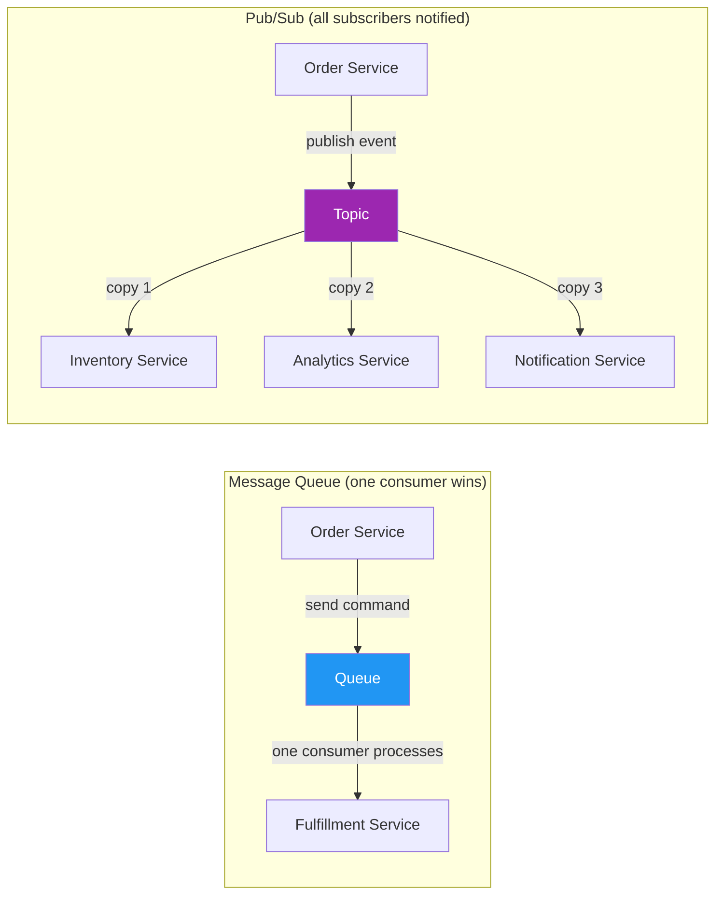

> **Why this matters:** Using a queue when you need pub/sub forces artificial fan-out wiring. Using pub/sub when you need a queue creates ownership confusion — every subscriber thinks someone else will handle the outcome.

**💡 Production Example:**
Order placement used an Azure Service Bus queue so exactly one fulfillment worker processed each order — no double fulfillment. Order domain events (OrderPlaced, OrderShipped, OrderDelivered) used a Service Bus topic with subscriptions so inventory, analytics, and notification services each received every event independently without coupling to each other.

---

### Q: How do you handle a message that keeps failing?

**Answer:**
Retry transient failures with bounded exponential backoff, then dead-letter persistent failures with full diagnostics. Isolate poison messages quickly — a single bad message must never permanently block consumer progress. Set up alerting on dead-letter queue depth so persistent failures become visible rather than silent.

```csharp
// Azure Service Bus — bounded retry then dead-letter
var processor = client.CreateProcessor(queueName, new ServiceBusProcessorOptions
{
    MaxConcurrentCalls = 4,
    AutoCompleteMessages = false
});

processor.ProcessMessageAsync += async args =>
{
    try
    {
        await ProcessOrderAsync(args.Message);
        await args.CompleteMessageAsync(args.Message); // ack success
    }
    catch (TransientException)
    {
        // Abandon — message returns to queue, retry count increments
        await args.AbandonMessageAsync(args.Message);
    }
    catch (PoisonMessageException)
    {
        // Dead-letter immediately — don't waste retries
        await args.DeadLetterMessageAsync(args.Message,
            deadLetterReason: "PoisonMessage",
            deadLetterErrorDescription: "Deserialization failed — bad payload");
    }
};

// In Azure DevOps/Portal: alert when deadLetterMessageCount > 5
// metric: ServiceBusMetrics/DeadLetteredMessages
```

```
Message lifecycle:
  Received → Processing failed → Abandoned → Retry (up to MaxDeliveryCount, default 10)
                                             ↓ (after MaxDeliveryCount exhausted)
                                          Dead-letter queue
                                             ↓
                                   Alert fires → human review → replay or discard
```

> **Why this matters:** Poison message handling prevents one bad message from permanently blocking consumer progress. Without dead-lettering, consumers get stuck in infinite retry loops consuming resources while delivering nothing.

**💡 Production Example:**
A consumer processing invoice events got stuck on a single malformed message for 6 hours, processing the same message and failing, blocking all subsequent invoices. Adding bounded retry (3 attempts) with dead-lettering on the third failure, combined with an alert on dead-letter depth, meant the next malformed message was isolated in under 2 minutes and the queue continued processing.

---

### Q: What is the Outbox pattern and why would you use it?

**Answer:**
The Outbox pattern solves the dual-write problem: writing to a database and publishing a message in a single atomic operation. Without it, a process crash between the database write and the message publish leaves state and messages out of sync. With Outbox, both writes happen in the same database transaction; a background relay process publishes the outbox entries to the message broker afterward.

```csharp
// ❌ Dual-write without Outbox — crash between steps causes inconsistency
public async Task CreateOrderAsync(CreateOrderCommand cmd)
{
    await _db.Orders.AddAsync(order);
    await _db.SaveChangesAsync();   // DB write succeeds
    // CRASH HERE → message never published → inventory never updated
    await _bus.PublishAsync(new OrderCreatedEvent(order.Id));
}

// ✅ Outbox pattern — atomic write to DB + outbox table
public async Task CreateOrderAsync(CreateOrderCommand cmd)
{
    await _db.Orders.AddAsync(order);

    // Write event to outbox table IN SAME TRANSACTION
    await _db.OutboxMessages.AddAsync(new OutboxMessage
    {
        Id        = Guid.NewGuid(),
        Type      = nameof(OrderCreatedEvent),
        Payload   = JsonSerializer.Serialize(new OrderCreatedEvent(order.Id)),
        CreatedAt = DateTime.UtcNow,
        Published = false
    });

    await _db.SaveChangesAsync(); // both order + outbox entry committed together
    // Background relay picks up unpublished outbox entries and publishes them
}

// Background relay (IHostedService or Hangfire recurring job)
public class OutboxRelay : BackgroundService
{
    protected override async Task ExecuteAsync(CancellationToken ct)
    {
        while (!ct.IsCancellationRequested)
        {
            var pending = await _db.OutboxMessages
                .Where(m => !m.Published)
                .OrderBy(m => m.CreatedAt)
                .Take(100)
                .ToListAsync(ct);

            foreach (var msg in pending)
            {
                await _bus.PublishAsync(msg.Type, msg.Payload, ct);
                msg.Published = true;
            }

            await _db.SaveChangesAsync(ct);
            await Task.Delay(TimeSpan.FromSeconds(5), ct);
        }
    }
}
```

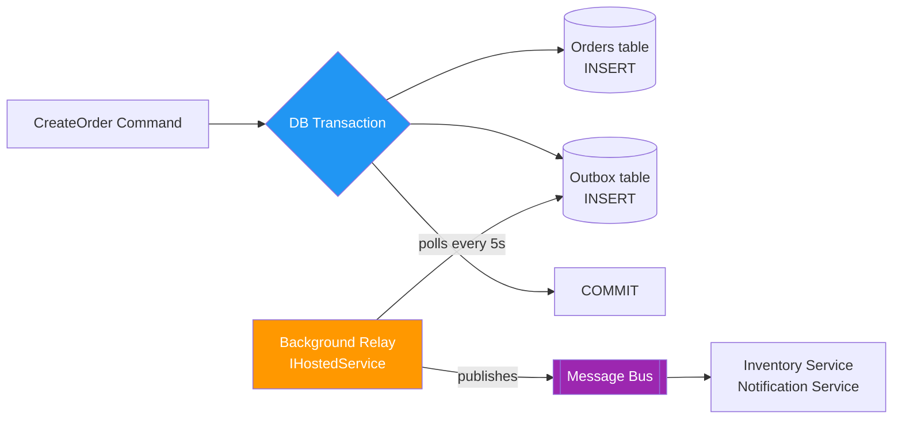

> **Why this matters:** The Outbox pattern is the standard solution for "exactly-once" message publishing in distributed systems. Without it, network failures between DB writes and message publishes cause data inconsistencies that are hard to detect and painful to fix.

---

### Q: How do you run schema changes for event payloads when old consumers still exist?

**Answer:**
Ship additive schema updates only: add fields as optional with defaults, never remove or rename required fields in a single deployment. Track consumer adoption via health endpoints or metrics. Only remove deprecated fields after all consumers have upgraded. This requires a defined compatibility window — producers must support old schema for N deployment cycles.

```csharp
// ❌ Breaking change — removes field old consumers depend on
public record OrderCreatedEvent(
    Guid OrderId,
    decimal Total
    // CustomerId removed — consumers reading this field now fail
);

// ✅ Additive change — new field is optional, old consumers ignore it
public record OrderCreatedEvent(
    Guid OrderId,
    decimal Total,
    Guid? CustomerId = null,          // new field: nullable with default
    decimal? ShippingEstimate = null   // another new field: optional
);
// Old consumers deserialise fine — unknown fields ignored (use JsonExtensionData if needed)
// New consumers can use the new fields immediately

// Consumer version tracking (health endpoint)
app.MapGet("/health/schema-version", () => new {
    EventType = nameof(OrderCreatedEvent),
    SchemaVersion = "2.1",
    SupportedFields = new[] { "OrderId", "Total", "CustomerId", "ShippingEstimate" }
});
```

```
Schema evolution lifecycle:
  v1: { OrderId, Total }
  v2: { OrderId, Total, CustomerId? }        ← additive, safe
  v3: { OrderId, Total, CustomerId?, ShippingEstimate? } ← additive, safe
  
  Only after ALL consumers on v3:
  v4: { OrderId, Total, CustomerId, ShippingEstimate }   ← make field required
```

> **Why this matters:** Event schema changes break consumers silently if compatibility isn't managed. A producer removing a field can cause deserialization failures in downstream services hours or days later when those consumers finally receive a new event.

**💡 Production Example:**
Adding a `ShippingEstimate` field to `OrderPlaced` was made optional with a null default. Old consumers ignored it safely. Consumer schema versions were tracked via health endpoints. Deprecated fields were only removed after all consumers had upgraded — verified by checking the health endpoint responses across all deployed instances before the removal PR was merged.

---

### Q: How do you design a retry policy that avoids retry storms?

**Answer:**
Use exponential backoff with jitter to spread retry attempts across time. Add a maximum retry count and circuit breaker to prevent indefinite retries overwhelming a struggling downstream service. Jitter is critical — without it, all retrying clients synchronise their retry attempts and create thundering herd bursts.

```csharp
// ❌ Fixed interval retry — all clients retry at same time
var policy = Policy
    .Handle<HttpRequestException>()
    .WaitAndRetryAsync(3, _ => TimeSpan.FromSeconds(5));
// All 1000 failed clients retry at T+5s, T+10s, T+15s simultaneously → storm

// ✅ Exponential backoff with jitter — using Polly
var jitter = new Random();
var policy = Policy
    .Handle<HttpRequestException>()
    .WaitAndRetryAsync(
        retryCount: 4,
        sleepDurationProvider: attempt =>
        {
            var baseDelay = TimeSpan.FromSeconds(Math.Pow(2, attempt)); // 2s, 4s, 8s, 16s
            var jitterMs  = jitter.Next(0, 1000);                       // 0-1000ms random
            return baseDelay + TimeSpan.FromMilliseconds(jitterMs);
        },
        onRetry: (exception, delay, attempt, context) =>
            _logger.LogWarning("Retry {Attempt} after {Delay}ms: {Error}",
                attempt, delay.TotalMilliseconds, exception.Message));

// Circuit breaker — stop retrying entirely when service is clearly down
var circuitBreaker = Policy
    .Handle<HttpRequestException>()
    .CircuitBreakerAsync(
        exceptionsAllowedBeforeBreaking: 5,
        durationOfBreak: TimeSpan.FromSeconds(30));

// Combined: retry + circuit breaker
var combined = Policy.WrapAsync(policy, circuitBreaker);
```

```
Without jitter (storm):          With jitter (spread):
T+5s:  ████████████ 1000 retries  T+5s:  ██ ~100 retries
T+10s: ████████████ 1000 retries  T+6s:  ██ ~100 retries
                                   T+7s:  ██ ~100 retries
→ hammers downstream              → spreads load safely
```

> **Why this matters:** Retry storms are a common cause of cascading failures. A service degradation that could self-heal under normal load can be pushed into full outage when thousands of clients retry simultaneously without jitter.

---

### Q: How do you design reliable background processing with IHostedService or Hangfire?

**Answer:**
Treat jobs as idempotent units with explicit retry policies, concurrency limits, and durable state. `IHostedService`/`BackgroundService` is best for service-owned recurring workflows tightly coupled to the service lifecycle. Hangfire is better when you need persistent scheduling, operational dashboards, retries that survive service restarts, and the ability to replay failed jobs manually.

```csharp
// Option 1: BackgroundService (IHostedService) — recurring, in-process
public class InvoiceExportJob : BackgroundService
{
    private static readonly TimeSpan Interval = TimeSpan.FromMinutes(15);

    protected override async Task ExecuteAsync(CancellationToken ct)
    {
        while (!ct.IsCancellationRequested)
        {
            try
            {
                await _invoiceService.ExportPendingAsync(ct);
            }
            catch (Exception ex)
            {
                _logger.LogError(ex, "InvoiceExport failed — will retry on next interval");
                // Don't throw — let the loop continue
            }
            await Task.Delay(Interval, ct);
        }
    }
}

// Option 2: Hangfire — persistent, dashboardable, recoverable
// Registration
builder.Services.AddHangfire(config =>
    config.UseSqlServerStorage(connectionString));
builder.Services.AddHangfireServer(options =>
    options.WorkerCount = 4);  // limit concurrency

// Schedule recurring job
RecurringJob.AddOrUpdate<InvoiceExportJob>(
    "invoice-export",
    job => job.ExportPendingAsync(CancellationToken.None),
    Cron.MinuteParts(15));  // every 15 minutes

// Enqueue one-off job with idempotency key
BackgroundJob.Enqueue<OrderFulfillmentJob>(
    job => job.FulfillAsync(orderId, CancellationToken.None));
```

| | BackgroundService | Hangfire |
|-|------------------|---------|
| Persistence | ❌ Lost on restart | ✅ Stored in DB |
| Dashboard | ❌ | ✅ Built-in |
| Retry on crash | ❌ | ✅ Resumes from DB |
| Manual replay | ❌ | ✅ One click |
| Complexity | Low | Medium |
| Use for | Simple recurring tasks | Critical jobs needing operational control |

> **Why this matters:** Background work often carries critical side effects like billing, email, and data sync. Losing jobs on restart or having no visibility into failures is a production reliability risk.

**💡 Production Example:**
Fragile cron scripts were moved into Hangfire with explicit queues (critical vs standard) and idempotency keys on each job. Failed jobs flowed to a dead-letter state visible in the Hangfire dashboard with full exception details. Operators could replay safely after fixes — no code changes or manual SQL required. Job reliability improved from ~94% to 99.8%.

---

> ✅ **10 advanced topics** — the ones that get highlighted in interview feedback.
>
> 💡 **How to use tradeoffs in interviews:**
> "I'd choose Kafka here because we need event replay for our audit requirements, and we have 3 independent consumer groups that need to read the same events. If it were a simple work queue, I'd reach for Service Bus or RabbitMQ — simpler to operate."
>
> Never say "X is better than Y." Always say: "X is better **in this context** because..."

---

*Last updated: 2026 | Redis 7 / Kafka 3 / .NET 8*

---

# ⚖️ Advanced Topics Comparisons — Side-by-Side Differences

---

## ADV-C1 — Redis vs Memcached

| | Redis | Memcached |
|-|-------|-----------|
| Data structures | String, Hash, List, Set, Sorted Set, Stream | String / binary blobs only |
| Persistence | ✅ RDB / AOF | ❌ Memory only |
| Pub/Sub | ✅ | ❌ |
| Cluster / sharding | ✅ Redis Cluster | ✅ Client-side sharding |
| Lua scripting | ✅ Atomic scripts | ❌ |
| Transactions | ✅ MULTI/EXEC | ❌ |
| Multi-threading | ✅ (Redis 6+ I/O threads) | ✅ Multi-threaded |
| Use for | Cache + pub/sub + queues + sessions + rate limiting | Pure simple cache, max throughput |

```
Choose Redis when: you need any feature beyond plain string cache
  — Leaderboard (Sorted Set), rate limiter (Lua + EXPIRE), pub/sub, sessions, queues

Choose Memcached when: pure in-memory cache, simplicity, and you have existing Memcached infra
```

---

## ADV-C2 — Event Sourcing vs CQRS vs Traditional CRUD

| | Traditional CRUD | CQRS | Event Sourcing |
|-|-----------------|------|----------------|
| State storage | Current state only | Current state (separate read/write) | All events that led to state |
| History / audit | ❌ Overwritten | ❌ Overwritten | ✅ Free |
| Read model | Same as write | Separate, optimised | Projected from events |
| Complexity | Low | Medium | High |
| Schema migration | Easy | Medium | Hard (old events must remain valid) |
| Debugging | Hard (what changed?) | Medium | ✅ Replay events to reproduce |
| Use for | Most CRUD apps | Read-heavy with complex queries | Financial, audit-critical, domain-event-heavy |

```
CRUD: Table has one row per entity — UPDATE overwrites state
CQRS: Write to SQL (normalised), read from Elasticsearch (denormalised) — separate models
Event Sourcing: Table has all events — current state = replay of events
```

---

## ADV-C3 — Kafka vs RabbitMQ vs Azure Service Bus vs Redis Pub/Sub

| | Kafka | RabbitMQ | Azure Service Bus | Redis Pub/Sub |
|-|-------|----------|------------------|--------------|
| Message retention | Days / forever | Deleted after consume | Configurable (max 80 GB) | ❌ No persistence |
| Replay | ✅ Yes | ❌ No | ❌ No | ❌ No |
| Throughput | ✅ Millions/sec | ~100k/sec | ~10k/sec | ✅ Very high |
| Consumer groups | ✅ Independent | Exchange + queues | ✅ Sessions + subscriptions | ❌ All subscribers |
| Ordering | Per-partition | Per-queue | ✅ Sessions | ❌ |
| Dead letter | ✅ | ✅ | ✅ | ❌ |
| Management overhead | High (ZooKeeper, tuning) | Medium | ✅ Managed SaaS | Low |
| Use for | Event streaming, replay, audit log | Work queues, complex routing | Azure-native apps | Real-time broadcast, ephemeral pub/sub |

---

## ADV-C4 — WebSocket vs Server-Sent Events (SSE) vs Long Polling vs Short Polling

| | Short Polling | Long Polling | SSE | WebSocket |
|-|--------------|-------------|-----|-----------|
| Direction | Client → Server | Client → Server | Server → Client | Bidirectional |
| Connection | New per poll | Held open, reopened | Persistent | Persistent (ws://) |
| Protocol | HTTP | HTTP | HTTP | WebSocket upgrade |
| Latency | High (poll interval) | Low | Low | Lowest |
| Server load | ❌ High (many requests) | Medium | ✅ Low | ✅ Low |
| Reconnect | Manual | Manual | ✅ Automatic browser | Manual |
| Proxy/firewall friendly | ✅ | ✅ | ✅ | ❌ Sometimes blocked |
| Use for | Status checks, infrequent | Notifications, chat fallback | Live feeds, notifications | Chat, games, collaborative editing |

```typescript
// SSE — server pushes only (simpler)
// Server:
Response.Headers["Content-Type"] = "text/event-stream";
await Response.WriteAsync($"data: {json}\n\n");

// Client:
const source = new EventSource('/api/stream');
source.onmessage = e => updateUI(JSON.parse(e.data));

// WebSocket — bidirectional
// Server: SignalR Hub
await Clients.All.SendAsync("OrderUpdated", order);
// Client:
const conn = new signalR.HubConnectionBuilder().withUrl("/hub").build();
conn.on("OrderUpdated", order => updateUI(order));
conn.invoke("SendMessage", "Hello");  // client → server ← only WebSocket can do this
```

---

## ADV-C5 — Consistent Hashing vs Simple Modulo Hashing

| | Modulo Hashing (`hash(key) % N`) | Consistent Hashing |
|-|----------------------------------|-------------------|
| Add/remove node | ❌ Remaps ~(N-1)/N keys | ✅ Remaps ~1/N keys |
| Cache miss on scale | ❌ Massive (75% for N=3→4) | ✅ Minimal (~25%) |
| Complexity | Low | Medium |
| Use for | Single-server or fixed-size pools | Distributed caches, databases, CDN routing |

```
Modulo: 3 → 4 servers = hash("key") % 3 = server 1, hash("key") % 4 = server 2 → DIFFERENT
→ 75% of all keys suddenly point to wrong server = cache stampede

Consistent hashing: add server D between A and C
→ Only keys between B and D remapped (~25%) → all others unaffected
```

---

## ADV-C6 — CAP Theorem: CP vs AP Real Examples

| System | Type | Why |
|--------|------|-----|
| PostgreSQL (single node) | CA | No distributed partition possible |
| PostgreSQL with replication | CP | During partition, replica refuses writes |
| Cassandra | AP | Accepts writes on any node, resolves conflict later |
| MongoDB (default) | CP | Primary required for writes |
| DynamoDB (eventual) | AP | Always available, may serve stale |
| DynamoDB (strong consistent) | CP | Sacrifices availability for consistency |
| ZooKeeper | CP | Leader required, minority partition unavailable |
| Redis Cluster | AP (usually) | May serve stale reads during partition |
| Kafka | CP | Partition requires quorum to elect leader |

```
Practical rule:
Money/inventory → CP (better unavailable than wrong)
User feed/notifications → AP (better stale than down)
Session data → AP (slightly stale session OK, downtime is not)
Order placement → CP (never double-charge, never oversell)
```

---

## ADV-C7 — Bloom Filter vs Hash Set vs Binary Search vs Database Lookup

| | Database Lookup | HashSet | Binary Search | Bloom Filter |
|-|----------------|---------|---------------|--------------|
| False negatives | ❌ Possible (DB inconsistency) | ❌ None | ❌ None | ❌ None (guaranteed) |
| False positives | ❌ None | ❌ None | ❌ None | ✅ Possible (small %) |
| Memory | ❌ Disk | Memory (full objects) | Memory (sorted) | ✅ Very small (bits) |
| Speed | Slowest (I/O) | O(1) | O(log n) | ✅ O(k) — constant |
| Use for | Source of truth | In-memory membership | Sorted data membership | Pre-filter before expensive lookup |

```
Pattern: Bloom Filter → HashSet/DB
"Is this URL malicious?"
1. Bloom says NO → definitely safe, skip DB (99% of cases)
2. Bloom says MAYBE → check DB for confirmation
→ DB load reduced by 99%+ with < 1% false positive rate
```

---

## ADV-C8 — Long Polling vs Server-Sent Events: When Each Wins

```
Long Polling wins when:
✅ Need bidirectional even if server-push focused
✅ Legacy browser support required
✅ SSE not supported by proxy/firewall
✅ Single-use notification (poll once, act, stop)

SSE wins when:
✅ Pure server → client stream (live scores, order status)
✅ Automatic browser reconnect built-in
✅ HTTP/2 multiplexing (multiple SSE streams per connection)
✅ Simpler server implementation than WebSocket

WebSocket wins when:
✅ Client must send data frequently too (chat, collaborative editing, gaming)
✅ Lowest possible latency required
✅ Binary data (audio, video signalling)
✅ Custom protocol needed
```


---

# 📊 Advanced Topics — Flow Diagrams

---

## ADV-D1 — Redis Data Structures Decision Tree

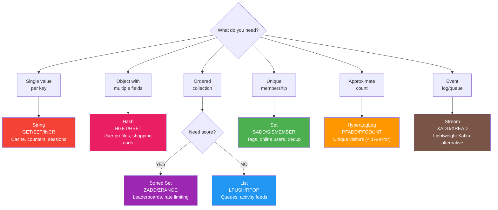

---

## ADV-D2 — Kafka Partition Rebalancing

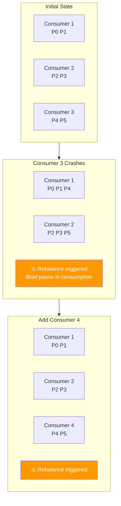

---

## ADV-D3 — Bloom Filter Internals

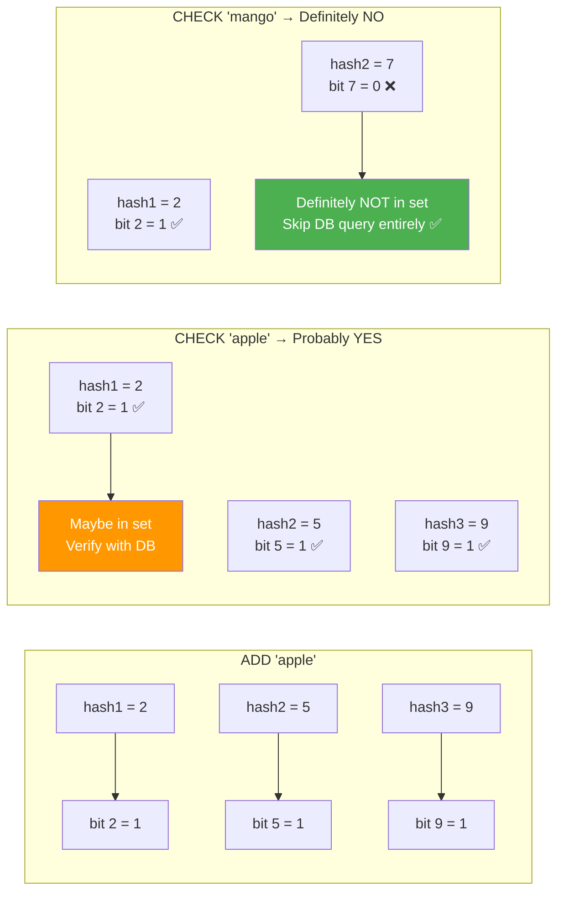

---

## ADV-D4 — Event Sourcing vs Traditional State Storage

```mermaid
flowchart TD
    subgraph Traditional["Traditional (Store Current State)"]
        CMD1[createOrder] --> DB1[(DB: status=Created)]
        CMD2[payOrder] --> DB2[(DB: status=Paid)]
        CMD3[shipOrder] --> DB3[(DB: status=Shipped)]
        DB3 --> LIMIT["❌ Can't answer:\n'What was status on Tuesday?'\n'Who changed this?'"]
    end

    subgraph ES["Event Sourcing (Store Events)"]
        E1[OrderCreated\n{total: 99.99}]
        E2[PaymentReceived\n{txnId: 'stripe_1'}]
        E3[ItemShipped\n{tracking: 'UPS123'}]

        STORE[(Event Store\nAppend-only)]
        E1 --> STORE
        E2 --> STORE
        E3 --> STORE

        STORE -->|replay| STATE[Current State =\nReduce over events]
        STORE -->|replay to t=Tuesday| PAST[State at any past time ✅]
        STORE --> AUDIT[Full audit trail ✅]
    end

    style LIMIT fill:#ffcdd2,color:#333
    style AUDIT fill:#c8e6c9,color:#333
    style PAST fill:#c8e6c9,color:#333
```

---

## ADV-D5 — WebSocket vs SSE vs Long Polling

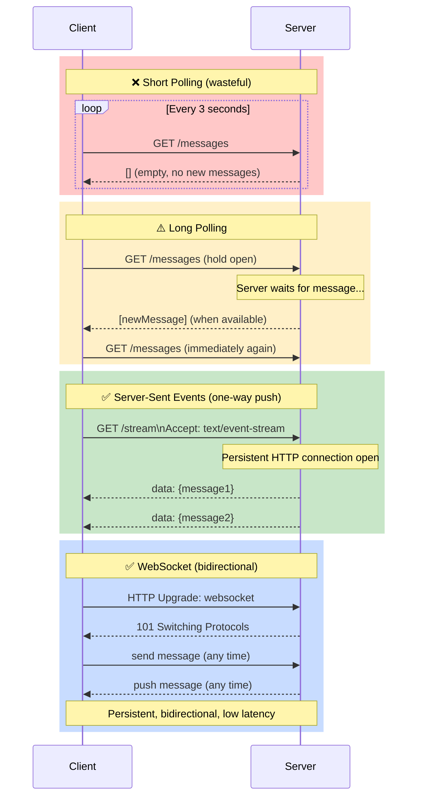

---

## ADV-D6 — CQRS Read vs Write Separation

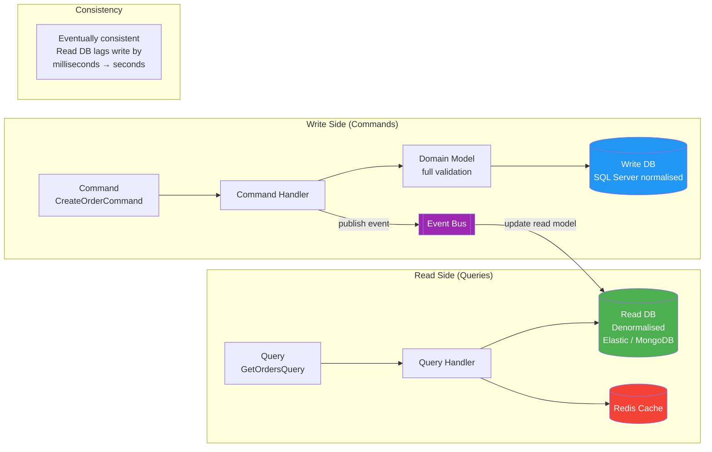

---

## ADV-D7 — Distributed Tracing

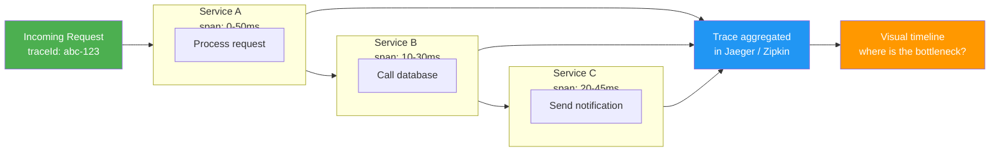

---

## ADV-D8 — Saga Choreography Pattern

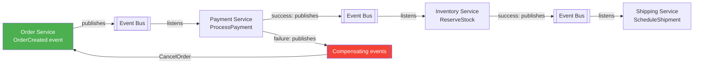

---

## ADV-D9 — Saga Orchestration Pattern

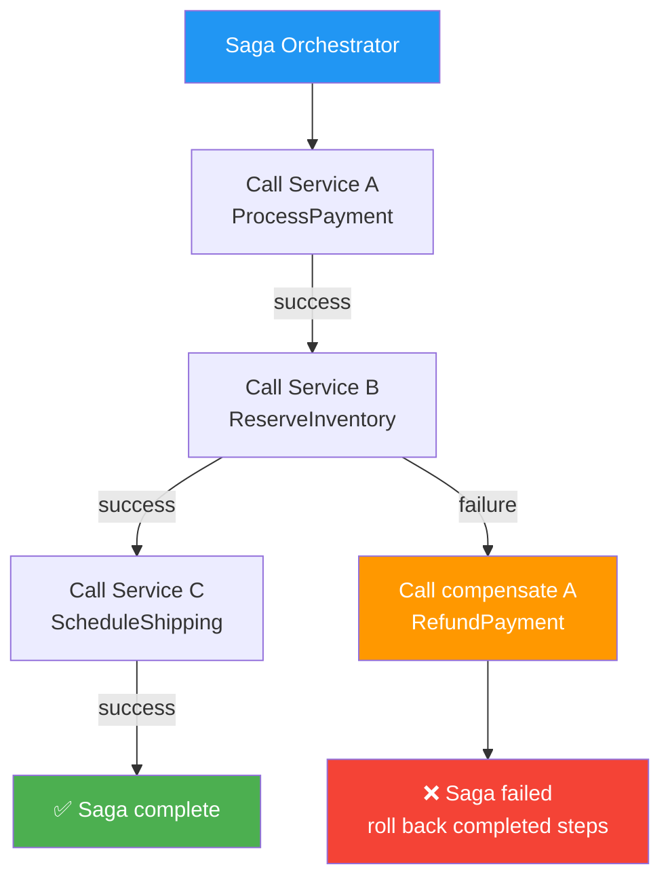

---

## ADV-D10 — Event-Driven Architecture

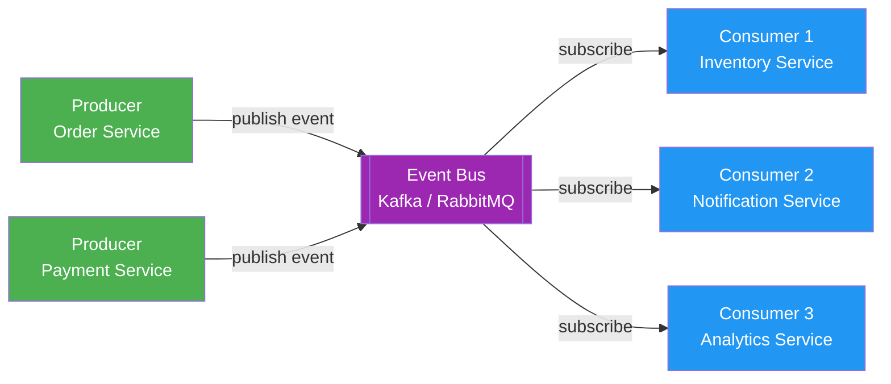

---

## ADV-D11 — Eventual Consistency Flow

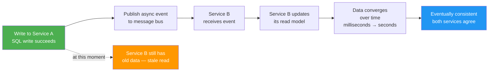

---

# 🏢 FAANG Distributed Systems & Architecture Questions

> Questions asked at Google, Amazon, Meta, and Netflix for senior/staff-level distributed systems and backend engineers.

---

## FAANG-1. How does Google Spanner achieve global consistency? (Google)

> **Why this matters:** Spanner violates the conventional "you can't have both consistency and partition tolerance" narrative. Google interviewers want you to explain TrueTime, external consistency, and why it matters for global transactions.

```
TrueTime API:
  Returns [earliest, latest] — a time interval, not a point
  Backed by atomic clocks + GPS receivers in every datacenter
  Uncertainty epsilon: typically 1–7 ms

  TT.now() = [TT.earliest, TT.latest]
  TT.after(t)  = true if t has definitely passed
  TT.before(t) = true if t has definitely not occurred

External Consistency (stronger than linearizability):
  If transaction T1 commits before T2 starts (wall-clock time)
  → T2's timestamp is guaranteed to be AFTER T1's timestamp
  → T2 will always see T1's writes
  → Global ordering without global coordination

Commit Wait:
  After choosing commit timestamp s:
  Server waits until TT.after(s) is true (epsilon passes)
  This ensures no future transaction can get a timestamp ≤ s
  Cost: ~7ms wait per write transaction — the price of global consistency
```

```
2-Phase Locking + TrueTime Commit:
  ┌──────────────────────────────────────────────────────┐
  │  1. Acquire locks on all rows being written          │
  │  2. Choose commit timestamp s = TT.now().latest      │
  │  3. Run Paxos across replicas — log commit with s    │
  │  4. Commit Wait: sleep until TT.after(s) == true    │  ← key step
  │  5. Release locks, apply writes                      │
  │  6. Return to client                                 │
  └──────────────────────────────────────────────────────┘

Why Paxos?
  Each "tablet" (data shard) has a Paxos group of 5 replicas
  Leader coordinates writes → replicates to majority (3/5)
  Leader failure → Paxos election → new leader continues
  Reads can be served from any replica (with timestamp validation)
```

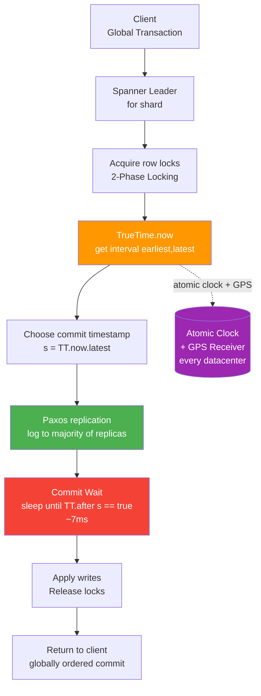

**Key talking points:**
- TrueTime gives a bounded uncertainty interval — Spanner waits until the uncertainty window closes before committing
- External consistency = if T1 commits before T2 begins (real time), T2 will observe T1's writes — this is stronger than serializable
- Commit wait (~7ms) is the performance cost of global consistency — Spanner trades latency for correctness
- Paxos per shard provides fault tolerance — a shard can lose 2/5 replicas and continue
- Compare to DynamoDB: eventual consistency (AP) vs Spanner (CP with global ordering)

---

## FAANG-2. How does Amazon DynamoDB handle hot partitions? (Amazon)

> **Why this matters:** Hot partitions are the most common DynamoDB production failure. Amazon interviewers expect you to know partition key design, adaptive capacity, write sharding, and DAX — not just "use a better key."

```
DynamoDB Partitioning:
  Data split across partitions by hash(partition_key)
  Each partition: max 3,000 RCU + 1,000 WCU + 10 GB

  Hot partition: one partition key receives disproportionate traffic
  Example: product_id = "iphone-15" on launch day
           → millions of reads/writes hit ONE partition
           → ProvisionedThroughputExceededException

Write Sharding (hot key mitigation):
  Append random suffix: "iphone-15#3" (shard 0..9)
  Spread writes across 10 partitions
  Read: query all 10 shards in parallel, merge results
  Cost: 10x read amplification — acceptable for write-heavy hot keys

Adaptive Capacity (automatic mitigation):
  DynamoDB detects imbalanced partitions
  Automatically boosts throughput of hot partition
  Up to 2x burst capacity sustained for minutes
  Eventual rebalancing: moves data to reduce hot spots
```

```
DAX (DynamoDB Accelerator):
  In-memory write-through cache in front of DynamoDB
  Item cache: single item by PK/SK → microsecond reads
  Query cache: result set of query/scan → reused across requests
  Write-through: writes go to DAX + DynamoDB atomically

  When to use DAX:
  ✅ Read-heavy, same items repeatedly (product catalog, config)
  ❌ Write-heavy, strongly consistent reads (financial records)
  ❌ Large items (DAX has 400KB item limit, same as DynamoDB)
```

```csharp
// ── Write sharding for hot keys ───────────────────────────────────────────
public async Task WriteProductViewAsync(string productId)
{
    // Shard 0..9 — distribute writes across partitions
    var shardSuffix = Random.Shared.Next(0, 10);
    var shardedKey  = $"{productId}#{shardSuffix}";

    await _dynamoDb.PutItemAsync(new PutItemRequest
    {
        TableName = "ProductViews",
        Item = new Dictionary<string, AttributeValue>
        {
            ["PK"]        = new AttributeValue { S = shardedKey },
            ["ViewCount"] = new AttributeValue { N = "1" },
            ["Timestamp"] = new AttributeValue { S = DateTimeOffset.UtcNow.ToString("O") }
        }
    });
}

public async Task<long> GetTotalViewsAsync(string productId)
{
    // Read all 10 shards in parallel — merge results
    var tasks = Enumerable.Range(0, 10).Select(i =>
        _dynamoDb.GetItemAsync(new GetItemRequest
        {
            TableName = "ProductViews",
            Key = new Dictionary<string, AttributeValue>
            {
                ["PK"] = new AttributeValue { S = $"{productId}#{i}" }
            }
        }));

    var results = await Task.WhenAll(tasks);
    return results.Sum(r =>
        r.Item.TryGetValue("ViewCount", out var v) ? long.Parse(v.N) : 0);
}

// ── Partition key design rules ────────────────────────────────────────────
// ❌ Low cardinality — all orders hit same partition
// PK = "ORDER", SK = orderId  → single partition for all orders

// ✅ High cardinality — orders distributed across partitions
// PK = customerId, SK = orderId  → 1 partition per customer, evenly distributed

// ✅ Composite for time-series (avoid partition per day pattern)
// PK = "metrics#" + instanceId, SK = timestamp  → per-instance partitions
```

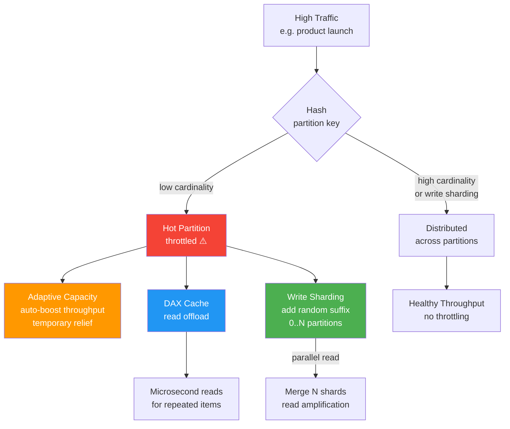

**Key talking points:**
- Partition key design is the most impactful DynamoDB decision — you can't change it without rebuilding the table
- Adaptive capacity is automatic but temporary — it masks bad key design; fix the root cause
- Write sharding trades read amplification for write distribution — acceptable when writes are the bottleneck
- DAX is write-through but doesn't help write-hot keys; it helps read-hot keys
- On-demand capacity removes WCU/RCU management but costs ~2x provisioned at steady load — use for unpredictable spikes

---

## FAANG-3. Explain the Raft consensus algorithm used in distributed systems (Google/Amazon/Meta)

> **Why this matters:** Raft powers etcd (Kubernetes), CockroachDB, TiKV, and Consul. Interviewers at Google/Amazon ask this to test understanding of leader election, log replication, and how distributed consensus works in practice.

```
Raft Node States:
  FOLLOWER  → default state, receives entries from leader
  CANDIDATE → starts election when leader heartbeat times out
  LEADER    → handles all writes, replicates to followers

Leader Election:
  1. Follower election timeout fires (150–300ms random)
  2. Becomes CANDIDATE, increments term, votes for self
  3. Sends RequestVote RPC to all nodes
  4. Nodes grant vote if: term >= their term AND
                          log is at least as up-to-date as theirs
  5. Majority votes → becomes LEADER
  6. Sends empty AppendEntries (heartbeat) to all → suppress elections

Log Replication:
  1. Client sends write to LEADER
  2. Leader appends entry to its log (uncommitted)
  3. Leader sends AppendEntries RPC to all followers
  4. Followers append to their logs, respond with success
  5. Leader receives majority acknowledgment → commits entry
  6. Leader applies to state machine, responds to client
  7. Next AppendEntries informs followers of commit → they apply too

Safety Guarantee:
  Committed entries NEVER lost
  Leader always has all committed entries (vote grant rule)
  At most one leader per term
```

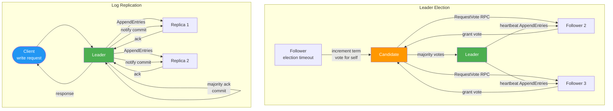

**Key talking points:**
- Random election timeout (150–300ms) prevents split votes — nodes start elections at different times
- A node grants a vote only if the candidate's log is at least as up-to-date — ensures the new leader has all committed entries
- Raft requires majority (N/2 + 1) acknowledgment before committing — a 5-node cluster tolerates 2 failures
- Kubernetes etcd uses Raft — this is why you run 3 or 5 etcd nodes, never 2 or 4
- Raft vs Paxos: Raft decomposes the problem (leader election separate from log replication), making it easier to implement and reason about

---

## FAANG-4. How does Netflix implement resilience with Hystrix/Resilience4j patterns? (Netflix)

> **Why this matters:** Netflix open-sourced Hystrix because cascading failures had taken down their platform multiple times. Interviewers want the full picture: circuit breaker, bulkhead, fallback, and metrics.

```
Hystrix Command Wrapping:
  Every call to a downstream service is wrapped in a HystrixCommand
  The command runs in an isolated thread pool (bulkhead)
  If the command times out or throws → fallback is called
  Circuit breaker tracks success/failure rates across commands

Thread Pool Isolation (Bulkhead):
  Each downstream service gets its own thread pool
  PaymentService pool:    10 threads
  InventoryService pool:  10 threads
  NotificationService:     5 threads

  If PaymentService hangs:
  → PaymentService pool fills up → new calls rejected (shed load)
  → InventoryService pool UNAFFECTED → continues to serve
  → Without bulkhead: one slow service consumes all threads → total outage

Semaphore Isolation:
  Lightweight alternative to thread pools for fast, low-latency calls
  Limits concurrent calls without thread context switching
  Use for in-process caches, lightweight transformations
```

```csharp
// ── Polly (C# equivalent of Hystrix) ─────────────────────────────────────
var paymentPipeline = new ResiliencePipelineBuilder<PaymentResult>()
    // 1. Retry — transient faults (network blip, 503)
    .AddRetry(new RetryStrategyOptions<PaymentResult>
    {
        MaxRetryAttempts = 3,
        Delay            = TimeSpan.FromMilliseconds(200),
        BackoffType      = DelayBackoffType.Exponential,
        UseJitter        = true,                          // avoid thundering herd
        ShouldHandle     = new PredicateBuilder<PaymentResult>()
            .Handle<HttpRequestException>()
            .HandleResult(r => r.StatusCode == 503)
    })
    // 2. Circuit breaker — stop calling a failing service
    .AddCircuitBreaker(new CircuitBreakerStrategyOptions<PaymentResult>
    {
        FailureRatio      = 0.5,                          // 50% failure rate
        MinimumThroughput = 10,
        SamplingDuration  = TimeSpan.FromSeconds(10),
        BreakDuration     = TimeSpan.FromSeconds(30),
        OnOpened  = args => { _metrics.RecordCircuitOpen("payment"); return default; },
        OnClosed  = args => { _metrics.RecordCircuitClose("payment"); return default; }
    })
    // 3. Timeout — fail fast rather than waiting indefinitely
    .AddTimeout(TimeSpan.FromSeconds(3))
    // 4. Bulkhead — limit concurrent calls (semaphore isolation)
    .AddConcurrencyLimiter(maxConcurrentExecutions: 20, queueCapacity: 10)
    .Build();

// Fallback is handled at the call site
try
{
    var result = await paymentPipeline.ExecuteAsync(ct =>
        _paymentClient.ChargeAsync(orderId, amount, ct), cancellationToken);
}
catch (BrokenCircuitException)
{
    // Circuit is OPEN — return graceful degraded response
    return new PaymentResult { Status = "Pending", Message = "Payment queued for retry" };
}
catch (TimeoutRejectedException)
{
    return new PaymentResult { Status = "Failed", Message = "Payment service timeout" };
}

// ── Metrics instrumentation ────────────────────────────────────────────────
// Track: success rate, failure rate, timeout rate, rejection rate, circuit state
// Dashboard: Grafana + Prometheus — alert when circuit opens
```

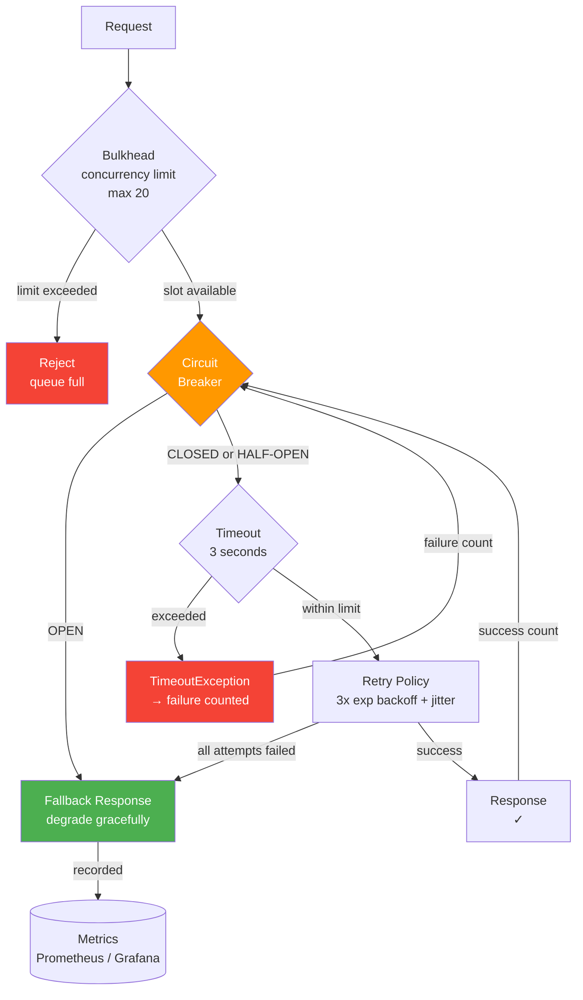

**Key talking points:**
- Bulkhead isolation prevents one slow downstream from exhausting all threads — it's the most important pattern at Netflix scale
- Circuit breaker uses a sampling window (not raw counts) — prevents a single spike from tripping the circuit
- Fallback must be meaningful — "degrade gracefully" means serve cached data, a default, or a queued response; not just an error
- Layer order matters: Retry → CircuitBreaker → Timeout → Bulkhead (outer to inner in Polly pipeline)
- Hystrix is in maintenance mode; Resilience4j (Java) and Polly (C#) are the modern equivalents

---

## FAANG-5. How does Meta's TAO (The Associations and Objects) work? (Meta)

> **Why this matters:** TAO serves billions of reads/second for Facebook's social graph. Meta interviewers ask this to test knowledge of purpose-built systems, tiered caching, and the tradeoffs of eventually-consistent social data.

```
TAO Architecture:
  Purpose: serve Facebook's social graph at scale
  Object store:      nodes (users, posts, pages, photos)
  Association store: edges (friend, like, comment, tag)

  Three-tier architecture:
  ┌─────────────────────────────────────────────────────────┐
  │  TAO Leaders (cache + write path)                       │
  │  One leader per data center region                      │
  └─────────────────────────────────────────────────────────┘
              │ on miss / write
  ┌─────────────────────────────────────────────────────────┐
  │  TAO Followers (read-through cache)                     │
  │  Many per datacenter — absorb read traffic              │
  └─────────────────────────────────────────────────────────┘
              │ on miss
  ┌─────────────────────────────────────────────────────────┐
  │  MySQL (persistent storage)                             │
  │  Source of truth — sharded by object/association ID    │
  └─────────────────────────────────────────────────────────┘

Why not use a general-purpose database or cache?
  - Redis: no native graph traversal API, no association semantics
  - Neo4j: not designed for Facebook-scale write throughput
  - MySQL alone: cannot serve billions of graph reads/second
  - TAO: read-through cache with graph-native API + MySQL durability
    perfect fit for social graph access patterns (80% reads)
```

```
TAO Consistency Model:
  Writes go to Leader → replicated to MySQL → followers cache-invalidated
  Followers serve reads from cache; miss → read from Leader
  Eventual consistency between regions (~100ms lag)
  Read-your-own-writes within a datacenter (sticky routing)
  Why acceptable: seeing a friend's post 100ms later is fine
  Why NOT acceptable: bank balance, inventory (use strong consistency)
```

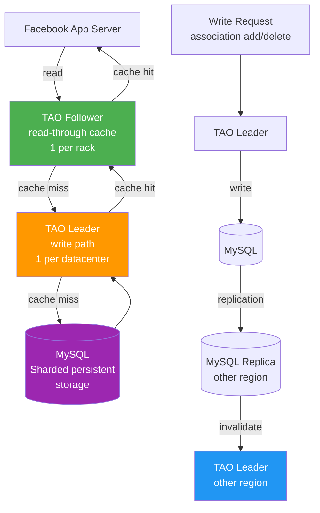

**Key talking points:**
- TAO is a read-through cache over MySQL — it does NOT replace MySQL, it sits in front of it
- Leader/follower hierarchy mirrors data-center topology — followers absorb local reads; leaders handle cross-datacenter consistency
- Graph-native API (get associations, count associations, get object) maps directly to social graph access patterns
- Eventual consistency is acceptable for social data — "your friend's new post is visible 100ms later" is not a problem
- The lesson: build purpose-specific systems when access patterns are known and general-purpose tools don't scale

---

## FAANG-6. How does Amazon SQS guarantee message delivery? (Amazon)

> **Why this matters:** Amazon interviewers test SQS deeply because it underpins a huge portion of AWS workloads. They want you to know visibility timeout, deduplication, dead letter queues, and exactly-once semantics (or lack thereof).

```
SQS At-Least-Once Delivery:
  Producer sends message → stored in SQS (replicated across 3 AZs)
  Consumer calls ReceiveMessage → message becomes INVISIBLE
  Visibility Timeout: 30s default — message hidden from other consumers
  Consumer processes + calls DeleteMessage → message permanently removed
  Consumer crashes / timeout expires → message becomes VISIBLE again
  Another consumer re-receives it → at-least-once delivery

  Why not exactly-once?
  "Delete succeeded" from consumer can be lost if consumer crashes after
  processing but before DeleteMessage call → redelivered → processed twice
  Solution: idempotent consumers (see FAANG-6 in dotnet-code-flow.md)

FIFO Queue — exactly-once processing:
  Message deduplication ID: SQS deduplicates same ID within 5-minute window
  Message group ID: ordering within a group (like partition key in Kafka)
  Throughput: 300 msg/s (3,000 with batching) — lower than standard queue
  Use when: financial transactions, state machines, ordered processing

Dead Letter Queue (DLQ):
  After maxReceiveCount (e.g. 5) failed deliveries → moved to DLQ
  DLQ preserves the message for analysis / manual replay
  Always set up a DLQ consumer with alerting
```

```csharp
// ── Standard queue consumer with visibility timeout management ────────────
public class SqsMessageProcessor : BackgroundService
{
    private readonly IAmazonSQS _sqs;
    private readonly string _queueUrl;

    protected override async Task ExecuteAsync(CancellationToken stoppingToken)
    {
        while (!stoppingToken.IsCancellationRequested)
        {
            // Long polling — waits up to 20s for messages (reduces empty responses + cost)
            var response = await _sqs.ReceiveMessageAsync(new ReceiveMessageRequest
            {
                QueueUrl            = _queueUrl,
                MaxNumberOfMessages = 10,              // batch up to 10
                WaitTimeSeconds     = 20,              // long polling
                VisibilityTimeout   = 60,              // 60s to process + delete
                AttributeNames      = new List<string> { "ApproximateReceiveCount" }
            }, stoppingToken);

            var tasks = response.Messages.Select(msg => ProcessMessageAsync(msg, stoppingToken));
            await Task.WhenAll(tasks);
        }
    }

    private async Task ProcessMessageAsync(Message msg, CancellationToken ct)
    {
        var receiveCount = int.Parse(msg.Attributes["ApproximateReceiveCount"]);

        try
        {
            // Extend visibility timeout for long-running processing
            if (WillTakeMoreThan30Seconds())
            {
                await _sqs.ChangeMessageVisibilityAsync(new ChangeMessageVisibilityRequest
                {
                    QueueUrl          = _queueUrl,
                    ReceiptHandle     = msg.ReceiptHandle,
                    VisibilityTimeout = 120   // extend by 2 minutes
                }, ct);
            }

            await ProcessAsync(msg.Body, ct);

            // Delete ONLY after successful processing
            await _sqs.DeleteMessageAsync(_queueUrl, msg.ReceiptHandle, ct);
        }
        catch (Exception ex)
        {
            _logger.LogError(ex, "Failed to process message. ReceiveCount: {Count}", receiveCount);
            // DO NOT delete — message becomes visible again after VisibilityTimeout
            // After maxReceiveCount failures → automatically moved to DLQ
        }
    }
}

// ── FIFO queue with deduplication ─────────────────────────────────────────
await _sqs.SendMessageAsync(new SendMessageRequest
{
    QueueUrl               = _fifoQueueUrl,
    MessageBody            = JsonSerializer.Serialize(orderEvent),
    MessageGroupId         = orderEvent.CustomerId.ToString(),    // ordering per customer
    MessageDeduplicationId = orderEvent.EventId.ToString()        // idempotent within 5 min
});
```

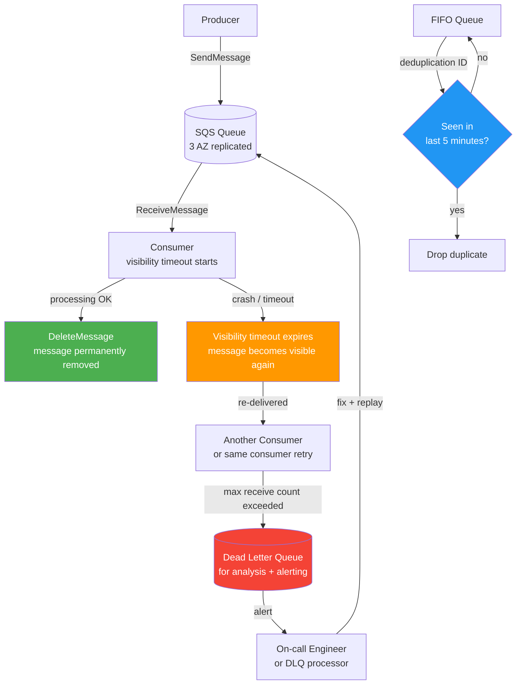

**Key talking points:**
- Visibility timeout is the heart of at-least-once delivery — size it to slightly exceed your processing SLA
- Delete the message ONLY after successful processing — deleting before processing means a crash loses the message
- Long polling (WaitTimeSeconds=20) reduces empty ReceiveMessage responses and cost — always use it
- FIFO queues trade throughput (300/s vs unlimited) for ordering and exactly-once within 5-minute deduplication window
- DLQ is not optional — without it, poison messages loop forever consuming processor capacity

---

## FAANG-7. What is the difference between strong consistency, eventual consistency, and causal consistency? (Google/Amazon)

> **Why this matters:** Consistency models are at the heart of every distributed system design question. Interviewers at Google and Amazon want precision — not vague "trade consistency for availability" hand-waving.

```
Consistency Model Spectrum (strongest → weakest):

  Linearizability (strong consistency):
    Every read returns the most recent committed write
    Operations appear instantaneous and globally ordered
    Any read after a write sees that write — everywhere
    Cost: requires coordination (quorum reads/writes) → higher latency
    Examples: Spanner, ZooKeeper, etcd, DynamoDB strongly-consistent reads

  Serializability:
    Concurrent transactions appear to execute in some serial order
    No guarantee about real-time ordering (unlike linearizability)
    Standard in RDBMS (SERIALIZABLE isolation level)
    Spanner = "external consistency" = linearizable + serializable

  Causal Consistency:
    If operation A causally precedes B, all nodes see A before B
    "You see the reply after you see the question"
    Monotonic reads: once you read a value, you never read older values
    Read-your-own-writes: you always see your own writes
    Examples: MongoDB (causal sessions), Cosmos DB (session consistency)

  Eventual Consistency:
    All replicas converge to the same value — given no new writes
    No ordering guarantee; a read may return stale data
    Highest availability, lowest latency
    Examples: DynamoDB (default), Cassandra, S3

  Real-world hybrid:
    DynamoDB: default = eventual, opt-in = strongly consistent (2x cost)
    Cassandra: tunable per query (ONE, QUORUM, ALL)
    Cosmos DB: 5 levels — Strong, Bounded Staleness, Session, Consistent Prefix, Eventual
```

```
Monotonic Reads guarantee:
  Once client reads value X, subsequent reads return X or newer
  Without it: client sees value flip back and forth (different replicas)

Read-Your-Own-Writes guarantee:
  After you write X, you always read X (or newer) — even if others see stale
  Critical for UX: "I just posted a photo but it's not showing!"
  Implementation: route reads for a user to the replica they wrote to
```

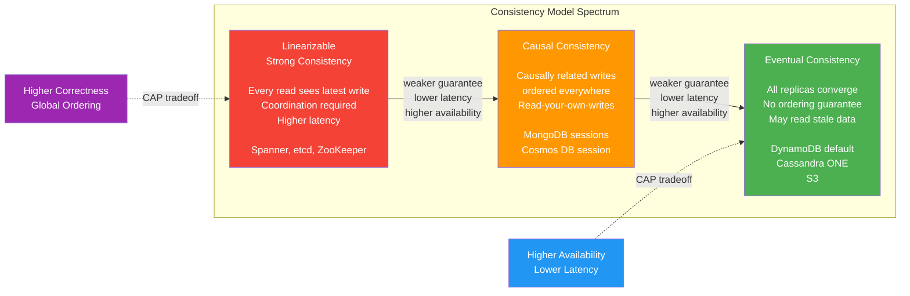

**Key talking points:**
- Linearizability and serializability are often confused: linearizability = real-time ordering; serializability = transaction isolation
- Causal consistency is the sweet spot for many social apps — causally related operations stay ordered, but globally unrelated operations can be concurrent
- Eventual consistency requires idempotent writes and conflict resolution — last-write-wins (Cassandra) or application-level merge
- DynamoDB strongly-consistent reads cost 2x RCU — use them only when staleness is unacceptable (financial totals, inventory levels)
- Cosmos DB's 5 consistency levels show the full spectrum in a single product — useful reference for interviews

---

## Technology Deep Dives

### Q: API Gateway vs Load Balancer — When to Use Which?

**A:**

| Aspect | Load Balancer | API Gateway |
|--------|--------------|-------------|
| Layer | L4 (TCP) or L7 (HTTP) | L7 (HTTP/HTTPS) |
| Purpose | Distribute traffic | Manage APIs |
| Auth | No | Yes (JWT, OAuth2) |
| Rate limiting | Basic | Advanced (per-user, per-endpoint) |
| Request transformation | No | Yes (headers, body) |
| Service discovery | Yes | Yes |
| Caching | No | Yes |
| Protocol | TCP/HTTP | HTTP/gRPC/WebSocket |
| Examples | AWS ALB, nginx, HAProxy | Kong, AWS API GW, Apigee |

**Architecture pattern:**
```
Internet → CDN → Load Balancer → API Gateway → Microservices
```

- **Load Balancer**: handles connection distribution, health checks, SSL termination at scale
- **API Gateway**: handles cross-cutting concerns: auth, rate limiting, routing, transformation

**Why this matters:** In .NET microservices, you'll configure both. Understanding which does what prevents security gaps (auth bypass if LB bypasses API GW).

**💡 Production Example:** Netflix uses a two-tier approach: AWS ELBs for L4 load balancing, then Zuul (open-sourced) as API gateway for routing, auth, and rate limiting. Kong is popular in .NET microservices shops.

---

### Q: Rate Limiting Strategies Deep Dive

**A:** Five algorithms with different trade-offs:

**1. Fixed Window Counter**
- Count requests per time window (e.g., 100 req/minute)
- Simple, but edge-case: 200 requests in 2-second burst at window boundary
- Use case: simple quotas

**2. Sliding Window Log**
- Store timestamp of each request, count within last N seconds
- Accurate but high memory (stores all timestamps)
- Use case: strict per-user limits

**3. Sliding Window Counter**
- Approximate sliding window using two fixed window counters
- Formula: `current_window_count + prev_window_count × (1 - elapsed_fraction)`
- Low memory, near-accurate
- Use case: most production systems (Redis implementation)

**4. Token Bucket**
- Bucket holds N tokens, refilled at rate R tokens/second
- Each request consumes 1 token; burst allowed (up to bucket size)
- Use case: API rate limiting, allows bursts
- AWS throttling uses this

**5. Leaky Bucket**
- Queue processes requests at fixed rate (output rate = constant)
- Excess requests dropped or queued
- Use case: smoothing traffic, protecting downstream services

```mermaid
flowchart TD
    R[Request] --> TB{Token\nBucket}
    TB -->|Token available| P[Process]
    TB -->|Empty| RL[Rate Limited\n429]
    T[Timer] -->|Refill at rate R| TB
```

**Redis implementation (Token Bucket):**
```lua
-- Lua script for atomic token bucket
local key = KEYS[1]
local rate = tonumber(ARGV[1])
local capacity = tonumber(ARGV[2])
local now = tonumber(ARGV[3])
local requested = tonumber(ARGV[4])

local last_tokens = tonumber(redis.call('hget', key, 'tokens') or capacity)
local last_refreshed = tonumber(redis.call('hget', key, 'timestamp') or 0)

local elapsed = math.max(0, now - last_refreshed)
local tokens = math.min(capacity, last_tokens + (elapsed * rate))

if tokens >= requested then
    tokens = tokens - requested
    redis.call('hset', key, 'tokens', tokens, 'timestamp', now)
    return 1 -- allowed
else
    return 0 -- rate limited
end
```

**Why this matters:** Rate limiting is in every API design interview and .NET production system. Understanding the algorithms, not just the tools, differentiates senior engineers.

**💡 Production Example:** Stripe uses token bucket with per-API-key limits. Burst: 100 req/sec, sustained: 25 req/sec. Headers: `X-RateLimit-Limit: 100`, `X-RateLimit-Remaining: 87`, `Retry-After: 1.2`. ASP.NET Core 7+ has built-in rate limiting middleware (Microsoft.AspNetCore.RateLimiting).

---

### Q: Redis Use Cases — Choosing the Right Data Structure

**A:** Redis is not just a cache. Different data structures solve different problems optimally.

| Use Case | Redis Structure | Command | Complexity |
|----------|----------------|---------|-----------|
| Session cache | String | GET/SET | O(1) |
| Leaderboard | Sorted Set | ZADD/ZRANK | O(log N) |
| Rate limiting | String + INCR | INCR/EXPIRE | O(1) |
| Pub/Sub | Pub/Sub | PUBLISH/SUBSCRIBE | O(N subscribers) |
| Job queue | List | RPUSH/BLPOP | O(1) |
| Unique visitors | HyperLogLog | PFADD/PFCOUNT | O(1) |
| Social graph | Set | SADD/SINTER | O(N) |
| Time-series | Stream | XADD/XRANGE | O(log N) |
| Geospatial | Geo | GEOADD/GEODIST | O(log N) |
| Distributed lock | String | SET NX EX | O(1) |

**Distributed lock pattern (Redlock):**
```csharp
// Using StackExchange.Redis in .NET
var acquired = await db.StringSetAsync(
    "lock:resource", 
    lockValue, 
    TimeSpan.FromSeconds(30),
    When.NotExists);

if (acquired) {
    try { /* critical section */ }
    finally {
        // Release only if we own it (Lua for atomicity)
        var script = "if redis.call('get',KEYS[1])==ARGV[1] then return redis.call('del',KEYS[1]) else return 0 end";
        await db.ScriptEvaluateAsync(script, new RedisKey[] { "lock:resource" }, new RedisValue[] { lockValue });
    }
}
```

**Why this matters:** Using Redis String for a leaderboard (instead of Sorted Set) is a red flag in interviews. Knowing which structure fits which problem is expected at senior level.

**💡 Production Example:** Twitter uses Redis Sorted Sets for timeline caches (tweet_id as score). Instagram uses Redis for 300M follow relationships stored as Sets (SINTER for mutual followers). Stack Overflow uses Redis for hot question caching with automatic expiry.

---

### Q: Kafka Deep Dive — Architecture and Guarantees

**A:** Kafka is a distributed, partitioned, replicated commit log designed for high-throughput event streaming.

**Core concepts:**
- **Topic**: logical stream of records, split into partitions
- **Partition**: ordered, immutable append-only log; unit of parallelism
- **Offset**: position within partition; consumers track their offset
- **Consumer group**: partitions distributed among consumers; each partition consumed by exactly one consumer in group
- **Replication**: each partition has 1 leader + N-1 followers; leader handles reads/writes

**Producer guarantees (acks setting):**
- `acks=0`: fire and forget, fastest, may lose data
- `acks=1`: leader ACK, fast, data loss if leader dies before replication
- `acks=all`: all ISR replicas ACK, slowest, no data loss

**Consumer guarantees:**
- At-least-once (default): commit offset after processing; may re-process on failure
- At-most-once: commit before processing; may lose messages
- Exactly-once: Kafka transactions (idempotent producer + transactional consumer)

**Ordering:**
- Ordered within partition (global ordering requires 1 partition)
- Use partition key to ensure same-entity events go to same partition

```mermaid
flowchart TD
    P[Producer] --> T[Topic: orders]
    T --> P0[Partition 0\noffset 0,1,2...]
    T --> P1[Partition 1\noffset 0,1,2...]
    T --> P2[Partition 2\noffset 0,1,2...]
    P0 --> CG[Consumer Group]
    P1 --> CG
    P2 --> CG
    CG --> C1[Consumer 1\nP0]
    CG --> C2[Consumer 2\nP1]
    CG --> C3[Consumer 3\nP2]
```

**Why this matters:** Kafka is in every event-driven .NET architecture. Understanding partition key design (avoid hot partitions), consumer group rebalancing, and exactly-once semantics is expected at senior level.

**💡 Production Example:** LinkedIn (Kafka's creator) processes 7 trillion messages/day. Partition key = user_id ensures all events for a user are ordered. Consumer lag monitoring is critical: >30 second lag = alert. .NET: Confluent.Kafka NuGet package.

---

### Q: Service Discovery — How Microservices Find Each Other

**A:** Service discovery enables dynamic endpoint resolution as services scale up/down.

**Client-side discovery:**
- Client queries registry → gets IP list → load balances itself
- Examples: Netflix Eureka + Ribbon, Consul + client library
- Pros: smart client, fast (no proxy hop)
- Cons: client must implement discovery logic for each language

**Server-side discovery:**
- Load balancer queries registry → routes request
- Examples: AWS ALB + ECS, Kubernetes Service
- Pros: client is simple, language-agnostic
- Cons: extra network hop, LB is SPOF (mitigated by clustering)

**Kubernetes service discovery:**
- `Service` object: stable DNS name (my-service.namespace.svc.cluster.local)
- kube-proxy: iptables rules route to pod IPs
- CoreDNS: cluster-internal DNS resolver

**Health checks:**
- Registry marks endpoint unhealthy → removed from discovery
- Consul: HTTP health check, TCP check, or script check

**Why this matters:** In .NET microservices on Kubernetes, service discovery is automatic via K8s Services. But understanding the mechanism (iptables, CoreDNS) explains latency and debugging.

**💡 Production Example:** Netflix uses Eureka for 1000+ microservices across 3 regions. Each service registers on startup with TTL of 90 seconds; missed heartbeats cause eviction. Ribbon client does round-robin with circuit breaking via Hystrix.

---

### Q: Sidecar Pattern

**A:** A sidecar is a co-located helper container that augments a service with cross-cutting concerns without modifying the service itself.

**Common sidecars:**
- **Service mesh proxy** (Envoy/Istio): mTLS, retries, circuit breaking, observability
- **Log shipper** (Fluentd/Filebeat): collect container logs → Elasticsearch
- **Config sync**: pull secrets from Vault on startup
- **Metrics collector** (Prometheus exporter): expose service metrics

**Architecture:**
```mermaid
flowchart LR
    subgraph Pod
        App[App Container\nPort 8080]
        SC[Sidecar: Envoy\nPort 15001]
    end
    SC -->|mTLS| OtherPod[Other Service]
    SC -->|metrics| Prom[Prometheus]
    SC -->|logs| ELK[Elasticsearch]
```

**Service mesh (Istio):**
- All traffic routed through Envoy sidecars
- Zero-code mTLS between all services
- Traffic policies: retries, timeouts, circuit breakers via YAML
- Distributed tracing automatically injected (Jaeger/Zipkin headers)

**Why this matters:** .NET microservices on Kubernetes often use Istio or Dapr (Distributed Application Runtime — Microsoft's sidecar framework). Interviewers ask "how do you add observability without changing 50 services?"

**💡 Production Example:** Airbnb migrated 2000+ services to Istio service mesh. Zero code changes required for mTLS. Sidecar adds ~5ms latency per hop but provides complete observability. Microsoft Dapr is the .NET-friendly alternative with actors, pub/sub, state management sidecars.

---

### Q: How Virtual Machines Work

**A:** Virtual machines allow multiple isolated OS instances to run on shared physical hardware.

**Hypervisor types:**

| Type | Description | Examples | Performance |
|------|-------------|---------|------------|
| Type 1 (bare metal) | Runs directly on hardware | Hyper-V, VMware ESXi, KVM | Near-native |
| Type 2 (hosted) | Runs on host OS | VirtualBox, VMware Workstation | Higher overhead |

**Key mechanisms:**
- **CPU virtualization**: VT-x/AMD-V hardware extensions trap privileged instructions
- **Memory virtualization**: EPT/NPT (Extended/Nested Page Tables) map VM→host→physical addresses without software intervention
- **I/O virtualization**: VirtIO paravirtual drivers bypass emulation layer
- **Live migration**: copy memory pages to destination while VM runs; final "stop-copy" phase freezes briefly

**Containers vs VMs:**

| | VMs | Containers |
|---|---|---|
| Isolation | Full OS boundary | Process isolation (namespaces) |
| Boot time | Minutes | Milliseconds |
| Memory overhead | GB per VM | MB per container |
| Security | Strong | Weaker (shared kernel) |
| Use case | Multi-tenant cloud, Windows+Linux mix | Microservices, CI/CD |

**Why this matters:** Azure runs on Hyper-V; AWS on Xen and Nitro (KVM-based). Understanding VM overhead justifies container migration decisions. Hyper-V isolation in Windows Containers adds VM security to containers.

**💡 Production Example:** AWS Nitro System (2017+) offloads hypervisor functions to dedicated hardware cards, reducing virtualization overhead to <5%. This allows EC2 instances to claim "bare metal performance." Azure Hyper-V underpins Azure VMs and Azure Kubernetes Service node pools.
