# AI System Design & Engineering

> Comprehensive guide for senior engineers designing AI-powered systems: LLMs, RAG pipelines, agentic architectures, multi-agent systems, and foundational distributed systems papers.

## Table of Contents
- [AI Agents](#ai-agents)
- [Large Language Models](#large-language-models)
- [RAG Pipeline Design](#rag-pipeline-design)
- [Vector Databases](#vector-databases)
- [Agentic Design Patterns](#agentic-design-patterns)
- [Multi-Agent Architectures](#multi-agent-architectures)
- [Agent Memory Systems](#agent-memory-systems)
- [GenAI System Design](#genai-system-design)
- [ChatGPT System Design](#chatgpt-system-design)
- [Context Engineering](#context-engineering)
- [ML Systems Pipeline](#ml-systems-pipeline)
- [LLM Evaluation](#llm-evaluation)
- [Reinforcement Learning](#reinforcement-learning)
- [MCP - Model Context Protocol](#mcp---model-context-protocol)
- [Amazon Dynamo](#amazon-dynamo)
- [Google Spanner](#google-spanner)
- [Meta XFaaS](#meta-xfaas)

---

## AI Agents

**Q: What is an AI agent and how does it differ from a simple LLM call?**

**A:** An AI agent is an LLM placed inside a loop that can perceive inputs, reason about what to do next, take actions via tool calls, observe the results of those actions, and repeat until it achieves a goal or exhausts its budget. A simple LLM call is stateless: input in, output out, done. An agent is stateful and iterative.

The foundational paper is **ReAct (Yao et al., 2022)** — "Synergizing Reasoning and Acting in Language Models." ReAct interleaves chain-of-thought reasoning ("Thought") with grounded actions ("Action") and environment feedback ("Observation"), producing a trace like:

```
Thought: I need to find the current price of AAPL stock.
Action: search("AAPL stock price today")
Observation: AAPL is trading at $189.42 as of 2024-01-15.
Thought: I have the price. I can now answer.
Final Answer: AAPL is currently $189.42.
```

**ReAct loop:**

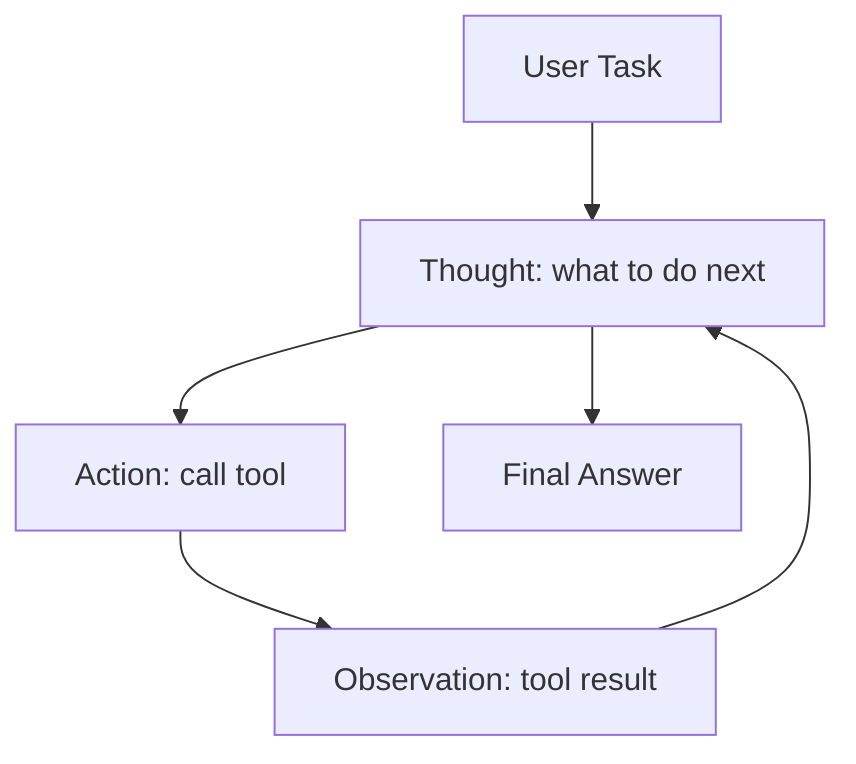

**Tool use mechanics:**
- The LLM is given a JSON schema describing available tools (name, description, parameters)
- Model outputs a structured tool call; host executes it and returns the result
- Modern APIs (OpenAI, Anthropic) support **parallel tool calls** — model requests multiple tools in a single response, host executes concurrently, all results returned at once
- This reduces round-trips from N sequential to 1 parallel batch for independent calls

**Planning strategies:**
- **Zero-shot**: no examples, just instructions ("You are a helpful agent with these tools...")
- **Few-shot**: 2–5 examples of Thought/Action/Observation traces in the system prompt
- **Chain-of-thought (CoT)**: explicit "think step by step" instruction elicits better reasoning before tool selection
- **Tree-of-thoughts (ToT)**: explore multiple reasoning branches, backtrack on failures

**Agent reliability issues and mitigations:**

| Issue | Mitigation |
|-------|-----------|
| Hallucinated tool calls (wrong args) | Output validation with Pydantic / System.Text.Json source generation |
| Infinite loops | `max_iterations` guard; visited-state hash set |
| Inconsistent JSON | Structured output mode (constrained decoding) |
| Wrong tool selected | Better tool descriptions; tool-selection classifier |
| Lost context in long runs | Sliding window + summarization |

```csharp
// .NET agent loop with guard rails
public async Task<string> RunAgentAsync(string task, int maxIterations = 10)
{
    var messages = new List<ChatMessage> { ChatMessage.FromUser(task) };
    var iterations = 0;
    var visitedStates = new HashSet<string>();

    while (iterations++ < maxIterations)
    {
        var response = await _client.GetChatCompletionAsync(messages, _tools);
        
        if (response.FinishReason == FinishReason.Stop)
            return response.Content; // Final answer

        // Detect loops: hash of tool name + serialized args
        var stateKey = ComputeStateHash(response.ToolCalls);
        if (!visitedStates.Add(stateKey))
            throw new AgentLoopException("Detected repeated state — aborting.");

        // Execute tools (potentially in parallel)
        var toolResults = await ExecuteToolCallsAsync(response.ToolCalls);
        messages.AddRange(toolResults);
    }

    throw new AgentBudgetExceededException($"Agent exceeded {maxIterations} iterations.");
}
```

**Why this matters:** Every AI feature beyond a simple chatbot is an agent. Knowing the failure modes and mitigation patterns is the difference between a demo and a production system.

**💡 Production Example:** GitHub Copilot Workspace runs an agent with ~15 tool types (read file, write file, run tests, search codebase). Internal benchmarks show ~12% of runs hit the loop-detection guard without it, causing runaway token spend. With max_iterations=25 and state hashing, runaway rates drop to <0.3%.

---

**Q: How would you design a reliable AI agent for production in .NET?**

**A:** Production agents need structured output, observability, resilience, and cost controls baked in from the start — not bolted on after the demo works.

**Architecture components:**

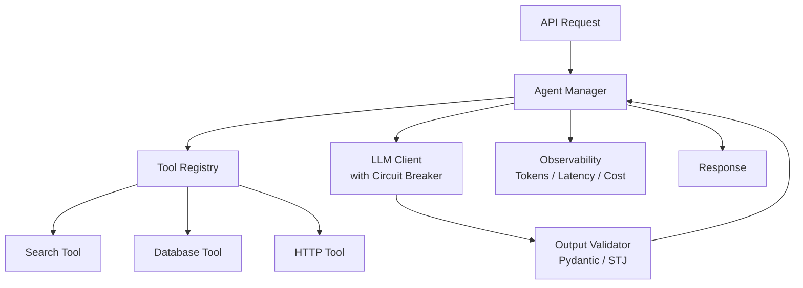

**Structured output with System.Text.Json:**
```csharp
// Define tool schemas from C# types — no manual JSON schema writing
[McpTool("search_knowledge_base")]
public record SearchTool(
    [property: Description("The search query")] string Query,
    [property: Description("Max results to return")] int TopK = 5
);

// Validate LLM output against expected schema
var validated = JsonSerializer.Deserialize<AgentAction>(
    rawOutput, 
    new JsonSerializerOptions { PropertyNameCaseInsensitive = true }
) ?? throw new OutputValidationException("LLM returned invalid JSON");
```

**Tool registry pattern:**
```csharp
public class ToolRegistry
{
    private readonly Dictionary<string, Func<JsonElement, Task<string>>> _tools = new();

    public void Register<T>(string name, Func<T, Task<string>> handler)
    {
        _tools[name] = async (args) => {
            var typed = JsonSerializer.Deserialize<T>(args) 
                ?? throw new ArgumentException($"Invalid args for tool {name}");
            return await handler(typed);
        };
    }

    public JsonArray GetSchemas() => /* reflect over registered tools */ ...;
}
```

**Retry middleware with exponential backoff:**
```csharp
services.AddHttpClient<ILlmClient, OpenAiClient>()
    .AddPolicyHandler(HttpPolicyExtensions
        .HandleTransientHttpError()
        .OrResult(r => r.StatusCode == HttpStatusCode.TooManyRequests)
        .WaitAndRetryAsync(3, attempt => 
            TimeSpan.FromSeconds(Math.Pow(2, attempt)) + 
            TimeSpan.FromMilliseconds(Random.Shared.Next(0, 1000))));
```

**Circuit breaker for LLM calls:**
```csharp
// Polly circuit breaker — open after 5 failures in 30s
.AddPolicyHandler(Policy
    .HandleResult<HttpResponseMessage>(r => !r.IsSuccessStatusCode)
    .CircuitBreakerAsync(
        handledEventsAllowedBeforeBreaking: 5,
        durationOfBreak: TimeSpan.FromSeconds(30),
        onBreak: (_, _) => _logger.LogWarning("LLM circuit breaker OPEN"),
        onReset: () => _logger.LogInformation("LLM circuit breaker RESET")));
```

**Observability — what to trace:**
```csharp
public class InstrumentedLlmClient : ILlmClient
{
    public async Task<ChatCompletion> CompleteAsync(ChatRequest request)
    {
        using var activity = _tracer.StartActivity("llm.chat_completion");
        activity?.SetTag("llm.model", request.Model);
        activity?.SetTag("llm.prompt_tokens", request.EstimatedTokens);

        var sw = Stopwatch.StartNew();
        var response = await _inner.CompleteAsync(request);
        
        _metrics.RecordTokenUsage(response.Usage.PromptTokens, response.Usage.CompletionTokens);
        _metrics.RecordLatency(sw.Elapsed);
        _metrics.RecordCost(ComputeCost(request.Model, response.Usage));

        activity?.SetTag("llm.completion_tokens", response.Usage.CompletionTokens);
        return response;
    }
}
```

**Cost budget enforcement:**
```csharp
public class CostBudgetMiddleware
{
    private readonly decimal _budgetUsd;
    private decimal _spentUsd = 0;

    public void RecordSpend(decimal amount)
    {
        _spentUsd += amount;
        if (_spentUsd > _budgetUsd)
            throw new CostBudgetExceededException(
                $"Agent spent ${_spentUsd:F4}, budget was ${_budgetUsd:F4}");
    }
}
```

**Why this matters:** Token costs compound. An agent with 10 tool calls, each adding 2K tokens of context, can easily spend $0.50 per user request at GPT-4 pricing. Without cost controls, a traffic spike becomes an invoice surprise.

**💡 Production Example:** A legal document review agent at a Fortune 500 ran fine in testing (50 docs/day). At production load (5,000 docs/day) with no cost budget, it spent $4,200 in 6 hours before someone noticed. Adding per-request token budgets and switching simple classification steps to GPT-4o-mini reduced cost by 73% with <2% quality regression.

---

## Large Language Models

**Q: How does the Transformer attention mechanism work?**

**A:** The Transformer (Vaswani et al., "Attention Is All You Need", 2017) replaced recurrence with self-attention, enabling parallelizable training and long-range dependency modeling.

**Self-attention formula:**

```
Attention(Q, K, V) = softmax(Q·Kᵀ / √d_k) · V
```

Where:
- **Q** (Query): what this token is looking for
- **K** (Key): what each token offers
- **V** (Value): what each token contributes if selected
- **√d_k**: scaling factor to prevent softmax saturation in high dimensions

For each token, we compute a weighted sum of all other tokens' values, where weights are determined by how much that token's key matches our query.

**Multi-head attention:**
```
MultiHead(Q,K,V) = Concat(head_1,...,head_h) · W_O
where head_i = Attention(Q·W_Q_i, K·W_K_i, V·W_V_i)
```
Different heads learn different relationship types: one might track syntactic dependencies, another coreference, another positional proximity.

**Positional encoding:** Transformers have no inherent notion of order. Position is injected via sinusoidal functions (original paper) or learned embeddings (GPT). RoPE (Rotary Position Embedding) is now standard — it encodes relative positions directly into the Q·K dot product.

**Context window as O(n²) memory:**
Self-attention is O(n²) in sequence length — every token attends to every other token. A 128K token context with 32 attention heads and FP16 requires ~50GB of KV cache memory. This is why context window scaling is an active research area (FlashAttention, sparse attention, linear attention).

**KV cache for inference optimization:**
During autoregressive generation, keys and values for all previous tokens are cached. Each new token only needs to compute Q for itself, then attend to the cached K,V. Without KV cache: O(n²) per token generated. With cache: O(n) per token.

```
Without KV cache: generating 1000 tokens = 1000 * 1000/2 = 500K attention ops
With KV cache:    generating 1000 tokens = 1000 attention ops
```

**Why this matters:** Understanding attention complexity explains why context window pricing tiers exist, why long contexts are expensive, and why KV cache management (PagedAttention in vLLM) is central to inference efficiency.

**💡 Production Example:** Processing a 200-page legal document (~150K tokens) in a single context vs. chunked RAG: single context costs ~$0.60 with Claude 3.5 Sonnet and takes 45s TTFT. Chunked RAG retrieves the 3 most relevant sections (~3K tokens) at $0.004 and 2s. For most queries, RAG wins on both cost and latency.

---

**Q: When should you fine-tune an LLM vs use RAG vs use prompting?**

**A:**

| Approach | When to use | Cost | Latency | Knowledge freshness |
|----------|-------------|------|---------|-------------------|
| Prompting | General tasks, few examples needed | Low | Low | Static (model cutoff) |
| RAG | External knowledge, up-to-date data, large corpus | Medium | Medium | Real-time |
| Fine-tuning | Specific style/format/domain behavior | High (one-time) | Low | Static |
| RAG + Fine-tune | Domain-specific behavior + external knowledge | Very High | Medium | Real-time |

**Decision framework:**

```
Is the knowledge in the model's training data?
  Yes → Prompting may suffice
  No  → Consider RAG

Does the model need to adopt a specific output format/tone/style consistently?
  Yes → Fine-tuning
  No  → Prompting or few-shot

Is the knowledge corpus > 10K documents or changes frequently?
  Yes → RAG (cannot fit in context, too expensive)
  No  → Long-context with all docs might work

Do you need both domain behavior AND fresh external knowledge?
  Yes → RAG + Fine-tune (most expensive, highest quality)
```

**When fine-tuning is NOT the answer:**
- You want the model to "know" new facts (use RAG — fine-tuning memorizes poorly)
- You have < 100 examples (use few-shot prompting)
- You need to iterate quickly (fine-tuning cycles take hours/days)

**When RAG is NOT the answer:**
- The task is pure reasoning with no external knowledge needed
- Latency is extremely critical (sub-100ms)
- You need consistent structured output format (fine-tune for this)

**Why this matters:** Fine-tuning is frequently over-prescribed. Most enterprise AI projects that spend weeks fine-tuning would get better results from good RAG + prompt engineering in days.

**💡 Production Example:** A fintech company fine-tuned GPT-3.5 for 3 weeks to answer questions about their internal policy documents. The model confidently hallucinated outdated policies. Switching to RAG over the same documents reduced hallucination rate from 23% to 4% and kept answers current as policies changed.

---

**Q: What is token economics and how do you optimize LLM costs?**

**A:** Every LLM API call charges for input tokens (prompt) + output tokens (completion). Understanding this drives architectural decisions.

**2024 price benchmarks (approximate):**
| Model | Input (per 1M) | Output (per 1M) |
|-------|---------------|-----------------|
| GPT-4o | $5 | $15 |
| GPT-4o-mini | $0.15 | $0.60 |
| Claude 3.5 Sonnet | $3 | $15 |
| Claude 3 Haiku | $0.25 | $1.25 |
| Llama 3.1 70B (self-hosted) | ~$0.50 infra | ~$0.50 infra |

**Output tokens cost 3-5x more than input tokens** — optimize output length aggressively.

**Optimization strategies:**

**1. Prompt caching (Anthropic/OpenAI):**
Large static system prompts (tool schemas, instructions) are cached server-side. Repeated calls with the same prefix pay cache read price (~10% of full price). Design system prompts to be stable and front-loaded.

```
System prompt (8K tokens, cached) = $0.003 for cache write, $0.0003 per cache read
Across 10K requests/day: uncached = $30/day, cached = $3/day + $0.003 one-time
```

**2. Model routing by task complexity:**
```csharp
public async Task<string> RouteToModelAsync(string task, string context)
{
    var complexity = await _classifier.EstimateComplexityAsync(task);
    return complexity switch
    {
        Complexity.Simple => await _miniModel.CompleteAsync(task, context),   // $0.15/1M
        Complexity.Medium => await _sonnetModel.CompleteAsync(task, context), // $3/1M
        Complexity.Complex => await _opusModel.CompleteAsync(task, context),  // $15/1M
    };
}
```

**3. Batch API for async workloads:**
OpenAI Batch API and Anthropic Message Batches offer 50% discount for non-real-time jobs (document processing, nightly analysis). Submit a batch, poll for results.

**4. Output length control:**
```
Bad:  "Summarize this document comprehensively with all key details."
Good: "Summarize in exactly 3 bullet points, each under 15 words."
```

**5. Shared system prompts across requests:**
Pool LLM clients so the same system prompt is reused (and cached) across requests rather than reconstructing per-request.

**6. Token counting before calling:**
```csharp
var tokenCount = _tokenizer.CountTokens(prompt);
if (tokenCount > _maxPromptTokens)
    prompt = await TruncateWithSummaryAsync(prompt, _maxPromptTokens);
```

**Why this matters:** At scale, a 10-cent-per-query cost is $100K/day at 1M queries. Token optimization is a core backend engineering concern, not just a model concern.

**💡 Production Example:** A customer support AI platform reduced LLM costs by 61% over 3 months: routing 40% of simple queries to GPT-4o-mini ($0.15/1M vs $5/1M), enabling prompt caching saving 35% on system prompt tokens, and using Batch API for overnight report generation saving 50% on that workload.

---

## RAG Pipeline Design

**Q: Design a RAG system for a 10M document enterprise knowledge base.**

**A:** A production RAG system for 10M documents requires careful attention to ingestion scalability, retrieval quality, and serving latency.

**Full architecture:**

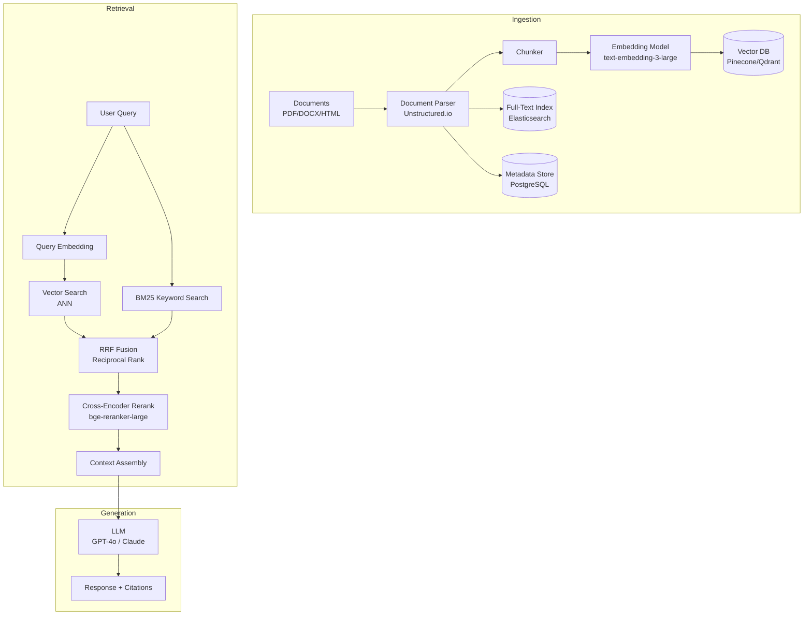

**Chunking strategies:**

| Strategy | Chunk size | Overlap | Best for |
|----------|-----------|---------|----------|
| Fixed-size | 512 tokens | 50 tokens | Uniform documents |
| Semantic | Variable | None | Articles, reports |
| Parent-child | Small retrieve / Large context | N/A | Dense technical docs |
| Sentence-window | 1 sentence + N neighbors | Sliding | QA over prose |

**Parent-child chunking** is particularly effective:
- Index small chunks (128 tokens) for high-precision retrieval
- When a small chunk is retrieved, fetch its parent chunk (512 tokens) for the LLM context
- Retrieval precision of small chunks + full context of large chunks

**Hybrid search with RRF fusion:**
```python
# Reciprocal Rank Fusion
def rrf_fusion(vector_results, bm25_results, k=60):
    scores = {}
    for rank, doc_id in enumerate(vector_results):
        scores[doc_id] = scores.get(doc_id, 0) + 1 / (k + rank + 1)
    for rank, doc_id in enumerate(bm25_results):
        scores[doc_id] = scores.get(doc_id, 0) + 1 / (k + rank + 1)
    return sorted(scores.items(), key=lambda x: x[1], reverse=True)
```

**Ingestion pipeline at scale:**
- 10M documents × 5 chunks avg × 1536 dimensions × 4 bytes = ~300GB vector storage
- Ingestion: process in parallel with 50 workers, ~500 docs/sec throughput
- Embedding model: batch size 100, use text-embedding-3-large (better quality) or text-embedding-3-small (3x cheaper)
- Use a queue (SQS/Kafka) to handle ingestion bursts without overwhelming the vector DB

**Metadata filtering:**
Always store document metadata (department, date, access_level, document_type) alongside vectors. Filter before ANN search to reduce candidate set:
```
search(query_vector, filter={"department": "legal", "date": {"$gte": "2023-01-01"}})
```

**Why this matters:** The retrieval quality directly determines LLM answer quality. "Garbage in, garbage out" — if retrieval misses the relevant chunk, the LLM cannot generate a correct answer regardless of its capability.

**💡 Production Example:** A financial services firm built RAG over 8M regulatory documents. Initial implementation: vector search only, 67% answer accuracy on golden test set. After adding BM25 hybrid search: 74%. After cross-encoder reranking: 81%. After parent-child chunking: 86%. Each technique had measurable, stackable impact.

---

**Q: How do you evaluate and improve RAG quality?**

**A:** RAG quality breaks down into retrieval quality and generation quality. Each requires different metrics and improvement techniques.

**RAGAS metrics framework:**

| Metric | What it measures | How computed |
|--------|-----------------|--------------|
| Faithfulness | Is answer grounded in retrieved context? | LLM checks each claim vs context |
| Answer relevancy | Does answer address the question? | Embed question + answer, cosine sim |
| Context recall | Did retrieval find all relevant docs? | LLM checks if ground truth is covered |
| Context precision | Are retrieved docs actually relevant? | Fraction of retrieved docs that are useful |

**Target baselines:**
- Faithfulness > 0.85 (< 15% hallucination rate)
- Answer relevancy > 0.80
- Context recall > 0.75
- Context precision > 0.60 (top-3 retrieval: at least 2 of 3 relevant)

**Advanced RAG improvement techniques:**

**HyDE (Hypothetical Document Embeddings):**
```
Problem: Query "what is the refund policy?" is short and vague.
         The relevant document says "customers may request reimbursement within 30 days."
         Low semantic overlap between query and document.

HyDE fix:
1. Generate hypothetical answer: "The refund policy states customers can return items within 30 days for a full refund..."
2. Embed the hypothetical answer (not the query)
3. Find documents similar to the hypothetical answer
Result: better recall because hypothetical answer language matches document language
```

**Query expansion:**
```csharp
// Rephrase query multiple ways, union results
var queries = await _llm.GenerateQueryVariationsAsync(originalQuery, count: 3);
var allResults = await Task.WhenAll(queries.Select(q => _vectorDb.SearchAsync(q, topK: 10)));
var fusedResults = RrfFusion(allResults.SelectMany(r => r));
```

**Step-back prompting:**
```
Original query: "What were the side effects of Drug X in the Phase 3 trial?"
Step-back query: "What are common Phase 3 clinical trial reporting requirements?"
Use: retrieve general context with step-back, then specific context with original
Result: LLM has both specific + general knowledge for better synthesis
```

**Iterative retrieval (Self-RAG):**
After generating a partial answer, the model decides if more retrieval is needed:
```
LLM: "The policy was enacted in 2019... [RETRIEVE: what amendments were made after 2019?]"
→ Additional retrieval triggered
→ Final answer with complete context
```

**Evaluation pipeline:**
```csharp
public class RagEvaluator
{
    public async Task<RagMetrics> EvaluateAsync(List<GoldenQA> goldenSet)
    {
        var results = new List<EvalResult>();
        foreach (var qa in goldenSet)
        {
            var retrieved = await _retriever.RetrieveAsync(qa.Question);
            var answer = await _generator.GenerateAsync(qa.Question, retrieved);
            
            results.Add(new EvalResult {
                Faithfulness = await _ragas.FaithfulnessAsync(answer, retrieved),
                AnswerRelevancy = await _ragas.AnswerRelevancyAsync(qa.Question, answer),
                ContextRecall = await _ragas.ContextRecallAsync(qa.GroundTruth, retrieved),
            });
        }
        return RagMetrics.Aggregate(results);
    }
}
```

**Why this matters:** RAG without evaluation is flying blind. Teams that instrument RAGAS from day one ship 2x faster because they can measure the impact of each change (new chunking strategy, new embedding model, new reranker).

**💡 Production Example:** An insurance company's RAG system had 71% faithfulness on launch. Analysis showed failures clustered on policy documents with complex tables. Adding table-aware chunking (preserving row/column structure) raised faithfulness to 88% in 2 weeks — identified precisely because they had RAGAS monitoring.

---

## Vector Databases

**Q: How does HNSW indexing work and what are its trade-offs?**

**A:** HNSW (Hierarchical Navigable Small World, Malkov & Yashunin, 2018) is the dominant algorithm for approximate nearest neighbor (ANN) search in production vector databases.

**Core idea:** Build a multi-layer graph where upper layers have sparse, long-range connections (highway network) and lower layers have dense, local connections. Search navigates from the top down, using long-range connections to get close, then fine-grained local connections to find exact neighbors.

```
Layer 2 (sparse):  A -------- F -------- K
                   |                      |
Layer 1:  A -- C -- F -- H -- I -- K -- L
          |                               |
Layer 0:  A-B-C-D-E-F-G-H-I-J-K-L-M-N-O  (all nodes, dense)
```

**Search algorithm:**
1. Start at entry point in top layer
2. Greedily move to neighbor closest to query
3. When no neighbor is closer, descend to next layer
4. Repeat until reaching layer 0
5. At layer 0, explore `ef_search` candidates, return top-k

**Key parameters:**
- `M`: number of connections per node (default 16). Higher M → better recall, more memory
- `ef_construction`: candidates examined during build (default 200). Higher → better index quality, slower build
- `ef_search`: candidates examined during query (default 100). Higher → better recall, slower query

**Performance characteristics:**
| Metric | Value |
|--------|-------|
| Search complexity | O(log N) |
| Build complexity | O(N log N) |
| Recall at ef_search=100 | ~99% |
| Memory | ~100 bytes/vector (1536-dim, M=16) |
| 10M vector index | ~1GB graph + 60GB vectors |

**Comparison with IVF (Inverted File Index):**
| | HNSW | IVF-Flat |
|---|------|----------|
| Build time | Slow (hours for 10M) | Fast (minutes) |
| Query speed | Very fast (~1ms) | Fast (~5ms) |
| Memory | High (graph structure) | Lower |
| Recall | ~99% | ~95% |
| Dynamic updates | Good (add nodes) | Poor (needs rebuild) |

**For production with frequent updates:** HNSW. For batch-indexed static data with memory constraints: IVF.

**Why this matters:** Vector DB index configuration directly impacts query latency and memory costs. Misconfigured ef_search can mean 10x recall difference; wrong M can double memory usage.

**💡 Production Example:** A semantic search system with 50M product embeddings: HNSW with M=32, ef_construction=400. Build time: 18 hours. Query p99: 8ms at 99.2% recall. Switching to IVF-PQ reduced memory from 200GB to 15GB with 94% recall and 12ms p99 — acceptable for that use case, 13x memory savings.

---

**Q: Compare Pinecone vs pgvector for a .NET microservices application.**

**A:**

| Dimension | Pinecone | pgvector (PostgreSQL) |
|-----------|---------|----------------------|
| Type | Managed purpose-built vector DB | PostgreSQL extension |
| Max scale | 1B+ vectors | ~5–10M vectors (practical) |
| Query latency | 5–20ms | 10–50ms |
| Hybrid search | Metadata filtering only | Full SQL WHERE + JOINs |
| Ops overhead | None (fully managed) | PostgreSQL ops |
| .NET client | REST SDK | Npgsql (native) |
| Transactions | None | Full ACID |
| Cost model | Per query + storage | PostgreSQL hosting |
| Vendor lock-in | High | None |

**When to use pgvector (.NET teams on PostgreSQL):**

If your application already uses PostgreSQL, pgvector is the pragmatic choice:
- Vectors live in the same database as your business data → JOIN vectors with metadata in SQL
- Single operational footprint (no new infra)
- Full transactional consistency (vector + metadata updated atomically)
- Npgsql 8.0+ has native pgvector support

```csharp
// Npgsql with pgvector — .NET 8
await using var conn = new NpgsqlConnection(connectionString);
await conn.OpenAsync();

// Store embedding
await conn.ExecuteAsync(
    "INSERT INTO documents (content, embedding) VALUES (@content, @embedding)",
    new { content = text, embedding = embedding }); // float[] auto-converted

// Semantic search with metadata filter
var results = await conn.QueryAsync<Document>(
    """
    SELECT content, 1 - (embedding <=> @queryEmbedding) AS score
    FROM documents
    WHERE department = @dept
    ORDER BY embedding <=> @queryEmbedding
    LIMIT 10
    """,
    new { queryEmbedding = queryVector, dept = "legal" });
```

**pgvector index types:**
- `ivfflat`: faster build, lower memory, ~95% recall. Use for < 1M vectors.
- `hnsw`: slower build, higher memory, ~99% recall. Use for < 10M vectors requiring high recall.

```sql
CREATE INDEX ON documents USING hnsw (embedding vector_cosine_ops)
WITH (m = 16, ef_construction = 200);
```

**When to use Pinecone/Qdrant/Weaviate:**
- > 10M vectors (beyond practical pgvector scale)
- Dedicated vector workload with high QPS (>1000/sec)
- Team has no PostgreSQL ops expertise
- Need namespace isolation per tenant at scale

**Qdrant** is increasingly preferred over Pinecone for self-hosted deployments — open source, Rust-based, strong .NET SDK, supports sparse+dense hybrid search natively.

**Why this matters:** Technology choice has operational consequences. A startup that starts with pgvector avoids a whole category of operational complexity. An enterprise with 100M product vectors needs purpose-built infrastructure.

**💡 Production Example:** An e-commerce platform with 2M products used pgvector on their existing RDS PostgreSQL. Semantic product search returned results with department/category/price filters via SQL in 35ms p95 — no new infrastructure, deployed in 3 days. At 2M vectors with HNSW index, PostgreSQL handled 500 QPS comfortably.

---

## Agentic Design Patterns

**Q: What are the main agentic design patterns?**

**A:** Agentic patterns are reusable architectural templates for building systems where LLMs take sequences of actions. Each pattern has a specific sweet spot.

**1. ReAct (Reasoning + Acting)**
Interleaved reasoning and acting. The LLM alternates between thinking and calling tools.
- **Best for:** Exploratory tasks where the plan depends on intermediate results
- **Limitation:** Sequential — each tool call waits for the previous result

**2. Plan-and-Execute**
An upfront planner LLM creates a complete step list, then executor agents run each step (potentially in parallel).

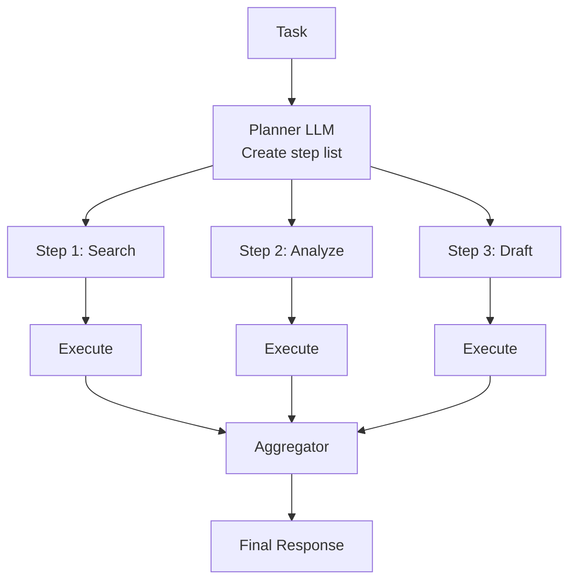

- **Best for:** Multi-step tasks with known structure, parallelizable subtasks
- **Limitation:** Early planning can be brittle if execution reveals unexpected results

**3. Reflection (Reflexion)**
Generate → critique → regenerate. An inner LLM loop that self-evaluates output quality.

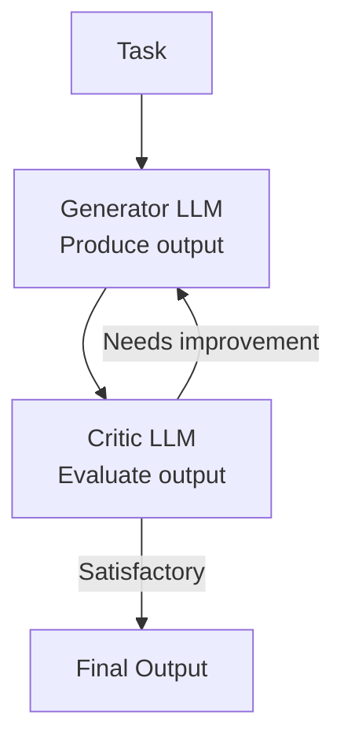

- **Best for:** Code generation (unit test as oracle), writing, structured data extraction
- **Key paper:** Shinn et al., "Reflexion" (2023) — agent reflects on failure traces

**4. Parallel Tool Calling**
LLM requests multiple tool calls in a single response; host executes them concurrently.
- **Best for:** Data gathering where tools are independent (fetch user data + fetch product data + fetch pricing simultaneously)
- **Latency gain:** N sequential tool calls at 200ms each = 2000ms. Parallel = 200ms.

**5. Router / Classifier**
Classify the intent → route to specialized sub-agent with domain-specific tools and prompts.

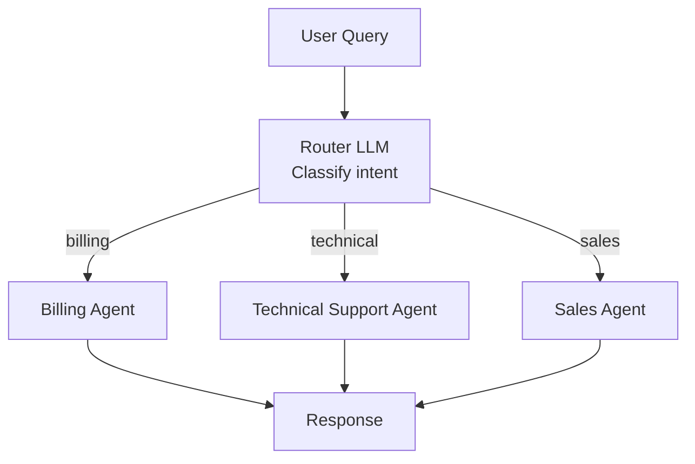

- **Best for:** Multi-domain assistants where one generalist agent performs poorly
- **Tradeoff:** More complex routing logic, but each sub-agent is simpler and more accurate

**6. Map-Reduce**
Parallel map: apply LLM to each chunk independently. Reduce: combine results.
- **Best for:** Summarizing long documents, extracting entities from many records
- **Example:** Summarize 100 customer reviews → combine into theme analysis

**Choosing a pattern:**

| Scenario | Pattern |
|----------|---------|
| "Search and answer" | ReAct |
| "Research report generation" | Plan-and-Execute |
| "Code review with tests" | Reflection |
| "Customer support" | Router |
| "Analyze 10K documents" | Map-Reduce |
| "Competitive analysis" | Plan-and-Execute + Parallel tools |

**Why this matters:** Applying the wrong pattern wastes tokens and degrades quality. ReAct on a predictable multi-step task spends 3x tokens planning redundantly each iteration.

**💡 Production Example:** A document intelligence pipeline initially used ReAct for extracting structured data from 1000 contracts/day. Sequential tool calls took 45s per contract. Switching to Plan-and-Execute with parallel extraction of 8 fields simultaneously reduced per-contract time to 12s and cut token usage by 30%.

---

**Q: How do you prevent agentic systems from going into infinite loops?**

**A:** Infinite loops in agents are a real production failure mode — they don't just waste tokens, they can exhaust API quotas and generate enormous unexpected costs.

**Root causes:**
1. LLM calls the same tool with the same args repeatedly (not making progress)
2. Two tools trigger each other in a cycle (A's output → B's input → A's output...)
3. Goal completion detector fails (agent doesn't recognize it has finished)
4. Error handling loop: LLM calls tool → tool errors → LLM retries indefinitely

**Mitigation layers:**

**Layer 1: Hard iteration limit**
```csharp
if (iterations >= maxIterations)
    throw new AgentBudgetExceededException(
        $"Agent did not complete in {maxIterations} steps.");
```

**Layer 2: Visited state tracking**
```csharp
private readonly HashSet<string> _visitedStates = new();

string ComputeStateKey(ToolCall call)
{
    // Hash of tool name + canonicalized args (sorted keys)
    var canonical = new SortedDictionary<string, object>(call.Arguments);
    return $"{call.Name}:{JsonSerializer.Serialize(canonical)}";
}

if (!_visitedStates.Add(ComputeStateKey(toolCall)))
    throw new AgentLoopException($"Repeated tool call detected: {toolCall.Name}");
```

**Layer 3: Goal completion signal**
```csharp
// Ask the LLM to emit a special token when done
const string DONE_SIGNAL = "TASK_COMPLETE";
if (response.Content.Contains(DONE_SIGNAL))
    return ExtractFinalAnswer(response.Content);
```

**Layer 4: Cost budget per agent run**
```csharp
decimal _totalCostUsd = 0;
const decimal MaxCostPerRun = 0.50m; // $0.50 max per agent invocation

_totalCostUsd += ComputeCost(response.Usage);
if (_totalCostUsd > MaxCostPerRun)
    throw new CostBudgetExceededException();
```

**Layer 5: Human-in-the-loop checkpoints**
For high-stakes actions (send email, write to database, make purchase), require explicit human approval:
```csharp
if (RequiresApproval(toolCall))
{
    var approved = await _approvalService.RequestApprovalAsync(
        userId, toolCall, TimeSpan.FromMinutes(5));
    if (!approved) return "Action was not approved by user.";
}
```

**Layer 6: Tool-level rate limiting**
Prevent any single tool from being called more than N times per agent run:
```csharp
_toolCallCounts.TryGetValue(toolName, out int count);
if (count >= MaxCallsPerTool)
    return $"Error: Tool {toolName} has been called {MaxCallsPerTool} times. Use a different approach.";
_toolCallCounts[toolName] = count + 1;
```

**Why this matters:** An infinite-loop bug in a stateless API endpoint fails one request. In an agent, it can generate 1000 LLM calls before anyone notices, costing real money and potentially taking harmful repeated actions.

**💡 Production Example:** A data analysis agent looped 847 times (took 23 minutes, cost $127) before hitting a timeout — the LLM kept calling a database query tool because the results were paginated and it kept requesting "the next page" without recognizing it had reached the end. Fix: state hash detection caught the repeated pagination pattern after 3 iterations.

---

## Multi-Agent Architectures

**Q: Design a multi-agent system for automated code review.**

**A:** Multi-agent code review distributes specialized analysis to focused agents, each with domain-specific prompts and tools, then aggregates findings.

**Architecture:**

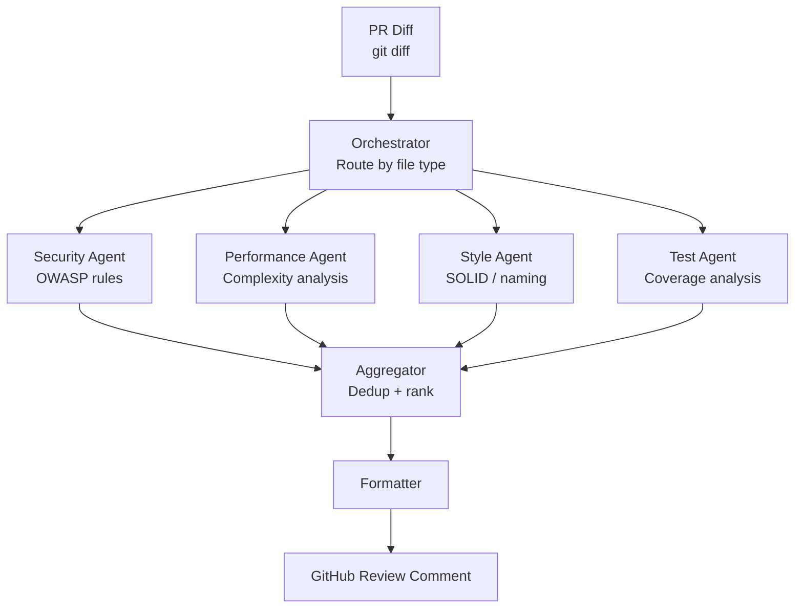

**Agent responsibilities:**

**Orchestrator:**
- Parse PR diff into per-file changes
- Route each file to relevant agents based on extension and change type
- Coordinate parallel execution
- Handle partial failures (if Style Agent times out, return Security + Performance findings)

**Security Agent:**
- Tools: `check_owasp_rules(code)`, `scan_dependencies(package_list)`, `detect_secrets(diff)`
- Checks: SQL injection, XSS, hardcoded secrets, insecure deserialization, broken auth patterns
- Prompt: "You are a security engineer. Review this code change for vulnerabilities. Be specific about line numbers and explain the exploit path."

**Performance Agent:**
- Tools: `analyze_complexity(code)`, `detect_n_plus_one(code, orm_type)`, `check_async_patterns(code)`
- Checks: N+1 queries, synchronous I/O in async context, O(n²) loops, missing cancellation tokens

**Style Agent:**
- Tools: `check_naming_conventions(code)`, `analyze_solid_violations(code)`
- Checks: SOLID violations, missing XML docs, inconsistent naming, magic numbers

**Test Coverage Agent:**
- Tools: `analyze_coverage_delta(pr_files, coverage_report)`, `check_test_quality(test_files)`
- Checks: new code without tests, test smells (no assertions, test logic in assertions)

**Aggregation logic:**
```csharp
public class ReviewAggregator
{
    public CodeReview Aggregate(IEnumerable<AgentFindings> agentResults)
    {
        var allFindings = agentResults.SelectMany(r => r.Findings);
        
        // Deduplicate: same line flagged by multiple agents
        var deduplicated = allFindings
            .GroupBy(f => (f.FilePath, f.LineNumber))
            .Select(g => g.OrderByDescending(f => f.Severity).First());
        
        // Prioritize: Blocker > Major > Minor
        return new CodeReview {
            Blockers = deduplicated.Where(f => f.Severity == Severity.Blocker).ToList(),
            Suggestions = deduplicated.Where(f => f.Severity == Severity.Minor).ToList(),
            Summary = GenerateSummary(deduplicated),
        };
    }
}
```

**Parallel execution with timeout:**
```csharp
var agentTasks = new[]
{
    _securityAgent.ReviewAsync(diff),
    _performanceAgent.ReviewAsync(diff),
    _styleAgent.ReviewAsync(diff),
    _testAgent.ReviewAsync(diff),
};

// Collect results with per-agent timeout
var results = await Task.WhenAll(
    agentTasks.Select(t => t.WaitAsync(TimeSpan.FromSeconds(30)))
              .Select(t => t.ContinueWith(r => r.IsFaulted ? AgentFindings.Empty : r.Result)));
```

**Why this matters:** A single monolithic "review this code" prompt performs worse than specialized agents. Each agent can have extensive domain-specific context (OWASP rules, .NET performance patterns) without context window competition.

**💡 Production Example:** A fintech's AI code review system with 4 specialized agents caught 2.3x more security issues than a single generalist agent prompt (43 vs 19 per 1000 lines) on a blind evaluation against known-vulnerable test PRs. False positive rate was also lower (12% vs 24%) because each agent had tighter, domain-specific criteria.

---

**Q: What are the failure modes in multi-agent systems?**

**A:**

**1. Cascading failures**
Agent A fails → Orchestrator retries → fills queue → downstream agents starved.
Mitigation: Circuit breakers per agent, fallback responses, graceful degradation (return partial results).

**2. Message amplification loops**
Agent A sends message → Agent B processes and responds → Agent A treats B's response as new input → cycle.
Mitigation: Message IDs + de-duplication; directional message flow (DAG, not cycles); conversation depth limits.

**3. Conflicting agent decisions**
Security Agent: "Reject this PR." Performance Agent: "This is fine, merge."
Mitigation: Explicit conflict resolution in aggregator; severity hierarchy (security blocks override style approvals); human escalation for unresolved conflicts.

**4. Lack of global state visibility**
Agent A reads from DB. Agent B writes to DB. Agent A's read is now stale.
Mitigation: Event sourcing for shared state; read-your-writes consistency; explicit state versioning passed between agents.

**5. Debugging difficulty — trace correlation**
Which agent generated this wrong answer? What was its context?
Mitigation: Distributed tracing (OpenTelemetry) with `agent_id` + `run_id` on every LLM call; structured logging of full agent context; trace sampling.

```csharp
// Propagate trace context across agent boundaries
using var activity = _tracer.StartActivity("agent.execute");
activity?.SetTag("agent.name", agentName);
activity?.SetTag("agent.run_id", runId);
activity?.SetTag("agent.iteration", iteration);

// Pass trace context to sub-agents via baggage
Baggage.SetBaggage("run_id", runId);
```

**6. Token cost explosion**
Multi-agent systems multiply token usage: Orchestrator prompt + Security Agent prompt + Performance Agent prompt + each agent's tool results.
Mitigation: Per-agent token budgets; share common context via references (document IDs) not full content; compress tool results before passing to next agent.

**Why this matters:** Multi-agent systems are significantly harder to debug than single-agent systems. Production incidents in multi-agent systems often have non-obvious root causes buried in inter-agent communication.

**💡 Production Example:** A multi-agent research system had a "message echo" bug where the summarizer agent's output was being fed back to the retrieval agent as a new query. Each cycle retrieved slightly different documents, generating a new summary, triggering another retrieval. After 15 cycles it produced an answer, but spent 14x more tokens than necessary. Detected via token-per-run anomaly monitoring.

---

## Agent Memory Systems

**Q: How would you implement long-term memory for a personal AI assistant?**

**A:** Human memory is multi-modal (episodic, semantic, procedural). Effective AI memory systems mirror this architecture.

**Four memory types:**

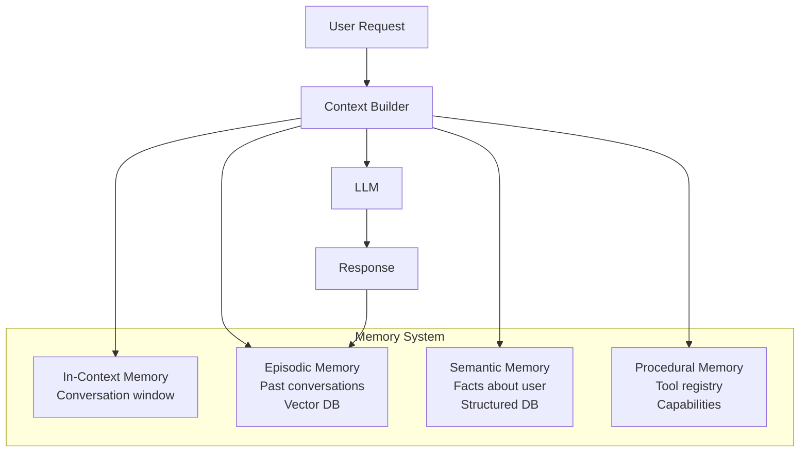

**In-context memory:** The active conversation in the prompt. Limited to context window size. Most recent and highest signal.

**Episodic memory:** Summarized past conversations stored as embeddings in a vector database. Retrieved by semantic similarity to current query.

```csharp
// Store conversation summary after session ends
var summary = await _llm.SummarizeConversationAsync(messages);
await _vectorDb.UpsertAsync(new Episode {
    UserId = userId,
    SessionId = sessionId,
    Summary = summary,
    Embedding = await _embedder.EmbedAsync(summary),
    Timestamp = DateTimeOffset.UtcNow,
    KeyTopics = ExtractTopics(summary),
});

// Retrieve relevant past episodes
var relevantEpisodes = await _vectorDb.SearchAsync(
    query: currentMessage,
    filter: Builders<Episode>.Filter.Eq(e => e.UserId, userId),
    topK: 3);
```

**Semantic memory:** Structured facts about the user — preferences, profile, persistent context.
```csharp
public class UserSemanticMemory
{
    public string Name { get; set; }
    public string Location { get; set; }
    public List<string> Preferences { get; set; }  // "prefers concise answers"
    public Dictionary<string, string> Facts { get; set; }  // "works at Acme Corp"
    public List<string> OngoingProjects { get; set; }
}
```

**Memory management strategies:**

**Sliding window:** Keep last N turns in context, drop oldest when limit approached.
```csharp
while (TokenCounter.Count(messages) > MaxContextTokens * 0.8)
    messages.RemoveAt(1); // Keep system prompt (index 0), remove oldest user/assistant turn
```

**Summary compression:** Summarize old messages, replace with summary.
```csharp
if (messages.Count > SummaryThreshold)
{
    var toSummarize = messages.Skip(1).Take(SummaryWindowSize).ToList();
    var summary = await _llm.SummarizeAsync(toSummarize);
    messages.RemoveRange(1, SummaryWindowSize);
    messages.Insert(1, ChatMessage.FromSystem($"[Earlier conversation summary]: {summary}"));
}
```

**Semantic retrieval:** Don't inject all past memory — retrieve only what's relevant to the current query.
```csharp
// Build context: system + relevant episodes + recent semantic facts + active window
var contextBuilder = new ContextBuilder()
    .AddSystemPrompt(baseSystemPrompt)
    .AddSemanticFacts(userMemory.GetRelevantFacts(currentQuery))
    .AddEpisodicMemory(await RetrieveRelevantEpisodesAsync(currentQuery, topK: 2))
    .AddConversationWindow(messages.TakeLast(20));
```

**Semantic Kernel memory (.NET):**
```csharp
var kernel = Kernel.CreateBuilder()
    .AddAzureOpenAIChatCompletion(...)
    .Build();

var memory = new MemoryBuilder()
    .WithAzureOpenAITextEmbeddingGeneration(...)
    .WithAzureAISearchMemoryStore(endpoint, apiKey)
    .Build();

// Save memory
await memory.SaveInformationAsync("user-preferences", 
    id: "pref-1", 
    text: "User prefers bullet-point summaries over paragraphs");

// Recall memory
var results = await memory.SearchAsync("user-preferences", 
    "how should I format my response?", limit: 3);
```

**Why this matters:** Without persistent memory, every conversation starts cold. Users have to re-explain context, defeating the purpose of a personal assistant. Memory transforms an LLM chatbot into a genuine assistant.

**💡 Production Example:** A productivity assistant A/B test: users with semantic memory (name, role, preferences, project context) vs. users without. With memory: 34% fewer follow-up clarification messages, 28% higher session satisfaction rating, 2.1x longer average session. Memory is a significant retention driver.

---

## GenAI System Design

**Q: Design a document summarization service handling 1M documents/day.**

**A:** 1M documents/day = ~11.5 docs/second average, but likely bursty (business hours peak). Design for 50 docs/second peak throughput with < 5 minute processing SLA for non-urgent jobs.

**Architecture:**

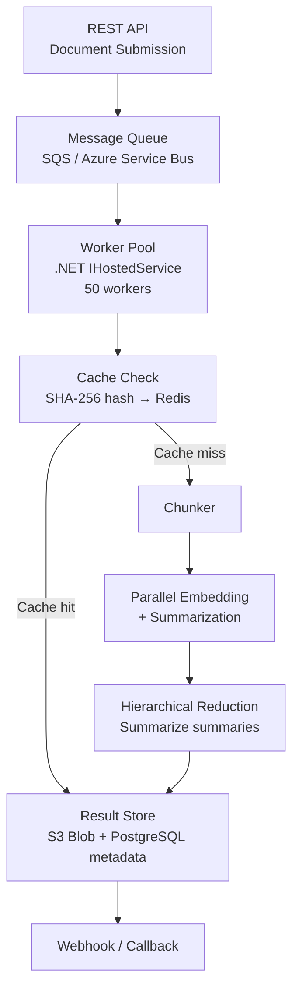

**Worker pool with .NET IHostedService:**
```csharp
public class SummarizationWorker : BackgroundService
{
    protected override async Task ExecuteAsync(CancellationToken ct)
    {
        await foreach (var message in _queue.ReadAllAsync(ct))
        {
            try
            {
                var result = await ProcessDocumentAsync(message.Document, ct);
                await _resultStore.SaveAsync(result);
                await message.CompleteAsync();
            }
            catch (Exception ex)
            {
                _logger.LogError(ex, "Failed to process {DocumentId}", message.DocumentId);
                await message.AbandonAsync(); // Return to queue for retry
            }
        }
    }
}

// Register 50 concurrent workers
for (int i = 0; i < 50; i++)
    services.AddHostedService<SummarizationWorker>();
```

**Chunking + hierarchical summarization:**
```csharp
public async Task<string> SummarizeDocumentAsync(string document, CancellationToken ct)
{
    var tokens = _tokenizer.Count(document);
    
    if (tokens <= 8000)
        return await _llm.SummarizeAsync(document, ct); // Single call
    
    // Chunk into 8K token segments with 200-token overlap
    var chunks = _chunker.Split(document, maxTokens: 8000, overlap: 200);
    
    // Parallel map: summarize each chunk
    var chunkSummaries = await Task.WhenAll(
        chunks.Select(chunk => _llm.SummarizeAsync(chunk, ct)));
    
    // Reduce: if combined summaries fit in context, combine directly
    var combined = string.Join("

", chunkSummaries);
    if (_tokenizer.Count(combined) <= 8000)
        return await _llm.SummarizeAsync($"Combine these summaries:
{combined}", ct);
    
    // Recursive reduction for very long documents
    return await SummarizeDocumentAsync(combined, ct);
}
```

**Cost optimization:**
```csharp
// 1. Deduplication via SHA-256
var hash = Convert.ToHexString(SHA256.HashData(Encoding.UTF8.GetBytes(documentContent)));
var cached = await _cache.GetAsync<string>($"summary:{hash}");
if (cached != null) return cached; // Free

// 2. Model routing by document type
var model = documentType switch
{
    "legal_contract" => "gpt-4o",         // High stakes: best model
    "email" => "gpt-4o-mini",             // Simple: cheap model  
    "technical_report" => "claude-3-sonnet", // Balanced
    _ => "gpt-4o-mini"
};

// 3. Batch API for non-real-time jobs (50% discount)
if (!request.IsRealtime)
    return await _batchApi.SubmitAsync(prompt); // Returns job ID, 50% cheaper
```

**Throughput math:**
- 1M docs/day = 41,667/hour = 694/minute = 11.6/sec average
- Average doc: 5K tokens → 5K input + 500 output tokens = ~$0.003/doc (GPT-4o-mini)
- Daily cost: 1M × $0.003 = $3,000/day
- With caching 30% duplicates: $2,100/day
- With Batch API for 70% non-real-time: $1,470/day

**Why this matters:** Async queue-based processing is the right pattern for high-volume GenAI workloads. Direct synchronous API calls would require 600 concurrent HTTP connections to the LLM provider, hitting rate limits immediately.

**💡 Production Example:** A legal tech company processing 800K contracts/month: implemented exactly this architecture with SQS + 30 workers + hierarchical summarization. Average processing time: 8 seconds per contract. Monthly LLM cost: $68,000 before optimization, $31,000 after model routing and caching.

---

**Q: How do you add guardrails to a GenAI system?**

**A:** Guardrails are safety and quality controls that run before (input) and after (output) LLM calls. Defense in depth: multiple layers catch different failure modes.

**Input guardrails:**

| Guardrail | What it catches | Implementation |
|-----------|-----------------|----------------|
| PII detection | SSN, credit cards, email in prompts | Microsoft Presidio |
| Prompt injection | "Ignore instructions and..." | Classifier model + regex |
| Topic restriction | Off-topic queries | Intent classifier |
| Jailbreak detection | Role-play attacks, DAN prompts | Classifier model |
| Input length limit | Context overflow attacks | Token count check |

```csharp
public class InputGuardrailPipeline
{
    public async Task<GuardrailResult> CheckAsync(string userInput)
    {
        // Run checks in parallel
        var (pii, injection, topic) = await (
            _presidio.DetectPiiAsync(userInput),
            _injectionDetector.CheckAsync(userInput),
            _topicClassifier.ClassifyAsync(userInput)
        );

        if (pii.HasPii)
            return GuardrailResult.Block("PII detected — please remove personal information.");
        if (injection.IsInjection)
            return GuardrailResult.Block("Invalid input format detected.");
        if (!topic.IsAllowedTopic)
            return GuardrailResult.Block($"I can only help with {_allowedTopics}. Your question appears to be about {topic.DetectedTopic}.");

        return GuardrailResult.Allow(userInput);
    }
}
```

**Output guardrails:**

| Guardrail | What it catches | Implementation |
|-----------|-----------------|----------------|
| Factuality check | Hallucinated claims | RAGAS faithfulness check |
| Toxicity classifier | Harmful content | Perspective API / Azure Content Safety |
| Format validation | Invalid JSON/XML | Schema validation |
| Citation verification | Made-up sources | URL existence check + content match |
| PII in output | Model leaking training data PII | Presidio on output |

```csharp
public class OutputGuardrailPipeline
{
    public async Task<string> ProcessAsync(string llmOutput, IList<string> retrievedContext)
    {
        // Check toxicity
        var toxicity = await _toxicityClassifier.ScoreAsync(llmOutput);
        if (toxicity.Score > 0.7)
            return "I cannot provide that response.";

        // Validate JSON format if expected
        if (_expectsJson && !IsValidJson(llmOutput))
        {
            // Retry with explicit format instruction
            return await RetryWithFormatCorrectionAsync(llmOutput);
        }

        // Check faithfulness against retrieved context (for RAG)
        if (retrievedContext.Any())
        {
            var faithfulness = await _ragas.FaithfulnessAsync(llmOutput, retrievedContext);
            if (faithfulness < 0.5)
                _logger.LogWarning("Low faithfulness {Score} — possible hallucination", faithfulness);
        }

        // Scrub any PII that slipped through
        return await _presidio.AnonymizeAsync(llmOutput);
    }
}
```

**NeMo Guardrails (NVIDIA):** YAML-defined colang policies that intercept and redirect conversations:
```yaml
define flow sensitive_topic
  user asks about competitors
  bot say "I can only discuss our own products"
```

**Why this matters:** Enterprise AI deployments without guardrails create legal and reputational risk. A single hallucinated medical claim or leaked PII incident can derail an entire AI program.

**💡 Production Example:** A healthcare AI assistant added PII detection and toxicity filtering post-launch after a user tested it with their own SSN and got it echoed back in the response. Post-guardrails: zero PII leakage incidents in 6 months of operation, 0.3% of inputs blocked (mostly test probes, not real users).

---

## ChatGPT System Design

**Q: How would you design ChatGPT's backend to handle 100M users?**

**A:** ChatGPT at scale requires rethinking every layer: API gateway, session management, inference infrastructure, and streaming delivery.

**High-level architecture:**

```mermaid
sequenceDiagram
    participant C as Client
    participant GW as API Gateway
(Rate limit / Auth)
    participant SS as Session Service
(Redis Cluster)
    participant SC as Safety Classifier
(parallel)
    participant IG as Inference
(vLLM + PagedAttention)
    C->>GW: POST /chat {message}
    GW->>SS: GET session history
    SS->>GW: Return context (last 20 turns)
    GW->>SC: Input safety check (async)
    GW->>IG: Prompt + context
    SC-->>GW: Safety score
    IG-->>C: Stream tokens (SSE)
    GW->>SS: Append response (async, after stream)
```

**Component deep-dive:**

**API Gateway:**
- Rate limiting: token bucket per user (free: 20 req/min, paid: 200 req/min)
- Authentication: JWT validation, API key hashing
- Load balancing: consistent hashing to session affinity (same user → same inference pod for KV cache reuse)

**Session Service (Redis Cluster):**
- Key: `session:{user_id}:{session_id}` → JSON list of messages
- TTL: 24 hours for free tier, 30 days for paid
- Sliding window: trim to last 20 messages on write
- Size limit: if total tokens > 100K, summarize oldest messages

**Inference with vLLM:**
- **Continuous batching** (PagedAttention): instead of waiting for one request to finish before starting another, process tokens for multiple requests in parallel, adding new requests dynamically as GPU compute frees up
- **PagedAttention**: KV cache stored in non-contiguous memory pages (like OS virtual memory). A 13B model serving 1000 users simultaneously: traditional cache allocation wastes 60% of GPU memory due to fragmentation; PagedAttention reduces waste to <5%

**Throughput gains:**
```
Without continuous batching:
  - Batch of 16 requests processed sequentially
  - GPU utilization: ~40%
  - Throughput: 500 tokens/sec

With vLLM continuous batching:
  - New requests added to batch every iteration
  - GPU utilization: ~95%
  - Throughput: 5,000 tokens/sec (10x improvement)
```

**Streaming with Server-Sent Events:**
```csharp
[HttpPost("chat")]
public async Task StreamChatAsync([FromBody] ChatRequest request)
{
    Response.ContentType = "text/event-stream";
    Response.Headers.Add("Cache-Control", "no-cache");
    Response.Headers.Add("X-Accel-Buffering", "no"); // Disable nginx buffering

    await foreach (var token in _inference.StreamAsync(request))
    {
        var data = $"data: {JsonSerializer.Serialize(new { token })}

";
        await Response.WriteAsync(data);
        await Response.Body.FlushAsync(); // Force flush per token
    }
    await Response.WriteAsync("data: [DONE]

");
}
```

**Capacity math for 100M users:**
- Active concurrent users at peak: ~2M (2% concurrency)
- Average tokens/request: 500 input + 300 output = 800 tokens
- GPT-4o: ~6000 tokens/sec/GPU at batch
- GPUs needed: 2M concurrent × 800 tokens / 6000 tokens/sec/GPU = ~267 A100 GPUs
- Reality: OpenAI runs ~10,000+ A100s with oversubscription

**Why this matters:** Streaming UX (tokens appear as generated) requires specific infrastructure — buffering anywhere in the stack kills the experience. This design pattern applies to any real-time AI feature in your .NET apps.

**💡 Production Example:** A customer service AI platform moved from request/response (full answer in one response, 8-12 second wait) to SSE streaming. Perceived latency dropped from 8s to 0.8s TTFT (time to first token). User satisfaction increased 41%. Abandonment rate dropped 67%. Same backend cost.

---

**Q: What is continuous batching and why does it matter for LLM inference?**

**A:** LLM text generation is autoregressive — each token is generated one at a time, conditioned on all previous tokens. This creates a fundamental challenge for batching.

**The problem with static batching:**
```
Request A: generating token 1 of 50
Request B: generating token 1 of 200  
Request C: generating token 1 of 10

Static batch: all 3 must finish before any new request joins the batch.
Request C finishes at token 10 → GPU sits idle waiting for A (token 50) and B (token 200).
GPU utilization: ~40% due to straggler effect.
```

**Continuous batching (iteration-level scheduling):**
```
After each token generation step:
- Check if any waiting requests can join the batch
- Remove completed requests from batch
- GPU is never idle waiting for stragglers
- New requests start within milliseconds of arriving, not waiting for batch completion

GPU utilization: ~95%
Throughput improvement: 10-23x vs static batching (Agrawal et al., 2023)
```

**PagedAttention (vLLM, Kwon et al., 2023):**

KV cache is the memory that stores key/value pairs for all tokens generated so far. For each request with context length n:
- KV cache size = n × num_layers × 2 (K and V) × head_dim × bytes
- A single 4096-token request on GPT-3 (96 layers, 128 head_dim, FP16) = 4096 × 96 × 2 × 128 × 2 = 200MB

Traditional KV cache: pre-allocate max_length contiguous memory per request → 60% waste (requests use much less than max).
PagedAttention: KV cache in fixed-size pages (like OS memory pages). Physical memory allocated on demand. Pages can be shared across requests (for shared prefix/system prompts).

```
Without PagedAttention: 16GB GPU can serve 80 concurrent 4096-token requests
With PagedAttention:    16GB GPU can serve 400+ concurrent requests (5x more)
```

**Why this matters:** Every .NET application calling an LLM API benefits indirectly from these infrastructure advances. For teams self-hosting models (Ollama, vLLM), understanding these parameters enables proper capacity planning.

**💡 Production Example:** A company self-hosting Llama 3 70B on 4× A100 (80GB each). Initial deployment with naive batching: 120 tokens/sec throughput. After enabling vLLM with PagedAttention and continuous batching: 1,400 tokens/sec. Cost per token dropped 11x, enabling them to make the product economically viable.

---

## Context Engineering

**Q: What is context engineering and why is it critical for production AI systems?**

**A:** Context engineering is the discipline of designing what information goes into an LLM's context window — what to include, what to exclude, how to structure it, and where to position it — to maximize output quality while minimizing cost.

The term was popularized by Andrej Karpathy in 2025: *"The job of a software engineer working with LLMs is increasingly context engineering."*

**The core insight:** LLMs are deterministic functions of their context. Better context → better outputs. Unlike traditional software where you optimize algorithms, with LLMs you optimize information selection and presentation.

**Context engineering principles:**

**1. Relevance — only include what matters:**
```
Bad:  Include all user history (50K tokens)
Good: Retrieve top-3 relevant past interactions (500 tokens)
```

**2. Recency — recent context carries more weight:**
LLMs exhibit "lost in the middle" phenomenon (Liu et al., 2023): performance degrades for information placed in the middle of long contexts. Place the most critical information at the start (system prompt) or end (just before the query).

**3. Compression — summarize rather than truncate:**
```
Bad:  Cut off conversation at token limit (loses coherence)
Good: Summarize old messages, keep summary (preserves meaning)
```

**4. Structure — format guides attention:**
```
Well-structured context:
<user_profile>
  Name: John Smith
  Role: Senior Engineer
  Preferences: concise answers, code examples
</user_profile>

<relevant_docs>
  [Doc 1]: Azure Functions deployment guide...
  [Doc 2]: .NET 8 performance best practices...
</relevant_docs>

<conversation_history>
  [Previous 5 turns]
</conversation_history>

Current question: {user_question}
```

**5. Instruction placement trade-offs:**
- System prompt: persistent, always present, more expensive (not cached if changes)
- User turn: per-request, cached if stable prefix, shows LLM "the user asked me to"
- Rule of thumb: put stable behavioral instructions in system prompt, dynamic context in user turn

**Context window budget allocation (typical RAG assistant):**
```
Total budget: 128K tokens
├── System prompt (instructions, persona): 2K tokens (fixed)
├── Tool schemas: 3K tokens (fixed, cacheable)
├── Retrieved documents: 40K tokens (variable)
├── Conversation history: 20K tokens (sliding window)
├── User query: 0.5K tokens
└── Reserved for output: 4K tokens
Remaining: ~58K buffer
```

**Why this matters:** Poor context engineering is the #1 cause of "the model isn't smart enough" complaints that are actually "we're giving the model bad information." Every RAG system, every agent, every chatbot is a context engineering problem.

**💡 Production Example:** A legal AI assistant had 71% accuracy with naive context injection (all retrieved docs appended). After context engineering — restructuring with XML tags, placing most relevant doc first, compressing metadata, adding the user's role and task at the end just before the question — accuracy improved to 84% with no model change and 30% fewer tokens used.

---

**Q: How do you handle context window limits in a long-running agent?**

**A:** As an agent accumulates tool results across many iterations, the context grows and can exceed the model's window. Different strategies apply based on what information needs to be preserved.

**The four strategies:**

**1. Sliding window — drop oldest messages**
```csharp
void TrimContextToFit(List<ChatMessage> messages, int maxTokens)
{
    // Always keep: system prompt (index 0) + last N user/assistant turns
    while (TokenCounter.Count(messages) > maxTokens * 0.8)
    {
        // Remove oldest non-system message
        var oldestIndex = messages.FindIndex(1, m => m.Role != ChatRole.System);
        if (oldestIndex == -1) break;
        messages.RemoveAt(oldestIndex);
    }
}
```
**Pro:** Simple. **Con:** Loses early context that may still be relevant.

**2. Summarization compression — LLM compresses history**
```csharp
async Task CompressOldMessagesAsync(List<ChatMessage> messages)
{
    var toCompress = messages.Skip(1).Take(messages.Count / 2).ToList();
    var summary = await _llm.SummarizeAsync(
        $"Summarize this agent conversation history concisely, preserving key findings:
{Format(toCompress)}");
    
    messages.RemoveRange(1, toCompress.Count);
    messages.Insert(1, ChatMessage.FromSystem($"[Conversation history summary]: {summary}"));
}
```
**Pro:** Preserves semantic meaning. **Con:** Summary is lossy; requires an extra LLM call.

**3. Tool result truncation — keep only key facts from tool outputs**
```csharp
string TruncateToolResult(string toolName, string result, int maxTokens = 500)
{
    if (TokenCounter.Count(result) <= maxTokens) return result;
    
    // Ask LLM to extract key facts from the tool result
    return await _llm.ExtractKeyFactsAsync(result, maxTokens: maxTokens,
        instruction: $"This is the result of tool '{toolName}'. Extract only the key facts needed to continue the task.");
}
```

**4. Hierarchical memory — compress old sessions to vector store**
After each conversation, store compressed episodic memory. Future conversations retrieve relevant past context instead of replaying full history.

**Combined strategy for production agents:**
```
Token budget thresholds:
< 40% used:   No action
40-70% used:  Truncate tool results to key facts  
70-85% used:  Summarize oldest N messages
85-95% used:  Aggressive summarization + drop non-critical tool results
> 95% used:   Store to episodic memory, start fresh context
```

**Why this matters:** Without context management, long-running agents fail with context overflow errors, often in the middle of critical tasks. Proper management is the difference between a 5-step and a 50-step agent.

**💡 Production Example:** A document research agent analyzing 200 documents: naive implementation hit context limit after 15 documents and crashed. After implementing sliding window + tool result compression (keeping only the 3 most relevant extracted facts per document): successfully processed all 200 documents in a single run, using 95% of the 128K context window efficiently.

---

## ML Systems Pipeline

**Q: Describe a production ML system pipeline from data to serving.**

**A:** A full ML system spans data collection, feature engineering, training, evaluation, deployment, and monitoring. Each stage has specific infrastructure requirements.

**End-to-end pipeline:**

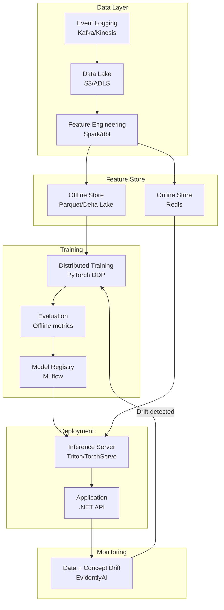

**Feature store architecture:**
The feature store solves **training-serving skew** — the notorious bug where features computed differently at training time vs. serving time causes model degradation in production.

```
Online store (Redis):
  - Serves real-time requests: GET user_features:{user_id}
  - Low latency: < 5ms
  - Features: last 24h activity, real-time signals

Offline store (Delta Lake / Parquet):  
  - Point-in-time correct feature retrieval for training
  - "What were this user's features at the moment they received this recommendation?"
  - Prevents label leakage (using future data to train on past events)

Feature pipeline syncs both stores from the same computation:
  → No skew possible: serving uses same logic as training
```

**Distributed training with PyTorch DDP:**
```python
# Data Parallel: each GPU gets full model copy + subset of data
# Gradients averaged across GPUs each step
model = DistributedDataParallel(model, device_ids=[local_rank])
# 8 GPUs = 8x effective batch size = faster training
```

**Model registry (MLflow):**
```python
with mlflow.start_run():
    mlflow.log_param("learning_rate", lr)
    mlflow.log_metric("val_auc", val_auc)
    mlflow.pytorch.log_model(model, "model")
    mlflow.set_tag("stage", "staging")  # staging → production promotion
```

**Inference serving (Triton):**
- Converts PyTorch/TF model to ONNX for cross-framework serving
- Dynamic batching: aggregate requests arriving within 5ms window into one GPU batch
- Concurrent model execution: multiple model versions simultaneously

**A/B testing infrastructure:**
```
Production traffic split:
  90% → Model v1 (control)
  10% → Model v2 (treatment)

Measure: business metric (CTR, conversion) not just ML metric (AUC)
Minimum detectable effect: 0.5% conversion lift
Required sample: ~50K users per variant
```

**Why this matters:** Most ML projects fail not because of model quality but because of infrastructure gaps: training-serving skew, missing monitoring, no retraining pipeline. The system around the model matters as much as the model.

**💡 Production Example:** An e-commerce recommendation system: initial deployment without feature store had 8.3% CTR. After investigating: training used "items viewed in past 7 days" but serving used "items viewed in past 1 hour" (different feature pipeline). After feature store alignment: CTR jumped to 9.1% with no model changes — the model was right all along, the infrastructure was wrong.

---

**Q: What is data drift and how do you detect it?**

**A:** Data drift occurs when the statistical properties of model inputs or outputs change over time, degrading model performance without any code changes.

**Three types of drift:**

**Feature drift (covariate shift):** Input distribution changes.
```
Example: E-commerce recommendation model trained on 2022 data.
         In 2024, users are younger (TikTok shoppers).
         "user_age" distribution shifts from mean 35 → mean 28.
         Model underperforms on younger users.
```

**Label drift (prior probability shift):** Target variable distribution changes.
```
Example: Fraud detection model.
         Fraud rate was 0.1% in training.
         New fraud campaign: fraud rate spikes to 2%.
         Model threshold tuned for 0.1% base rate is now far too lenient.
```

**Concept drift:** Relationship between features and label changes.
```
Example: Credit risk model.
         Historical pattern: high debt-to-income = high risk.
         Post-COVID: government loan programs decouple this relationship.
         Model predictions become unreliable even though inputs look normal.
```

**Detection methods:**

| Method | Detects | How |
|--------|---------|-----|
| PSI (Population Stability Index) | Feature drift | Compare training vs. serving distribution per feature |
| KL Divergence | Distribution shift | Measure information difference between distributions |
| KS Test | Feature drift | Statistical test on cumulative distributions |
| Prediction distribution monitoring | Output drift | Track score/class distribution over time |
| Business metric monitoring | Concept drift | Track CTR, conversion, actual outcomes |

**PSI threshold interpretation:**
```
PSI < 0.1:  No significant drift
PSI 0.1-0.2: Moderate drift — investigate
PSI > 0.2:  Significant drift — retrain likely needed
```

**Implementation with EvidentlyAI:**
```python
from evidently.report import Report
from evidently.metric_preset import DataDriftPreset

report = Report(metrics=[DataDriftPreset()])
report.run(reference_data=train_df, current_data=production_df_last_7days)
report.save_html("drift_report.html")

# Programmatic check
result = report.as_dict()
if result["metrics"][0]["result"]["dataset_drift"]:
    trigger_retraining_pipeline()
```

**Automated retraining triggers:**
```
Monitor daily:
  PSI > 0.2 on any top-10 feature → alert + schedule retrain
  Prediction score mean shifts > 2 std devs → alert
  Business metric (CTR) drops > 5% week-over-week → alert + investigate
  Actual outcome labels (when available, lagged) show accuracy < threshold → immediate retrain
```

**Why this matters:** ML models are not set-and-forget. Production models silently degrade. Without drift monitoring, teams find out from business stakeholders ("our recommendations suck now") not from engineering alerts.

**💡 Production Example:** A bank's loan approval model degraded from 82% AUC to 71% AUC over 18 months post-COVID with no code changes. Root cause: income verification patterns changed (gig economy growth). EvidentlyAI PSI monitoring would have flagged the `income_source` feature drift within 3 months, enabling a retrain before significant business impact.

---

## LLM Evaluation

**Q: How do you systematically evaluate LLM-powered applications?**

**A:** LLM evaluation requires a multi-dimensional framework covering task performance, safety, and operational metrics. No single metric captures the full picture.

**Evaluation dimensions:**

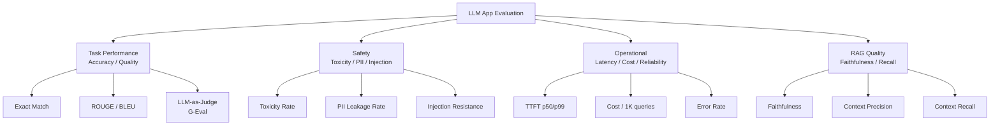

**Evaluation pipeline:**

**Step 1: Golden dataset creation**
```
Requirements:
- 200+ expert-annotated Q&A pairs per use case
- Cover the distribution of real user queries (not just easy ones)
- Include edge cases: ambiguous queries, out-of-scope questions, adversarial inputs
- Include "hard negatives": queries where the correct answer is "I don't know"
- Review process: 2 domain experts annotate + 1 adjudicates disagreements
```

**Step 2: LLM-as-judge (G-Eval)**
```csharp
public async Task<float> EvaluateWithLlmJudgeAsync(
    string question, string answer, string groundTruth)
{
    var prompt = $"""
        You are evaluating an AI assistant answer.
        
        Question: {question}
        Ground Truth: {groundTruth}
        AI Answer: {answer}
        
        Rate the answer on these criteria (1-5 each):
        1. Correctness: Does it match the ground truth?
        2. Completeness: Does it cover all key points?
        3. Conciseness: Is it appropriately brief?
        4. Clarity: Is it easy to understand?
        
        Output JSON: {{"correctness": X, "completeness": X, "conciseness": X, "clarity": X}}
        """;

    var result = await _llm.CompleteAsync(prompt);
    var scores = JsonSerializer.Deserialize<EvalScores>(result);
    return (scores.Correctness + scores.Completeness + scores.Conciseness + scores.Clarity) / 4f;
}
```

**LLM-as-judge correlation:** G-Eval with GPT-4 judges correlates with human judgment at ~85% for most NLP tasks. Limitations: judge has same biases as the model; verbose answers rated higher than concise (verbosity bias); judges favor outputs from the same model family.

**Step 3: Human evaluation for high-stakes use cases**
- Sample 2% of production requests weekly
- 3 human raters per sample (majority vote)
- Track inter-annotator agreement (Cohen's kappa > 0.7 required)
- Use for calibrating automated eval metrics

**Step 4: Regression testing**
```yaml
# CI/CD pipeline: run eval suite on every model/prompt change
- name: LLM Regression Tests
  run: |
    python evaluate.py       --golden-set golden_qa_200.json       --model gpt-4o       --prompt prompts/v2.txt       --threshold-accuracy 0.82       --threshold-faithfulness 0.85
  # Fails PR if accuracy drops > 2% or faithfulness drops > 5%
```

**Metrics dashboard targets:**

| Metric | Target | Alert threshold |
|--------|--------|----------------|
| Answer accuracy (LLM judge) | > 82% | < 78% |
| Faithfulness (RAG) | > 85% | < 80% |
| Toxicity rate | < 0.1% | > 0.5% |
| TTFT p50 | < 800ms | > 1500ms |
| TTFT p99 | < 3000ms | > 5000ms |
| Cost/1K queries | < $2.00 | > $4.00 |
| Error rate | < 0.5% | > 2% |

**Why this matters:** Without systematic evaluation, prompt changes and model upgrades are deployed blind. Teams that invest in evals ship AI features 3x faster because they can iterate confidently.

**💡 Production Example:** A legal AI team ran monthly evaluations with 500 golden Q&As. When switching from GPT-4 to GPT-4o (cheaper), evals caught a 7% accuracy regression on complex multi-document questions. They kept GPT-4 for complex queries, used GPT-4o for simple ones — saving 45% on costs without the regression.

---

## Reinforcement Learning

**Q: What is RLHF and how was it used to train ChatGPT?**

**A:** RLHF (Reinforcement Learning from Human Feedback) is the training technique that transformed GPT-3 (capable but raw) into InstructGPT/ChatGPT (helpful, harmless, and honest).

**Three-phase training process:**

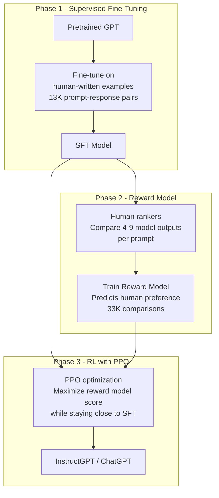

**Phase 1 — Supervised Fine-Tuning (SFT):**
- Human labelers write ideal responses to 13K diverse prompts
- Prompts cover: question answering, summarization, brainstorming, coding, creative writing
- Fine-tune pretrained GPT-3 on these (prompt, ideal response) pairs
- Creates a decent baseline that follows instructions

**Phase 2 — Reward Model (RM):**
- For each prompt, SFT model generates 4-9 different responses
- Human labelers rank responses from best to worst
- Train a separate model (reward model) to predict these human rankings
- The RM learns: what properties make an answer good? (helpful, accurate, honest, safe)

**Phase 3 — PPO Optimization:**
```
Objective: maximize E[R(π_θ(s))] - β · KL(π_θ || π_SFT)
Where:
  R(response) = reward model score for this response
  KL penalty = keeps RL model close to SFT model (prevents "reward hacking")
  β = trade-off coefficient between reward maximization and KL constraint
```

Without the KL penalty, the model learns to produce nonsensical text that happens to fool the reward model ("reward hacking").

**InstructGPT results (Ouyang et al., 2022):**
- 1.3B InstructGPT preferred by humans 85% of the time vs. 175B GPT-3
- Smaller model with RLHF > larger model without RLHF
- Shows that alignment training (RLHF) is as important as scale

**RLAIF — Constitutional AI (Anthropic):**
Instead of human preference labels, use AI feedback:
1. Model generates responses
2. A "critic" model evaluates responses against constitutional principles
3. Use these AI-generated preferences to train the reward model
4. Dramatically reduces human annotation cost (10-100x)

**Why this matters:** RLHF explains why ChatGPT feels different from raw completions. It also explains why fine-tuning alone (without RL) doesn't produce assistant-like behavior — SFT teaches format, RLHF teaches alignment.

**💡 Production Example:** A company fine-tuned Llama 2 for customer support (SFT only). The model was technically accurate but tonally inappropriate — abrupt, sometimes condescending. Adding a simple reward model (trained on 5K human preference ratings of "helpful and professional" vs "unhelpful or rude") and 2 PPO epochs transformed the tone dramatically with minimal accuracy regression.

---

**Q: What is the exploration-exploitation trade-off?**

**A:** The exploration-exploitation trade-off is foundational to RL and shows up across recommender systems, A/B testing, and AI agent behavior.

**The problem:**
```
You have a slot machine with 10 arms. Each arm has an unknown expected payout.
Exploitation: always pull the arm with the highest observed payout so far.
Exploration: pull other arms to learn if they might be better.

Pure exploitation: may permanently miss a better option due to bad luck early.
Pure exploration: never uses knowledge gained — keeps trying known bad options.
```

**Algorithms:**

**ε-greedy:**
```python
if random.random() < epsilon:  # ε = 0.1 typically
    action = random.choice(all_actions)  # Explore
else:
    action = best_known_action  # Exploit
```
Simple but wastes exploration on obviously bad options.

**UCB (Upper Confidence Bound):**
```python
# Select action maximizing: mean_reward + C * sqrt(ln(t) / n_i)
# Where t = total trials, n_i = trials for action i, C = exploration constant
ucb_scores = [mean[i] + C * math.sqrt(math.log(t) / n[i]) for i in actions]
action = argmax(ucb_scores)
```
Mathematically optimal: explores arms with high uncertainty, not randomly.

**Thompson Sampling:**
```python
# Bayesian approach: sample from posterior distribution of each arm's reward
samples = [beta.rvs(alpha[i], beta_param[i]) for i in actions]
action = argmax(samples)
# As data accumulates, posteriors narrow → more exploitation
```
Best practical performance; naturally balances exploration/exploitation as uncertainty decreases.

**Applications:**

**Recommendation systems:**
```
Pure exploitation: always recommend items similar to what user liked before
  → Filter bubble, user boredom, miss new interests
  
With ε-greedy exploration (ε=5%):
  5% of recommendations are exploratory (new categories, new content types)
  → Discover new user interests
  → System learns user evolves over time
```

**Multi-armed bandit for A/B testing:**
Traditional A/B test: 50/50 split for N weeks, then pick winner.
Multi-armed bandit: start 50/50, shift traffic toward winning variant as evidence accumulates, minimize regret during test.

```
Traditional A/B test on 100K users with clear winner from day 5:
  50K users shown losing variant unnecessarily (regret)

Thompson Sampling bandit:
  By day 5: 70% traffic to winning variant
  By day 10: 90% traffic to winning variant
  Regret reduced 60%
```

**Why this matters:** Recommendation systems, content ranking, and A/B testing frameworks all implement these algorithms. Understanding them helps you tune their behavior and recognize when a recommender is "stuck" exploiting without exploring.

**💡 Production Example:** A news app switched from fixed 80/20 editorial/algorithmic content split to Thompson Sampling bandit. After 30 days, the bandit discovered that for morning commute users, algorithm-first (70% algo) performed best, while evening users preferred editorial-first (60% editorial). Personalized splits increased session duration 18%.

---

## MCP - Model Context Protocol

**Q: What is the Model Context Protocol (MCP) and why does it matter?**

**A:** MCP (Anthropic, November 2024) is an open standard for connecting AI assistants to external tools, data sources, and services. It solves the integration fragmentation problem where every AI application needs bespoke integration code for every tool.

**The problem MCP solves:**
```
Before MCP:
  Claude integration with Slack = custom code
  GPT integration with Slack = different custom code
  Copilot integration with Slack = yet another custom code
  
  N AI providers × M tools = N×M integrations to maintain

After MCP:
  Slack MCP Server (built once)
  Any MCP-compatible AI client connects to it
  N providers × M tools = N + M implementations
```

**Architecture:**

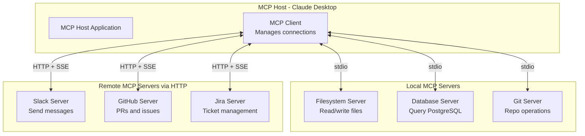

**Three MCP capabilities:**

**1. Tools** — functions the LLM can call:
```json
{
  "name": "search_knowledge_base",
  "description": "Search the enterprise knowledge base for relevant documents",
  "inputSchema": {
    "type": "object",
    "properties": {
      "query": {"type": "string", "description": "The search query"},
      "top_k": {"type": "integer", "default": 5}
    },
    "required": ["query"]
  }
}
```

**2. Resources** — data the LLM can read:
```json
{
  "uri": "postgres://mydb/customers/12345",
  "name": "Customer record for ID 12345",
  "mimeType": "application/json"
}
```

**3. Prompts** — reusable prompt templates:
```json
{
  "name": "code_review",
  "description": "Structured code review template",
  "arguments": [{"name": "language"}, {"name": "pr_diff"}]
}
```

**.NET MCP server implementation:**
```csharp
// Install: dotnet add package ModelContextProtocol
using ModelContextProtocol.Server;
using ModelContextProtocol.Protocol.Types;

var builder = WebApplication.CreateBuilder(args);
builder.Services.AddMcpServer()
    .WithHttpTransport()
    .WithTool("search_docs", "Search documentation", async (CallToolRequestParams request) =>
    {
        var query = request.Arguments?["query"]?.GetValue<string>() ?? "";
        var results = await _vectorDb.SearchAsync(query, topK: 5);
        return new CallToolResult {
            Content = [new Content { Type = "text", Text = JsonSerializer.Serialize(results) }]
        };
    })
    .WithResource("company://config", "Company configuration", async () =>
    {
        var config = await _configStore.GetAllAsync();
        return JsonSerializer.Serialize(config);
    });

var app = builder.Build();
app.MapMcp("/mcp"); // MCP endpoint at /mcp
app.Run();
```

**Transport options:**
- **stdio**: process spawned by host, communicate via stdin/stdout. For local tools, IDEs.
- **HTTP + SSE**: remote servers, multi-tenant, network-accessible. For cloud services.

**Why this matters:** MCP is becoming the industry standard. VS Code Copilot, Claude Desktop, Cursor, and Zed all support MCP. Building internal tools as MCP servers makes them compatible with every future AI client.

**💡 Production Example:** A dev team built an internal MCP server exposing their deployment tools (deploy, rollback, get_logs, check_metrics). Connected to Claude Desktop, developers can now describe deployment tasks in natural language — "roll back the payment service to the previous version" — without memorizing CLI commands. One MCP server, works with every MCP-compatible AI client they adopt.

---

**Q: How does MCP differ from traditional function calling?**

**A:** Both MCP and function calling let LLMs invoke external tools, but they differ fundamentally in scope, portability, and ecosystem.

| Dimension | Function Calling | MCP |
|-----------|-----------------|-----|
| Portability | Provider-specific | Provider-agnostic standard |
| Discovery | Hardcoded in application | Dynamic server discovery |
| Reusability | Re-implement per AI provider | Build once, works everywhere |
| Composability | Manual wiring | MCP servers composable as packages |
| State | Stateless per request | Stateful server connections |
| Resources | Tools only | Tools + Resources + Prompts |
| Ecosystem | Proprietary | Open standard, growing package registry |

**Function calling flow (traditional):**
```
1. Developer writes JSON schema for each tool (per-provider format)
2. Hardcoded in application startup
3. LLM returns tool call in provider-specific format
4. Application parses, executes, returns result
5. Repeat for every AI provider you adopt
```

**MCP flow:**
```
1. MCP server exposes tools/resources in standard format
2. Any MCP host discovers and connects to server
3. LLM uses tools through standardized protocol
4. Same server works with Claude, GPT, Gemini, Copilot
5. Publish server as npm/NuGet package → entire ecosystem can use it
```

**When to use each:**
- **Simple, application-specific tools, one AI provider:** Function calling (less infrastructure)
- **Tools shared across multiple AI applications:** MCP (build once, reuse everywhere)
- **Internal enterprise tools accessible to multiple AI clients:** MCP
- **Consumer product with single LLM provider:** Function calling

**Why this matters:** Organizations building on MCP avoid vendor lock-in and benefit from the growing ecosystem of pre-built MCP servers (Git, Slack, databases, Kubernetes, etc.). Function calling is application code; MCP is infrastructure.

**💡 Production Example:** A company built RAG over their internal docs using OpenAI function calling. When they wanted to add Claude for certain use cases, they had to rewrite all tool definitions in Anthropic's format. Migrating to MCP: one server implementation, both Claude and GPT clients work immediately.

---

## Amazon Dynamo

**Q: What are the key design decisions in Amazon's Dynamo paper (2007)?**

**A:** Amazon Dynamo (DeCandia et al., SOSP 2007) is one of the most influential distributed systems papers. It describes the key-value store powering Amazon's shopping cart, designed for extreme availability over consistency.

**The core trade-off — CAP Theorem:**
Dynamo chose **Availability over Consistency** (AP in CAP). The shopping cart must always be writable — Amazon decided a customer seeing a slightly stale cart is better than a customer unable to add items to their cart.

**Five key design decisions:**

**1. Always-writable with eventual consistency:**
```
Traditional: Write to primary, replicate to secondaries, fail if primary down.
Dynamo: Write to ANY available node. Conflicts resolved later.
Trade-off: Occasional inconsistency (two clients add same item simultaneously)
           vs guaranteed availability.
Conflict resolution: last-write-wins OR application-level merge logic.
```

**2. Consistent hashing with virtual nodes:**
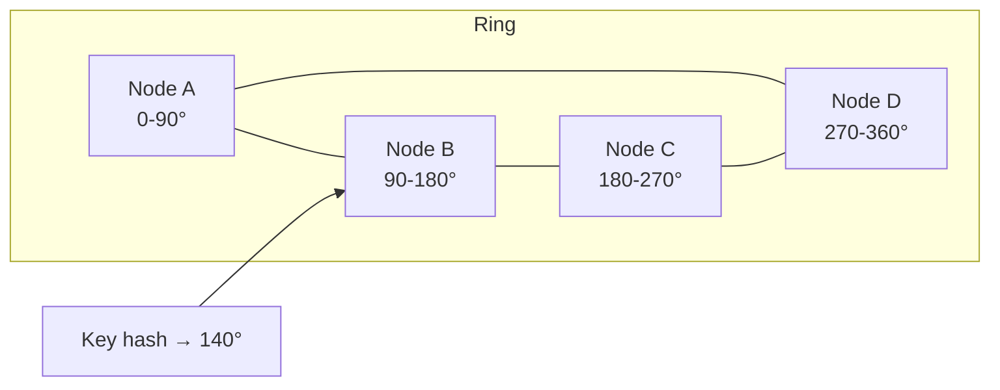
- Hash space forms a ring; each node owns a range
- Virtual nodes: each physical node appears multiple times on ring (150 virtual nodes per physical node)
- Benefit: even distribution; node failure impacts only neighbors; easy addition of new nodes

**3. Vector clocks for conflict detection:**
```
Each write carries a vector clock: {node_id: counter}
Alice writes: {A: 1} → value: ["milk"]
Bob  writes: {B: 1} → value: ["eggs"]  (concurrent with Alice)
Server merges: vector clocks incomparable → CONFLICT
Application resolves: shopping cart merges to ["milk", "eggs"]
```

**4. Sloppy quorum + hinted handoff:**
```
Normal quorum: write to exactly the N=3 nodes responsible for this key.
Sloppy quorum: if one of the N nodes is down, write to the next healthy node.
              That node stores data with a "hint" to forward to correct node when it recovers.
Hinted handoff: when the correct node recovers, the hint-holder forwards the data.
```
This provides availability even when correct nodes are temporarily down.

**5. Merkle trees for anti-entropy:**
Each node maintains a Merkle tree over its key range. To sync two nodes:
1. Compare root hashes — if equal, nodes are in sync (O(1) check)
2. If different, traverse tree to find which subtrees differ
3. Only exchange the divergent data
4. O(log N) sync cost even for millions of keys

**Gossip protocol for failure detection:**
Each node periodically gossips its membership list to a random peer. Nodes learn about failures through this propagation (eventual consistency in the control plane too).

**Why this matters:** Dynamo's patterns are now in virtually every distributed database: DynamoDB, Cassandra, Riak. Understanding why these choices were made explains why you'd use DynamoDB (high availability, eventual consistency) vs PostgreSQL (strong consistency, availability trade-offs).

**💡 Production Example:** Amazon's shopping cart design requirement: "always accept adds to cart, even during partial failures." During a 2004 outage when 2 of 3 cart nodes failed, traditional design would reject writes. Dynamo's sloppy quorum accepted writes on available nodes, reconciled when nodes recovered. Zero cart write failures during node failures.

---

**Q: What is a vector clock and how does it enable conflict detection?**

**A:** A vector clock is a data structure that tracks causal relationships between events in a distributed system, enabling detection of concurrent writes that may conflict.

**Structure:** A vector clock is a map from node IDs to logical counters:
```
{node_A: 3, node_B: 1, node_C: 2}
```
Meaning: "I have seen 3 events from A, 1 from B, 2 from C."

**Causality rules:**
```
Clock X happened-before clock Y if:
  X[i] <= Y[i] for ALL nodes i, AND
  X[i] < Y[i] for SOME node i

If neither X < Y nor Y < X: CONCURRENT events → potential conflict
```

**Dynamo example — shopping cart conflict:**
```
Initial state: cart = ["milk"], VC = {A:1}

Scenario: network partition. Client 1 talks to Node A. Client 2 talks to Node B.

Node A receives: add "eggs"
  A's cart = ["milk", "eggs"], VC = {A:2}

Node B receives: add "butter" (concurrent — B hasn't seen A:2)
  B's cart = ["milk", "butter"], VC = {B:1, A:1}

Partition heals. A and B exchange versions.
Compare VCs: {A:2} vs {B:1, A:1} — neither is strictly greater → CONCURRENT
Shopping cart application merges: cart = ["milk", "eggs", "butter"]
```

**Last-write-wins (LWW) vs. vector clocks:**
- DynamoDB (2007 Dynamo paper): vector clocks → detect conflicts, app resolves
- DynamoDB (2012+): moved to LWW (last write wins based on timestamp)
  - Simpler, no client-side conflict resolution needed
  - Loses causality: concurrent writes can silently overwrite each other
  - Acceptable for most use cases; problematic for shopping carts (item loss)

**When vector clocks matter:**
Use vector clocks when silent data loss is unacceptable and you need to surface conflicts for application-level merge. Use LWW when simplicity matters and last write is acceptable.

**Why this matters:** Understanding causality tracking is fundamental to distributed systems. CRDTs (Conflict-free Replicated Data Types, used in Google Docs real-time collaboration) are the natural evolution: data structures that automatically merge without conflicts.

**💡 Production Example:** A collaborative document editor used last-write-wins for concurrent edits. During an incident where two offices lost connectivity for 5 minutes, 47 users made edits. When connectivity restored, LWW silently discarded 23 users' work (overwrote with the most recent timestamp). Switching to CRDTs (operational transformation approach) enabled conflict-free merges.

---

## Google Spanner

**Q: What makes Google Spanner unique and what problem does TrueTime solve?**

**A:** Google Spanner (Corbett et al., OSDI 2012) is the first globally distributed database with external consistency (linearizability across datacenters). It achieves this through a hardware-software co-design called TrueTime.

**The core problem:**
Achieving external consistency across globally distributed datacenters normally requires distributed coordination (Paxos, 2PC) that introduces hundreds of milliseconds of latency (the speed of light across continents). Spanner eliminates this coordination using synchronized physical clocks.

**TrueTime API:**

Instead of a single timestamp, TrueTime returns a time interval with guaranteed uncertainty bounds:

```
TT.now() returns: TTinterval{earliest, latest}
  where: true_time ∈ [earliest, latest]
  typical uncertainty: ε ≈ 7ms (bounded by GPS + atomic clock sync)

TT.after(t)  returns true if t has definitely passed
TT.before(t) returns true if t has definitely not occurred
```

Google installs GPS receivers and atomic clocks in every datacenter. A global daemon network continuously synchronizes clocks, ensuring uncertainty ε stays below 10ms.

**How TrueTime achieves external consistency:**

```
Commit protocol for transaction T:
1. Select commit timestamp s = TT.now().latest (pessimistic — upper bound)
2. COMMIT WAIT: block until TT.after(s) is true
   (wait until s is definitely in the past: ~7ms wait)
3. Apply transaction

Why this works:
If T2 starts after T1 commits (in wall-clock time):
  T2's start_time > T1's commit_time (because T1 waited for s to pass)
  Therefore T2 reads T1's writes ✓
  External consistency guaranteed without any cross-datacenter coordination
```

**External consistency vs. serializability:**
- **Serializability**: transactions appear to execute in some serial order (ACID isolation)
- **External consistency** (linearizability + across data centers): that serial order matches real-world time order. If T1 committed before T2 started (by wall clock), T2 sees T1's writes.
- Spanner achieves both, globally, at Google scale.

**Spanner schema (globally distributed table):**
```sql
CREATE TABLE Users (
  UserId INT64 NOT NULL,
  Name STRING(100),
  Email STRING(200),
) PRIMARY KEY (UserId);

-- Data is range-sharded by primary key
-- Each shard replicated via Paxos across 3-5 datacenters
-- Reads: served from local replica (strong read: wait for Paxos majority)
-- Writes: go through Paxos leader, replicated before commit
```

**Read types:**
- **Strong read (default)**: reads at TT.now() — guaranteed to see all committed transactions
- **Stale read (bounded staleness)**: read at timestamp T - 15s — served from any replica, ~10ms latency, 99.9% availability

**Why this matters:** Spanner shows that "CAP theorem forces you to choose consistency OR availability" is nuanced. With synchronized hardware clocks, you can have both — it just requires physical infrastructure investment. CockroachDB and YugabyteDB are open-source Spanner-inspired databases accessible without Google's hardware.

**💡 Production Example:** Google's AdWords runs on Spanner — financial transactions (money moving between advertiser accounts) require external consistency. Before Spanner: 2-second pause times for cross-datacenter consistency checks. After Spanner with TrueTime: 7ms commit wait, global transactions in 30-50ms total.

---

**Q: How does Spanner implement distributed transactions without 2PC blocking?**

**A:** Spanner uses 2PC but makes it non-blocking by leveraging Paxos groups for each participant, so coordinator failure doesn't permanently block transactions.

**Traditional 2PC blocking problem:**
```
Phase 1: Coordinator sends PREPARE to all participants
Phase 2: Coordinator sends COMMIT to all participants

If coordinator fails after Phase 1 but before Phase 2:
  Participants are stuck holding locks indefinitely
  System blocked until coordinator recovers (could be hours)
```

**Spanner's solution — Paxos-backed participants:**
```
Each shard is a Paxos group (5 replicas across datacenters)
The Paxos group elects a leader; the leader participates in 2PC

If the transaction coordinator fails:
  New coordinator can be elected by Paxos (not 2PC)
  New coordinator queries Paxos groups for their prepared state
  Can continue or abort the transaction
  Not blocked — Paxos group can always make progress
```

**Transaction flow:**
```
1. Client → Spanner: BEGIN TRANSACTION
2. Client reads (from local Paxos leader of each shard)
3. Client performs writes (buffered client-side)
4. Client → Coordinator shard: COMMIT {reads, writes}
5. Coordinator → Participant shards: PREPARE
6. Paxos replication: each shard replicates PREPARE across its 5 replicas
7. Participant shards → Coordinator: PREPARED (with timestamp vote)
8. Coordinator: select commit timestamp = max(all votes).latest, then COMMIT WAIT
9. Coordinator → Participants: COMMIT {timestamp}
10. Participants apply writes, release locks
```

**Commit wait ensures external consistency:**
```
Commit timestamp s = TT.now().latest
Wait until TT.after(s) (≈ 7ms)
→ Any subsequent transaction necessarily starts after s
→ External consistency maintained
```

**Read-write vs. read-only transactions:**
- Read-write: full 2PC with Paxos replication and commit wait (~10ms)
- Read-only (snapshot read): no 2PC, no locks, served from any replica at a consistent timestamp (~1ms within datacenter, ~10ms cross-datacenter with strong read)

**Why this matters:** Spanner's design proves that strong consistency at global scale is achievable — it's an engineering challenge, not a theoretical impossibility. Understanding this influences when you'd choose CockroachDB/Spanner over eventual-consistent NoSQL.

**💡 Production Example:** A global fintech running on CockroachDB (Spanner-inspired): cross-region transactions (e.g., transfer funds from US East to EU West account) commit in 85ms with full linearizability. Competing architecture using eventual-consistent Cassandra + application-level saga: 250ms + complex compensating transaction logic. Spanner-model wins on both latency and correctness.

---

## Meta XFaaS

**Q: What is Meta's XFaaS and how does it handle 10M function calls/second?**

**A:** XFaaS (Schall et al., OSDI 2023) is Meta's internal Functions-as-a-Service platform. It runs 10 million+ function invocations per second across Meta's global infrastructure, serving products from WhatsApp to Instagram to Facebook.

**Why Meta built it:**
- Microservices proliferation: thousands of internal services with inconsistent infra
- Operational burden: each team managing their own infra, scaling, deployment
- Resource waste: services over-provisioned for peak, idle the rest of the time
- Need: shared, efficient, opaque compute platform

**Architecture:**

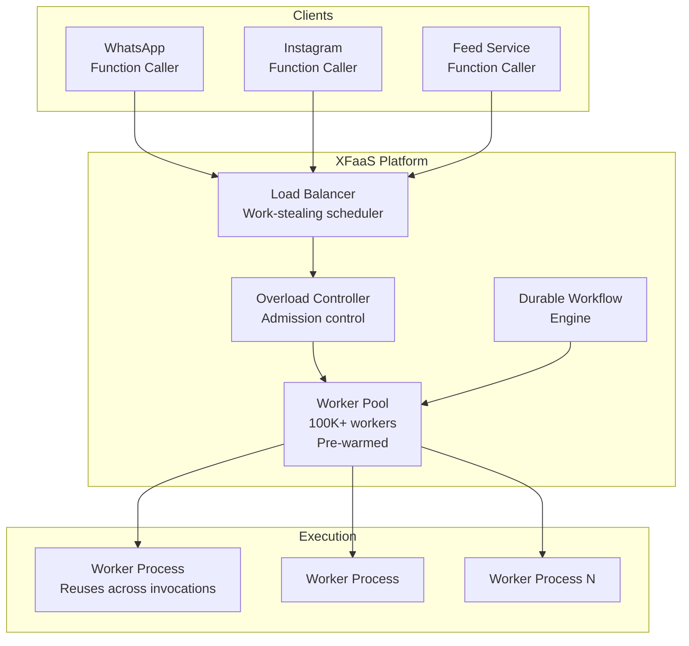

**Key innovations:**

**1. No cold starts — pre-warmed worker pool:**
Unlike AWS Lambda (spawns a new container per invocation: 100-300ms cold start), XFaaS maintains a persistent pool of workers pre-loaded with function code.

```
AWS Lambda flow:
  Request → Provision container (100ms) → Load code (50ms) → Execute → Destroy container
  Cold start: 150-300ms

XFaaS flow:
  Request → Pick available worker (already running function code) → Execute
  Cold start: 0ms (workers are always warm)
```

**2. Work-stealing scheduler:**
```
Workers maintain local queues.
When a worker's queue is empty, it "steals" work from a busy worker's queue.
Benefits:
  - Natural load balancing without centralized coordinator
  - Low latency: no waiting for a specific worker
  - O(1) average steal cost
```

**3. Admission control under overload:**
```csharp
// Simplified admission control
if (IsOverloaded())
{
    // Shed low-priority requests rather than letting all requests slow down
    if (request.Priority < Priority.High)
        return StatusCode(503, "Service overloaded — retry with backoff");
    
    // Queue high-priority requests briefly
    await _queue.EnqueueWithTimeoutAsync(request, TimeSpan.FromMilliseconds(100));
}
```
Controlled shedding prevents cascading failures. At 10M RPS, a 1% overload = 100K RPS of surplus — without shedding, the system collapses.

**4. Stateful workflows — durable execution:**
For long-running multi-step functions (ML inference pipelines, data processing workflows):
```python
@xfaas.workflow
def process_video(video_id: str):
    # Each step checkpointed — resumable if worker fails
    frames = yield extract_frames(video_id)        # Step 1
    embeddings = yield generate_embeddings(frames)  # Step 2
    tags = yield classify_content(embeddings)       # Step 3
    yield store_results(video_id, tags)             # Step 4
```
If the worker running Step 2 crashes, XFaaS resumes from the checkpoint at Step 2 — no reprocessing of Step 1.

**5. Heterogeneous scheduling:**
Functions range from 1ms (cache lookups) to 30s (ML inference). XFaaS bins functions by expected duration and assigns appropriate worker types (CPU-optimized for short, GPU for ML inference, memory-heavy for data processing).

**Performance at scale:**
- 10M+ calls/second sustained
- 100K+ worker processes
- Tail latency: p99 < 1ms for cached operations
- Durable workflow throughput: 1M workflow steps/second

**Why this matters:** XFaaS patterns are applicable to any high-scale .NET microservices platform. The pre-warmed worker model is why Azure Container Apps and Google Cloud Run evolved toward "minimum instances > 0" settings — cold starts are a real latency and UX problem.

**💡 Production Example:** Before XFaaS, a Meta ML inference service ran on dedicated VMs: 40% average CPU utilization (over-provisioned for peak), 2-week deployment cycle. After migration to XFaaS: bin-packed with other functions → 85% CPU utilization (2x efficiency), deployment in minutes, auto-scaling built-in.

---

**Q: How does XFaaS compare to AWS Lambda?**

**A:**

| Dimension | AWS Lambda | Meta XFaaS |
|-----------|-----------|------------|
| Cold start | 100-300ms (standard), <1ms (SnapStart) | None — pre-warmed workers |
| Max duration | 15 minutes | Hours (workflow engine) |
| Scaling model | Auto (0 to N) | Manual capacity managed by platform |
| Isolation model | Per-invocation VM (Firecracker) | Shared worker process |
| Multi-tenancy | External customers (strong isolation required) | Internal Meta code (trusted) |
| State | Stateless by default | Durable workflows with checkpointing |
| Scheduling | AWS-managed | Work-stealing scheduler |
| GPU support | Limited | First-class (ML workloads) |
| Cold start mitigation | Provisioned concurrency ($$) | Architecture eliminates cold start |
| Deployment | Per-function packages | Central platform teams manage |

**The isolation trade-off:**
Lambda uses Firecracker microVMs — each invocation gets a fresh VM. This is required for multi-tenant external customer workloads (you cannot trust customer code). The price: cold start overhead.

XFaaS uses shared worker processes — same process handles multiple invocations. Possible only because all Meta code is trusted. The benefit: zero cold start, 5-10x better resource utilization.

**AWS Lambda SnapStart (Java):** Lambda now offers SnapStart — take a memory snapshot after initialization, restore snapshot on cold start. Reduces Java cold start from 8-12s to <1s. Partial convergence toward XFaaS approach.

**Azure equivalent patterns:**
- **Azure Container Apps**: supports "minimum replicas > 0" to eliminate cold start (like XFaaS pre-warming)
- **Azure Durable Functions**: mirrors XFaaS durable workflow engine (checkpointed, resumable)
- **Azure Functions Premium Plan**: pre-warmed instances, eliminates cold start

**.NET implementation pattern (Azure Durable Functions inspired by XFaaS):**
```csharp
// Durable function orchestration — automatically checkpointed
[FunctionName("ProcessDocumentOrchestration")]
public async Task RunOrchestrator([OrchestrationTrigger] IDurableOrchestrationContext context)
{
    var documentId = context.GetInput<string>();
    
    // Each activity is checkpointed — if host restarts, orchestration resumes here
    var parsed = await context.CallActivityAsync<ParsedDocument>("ParseDocument", documentId);
    var embedded = await context.CallActivityAsync<float[]>("GenerateEmbedding", parsed);
    var stored = await context.CallActivityAsync<bool>("StoreEmbedding", 
        new StoreRequest { DocumentId = documentId, Embedding = embedded });
}
```

**Why this matters:** Understanding FaaS trade-offs guides architectural decisions. Cold start is a hard constraint for user-facing latency-sensitive workloads. Pre-warming (Azure Premium Plan, minimum instances) costs more but eliminates the tail latency problem.

**💡 Production Example:** A real-time API on Azure Functions Consumption plan had p99 latency of 4.2s (cold starts). Switching to Premium Plan with 2 pre-warmed instances: p99 dropped to 180ms. Cost increase: $150/month. User abandonment at > 3s wait time dropped by 78%, revenue impact far exceeded cost.

---

*Last updated: 2026-06-07 | Senior .NET Engineer Interview Preparation*
