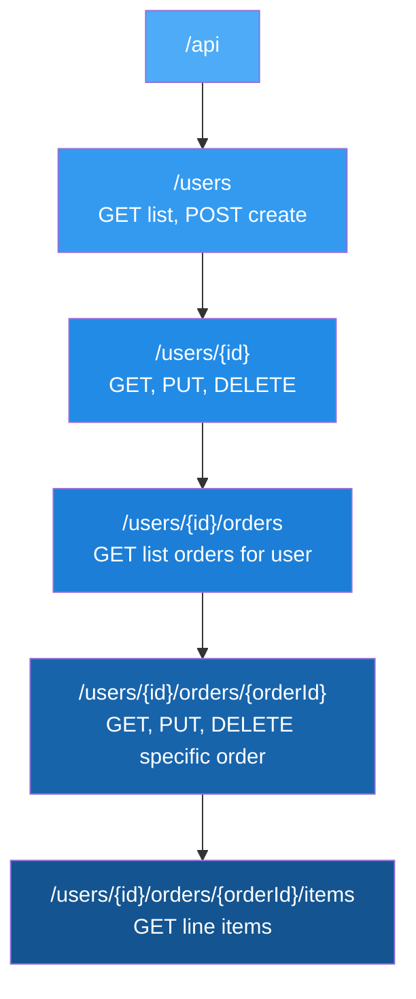
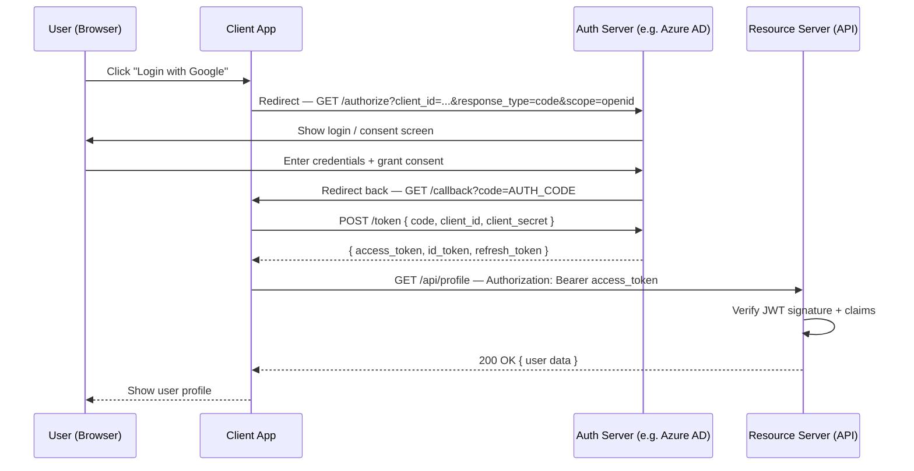
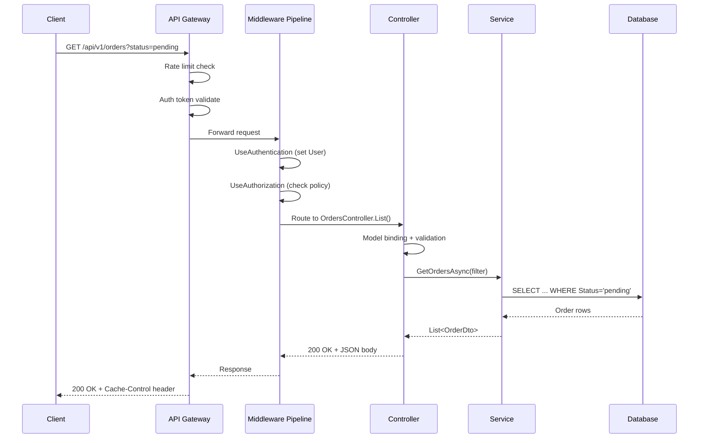
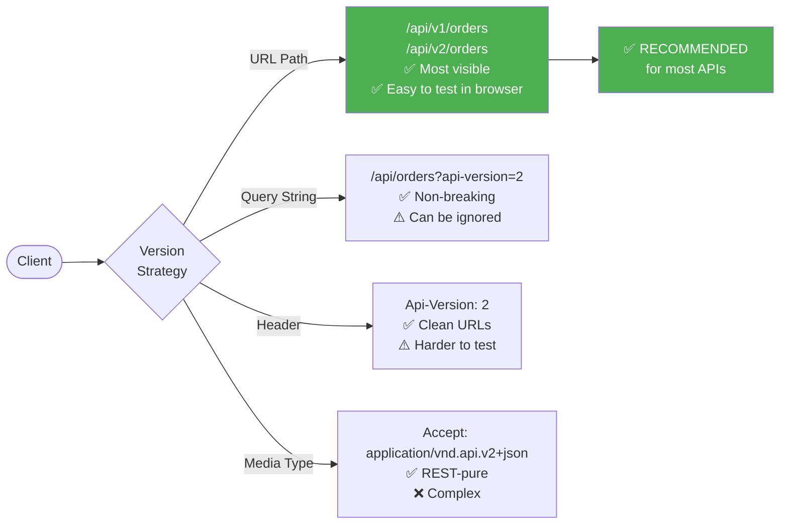
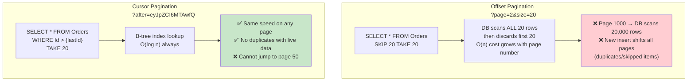
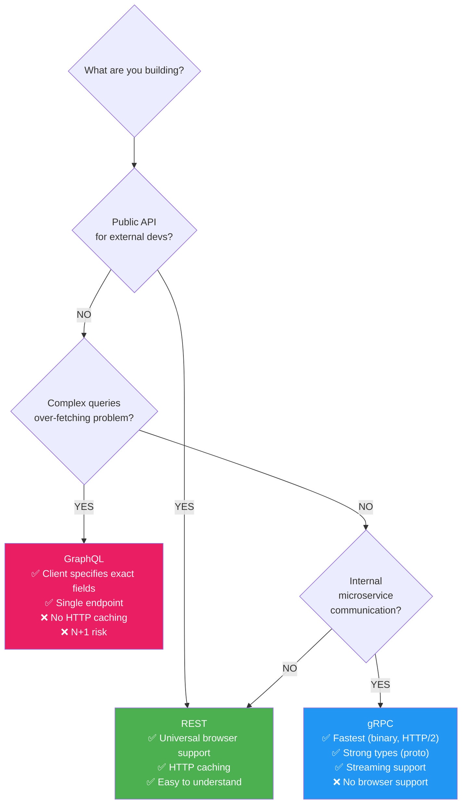
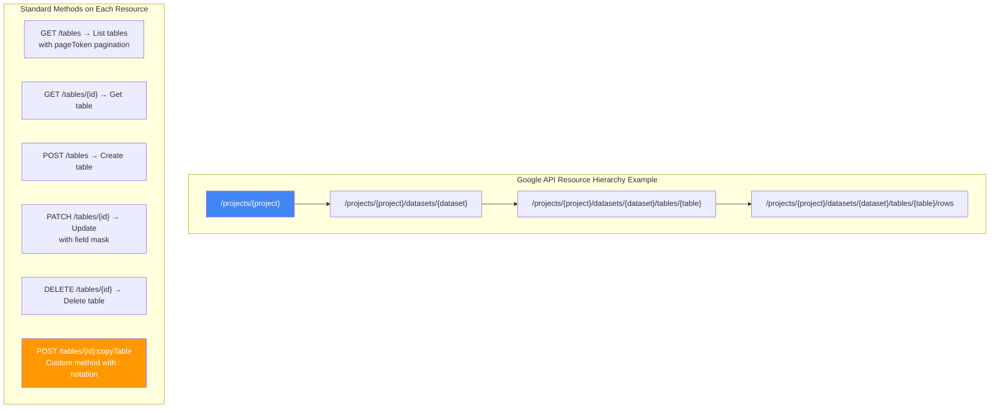
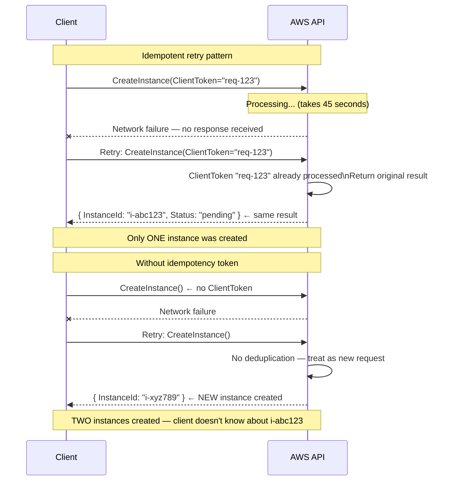
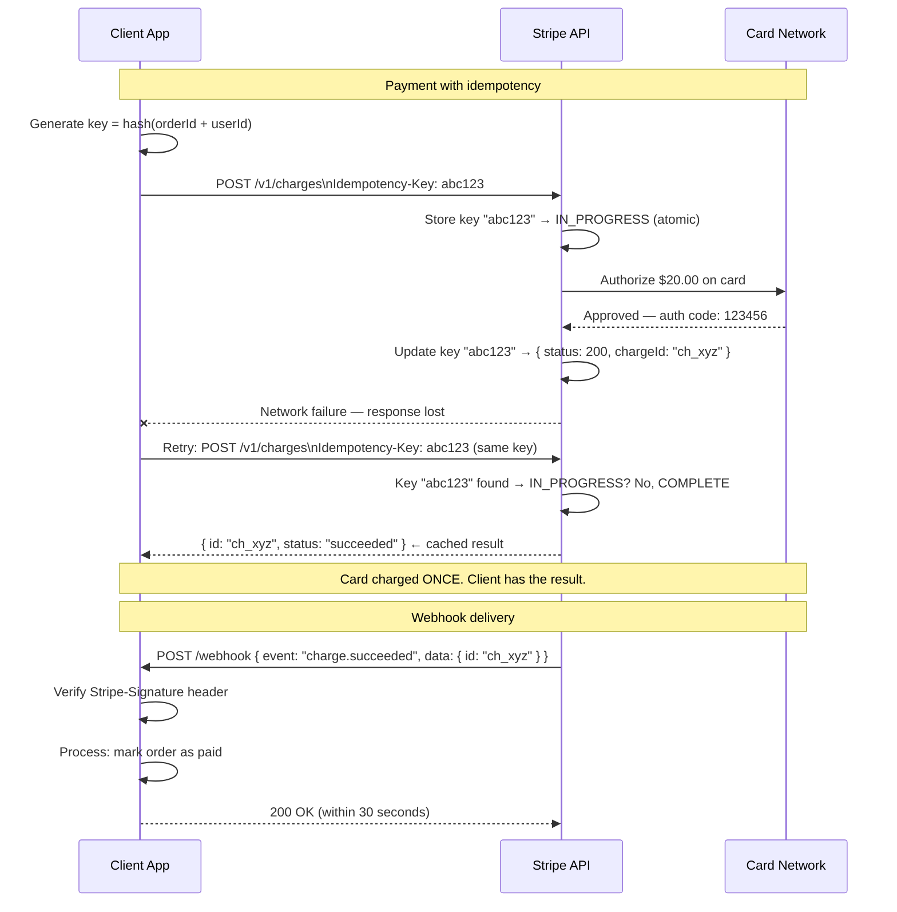
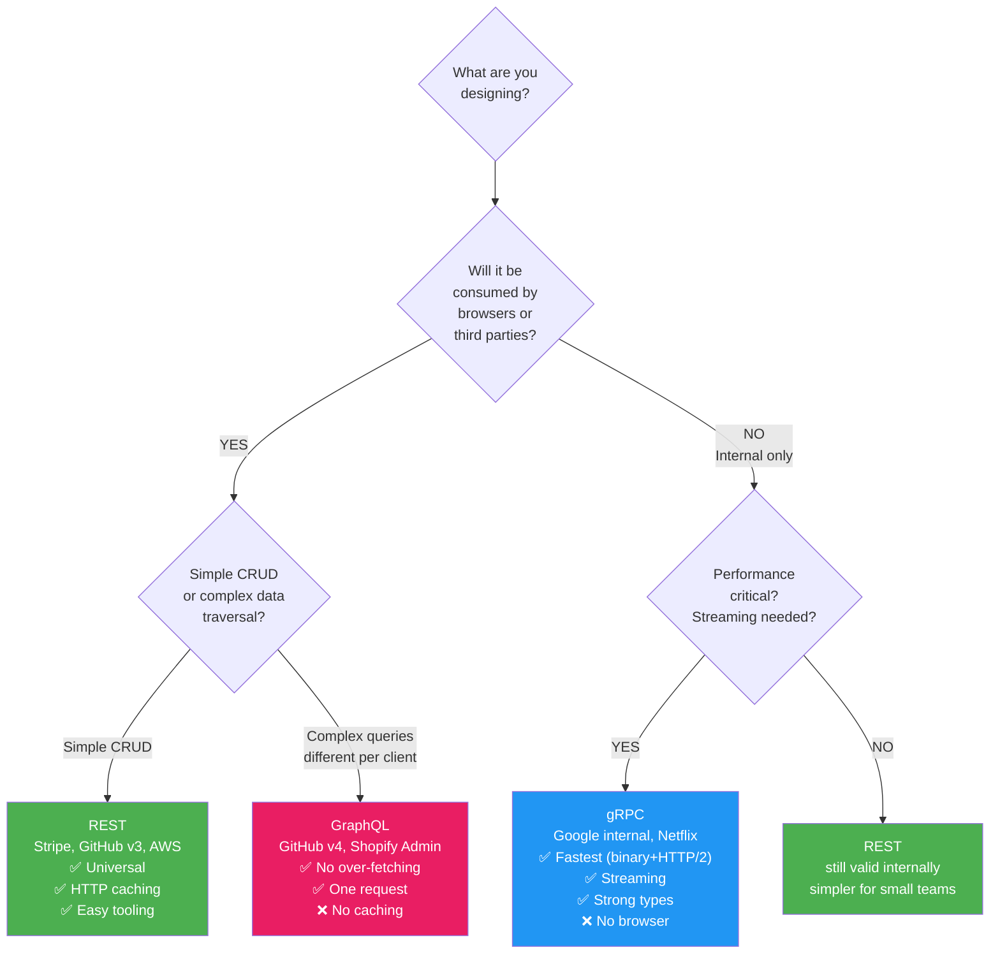

# 🔌 API Design Interview Guide

> REST best practices · Idempotency · Versioning · HATEOAS · OpenAPI · Error standards · Tradeoffs

---

## 📋 Table of Contents

1. [REST Best Practices](#1-rest-best-practices)
2. [Idempotent APIs](#2-idempotent-apis)
3. [API Versioning](#3-api-versioning)
4. [Pagination Strategies](#4-pagination-strategies)
5. [Error Response Standards](#5-error-response-standards)
6. [HATEOAS Basics](#6-hateoas-basics)
7. [OpenAPI / Swagger](#7-openapi--swagger)
8. [API Security Best Practices](#8-api-security-best-practices)
9. [Rate Limiting & Throttling](#9-rate-limiting--throttling)
10. [Tradeoffs — Key Decisions](#10-tradeoffs--key-decisions)

---

## 1. REST Best Practices

> 📚 Reference: https://restfulapi.net/

### Resource Naming — Nouns, Not Verbs

❌ **Wrong** — verbs in URLs:
```
GET  /getOrders
POST /createOrder
POST /deleteOrder/123
GET  /getUserById?id=456
```

✅ **Correct** — nouns (resources), HTTP method is the verb:
```
GET    /orders              → list orders
POST   /orders              → create order
GET    /orders/{id}         → get order by ID
PUT    /orders/{id}         → replace order
PATCH  /orders/{id}         → partial update
DELETE /orders/{id}         → delete order

GET    /orders/{id}/items   → get items for a specific order (nested resource)
POST   /orders/{id}/ship    → exception: action that doesn't map to CRUD (use noun phrase)
```

### HTTP Methods Correctly Applied
```csharp
[ApiController]
[Route("api/v1/orders")]
public class OrdersController : ControllerBase
{
    [HttpGet]                          // GET /orders?status=pending&page=1
    public Task<IActionResult> List([FromQuery] OrderFilter filter) { }

    [HttpGet("{id:guid}")]             // GET /orders/abc123
    public Task<IActionResult> Get(Guid id) { }

    [HttpPost]                         // POST /orders
    public Task<IActionResult> Create([FromBody] CreateOrderDto dto) { }

    [HttpPut("{id:guid}")]             // PUT /orders/abc123 (full replace)
    public Task<IActionResult> Replace(Guid id, [FromBody] OrderDto dto) { }

    [HttpPatch("{id:guid}")]           // PATCH /orders/abc123 (partial update)
    public Task<IActionResult> Update(Guid id, [FromBody] JsonPatchDocument<OrderDto> patch) { }

    [HttpDelete("{id:guid}")]          // DELETE /orders/abc123
    public Task<IActionResult> Delete(Guid id) { }

    [HttpPost("{id:guid}/ship")]       // POST /orders/abc123/ship (action)
    public Task<IActionResult> Ship(Guid id) { }
}
```

### Response Codes — Use Them Correctly
```csharp
// ✅ 201 Created with Location header
[HttpPost]
public async Task<IActionResult> Create(CreateOrderDto dto)
{
    var id = await _svc.CreateAsync(dto);
    return CreatedAtAction(                // 201 + Location: /api/orders/{id}
        nameof(Get), new { id }, new { id });
}

// ✅ 204 No Content for delete/update with no response body
[HttpDelete("{id:guid}")]
public async Task<IActionResult> Delete(Guid id)
{
    await _svc.DeleteAsync(id);
    return NoContent();  // 204
}

// ✅ 202 Accepted for async operations
[HttpPost("import")]
public IActionResult Import(IFormFile file)
{
    var jobId = _queue.Enqueue(file);
    return Accepted(new { jobId, statusUrl = $"/api/jobs/{jobId}" }); // 202
}
```

---

## 2. Idempotent APIs

> 📚 Reference: https://developer.mozilla.org/en-US/docs/Glossary/Idempotent

### What Is Idempotency?
An operation is **idempotent** if calling it multiple times has the same effect as calling it once. Critical for network reliability — if you don't know if a request succeeded, safe to retry idempotent ones.

| Method | Idempotent? | Safe? | Notes |
|--------|-------------|-------|-------|
| GET | ✅ Yes | ✅ Yes | No side effects |
| DELETE | ✅ Yes | ❌ No | Delete twice = still deleted |
| PUT | ✅ Yes | ❌ No | Replace twice = same result |
| POST | ❌ No | ❌ No | Create twice = two records |
| PATCH | ❌ No (usually) | ❌ No | `SET name="Alice"` is idempotent; `INCREMENT count` is not |

### Making POST Idempotent with Idempotency Keys
```csharp
// Client sends: POST /payments
// Header: Idempotency-Key: 550e8400-e29b-41d4-a716-446655440000
// If network fails → client retries with SAME key → server returns SAME response

[HttpPost]
public async Task<IActionResult> Create(
    [FromBody] CreatePaymentDto dto,
    [FromHeader(Name = "Idempotency-Key")] string? idempotencyKey)
{
    if (idempotencyKey is not null)
    {
        // Check cache for existing result
        var cached = await _idempotencyStore.GetAsync(idempotencyKey);
        if (cached is not null)
            return new ContentResult
            {
                StatusCode  = cached.StatusCode,
                Content     = cached.Body,
                ContentType = "application/json"
            };
    }

    var result = await _paymentService.CreateAsync(dto);

    if (idempotencyKey is not null)
        await _idempotencyStore.SetAsync(idempotencyKey, result, ttl: TimeSpan.FromHours(24));

    return CreatedAtAction(nameof(Get), new { id = result.Id }, result);
}
```

---

## 3. API Versioning

### Four Strategies Compared

| Strategy | Example | Pros | Cons |
|----------|---------|------|------|
| **URL path** | `/api/v1/orders` | Obvious, easy to test in browser | Version in URL (REST purists object) |
| **Query string** | `/api/orders?api-version=1.0` | Non-breaking for clients | Can be ignored, less visible |
| **Header** | `Api-Version: 1.0` | Clean URLs | Harder to test in browser |
| **Media type** | `Accept: application/vnd.myapi.v1+json` | Most REST-correct | Complex, rarely used |

**Recommendation:** URL path (`/api/v1/`) — most visible, easiest to understand, easiest to route.

### Implementation with Microsoft.AspNetCore.Mvc.Versioning
```csharp
// Program.cs
builder.Services.AddApiVersioning(options =>
{
    options.DefaultApiVersion           = new ApiVersion(1, 0);
    options.AssumeDefaultVersionWhenUnspecified = true;
    options.ReportApiVersions           = true;  // adds Api-Supported-Versions header
    options.ApiVersionReader            = ApiVersionReader.Combine(
        new UrlSegmentApiVersionReader(),           // /api/v1/
        new HeaderApiVersionReader("Api-Version"),  // also accept header
        new QueryStringApiVersionReader("api-version") // also accept query string
    );
});

builder.Services.AddVersionedApiExplorer(options =>
{
    options.GroupNameFormat           = "'v'VVV";
    options.SubstituteApiVersionInUrl = true;
});

// V1 Controller
[ApiController]
[ApiVersion("1.0")]
[Route("api/v{version:apiVersion}/orders")]
public class OrdersV1Controller : ControllerBase
{
    [HttpGet]
    public IActionResult Get() => Ok(new { version = "v1", orders = _v1Service.GetAll() });
}

// V2 Controller — new format, new fields
[ApiController]
[ApiVersion("2.0")]
[Route("api/v{version:apiVersion}/orders")]
public class OrdersV2Controller : ControllerBase
{
    [HttpGet]
    public IActionResult Get() => Ok(new { version = "v2", data = _v2Service.GetAll(), total = 42 });
}
```

### Deprecation Strategy
```csharp
// Mark old version as deprecated — still works, but clients are warned
[ApiVersion("1.0", Deprecated = true)]
[ApiController]
public class OrdersV1Controller : ControllerBase
{
    // Response header automatically added:
    // Sunset: Sat, 31 Dec 2026 23:59:59 GMT  (when it will stop working)
    // Deprecation: true
}
```

### Non-Breaking vs Breaking Changes
```
✅ Non-breaking (add to same version):
  - Add optional request fields
  - Add new response fields
  - Add new endpoints
  - Relax validation (accept more)

❌ Breaking (requires new version):
  - Remove or rename fields
  - Change field types
  - Change status codes
  - Change URL structure
  - Tighten validation (reject previously valid input)
  - Change authentication requirements
```

---

## 4. Pagination Strategies

### Offset vs Cursor Pagination

| | Offset (`?page=2&size=20`) | Cursor (`?after=eyJpZCI6MTAwfQ`) |
|-|---------------------------|----------------------------------|
| Implementation | Simple | Moderate |
| Performance | ❌ O(n) — DB scans all skipped rows | ✅ O(log n) — uses index |
| Real-time data | ❌ Skipped/duplicate items if data changes | ✅ Stable |
| Random access | ✅ Jump to any page | ❌ Forward/backward only |
| Use when | Small datasets, admin UIs | Large datasets, feeds, timelines |

```csharp
// Offset pagination — simple, avoid for > 10k rows
[HttpGet]
public async Task<IActionResult> List([FromQuery] int page = 1, [FromQuery] int size = 20)
{
    if (size > 100) size = 100; // cap page size

    var total  = await _db.Orders.CountAsync();
    var orders = await _db.Orders
        .OrderBy(o => o.CreatedAt)
        .Skip((page - 1) * size)    // ← OFFSET: scans all prior rows
        .Take(size)
        .AsNoTracking()
        .ToListAsync();

    return Ok(new
    {
        data  = orders,
        total,
        page,
        size,
        pages = (int)Math.Ceiling((double)total / size),
        links = new
        {
            next = page * size < total ? $"/api/orders?page={page + 1}&size={size}" : null,
            prev = page > 1            ? $"/api/orders?page={page - 1}&size={size}" : null
        }
    });
}

// Cursor pagination — for large datasets and feeds
[HttpGet]
public async Task<IActionResult> ListCursor([FromQuery] string? after = null, [FromQuery] int size = 20)
{
    Guid? cursorId = after is null ? null
        : Guid.Parse(Encoding.UTF8.GetString(Convert.FromBase64String(after)));

    var query = _db.Orders
        .OrderBy(o => o.Id);

    if (cursorId.HasValue)
        query = (IOrderedQueryable<Order>)query.Where(o => o.Id > cursorId); // keyset pagination

    var orders  = await query.Take(size + 1).AsNoTracking().ToListAsync(); // +1 to detect hasMore
    var hasMore = orders.Count > size;
    if (hasMore) orders = orders.Take(size).ToList();

    var nextCursor = hasMore
        ? Convert.ToBase64String(Encoding.UTF8.GetBytes(orders.Last().Id.ToString()))
        : null;

    return Ok(new { data = orders, nextCursor, hasMore });
}
```

---

## 5. Error Response Standards

### Problem Details (RFC 7807) — The Standard
```json
// Standard error response — machine-readable + human-readable
{
  "type":     "https://myapi.com/errors/validation-failed",  // URI identifying error type
  "title":    "One or more validation errors occurred",
  "status":   400,
  "detail":   "The request body failed validation",
  "instance": "/api/orders/00000000-0000-0000-0000-000000000000",
  "traceId":  "00-abc123def456-00",    // link to distributed trace
  "errors": {                          // extension: field-level errors
    "customerName": ["Name is required", "Name must be at most 100 characters"],
    "total":        ["Total must be greater than 0"]
  }
}
```

### Implementation
```csharp
// Program.cs — configure Problem Details
builder.Services.AddProblemDetails();
builder.Services.AddExceptionHandler<GlobalExceptionHandler>();

// Custom exception → consistent ProblemDetails
public class GlobalExceptionHandler : IExceptionHandler
{
    public async ValueTask<bool> TryHandleAsync(
        HttpContext ctx, Exception ex, CancellationToken ct)
    {
        var (status, type, title) = ex switch
        {
            ValidationException v => (400, "validation-failed", "Validation Failed"),
            NotFoundException   n => (404, "not-found",         "Resource Not Found"),
            ConflictException   c => (409, "conflict",          "Conflict"),
            UnauthorizedException => (401, "unauthorized",      "Unauthorized"),
            ForbiddenException    => (403, "forbidden",         "Forbidden"),
            _                     => (500, "internal-error",    "Internal Server Error")
        };

        ctx.Response.StatusCode = status;
        await ctx.Response.WriteAsJsonAsync(new ProblemDetails
        {
            Type     = $"https://myapi.com/errors/{type}",
            Title    = title,
            Status   = status,
            Detail   = ex is not InternalException ? ex.Message : "An error occurred",
            Instance = ctx.Request.Path,
            Extensions =
            {
                ["traceId"] = Activity.Current?.Id,
                ["errors"]  = ex is ValidationException ve ? ve.Errors : null
            }
        }, ct);

        return true;
    }
}
```

### Never Return Raw Exception Messages in Production
```csharp
// ❌ Wrong — exposes stack trace, internal paths, DB table names
{
  "error": "SqlException: Invalid column name 'custmer_id'. at ... at System.Data.SqlClient..."
}

// ✅ Correct — safe, actionable
{
  "type":   "https://myapi.com/errors/internal-error",
  "title":  "Internal Server Error",
  "status": 500,
  "detail": "An unexpected error occurred. Please contact support with traceId: abc123"
}
// The traceId lets support find the full exception in logs
```

---

## 6. HATEOAS Basics

> 📚 Reference: https://restfulapi.net/hateoas/

### What Is HATEOAS?
Hypermedia As The Engine Of Application State — API responses include **links** to available actions. Clients discover what they can do next from the response, rather than hardcoding URLs.

```json
// Without HATEOAS — client must know all URLs upfront
{ "id": "abc123", "status": "pending", "total": 99.99 }

// With HATEOAS — response tells client what actions are available
{
  "id":     "abc123",
  "status": "pending",
  "total":  99.99,
  "_links": {
    "self":   { "href": "/api/orders/abc123",        "method": "GET" },
    "pay":    { "href": "/api/orders/abc123/pay",    "method": "POST" },
    "cancel": { "href": "/api/orders/abc123/cancel", "method": "POST" },
    "items":  { "href": "/api/orders/abc123/items",  "method": "GET" }
  }
}

// After payment:
{
  "id":     "abc123",
  "status": "paid",
  "_links": {
    "self":   { "href": "/api/orders/abc123" },
    "ship":   { "href": "/api/orders/abc123/ship",   "method": "POST" },
    "refund": { "href": "/api/orders/abc123/refund", "method": "POST" }
    // "pay" and "cancel" no longer present — order already paid
  }
}
```

```csharp
// Simple HATEOAS response builder
public record Link(string Href, string Method = "GET", string Rel = "self");

public async Task<IActionResult> Get(Guid id)
{
    var order = await _svc.GetAsync(id) ?? throw new NotFoundException();

    var links = new List<Link> { new($"/api/orders/{id}") };

    if (order.Status == "Pending")
    {
        links.Add(new($"/api/orders/{id}/pay",    "POST", "pay"));
        links.Add(new($"/api/orders/{id}/cancel", "POST", "cancel"));
    }
    if (order.Status == "Paid")
        links.Add(new($"/api/orders/{id}/ship", "POST", "ship"));

    return Ok(new { order, _links = links });
}
```

**HATEOAS tradeoff:** Adds complexity and response size. In practice, most REST APIs don't implement full HATEOAS — they include basic pagination links and action links for state machine transitions. Know the concept; implement selectively.

---

## 7. OpenAPI / Swagger

> 📚 Reference: https://swagger.io/docs/

### Setup in .NET
```csharp
// Program.cs
builder.Services.AddEndpointsApiExplorer();
builder.Services.AddSwaggerGen(options =>
{
    options.SwaggerDoc("v1", new OpenApiInfo
    {
        Title       = "Orders API",
        Version     = "v1",
        Description = "Manage customer orders",
        Contact     = new OpenApiContact { Name = "Support", Email = "api@mycompany.com" }
    });

    // Add JWT auth to Swagger UI
    options.AddSecurityDefinition("Bearer", new OpenApiSecurityScheme
    {
        Name         = "Authorization",
        Type         = SecuritySchemeType.Http,
        Scheme       = "bearer",
        BearerFormat = "JWT",
        In           = ParameterLocation.Header,
        Description  = "Enter: Bearer {your-token}"
    });
    options.AddSecurityRequirement(new OpenApiSecurityRequirement
    {
        [new OpenApiSecurityScheme
        {
            Reference = new OpenApiReference { Type = ReferenceType.SecurityScheme, Id = "Bearer" }
        }] = []
    });

    // Include XML comments from code
    var xmlFile = $"{Assembly.GetExecutingAssembly().GetName().Name}.xml";
    options.IncludeXmlComments(Path.Combine(AppContext.BaseDirectory, xmlFile));
});

app.UseSwagger();
app.UseSwaggerUI(c =>
{
    c.SwaggerEndpoint("/swagger/v1/swagger.json", "Orders API V1");
    // Only expose in dev:
    // if (app.Environment.IsDevelopment()) app.UseSwaggerUI();
});
```

### Document Endpoints Properly
```csharp
/// <summary>
/// Creates a new order for the authenticated customer.
/// </summary>
/// <param name="dto">Order creation details</param>
/// <returns>The created order with assigned ID</returns>
/// <response code="201">Order created successfully</response>
/// <response code="400">Validation failed — check errors array</response>
/// <response code="401">Not authenticated</response>
[HttpPost]
[ProducesResponseType(typeof(OrderDto), StatusCodes.Status201Created)]
[ProducesResponseType(typeof(ProblemDetails), StatusCodes.Status400BadRequest)]
[ProducesResponseType(StatusCodes.Status401Unauthorized)]
[Produces("application/json")]
public async Task<IActionResult> Create([FromBody] CreateOrderDto dto) { }
```

---

## 8. API Security Best Practices

```csharp
// 1. Always validate and sanitise input
public record CreateOrderDto(
    [Required][MaxLength(100)] string CustomerName,
    [Required][MinLength(1)]   List<OrderItemDto> Items,
    [Range(0.01, 1_000_000)]   decimal Total
);

// 2. Never expose internal IDs where possible — use public-facing IDs
// Bad: /orders/1, /orders/2 → exposes how many orders you have (enumeration attack)
// Good: /orders/a1b2c3d4-... (UUID) → not enumerable

// 3. Scope queries to authenticated user
var order = await _db.Orders
    .Where(o => o.Id == id && o.UserId == CurrentUserId) // BOLA prevention
    .FirstOrDefaultAsync();

// 4. Log security events
_log.LogWarning("Unauthorized access attempt: user {UserId} requested order {OrderId} (not their order)",
    CurrentUserId, id);

// 5. Rate limit sensitive endpoints
[EnableRateLimiting("AuthLimiter")] // 5 attempts per minute
[HttpPost("auth/login")]
public Task<IActionResult> Login(LoginDto dto) { }

// 6. Validate content type
app.UseWhen(ctx => ctx.Request.Method == "POST" || ctx.Request.Method == "PUT",
    branch => branch.Use(async (ctx, next) =>
    {
        if (!ctx.Request.HasJsonContentType())
        {
            ctx.Response.StatusCode = 415; // Unsupported Media Type
            return;
        }
        await next();
    }));
```

---

## 9. Rate Limiting & Throttling

```csharp
// .NET 7+ built-in rate limiting
builder.Services.AddRateLimiter(options =>
{
    // Per-user token bucket (authenticated users)
    options.AddPolicy("ApiLimiter", context =>
        RateLimitPartition.GetTokenBucketLimiter(
            partitionKey: context.User.FindFirst("sub")?.Value ?? context.Connection.RemoteIpAddress?.ToString() ?? "anon",
            factory: _ => new TokenBucketRateLimiterOptions
            {
                TokenLimit         = 100,
                ReplenishmentPeriod = TimeSpan.FromSeconds(1),
                TokensPerPeriod    = 10,   // 10 req/sec sustained, burst up to 100
                QueueLimit         = 0     // no queuing — fail fast
            }));

    // Stricter limit for auth endpoints
    options.AddPolicy("AuthLimiter", context =>
        RateLimitPartition.GetFixedWindowLimiter(
            partitionKey: context.Connection.RemoteIpAddress?.ToString() ?? "anon",
            factory: _ => new FixedWindowRateLimiterOptions
            {
                PermitLimit = 5,
                Window      = TimeSpan.FromMinutes(1)
            }));

    options.OnRejected = async (ctx, ct) =>
    {
        ctx.HttpContext.Response.StatusCode = 429;
        if (ctx.Lease.TryGetMetadata(MetadataName.RetryAfter, out var retryAfter))
            ctx.HttpContext.Response.Headers["Retry-After"] = retryAfter.TotalSeconds.ToString();
        await ctx.HttpContext.Response.WriteAsJsonAsync(
            new { error = "Rate limit exceeded. Please retry later." }, ct);
    };
});

// Apply globally
app.UseRateLimiter();

// Or per-controller
[EnableRateLimiting("ApiLimiter")]
[ApiController]
public class OrdersController : ControllerBase { }
```

---

## 10. Tradeoffs — Key Decisions

### REST vs GraphQL vs gRPC

| | REST | GraphQL | gRPC |
|-|------|---------|------|
| Data fetching | Fixed response shape | Client specifies exact fields | Fixed (proto contract) |
| Over/under fetching | Common | ✅ Solved | ✅ Solved (but less flexible) |
| Caching | ✅ HTTP caching works naturally | ❌ Single POST endpoint | ❌ HTTP/2, no standard caching |
| Browser support | ✅ Universal | ✅ Universal | ❌ Needs grpc-web proxy |
| Type safety | ❌ Manual | Partial | ✅ Strong (proto) |
| Performance | Medium | Medium | ✅ Highest (binary, HTTP/2) |
| Use when | Public APIs, simple CRUD | Complex queries, BFF | Internal microservices |

### When to Use Each Pagination Strategy
```
Offset pagination:
✅ Admin dashboards, small datasets (< 10k rows)
✅ When users need to jump to page 50
❌ Large datasets — performance degrades with OFFSET

Cursor pagination:
✅ Social feeds, activity streams, large datasets
✅ Real-time data (no skipped/duplicate items)
❌ Can't jump to arbitrary pages

Key insight: Most public-facing feeds (Twitter, Instagram, Facebook)
use cursor pagination. Most internal admin tables use offset.
```

### Synchronous vs Asynchronous API Responses
```
Sync (return result immediately):
✅ Simple operations < 500ms
✅ User expects immediate result
Example: GET, simple POST

Async (202 Accepted + polling):
✅ Long operations (> 3s)
✅ File processing, report generation, bulk operations
Example: POST /import → 202 { jobId } → GET /jobs/{jobId}

Webhooks (server pushes result):
✅ When client can receive HTTP calls
✅ When polling is wasteful
Example: Stripe payment events, GitHub webhooks
```

---

> ✅ **10 API design topics** with full .NET code and tradeoff analysis.
>
> 💡 **Key interview answers:**
> - Why cursor over offset? **Performance (keyset vs OFFSET) + no skipped rows with real-time data**
> - Why RFC 7807? **Machine-readable error types + field-level validation errors + traceId for support**
> - Breaking change handling? **New version for breaking changes; never modify existing version's contract**
> - Idempotency key TTL? **24 hours is standard — client retries within that window; after that, new key**

---

*Last updated: 2026 | .NET 8 / ASP.NET Core 8*

---

# ⚖️ API Design Comparisons — Side-by-Side Differences

---

## API-C1 — REST vs GraphQL vs gRPC

| | REST | GraphQL | gRPC |
|-|------|---------|------|
| Protocol | HTTP/1.1 or HTTP/2 | HTTP/1.1 or HTTP/2 | HTTP/2 only |
| Data format | JSON (usually) | JSON | Protocol Buffers (binary) |
| Contract | Implicit (docs/OpenAPI) | Schema (SDL) | Strict `.proto` file |
| Over-fetching | ✅ Common | ❌ Client picks fields | ❌ Fixed message |
| Under-fetching | ✅ Multiple requests | ❌ Single request | ❌ Fixed message |
| Caching | ✅ HTTP caching native | ❌ POST = no HTTP cache | ❌ No standard |
| Browser support | ✅ Universal | ✅ Universal | ❌ Needs grpc-web proxy |
| Streaming | Limited (SSE/WebSocket) | Subscriptions | ✅ Native bidirectional |
| Performance | Medium | Medium | ✅ Fastest (binary + HTTP/2) |
| Use for | Public APIs, CRUD, simple | Complex queries, BFF, mobile | Internal microservices, low-latency |

```
Decision guide:
Public API exposed to third parties → REST (familiar, cacheable, tooling)
BFF aggregating multiple services for mobile → GraphQL (one request, exact fields)
Internal microservice-to-microservice → gRPC (fastest, strict contract, streaming)
```

---

## API-C2 — PUT vs PATCH

| | PUT | PATCH |
|-|-----|-------|
| Semantics | Full replace — send entire resource | Partial update — send only changed fields |
| Idempotent | ✅ Yes | ❌ Not always (depends on patch format) |
| Missing fields | Set to null / default | Unchanged |
| Payload size | Always full resource | Only changed fields |
| Use for | Replace entire document | Update specific fields |

```csharp
// PUT — replace entire order (missing fields → null)
[HttpPut("{id}")]
public async Task<IActionResult> Replace(Guid id, [FromBody] OrderDto dto)
{
    // dto must contain ALL fields; missing = overwritten with null/default
    await _svc.ReplaceAsync(id, dto);
    return NoContent();
}

// PATCH — update only what's sent (RFC 6902 JSON Patch)
[HttpPatch("{id}")]
public async Task<IActionResult> Update(Guid id, [FromBody] JsonPatchDocument<OrderDto> patch)
{
    var order = await _svc.GetAsync(id);
    patch.ApplyTo(order, ModelState);          // only patched fields change
    await _svc.SaveAsync(order);
    return NoContent();
}
// PATCH body: [{ "op": "replace", "path": "/status", "value": "Shipped" }]
```

---

## API-C3 — Offset Pagination vs Cursor Pagination vs Keyset Pagination

| | Offset (`?page=2&size=20`) | Cursor (`?after=eyJ...`) | Keyset (`?lastId=abc`) |
|-|--------------------------|------------------------|----------------------|
| DB query | `SKIP (page-1)*size TAKE size` | `WHERE id > cursor` | `WHERE id > lastId` |
| Performance | O(offset) — degrades with depth | O(log n) constant | O(log n) constant |
| Stable under inserts | ❌ Items shift, duplicates/skips | ✅ Stable | ✅ Stable |
| Random page access | ✅ Jump to page 50 | ❌ Forward/backward only | ❌ Forward/backward only |
| Cursor opacity | N/A | ✅ Opaque (base64 encoded) | ❌ Exposed (raw ID) |
| Use for | Small data, admin UIs | Feeds, timelines, APIs | High-performance lists |

```csharp
// Offset — simple but slow on deep pages
var items = await _db.Orders
    .OrderBy(o => o.CreatedAt)
    .Skip((page - 1) * size)   // scans all prior rows!
    .Take(size).ToListAsync();

// Keyset — fast regardless of depth
var items = await _db.Orders
    .Where(o => o.Id > lastSeenId)  // index seek, not scan
    .OrderBy(o => o.Id)
    .Take(size).ToListAsync();
```

---

## API-C4 — 401 Unauthorized vs 403 Forbidden vs 404 Not Found (for missing auth)

| | 401 | 403 | 404 |
|-|-----|-----|-----|
| Meaning | Not authenticated | Authenticated but not authorised | Resource doesn't exist (from this user's view) |
| Token present | ❌ No / invalid | ✅ Valid token | Any |
| Retry with auth | ✅ Might help | ❌ Won't help | ❌ Won't help |
| Security note | — | — | Return 404 instead of 403 to hide existence of resource |

```csharp
// Return 404 instead of 403 when user shouldn't know a resource exists
var order = await _db.Orders
    .FirstOrDefaultAsync(o => o.Id == id && o.UserId == currentUserId);
// If order exists but belongs to another user → return 404, not 403
// Prevents enumeration: attacker can't tell "forbidden" from "not found"
return order is null ? NotFound() : Ok(order);
```

---

## API-C5 — Synchronous vs Asynchronous API Response

| | Synchronous (return result) | Asynchronous (202 + polling) | Webhook (server push) |
|-|---------------------------|-----------------------------|-----------------------|
| Client waits | ✅ Yes (blocks connection) | ❌ No (polls separately) | ❌ No (server calls client) |
| Timeout risk | ✅ If > 30s | ❌ None | ❌ None |
| Infrastructure | Simple | Job store + polling endpoint | Client must expose HTTP endpoint |
| Use for | < 3 second operations | Long-running jobs, bulk import | Payment callbacks, GitHub events |

```
Sync:  POST /reports → 200 { data: [...] }          (< 3s)
Async: POST /reports → 202 { jobId: "abc" }          (return immediately)
       GET  /jobs/abc → 200 { status: "completed", result: [...] }  (poll)
Webhook: POST https://client.com/webhook { event: "report.ready", data: [...] }
```

---

## API-C6 — API Versioning Strategies

| Strategy | URL Example | Pros | Cons |
|----------|-------------|------|------|
| URL Path | `/api/v1/orders` | Obvious, easy to test | Version in URL (purists object) |
| Query String | `/api/orders?version=1` | No URL change | Can be missed, less visible |
| Header | `Api-Version: 1` | Clean URLs | Hard to test in browser |
| Media Type | `Accept: application/vnd.api.v1+json` | REST-pure | Complex, rarely adopted |

```csharp
// URL path — recommended (most visible and tooling-friendly)
[ApiVersion("1.0")]
[Route("api/v{version:apiVersion}/orders")]
public class OrdersV1Controller : ControllerBase { }

[ApiVersion("2.0")]
[Route("api/v{version:apiVersion}/orders")]
public class OrdersV2Controller : ControllerBase { }

// Non-breaking additions stay on same version
// Breaking changes (rename field, remove field, change type) → bump version
```

---

## API-C7 — Error Response Formats: Custom vs RFC 7807 ProblemDetails

| | Custom Error Format | RFC 7807 ProblemDetails |
|-|--------------------|------------------------|
| Standardised | ❌ Each API invents own | ✅ Industry standard |
| Machine-readable type | ❌ No URI | ✅ `type` URI identifies error class |
| HTTP status | Sometimes duplicated in body | ✅ `status` field matches HTTP code |
| Field-level errors | Custom | Extension fields (`errors` object) |
| Tooling support | Limited | ✅ Swagger, clients auto-parse |

```json
// ❌ Custom — clients must know your format
{ "success": false, "message": "Validation failed", "errorCode": 1042 }

// ✅ RFC 7807 ProblemDetails
{
  "type":     "https://api.myapp.com/errors/validation-failed",
  "title":    "Validation Failed",
  "status":   400,
  "detail":   "One or more fields are invalid",
  "instance": "/api/orders",
  "traceId":  "00-abc123-00",
  "errors": {
    "customerName": ["Name is required"],
    "total":        ["Must be greater than 0"]
  }
}
```


---

# 📊 API Design Flow Diagrams — Visual Reference

---

## API-D0a — REST Resource Hierarchy



---

## API-D0b — OAuth2 Authorization Code Flow



---

## API-D1 — REST Request Lifecycle



---

## API-D2 — Idempotency Key Flow

```mermaid
flowchart TD
    C([Client]) -->|POST /payments\nIdempotency-Key: uuid-123| API[API]

    API --> CHECK{Key 'uuid-123'\nin idempotency store?}
    CHECK -->|YES| REPLAY[Return SAME cached response\nNo re-processing ✅]
    CHECK -->|NO| LOCK[Acquire lock on key]

    LOCK --> PROCESS[Process payment]
    PROCESS --> STORE[Store result with TTL 24h\n'uuid-123' → { status: 200, body: ... }]
    STORE --> RESP[Return response to client]

    subgraph Retry["Client retry on network failure"]
        C2([Client retries\nsame Idempotency-Key: uuid-123]) -->|Same key| API
    end

    REPLAY --> C
    RESP --> C

    style REPLAY fill:#4CAF50,color:#fff
    style CHECK fill:#FF9800,color:#fff
```

---

## API-D3 — API Versioning Strategies



---

## API-D4 — Pagination: Offset vs Cursor



---

## API-D5 — RFC 7807 Problem Details Error Response

```mermaid
flowchart LR
    subgraph Old["❌ Old Style — inconsistent"]
        E1["{\"error\": \"Something went wrong\"}"]
        E2["{\"message\": \"Not found\", \"code\": 404}"]
        E3["Plain text error message"]
    end

    subgraph New["✅ RFC 7807 Problem Details — standardised"]
        PD["{
  type: 'https://api/errors/validation',
  title: 'Validation Failed',
  status: 400,
  detail: 'Request body invalid',
  instance: '/api/orders',
  traceId: 'abc123',
  errors: {
    customerName: ['Required'],
    total: ['Must be > 0']
  }
}"]
    end

    Old --> WHY["Problems:\n❌ No standard field names\n❌ No traceId for support\n❌ Machine can't parse reliably"]
    New --> BENEFIT["Benefits:\n✅ Standard type URI\n✅ Field-level errors\n✅ traceId links to logs\n✅ HTTP status consistent"]

    style WHY fill:#ffcdd2,color:#333
    style BENEFIT fill:#c8e6c9,color:#333
```

---

## API-D6 — REST vs GraphQL vs gRPC




---

---

# 🏢 FAANG API Design Questions

> How Google, Amazon, Meta, GitHub, and Stripe design APIs — resource orientation, idempotency at scale, graph traversal, versioning, and protocol tradeoffs from the companies that set the industry standard.

---

## Q: How does Google design APIs? (Google API Design Guide)

Google published an internal API design guide that became public — it is the foundation of most well-designed APIs in the industry. Google applies it across all their public APIs (Cloud, Maps, Calendar, etc.) and internal services.

**Core Principle: Resource-Oriented Design**

APIs should model **resources** (nouns), not **actions** (verbs). The HTTP method is the action.

```
Everything is a resource with a parent-child hierarchy:
services/{service}/users/{user}/messages/{message}

This maps directly to a URL:
GET  /services/gmail/users/alice@gmail.com/messages/msg-123

Not action-oriented (bad Google-style):
POST /getMessageForUser?user=alice&messageId=123
```

**Standard Methods — The Five Operations**

Google's guide mandates these five standard methods as the foundation of every resource API:

| Method | HTTP | Semantics |
|--------|------|-----------|
| `List` | `GET /resources` | Returns collection, supports filtering and pagination |
| `Get` | `GET /resources/{id}` | Returns single resource |
| `Create` | `POST /resources` | Creates new resource, returns created resource |
| `Update` | `PATCH /resources/{id}` | Partial update — field mask defines which fields |
| `Delete` | `DELETE /resources/{id}` | Deletes resource; returns empty or `google.protobuf.Empty` |

**Custom Methods — The `:` Notation**

When a business operation doesn't map to standard CRUD, Google uses custom methods with the `:` notation:

```
POST /messages/{id}:send         → send a draft message
POST /accounts/{id}:undelete     → restore a deleted account
POST /documents/{id}:translate   → translate document to another language
POST /models/{id}:predict        → run a prediction against a ML model

Why POST for all custom methods?
Custom methods have side effects. POST is the correct HTTP method for non-idempotent
operations with a request body. GET custom methods are allowed only for truly read-only
operations that don't fit List/Get (rare).
```

**Field Masks for Partial Updates**

```
Google's approach to PATCH: explicit field masks.
Instead of "update all fields in the body," the client specifies which fields to update.

PATCH /users/alice@gmail.com
{
  "update_mask": "display_name,email",
  "display_name": "Alice Smith",
  "email": "alice.smith@gmail.com"
}

Benefits:
- Atomic: other fields are guaranteed unchanged
- Clear: no ambiguity about whether a null value means "set to null" or "don't change"
- Safe: even if the client sends extra fields, only masked fields are written

gRPC equivalent: google.protobuf.FieldMask message
```

**Long-Running Operations Pattern**

For operations that take more than a few seconds (e.g., Cloud Build, BigQuery jobs):

```
POST /projects/{project}/models:train
Response: 202 Accepted
{
  "name": "operations/projects/myproject/models/train/abc123",
  "done": false,
  "metadata": { "progress": 0, "stage": "initializing" }
}

Poll for completion:
GET /operations/projects/myproject/models/train/abc123
{
  "name": "operations/.../abc123",
  "done": true,
  "response": { "model_id": "model-456", "accuracy": 0.94 }
}

Cancel:
POST /operations/projects/myproject/models/train/abc123:cancel
```



---

## Q: How does Amazon design APIs for AWS services?

AWS has been designing public APIs for 20+ years. Their design principles reflect hard-won lessons from operating APIs at global cloud scale with millions of customers.

**Principle 1: APIs Are Forever**

```
"We don't break backwards compatibility. Ever."
— Jeff Bezos internal mandate

What this means in practice:
- Every field added to a response must remain forever (or be deprecated years in advance)
- Error codes once defined cannot change meaning
- Pagination tokens from 5 years ago must still work
- Request fields once accepted must continue to be accepted
- If a decision was wrong, you add a new version alongside the old (not replace)

Implication for design:
You must be extremely conservative about what you put in an API surface.
Everything you publish is a commitment.
Use extensible structures (objects with named fields, not positional arrays).
Always add fields as optional, never required (new clients must work with old servers).
```

**Principle 2: Idempotency Tokens on Every Write**

```
All AWS mutating operations accept an optional ClientToken (idempotency key):

CreateInstance(
  instanceType: "t3.large",
  ClientToken: "my-unique-request-id-123"  # optional but strongly recommended
)

Behaviour:
- Same ClientToken within 24 hours → same response, no new instance created
- Allows clients to safely retry after network failure
- Critical at cloud scale: instance creation can take 10-120 seconds
  If network drops at second 30, client must be able to retry safely

AWS reserves the idempotency guarantee for the ClientToken window (24 hours).
After that, the same ClientToken may create a new resource.
```

**Principle 3: Request IDs for Traceability**

```
Every AWS API response includes:
- RequestId: unique ID for this specific request
- x-amzn-requestid header

This enables:
- Support: "Share your RequestId and we can look up exactly what happened"
- Debugging: trace a specific call through AWS's internal systems
- Billing disputes: correlate API calls to charges

Design principle: every API response must include a correlation ID.
```

**Principle 4: Eventual Consistency Documented in API Contracts**

```
AWS explicitly documents consistency models in their API docs:
"Changes may not be immediately visible" — IAM policy propagation
"Strongly consistent reads can be requested with ConsistentRead=true" — DynamoDB
"Global propagation may take up to 48 hours" — Route53 DNS

Why this matters: clients need to know whether to implement polling, retries,
and consistency checks — or whether they can assume immediate consistency.
Hiding eventual consistency causes hard-to-debug production issues.
```

**Principle 5: Pagination with Next Token (Not Offset)**

```
AWS uses cursor-based pagination uniformly:
- Never expose page numbers or offsets
- Always return a NextToken (opaque cursor)
- Client passes NextToken in the next request
- When there are no more results, NextToken is absent (or null)

Why not offset pagination:
- AWS data sets change continuously (instances created/deleted)
- Offset pagination produces skipped or duplicate items with live data
- Cursor pagination is O(log n) regardless of position
- The cursor encodes the exact position — no ambiguity

ListInstances(filters: {...}, MaxResults: 100) 
→ { instances: [...], NextToken: "eyJsYXN0SWQiOiJpLTEyMzQ1NiJ9" }

ListInstances(filters: {...}, MaxResults: 100, NextToken: "eyJsYXN0SWQiOiJpLTEyMzQ1NiJ9")
→ { instances: [...] }  // no NextToken = last page
```



---

## Q: How does Meta's Graph API work? Design something similar.

**The Problem Graph API Solves**

Meta's social data is fundamentally a graph: people, posts, pages, photos, events — all connected by edges (friendships, likes, shares, comments). A traditional REST API would require dozens of round trips to assemble a social feed. Graph API allows the client to traverse the graph in a single request.

**Core Model: Nodes and Edges**

```
Node: Any object in the social graph with a unique ID
  User, Page, Post, Photo, Comment, Event, Group

Edge: A named relationship between nodes
  /user/123/friends        → friends of user 123
  /post/456/comments       → comments on post 456
  /photo/789/likes         → users who liked photo 789
  /user/123/feed           → posts on user 123's feed

Field selection: Avoid over-fetching
GET /user/123?fields=id,name,profile_picture
→ Returns only the three requested fields, not the entire user object

Nested traversal in a single request:
GET /user/123?fields=id,name,friends{id,name,profile_picture}
→ Returns user AND their friends' id/name/picture — one HTTP request
```

**Designing a Similar Graph API**

```
Resource model:
/nodes/{nodeId}                    → get any node by ID
/nodes/{nodeId}/{edgeName}         → traverse a named edge

Examples:
GET /nodes/user-123                               → get user
GET /nodes/user-123/posts                         → user's posts
GET /nodes/user-123/posts?fields=id,text,created  → field selection on posts
GET /nodes/post-456/comments?fields=text,author{name,avatar}  → nested fields

Batch request — multiple nodes in one HTTP call:
POST /batch
[
  { "method": "GET", "relative_url": "/nodes/user-123?fields=name" },
  { "method": "GET", "relative_url": "/nodes/post-456?fields=text,likes.summary(true)" }
]
→ One HTTP request, two independent node lookups in parallel server-side
```

**Rate Limiting Per Token**

```
Graph API rate limits are per access_token (application + user pair), not per IP:
- Standard: 200 calls per hour per user per app
- App-level limits: aggregate across all users of an app
- Special limits for high-frequency use cases (streaming, bulk data)

Why per-token, not per-IP:
- Client apps are server-side (one IP sends requests for millions of users)
- Per-IP would either throttle legitimate high-traffic apps or be useless for botnets
- Per-token gives per-user isolation — one abusive user doesn't hurt others

Rate limit response:
HTTP 429
X-App-Usage: {"call_count":80,"total_time":50,"total_cputime":45}
X-User-Usage: {"call_count":195,"total_time":98,"total_cputime":90}
```

**Pagination on Graph Edges**

```
Graph API uses cursor-based pagination:
GET /user/123/friends?limit=25
{
  "data": [...25 friends],
  "paging": {
    "cursors": {
      "before": "QVFIUmFnQkhMenhXWTZ...",
      "after":  "QVFIUjBha1dqVVpFbUt..."
    },
    "next": "https://graph.facebook.com/user/123/friends?after=QVFIUjBha..."
  }
}

Forward navigation: use after cursor
Backward navigation: use before cursor
No results: "next" and "previous" absent from "paging" object
```

---

## Q: Design the GitHub REST API — versioning strategy

**GitHub's API Design History**

GitHub v3 (REST) has been the public API since 2012. GitHub v4 (GraphQL) launched in 2016. This makes GitHub unusual — they run both REST and GraphQL in production and have been transparent about why. The REST API design decisions are well-documented and serve as a case study in real-world API evolution.

**Accept Header Versioning**

```
GitHub versions via the Accept header:
Accept: application/vnd.github.v3+json

This is the media type versioning strategy — the most REST-correct approach.
The URL stays clean; versioning is a content negotiation concern.

Why GitHub chose this over URL versioning:
- Resources don't change; their representation does
- Clients that don't specify a version get the latest (forward compatible)
- Multiple representations of the same resource can coexist
```

**Deprecation Headers**

```
When a feature is deprecated, GitHub adds standard headers:
Sunset: Sat, 31 Dec 2027 23:59:59 GMT   (RFC 8594 — when it stops working)
Deprecation: true                         (RFC 8594 — marks as deprecated)
Link: <https://docs.github.com/changes/...>; rel="deprecation"  (docs link)

These headers allow:
- Monitoring tools to automatically detect deprecated API usage
- Developers to find migration docs without asking support
- Automated alerts: "Your application is using a deprecated API endpoint"

Implementation in your own API:
[HttpGet("{id}")]
[Obsolete]
public IActionResult GetLegacy(string id)
{
    Response.Headers["Deprecation"] = "true";
    Response.Headers["Sunset"] = "Sat, 31 Dec 2027 23:59:59 GMT";
    Response.Headers["Link"] = "</v2/resources>; rel=\"successor-version\"";
    return await GetV2(id);  // still works, just warns
}
```

**Hypermedia Links (HATEOAS-lite)**

```
GitHub responses include _links and url fields for related resources:
{
  "id": 1296269,
  "name": "Hello-World",
  "url": "https://api.github.com/repos/octocat/Hello-World",
  "html_url": "https://github.com/octocat/Hello-World",
  "forks_url": "https://api.github.com/repos/octocat/Hello-World/forks",
  "commits_url": "https://api.github.com/repos/octocat/Hello-World/commits{/sha}",
  "issues_url": "https://api.github.com/repos/octocat/Hello-World/issues{/number}"
}

URL templates ({/sha}, {/number}) follow RFC 6570 — clients expand them without
hardcoding URL structure. This allows GitHub to change URL structure with minimal
client breakage.
```

**Webhook Design**

```
GitHub webhooks follow the industry-standard pattern:
1. Client registers a webhook URL and selects events
2. GitHub POSTs to the URL when the event occurs
3. Client returns 200 within 10 seconds or GitHub marks it as failed
4. GitHub retries failed deliveries up to 3 times with exponential backoff

Security: Every webhook payload includes:
X-Hub-Signature-256: sha256=<HMAC-SHA256 of payload using shared secret>

Client verification:
var expectedSig = ComputeHmacSha256(payload, webhookSecret);
var receivedSig = request.Headers["X-Hub-Signature-256"].Replace("sha256=", "");
if (!CryptographicOperations.FixedTimeEquals(
    Convert.FromHexString(expectedSig),
    Convert.FromHexString(receivedSig)))
    return Unauthorized();

Without signature verification: any system can forge webhook events
```

**Rate Limiting**

```
GitHub rate limits by authentication state:
- Unauthenticated: 60 requests/hour (per IP)
- Authenticated (PAT/OAuth): 5,000 requests/hour (per user/app)
- GitHub Apps: 15,000 requests/hour (per installation)

Rate limit headers returned on every response:
X-RateLimit-Limit:     5000
X-RateLimit-Remaining: 4987
X-RateLimit-Reset:     1372700873  (Unix timestamp when bucket resets)
X-RateLimit-Used:      13
X-RateLimit-Resource:  core

Secondary rate limits (abuse detection):
- Rapid repeated requests to the same endpoint
- High number of concurrent requests
- Large numbers of POST/PATCH/DELETE in a short window
Response: 403 with Retry-After header
```

---

## Q: How does Stripe design payment APIs for idempotency and reliability?

**Why Stripe's API Design is Industry-Leading**

Stripe processes hundreds of billions of dollars annually. Their API design is studied by engineers worldwide because they solved problems that every payment company faces: how do you safely retry a payment request without charging twice?

**The Idempotency-Key Header**

```
Stripe's primary reliability mechanism is the Idempotency-Key header.

POST /v1/charges
Idempotency-Key: a8e9b7c6-3f2e-4d1a-9b8c-7e6f5d4a3b2c
{
  "amount": 2000,
  "currency": "usd",
  "source": "tok_visa"
}

Rules:
- Client generates a UUID per unique payment intent
- Server stores (key → result) for 24 hours
- Same key within 24 hours → same response, no new charge
- Same key with different parameters → 400 Idempotency-Key already used

Implementation requirement:
The key must be stored BEFORE the operation begins, not after.
This prevents a race condition:
1. Request arrives with key "abc"
2. Server checks: key "abc" not found → proceed
3. Payment processes
4. Server crashes before storing result
5. Client retries with key "abc"
6. Server checks: key "abc" not found (never stored) → creates DUPLICATE charge

Correct:
1. Request arrives with key "abc"
2. Server stores key "abc" with status "in_progress" (atomic)
3. Payment processes
4. Server updates key "abc" with final result
5. Client retries: key "abc" found → return stored result
```

**Request Deduplication Window**

```
Stripe's 24-hour deduplication window is a deliberate design decision:
- Payments must be retried promptly (network issues are transient)
- 24 hours covers any reasonable retry window
- After 24 hours: treat as a new payment (user-initiated retry, not system retry)

For clients: generate Idempotency-Keys that are deterministic from the business event.
Bad:  IdempotencyKey = Guid.NewGuid()  // different key on each retry
Good: IdempotencyKey = hash(orderId + userId + amount + currency)
                          // same inputs → same key → safely retryable
```

**Webhook Events with Retry + Signature Verification**

```
Stripe webhooks are push-based event delivery:
1. Event occurs (charge.succeeded, payment_intent.failed)
2. Stripe POSTs to your registered endpoint
3. You return 200 within 30 seconds or Stripe marks delivery failed
4. Stripe retries up to 25 times over 3 days with exponential backoff

Signature verification (prevents spoofing):
Stripe-Signature: t=1614556600,v1=5257a869e7ecebeda32affa62cdca3fa...

Verification:
string webhookSecret = "whsec_...";
string payload = await request.Body.ReadToEndAsync();
string signatureHeader = request.Headers["Stripe-Signature"];

try {
    var stripeEvent = EventUtility.ConstructEvent(
        payload, signatureHeader, webhookSecret,
        throwOnApiVersionMismatch: false);
    // Process event
} catch (StripeException) {
    return BadRequest(); // signature invalid
}

Tolerance: Stripe includes a timestamp in the signature and rejects events
older than 5 minutes (replay attack prevention).
```

**Pagination — Cursor-Based**

```
Stripe uses object ID-based cursor pagination:
GET /v1/charges?limit=25&starting_after=ch_abc123
GET /v1/charges?limit=25&ending_before=ch_xyz789

Why starting_after / ending_before instead of a token:
- Stripe IDs are sortable (time-ordered) — the ID itself is the cursor
- More transparent than opaque cursors — client can reason about their position
- Works for forward (starting_after) and backward (ending_before) navigation

Response:
{
  "object": "list",
  "data": [...],
  "has_more": true,
  "url": "/v1/charges"
}
No explicit next cursor — client uses the last item's ID as starting_after.
```

**Expand[] Parameter — Nested Resource Embedding**

```
By default, Stripe returns IDs for related resources.
Clients can request inline expansion:

GET /v1/charges/ch_abc123?expand[]=customer&expand[]=payment_method
{
  "id": "ch_abc123",
  "customer": {
    "id": "cus_xyz",
    "email": "alice@example.com"   // expanded inline
  },
  "payment_method": {
    "id": "pm_123",
    "card": { "last4": "4242", "brand": "visa" }  // expanded inline
  }
}

Without expand: { "customer": "cus_xyz", "payment_method": "pm_123" }
  → Client would need 2 more API calls to get this data

With expand: 1 API call returns everything needed

Design principle: default to minimal data; provide opt-in expansion
for related resources. Respects bandwidth, respects privacy.
```

**Error Codes — Machine-Readable + Human-Readable**

```json
{
  "error": {
    "type": "card_error",
    "code": "card_declined",
    "decline_code": "insufficient_funds",
    "message": "Your card has insufficient funds.",
    "param": "source",
    "doc_url": "https://stripe.com/docs/error-codes/card-declined"
  }
}

Three levels of granularity:
1. type: broad category (card_error, api_error, invalid_request_error)
2. code: specific machine-readable error (card_declined, expired_card)
3. decline_code: sub-reason from the card network (insufficient_funds, do_not_honor)

Why three levels:
- type: drives high-level client logic (retry vs don't retry)
- code: drives user-facing messaging ("Your card was declined")
- decline_code: drives specific UI advice ("Check your available balance")

param: which request field caused the error (for validation errors)
doc_url: direct link to documentation — no googling required
```



---

## Q: Compare REST vs GraphQL vs gRPC for a FAANG-scale API

**Real-World Choices: What FAANG Companies Actually Use**

| Company | REST | GraphQL | gRPC |
|---------|------|---------|------|
| GitHub | v3 (public REST API) | v4 (developer API, full GraphQL) | Internal |
| Meta | Legacy graph endpoints | Graph API, internal federation | Internal services |
| Shopify | REST (v1-v9) | GraphQL (Storefront & Admin, preferred) | Internal |
| Google | Maps, Drive, YouTube (REST) | Internal experimentation | Cloud internal, Stubby |
| Netflix | External REST API | Partial (DGS framework) | Internal microservices |
| Stripe | REST (public) | None | Internal |
| Twitter/X | REST (v2) | None | Internal |

**Deep Comparison**

```
REST:
✅ Universal browser and HTTP client support
✅ HTTP caching (GET responses cacheable by default)
✅ Simple mental model: URL = resource, method = action
✅ Great tooling: OpenAPI, Postman, curl, every language
✅ Stateless — easy to load balance
❌ Over-fetching: response shape is fixed by server
❌ Under-fetching: multiple requests needed for related data
❌ Versioning required for schema changes
Best for: Public APIs, simple CRUD services, any API consumed by browsers

GraphQL:
✅ Client specifies exactly what data it needs (no over/under-fetching)
✅ Single endpoint, single request for complex data
✅ Strong type system with schema (SDL)
✅ Introspection — clients can discover the schema
✅ Federation — compose multiple services into one schema
❌ POST for all queries → no HTTP caching
❌ N+1 query problem (requires DataLoader pattern to solve)
❌ Rate limiting complexity (a single query can be arbitrarily expensive)
❌ Over-fetching still possible (clients can request everything)
❌ Error handling less standard (200 OK with errors in body)
Best for: BFF (Backend for Frontend), mobile apps, complex data graphs, developer tools

gRPC:
✅ Highest performance: binary Protocol Buffers + HTTP/2 multiplexing
✅ Strongly typed contracts via .proto files
✅ Native bi-directional streaming
✅ Generated client/server code in any language
✅ Deadline propagation across services
❌ No browser support without grpc-web proxy
❌ Binary protocol — not human-readable (harder to debug without tooling)
❌ Harder to test without dedicated tools (Postman supports it now, but friction)
❌ .proto schema changes require careful versioning
Best for: Internal microservices, real-time streaming, low-latency inter-service calls
```

**Why GitHub Has Both REST (v3) and GraphQL (v4)**

```
GitHub REST v3 (2012–present):
- Designed for simplicity and universal accessibility
- Any curl command, any language, no special libraries
- Still preferred by many integrators for simple operations
- Every resource well-documented, stable, widely understood

GitHub GraphQL v4 (2016–present):
- Motivated by REST limitations: a single GitHub page required
  dozens of REST calls to assemble all the data (PR + reviews + status checks + labels)
- GraphQL: one query returns exactly what the page needs
- Used for the GitHub website itself (eating their own dog food)
- Preferred for complex integrations (CI/CD tools, reporting)

Key insight from GitHub's decision:
REST is still the right choice for public, general-purpose APIs.
GraphQL becomes compelling when clients have diverse, complex data needs
that differ significantly by use case.
```

**Why Google Uses gRPC Internally**

```
Google's internal RPC framework (Stubby, now open-sourced as gRPC) predates REST.
At Google's scale (billions of internal RPCs per second):

- Binary serialization: Protocol Buffers are 3-10x smaller than JSON
- HTTP/2 multiplexing: multiple RPCs in parallel over one connection
  (avoids TCP connection overhead at high RPC rates)
- Streaming: server-side streaming for log tailing, event feeds, large datasets
- Strong types: breaking change detection via .proto schema evolution rules
- Deadline propagation: "this request must complete within 200ms"
  propagated automatically to all downstream calls

For external APIs (Cloud, Maps, YouTube): REST is exposed
because browsers and third-party clients need accessibility.
Internal: gRPC everywhere for performance.

This is the canonical pattern: REST for external surface, gRPC internally.
```



---

> ✅ **FAANG API Design Guide complete** — Google resource-oriented design · AWS idempotency at scale · Meta Graph API · GitHub versioning · Stripe payment reliability · REST vs GraphQL vs gRPC with real FAANG context
>
> 💡 **Key interview answers:**
> - Google API style: "Resource-oriented, five standard methods, custom methods with `:` notation, field masks for partial updates"
> - AWS reliability: "Idempotency tokens on every write, cursor pagination via NextToken, APIs are forever"
> - Stripe idempotency: "Idempotency-Key stored BEFORE processing; deterministic keys from business events; 24-hour deduplication window"
> - REST vs GraphQL: "REST for public APIs with HTTP caching; GraphQL for complex data needs where clients have diverse queries; gRPC for internal low-latency services"
> - GitHub versioning: "Accept header versioning; Sunset + Deprecation headers; URL templates via RFC 6570"

