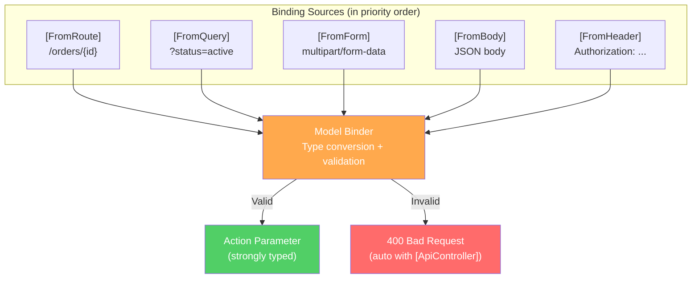
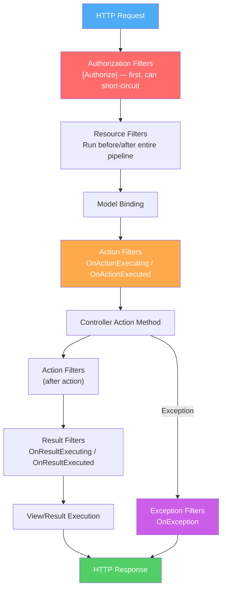
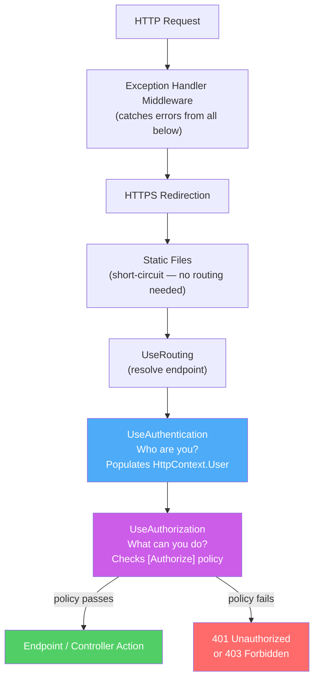
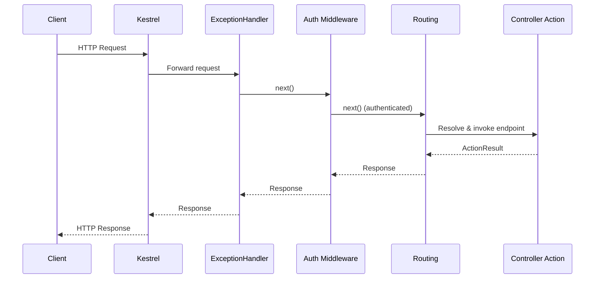
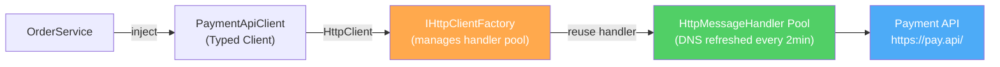
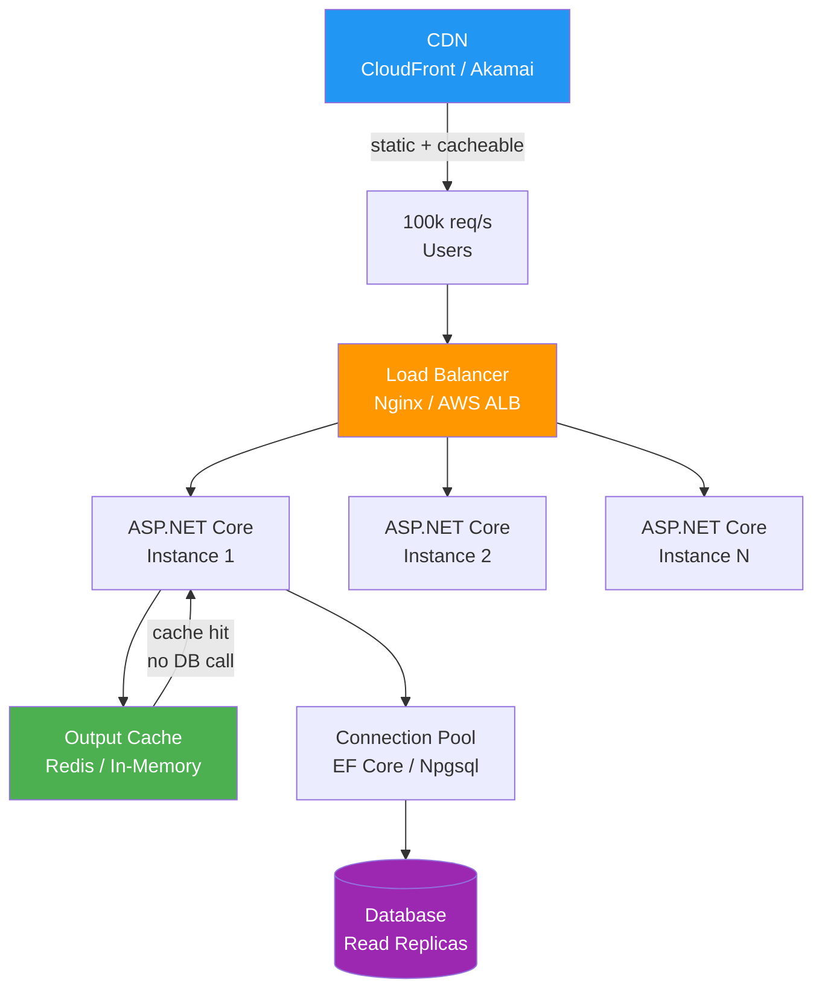
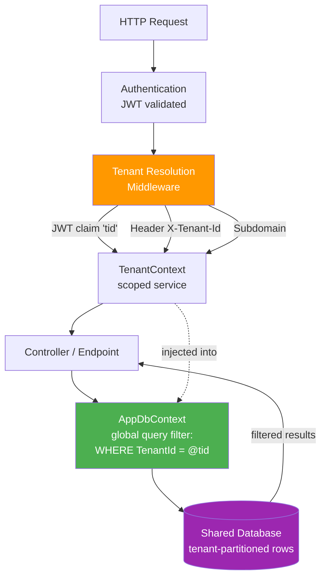
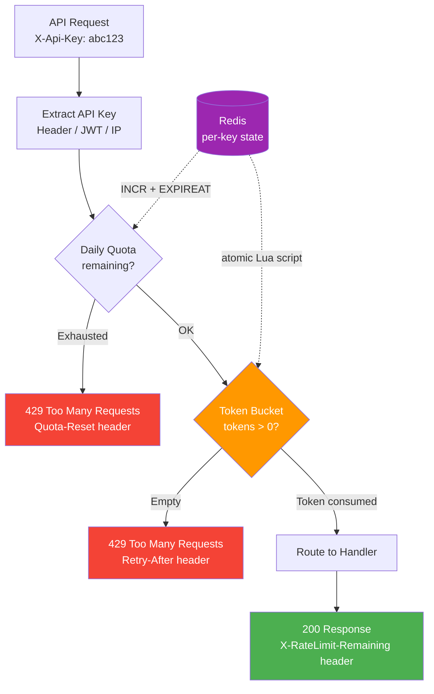
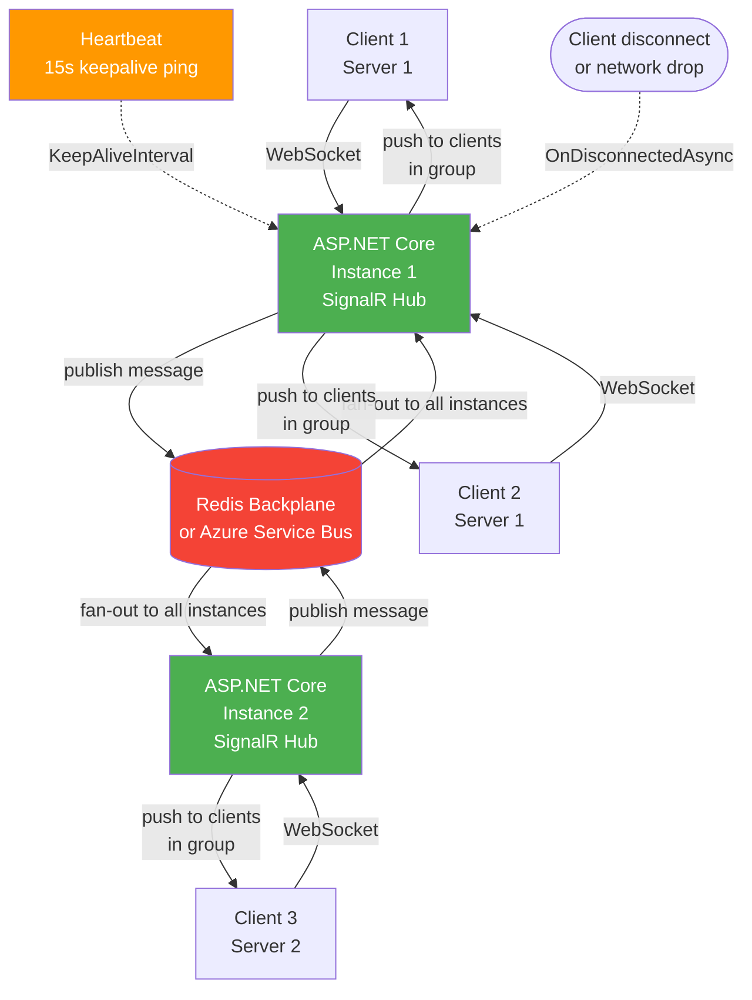

# 🌐 ASP.NET MVC Interview Questions — Complete Guide

> **50+ questions** grouped by concept · With definitions, ✅ good examples, ❌ bad examples & 📚 reference links.
> Use `Ctrl+F` / `Cmd+F` to jump to any topic.

---

## 📋 Table of Contents
1. [MVC Pattern & Routing](#1-mvc-pattern--routing)
2. [Controllers & Actions](#2-controllers--actions)
3. [Model Binding & Validation](#3-model-binding--validation)
4. [Filters](#4-filters)
5. [Dependency Injection](#5-dependency-injection)
6. [Middleware](#6-middleware)
7. [Authentication & Authorization](#7-authentication--authorization)
8. [Views & Razor](#8-views--razor)
9. [Performance & Caching](#9-performance--caching)
10. [Error Handling & Testing](#10-error-handling--testing)

---

# 1. MVC Pattern & Routing

> 📚 Reference: https://learn.microsoft.com/en-us/aspnet/core/mvc/overview
> 📚 Routing: https://learn.microsoft.com/en-us/aspnet/core/fundamentals/routing

---

## 1.1 Routing — Conventional vs Attribute


### Q1. What are the two routing styles in ASP.NET Core and when do you use each?

**Answer:**
Conventional routing is defined in `Program.cs` via templates like `{controller}/{action}/{id?}`. Attribute routing uses `[Route]`, `[HttpGet]`, etc. on controllers/actions. Attribute routing is preferred for APIs — it's explicit and co-located with the code. Conventional routing is common in MVC apps with Razor views.

❌ **Wrong — mixing conventional routes in an API project, ambiguous URLs:**
```csharp
// Program.cs — conventional routing on a Web API
app.MapControllerRoute(
    name: "default",
    pattern: "{controller=Home}/{action=Index}/{id?}");
// API URLs become /Products/GetById/5 — not RESTful, not explicit
```

✅ **Correct — attribute routing on API controllers:**
```csharp
[ApiController]
[Route("api/[controller]")]
public class ProductsController : ControllerBase {
    [HttpGet("{id:int}")]               // GET api/products/5
    public async Task<IActionResult> GetById(int id) { ... }

    [HttpPost]                          // POST api/products
    public async Task<IActionResult> Create([FromBody] CreateProductDto dto) { ... }

    [HttpDelete("{id:int}")]            // DELETE api/products/5
    public async Task<IActionResult> Delete(int id) { ... }
}
```

---

## 1.2 Route Constraints

### Q2. How do route constraints prevent invalid requests from reaching your controller?

**Answer:**
Route constraints (`{id:int}`, `{slug:alpha}`, `{date:datetime}`) validate route values before the action is invoked, returning 404 automatically for invalid formats rather than requiring manual checks in the action.

❌ **Wrong — no constraint, manual validation inside the action:**
```csharp
[HttpGet("{id}")]
public IActionResult Get(string id) {
    if (!int.TryParse(id, out int numericId))
        return BadRequest("ID must be an integer");
    // Unnecessary — the route should enforce this
    ...
}
```

✅ **Correct — constraint enforced at routing level:**
```csharp
[HttpGet("{id:int:min(1)}")]   // must be int AND >= 1
public async Task<IActionResult> Get(int id) {
    var product = await _service.GetByIdAsync(id);
    return product is null ? NotFound() : Ok(product);
}
```

---

# 2. Controllers & Actions

> 📚 Reference: https://learn.microsoft.com/en-us/aspnet/core/mvc/controllers/actions
> 📚 ApiController: https://learn.microsoft.com/en-us/aspnet/core/web-api/

---

## 2.1 [ApiController] Attribute

### Q3. What does `[ApiController]` do and why should you use it?

**Answer:**
`[ApiController]` enables: automatic 400 responses when ModelState is invalid, binding source inference, Problem Details error format (RFC 7807), and requires attribute routing. Removes boilerplate validation checks from every action.

❌ **Wrong — manually checking ModelState in every action without [ApiController]:**
```csharp
[Controller]
public class ProductsController : ControllerBase {
    [HttpPost]
    public IActionResult Create([FromBody] CreateProductDto dto) {
        if (!ModelState.IsValid)         // repeated in EVERY action
            return BadRequest(ModelState);
        // logic...
    }
}
```

✅ **Correct — [ApiController] handles validation automatically:**
```csharp
[ApiController]
[Route("api/[controller]")]
public class ProductsController : ControllerBase {
    [HttpPost]
    public async Task<ActionResult<ProductDto>> Create([FromBody] CreateProductDto dto) {
        // If dto fails validation, 400 is returned automatically — no manual check needed
        var product = await _service.CreateAsync(dto);
        return CreatedAtAction(nameof(GetById), new { id = product.Id }, product);
    }
}
```

---

## 2.2 ActionResult<T>

### Q4. What is `ActionResult<T>` and why is it preferred over `IActionResult` for APIs?

**Answer:**
`ActionResult<T>` allows returning either a typed result `T` (for 200 OK) or any `IActionResult` (for 404, 400, etc.). It enables OpenAPI/Swagger to infer the response schema automatically, which `IActionResult` alone cannot.

❌ **Wrong — `IActionResult` loses response type information for OpenAPI:**
```csharp
[HttpGet("{id}")]
public async Task<IActionResult> GetById(int id) {
    var product = await _service.GetByIdAsync(id);
    return product is null ? NotFound() : Ok(product);
    // Swagger shows response as 'any' — no schema generated
}
```

✅ **Correct — `ActionResult<T>` provides both flexibility and schema:**
```csharp
[HttpGet("{id:int}")]
[ProducesResponseType<ProductDto>(StatusCodes.Status200OK)]
[ProducesResponseType(StatusCodes.Status404NotFound)]
public async Task<ActionResult<ProductDto>> GetById(int id) {
    var product = await _service.GetByIdAsync(id);
    return product is null ? NotFound() : product; // implicit Ok() wrapping
}
```

---

# 3. Model Binding & Validation

> 📚 Reference: https://learn.microsoft.com/en-us/aspnet/core/mvc/models/model-binding
> 📚 Validation: https://learn.microsoft.com/en-us/aspnet/core/mvc/models/validation



---

## 3.1 Model Validation with Data Annotations

### Q5. How do you validate request models in ASP.NET Core?

**Answer:**
Use Data Annotations on the DTO class. The framework validates and populates `ModelState`. With `[ApiController]`, invalid models return 400 automatically. For complex rules, use `IValidatableObject` or FluentValidation.

❌ **Wrong — no validation on DTO, validating manually in the action:**
```csharp
[HttpPost]
public IActionResult Create([FromBody] CreateProductDto dto) {
    if (string.IsNullOrEmpty(dto.Name)) return BadRequest("Name required");
    if (dto.Price <= 0) return BadRequest("Price must be positive");
    // Duplicated validation logic, not reusable
}
```

✅ **Correct — validation attributes on the DTO, automatic enforcement:**
```csharp
public class CreateProductDto {
    [Required]
    [MaxLength(100, ErrorMessage = "Name cannot exceed 100 characters")]
    public string Name { get; set; } = string.Empty;

    [Range(0.01, 99999.99, ErrorMessage = "Price must be between 0.01 and 99,999.99")]
    public decimal Price { get; set; }

    [Url]
    public string? ImageUrl { get; set; }
}

[HttpPost]
public async Task<ActionResult<ProductDto>> Create([FromBody] CreateProductDto dto) {
    // [ApiController] returns 400 automatically if dto is invalid
    var product = await _service.CreateAsync(dto);
    return CreatedAtAction(nameof(GetById), new { id = product.Id }, product);
}
```

> **Why this matters:** Weak validation shifts errors downstream, wastes compute on bad requests, and makes APIs frustrating to integrate with.

**💡 Production Example:**
In a checkout API, FluentValidation was used for request shape checks returning all validation errors at once in a Problem Details response, so clients could fix multiple issues in one round-trip.

---

# 4. Filters

> 📚 Reference: https://learn.microsoft.com/en-us/aspnet/core/mvc/controllers/filters



---

## 4.1 Action Filters for Cross-Cutting Concerns

### Q6. How do you implement a reusable action filter for logging or timing?

**Answer:**
Implement `IActionFilter` (or `IAsyncActionFilter`) and register globally or per controller. Filters run as part of the MVC pipeline and have access to `ActionExecutingContext` / `ActionExecutedContext`.

❌ **Wrong — manual timing code in every action method:**
```csharp
[HttpGet("{id}")]
public async Task<IActionResult> GetById(int id) {
    var sw = Stopwatch.StartNew();
    try {
        var result = await _service.GetByIdAsync(id);
        return result is null ? NotFound() : Ok(result);
    } finally {
        _logger.LogInformation("GetById took {ms}ms", sw.ElapsedMilliseconds);
        // copied to every action — maintenance nightmare
    }
}
```

✅ **Correct — reusable action filter registered globally:**
```csharp
public class TimingFilter : IAsyncActionFilter {
    private readonly ILogger<TimingFilter> _logger;
    public TimingFilter(ILogger<TimingFilter> logger) => _logger = logger;

    public async Task OnActionExecutionAsync(ActionExecutingContext context, ActionExecutionDelegate next) {
        var sw = Stopwatch.StartNew();
        await next();
        _logger.LogInformation("{Action} took {ms}ms",
            context.ActionDescriptor.DisplayName, sw.ElapsedMilliseconds);
    }
}

// Program.cs — applied to all controllers:
builder.Services.AddControllers(options => options.Filters.Add<TimingFilter>());
builder.Services.AddScoped<TimingFilter>();
```

---

# 5. Dependency Injection

> 📚 Reference: https://learn.microsoft.com/en-us/aspnet/core/fundamentals/dependency-injection

---

## 5.1 Service Lifetimes

### Q7. What are the three DI lifetimes and what happens if you misuse them?

**Answer:**
Transient = new instance per injection. Scoped = one per HTTP request. Singleton = one for the application. Injecting a Scoped service into a Singleton is a "captive dependency" — the singleton holds a stale request-scoped object. ASP.NET Core detects this in development.

❌ **Wrong — scoped DbContext injected into singleton (captive dependency):**
```csharp
// DbContext is Scoped — registered once per request
builder.Services.AddDbContext<AppDbContext>(options => ...);

// BAD: Singleton captures the first-request DbContext forever
builder.Services.AddSingleton<IProductCache>(sp => {
    var db = sp.GetRequiredService<AppDbContext>(); // captured scoped service
    return new ProductCache(db);
});
```

✅ **Correct — use IServiceScopeFactory in singletons to create scopes on demand:**
```csharp
builder.Services.AddSingleton<IProductCache>(sp => {
    var scopeFactory = sp.GetRequiredService<IServiceScopeFactory>();
    return new ProductCache(scopeFactory); // creates a new scope when needed
});

public class ProductCache : IProductCache {
    private readonly IServiceScopeFactory _scopeFactory;
    public ProductCache(IServiceScopeFactory sf) => _scopeFactory = sf;

    public async Task<Product?> GetAsync(int id) {
        using var scope = _scopeFactory.CreateScope();
        var db = scope.ServiceProvider.GetRequiredService<AppDbContext>();
        return await db.Products.FindAsync(id);
    }
}
```

> **Why this matters:** Wrong DI lifetimes are a common source of silent data corruption under concurrent load.

**💡 Production Example:**
A notification service registered a `DbContext` as singleton accidentally. Under concurrent requests, EF Core threw tracking errors and occasionally returned another user's data. Fixing the lifetime to scoped resolved both bugs.

---

# 6. Middleware

> 📚 Reference: https://learn.microsoft.com/en-us/aspnet/core/fundamentals/middleware/

---

## 6.1 Middleware Order

### Q8. Why does middleware order in ASP.NET Core matter?

**Answer:**
Middleware executes in registration order on the way in, and in reverse order on the way out. Exception handling must come early to catch errors from later middleware. Authentication before authorization. Static files before routing to short-circuit expensive pipeline for static assets.

❌ **Wrong — authorization before authentication (user is never authenticated):**
```csharp
app.UseRouting();
app.UseAuthorization();    // runs before authentication — always sees unauthenticated user
app.UseAuthentication();   // too late
app.MapControllers();
```

✅ **Correct — proper middleware order:**
```csharp
app.UseExceptionHandler("/error");   // catch errors from everything below
app.UseHttpsRedirection();
app.UseStaticFiles();                // short-circuit before routing
app.UseRouting();
app.UseAuthentication();             // who are you?
app.UseAuthorization();              // what can you do?
app.MapControllers();
```



> **Why this matters:** One misplaced middleware can silently disable security checks or observability for entire routes.

**💡 Production Example:**
`UseAuthorization` was configured before `UseAuthentication`, causing all requests to appear unauthenticated. Reordering the pipeline fixed intermittent 403 responses.

---

## 6.2 Custom Middleware

### Q9. How do you write and register custom middleware?

**Answer:**
Implement a class with `InvokeAsync(HttpContext context)` and a `RequestDelegate _next` constructor parameter. Call `await _next(context)` to pass to the next component.

❌ **Wrong — modifying the response after `_next` has already written to it:**
```csharp
public async Task InvokeAsync(HttpContext context) {
    await _next(context);
    context.Response.Headers["X-Custom"] = "value"; // may fail — headers already sent
    context.Response.StatusCode = 200;               // invalid after body is written
}
```

✅ **Correct — set headers before calling next:**
```csharp
public class SecurityHeadersMiddleware {
    private readonly RequestDelegate _next;
    public SecurityHeadersMiddleware(RequestDelegate next) => _next = next;

    public async Task InvokeAsync(HttpContext context) {
        context.Response.OnStarting(() => {
            context.Response.Headers["X-Content-Type-Options"] = "nosniff";
            context.Response.Headers["X-Frame-Options"] = "DENY";
            return Task.CompletedTask;
        });
        await _next(context);
    }
}

app.UseMiddleware<SecurityHeadersMiddleware>();
```

---

# 7. Authentication & Authorization

> 📚 Reference: https://learn.microsoft.com/en-us/aspnet/core/security/authentication/
> 📚 JWT: https://learn.microsoft.com/en-us/aspnet/core/security/authentication/jwt-authn

---

## 7.1 JWT Authentication

### Q10. How do you configure JWT Bearer authentication in ASP.NET Core?

**Answer:**
Register the JWT bearer scheme in `Program.cs` with `TokenValidationParameters`. Always validate issuer, audience, lifetime, and signing key. Store the key in configuration — never hardcode it.

❌ **Wrong — disabling validation, accepting any token:**
```csharp
options.TokenValidationParameters = new TokenValidationParameters {
    ValidateIssuer = false,      // anyone can forge issuer
    ValidateAudience = false,    // wrong audience accepted
    ValidateLifetime = false,    // expired tokens accepted
    ValidateIssuerSigningKey = false // unsigned tokens accepted!
};
```

✅ **Correct — full validation with key from configuration:**
```csharp
builder.Services.AddAuthentication(JwtBearerDefaults.AuthenticationScheme)
    .AddJwtBearer(options => {
        options.TokenValidationParameters = new TokenValidationParameters {
            ValidateIssuer = true,
            ValidateAudience = true,
            ValidateLifetime = true,
            ValidateIssuerSigningKey = true,
            ValidIssuer = config["Jwt:Issuer"],
            ValidAudience = config["Jwt:Audience"],
            IssuerSigningKey = new SymmetricSecurityKey(
                Encoding.UTF8.GetBytes(config["Jwt:Key"]!)),
            ClockSkew = TimeSpan.FromSeconds(30) // tight tolerance
        };
    });
```

---

## 7.2 Policy-Based Authorization

### Q11. How does policy-based authorization work in ASP.NET Core?

**Answer:**
Define requirements and handlers. Policies compose multiple requirements. More flexible than role-based auth — supports resource-based decisions, custom claim checks, and async external lookups.

❌ **Wrong — role-based checks scattered in action code, business logic in controller:**
```csharp
[HttpDelete("{id}")]
public async Task<IActionResult> Delete(int id) {
    if (!User.IsInRole("Admin") && !User.IsInRole("Manager"))
        return Forbid();
    // Duplicated in every action that needs this check
}
```

✅ **Correct — policy defined once, applied via attribute:**
```csharp
// Program.cs
builder.Services.AddAuthorization(options => {
    options.AddPolicy("CanManageProducts", policy =>
        policy.RequireAssertion(ctx =>
            ctx.User.IsInRole("Admin") || ctx.User.IsInRole("Manager")));
});

// Controller:
[HttpDelete("{id:int}")]
[Authorize(Policy = "CanManageProducts")]
public async Task<IActionResult> Delete(int id) {
    await _service.DeleteAsync(id);
    return NoContent();
}
```

---

# 8. Views & Razor

> 📚 Reference: https://learn.microsoft.com/en-us/aspnet/core/mvc/views/razor
> 📚 Tag Helpers: https://learn.microsoft.com/en-us/aspnet/core/mvc/views/tag-helpers/intro

---

## 8.1 Tag Helpers vs HTML Helpers

### Q12. What is the difference between Tag Helpers and HTML Helpers?

**Answer:**
Tag Helpers look like HTML attributes — they're processed server-side but blend into the markup naturally. HTML Helpers are C# method calls (`@Html.ActionLink(...)`). Tag Helpers are strongly typed, support IntelliSense, and are easier for designers to read.

❌ **Wrong — HTML Helpers, verbose and C#-centric in markup:**
```html
@Html.BeginForm("Create", "Products", FormMethod.Post)
    @Html.LabelFor(m => m.Name)
    @Html.TextBoxFor(m => m.Name, new { @class = "form-control" })
    @Html.ValidationMessageFor(m => m.Name)
    <button type="submit">Save</button>
@Html.EndForm()
```

✅ **Correct — Tag Helpers, clean HTML-like syntax:**
```html
<form asp-action="Create" asp-controller="Products" method="post">
    <label asp-for="Name"></label>
    <input asp-for="Name" class="form-control" />
    <span asp-validation-for="Name" class="text-danger"></span>
    <button type="submit">Save</button>
</form>
```

---

## 8.2 View Components vs Partial Views

### Q13. When should you use a View Component instead of a Partial View?

**Answer:**
Use View Components when the rendered content requires service calls or business logic (cart summary, notification badge). They have their own async Invoke method and are independent mini-controllers. Partial Views are for simple template reuse with data passed from the parent view.

❌ **Wrong — putting service calls inside a Partial View via ViewData (tight coupling, not testable):**
```csharp
// In main controller action — pushing unrelated data for partial
ViewData["CartCount"] = await _cartService.GetCountAsync(userId);
return View();
```
```html
@* Partial view depends on ViewData set by parent controller *@
<span>Cart: @ViewData["CartCount"]</span>
```

✅ **Correct — View Component handles its own data fetching:**
```csharp
public class CartSummaryViewComponent : ViewComponent {
    private readonly ICartService _cartService;
    public CartSummaryViewComponent(ICartService cartService) => _cartService = cartService;

    public async Task<IViewComponentResult> InvokeAsync() {
        var count = await _cartService.GetCountAsync(UserClaimsPrincipal);
        return View(count);
    }
}
```
```html
@* In any view, independently: *@
@await Component.InvokeAsync("CartSummary")
```

---

# 9. Performance & Caching

> 📚 Reference: https://learn.microsoft.com/en-us/aspnet/core/performance/caching/overview
> 📚 Output caching: https://learn.microsoft.com/en-us/aspnet/core/performance/caching/output

---

## 9.1 Output Caching vs Response Caching

### Q14. What is the difference between Output Caching and Response Caching?

**Answer:**
Response Caching (`[ResponseCache]`) relies on HTTP cache headers — the browser or a CDN does the caching. Output Caching (`.NET 7+`) is server-side — the server stores and reserializes the response. Output Caching supports tag-based invalidation and works regardless of client cache settings.

❌ **Wrong — Response Caching on an authenticated endpoint (caches per-user responses globally):**
```csharp
[HttpGet("my-orders")]
[ResponseCache(Duration = 60)]  // caches first user's orders for everyone — security issue
[Authorize]
public async Task<IActionResult> GetMyOrders() { ... }
```

✅ **Correct — Output Caching with a cache key that varies by user:**
```csharp
// Program.cs
builder.Services.AddOutputCache();
app.UseOutputCache();

// Endpoint:
[HttpGet("products")]
[OutputCache(Duration = 60, VaryByQueryKeys = ["category", "page"])]
public async Task<IActionResult> GetProducts([FromQuery] string? category, int page = 1) {
    var products = await _service.GetPagedAsync(category, page);
    return Ok(products);
}
```

> **Why this matters:** Caching failures usually become correctness incidents, not just performance issues.

**💡 Production Example:**
Product catalog reads were cached in Redis with short TTL plus event-driven invalidation on price updates. Database load reduced significantly while stale windows stayed bounded.

---

# 10. Error Handling & Testing

> 📚 Reference: https://learn.microsoft.com/en-us/aspnet/core/fundamentals/error-handling
> 📚 Integration testing: https://learn.microsoft.com/en-us/aspnet/core/test/integration-tests

---

## 10.1 Problem Details for APIs

### Q15. How do you return consistent error responses in a Web API?

**Answer:**
Use Problem Details (RFC 7807) via `AddProblemDetails()`. Returns JSON with `type`, `title`, `status`, `detail`. In .NET 8+, implement `IExceptionHandler` for full control over error responses.

❌ **Wrong — inconsistent ad-hoc error objects across controllers:**
```csharp
return BadRequest(new { error = "Name is required" });    // controller A
return NotFound(new { message = "Not found", id = id });  // controller B — different shape!
return StatusCode(500, "Something went wrong");            // controller C — plain string
```

✅ **Correct — unified Problem Details via IExceptionHandler:**
```csharp
// Program.cs
builder.Services.AddProblemDetails();
builder.Services.AddExceptionHandler<GlobalExceptionHandler>();
app.UseExceptionHandler();

public class GlobalExceptionHandler : IExceptionHandler {
    public async ValueTask<bool> TryHandleAsync(
        HttpContext ctx, Exception ex, CancellationToken ct) {
        var (status, title) = ex switch {
            NotFoundException => (404, "Resource not found"),
            ValidationException => (400, "Validation failed"),
            _ => (500, "An unexpected error occurred")
        };
        await ctx.Response.WriteAsJsonAsync(new ProblemDetails {
            Status = status, Title = title, Detail = ex.Message
        }, ct);
        return true;
    }
}
```

---

## 10.2 Integration Testing with WebApplicationFactory

### Q16. How do you write integration tests for ASP.NET Core controllers?

**Answer:**
`WebApplicationFactory<TProgram>` spins up the full pipeline in-memory. Override `ConfigureWebHost` to swap real services (like DbContext) for test doubles. Tests exercise real routing, middleware, and serialization.

❌ **Wrong — unit testing the controller directly, misses middleware, routing, and serialization:**
```csharp
[Fact]
public async Task GetProduct_ReturnsOk() {
    var controller = new ProductsController(new MockProductService());
    var result = await controller.GetById(1);
    Assert.IsType<OkObjectResult>(result);
    // Doesn't test routing, auth middleware, JSON serialization, filters, etc.
}
```

✅ **Correct — full integration test with in-memory database:**
```csharp
public class ProductsApiTests : IClassFixture<WebApplicationFactory<Program>> {
    private readonly HttpClient _client;

    public ProductsApiTests(WebApplicationFactory<Program> factory) {
        _client = factory.WithWebHostBuilder(builder =>
            builder.ConfigureServices(services => {
                services.RemoveAll<AppDbContext>();
                services.AddDbContext<AppDbContext>(o => o.UseInMemoryDatabase("TestDb"));
            })).CreateClient();
    }

    [Fact]
    public async Task GetProducts_ReturnsOkWithList() {
        var response = await _client.GetAsync("/api/products");
        response.EnsureSuccessStatusCode();
        var products = await response.Content.ReadFromJsonAsync<List<ProductDto>>();
        Assert.NotNull(products);
    }
}
```

---

# 11. SignalR & Real-Time Communication

> 📚 Reference: https://learn.microsoft.com/en-us/aspnet/core/signalr/introduction
> 📚 Hubs: https://learn.microsoft.com/en-us/aspnet/core/signalr/hubs

---

## 11.1 SignalR Hubs

### Q17. How do you implement real-time communication with SignalR?

**Answer:**
SignalR abstracts WebSockets (falling back to SSE, then long-polling). A Hub is the server-side class clients connect to. The server can push messages to specific clients, groups, or all connected clients. Use `IHubContext<T>` to push from outside the Hub (e.g., from a background service).

❌ **Wrong — polling an endpoint every 2 seconds for updates:**
```csharp
// Client polls every 2s
setInterval(() => fetch('/api/notifications/unread').then(...), 2000);
// Server: every client hits this endpoint constantly — wasted load even when nothing changed
```

✅ **Correct — SignalR Hub pushes only when there's something to send:**
```csharp
// Hub
public class NotificationHub : Hub {
    public async Task JoinUserGroup(string userId) =>
        await Groups.AddToGroupAsync(Context.ConnectionId, $"user-{userId}");

    public override async Task OnConnectedAsync() {
        var userId = Context.User?.FindFirst(ClaimTypes.NameIdentifier)?.Value;
        if (userId != null)
            await Groups.AddToGroupAsync(Context.ConnectionId, $"user-{userId}");
        await base.OnConnectedAsync();
    }
}

// Push from a background service or controller using IHubContext
public class OrderService(IHubContext<NotificationHub> hubContext) {
    public async Task CompleteOrderAsync(Order order) {
        // ... order logic ...
        // Push to specific user's group — only sent when event actually occurs
        await hubContext.Clients.Group($"user-{order.UserId}")
            .SendAsync("OrderCompleted", new { order.Id, order.Status });
    }
}

// Program.cs
builder.Services.AddSignalR();
app.MapHub<NotificationHub>("/hubs/notifications");
```

---

## 11.2 SignalR Scaling — Backplane

### Q18. How do you scale SignalR across multiple server instances?

**Answer:**
Each server instance only knows about its own connected clients. If server A has a user and server B tries to push to them, it fails. A backplane (Redis, Azure SignalR Service) broadcasts messages across all instances.

❌ **Wrong — no backplane, messages only reach clients on the same instance:**
```csharp
// Works on one server instance, silently fails on multi-instance deployment
builder.Services.AddSignalR(); // no backplane configured
```

✅ **Correct — Redis backplane or Azure SignalR Service:**
```csharp
// Option 1: Redis backplane
builder.Services.AddSignalR()
    .AddStackExchangeRedis(config["Redis:ConnectionString"]!);

// Option 2: Azure SignalR Service (fully managed, no server-side WebSocket)
builder.Services.AddSignalR()
    .AddAzureSignalR(config["AzureSignalR:ConnectionString"]!);
// Azure SignalR Service handles all connections externally — servers are stateless
```

---

# 12. Background Services & Hosted Services

> 📚 Reference: https://learn.microsoft.com/en-us/aspnet/core/fundamentals/host/hosted-services

---

## 12.1 IHostedService vs BackgroundService

### Q19. What is the difference between `IHostedService` and `BackgroundService`?

**Answer:**
`IHostedService` has `StartAsync` and `StopAsync` — you manage the loop yourself. `BackgroundService` is a base class implementing `IHostedService` with a `ExecuteAsync(CancellationToken)` method — simpler for continuous background loops. Always respect the cancellation token to enable clean shutdown.

❌ **Wrong — `async void` background work, ignores cancellation, crashes the process on exception:**
```csharp
public class BadWorker : IHostedService {
    public Task StartAsync(CancellationToken ct) {
        Task.Run(async () => {              // fire-and-forget — exceptions lost
            while (true) {                 // no cancellation token check
                await DoWorkAsync();
                await Task.Delay(5000);    // can't be cancelled cleanly
            }
        });
        return Task.CompletedTask;
    }
    public Task StopAsync(CancellationToken ct) => Task.CompletedTask; // doesn't stop the loop!
}
```

✅ **Correct — `BackgroundService` with proper cancellation:**
```csharp
public class OutboxRelayWorker : BackgroundService {
    private readonly IServiceScopeFactory _scopeFactory;
    private readonly ILogger<OutboxRelayWorker> _logger;

    public OutboxRelayWorker(IServiceScopeFactory sf, ILogger<OutboxRelayWorker> logger) {
        _scopeFactory = sf; _logger = logger;
    }

    protected override async Task ExecuteAsync(CancellationToken stoppingToken) {
        _logger.LogInformation("OutboxRelayWorker starting");
        while (!stoppingToken.IsCancellationRequested) {
            try {
                using var scope = _scopeFactory.CreateScope();
                var relay = scope.ServiceProvider.GetRequiredService<IOutboxRelay>();
                await relay.ProcessPendingAsync(stoppingToken);
            } catch (Exception ex) when (ex is not OperationCanceledException) {
                _logger.LogError(ex, "Error in OutboxRelayWorker");
            }
            await Task.Delay(TimeSpan.FromSeconds(5), stoppingToken);
        }
        _logger.LogInformation("OutboxRelayWorker stopping");
    }
}

// Program.cs
builder.Services.AddHostedService<OutboxRelayWorker>();
```

---

# 13. Health Checks

> 📚 Reference: https://learn.microsoft.com/en-us/aspnet/core/host-and-deploy/health-checks

---

## 13.1 Health Check Endpoints

### Q20. How do you implement health checks in ASP.NET Core for Kubernetes readiness/liveness probes?

**Answer:**
Register health checks for your database, external services, and message queues. Expose `/health/live` (liveness — is the process alive) and `/health/ready` (readiness — can it serve traffic, all dependencies available). Kubernetes probes hit these endpoints.

❌ **Wrong — single `/health` endpoint that always returns 200 regardless of dependencies:**
```csharp
app.MapGet("/health", () => "OK");
// Kubernetes thinks the pod is healthy even if the database is down
```

✅ **Correct — separate liveness and readiness probes with real dependency checks:**
```csharp
// Program.cs
builder.Services.AddHealthChecks()
    .AddDbContextCheck<AppDbContext>("database", tags: new[] { "ready" })
    .AddRedis(config["Redis:ConnectionString"]!, name: "redis", tags: new[] { "ready" })
    .AddUrlGroup(new Uri(config["ExternalApi:BaseUrl"]!), name: "external-api", tags: new[] { "ready" });

// Custom health check
public class QueueHealthCheck : IHealthCheck {
    private readonly IMessageBus _bus;
    public QueueHealthCheck(IMessageBus bus) => _bus = bus;
    public async Task<HealthCheckResult> CheckHealthAsync(HealthCheckContext ctx, CancellationToken ct) {
        var isHealthy = await _bus.IsConnectedAsync(ct);
        return isHealthy
            ? HealthCheckResult.Healthy("Queue connected")
            : HealthCheckResult.Unhealthy("Queue disconnected");
    }
}

builder.Services.AddHealthChecks().AddCheck<QueueHealthCheck>("queue", tags: new[] { "ready" });

// Map two endpoints with filtered tags
app.MapHealthChecks("/health/live",  new HealthCheckOptions { Predicate = _ => false }); // process alive only
app.MapHealthChecks("/health/ready", new HealthCheckOptions {
    Predicate = check => check.Tags.Contains("ready"),
    ResponseWriter = UIResponseWriter.WriteHealthCheckUIResponse
});
```

---

# 14. API Versioning

> 📚 Reference: https://github.com/dotnet/aspnet-api-versioning
> 📚 NuGet: Asp.Versioning.Mvc

---

## 14.1 API Versioning Strategies

### Q21. How do you version an ASP.NET Core Web API?

**Answer:**
Three strategies: URL segment (`/api/v1/products`), query string (`?api-version=1.0`), header (`Api-Version: 1.0`). Use `Asp.Versioning.Mvc` NuGet package. Deprecate old versions gracefully with sunset headers. Never break existing clients by changing a version.

❌ **Wrong — creating separate controllers in separate folders as versions accumulate:**
```csharp
// Manually managing V1 and V2 with no framework support
namespace Api.V1.Controllers { public class ProductsController { ... } }
namespace Api.V2.Controllers { public class ProductsController { ... } }
// Routes overlap, no version negotiation, no deprecation notices
```

✅ **Correct — framework-supported versioning with deprecation:**
```csharp
// Program.cs
builder.Services.AddApiVersioning(options => {
    options.DefaultApiVersion = new ApiVersion(1, 0);
    options.AssumeDefaultVersionWhenUnspecified = true;
    options.ReportApiVersions = true; // adds api-supported-versions header
}).AddApiExplorer(options => {
    options.GroupNameFormat = "'v'VVV";
    options.SubstituteApiVersionInUrl = true;
});

// V1 Controller
[ApiController]
[Route("api/v{version:apiVersion}/[controller]")]
[ApiVersion("1.0")]
[ApiVersion("1.1")]
public class ProductsController : ControllerBase {
    [HttpGet]
    [MapToApiVersion("1.0")]
    public IActionResult GetV1() => Ok(new { version = "1.0" });

    [HttpGet]
    [MapToApiVersion("1.1")]
    public IActionResult GetV1_1() => Ok(new { version = "1.1", extra = "new field" });
}

// V2 Controller (breaking change — new separate controller)
[ApiController]
[Route("api/v{version:apiVersion}/[controller]")]
[ApiVersion("2.0")]
[ApiVersion("1.0", Deprecated = true)] // mark V1 deprecated
public class ProductsV2Controller : ControllerBase { ... }
```

> **Why this matters:** Breaking API changes without a versioning strategy force coordinated deployments with all clients simultaneously, which is often impossible with mobile integrations.

**💡 Production Example:**
A mobile banking API used URL path versioning (`/v1/`, `/v2/`) and maintained v1 for 12 months after v2 launched. Usage telemetry per version let them email partners with migration timelines before deprecation.

---

# 15. CORS & Rate Limiting

> 📚 CORS: https://learn.microsoft.com/en-us/aspnet/core/security/cors
> 📚 Rate Limiting: https://learn.microsoft.com/en-us/aspnet/core/performance/rate-limit

---

## 15.1 CORS Configuration

### Q22. How do you configure CORS correctly in ASP.NET Core?

**Answer:**
CORS is a browser security feature — servers tell browsers which origins are allowed. Configure per-policy and apply globally or per-endpoint. Never use `AllowAnyOrigin()` with `AllowCredentials()` — it's both a security risk and a CORS spec violation.

❌ **Wrong — wildcard CORS with credentials allowed:**
```csharp
builder.Services.AddCors(o => o.AddDefaultPolicy(p =>
    p.AllowAnyOrigin()         // any website
     .AllowAnyMethod()
     .AllowAnyHeader()
     .AllowCredentials()));    // INVALID: browsers reject AllowAnyOrigin + AllowCredentials
```

✅ **Correct — specific origins for production, permissive for development:**
```csharp
builder.Services.AddCors(options => {
    options.AddPolicy("Production", policy => policy
        .WithOrigins("https://app.example.com", "https://admin.example.com")
        .WithMethods("GET", "POST", "PUT", "DELETE")
        .WithHeaders("Authorization", "Content-Type")
        .AllowCredentials());

    options.AddPolicy("Development", policy => policy
        .AllowAnyOrigin().AllowAnyMethod().AllowAnyHeader());
});

app.UseCors(builder.Environment.IsDevelopment() ? "Development" : "Production");

// Per-endpoint override if needed:
app.MapGet("/public", () => "public").RequireCors("Production");
```

---

## 15.2 Rate Limiting (ASP.NET Core 7+)

### Q23. How do you implement rate limiting in ASP.NET Core?

**Answer:**
Use the built-in `Microsoft.AspNetCore.RateLimiting` middleware (.NET 7+). Supports Fixed Window, Sliding Window, Token Bucket, and Concurrency limiters. Apply globally or per-endpoint. Return `429 Too Many Requests` with a `Retry-After` header.

❌ **Wrong — manual counter in a static dictionary, not thread-safe, not distributed:**
```csharp
private static Dictionary<string, int> _counts = new();
// [HttpGet] action manually checks and increments _counts[ip]
// Not thread-safe, resets on restart, doesn't work across multiple instances
```

✅ **Correct — built-in rate limiter with per-user and global policies:**
```csharp
builder.Services.AddRateLimiter(options => {
    options.RejectionStatusCode = StatusCodes.Status429TooManyRequests;

    // Per-IP sliding window
    options.AddPolicy("per-ip", httpContext => RateLimitPartition.GetSlidingWindowLimiter(
        partitionKey: httpContext.Connection.RemoteIpAddress?.ToString() ?? "unknown",
        factory: _ => new SlidingWindowRateLimiterOptions {
            PermitLimit = 100, Window = TimeSpan.FromMinutes(1), SegmentsPerWindow = 6
        }));

    // Per-user token bucket (authenticated endpoints)
    options.AddPolicy("per-user", httpContext => RateLimitPartition.GetTokenBucketLimiter(
        partitionKey: httpContext.User.FindFirst(ClaimTypes.NameIdentifier)?.Value ?? "anon",
        factory: _ => new TokenBucketRateLimiterOptions {
            TokenLimit = 20, ReplenishmentPeriod = TimeSpan.FromSeconds(10), TokensPerPeriod = 5
        }));
});

app.UseRateLimiter();

// Apply per-endpoint:
app.MapPost("/api/auth/login", LoginHandler)
   .RequireRateLimiting("per-ip");

app.MapGet("/api/products", GetProducts)
   .RequireRateLimiting("per-user");
```

> **Why this matters:** Rate limiting is both a reliability and security control. Without it, one noisy client can degrade service for everyone.

**💡 Production Example:**
A login endpoint was protected from credential-stuffing with per-IP and per-user token bucket limits, plus exponential backoff hints. Auth service saturation during attack windows dropped sharply.

---

# 16. gRPC in ASP.NET Core

> 📚 Reference: https://learn.microsoft.com/en-us/aspnet/core/grpc/

---

## 16.1 gRPC vs REST

### Q24. When do you choose gRPC over REST?

**Answer:**
gRPC uses HTTP/2 and Protocol Buffers (binary serialization). It's 5–10× faster than JSON over HTTP/1.1 for internal service-to-service calls. Strongly typed contracts via `.proto` files. Supports streaming (server, client, bidirectional). Use REST for public APIs and browser clients; use gRPC for internal microservice communication and high-throughput scenarios.

❌ **Wrong — using JSON REST for internal high-frequency inter-service calls:**
```csharp
// ProductService calling InventoryService 1000x/sec via JSON REST
var response = await _http.GetAsync($"http://inventory-svc/api/stock/{productId}");
var stock = await response.Content.ReadFromJsonAsync<StockDto>();
// JSON serialization overhead + HTTP/1.1 connection overhead at high frequency
```

✅ **Correct — gRPC for internal service communication:**
```protobuf
// inventory.proto
syntax = "proto3";
service InventoryService {
  rpc GetStock (StockRequest) returns (StockResponse);
  rpc WatchStock (StockRequest) returns (stream StockUpdate); // server streaming
}
message StockRequest { string product_id = 1; }
message StockResponse { string product_id = 1; int32 quantity = 2; }
message StockUpdate   { string product_id = 1; int32 quantity = 2; string timestamp = 3; }
```

```csharp
// Server:
public class InventoryGrpcService : InventoryService.InventoryServiceBase {
    public override async Task<StockResponse> GetStock(StockRequest req, ServerCallContext ctx) {
        var qty = await _repo.GetQuantityAsync(req.ProductId);
        return new StockResponse { ProductId = req.ProductId, Quantity = qty };
    }
}

// Client (generated strongly-typed client):
var channel = GrpcChannel.ForAddress("https://inventory-svc");
var client  = new InventoryService.InventoryServiceClient(channel);
var stock   = await client.GetStockAsync(new StockRequest { ProductId = "abc" });
```

---

# 17. Minimal APIs (Deep Dive)

> 📚 Reference: https://learn.microsoft.com/en-us/aspnet/core/fundamentals/minimal-apis/overview

---

## 17.1 Minimal API Organization at Scale

### Q25. How do you organize a Minimal API project as it grows beyond a few endpoints?

**Answer:**
Group endpoints into extension methods using `IEndpointRouteBuilder`. Use `RouteGroupBuilder` for common prefixes and middleware. Apply filters for cross-cutting concerns. Keeps `Program.cs` clean without reverting to full MVC controllers.

❌ **Wrong — all 50 endpoints defined inline in Program.cs, one giant file:**
```csharp
// Program.cs — hundreds of lines
app.MapGet("/api/products", async (AppDbContext db) => await db.Products.ToListAsync());
app.MapPost("/api/products", async (CreateProductDto dto, AppDbContext db) => { ... });
app.MapGet("/api/orders", ...);
app.MapPost("/api/orders", ...);
// ... 46 more endpoints inline
```

✅ **Correct — grouped into extension methods by domain:**
```csharp
// ProductEndpoints.cs
public static class ProductEndpoints {
    public static IEndpointRouteBuilder MapProductEndpoints(this IEndpointRouteBuilder app) {
        var group = app.MapGroup("/api/products")
            .WithTags("Products")
            .RequireAuthorization()
            .AddEndpointFilter<ValidationFilter<CreateProductDto>>();

        group.MapGet("/",      GetAll);
        group.MapGet("/{id:int}", GetById);
        group.MapPost("/",    Create);
        group.MapPut("/{id:int}", Update);
        group.MapDelete("/{id:int}", Delete);
        return app;
    }

    private static async Task<Ok<List<ProductDto>>> GetAll(IProductService svc) =>
        TypedResults.Ok(await svc.GetAllAsync());

    private static async Task<Results<Ok<ProductDto>, NotFound>> GetById(int id, IProductService svc) {
        var p = await svc.GetByIdAsync(id);
        return p is null ? TypedResults.NotFound() : TypedResults.Ok(p);
    }
}

// Program.cs — clean
app.MapProductEndpoints();
app.MapOrderEndpoints();
app.MapUserEndpoints();
```

---

## 18. Configuration & Options Pattern

### Q82. What is the Options pattern in ASP.NET Core and when do you use each variant?

The Options pattern binds configuration sections to strongly-typed POCO classes. Three interfaces serve different lifetimes:

| Interface | Lifetime | Reloads | Use when |
|---|---|---|---|
| `IOptions<T>` | Singleton | Never (reads once at startup) | Config that never changes at runtime |
| `IOptionsSnapshot<T>` | Scoped | Per request (re-reads each scope) | Config that may change; reflects updates per request |
| `IOptionsMonitor<T>` | Singleton | Live (via `OnChange` callback) | Long-running services needing live reload |

**Configuration model:**
```json
// appsettings.json
{
  "Smtp": {
    "Host": "smtp.example.com",
    "Port": 587,
    "UseSsl": true,
    "From": "no-reply@example.com"
  },
  "FeatureFlags": {
    "EnableDarkMode": true,
    "MaxUploadMb": 10
  }
}
```

**POCO classes:**
```csharp
public class SmtpSettings {
    public string Host    { get; set; } = "";
    public int    Port    { get; set; } = 25;
    public bool   UseSsl  { get; set; }
    public string From    { get; set; } = "";
}

public class FeatureFlags {
    public bool EnableDarkMode { get; set; }
    public int  MaxUploadMb   { get; set; }
}
```

**Registration in Program.cs:**
```csharp
builder.Services.Configure<SmtpSettings>(
    builder.Configuration.GetSection("Smtp"));

builder.Services.Configure<FeatureFlags>(
    builder.Configuration.GetSection("FeatureFlags"));

// Alternative — AddOptions builder with validation
builder.Services.AddOptions<SmtpSettings>()
    .BindConfiguration("Smtp")
    .ValidateDataAnnotations()        // validates [Required], [Range], etc.
    .ValidateOnStart();               // fail fast — throw at startup, not first use
```

---

### Q83. How do you use IOptions<T>, IOptionsSnapshot<T>, and IOptionsMonitor<T> in practice?

**IOptions<T> — singleton, reads once:**
```csharp
public class EmailService {
    private readonly SmtpSettings _smtp;

    // Inject IOptions<T> in constructor
    public EmailService(IOptions<SmtpSettings> options) {
        _smtp = options.Value;   // .Value returns the T instance
    }

    public async Task SendAsync(string to, string subject, string body) {
        using var client = new SmtpClient(_smtp.Host, _smtp.Port);
        client.EnableSsl = _smtp.UseSsl;
        await client.SendMailAsync(_smtp.From, to, subject, body);
    }
}
```

**IOptionsSnapshot<T> — scoped, re-reads per request:**
```csharp
// Best for controllers and scoped services — reflects config file changes per request
[ApiController]
[Route("api/[controller]")]
public class UploadController : ControllerBase {
    private readonly FeatureFlags _flags;

    public UploadController(IOptionsSnapshot<FeatureFlags> snapshot) {
        _flags = snapshot.Value;   // fresh value every request
    }

    [HttpPost]
    public async Task<IActionResult> Upload(IFormFile file) {
        if (file.Length > _flags.MaxUploadMb * 1024 * 1024)
            return BadRequest($"Max upload size is {_flags.MaxUploadMb} MB");
        // ...
        return Ok();
    }
}
```

**IOptionsMonitor<T> — singleton with live change notification:**
```csharp
// Best for background services (IHostedService) — singletons that need live config
public class NotificationWorker : BackgroundService {
    private readonly IOptionsMonitor<SmtpSettings> _monitor;
    private SmtpSettings _current;

    public NotificationWorker(IOptionsMonitor<SmtpSettings> monitor) {
        _monitor = monitor;
        _current = monitor.CurrentValue;

        // Subscribe to changes — callback fires when config reloads
        _monitor.OnChange(updated => {
            _current = updated;
            Console.WriteLine($"SMTP config reloaded — new host: {updated.Host}");
        });
    }

    protected override async Task ExecuteAsync(CancellationToken ct) {
        while (!ct.IsCancellationRequested) {
            // always uses the latest _current
            await SendPendingNotificationsAsync(_current, ct);
            await Task.Delay(TimeSpan.FromMinutes(1), ct);
        }
    }
}
```

---

### Q84. What are named options and when are they useful?

Named options let you register multiple configurations of the same type — for example, two different SMTP providers.

```json
// appsettings.json
{
  "Smtp": {
    "Transactional": { "Host": "smtp.sendgrid.net", "Port": 587, "From": "tx@app.com" },
    "Marketing":     { "Host": "smtp.mailchimp.com", "Port": 587, "From": "news@app.com" }
  }
}
```

**Registration:**
```csharp
builder.Services.Configure<SmtpSettings>("Transactional",
    builder.Configuration.GetSection("Smtp:Transactional"));

builder.Services.Configure<SmtpSettings>("Marketing",
    builder.Configuration.GetSection("Smtp:Marketing"));
```

**Usage with IOptionsMonitor<T> (named options require IOptionsMonitor or IOptionsSnapshot):**
```csharp
public class EmailDispatcher {
    private readonly IOptionsMonitor<SmtpSettings> _monitor;

    public EmailDispatcher(IOptionsMonitor<SmtpSettings> monitor) {
        _monitor = monitor;
    }

    public SmtpSettings GetSettings(EmailType type) =>
        type == EmailType.Marketing
            ? _monitor.Get("Marketing")
            : _monitor.Get("Transactional");
}
```

> `IOptions<T>` only supports the default (unnamed) instance. Use `IOptionsMonitor<T>` or `IOptionsSnapshot<T>` to retrieve named instances via `.Get("name")`.

---

### Q85. How do you validate options at startup?

```csharp
public class SmtpSettings {
    [Required]
    public string Host { get; set; } = "";

    [Range(1, 65535)]
    public int Port { get; set; }

    [Required, EmailAddress]
    public string From { get; set; } = "";
}

// Program.cs
builder.Services.AddOptions<SmtpSettings>()
    .BindConfiguration("Smtp")
    .ValidateDataAnnotations()   // enforce [Required], [Range], etc.
    .ValidateOnStart();          // throw OptionsValidationException at startup

// Custom validation via IValidateOptions<T>
public class SmtpSettingsValidator : IValidateOptions<SmtpSettings> {
    public ValidateOptionsResult Validate(string? name, SmtpSettings options) {
        if (options.Port == 25 && options.UseSsl)
            return ValidateOptionsResult.Fail("Port 25 cannot use SSL.");
        return ValidateOptionsResult.Success;
    }
}
builder.Services.AddSingleton<IValidateOptions<SmtpSettings>, SmtpSettingsValidator>();
```

---

### Q86. What is the difference between IConfiguration and the Options pattern?

| | `IConfiguration` | Options pattern (`IOptions<T>`) |
|---|---|---|
| **Type safety** | Strings only | Strongly typed POCO |
| **Change detection** | Manual `.GetReloadToken()` | Built-in via `IOptionsMonitor<T>` |
| **Validation** | None | Data annotations + custom validators |
| **Testability** | Requires `IConfiguration` mock | Just pass the POCO directly |
| **Best for** | Infrastructure / bootstrapping code | Application-level settings |

```csharp
// ❌ Avoid — stringly-typed, no validation
var host = _config["Smtp:Host"];

// ✅ Prefer — typed, validated, testable
var host = _smtpSettings.Host;
```

---

# ⚖️ ASP.NET Core Comparisons — Side-by-Side Differences

---

## MVC-C1 — Middleware vs Action Filters vs Exception Filters

| | Middleware | Action Filter | Exception Filter |
|-|-----------|--------------|-----------------|
| Scope | All requests (pipeline-level) | Controller / action level | Controller / action level |
| Access to action result | ❌ Only HTTP context | ✅ Yes (ActionExecutingContext) | ✅ Yes |
| Order of execution | Before routing resolves | After routing, before/after action | After exception thrown in action |
| Use for | Auth, logging, rate limit, CORS | Validation, logging per-action, caching | Map exceptions → HTTP responses |
| Registered in | `Program.cs` `app.Use...()` | `[ServiceFilter]`, `AddMvc().AddFilter()` | `[ExceptionFilter]` or global |

```csharp
// Middleware — runs for every request
app.Use(async (ctx, next) => { /* before */ await next(); /* after */ });

// Action Filter — runs around a specific action
public class LogActionFilter : IActionFilter
{
    public void OnActionExecuting(ActionExecutingContext ctx) => Log("Before");
    public void OnActionExecuted(ActionExecutedContext ctx)  => Log("After");
}

// Exception Filter — only runs when action throws
public class ApiExceptionFilter : IExceptionFilter
{
    public void OnException(ExceptionContext ctx)
    {
        ctx.Result = new ObjectResult(new { error = ctx.Exception.Message }) { StatusCode = 500 };
        ctx.ExceptionHandled = true;
    }
}
```

---

## MVC-C2 — Minimal API vs Controller-Based API

| | Minimal API | Controller (`[ApiController]`) |
|-|------------|-------------------------------|
| Boilerplate | Low | Moderate |
| Route grouping | `RouteGroupBuilder` | Controller class |
| Model binding | ✅ | ✅ |
| Filters | Limited (endpoint filters) | Full filter pipeline |
| OpenAPI support | ✅ (with `WithOpenApi()`) | ✅ |
| Testability | Unit test harder (inline lambdas) | ✅ Easy (instantiate controller) |
| Use for | Microservices, small APIs, CQRS dispatch | Large APIs, complex validation, filter chains |

```csharp
// Minimal API
app.MapGet("/orders/{id}", async (Guid id, IOrderService svc) =>
{
    var order = await svc.GetAsync(id);
    return order is null ? Results.NotFound() : Results.Ok(order);
})
.WithName("GetOrder")
.RequireAuthorization()
.WithOpenApi();

// Controller
[ApiController, Route("api/orders")]
public class OrdersController : ControllerBase
{
    [HttpGet("{id:guid}")]
    public async Task<IActionResult> Get(Guid id) => ...;
}
```

---

## MVC-C3 — `IActionResult` vs `ActionResult<T>` vs `Results<T>` (Minimal API)

| | `IActionResult` | `ActionResult<T>` | `Results<T>` (Minimal) |
|-|----------------|------------------|------------------------|
| Type info in OpenAPI | ❌ Inferred | ✅ Explicit | ✅ Explicit |
| Return typed value | Wrap in `Ok(value)` | Return value directly | `TypedResults.Ok(value)` |
| Compile-time safety | ❌ | ✅ | ✅ |

```csharp
// IActionResult — no type info for Swagger
public IActionResult Get(Guid id) => Ok(new OrderDto());

// ActionResult<T> — Swagger knows response type
public ActionResult<OrderDto> Get(Guid id) => new OrderDto(); // implicit 200 OK

// Minimal API with typed results
app.MapGet("/orders/{id}", async (Guid id) =>
{
    var order = await GetAsync(id);
    return order is null
        ? Results.NotFound()          // 404
        : TypedResults.Ok(order);     // 200 with type info for OpenAPI
});
```

---

## MVC-C4 — Cookie Authentication vs JWT Bearer vs API Key

| | Cookie Auth | JWT Bearer | API Key |
|-|------------|-----------|---------|
| Storage (client) | Browser cookie | localStorage or httpOnly cookie | Header / query string |
| CSRF risk | ✅ Yes (SameSite mitigates) | ❌ No (header not auto-sent) | ❌ No |
| Stateless | ❌ Session on server (or encrypted cookie) | ✅ Self-contained | ✅ |
| Refresh mechanism | Sliding expiry | Refresh token pattern | Long-lived key |
| Use for | Server-rendered web apps (MVC Razor) | SPA / mobile APIs | Server-to-server, webhooks |

---

## MVC-C5 — Singleton vs Scoped vs Transient (DI Lifetimes)

| | Singleton | Scoped | Transient |
|-|----------|--------|-----------|
| Created | Once (app start) | Once per HTTP request | Every time injected |
| Shared across | All requests & users | Same request only | Never shared |
| Disposed | On app shutdown | End of request | Immediately after use |
| Safe for | Caches, clients, config | DbContext, services | Validators, light helpers |
| Danger | Holding Scoped → captive dependency | Holding Transient refs long | Expensive if heavy construction |

```csharp
builder.Services.AddSingleton<ICache, RedisCache>();       // one instance, app lifetime
builder.Services.AddScoped<AppDbContext>();                 // one per request
builder.Services.AddTransient<IEmailBuilder, EmailBuilder>(); // new every injection

// ❌ Captive dependency — Singleton holds Scoped
builder.Services.AddSingleton<MyService>(); // MyService(AppDbContext db) → WRONG
// Fix: inject IServiceScopeFactory and create scope manually
```

---

## MVC-C6 — `app.Use` vs `app.Run` vs `app.Map` vs `app.UseWhen`

| | `app.Use` | `app.Run` | `app.Map` | `app.UseWhen` |
|-|----------|----------|----------|--------------|
| Calls next | ✅ (optional) | ❌ Terminal | Branches by path | Conditional branch |
| Terminates pipeline | Only if you don't call next | ✅ Always | On matched path | Only if predicate true |
| Use for | Middleware with before+after | Last handler | Path-based branching | Conditional middleware |

```csharp
app.Use(async (ctx, next) => { /* before */ await next(); /* after */ });
app.Run(async ctx => await ctx.Response.WriteAsync("Terminal")); // no next
app.Map("/health", branch => branch.Run(async ctx => await ctx.Response.WriteAsync("OK")));
app.UseWhen(ctx => ctx.Request.Path.StartsWithSegments("/api"),
    branch => branch.UseAuthentication());
```

---

## MVC-C7 — `IMemoryCache` vs `IDistributedCache` vs `ResponseCache`

| | `IMemoryCache` | `IDistributedCache` | `[ResponseCache]` |
|-|---------------|--------------------|--------------------|
| Storage | In-process RAM | Redis / SQL / Azure Cache | HTTP cache headers |
| Multi-instance safe | ❌ No (each pod has own cache) | ✅ Yes (shared) | ✅ (CDN/browser caches) |
| Object types | Any CLR object | `byte[]` / string only | HTTP responses only |
| Use for | Single-instance, fast local cache | Session, shared state, scale-out cache | Public API responses, static data |

```csharp
// IMemoryCache — fast, single process
_cache.Set("key", complexObject, TimeSpan.FromMinutes(5));

// IDistributedCache — must serialize (but shared across pods)
await _cache.SetStringAsync("key", JsonSerializer.Serialize(obj),
    new DistributedCacheEntryOptions { AbsoluteExpirationRelativeToNow = TimeSpan.FromMinutes(5) });

// ResponseCache — browser/CDN caches HTTP response
[ResponseCache(Duration = 300, Location = ResponseCacheLocation.Any)]
[HttpGet("products")]
public IActionResult GetProducts() => Ok(_svc.GetAll());
```

---

## MVC-C8 — `HttpClient` vs `IHttpClientFactory` vs Typed Client

| | `new HttpClient()` | `IHttpClientFactory` | Typed Client |
|-|-------------------|---------------------|-------------|
| Connection pooling | ❌ Port exhaustion | ✅ Pooled handlers | ✅ Pooled handlers |
| Handler lifetime | Per instance | Managed (2 min rotation) | Managed |
| Configuration | Manual | Named config in DI | Class-based DI |
| Use for | ❌ Never in prod | Ad-hoc calls | Service-specific HTTP clients |

```csharp
// ❌ new HttpClient() — port exhaustion in high-throughput apps
var client = new HttpClient();

// ✅ IHttpClientFactory
builder.Services.AddHttpClient("payments", c => c.BaseAddress = new Uri("https://pay.api/"));
// In class: var client = _factory.CreateClient("payments");

// ✅ Typed Client — best for service wrappers
builder.Services.AddHttpClient<PaymentApiClient>(c => c.BaseAddress = new Uri("https://pay.api/"));
public class PaymentApiClient { public PaymentApiClient(HttpClient client) { _client = client; } }
```

---

## 19. Implementing a REST API — End-to-End

### Q87. Walk me through implementing a complete REST API in ASP.NET Core.

A production REST API has six layers: **Model → Repository → Service → Controller → Middleware → Configuration**. Here is a complete walkthrough for a `Products` resource.

**Step 1 — Domain model and DTO:**
```csharp
// Domain entity (never expose directly to clients)
public class Product {
    public int     Id          { get; set; }
    public string  Name        { get; set; } = "";
    public decimal Price       { get; set; }
    public bool    IsAvailable { get; set; }
}

// DTOs — what the API actually sends/receives
public record ProductDto(int Id, string Name, decimal Price);

public record CreateProductRequest(
    [Required, MaxLength(200)] string  Name,
    [Range(0.01, 9999.99)]    decimal Price
);

public record UpdateProductRequest(
    [Required, MaxLength(200)] string  Name,
    [Range(0.01, 9999.99)]    decimal Price,
    bool IsAvailable
);
```

**Step 2 — Repository + EF Core:**
```csharp
public interface IProductRepository {
    Task<IEnumerable<Product>> GetAllAsync();
    Task<Product?>             GetByIdAsync(int id);
    Task<Product>              AddAsync(Product product);
    Task UpdateAsync(Product product);
    Task DeleteAsync(int id);
}

public class ProductRepository : IProductRepository {
    private readonly AppDbContext _db;
    public ProductRepository(AppDbContext db) => _db = db;

    public async Task<IEnumerable<Product>> GetAllAsync() =>
        await _db.Products.AsNoTracking().ToListAsync();

    public async Task<Product?> GetByIdAsync(int id) =>
        await _db.Products.FindAsync(id);

    public async Task<Product> AddAsync(Product product) {
        _db.Products.Add(product);
        await _db.SaveChangesAsync();
        return product;
    }

    public async Task UpdateAsync(Product product) {
        _db.Products.Update(product);
        await _db.SaveChangesAsync();
    }

    public async Task DeleteAsync(int id) {
        var p = await _db.Products.FindAsync(id);
        if (p is not null) { _db.Products.Remove(p); await _db.SaveChangesAsync(); }
    }
}
```

**Step 3 — Service layer (business logic + mapping):**
```csharp
public interface IProductService {
    Task<IEnumerable<ProductDto>> GetAllAsync();
    Task<ProductDto?>             GetByIdAsync(int id);
    Task<ProductDto>              CreateAsync(CreateProductRequest request);
    Task<bool>                    UpdateAsync(int id, UpdateProductRequest request);
    Task<bool>                    DeleteAsync(int id);
}

public class ProductService : IProductService {
    private readonly IProductRepository _repo;
    public ProductService(IProductRepository repo) => _repo = repo;

    public async Task<IEnumerable<ProductDto>> GetAllAsync() =>
        (await _repo.GetAllAsync()).Select(ToDto);

    public async Task<ProductDto?> GetByIdAsync(int id) {
        var p = await _repo.GetByIdAsync(id);
        return p is null ? null : ToDto(p);
    }

    public async Task<ProductDto> CreateAsync(CreateProductRequest req) {
        var product = new Product { Name = req.Name, Price = req.Price, IsAvailable = true };
        var created = await _repo.AddAsync(product);
        return ToDto(created);
    }

    public async Task<bool> UpdateAsync(int id, UpdateProductRequest req) {
        var product = await _repo.GetByIdAsync(id);
        if (product is null) return false;
        product.Name = req.Name; product.Price = req.Price; product.IsAvailable = req.IsAvailable;
        await _repo.UpdateAsync(product);
        return true;
    }

    public async Task<bool> DeleteAsync(int id) {
        var product = await _repo.GetByIdAsync(id);
        if (product is null) return false;
        await _repo.DeleteAsync(id);
        return true;
    }

    private static ProductDto ToDto(Product p) => new(p.Id, p.Name, p.Price);
}
```

**Step 4 — Controller:**
```csharp
[ApiController]
[Route("api/[controller]")]
[Produces("application/json")]
public class ProductsController : ControllerBase {
    private readonly IProductService _svc;
    public ProductsController(IProductService svc) => _svc = svc;

    // GET api/products
    [HttpGet]
    [ProducesResponseType<IEnumerable<ProductDto>>(StatusCodes.Status200OK)]
    public async Task<ActionResult<IEnumerable<ProductDto>>> GetAll() =>
        Ok(await _svc.GetAllAsync());

    // GET api/products/5
    [HttpGet("{id:int}")]
    [ProducesResponseType<ProductDto>(StatusCodes.Status200OK)]
    [ProducesResponseType(StatusCodes.Status404NotFound)]
    public async Task<ActionResult<ProductDto>> GetById(int id) {
        var product = await _svc.GetByIdAsync(id);
        return product is null ? NotFound() : Ok(product);
    }

    // POST api/products
    [HttpPost]
    [ProducesResponseType<ProductDto>(StatusCodes.Status201Created)]
    [ProducesResponseType(StatusCodes.Status400BadRequest)]
    public async Task<ActionResult<ProductDto>> Create([FromBody] CreateProductRequest request) {
        var created = await _svc.CreateAsync(request);
        return CreatedAtAction(nameof(GetById), new { id = created.Id }, created);
    }

    // PUT api/products/5
    [HttpPut("{id:int}")]
    [ProducesResponseType(StatusCodes.Status204NoContent)]
    [ProducesResponseType(StatusCodes.Status404NotFound)]
    public async Task<IActionResult> Update(int id, [FromBody] UpdateProductRequest request) {
        var updated = await _svc.UpdateAsync(id, request);
        return updated ? NoContent() : NotFound();
    }

    // DELETE api/products/5
    [HttpDelete("{id:int}")]
    [ProducesResponseType(StatusCodes.Status204NoContent)]
    [ProducesResponseType(StatusCodes.Status404NotFound)]
    public async Task<IActionResult> Delete(int id) {
        var deleted = await _svc.DeleteAsync(id);
        return deleted ? NoContent() : NotFound();
    }
}
```

**Step 5 — Program.cs wiring:**
```csharp
var builder = WebApplication.CreateBuilder(args);

// Services
builder.Services.AddDbContext<AppDbContext>(opt =>
    opt.UseSqlServer(builder.Configuration.GetConnectionString("Default")));
builder.Services.AddScoped<IProductRepository, ProductRepository>();
builder.Services.AddScoped<IProductService, ProductService>();

builder.Services.AddControllers();
builder.Services.AddEndpointsApiExplorer();
builder.Services.AddSwaggerGen();

var app = builder.Build();

// Middleware pipeline
if (app.Environment.IsDevelopment()) {
    app.UseSwagger();
    app.UseSwaggerUI();
}

app.UseHttpsRedirection();
app.UseAuthentication();
app.UseAuthorization();
app.MapControllers();

app.Run();
```

**REST conventions summary:**

| Operation | Method | Route | Success code |
|---|---|---|---|
| List all | GET | `/api/products` | 200 OK |
| Get one | GET | `/api/products/{id}` | 200 OK / 404 |
| Create | POST | `/api/products` | 201 Created |
| Full replace | PUT | `/api/products/{id}` | 204 No Content |
| Partial update | PATCH | `/api/products/{id}` | 204 No Content |
| Delete | DELETE | `/api/products/{id}` | 204 No Content |

---

# 20. Production API Design — Deep Dive Questions

> These questions test real-world decision-making, not just API knowledge.

---

## 20.1 Request Pipeline

### Q: Walk me through what happens when an HTTP request hits your ASP.NET Core API.

**Answer:**
Kestrel receives the request, middleware executes in registration order, routing resolves an endpoint, endpoint logic runs, and the response flows back through middleware in reverse. Order matters because middleware can short-circuit the pipeline — returning a response without calling `_next`.



> **Why this matters:** Every performance issue in ASP.NET Core traces back to middleware order, Kestrel behavior, or endpoint resolution.

**💡 Production Example:**
A logging middleware placed after `UseRouting` but before `UseAuthorization` was doing synchronous I/O on every request. Moving it earlier and making it async cut p95 latency by 40ms.

❌ **Anti-pattern:**
```csharp
app.UseRouting();
app.Use(async (ctx, next) => {
    // Synchronous blocking I/O inside middleware — blocks thread pool
    File.AppendAllText("requests.log", ctx.Request.Path);
    await next();
});
app.UseAuthentication();
app.UseAuthorization();
app.MapControllers();
```

✅ **Best practice:**
```csharp
app.UseExceptionHandler();       // catch all errors first
app.UseHttpsRedirection();
app.UseStaticFiles();
app.UseRouting();
app.UseAuthentication();
app.UseAuthorization();
// Custom middleware uses async I/O and OnStarting hooks for headers
app.MapControllers();
```

---

## 20.2 Centralized Error Handling

### Q: How do you handle errors in a production API? Walk me through your strategy.

**Answer:**
Use centralized exception handling (`UseExceptionHandler` / `IExceptionHandler`), return consistent RFC 7807 Problem Details, and log rich internal context with correlation IDs. Don't assume unhandled exceptions automatically become Problem Details without explicitly configuring the exception pipeline.

> **Why this matters:** Inconsistent error handling creates noisy alerts, confuses clients, and makes incidents harder to diagnose.

**💡 Production Example:**
In a checkout API, `IExceptionHandler` was implemented to catch domain exceptions and map them to Problem Details with correlation IDs. Support could trace any customer complaint to the exact failed call within seconds.

❌ **Anti-pattern:**
```csharp
// Scattered try/catch returning different shapes across controllers
try { ... }
catch (NotFoundException) { return NotFound("Not found"); }        // plain string
catch (Exception) { return StatusCode(500, new { error = "oops" }); } // ad-hoc object
```

✅ **Best practice:**
```csharp
// Program.cs
builder.Services.AddProblemDetails();
builder.Services.AddExceptionHandler<GlobalExceptionHandler>();
app.UseExceptionHandler();

public class GlobalExceptionHandler : IExceptionHandler {
    private readonly ILogger<GlobalExceptionHandler> _logger;
    public GlobalExceptionHandler(ILogger<GlobalExceptionHandler> logger) => _logger = logger;

    public async ValueTask<bool> TryHandleAsync(
        HttpContext ctx, Exception ex, CancellationToken ct) {
        var correlationId = ctx.TraceIdentifier;
        _logger.LogError(ex, "Unhandled exception. CorrelationId: {CorrelationId}", correlationId);

        var (status, title) = ex switch {
            NotFoundException  => (404, "Resource not found"),
            ValidationException => (400, "Validation failed"),
            ConflictException  => (409, "Conflict"),
            _                  => (500, "An unexpected error occurred")
        };

        ctx.Response.StatusCode = status;
        await ctx.Response.WriteAsJsonAsync(new ProblemDetails {
            Status   = status,
            Title    = title,
            Detail   = ex.Message,
            Extensions = { ["correlationId"] = correlationId }
        }, ct);
        return true;
    }
}
```

---

## 20.3 4xx vs 5xx Classification

### Q: How do you decide which failures should return 4xx vs 5xx in complex business flows?

**Answer:**
4xx means the client can correct the request — the problem is on the client side. 5xx means server or dependency failure — the problem is on the server side. Classify by responsibility and actionability. Business rule violations are usually 4xx; infrastructure failures are 5xx.

| Scenario | Code | Reason |
|---|---|---|
| Missing required field | 400 | Client sent bad data |
| Invalid auth token | 401 | Client must re-authenticate |
| Forbidden resource | 403 | Client lacks permission |
| Resource not found | 404 | Client referenced wrong ID |
| Conflict (duplicate, out of stock) | 409 | Client must resolve the conflict |
| Upstream service down | 502/503 | Server dependency failed |
| Unhandled exception | 500 | Server bug |

> **Why this matters:** Wrong status codes break client retry logic, inflate on-call alerts, and obscure whether an issue is a product problem or a platform failure.

**💡 Production Example:**
Inventory reservation failures were initially returned as 500s. After analysis, "out of stock" was reclassified as 409 Conflict. Alert noise dropped 70% because monitors could distinguish real server errors from expected business rejections.

❌ **Anti-pattern:**
```csharp
// Returning 500 for a known business condition
if (product.Stock == 0)
    return StatusCode(500, "Product unavailable");
// Clients can't distinguish this from a real server crash
```

✅ **Best practice:**
```csharp
if (product.Stock == 0)
    return Conflict(new ProblemDetails {
        Status = 409,
        Title  = "Product unavailable",
        Detail = $"Product '{product.Name}' is currently out of stock."
    });
```

---

## 20.4 Over-Posting & Mass Assignment

### Q: How do you prevent over-posting and mass assignment vulnerabilities in API endpoints?

**Answer:**
Bind to explicit request DTOs, map only allowed fields, and keep domain mutations behind application logic. Never bind directly to domain entities or EF Core models — the client can set any property the model exposes.

> **Why this matters:** Over-posting vulnerabilities let clients modify fields they should never control, leading to privilege escalation or data corruption.

**💡 Production Example:**
An endpoint bound directly to the `User` entity. An attacker set `IsAdmin: true` in the JSON body and escalated their privileges. A `UpdateProfileRequest` DTO with only `DisplayName` and `Email` fields fixed it.

❌ **Anti-pattern:**
```csharp
[HttpPut("{id}")]
public async Task<IActionResult> UpdateUser(int id, [FromBody] User user) {
    // User entity has IsAdmin, CreatedAt, PasswordHash — all bindable!
    await _db.Users.Where(u => u.Id == id).ExecuteUpdateAsync(u => u
        .SetProperty(x => x.DisplayName, user.DisplayName)
        .SetProperty(x => x.IsAdmin, user.IsAdmin)); // attacker controls this
    return NoContent();
}
```

✅ **Best practice:**
```csharp
// DTO exposes only what the client is allowed to change
public record UpdateProfileRequest(
    [Required, MaxLength(100)] string DisplayName,
    [Required, EmailAddress]   string Email
);

[HttpPut("{id:int}")]
[Authorize]
public async Task<IActionResult> UpdateProfile(int id, [FromBody] UpdateProfileRequest req) {
    var user = await _userService.GetByIdAsync(id);
    if (user is null) return NotFound();

    user.DisplayName = req.DisplayName;  // only allowed fields — IsAdmin untouched
    user.Email       = req.Email;
    await _userService.SaveAsync(user);
    return NoContent();
}
```

---

## 20.5 Cursor-Based Pagination

### Q: How would you implement pagination for an endpoint that returns thousands of records?

**Answer:**
Prefer cursor pagination for large mutable datasets — it scales better and avoids page drift. Cursor pagination uses an opaque token (e.g., encoded `CreatedAt + Id`) as the starting point. Enforce a maximum page size and return a next-cursor in the response metadata.

> **Why this matters:** Offset-based pagination breaks under concurrent writes and becomes slower as data grows because `OFFSET N` scans and discards N rows every time.

**💡 Production Example:**
A product search endpoint using offset pagination had users report duplicate or missing items as new products were added. Switching to cursor-based pagination keyed on `CreatedAt + Id` eliminated drift completely.

❌ **Anti-pattern — offset pagination:**
```csharp
[HttpGet]
public async Task<IActionResult> GetProducts(int page = 1, int pageSize = 20) {
    var skip = (page - 1) * pageSize;
    var products = await _db.Products
        .OrderBy(p => p.CreatedAt)
        .Skip(skip)        // SQL OFFSET — slow on large tables, causes drift
        .Take(pageSize)
        .ToListAsync();
    return Ok(products);
}
```

✅ **Best practice — cursor pagination:**
```csharp
public record PagedResult<T>(List<T> Items, string? NextCursor, bool HasMore);

[HttpGet]
public async Task<ActionResult<PagedResult<ProductDto>>> GetProducts(
    [FromQuery] string? cursor, [FromQuery] int limit = 20) {

    limit = Math.Min(limit, 100); // enforce max page size

    IQueryable<Product> query = _db.Products.OrderBy(p => p.CreatedAt).ThenBy(p => p.Id);

    if (cursor is not null) {
        var (cursorDate, cursorId) = DecodeCursor(cursor);
        query = query.Where(p => p.CreatedAt > cursorDate ||
                                 (p.CreatedAt == cursorDate && p.Id > cursorId));
    }

    var items    = await query.Take(limit + 1).ToListAsync();
    var hasMore  = items.Count > limit;
    var page     = items.Take(limit).Select(ToDto).ToList();
    var next     = hasMore ? EncodeCursor(items[limit - 1]) : null;

    return Ok(new PagedResult<ProductDto>(page, next, hasMore));
}
```

---

## 20.6 Idempotent Write Endpoints

### Q: How do you design idempotent write endpoints for retry-heavy clients?

**Answer:**
Use idempotency keys for create operations — clients generate a unique key per logical operation, send it in a header, and the server stores the response. On retry with the same key, return the cached response without re-executing side effects.

> **Why this matters:** Retry-heavy clients are normal in distributed systems. Without idempotency, retries cause duplicate charges, double-sent emails, or duplicate records.

**💡 Production Example:**
Mobile clients retried payment requests on network timeouts. Without idempotency keys, customers were charged twice. A client-generated `Idempotency-Key` stored in Redis with 24-hour TTL fixed it.

❌ **Anti-pattern:**
```csharp
[HttpPost("payments")]
public async Task<IActionResult> CreatePayment([FromBody] PaymentRequest req) {
    // No idempotency — every retry creates a new charge
    var charge = await _paymentService.ChargeAsync(req);
    return Ok(charge);
}
```

✅ **Best practice:**
```csharp
[HttpPost("payments")]
public async Task<IActionResult> CreatePayment(
    [FromBody] PaymentRequest req,
    [FromHeader(Name = "Idempotency-Key")] string? idempotencyKey) {

    if (string.IsNullOrEmpty(idempotencyKey))
        return BadRequest(new ProblemDetails { Title = "Idempotency-Key header is required" });

    var cacheKey = $"idem:{idempotencyKey}";

    // Return cached response if key already seen
    var cached = await _cache.GetStringAsync(cacheKey);
    if (cached is not null)
        return new ContentResult {
            Content = cached, ContentType = "application/json", StatusCode = 200
        };

    var charge = await _paymentService.ChargeAsync(req);
    var json   = JsonSerializer.Serialize(charge);

    // Store result for 24 hours
    await _cache.SetStringAsync(cacheKey, json, new DistributedCacheEntryOptions {
        AbsoluteExpirationRelativeToNow = TimeSpan.FromHours(24)
    });

    return Ok(charge);
}
```

---

## 20.7 File Upload Security

### Q: Walk me through securing file upload endpoints in ASP.NET Core.

**Answer:**
Validate size, content type, and extension; scan content when possible; store outside the web root; and use randomized file names. Never trust client-supplied content type or file name.

> **Why this matters:** File upload endpoints are a common attack surface for malware injection, server-side execution, and path traversal attacks.

**💡 Production Example:**
An attacker uploaded a `.aspx` file disguised as a PDF. Server-side content-type sniffing, extension allowlisting, virus scanning via ClamAV, and storage in Azure Blob Storage with randomized names blocked the attack vector.

❌ **Anti-pattern:**
```csharp
[HttpPost("upload")]
public async Task<IActionResult> Upload(IFormFile file) {
    var path = Path.Combine("wwwroot/uploads", file.FileName); // predictable path, web-accessible
    using var stream = System.IO.File.Create(path);
    await file.CopyToAsync(stream);                           // no validation at all
    return Ok(new { path });
}
```

✅ **Best practice:**
```csharp
private static readonly HashSet<string> AllowedExtensions = [".jpg", ".jpeg", ".png", ".pdf"];
private const long MaxFileSizeBytes = 10 * 1024 * 1024; // 10 MB

[HttpPost("upload")]
public async Task<IActionResult> Upload(IFormFile file) {
    // 1. Size check
    if (file.Length > MaxFileSizeBytes)
        return BadRequest("File exceeds maximum allowed size of 10 MB.");

    // 2. Extension allowlist
    var ext = Path.GetExtension(file.FileName).ToLowerInvariant();
    if (!AllowedExtensions.Contains(ext))
        return BadRequest($"File type '{ext}' is not allowed.");

    // 3. Content sniffing (read magic bytes)
    using var ms = new MemoryStream();
    await file.CopyToAsync(ms);
    if (!IsAllowedMimeType(ms.ToArray(), ext))
        return BadRequest("File content does not match its declared type.");

    // 4. Randomize file name — never use client-supplied name
    var storedName = $"{Guid.NewGuid()}{ext}";

    // 5. Store outside web root (Azure Blob or secure path)
    await _blobService.UploadAsync(storedName, ms.ToArray(), file.ContentType);

    return Ok(new { fileId = storedName });
}
```

---

## 20.8 Content Negotiation

### Q: How do you apply content negotiation in ASP.NET Core APIs, and when do you reject a request with 406?

**Answer:**
Keep JSON as the default representation, explicitly support additional media types only when there is a real consumer need, and document accepted `Accept` headers. If the client requests an unsupported format and strict negotiation is required, return 406 Not Acceptable.

> **Why this matters:** Weak content negotiation creates ambiguous API behavior across clients and can silently return data in the wrong format.

**💡 Production Example:**
A partner API required both JSON and CSV exports. Explicit output formatters and negotiation tests were implemented, returning 406 for unsupported `Accept` values to prevent silent fallback bugs.

❌ **Anti-pattern:**
```csharp
// Ignores Accept header entirely — always returns JSON even when client asks for CSV
[HttpGet("export")]
public async Task<IActionResult> Export() {
    var data = await _service.GetAllAsync();
    return Ok(data); // always JSON
}
```

✅ **Best practice:**
```csharp
// Program.cs — register formatters explicitly
builder.Services.AddControllers(options => {
    options.RespectBrowserAcceptHeader = true;
    options.ReturnHttpNotAcceptable    = true;  // return 406 for unsupported types
})
.AddXmlSerializerFormatters()  // add XML if needed
.AddCsvFormatters();            // custom formatter for CSV

// Endpoint — framework handles negotiation based on Accept header
[HttpGet("export")]
[Produces("application/json", "text/csv", "application/xml")]
public async Task<IActionResult> Export() {
    var data = await _service.GetAllAsync();
    return Ok(data); // content-type resolved by Accept negotiation
}
```

---

## 20.9 IHttpClientFactory — Dedicated Deep Dive

### Q: Why use IHttpClientFactory instead of new HttpClient() per request?

**Answer:**
`IHttpClientFactory` manages underlying `HttpMessageHandler` lifetimes, reduces socket exhaustion risk, supports DNS refresh, and centralizes resilience policies per named or typed client. Creating `new HttpClient()` repeatedly is a common source of socket exhaustion because the underlying `HttpMessageHandler` (which holds the TCP connections) is not reused.

> **Why this matters:** Outbound HTTP reliability is a core production concern in microservice architectures where each service makes many downstream calls.

**💡 Production Example:**
Per-request `new HttpClient()` caused intermittent connection failures during peak traffic because all ephemeral TCP ports were exhausted. Moving to typed clients with `IHttpClientFactory` and Polly retry policies stabilized success rate to 99.9%.

❌ **Anti-pattern:**
```csharp
// New HttpClient per request — port exhaustion at scale
public class PaymentService {
    public async Task<PaymentResult> ChargeAsync(PaymentRequest req) {
        using var client = new HttpClient();          // disposable but handlers leak
        client.BaseAddress = new Uri("https://pay.api/");
        var response = await client.PostAsJsonAsync("/charge", req);
        return await response.Content.ReadFromJsonAsync<PaymentResult>()!;
    }
}
```

✅ **Best practice — typed client with Polly:**
```csharp
// Program.cs
builder.Services.AddHttpClient<PaymentApiClient>(client => {
    client.BaseAddress = new Uri(builder.Configuration["PaymentApi:BaseUrl"]!);
    client.Timeout     = TimeSpan.FromSeconds(10);
})
.AddStandardResilienceHandler(); // Polly retry + circuit breaker via Microsoft.Extensions.Http.Resilience

// Typed client
public class PaymentApiClient {
    private readonly HttpClient _client;
    public PaymentApiClient(HttpClient client) => _client = client;

    public async Task<PaymentResult> ChargeAsync(PaymentRequest req, CancellationToken ct = default) {
        var response = await _client.PostAsJsonAsync("/charge", req, ct);
        response.EnsureSuccessStatusCode();
        return await response.Content.ReadFromJsonAsync<PaymentResult>(cancellationToken: ct)
               ?? throw new InvalidOperationException("Empty response from payment API");
    }
}

// Usage — inject typed client normally
public class OrderService(PaymentApiClient paymentClient) {
    public async Task ProcessOrderAsync(Order order) {
        var result = await paymentClient.ChargeAsync(new PaymentRequest(order.Total, order.Currency));
        // ...
    }
}
```



---

# 🏢 FAANG ASP.NET Core & Web API Questions

> Scenarios asked at Amazon, Google, Microsoft, Meta, and Netflix for senior ASP.NET Core / Web API engineers.

---

## FAANG-1. How would you design an ASP.NET Core API to handle 100,000 requests/second? (Amazon/Google)

> **Why this matters:** At this scale, every blocking call, allocation, and middleware becomes measurable. Interviewers want to hear about async discipline, allocation avoidance, connection pooling, and horizontal scaling — not just "add more servers."

```
Scale Strategy Layers:
  ┌──────────────────────────────────────────────────┐
  │  1. Async all the way — no blocking calls         │  ← foundation
  │  2. Connection pooling (DB, HttpClient)           │  ← resource efficiency
  │  3. Allocation minimisation (Span, ArrayPool)     │  ← GC pressure
  │  4. Response/output caching                       │  ← reduce compute
  │  5. Horizontal scaling + load balancer            │  ← capacity
  │  6. CDN for static + cacheable responses          │  ← edge offload
  └──────────────────────────────────────────────────┘
```

```csharp
// ── 1. Async all the way ──────────────────────────────────────────────────
// ❌ Blocking — ThreadPool starvation under load
public IActionResult GetOrder(Guid id) =>
    Ok(_service.GetByIdAsync(id).Result);      // .Result blocks a thread

// ✅ Fully async — thread released during I/O
public async Task<IActionResult> GetOrder(Guid id) =>
    Ok(await _service.GetByIdAsync(id));

// ── 2. Connection pooling ─────────────────────────────────────────────────
// ❌ New SqlConnection per request — pool exhaustion
public async Task<Product> GetProduct(int id)
{
    using var conn = new SqlConnection(_connStr);  // manually managed — easy to mis-use
    return await conn.QueryFirstAsync<Product>("SELECT...", new { id });
}

// ✅ EF Core + Npgsql handle pooling; HttpClient via IHttpClientFactory
builder.Services.AddDbContextPool<AppDbContext>(o =>
    o.UseNpgsql(connectionString), poolSize: 128);  // reuse DbContext instances

builder.Services.AddHttpClient<PaymentClient>(c =>
    c.BaseAddress = new Uri("https://payments.internal/"));

// ── 3. Allocation minimisation ────────────────────────────────────────────
// ❌ Large string/byte allocations on hot path
public async Task<IActionResult> GetReport()
{
    var bytes = await _store.ReadAllBytesAsync("report");
    return File(bytes, "application/pdf");  // allocates full byte array in memory
}

// ✅ Stream directly — no buffer allocation
public async Task<IActionResult> GetReport()
{
    var stream = await _store.OpenReadStreamAsync("report");
    return File(stream, "application/pdf");  // pipes directly to response
}

// ✅ ArrayPool for temporary buffers
byte[] buffer = ArrayPool<byte>.Shared.Rent(4096);
try
{
    int read = await stream.ReadAsync(buffer.AsMemory(0, 4096));
    // process buffer[0..read]
}
finally
{
    ArrayPool<byte>.Shared.Return(buffer);  // returned to pool, no GC
}

// ── 4. Output caching (ASP.NET Core 7+) ──────────────────────────────────
builder.Services.AddOutputCache(options =>
{
    options.AddPolicy("Products", builder =>
        builder.Expire(TimeSpan.FromSeconds(60))
               .SetVaryByQuery("category", "page")
               .Tag("products"));   // evict by tag on product update
});

app.UseOutputCache();

[HttpGet]
[OutputCache(PolicyName = "Products")]
public async Task<IActionResult> GetProducts([FromQuery] string category) { ... }

// Evict on write (invalidation)
await _outputCacheStore.EvictByTagAsync("products", CancellationToken.None);

// ── 5. Benchmarking with NBomber ──────────────────────────────────────────
// Establish baseline before and after each optimisation
var scenario = Scenario.Create("get_product", async context =>
{
    using var client = new HttpClient();
    var response = await client.GetAsync("http://localhost:5000/api/products/1");
    return response.IsSuccessStatusCode ? Response.Ok() : Response.Fail();
})
.WithLoadSimulations(
    Simulation.Inject(rate: 1000, interval: TimeSpan.FromSeconds(1),
                      during: TimeSpan.FromSeconds(30)));

NBomberRunner.RegisterScenarios(scenario).Run();
```



**Key talking points:**
- Async all the way is the foundation — one blocking `.Result` can starve the ThreadPool under load
- `AddDbContextPool` reuses `DbContext` instances — reduces allocations and connection churn
- Output caching with tag-based eviction lets you cache aggressively without serving stale data
- `ArrayPool<byte>` and `Span<T>` cut GC pressure on hot paths — measure with `dotnet-trace` / BenchmarkDotNet
- Horizontal scaling requires stateless APIs — session state in Redis, no in-memory singletons holding request state

---

## FAANG-2. How does ASP.NET Core's minimal API compare to controller-based API at scale? (Microsoft)

> **Why this matters:** Microsoft asks this to test knowledge of startup performance, source generators, and when abstraction cost becomes measurable. For 100k+ req/s, the difference is real.

| Dimension | Controller-based API | Minimal API |
|-----------|---------------------|-------------|
| Startup time | Slower (reflection, controller discovery) | Faster (no controller scanning) |
| Per-request overhead | Action filter pipeline, model binding via reflection | Lightweight — direct delegate invocation |
| Middleware overhead | Full MVC pipeline | Leaner pipeline |
| JSON serialization | `System.Text.Json` (reflection by default) | Source-generator JSON available |
| Code organisation | Controllers + actions — familiar at scale | Endpoint groups (`MapGroup`) — good for microservices |
| OpenAPI / Swagger | `[ApiController]` decorations | `WithOpenApi()` / `Swashbuckle` |
| When to choose | Large teams, complex filters, Razor views | Microservices, high-throughput APIs, greenfield |

```csharp
// ── Controller-based ──────────────────────────────────────────────────────
[ApiController]
[Route("api/products")]
public class ProductsController : ControllerBase
{
    [HttpGet("{id:int}")]
    [ResponseCache(Duration = 60)]
    public async Task<ActionResult<ProductDto>> Get(int id, [FromServices] IProductService svc)
        => await svc.GetByIdAsync(id) is { } p ? p : NotFound();
}

// ── Minimal API equivalent ────────────────────────────────────────────────
var products = app.MapGroup("/api/products").WithTags("Products");

products.MapGet("/{id:int}", async (int id, IProductService svc) =>
    await svc.GetByIdAsync(id) is { } p
        ? Results.Ok(p)
        : Results.NotFound())
.WithName("GetProduct")
.WithOpenApi()
.CacheOutput(p => p.Expire(TimeSpan.FromSeconds(60)));

// ── Source-generator JSON (faster serialization, zero reflection) ─────────
[JsonSerializable(typeof(ProductDto))]
[JsonSerializable(typeof(List<ProductDto>))]
internal partial class AppJsonContext : JsonSerializerContext { }

builder.Services.ConfigureHttpJsonOptions(options =>
    options.SerializerOptions.TypeInfoResolverChain.Insert(0, AppJsonContext.Default));
// Result: JSON serialization with no reflection — measurable gain at 100k req/s
```

**Key talking points:**
- Source-generator JSON eliminates reflection on the hot path — benchmark shows 15-30% faster serialization
- Minimal APIs shine in microservices — one file, one concern; controllers shine in large MVC apps with complex filter chains
- `MapGroup` applies middleware, auth, rate limiting to a group of endpoints — replaces base controller inheritance
- Both can use the full middleware pipeline — the difference is in MVC-layer overhead, not Kestrel or routing

---

## FAANG-3. How do you implement multi-tenancy in an ASP.NET Core API? (Amazon/SaaS companies)

> **Why this matters:** SaaS platforms at Amazon scale serve thousands of tenants from one codebase. Interviewers want tenant isolation strategy, DI scoping, and EF Core query filters — and they want you to name the tradeoffs.

```
Tenant Resolution (choose one or combine):
  ┌────────────────────────────────────────────────────┐
  │  Subdomain:  tenant1.api.example.com               │  ← clean, DNS-based
  │  Header:     X-Tenant-Id: tenant-abc               │  ← simple for B2B APIs
  │  JWT Claim:  "tid": "tenant-abc"                   │  ← most secure, auth-bound
  │  Path:       /api/tenant-abc/products              │  ← REST-visible
  └────────────────────────────────────────────────────┘

Data Isolation Models:
  Separate DB        → strongest isolation, high cost, complex migration
  Shared DB, tenant column → most common, row-level security via EF filters
  Schema-per-tenant  → middle ground, PostgreSQL schemas
```

```csharp
// ── 1. Tenant context (scoped to each request) ────────────────────────────
public interface ITenantContext
{
    string TenantId { get; }
}

public class TenantContext : ITenantContext
{
    public string TenantId { get; set; } = default!;
}

// ── 2. Tenant resolution middleware ──────────────────────────────────────
public class TenantResolutionMiddleware
{
    private readonly RequestDelegate _next;

    public TenantResolutionMiddleware(RequestDelegate next) => _next = next;

    public async Task InvokeAsync(HttpContext ctx, ITenantContext tenantCtx)
    {
        // Strategy 1: JWT claim
        var tenantId = ctx.User.FindFirstValue("tid");

        // Strategy 2: Header fallback
        tenantId ??= ctx.Request.Headers["X-Tenant-Id"].FirstOrDefault();

        // Strategy 3: Subdomain
        tenantId ??= ctx.Request.Host.Host.Split('.').FirstOrDefault();

        if (string.IsNullOrEmpty(tenantId))
        {
            ctx.Response.StatusCode = 400;
            await ctx.Response.WriteAsync("Tenant could not be resolved");
            return;
        }

        ((TenantContext)tenantCtx).TenantId = tenantId;
        await _next(ctx);
    }
}

// ── 3. EF Core global query filter (row-level security) ──────────────────
public class AppDbContext : DbContext
{
    private readonly ITenantContext _tenant;

    public AppDbContext(DbContextOptions options, ITenantContext tenant)
        : base(options) => _tenant = tenant;

    public DbSet<Product> Products => Set<Product>();

    protected override void OnModelCreating(ModelBuilder mb)
    {
        // Applied to EVERY query automatically — tenants never see each other's data
        mb.Entity<Product>().HasQueryFilter(p => p.TenantId == _tenant.TenantId);
        mb.Entity<Product>().HasIndex(p => p.TenantId);   // index is critical for performance
    }
}

// ── 4. Registration ───────────────────────────────────────────────────────
builder.Services.AddScoped<ITenantContext, TenantContext>();
builder.Services.AddScoped<AppDbContext>();
app.UseMiddleware<TenantResolutionMiddleware>();   // before UseAuthentication? No — after

// ── 5. Bypassing the filter (admin/migration scenarios) ──────────────────
var allProducts = await _db.Products
    .IgnoreQueryFilters()    // explicit opt-out — only in admin contexts
    .ToListAsync();
```



**Key talking points:**
- Global query filter in EF Core is the safest approach — tenant isolation is enforced at the data layer, not scattered across services
- Always index the `TenantId` column — without it, every query scans the full table
- Scoped `ITenantContext` means each HTTP request gets its own tenant identity — no cross-tenant leakage
- Separate databases: use when tenants have contractual data residency requirements (GDPR, HIPAA)
- `IgnoreQueryFilters()` must be gated behind admin authorization — it's a foot-gun

---

## FAANG-4. How would you implement API throttling and quotas like AWS API Gateway? (Amazon)

> **Why this matters:** Rate limiting is a first-class concern at Amazon. Interviewers expect token bucket semantics, distributed enforcement via Redis, and proper 429 responses with `Retry-After`.

```
Token Bucket Algorithm:
  Bucket capacity: 100 tokens (burst)
  Refill rate:     10 tokens/second

  Request arrives:
    ├─ Tokens available? Consume 1 token → allow
    └─ Empty bucket? → 429 Too Many Requests

  Quota (daily/monthly limit):
    Separate counter per API key, resets at UTC midnight / billing cycle
    Redis INCR + EXPIREAT (set expiry to end of period on first write)
```

```csharp
// ── Token bucket in Redis ─────────────────────────────────────────────────
public class RedisBucketRateLimiter
{
    private readonly IDatabase _db;

    public RedisBucketRateLimiter(IDatabase db) => _db = db;

    public async Task<RateLimitResult> CheckAsync(string apiKey,
        int capacity = 100, double refillPerSecond = 10)
    {
        var now    = DateTimeOffset.UtcNow.ToUnixTimeMilliseconds() / 1000.0;
        var key    = $"bucket:{apiKey}";

        // Lua script — atomic read-modify-write
        const string script = @"
            local tokens_key  = KEYS[1]
            local last_key    = KEYS[1] .. ':last'
            local capacity    = tonumber(ARGV[1])
            local refill_rate = tonumber(ARGV[2])
            local now         = tonumber(ARGV[3])
            local ttl         = math.ceil(capacity / refill_rate) + 1

            local last_tokens = tonumber(redis.call('GET', tokens_key) or capacity)
            local last_time   = tonumber(redis.call('GET', last_key)   or now)

            local elapsed     = math.max(0, now - last_time)
            local new_tokens  = math.min(capacity, last_tokens + elapsed * refill_rate)

            if new_tokens >= 1 then
                redis.call('SETEX', tokens_key, ttl, new_tokens - 1)
                redis.call('SETEX', last_key,   ttl, now)
                return {1, math.floor(new_tokens - 1)}   -- allowed, remaining
            else
                local retry_after = math.ceil((1 - new_tokens) / refill_rate)
                return {0, retry_after}                   -- denied, retry-after seconds
            end";

        var result = (RedisResult[]) await _db.ScriptEvaluateAsync(script,
            new RedisKey[]  { key },
            new RedisValue[] { capacity, refillPerSecond, now });

        var allowed = (int)result[0] == 1;
        return new RateLimitResult(allowed, (long)result[1]);
    }
}

// ── ASP.NET Core middleware integration ───────────────────────────────────
public class RateLimitMiddleware
{
    private readonly RequestDelegate _next;
    private readonly RedisBucketRateLimiter _limiter;

    public async Task InvokeAsync(HttpContext ctx)
    {
        var apiKey = ctx.Request.Headers["X-Api-Key"].FirstOrDefault()
                  ?? ctx.User.FindFirstValue("sub")
                  ?? ctx.Connection.RemoteIpAddress?.ToString()
                  ?? "anonymous";

        var result = await _limiter.CheckAsync(apiKey);

        ctx.Response.Headers["X-RateLimit-Remaining"] = result.Remaining.ToString();

        if (!result.Allowed)
        {
            ctx.Response.StatusCode = StatusCodes.Status429TooManyRequests;
            ctx.Response.Headers["Retry-After"] = result.Remaining.ToString();
            await ctx.Response.WriteAsJsonAsync(new
            {
                error   = "Rate limit exceeded",
                retryAfterSeconds = result.Remaining
            });
            return;
        }

        await _next(ctx);
    }
}

// ── Daily quota (separate from rate limit) ────────────────────────────────
public async Task<bool> CheckDailyQuotaAsync(string apiKey, int dailyLimit)
{
    var key = $"quota:{apiKey}:{DateTime.UtcNow:yyyyMMdd}";
    var count = await _db.StringIncrementAsync(key);
    if (count == 1)
        await _db.KeyExpireAsync(key, DateTime.UtcNow.Date.AddDays(1)); // expire at midnight UTC
    return count <= dailyLimit;
}
```



**Key talking points:**
- Lua script in Redis makes token bucket check-and-decrement atomic — no race conditions across instances
- Return `Retry-After` header — RFC 6585 requires it; clients need it to back off correctly
- Rate limit (requests/second) and quota (daily/monthly total) are orthogonal — implement both
- ASP.NET Core 7+ ships `RateLimiter` middleware built-in — use it for simple cases; Redis-backed for multi-instance
- Partition by API key, not IP — IP-based limits punish users behind NAT and are trivially bypassed with proxies

---

## FAANG-5. How does ASP.NET Core handle WebSockets for real-time features? (Meta/Slack-style)

> **Why this matters:** Real-time at Meta/Slack scale means millions of persistent connections. Interviewers test the upgrade flow, SignalR backplane for horizontal scaling, and reconnection strategies.

```
WebSocket Upgrade Flow:
  Client                              Server
    │                                   │
    ├── HTTP GET /hub ──────────────────►│
    │   Upgrade: websocket              │
    │   Connection: Upgrade             │
    │   Sec-WebSocket-Key: <base64>     │
    │                                   │
    │◄── 101 Switching Protocols ────────┤
    │    Sec-WebSocket-Accept: <hash>   │
    │                                   │
    │◄══ Full-duplex TCP frames ════════►│  ← persistent connection
    │   (no HTTP overhead per message)  │
    │                                   │
    ├── ping frame ─────────────────────►│  ← heartbeat (keep-alive)
    │◄── pong frame ─────────────────────┤
    │                                   │
    ├── close frame (1000) ─────────────►│  ← graceful close
    │◄── close frame ────────────────────┤
```

```csharp
// ── SignalR Hub ────────────────────────────────────────────────────────────
public class ChatHub : Hub
{
    public async Task SendMessage(string roomId, string message)
    {
        // Send to all clients in the group (room)
        await Clients.Group(roomId).SendAsync("ReceiveMessage", new
        {
            User    = Context.User?.Identity?.Name,
            Message = message,
            SentAt  = DateTimeOffset.UtcNow
        });
    }

    public async Task JoinRoom(string roomId)
    {
        await Groups.AddToGroupAsync(Context.ConnectionId, roomId);
        await Clients.Group(roomId).SendAsync("UserJoined", Context.User?.Identity?.Name);
    }

    public override async Task OnDisconnectedAsync(Exception? exception)
    {
        // Cleanup — notify room of departure
        await base.OnDisconnectedAsync(exception);
    }
}

// ── Registration ──────────────────────────────────────────────────────────
builder.Services.AddSignalR(options =>
{
    options.ClientTimeoutInterval    = TimeSpan.FromSeconds(30);  // server-side timeout
    options.KeepAliveInterval        = TimeSpan.FromSeconds(15);  // heartbeat ping
    options.MaximumReceiveMessageSize = 32 * 1024;               // 32KB max message
});

// ── Redis backplane for horizontal scaling ────────────────────────────────
// Without backplane: user on Server1 can't receive messages sent via Server2
builder.Services.AddSignalR()
    .AddStackExchangeRedis(connectionString, options =>
    {
        options.Configuration.ChannelPrefix = RedisChannel.Literal("ChatApp");
    });

app.MapHub<ChatHub>("/hubs/chat");

// ── TypeScript client with reconnection ──────────────────────────────────
/*
const connection = new signalR.HubConnectionBuilder()
    .withUrl("/hubs/chat", { accessTokenFactory: () => getAuthToken() })
    .withAutomaticReconnect([0, 2000, 5000, 10000, 30000])  // retry delays ms
    .configureLogging(signalR.LogLevel.Warning)
    .build();

connection.on("ReceiveMessage", (payload) => renderMessage(payload));

connection.onreconnecting(() => showBanner("Reconnecting..."));
connection.onreconnected(() => hideBanner());
connection.onclose(() => showError("Disconnected. Please refresh."));

await connection.start();
*/

// ── Scaling WebSockets (Azure Service Bus backplane for higher scale) ─────
builder.Services.AddSignalR()
    .AddAzureSignalR(options =>
    {
        options.ConnectionCount = 5;           // connections to Azure SignalR Service
        options.ServerStickyMode = ServerStickyMode.Required;  // sticky sessions
    });
// Azure SignalR Service: offloads connection management — scales to millions
```



**Key talking points:**
- Without a backplane, messages sent on Instance 1 never reach clients connected to Instance 2 — Redis pub/sub bridges instances
- `KeepAliveInterval` sends pings; `ClientTimeoutInterval` disconnects unresponsive clients — always set both
- Sticky sessions (same client always hits same server) can simplify state but break if a server dies — Redis backplane is the better solution
- Azure SignalR Service offloads connection management entirely — the app server handles business logic, Azure handles millions of sockets
- Reconnect with jitter to prevent thundering herd when a server restarts
