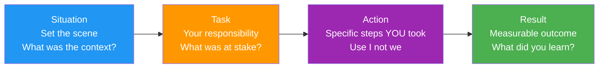
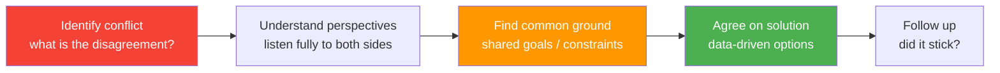
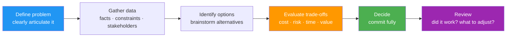
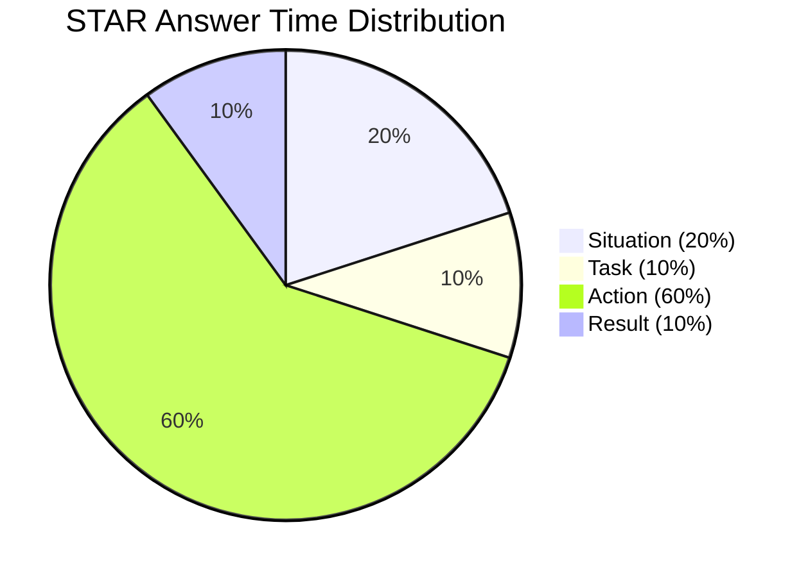
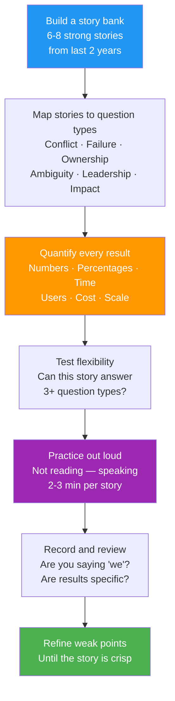

# 🎯 Behavioral & Leadership Interview Guide

> STAR-format answers for every scenario. Every answer framework includes: what interviewers are really testing + red flags to avoid + sample answer structure.

---

## 📋 Table of Contents

1. [STAR Framework](#1-star-framework)
2. [Conflict Handling](#2-conflict-handling)
3. [Production Outage Story](#3-production-outage-story)
4. [Ownership & Initiative](#4-ownership--initiative)
5. [Difficult Stakeholder Handling](#5-difficult-stakeholder-handling)
6. [Tight Deadline Tradeoffs](#6-tight-deadline-tradeoffs)
7. [Mistake You Made](#7-mistake-you-made)
8. [Mentoring Junior Developers](#8-mentoring-junior-developers)
9. [Disagreeing with a Decision](#9-disagreeing-with-a-decision)
10. [Handling Ambiguous Requirements](#10-handling-ambiguous-requirements)
11. [Cross-Team Collaboration](#11-cross-team-collaboration)
12. [Career & Growth Questions](#12-career--growth-questions)

---

## 1. STAR Framework

Every behavioral answer should follow STAR:



```
S — Situation   : Set the scene. What was the context?
T — Task        : What was YOUR responsibility? What was at stake?
A — Action      : Specific steps YOU took. Use "I", not "we".
R — Result      : Measurable outcome. What changed? What did you learn?
```

**Duration:** 2–3 minutes per answer. Don't ramble; don't be too brief.

**Common mistakes:**
- ❌ Using "we" throughout — interviewer wants to know YOUR contribution
- ❌ Vague results — "things got better" → instead: "reduced deploy time by 60%"
- ❌ No self-reflection — always add what you learned
- ❌ Choosing a trivial example — pick situations with real stakes

---

## 2. Conflict Handling



**What they're testing:** Can you handle disagreement professionally? Can you separate personal from professional? Do you escalate appropriately?

### Example Question: *"Tell me about a time you had a conflict with a colleague."*

**Answer Framework:**
```
S: We disagreed on the architecture approach for a new payment service.
   My colleague wanted to use a monolithic module for speed of delivery.
   I believed the service needed to be isolated due to PCI compliance requirements.

T: I was the tech lead. The decision would affect security posture for 2 years.
   Both approaches were technically feasible — this was a judgment call.

A: 1. I listened fully to their reasoning first — understood their concern
      was meeting a Q3 deadline, not architecture preference.
   2. I wrote a one-page comparison doc: pros/cons of both, risks,
      estimated timeline for each.
   3. I proposed a middle path: isolated service, but with a simplified
      initial scope that still hit the deadline.
   4. We presented both views to the tech principal and agreed on
      the isolated approach with a phased delivery plan.

R: Shipped on time, passed PCI audit, no rework needed.
   My colleague later said the written comparison made it easy to
   see the tradeoffs objectively. We still work well together.

Learned: Conflict often isn't about the technical decision itself —
it's about concerns (deadline, risk, ownership) that haven't been
fully articulated. Surfacing those first makes resolution easier.
```

**Red flags to avoid:**
- Saying you always "won" the argument
- Saying the other person was wrong/incompetent
- Avoiding conflict entirely ("I just went along with it")

---

## 3. Production Outage Story

**What they're testing:** Do you stay calm under pressure? Do you follow a systematic approach? Do you communicate well? Do you do postmortems?

### Example Question: *"Tell me about a production outage you handled."*

**Answer Framework:**
```
S: At 2 AM on a Friday, our order processing service started throwing 500s.
   Error rate hit 40%. 3,000 orders per hour were failing.
   This was Black Friday weekend — highest traffic of the year.

T: I was on-call. I had 15 minutes before it would breach our SLA
   and trigger customer-facing compensation.

A: 1. Immediately: check dashboards — Datadog showed DB connection pool
      exhausted. Not a code deploy (last deploy was 3 days ago).
   2. Checked DB slow query log — one query had no index, doing a full scan
      on a 50M row table. Traffic spike exposed it.
   3. Communication: sent Slack update to stakeholders every 15 minutes.
      Clear: "what we know, what we're doing, ETA".
   4. Short-term fix: added a query hint to force index use (1 minute deploy).
      Connection pool freed → error rate dropped to 0%.
   5. Proper fix next morning: added composite index via non-blocking migration.
   6. Postmortem 48 hours later: documented timeline, root cause,
      added slow query alerts to prevent recurrence.

R: Full recovery in 22 minutes. ~1,200 orders failed — all auto-retried
   successfully. No customer compensation triggered.
   Postmortem: added slow query monitoring that caught 3 more
   potential issues before they hit production.

Learned: Every outage is a gift if you do the postmortem right.
The alert we added from this incident caught a worse query 3 months later.
```

**Postmortem structure to mention:**
```
1. Timeline (minute-by-minute what happened)
2. Root cause (5 Whys — go deep, not surface)
3. Contributing factors (why didn't we catch it earlier?)
4. Action items (specific, owned, dated — not vague "add more tests")
5. Blameless: systems failed, not people
```

---

## 4. Ownership & Initiative

**What they're testing:** Do you take initiative beyond your ticket? Do you see the bigger picture? Can you drive work without being told?

### Example Question: *"Tell me about a time you went beyond your role."*

**Answer Framework:**
```
S: I noticed our CI pipeline was taking 45 minutes. Nobody complained
   officially — it was just accepted as "normal".
   Developers were running full pipeline 5–8 times a day per PR.

T: This wasn't my sprint ticket. I had a week with some slack time.

A: 1. Profiled the pipeline: 30 of the 45 minutes were integration tests
      running sequentially.
   2. Parallelised test execution across 4 agents: 8 minutes.
   3. Introduced test caching for unchanged modules: further to 6 minutes.
   4. Added changedFiles detection — only run tests for affected services.
   5. Wrote a wiki page so team could maintain it.
   6. Presented the change at team demo with before/after metrics.

R: CI time: 45 min → 7 min.
   Team ran pipeline ~40 times per day across 5 developers.
   Saved ~25 hours/day of blocked developer time per week.
   This improvement was cited in my performance review as
   "high-impact initiative taken without being asked."

Learned: Technical debt in developer tooling compounds every day.
Small improvements to the feedback loop pay dividends constantly.
```

---

## 5. Difficult Stakeholder Handling

**What they're testing:** Can you manage up? Can you push back diplomatically? Can you align business and engineering?

### Example Question: *"Tell me about a time you had to push back on a stakeholder."*

**Answer Framework:**
```
S: A product manager wanted to ship a new feature in 2 weeks.
   The feature required changes to the payment flow — an area
   with high regulatory risk. My estimate was 6 weeks with proper testing.

T: I was the tech lead. If I agreed to 2 weeks and we shipped too fast,
   we risked a security incident or regulatory violation.
   If I refused outright without alternatives, I'd be seen as blocking delivery.

A: 1. Didn't say "no" in the meeting. Said "let me understand the priority
      and come back with options."
   2. Broke the feature into must-have vs nice-to-have.
      Core payment change: 6 weeks (non-negotiable for compliance).
      UI improvements: 1 week (could ship immediately).
   3. Proposed a phased plan: Ship UI in 1 week, core in 6 weeks.
      Also documented the specific risks of rushing (breach scenarios,
      compliance fines — made them concrete, not abstract).
   4. Presented this to PM and their director with the risk doc.

R: Director agreed to the phased approach.
   UI shipped week 1 — satisfied stakeholder's pressure from above.
   Core payment change shipped in 6 weeks — zero issues.
   PM thanked me afterward for making the risk concrete — they
   hadn't realised the compliance implications.

Learned: Saying "no" is easy and unproductive. Offering options with
clear tradeoffs — that's what makes the conversation productive.
```

---

## 6. Tight Deadline Tradeoffs

**What they're testing:** Can you make pragmatic tradeoffs? Do you communicate scope changes early? Do you distinguish technical debt from cutting corners on safety?

### Example Question: *"Tell me about a time you had to cut scope to meet a deadline."*

**Answer Framework:**
```
S: We had a hard launch date for a new product — tied to a marketing event
   with 50,000 email subscribers already notified.
   2 weeks before launch, we discovered the reporting module would
   take 3 more weeks to build correctly.

T: I was responsible for technical delivery. We couldn't move the date.
   We had to decide: delay the whole product, ship without reporting,
   or ship a degraded version.

A: 1. Assessed what "must work on day 1" vs "nice to have":
      Core product: must ship. Reporting: needed, but not day-1 blocking.
   2. Proposed: ship without reporting, add manual CSV export as a stopgap.
      Created a detailed technical debt ticket for proper implementation.
   3. Briefed stakeholders with a concrete plan: "Reporting ships in 3 weeks
      post-launch. Until then, we export a daily CSV to the data team."
   4. Added monitoring to track how often the CSV export was used —
      so we could prioritise the proper feature with data.

R: Launched on time. Zero complaints about missing reporting on day 1.
   Proper reporting shipped 3 weeks later.
   The CSV export data showed only 12% of users needed daily reports —
   which informed a simpler final design than originally planned.

Learned: Cutting scope is valid. Cutting quality (no tests, no error handling)
is not — that debt compounds. Always make the tradeoff explicit and tracked.
```

---

## 7. Mistake You Made

**What they're testing:** Self-awareness. Accountability. Do you learn? Do you blame others?

### Example Question: *"Tell me about a mistake you made."*

**Answer Framework:**
```
S: I deployed a database index change on a table with 80M rows
   during business hours without a maintenance window.

T: I was confident the online index rebuild would be fast. I was wrong.
   It caused lock contention, degraded the API, and triggered 5 minutes
   of increased error rates.

A: 1. Immediately rolled back the index change (3 minutes recovery).
   2. Communicated to the team and wrote an incident report.
   3. Investigated: online index on SQL Server still takes exclusive locks
      at the beginning and end — I hadn't verified this for our version.
   4. Created a DB change checklist: test in staging on production-sized data,
      schedule schema changes outside business hours, get second eyes.
   5. Shared the incident and checklist in our engineering all-hands —
      made it a team learning rather than hiding it.

R: No customer impact beyond 5 minutes. No repeat incidents.
   The checklist is now standard procedure for our team.

Learned: Confidence is dangerous when untested. "I think this will be fast"
is not the same as "I measured this on production-sized data."
Slow down for high-risk changes.
```

**What makes this answer strong:**
- Owns it fully — no blaming tools or circumstances
- Shows specific action to prevent recurrence
- Shared the learning publicly (leadership behaviour)
- Has a real measured impact

---

## 8. Mentoring Junior Developers

**What they're testing:** Can you grow others? Do you have patience? Can you balance teaching with delivery?

### Example Question: *"Tell me about a time you mentored someone."*

**Answer Framework:**
```
S: A junior developer on my team was struggling with async/await.
   They kept writing async void methods and had several bugs where
   exceptions were being swallowed silently.

T: I was their senior and it was my responsibility to help them level up —
   not just fix their bugs for them.

A: 1. Set up weekly 1:1s focused on learning, separate from code reviews.
   2. Instead of correcting code directly, asked questions:
      "What happens to this exception if the caller doesn't await?"
      Let them discover the problem.
   3. Shared specific reading: .NET async best practices docs,
      a blog post on ConfigureAwait — curated, not overwhelming.
   4. Did pair programming for 2 sessions on their trickiest task.
      I typed, they directed — builds confidence and exposes thinking.
   5. Gave them ownership of a small isolated feature end-to-end
      so they had a win to point to.

R: Within 6 weeks, their async code was solid.
   They started catching async anti-patterns in other people's PRs.
   They told me in their 1:1 it was the most they'd learned in 6 months.

Learned: The best way to teach is to make the learner do the thinking.
Giving answers creates dependency. Asking questions builds independence.
```

---

## 9. Disagreeing with a Decision

**What they're testing:** Disagree and commit. Can you advocate professionally and then fully execute even when overruled?

### Example Question: *"Tell me about a time you disagreed with a technical decision."*

**Answer Framework:**
```
S: The team decided to use MongoDB for a new service.
   I believed PostgreSQL was better for our use case — we had
   mostly relational data with frequent joins.

T: I wasn't the decision-maker. Two senior engineers had already agreed
   on MongoDB. I had one chance to raise the concern before it was locked in.

A: 1. Didn't argue in Slack — asked for 30 minutes in a design session.
   2. Came prepared: a one-pager with the specific query patterns
      our service would run, join frequency, and how that mapped to
      MongoDB vs PostgreSQL.
   3. Raised specific risks: "These 3 query patterns require $lookup
      aggregations in Mongo — which are slow. In Postgres, they're
      a single JOIN."
   4. They reviewed it, discussed, and decided to stick with MongoDB —
      they had other reasons (existing team expertise, operational simplicity).
   5. I said clearly: "I've shared my concern, I understand the decision.
      I'm fully committed to making this work. Let's define our index strategy."

R: The service shipped with MongoDB.
   We did hit one of the performance issues I predicted.
   We mitigated it with denormalisation — extra work, but manageable.
   My concern was noted in the postmortem as a valid risk.

Learned: Advocating clearly, once, with data — then committing fully —
is the right pattern. Continuing to push after a decision is made
damages trust and slows delivery.
```

---

## 10. Handling Ambiguous Requirements

**What they're testing:** Can you drive clarity? Do you make assumptions explicit? Can you ship without perfect information?

### Example Question: *"Tell me about a time you worked with ambiguous requirements."*

**Answer Framework:**
```
S: We received a requirement: "Users should be able to export their data."
   That was the entire spec. No format, no scope, no volume defined.

T: I was the developer implementing it. The PM was busy with other priorities.
   I needed to deliver in 2 sprints.

A: 1. Rather than asking one big meeting, I wrote a 10-question assumption doc:
      "Which entities? What format — CSV, JSON, PDF? One-click or async?
      What's the data volume? Any GDPR considerations?"
   2. PM answered 8 of 10 in 10 minutes over Slack.
   3. For the 2 unclear ones, I proposed safe defaults with a note:
      "I'll implement as CSV and async (for large datasets) unless told otherwise."
   4. Built the simplest version that satisfied the stated requirements.
      Added feature flags so we could extend format support later.

R: Shipped on time. PM saw the feature and requested one change
   (add JSON as an option) — 1 day of work because I'd built it extensibly.

Learned: Ambiguity is a solvable problem, not a blocker.
Write down your assumptions, confirm quickly, build the simplest correct thing.
```

---

## 11. Cross-Team Collaboration

**What they're testing:** Can you work across org boundaries? Can you influence without authority?

### Example Question: *"Tell me about a time you worked with another team to solve a problem."*

**Answer Framework:**
```
S: Our service depended on the Payments team's API.
   Their API was returning inconsistent error codes — sometimes 400,
   sometimes 500 for the same validation failure.
   This broke our retry logic (we retried 500s but not 400s).

T: I didn't manage the Payments team. I had no authority to change their API.
   But the bug was causing real customer impact on our side.

A: 1. Reproduced the issue with specific examples and logged them.
   2. Reached out to their tech lead directly — with evidence, not blame.
      "Here are 5 examples where your API returns 500 for what seems like
      a validation error. Is this by design or a bug?"
   3. They confirmed it was a bug. Agreed to fix it in their next sprint.
   4. Short-term: I made our retry logic check the error body, not just
      status code — a defensive change.
   5. We added a contract test: our CI checks that their API contract
      matches our expectations. Prevents regression.

R: Their fix shipped 2 weeks later.
   Our defensive code meant zero customer impact in the interim.
   The contract test has caught 2 regressions since.

Learned: When working with other teams, lead with specific evidence
and make it easy for them to act. Blame creates defensiveness;
concrete reproduction steps create collaboration.
```

---

## 12. Career & Growth Questions

### "Where do you see yourself in 5 years?"
```
Be honest and specific, not corporate-speak.

Good answer:
"In 5 years, I want to be at a principal or staff engineer level —
where I'm shaping technical direction across multiple teams, not just
writing code. I want to get better at system design at scale, and at
mentoring others. I'm actively working toward that: I recently led
my first cross-team architecture decision and started writing
internal design docs that others reference. This role appeals to me
because [specific reason tied to the company]."

Bad answer:
"I want to be a manager." (if the role isn't management track)
"I want to keep learning and growing." (meaningless)
"I want to be the best engineer I can be." (vague)
```

### "Why are you leaving your current role?"
```
Honesty + positive framing. Never criticise your current employer.

Good answer:
"I've learned a lot at [Company] — particularly around [specific skill].
I'm proud of [specific achievement]. But I've reached a point where
the technical challenges are becoming repetitive, and I want to work
on [larger scale / specific domain / different tech stack].
This role stood out because [specific reason]."

Avoid:
"My manager is terrible."
"The company is a mess."
"I'm not paid enough." (true, but say "compensation that reflects my market value")
```

### "What's your greatest strength?"
```
Pick ONE real strength. Support with a specific example. Tie it to the role.

Example:
"My greatest strength is breaking down complex systems into clear,
communicable designs. When I joined my current team, nobody had
a clear picture of how our microservices interacted — we had 12 services
with undocumented dependencies. I built out a service map and wrote
decision records for the 3 most critical architectural decisions.
New team members now onboard in 2 weeks instead of 2 months.
I think that ability — making complexity navigable — will be especially
valuable in this role given the distributed architecture you described."
```

### "What's your greatest weakness?"
```
Pick a REAL weakness. Show you're actively working on it.
Don't say "I work too hard" or "I'm a perfectionist" — interviewers see through it.

Example:
"I sometimes dive into implementation too quickly before fully
validating requirements. I get excited by the problem-solving and
want to start building. In the past this led to a refactor when the
business rules changed mid-sprint. I now force myself to write a
one-pager before opening my IDE for any non-trivial feature.
It's a habit I've been deliberately building over the past year
and it's reduced rework significantly."
```

---

## Decision-Making Framework



---

> ✅ **12 behavioral categories** — every common interview scenario with full frameworks.
>
> 💡 **Preparation tips:**
> - Prepare 6–8 STAR stories that can flex across multiple question types
> - One story about a hard technical decision
> - One story about a mistake (with a positive outcome from learning)
> - One story where you influenced without authority
> - One story about going beyond your scope
> - One story about conflict that ended positively
> - One story about a time you were wrong and changed your mind

---

*Last updated: 2026*

---

---

# 🏢 FAANG Behavioral Interview Guide

> Company-specific frameworks, question banks, and answer patterns for Amazon, Google, Meta, Microsoft — with STAR templates, red flags, and scoring dimensions.

---

## Amazon — 16 Leadership Principles

Amazon behavioral interviews are entirely structured around Leadership Principles (LPs). Every question maps to one or more. Interviewers score you on these dimensions; they want **specific past behavior**, not hypotheticals.

**Rule:** For each LP, prepare at least one polished STAR story. Many stories can flex across multiple principles.

---

### LP1: Customer Obsession

**Definition:** Leaders start with the customer and work backwards. They work vigorously to earn and keep customer trust.

**What Amazon is testing:** Do you prioritise customer outcomes over internal metrics? Do you push back when internal goals conflict with customer needs?

**STAR Template:**
```
S: [A customer-facing issue that was being ignored internally — e.g., a metric looked
   fine but customers were experiencing something painful]

T: I identified the gap between our internal measurement and actual customer experience.
   Nobody had formally owned fixing it.

A: 1. I researched the customer impact — support tickets, error logs, session replays.
   2. Quantified the pain: [X% of users hit this, Y minutes wasted, Z NPS drop].
   3. Built a case and brought it to the team, proposing a concrete fix.
   4. Championed the fix through prioritisation — it wasn't in the sprint plan.

R: Fixed within [timeframe]. Customer satisfaction metric improved by [X%].
   Support ticket volume for this issue dropped by [Y%].
   Learned: What looks fine from a system perspective can be painful from a
   customer perspective. Data must include the customer's point of view.
```

**Red flags to avoid:**
- Talking about what the system did — not what YOU did for the customer
- Prioritising internal metrics over customer outcomes
- No measurable customer impact in your result

---

### LP2: Ownership

**Definition:** Leaders are owners. They never say "that's not my job." They act on behalf of the entire company, beyond just their own team.

**What Amazon is testing:** Do you take responsibility beyond your scope? Do you follow through without being asked?

**STAR Template:**
```
S: I noticed [a problem outside my direct responsibility — e.g., a deployment pipeline
   that was causing delays for three teams, but nobody's job to fix].

T: Nobody had formally been assigned to fix this. My sprint was full. But the cost
   to the organisation was [X hours/day across Y engineers].

A: 1. Took it on voluntarily — communicated to my manager.
   2. Investigated root cause.
   3. Fixed it, documented it, added monitoring so it wouldn't silently break again.
   4. Handed off maintenance ownership to the right team with full documentation.

R: [Measurable improvement: time saved, reliability improved].
   Learned: Ownership isn't about your job description. It's about seeing something
   broken and deciding you're the one who will fix it.
```

**Red flags to avoid:**
- "That wasn't my responsibility" — this is an anti-LP2 statement
- Solving the problem but then abandoning it without handoff
- Blaming lack of time as a reason to not act

---

### LP3: Invent and Simplify

**Definition:** Leaders expect and require innovation. They are externally aware, look for new ideas everywhere, and are not limited by "not invented here."

**What Amazon is testing:** Can you find simpler solutions? Do you challenge existing approaches? Do you look outside your team for inspiration?

**STAR Template:**
```
S: Our team had [a complex, multi-step process that was fragile and slow — e.g.,
   a manual release process with 15 steps taking 2 hours].

T: I was responsible for developer productivity. This was accepted as "just how it is."

A: 1. Mapped the process end-to-end — found 6 of 15 steps were redundant.
   2. Looked at how other teams in the industry handled this (external research).
   3. Proposed a simplified approach: [specific change that reduced complexity].
   4. Built a prototype and measured the difference.
   5. Documented and rolled it out team-wide.

R: Process reduced from [15 steps / 2 hours] to [4 steps / 15 minutes].
   Onboarding new engineers to the release process: from 1 week to 1 day.
   Learned: Complexity accumulates gradually. Sometimes the best innovation
   is aggressive simplification, not adding something new.
```

**Red flags to avoid:**
- Adding complexity in the name of "innovation"
- Solving a problem with an overcomplicated solution when a simple one exists
- Not measuring before and after

---

### LP4: Are Right, A Lot

**Definition:** Leaders have strong judgment and good instincts. They seek diverse perspectives and work to disconfirm their beliefs.

**What Amazon is testing:** Do you make good decisions? Do you update your views when new data arrives? Do you actively seek disconfirming evidence?

**STAR Template:**
```
S: I had to make a decision about [a significant technical or product choice] under time
   pressure. My initial instinct was [X], but I deliberately challenged it.

T: The decision would affect [scope — e.g., 3 teams for 18 months]. Getting it wrong
   would be expensive to undo.

A: 1. Stated my initial hypothesis explicitly.
   2. Actively sought out people who disagreed and listed why they might be right.
   3. Found data that challenged my view: [specific piece of disconfirming evidence].
   4. Changed my position based on the evidence: chose [different option].
   5. Documented the reasoning so the decision could be revisited if facts changed.

R: [Outcome showing the revised decision was better than the initial instinct].
   Learned: Being right more often requires actively trying to be wrong first.
   The best decision-makers I've seen don't defend their initial view — they
   attack it and see if it survives.
```

**Red flags to avoid:**
- Never changing your mind — "I was right from the start"
- No evidence of seeking diverse perspectives
- Overconfidence without data

---

### LP5: Learn and Be Curious

**Definition:** Leaders are never done learning. They seek to improve themselves and are curious about new possibilities.

**What Amazon is testing:** How do you stay current? Can you give examples of self-directed learning that improved your work?

**STAR Template:**
```
S: I identified a gap in my knowledge that was limiting what I could contribute —
   [e.g., I was effective at backend services but had no understanding of how
   the data pipeline our service fed into worked].

T: Nobody told me to learn this. But I realised my decisions were affecting downstream
   systems I didn't understand.

A: 1. Dedicated [X hours/week] to learning [the domain/technology].
   2. Shadowed the data engineering team for [Y days].
   3. Built a small internal tool / prototype to apply the learning.
   4. Brought what I learned back to my team through a lunch-and-learn.

R: Within [timeframe], I could design services that were significantly easier
   to consume by the data team. [Specific outcome — fewer integration issues,
   faster onboarding of data consumers].
   Learned: The fastest way to learn is to teach. Forcing myself to present
   to the team exposed gaps in my understanding I hadn't realised I had.
```

**Red flags to avoid:**
- Vague "I like learning" without specifics
- Learning that was entirely externally directed (told to take a course)
- No clear connection between what you learned and business impact

---

### LP6: Hire and Develop the Best

**Definition:** Leaders raise the performance bar with every hire. They recognize exceptional talent and willingly move them throughout the organisation. They develop leaders.

**What Amazon is testing:** Have you raised the bar in hiring? Have you genuinely developed others, not just supervised them?

**STAR Template:**
```
S: I was asked to interview candidates for [role]. I noticed our interview process
   was not differentiating strong from average candidates — everyone passed who
   seemed "nice and competent."

T: As the most senior engineer on the loop, I had influence over how we evaluated.

A: 1. Rewrote the coding exercise to test actual problem-solving, not just syntax.
   2. Added a system design question calibrated to the level.
   3. Created a structured scoring rubric so interviewers graded consistently.
   4. Ran calibration sessions with other interviewers.
   5. Also: for a specific junior engineer on my team, created a 6-month growth plan
      with monthly goals, gave them progressively larger ownership, and nominated
      them for a promotion after 8 months.

R: After process change: rejection rate increased by [X%] — bar was raised.
   Junior engineer promoted to mid-level [Y months] ahead of typical timeline.
   Learned: Developing people is a skill, not an attitude. It requires deliberate
   investment, clear goals, and willingness to give uncomfortable feedback.
```

**Red flags to avoid:**
- Claiming you "raised the bar" without evidence
- Mentoring that amounted to "I was available if they had questions"
- Hiring people who would be "good enough" vs truly exceptional

---

### LP7: Insist on the Highest Standards

**Definition:** Leaders have relentlessly high standards. They continually raise the bar and drive their teams to deliver high-quality products, services, and processes.

**What Amazon is testing:** Have you pushed for quality when there was pressure to accept "good enough"? Have you held the line?

**STAR Template:**
```
S: The team was under pressure to ship [feature/product] by [deadline].
   A code review revealed [specific quality issue — e.g., no error handling on
   payment retries, potential for duplicate charges].

T: The PM wanted to ship anyway — "we'll fix it in the next sprint."
   I was the tech lead and this was a correctness/safety issue, not a cosmetic one.

A: 1. Did not just flag it in the PR — called a 30-minute meeting with the PM and
      engineer to explain specifically what could go wrong and the customer impact.
   2. Quantified the risk: "In our current traffic, this bug will likely cause
      [X duplicate charges per day]. That's a customer trust and financial liability."
   3. Proposed a scoped fix that would take [2 days] not [2 weeks].
   4. Held the release until the fix was verified.

R: Released 2 days later with the fix. Zero duplicate charge incidents.
   In the next retrospective, the PM acknowledged the call was right and we
   added a "correctness checklist" for payment flows.
   Learned: Insisting on high standards is only credible if you can quantify
   what "low standards" would have cost. Abstract quality arguments lose to
   deadline pressure. Concrete risk arguments win.
```

**Red flags to avoid:**
- Caving to deadline pressure on safety/correctness issues
- Blocking releases for cosmetic issues (this isn't high standards, it's poor judgment)
- No specific example of actually holding the line

---

### LP8: Think Big

**Definition:** Thinking small is a self-fulfilling prophecy. Leaders create and communicate a bold direction that inspires results.

**What Amazon is testing:** Can you look beyond the immediate task and see the larger opportunity? Can you influence others toward a bigger vision?

**STAR Template:**
```
S: I was asked to [small scoped task — e.g., add a new report to the dashboard].
   While scoping it, I realised the underlying data model could power [a much
   larger capability — e.g., a self-service analytics platform for all 15 teams].

T: My task was just the one report. Proposing the bigger vision meant more work
   upfront and required buy-in from teams I didn't manage.

A: 1. Built the one report as asked (delivered on the immediate ask).
   2. Wrote a one-pager on the larger opportunity: what it could unlock,
      rough estimate of value, what would need to change architecturally.
   3. Presented to my manager and the two other team leads — got informal buy-in.
   4. Proposed it as a 2-sprint investment with a defined scope.

R: The bigger initiative was approved. [Outcome: X teams now self-serve analytics,
   saving Y hours/week of engineering requests for custom reports].
   Learned: Delivering the immediate ask earns the credibility to propose the
   bigger idea. Do both — don't use "think big" as an excuse not to deliver.
```

**Red flags to avoid:**
- Proposing big things that never shipped
- Thinking big without executing
- Missing the immediate deliverable while chasing the bigger vision

---

### LP9: Bias for Action

**Definition:** Speed matters in business. Many decisions and actions are reversible and do not need extensive study. We value calculated risk-taking.

**What Amazon is testing:** Do you move when you have enough information (not perfect information)? Can you distinguish reversible from irreversible decisions?

**STAR Template:**
```
S: [A situation where waiting for more information or approval would have caused
   significant delay or damage — e.g., a production issue degrading customer
   experience while the on-call manager was unreachable].

T: I could wait for explicit approval (safe for me, bad for customers)
   or act on my best judgment with the information I had.

A: 1. Assessed: is this action reversible? (Yes — a config rollback.)
   2. Documented my reasoning in Slack before acting.
   3. Took the action — rolled back the config change.
   4. Immediately notified my manager and wrote a 3-paragraph summary:
      "Here's what I did, why, and what the outcome was."

R: Customer impact resolved in [X minutes] instead of [Y hours].
   Manager confirmed the action was correct.
   Learned: Bias for action is not recklessness. Before acting, I ask:
   "Is this reversible? Do I have enough data to be reasonably confident?
   Can I communicate clearly what I'm doing and why?" If all three are yes,
   act and communicate — don't wait.
```

**Red flags to avoid:**
- Over-analysing reversible decisions
- Acting on irreversible decisions without enough data (that's recklessness, not bias for action)
- Waiting for permission when you have enough context to act

---

### LP10: Frugality

**Definition:** Accomplish more with less. Constraints breed resourcefulness, self-sufficiency, and invention. There is no extra credit for headcount, budget, or fixed expense.

**What Amazon is testing:** Have you achieved meaningful results with limited resources? Do you find creative solutions under constraints?

**STAR Template:**
```
S: I needed to [accomplish a significant goal — e.g., build a real-time monitoring
   system for our services] with [a very limited budget / no additional headcount /
   tight timeline].

T: The obvious solution was [buying a commercial tool / hiring two engineers].
   Neither was approved. I had [limited resources] to work with.

A: 1. Mapped the actual requirements — what did we truly need vs what was nice-to-have?
   2. Found an open-source alternative that covered 80% of the requirements.
   3. Built the remaining 20% in [X days] using existing infrastructure.
   4. Total cost: [$Y vs $Z for the commercial solution].

R: Monitoring system delivered. Caught [X incidents in Y months].
   Cost: [$Y — 90% less than the commercial alternative].
   Learned: Constraints force you to understand what you actually need.
   The commercial tool had 40 features. We used 8. The focused solution
   was easier to maintain and better understood by the team.
```

**Red flags to avoid:**
- Stories where you had unlimited resources
- No evidence of cost-consciousness
- Frugality that came at the cost of quality (penny wise, pound foolish)

---

### LP11: Earn Trust

**Definition:** Leaders listen attentively, speak candidly, and treat others respectfully. They are vocally self-critical, even when doing so is awkward.

**What Amazon is testing:** Can you give an example of being transparent when it was uncomfortable? Do you admit mistakes publicly?

**STAR Template:**
```
S: I made a mistake that had visible impact — [e.g., I gave an incorrect estimate
   that caused another team to plan their sprint around work that wouldn't be ready].

T: I could quietly fix it and hope nobody noticed, or I could be transparent
   immediately and manage the fallout.

A: 1. Sent a message to the affected team lead within the hour: "I was wrong about
      the estimate. Here's why, here's the correct timeline, here's what I can do
      to partially mitigate the impact."
   2. In the next team retrospective, brought it up myself — didn't wait to be called out.
   3. Explained the root cause: "I estimated without accounting for [specific factor]."
   4. Proposed a process change: [specific improvement to prevent recurrence].

R: The other team appreciated the early warning and adjusted their sprint.
   My manager told me in 1:1: "The way you handled that built more trust than
   if the mistake hadn't happened."
   Learned: Trust is built in the awkward moments. Anyone can be trustworthy
   when things go well. It's the self-critical moments that differentiate.
```

**Red flags to avoid:**
- No examples of being vocally self-critical
- Blaming others for your mistakes
- Only admitting mistakes after being caught

---

### LP12: Dive Deep

**Definition:** Leaders operate at all levels, stay connected to the details, and audit frequently. No task is beneath them. When data and anecdote conflict, they investigate.

**What Amazon is testing:** Do you understand your systems deeply? Can you give examples of going past the surface to find real root causes?

**STAR Template:**
```
S: We had a recurring customer complaint about [vague symptom — e.g.,
   "slow page loads on mobile"]. Previous investigation had concluded:
   "network latency — nothing we can do." I was skeptical.

T: The issue had been open for 3 months. Customers kept reporting it.
   I decided to investigate properly.

A: 1. Reproduced the issue personally on a mobile device — not just in devtools.
   2. Captured a network trace — found the true culprit: [e.g., 47 separate API
      calls on page load, many of which were waterfall-dependent].
   3. Looked at the code — found the calls were made sequentially when they
      could be made in parallel.
   4. Also found the mobile-specific serialisation was 3x larger than desktop
      (no field selection on the API).
   5. Fixed both issues and re-measured.

R: Page load time reduced from [4.2s] to [0.9s] on mobile.
   Customer complaints about mobile speed: dropped [80%] in the following month.
   Learned: "Nothing we can do" is almost always wrong. It means "we haven't
   looked closely enough yet."
```

**Red flags to avoid:**
- Accepting surface-level explanations
- Delegating root cause analysis entirely and just reviewing findings
- Knowing the answer without being able to explain the detail

---

### LP13: Have Backbone; Disagree and Commit

**Definition:** Leaders are obligated to respectfully challenge decisions when they disagree, even when doing so is uncomfortable or exhausting. But once a decision is made, they commit completely.

**What Amazon is testing:** Can you advocate professionally and then execute fully even when overruled? (Both halves matter — backbone AND commit.)

**STAR Template:**
```
S: The team was making a decision I believed was technically wrong —
   [e.g., using eventual consistency in a context where it would cause
   user-visible data inconsistency].

T: The decision had been discussed and the team leads were aligned against my view.
   I was the only dissenting voice.

A: 1. Asked for one more conversation — came prepared with specific failure scenarios,
      not just "I think this is wrong."
   2. Made my case: "Here are 3 concrete cases where this will produce incorrect
      results that a user will see."
   3. They listened, considered, and decided to proceed anyway — their reasoning was
      [valid reason: operational complexity, team expertise, timeline].
   4. I said clearly: "I've made my case. I understand the decision. I'm fully in.
      Let me help define the mitigation strategy for the scenarios I raised."
   5. Executed the decision as fully as if it had been my own.

R: [Outcome — whether you were right or wrong, what matters is showing you committed].
   One of the failure scenarios I predicted did occur — we had a mitigation ready.
   Learned: The value of disagreeing is the conversation, not winning.
   Once the decision is made, dissent is destructive. Commitment is the only path.
```

**Red flags to avoid:**
- Continuing to resist after the decision is made
- Saying "I told you so" when things go wrong
- Not actually disagreeing when you should (silent disagreement + quiet resentment)

---

### LP14: Deliver Results

**Definition:** Leaders focus on the key inputs for their business and deliver them with the right quality and in a timely fashion. Despite setbacks, they rise to the occasion and never settle.

**What Amazon is testing:** Do you ship? Can you navigate obstacles and still deliver? Do you have a track record of completing things?

**STAR Template:**
```
S: I committed to delivering [significant feature/project] by [date].
   Midway through, [a major obstacle appeared — key engineer left, dependency
   was delayed by another team, scope expanded].

T: The original plan was no longer viable. I had to decide: slip the date, cut scope,
   or find a creative path to still deliver.

A: 1. Re-assessed what "delivering on time" actually meant to the business —
      talked to the stakeholders. The core feature was critical; some parts were not.
   2. Negotiated a scope reduction that preserved 100% of the business value
      at 70% of the original scope.
   3. Escalated the dependency blocker directly — got a senior engineer from the
      other team temporarily assigned.
   4. Communicated the revised plan clearly with no surprises.

R: Delivered on the original date with [adjusted scope — documented, planned
   for the following sprint]. Zero business impact from the scope change.
   Learned: Delivering results is not about delivering the original plan.
   It's about delivering the actual business value. That sometimes means
   changing the plan, not the outcome.
```

**Red flags to avoid:**
- Stories where you missed the deadline without a fight
- Over-indexing on process over outcome
- No clear ownership of the result

---

### LP15: Strive to be Earth's Best Employer

**Definition:** Leaders work every day to create a safer, more productive, higher performing, more diverse, and more just work environment.

**What Amazon is testing:** Have you created an inclusive, psychologically safe environment for your team? Have you acted on behalf of your team's wellbeing?

**STAR Template:**
```
S: I noticed [a team dynamic issue — e.g., one engineer was consistently
   talked over in meetings, or a junior team member was afraid to ask questions
   in group settings].

T: This was affecting team performance and the individual's growth.
   As the senior engineer/tech lead, I had informal influence over the team culture.

A: 1. Had a private conversation with the affected person to understand their experience.
   2. Made structural changes: introduced a round-robin speaking format for design discussions.
   3. Modelled the behaviour I wanted: asked explicitly for the quieter voices before
      the loudest voices in every meeting.
   4. Gave positive reinforcement when the dynamic improved.

R: The engineer's participation increased measurably.
   In the next team health check, psychological safety score improved by [X].
   The engineer later told me it changed how they felt about coming to work.
   Learned: Culture is shaped by specific behaviours, not posters.
   The most important intervention is what you do in the next meeting.
```

**Red flags to avoid:**
- Vague statements about "caring about the team"
- No specific behavioural changes you made
- Ignoring team dynamics issues

---

### LP16: Success and Scale Bring Broad Responsibility

**Definition:** We started in a garage but we're not there anymore. We must be humble and thoughtful about secondary effects of our actions.

**What Amazon is testing:** Have you considered the broader impact of your decisions — on customers, society, third parties?

**STAR Template:**
```
S: We were designing [a feature or system] that would affect [large number of users
   or had potential external consequences — e.g., an automated decision system,
   a data collection feature, a content moderation system].

T: The immediate engineering goal was clear. But I saw potential for [unintended harm
   — e.g., privacy implications, bias in automated decisions, vendor lock-in for
   customers].

A: 1. Raised the concern explicitly before implementation began — not after.
   2. Brought in [privacy team / legal / affected users] to evaluate the risk.
   3. Proposed a design change that achieved the goal with [reduced risk — e.g.,
      minimal data collection, explainability added to automated decisions].
   4. Documented the consideration and the tradeoffs made.

R: The feature shipped with the safeguards built in.
   No subsequent issues related to the risk I identified.
   Learned: At scale, good intentions are not enough. You must actively
   think about second-order effects — who else is affected beyond the
   primary user, and what happens when this system makes a mistake?
```

**Red flags to avoid:**
- No evidence of thinking beyond the immediate user/team
- Shipping first, asking ethical questions later
- Treating broad responsibility as someone else's job

---

## Google — Googleyness + Role-Related Knowledge

Google's interviews assess four dimensions. Every answer should demonstrate at least two.

### The 4 Google Interview Dimensions

| Dimension | What It Measures | How to Show It |
|-----------|-----------------|----------------|
| **General Cognitive Ability** | How you think, not what you know | Walk through your reasoning out loud. Show how you break down problems. |
| **Leadership** | Influencing outcomes at any level (not just management) | Examples of driving change without authority, rallying teams, making calls under uncertainty. |
| **Googleyness** | Cultural fit — comfort with ambiguity, collaboration, humility | Show intellectual curiosity, directness without ego, willingness to be wrong. |
| **Role-related Knowledge** | Domain depth for the specific role | Concrete technical or functional examples relevant to the job description. |

---

### Googleyness Traits

Google looks for these specific attributes under the "Googleyness" umbrella:

- **Comfort with ambiguity** — thriving in situations with incomplete information
- **Collaboration** — working across functions without formal authority
- **Fun / enjoyment of work** — genuine intellectual excitement about problems
- **Humility** — updating beliefs when wrong, crediting others
- **Directness** — sharing views clearly and respectfully, even when inconvenient

---

### Google Behavioral Questions

**"Tell me about a time you worked on an ambiguous problem."**

What it probes: Comfort with incomplete specs. Ability to create structure. Decision-making under uncertainty.

```
S: We were asked to "improve search relevance" — no metric defined, no scope,
   no success criteria.

T: I was the tech lead. Without clarity, any solution could be "wrong" in hindsight.

A: 1. Refused to build before defining success. Ran a 2-day spike to establish:
      - What does "relevance" mean to users? (User research: 5 sessions)
      - What's the current baseline? (Established a metric: NDCG@10)
      - What are the constraints? (Latency < 100ms, no external ML models yet)
   2. Proposed a focused experiment: improve ranking for the top 10% of queries
      that drove 60% of traffic.
   3. Built, measured, iterated.

R: NDCG@10 improved 18% for the target query set.
   Established the measurement framework used by the team for the next year.
   Learned: Ambiguity is not a problem to solve before starting.
   It's a problem to solve as the first step of starting.
```

---

**"How do you influence without authority?"**

What it probes: Leadership at any level. Can you move people who don't report to you?

```
Framework:
1. Build credibility first — deliver something that makes people want to listen
2. Understand what they care about — frame your ask in terms of their goals
3. Show your work — bring data, not opinions
4. Make it easy to say yes — do the legwork, lower their cost of agreeing
5. Accept "no" gracefully — and come back with new information, not repetition

Example:
I needed another team to prioritise a performance fix that was hurting our service.
- Framed it as: "This is causing [X page timeouts per hour for your downstream users]"
  (their problem, not just mine)
- Brought a measured reproducer — 10 lines to demonstrate the issue
- Offered to write the fix myself and put it up for their review
- Their cost: code review only. They said yes within a day.
```

---

**"Describe a time you had to make a decision with incomplete data."**

What it probes: Can you act when you don't have perfect information? Do you know when you have enough?

```
S: Our system was experiencing degraded performance. Two possible causes were
   identified — neither confirmed. Investigating fully would take 4 hours.
   Every hour of degradation was costing [business metric].

A: 1. Assessed which fix was more reversible: Fix A (config change, instant rollback)
      vs Fix B (code deployment, 20 min rollback).
   2. Calculated rough probability: based on recent changes, Fix A was 70% likely.
   3. Applied Fix A first — if wrong, 2-minute rollback. If right, immediate resolution.
   4. Fix A resolved it. Full investigation confirmed it was the root cause.
   5. Documented the decision tree for next time.

Lesson: When you can't be certain, make the most reversible bet first.
Don't wait for certainty when action is cheap and reversible.
```

---

**"Tell me about a time you disagreed with your manager."**

What it probes: Psychological safety, candor, professionalism, ability to advocate up.

```
Framework: Same as LP13 (Disagree and Commit) — make your case once, clearly,
with data. Then commit.

Safe language:
- "I want to share a concern before we proceed. Can I take 5 minutes?"
- "My read of the data suggests [X]. Am I missing something?"
- "I understand the decision. I want to make sure the risks are on record.
  [State risk.] Given that, I'll support the direction fully."

What to avoid:
- "I told my manager they were wrong" (aggressive framing)
- "I just went along with it" (no backbone)
- "I escalated over their head" (nuclear option — only valid for ethical violations)
```

---

## Meta — "Boost Signal" Framework

Meta interviewers evaluate answers against three categories. Strong answers demonstrate all three.

### The Three Signal Categories

| Category | What Meta Looks For |
|----------|---------------------|
| **Collaboration** | Cross-functional work, influencing peers, handling conflict constructively |
| **Impact** | Measurable outcomes at scale, business-level thinking, not just task completion |
| **Execution** | Shipping fast, iterating with data, handling ambiguity, unblocking yourself |

---

### What Meta Specifically Looks For

- **Move fast:** Meta's culture values speed. Show stories where you shipped fast, iterated fast, learned fast. Not stories where you spent 3 months in planning.
- **Data-driven decisions:** Show quantitative reasoning. "I felt it would be better" is weak. "The A/B test showed a 12% CTR improvement" is strong.
- **Cross-functional influence:** Meta is large. Show you can work with PMs, data scientists, designers, other engineers. Show you can drive alignment.
- **Scale thinking:** Meta operates at billions of users. Show awareness of what works at 10k users breaks at 1B. Show you think about performance, reliability, and edge cases at scale.

---

### Meta Behavioral Questions

**"Tell me about your greatest impact."**

```
Template (Meta-optimised):
- Lead with the OUTCOME, not the story: "I reduced [metric] by [X%] across [Y users]."
- Then give the context: what the problem was, why it was hard.
- Emphasise YOUR specific contribution (not team).
- Show it was data-driven: how you measured it.
- Show scale: how many users, how much traffic, what dollar value.

Strong signal: "I redesigned the notification ranking algorithm. Measured against
a 2-week A/B test on 5% of traffic. Notification engagement increased 22%.
Click-through-to-meaningful-action increased 18%. This rolled out to 400M daily
active users. Estimated to add $X in advertiser retention annually."

Weak signal: "I worked on notifications and things improved a lot."
```

---

**"Give an example of a time you used data to drive a decision."**

```
S: Two engineers proposed different caching strategies. Both seemed reasonable.
   Instead of debating architecture, I proposed: let's measure.

A: 1. Set up a controlled experiment: 1% of traffic to each approach.
   2. Defined metrics in advance: p95 latency, cache hit rate, error rate, cost.
   3. Ran for 5 days — enough traffic for statistical significance.
   4. Results: Strategy A: 92% hit rate, 45ms p95. Strategy B: 87% hit rate, 38ms p95.
   5. Strategy B was faster but had lower hit rate. Looked at what was missing:
      hot keys. Added hot-key pre-warming to Strategy B.
   6. Re-measured: 94% hit rate, 37ms p95. Clear winner.

R: Decision made in 2 weeks with data instead of 2 months of argument.
   Production: 40% reduction in DB load.
```

---

**"How do you handle a colleague who is not pulling their weight?"**

```
Framework (Meta-appropriate — direct, collaborative, fast):
1. Assume good intent first — have a private direct conversation.
   "I've noticed [specific observations]. Is there something blocking you?"
2. Listen for root cause: unclear requirements, personal situation, skill gap,
   misaligned priorities, disagreement with approach.
3. Address the specific root cause, not the symptom.
4. Set clear expectations if needed: "I need [X] by [date]. Does that work?"
5. If no change after direct conversation: loop in manager with specific,
   observable examples — not "they're lazy."

What NOT to do:
- Complain to other teammates (undermines trust)
- Cover for them indefinitely (harms the project and them)
- Go to manager first without trying direct conversation (skips the respectful step)
```

---

**"Describe a time you built something from scratch."**

```
S: We had no observability into our microservices — no centralised logging,
   no distributed tracing, no dashboards. Engineers spent hours debugging
   cross-service failures.

T: I was given 2 weeks to "figure out observability." No spec, no team, just me.

A: 1. Week 1: Evaluated options. OpenTelemetry + Jaeger vs commercial solutions.
      Decided on OpenTelemetry (vendor-neutral, free, community-backed).
   2. Instrumented our 3 highest-traffic services as a pilot.
   3. Built a Grafana dashboard showing: error rate, p95 latency, trace IDs.
   4. Documented the instrumentation pattern so other teams could adopt it.
   5. Ran a workshop: 4 teams instrumented their own services in 1 week.

R: Within 4 weeks: 100% of services instrumented.
   MTTR for cross-service incidents: 4 hours → 35 minutes.
   "Can you look at the logs?" Slack messages: dropped 70%.
```

---

## Microsoft — Growth Mindset

Microsoft's culture under Satya Nadella is explicitly built around growth mindset. Every behavioral question has a hidden lens: **"Are you a learn-it-all or a know-it-all?"**

### The Growth Mindset Framework

| Know-it-all (avoid) | Learn-it-all (demonstrate) |
|---------------------|---------------------------|
| "I already knew how to do that" | "I had to learn [X] to solve this" |
| Defensive about mistakes | Openly shares failures and lessons |
| Credits their own talent | Credits the process of learning |
| Sees feedback as criticism | Actively solicits feedback |
| Avoids unfamiliar problems | Leans into challenges outside comfort zone |

---

### Three Microsoft Cultural Pillars

**1. Collaboration across teams**
Microsoft is large, with deep silos. They want engineers who break down barriers.
Show stories of working across org boundaries, contributing to shared codebases, or aligning competing priorities.

**2. Customer empathy**
Microsoft serves enterprise customers. Show you understand customer pain, not just technical elegance. "The customer didn't care about the architecture — they cared that it saved them 2 hours a week."

**3. Diversity and inclusion**
More explicitly valued than at some peers. Show how you've created inclusive environments, sought diverse perspectives, or advocated for underrepresented colleagues.

---

### Common Microsoft Behavioral Questions

- **"Tell me about a time you had to learn something quickly to solve a problem."**
  → Demonstrate learn-it-all. Show the specific steps of learning, not just "I picked it up fast."

- **"Describe a time you had to work with someone very different from you."**
  → Demonstrate collaboration and inclusion. Show curiosity about their perspective, not tolerance of it.

- **"Tell me about a time you failed."**
  → Show genuine self-reflection. Not "I worked too hard." A real mistake with a real lesson.

- **"How have you grown in the past year?"**
  → Specific skill, specific practice, specific outcome. Not "I got better at communication."

- **"Describe a time you contributed to a teammate's growth."**
  → Show you invest in others. Specific actions, specific outcomes — not "I was always available."

---

## General FAANG Behavioral Patterns

### "Tell me about yourself" — 90-Second Structured Pitch

```
Structure (90 seconds, ~200 words):

1. CURRENT ROLE (15 sec)
   "I'm a [level] [title] at [company], where I [one-line description of your scope]."

2. KEY IMPACT (30 sec)
   "In the last [timeframe], my biggest contribution was [achievement with metric].
   [One sentence on how you did it.]"

3. CAREER ARC (20 sec)
   "Before that, I [brief 1-sentence history showing progression].
   This gave me [skill/perspective relevant to the role]."

4. WHY HERE (25 sec)
   "I'm interested in [this company/role] specifically because [2 concrete reasons
   tied to their product, scale, or domain — not 'great culture']."

Example (Senior SWE at Amazon):
"I'm a Staff Engineer at [Company], where I own the reliability of our payment
processing platform — 40M transactions/day.

In the last year, I reduced our incident MTTR from 90 minutes to 22 minutes by
building a runbook-driven alerting system and upskilling the on-call rotation.

Previously I was at [Company 2] for 3 years focused on distributed systems,
which gave me deep experience with consistency tradeoffs at scale.

I'm interested in Amazon specifically because the scale of AWS infrastructure
problems is unique, and I've been following the DistributedAmazon architecture
blog — the work on [specific area] is exactly what I want to grow into."
```

---

### Handling Failure Questions

**"Tell me about a time you failed."** — used at all FAANG companies.

```
What they're testing:
- Self-awareness (do you know why you failed?)
- Accountability (do you own it or deflect?)
- Learning (what changed as a result?)
- Judgment (did you pick a real failure, or a humblebrag?)

Structure:
1. State the failure plainly — no minimising. "I made the wrong call." "I missed it."
2. Explain the root cause — specific, not vague.
3. Own it — no "but the system also had problems." (That's the cause; you're the owner.)
4. State what you learned — concrete and specific.
5. Show what changed — evidence you applied the lesson.

Strong example:
"I once estimated a feature at 2 weeks that took 6. It blocked two other teams.
Root cause: I gave the estimate before reading the full spec. I saw similar features,
pattern-matched, and committed without due diligence.
I now have a rule: no estimate before writing a one-pager on the task.
In the past 18 months, my estimates have been within 20% of actuals, versus
roughly 100% variance before."

Weak examples to avoid:
- "I worked too hard and burned out" (humblebrag)
- "The team failed, not me specifically" (deflection)
- "I failed at learning Kubernetes fast enough" (too trivial)
```

---

### Conflict Questions — Structure and Safe Language

```
The COIN framework (useful for conflict answers):
C — Context: what was the situation?
O — Observation: what specific behaviour did you observe? (not interpretation)
I — Impact: what was the effect on the project/team?
N — Next step: what action did you take?

Safe language patterns:
- "I noticed [specific observable behaviour], not 'you always do X'"
- "The impact I saw was [Y]" — not "you caused problems"
- "I want to understand your perspective — help me see what I'm missing"
- "I think we want the same outcome — let's see if we can find a path there"

What interviewers are listening for:
✅ You addressed it directly (not passive-aggressively or through a manager)
✅ You listened to the other person's perspective
✅ The relationship survived and improved
✅ The project outcome was positive
❌ You "won" the argument
❌ You escalated without trying direct resolution first
❌ You still sound annoyed at the other person
```

---

### "Why [Company]?" — Research-Based Answer Template

```
Never say:
- "You're a great company" (generic, meaningless)
- "I want to work on interesting problems" (every engineer says this)
- "The compensation is excellent" (true, but not what they want to hear)
- "Great culture" (you haven't worked there yet — you don't know)

Template (3 parts):
1. PRODUCT/TECHNICAL PULL: Something specific about what they build.
   "The [specific product/system] challenge around [specific problem] is something
   I've been thinking about — I read [specific blog post/paper/talk] and the
   [specific architectural decision] was surprising to me."

2. SCALE MATCH: Why now, why at this scale.
   "I've been working on [domain] at [current scale]. I want to go from [X] to [Y].
   Your platform is the environment where that growth happens."

3. TEAM/VALUES MATCH: Something about how they work, not who they are.
   "The [specific team/org structure/engineering practice] fits how I work best —
   [be specific: fast feedback loops, high ownership, research culture, etc.]"

Company-specific angles:
Amazon: "Work backwards from the customer" — mention a specific customer pain point
        you'd want to solve. Mention a specific AWS service that inspired you.
Google: Mention a specific research paper, open-source project, or product decision.
        "I read the Spanner paper and the TrueTime insight was unlike anything I'd seen."
Meta: Mention scale and social impact. Billion-user scale, infrastructure choices,
      Reality Labs if relevant, or a specific product decision that impressed you.
Microsoft: Mention cloud transformation, Azure, or Satya-era cultural change.
           Show you see it as a different company from the 2010 Microsoft.
```

---

### Salary Negotiation Talking Points

```
Principles:
1. Never give a number first — redirect: "I'm flexible; what's the band for this level?"
2. Compete offers are your strongest leverage — get them before negotiating.
3. Negotiate total compensation, not just base (RSUs, bonus, signing, level matter).
4. Be matter-of-fact, not apologetic or aggressive.

Language:
- "I'm excited about the role. Based on my research and competing offers,
  I was expecting [X]. Is there flexibility?"
- "Is there room to move on the equity component? I'm planning to stay long-term
  and equity aligns our interests."
- "The offer is close. If you can get to [specific number], I'm ready to sign."

What to never say:
- "I need more because my rent is expensive" (not their problem)
- "I just need a little more" (vague, won't move anything)
- Accepting on the spot without negotiating (even if you're happy — they expect it)

At FAANG specifically:
- Levels matter enormously (L4 vs L5 at Google = $80k+ difference in total comp)
- Ask explicitly: "What level am I being assessed at? Is there flexibility on the level?"
- Recruiters have negotiation room — they expect you to use it
```

---

## STAR Framework — Advanced Usage

### Weighting Your Answer

The most common mistake is spending too long on Situation and Task (setup) and not enough on Action.



**The Action section is everything.** This is where interviewers hear YOUR decisions, YOUR reasoning, YOUR specific steps. If your action is vague, the whole answer fails.

### Common Mistakes

| Mistake | Fix |
|---------|-----|
| "We decided to..." | "I specifically... while my colleague handled..." |
| "Results improved" | "Latency dropped 43%, from 280ms to 160ms p95" |
| No lesson in the result | Add: "What I learned was..." |
| Team-focused action | Use "I" and be specific about your contribution |
| Hypothetical framing | Use past tense — real events only |
| Story too old | Prefer last 2 years; explain if older is most relevant |

### Quantify Everything

| Weak | Strong |
|------|--------|
| "It got much faster" | "Reduced p95 latency from 900ms to 110ms" |
| "Saved the team time" | "Freed 6 hours/week per engineer — 8 engineers = 48 hours/week" |
| "The project was large" | "12-service migration, 3-month timeline, 4 teams involved" |
| "Customer satisfaction improved" | "NPS score increased from 32 to 51 over 3 months" |
| "Reduced cost" | "Cut monthly AWS spend from $240k to $91k" |

### STAR Preparation Process



### Story Bank Template

Prepare at least one story for each of these categories:

```
1. Greatest technical impact (use numbers)
2. Mistake you made (own it fully, show learning)
3. Conflict with a peer (resolution, relationship intact)
4. Disagreement with manager or direction (backbone + commit)
5. Worked without authority (influenced cross-functionally)
6. Went beyond your scope (ownership)
7. Handled ambiguity (created structure, shipped despite unknown)
8. Mentored or grew someone else
```

**Pro tip:** Each story should be able to flex across at least 3 LP/behavioral dimensions. When the interviewer asks "Tell me about a time you showed ownership," your outage story, your mentoring story, and your initiative story should all be candidates — pick the best fit in the moment.

---

> ✅ **FAANG Behavioral Guide complete** — 16 Amazon LPs · Google 4 dimensions · Meta Boost Signal · Microsoft Growth Mindset · Universal patterns
>
> 💡 **Final tips:**
> - Amazon: one STAR story per LP minimum. They will ask multiple LP questions in one loop.
> - Google: show your thinking process — reasoning out loud is as important as the answer
> - Meta: lead with impact and numbers. "Here's what I shipped and how I measured it."
> - Microsoft: show growth mindset by demonstrating you actively sought feedback and changed
> - All companies: the best stories are ones where things went wrong and you handled it well

