# 🔄 .NET Code Flows & Design Pattern Execution Flows

> Step-by-step execution traces — what actually runs, in what order, and why.
> Every flow includes an ASCII diagram + annotated C# code walking through each stage.

---

## 📋 Table of Contents

### .NET Runtime Flows
1. [ASP.NET Core Request Pipeline Flow](#1-aspnet-core-request-pipeline-flow)
2. [Dependency Injection Lifecycle Flow](#2-dependency-injection-lifecycle-flow)
3. [Middleware Chain Execution Flow](#3-middleware-chain-execution-flow)
4. [Entity Framework Core Query Flow](#4-entity-framework-core-query-flow)
5. [JWT Authentication Flow](#5-jwt-authentication-flow)
6. [Async/Await Execution Flow](#6-asyncawait-execution-flow)
7. [Exception Handling Pipeline Flow](#7-exception-handling-pipeline-flow)
8. [SignalR Connection Flow](#8-signalr-connection-flow)

### Design Pattern Flows
9.  [Singleton Pattern Flow](#9-singleton-pattern-flow)
10. [Factory Method Pattern Flow](#10-factory-method-pattern-flow)
11. [Abstract Factory Pattern Flow](#11-abstract-factory-pattern-flow)
12. [Builder Pattern Flow](#12-builder-pattern-flow)
13. [Decorator Pattern Flow](#13-decorator-pattern-flow)
14. [Adapter Pattern Flow](#14-adapter-pattern-flow)
15. [Facade Pattern Flow](#15-facade-pattern-flow)
16. [Proxy Pattern Flow](#16-proxy-pattern-flow)
17. [Observer Pattern Flow](#17-observer-pattern-flow)
18. [Strategy Pattern Flow](#18-strategy-pattern-flow)
19. [Command Pattern Flow](#19-command-pattern-flow)
20. [Chain of Responsibility Flow](#20-chain-of-responsibility-flow)
21. [State Pattern Flow](#21-state-pattern-flow)
22. [Template Method Pattern Flow](#22-template-method-pattern-flow)
23. [Repository + Unit of Work Flow](#23-repository--unit-of-work-flow)
24. [CQRS + MediatR Flow](#24-cqrs--mediatr-flow)

---

# .NET Runtime Flows

---

## 1. ASP.NET Core Request Pipeline Flow

```
Browser / Client
      │
      ▼
[ Kestrel / IIS ]         ← TCP socket, TLS termination
      │
      ▼
[ Host / WebApplication ]  ← Program.cs: builder.Build().Run()
      │
      ▼
┌─────────────────────────────────────────────┐
│           Middleware Pipeline               │
│                                             │
│  1. ExceptionHandler / HSTS                 │
│  2. HttpsRedirection                        │
│  3. StaticFiles                             │
│  4. Routing          ← matches endpoint     │
│  5. CORS                                    │
│  6. Authentication   ← sets HttpContext.User│
│  7. Authorization    ← checks policy        │
│  8. RateLimiter                             │
│  9. Endpoint Middleware (your code)         │
└─────────────────────────────────────────────┘
      │
      ▼
[ Controller / Minimal API Handler ]
      │  Model Binding → Validation → Action
      ▼
[ Service Layer ]   ← business logic
      │
      ▼
[ Repository / DbContext ]
      │
      ▼
[ Database ]
      │
      ▼ (response bubbles back up through middleware)
[ JSON Serialization → HttpResponse ]
      │
      ▼
Browser / Client
```

### Annotated Code Walk-through

```csharp
// ── Program.cs ───────────────────────────────────────────────────────
var builder = WebApplication.CreateBuilder(args);        // STEP 1: host + DI container built

// Register services into DI
builder.Services.AddControllers();
builder.Services.AddScoped<IOrderService, OrderService>();
builder.Services.AddDbContext<AppDbContext>(o =>
    o.UseSqlServer(builder.Configuration.GetConnectionString("Default")));

var app = builder.Build();                               // STEP 2: pipeline compiled

// ── Middleware registration ORDER matters ─────────────────────────────
app.UseExceptionHandler("/error");                       // STEP 3a: outermost — catches unhandled exceptions
app.UseHsts();                                           // STEP 3b: adds Strict-Transport-Security header
app.UseHttpsRedirection();                               // STEP 3c: 301 if HTTP
app.UseStaticFiles();                                    // STEP 3d: short-circuits for wwwroot files
app.UseRouting();                                        // STEP 3e: resolves which endpoint matches URL
app.UseCors("AllowAll");                                 // STEP 3f: CORS preflight/headers
app.UseAuthentication();                                 // STEP 3g: reads JWT/cookie → sets HttpContext.User
app.UseAuthorization();                                  // STEP 3h: checks [Authorize] policies
app.MapControllers();                                    // STEP 3i: endpoint middleware runs controller

app.Run();                                               // STEP 4: Kestrel starts listening

// ── Request arrives: GET /api/orders/42 ──────────────────────────────
// STEP 5: Routing resolves → OrdersController.Get(42)
// STEP 6: Model binding → id = 42
// STEP 7: Action filter OnActionExecuting
// STEP 8: Action method executes
[ApiController]
[Route("api/[controller]")]
public class OrdersController : ControllerBase
{
    private readonly IOrderService _svc;
    public OrdersController(IOrderService svc) => _svc = svc; // STEP 9: DI injects scoped service

    [HttpGet("{id:guid}")]
    public async Task<IActionResult> Get(Guid id)
    {
        var order = await _svc.GetByIdAsync(id);   // STEP 10: service → repo → DbContext → SQL
        return order is null ? NotFound() : Ok(order); // STEP 11: IActionResult serialized to JSON
    }
}
// STEP 12: Response travels back through middleware (in reverse)
// STEP 13: Kestrel writes bytes to TCP socket
```

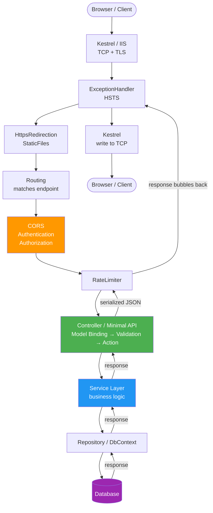

---

## 2. Dependency Injection Lifecycle Flow

> **Why this matters:** DI lifetime mismatches are a leading cause of data bleed, stale state, and memory leaks in .NET services. The "captive dependency" bug — a singleton holding a scoped service — is subtle enough that many developers only discover it under concurrent load in production.

**💡 Production Example:**
A background job service accidentally registered a database context as a singleton instead of scoped. Under concurrent execution, two workers shared the same `DbContext` instance, causing intermittent `InvalidOperationException` ("A second operation was started on this context"). Correcting the lifetime to scoped (using `IServiceScopeFactory`) resolved the contention immediately.

```
app.Run() → Request 1 arrives
│
├─ DI Scope created  (1 scope per HTTP request)
│    │
│    ├─ Singleton resolved  → same instance across ALL requests/scopes (created once)
│    │       IAppCache, IHttpClientFactory, ILogger<T>
│    │
│    ├─ Scoped resolved     → same instance WITHIN this request scope
│    │       AppDbContext, IOrderService, ICurrentUser
│    │
│    └─ Transient resolved  → new instance EVERY time it is requested
│            IEmailBuilder, validators
│
└─ Request 1 ends → Scope disposed
         │
         ├─ Scoped services: Dispose() called
         └─ Transient services: Dispose() called (if IDisposable)

Singleton services: only disposed when host shuts down
```

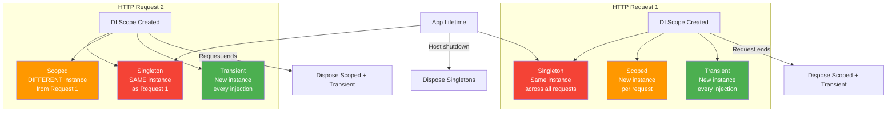

### Annotated Code Walk-through

```csharp
// Registration
builder.Services.AddSingleton<ICache, RedisCache>();         // one instance, entire app lifetime
builder.Services.AddScoped<AppDbContext>();                   // one per HTTP request
builder.Services.AddTransient<IEmailBuilder, EmailBuilder>(); // new every injection

// ── What happens during a request ──────────────────────────────────────
// DI resolves OrdersController constructor:
//   IOrderService (Scoped) → created fresh for this request
//     └─ IOrderRepository (Scoped) → same scope, may share with OrderService
//          └─ AppDbContext (Scoped) → one DbContext tracks all entities for this request

// ── Captive Dependency Bug ─────────────────────────────────────────────
// ❌ Singleton holding Scoped = captured scope = shared state across requests
builder.Services.AddSingleton<MySingleton>(); // MySingleton(AppDbContext dbContext) → WRONG
// Fix: inject IServiceScopeFactory instead
public class MySingleton
{
    private readonly IServiceScopeFactory _factory;
    public MySingleton(IServiceScopeFactory f) => _factory = f;

    public async Task DoWork()
    {
        using var scope = _factory.CreateScope();                  // manually create scope
        var db = scope.ServiceProvider.GetRequiredService<AppDbContext>(); // scoped db for this work
        // ...
    } // scope.Dispose() → db.Dispose()
}
```

---

## 3. Middleware Chain Execution Flow

```
Request →  MW1.InvokeAsync(ctx, next)
              │ before-logic
              ▼
           MW2.InvokeAsync(ctx, next)
              │ before-logic
              ▼
           MW3.InvokeAsync(ctx, next)
              │ before-logic
              ▼
           [ Endpoint / Controller ]
              │
              ▼ (response flows BACK up)
           MW3 after-logic
              │
              ▼
           MW2 after-logic  ← can inspect/modify response here
              │
              ▼
           MW1 after-logic
              │
              ▼
         ← Response
```

### Annotated Code Walk-through

```csharp
// Custom middleware — timing + logging
public class TimingMiddleware
{
    private readonly RequestDelegate _next;
    private readonly ILogger<TimingMiddleware> _log;

    public TimingMiddleware(RequestDelegate next, ILogger<TimingMiddleware> log)
    {
        _next = next;  // _next = the rest of the pipeline
        _log  = log;
    }

    public async Task InvokeAsync(HttpContext ctx)
    {
        // ── BEFORE: runs on the way IN ───────────────────────
        var sw = Stopwatch.StartNew();
        _log.LogInformation("→ {Method} {Path}", ctx.Request.Method, ctx.Request.Path);

        await _next(ctx);  // ◄─ hand off to next middleware / endpoint

        // ── AFTER: runs on the way OUT ───────────────────────
        sw.Stop();
        _log.LogInformation("← {Status} in {Ms}ms",
            ctx.Response.StatusCode, sw.ElapsedMilliseconds);
        // IMPORTANT: cannot modify ctx.Response.Body here if it's already started
    }
}

// Short-circuit example — returns 429 without calling _next
public class RateLimitMiddleware
{
    public async Task InvokeAsync(HttpContext ctx)
    {
        if (IsThrottled(ctx))
        {
            ctx.Response.StatusCode = 429;
            await ctx.Response.WriteAsync("Too Many Requests");
            return; // ← short-circuit: _next never called
        }
        await _next(ctx);
    }
}
```

---

## 4. Entity Framework Core Query Flow

```
C# LINQ Query
      │
      ▼
[ IQueryable<T> built ] ← nothing hits DB yet
      │
      ▼
[ DbContext.Set<T>().Where(...).Include(...) ]
      │
      ▼
[ EF Core LINQ Provider ]   ← translates expression tree → SQL AST
      │
      ▼
[ SQL Query Generated ]     ← "SELECT o.*, c.* FROM Orders o JOIN Customers c ..."
      │
      ▼
[ DbConnection.OpenAsync() ]  ← connection from pool
      │
      ▼
[ DbCommand.ExecuteReaderAsync() ] ← SQL sent to DB server
      │
      ▼
[ DataReader maps rows → entity objects ]
      │
      ▼
[ Identity Map / Change Tracker ]  ← entity tracked if AsTracking (default)
      │
      ▼
C# entity objects returned

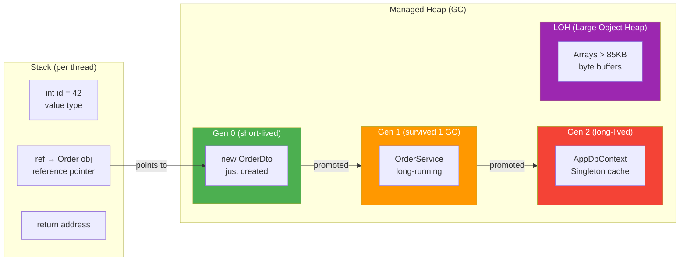

SaveChanges() path:
[ Change Tracker detects Added/Modified/Deleted ]
      │
      ▼
[ SQL INSERT/UPDATE/DELETE generated ]
      │
      ▼
[ Transaction (implicit or explicit) ]
      │
      ▼
[ DbCommand.ExecuteNonQueryAsync() ]
      │
      ▼
[ DB commits, rowcount returned ]
```

### Annotated Code Walk-through

```csharp
// STEP 1: LINQ builds an expression tree — NO SQL yet
IQueryable<Order> query = _db.Orders
    .Include(o => o.Customer)          // JOIN Customer
    .Where(o => o.Status == "Pending") // WHERE filter
    .OrderBy(o => o.CreatedAt);        // ORDER BY

// STEP 2: Materialise — SQL executed HERE
List<Order> orders = await query.ToListAsync(); // ← hits DB

// STEP 3: AsNoTracking — skips change tracker for read-only queries (faster)
var dtos = await _db.Orders
    .AsNoTracking()
    .Where(o => o.CustomerId == customerId)
    .Select(o => new OrderDto { Id = o.Id, Total = o.Total }) // projection — fewer columns
    .ToListAsync();

// STEP 4: Mutation — change tracker watches entities
var order = await _db.Orders.FindAsync(id);    // tracked
order.Status = "Shipped";                       // change tracker marks as Modified
await _db.SaveChangesAsync();                   // generates UPDATE Orders SET Status=... WHERE Id=...

// STEP 5: Explicit transaction spanning multiple operations
await using var tx = await _db.Database.BeginTransactionAsync();
try
{
    _db.Orders.Add(newOrder);
    _db.Inventory.Update(item);
    await _db.SaveChangesAsync();
    await tx.CommitAsync();
}
catch
{
    await tx.RollbackAsync();
    throw;
}
```

---

## 5. JWT Authentication Flow

```
Client                              Server
  │                                   │
  │── POST /auth/login ──────────────►│
  │   { username, password }          │
  │                                   ├─ 1. Validate credentials vs DB
  │                                   ├─ 2. Build Claims:
  │                                   │      sub, email, roles, exp
  │                                   ├─ 3. Sign token with secret key
  │◄── 200 { token: "eyJ..." } ───────│
  │                                   │
  │── GET /api/orders ───────────────►│
  │   Authorization: Bearer eyJ...    │
  │                                   ├─ 4. UseAuthentication middleware
  │                                   ├─ 5. JwtBearer handler reads header
  │                                   ├─ 6. Validate signature, exp, iss, aud
  │                                   ├─ 7. Set HttpContext.User (ClaimsPrincipal)
  │                                   ├─ 8. UseAuthorization checks [Authorize]
  │◄── 200 [ orders... ] ─────────────│
```

### Annotated Code Walk-through

```csharp
// ── 1. Register JWT bearer ─────────────────────────────────────────────
builder.Services
    .AddAuthentication(JwtBearerDefaults.AuthenticationScheme)
    .AddJwtBearer(o =>
    {
        o.TokenValidationParameters = new TokenValidationParameters
        {
            ValidateIssuer           = true,
            ValidIssuer              = "https://myapp.com",
            ValidateAudience         = true,
            ValidAudience            = "https://myapp.com",
            ValidateLifetime         = true,    // checks exp claim
            ValidateIssuerSigningKey = true,
            IssuerSigningKey         = new SymmetricSecurityKey(
                Encoding.UTF8.GetBytes(builder.Configuration["Jwt:Key"]!))
        };
    });

// ── 2. Issue token on login ────────────────────────────────────────────
string IssueToken(User user, IConfiguration cfg)
{
    var claims = new[]
    {
        new Claim(JwtRegisteredClaimNames.Sub,   user.Id.ToString()),
        new Claim(JwtRegisteredClaimNames.Email, user.Email),
        new Claim(ClaimTypes.Role,               user.Role)
    };

    var key   = new SymmetricSecurityKey(Encoding.UTF8.GetBytes(cfg["Jwt:Key"]!));
    var creds = new SigningCredentials(key, SecurityAlgorithms.HmacSha256);
    var token = new JwtSecurityToken(
        issuer:             "https://myapp.com",
        audience:           "https://myapp.com",
        claims:             claims,
        expires:            DateTime.UtcNow.AddHours(1),
        signingCredentials: creds);

    return new JwtSecurityTokenHandler().WriteToken(token); // "eyJhbGci..."
}

// ── 3. Protect endpoint ────────────────────────────────────────────────
[Authorize(Roles = "Admin")]           // 401 if no token; 403 if wrong role
[HttpDelete("{id}")]
public async Task<IActionResult> Delete(Guid id)
{
    var userId = User.FindFirstValue(ClaimTypes.NameIdentifier); // from token claims
    // ...
}
```

---

## 6. Async/Await Execution Flow

```
Thread T1 (request thread)
  │
  ├─ controller.Get() called
  ├─ await dbContext.FindAsync(id)  ── I/O initiated ──► DB server
  │                                                        │
  │  T1 RELEASED back to thread pool                       │
  │  (no blocking!)                                        │
  │                                                        │
  │◄──────────────── I/O completes ─────────────────────── │
  │
  ├─ Continuation scheduled on Thread T2 (may differ from T1)
  ├─ await emailService.SendAsync()  ── I/O initiated ──► SMTP
  │
  │  T2 RELEASED back to thread pool
  │
  │◄──────────────── SMTP completes ──────────────────────
  │
  ├─ Thread T3 continues
  └─ return Ok(result) → response written
```

### Annotated Code Walk-through

```csharp
// State machine generated by compiler for every async method
public async Task<Order?> GetOrderWithNotificationAsync(Guid id)
{
    // Checkpoint 1: synchronous until first await
    _log.LogInformation("Starting");

    var order = await _db.Orders.FindAsync(id);   // ← compiler generates MoveNext() here
    // Everything below is a "continuation" — resumes after I/O completes

    if (order is null) return null;

    await _emailService.SendAsync(order.CustomerEmail, "Order found"); // another checkpoint

    return order; // returned via Task<Order?> completion source
}

// ConfigureAwait(false) — avoid deadlock in library code
// In ASP.NET Core there is NO SynchronizationContext, so it doesn't matter there,
// but in library code:
public async Task<string> LibraryMethod()
{
    var data = await _httpClient.GetStringAsync(url).ConfigureAwait(false);
    // continues on thread pool thread — never needs to return to captured context
    return data.Trim();
}

// ValueTask for hot paths (avoids Task allocation when already-complete)
public ValueTask<Order?> GetCachedAsync(Guid id)
{
    if (_cache.TryGetValue(id, out var order))
        return ValueTask.FromResult(order); // synchronous path — zero allocation

    return new ValueTask<Order?>(LoadFromDbAsync(id)); // async path — wraps Task
}
```

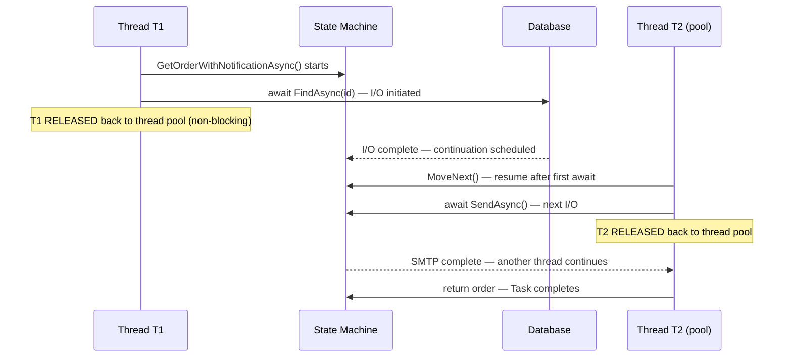

---

## 7. Exception Handling Pipeline Flow

```
Exception thrown in action
        │
        ▼
[ Action Filters — OnException ]      ← first chance: IExceptionFilter
        │ (if not handled)
        ▼
[ Exception Middleware ]              ← UseExceptionHandler("/error")
        │ catches, logs, returns ProblemDetails
        ▼
[ /error endpoint ]                   ← maps to structured error response

Custom global handler path:
        │
        ▼
[ IExceptionHandler (NET 8) ]         ← TryHandleAsync
        │
        ▼
[ ProblemDetails middleware ]         ← UseProblemDetails()
```

### Annotated Code Walk-through

```csharp
// ── .NET 8 IExceptionHandler ───────────────────────────────────────────
public class GlobalExceptionHandler : IExceptionHandler
{
    private readonly ILogger<GlobalExceptionHandler> _log;
    public GlobalExceptionHandler(ILogger<GlobalExceptionHandler> log) => _log = log;

    public async ValueTask<bool> TryHandleAsync(
        HttpContext ctx, Exception ex, CancellationToken ct)
    {
        _log.LogError(ex, "Unhandled exception");

        var problem = ex switch
        {
            NotFoundException  => new ProblemDetails { Status = 404, Title = "Not Found",  Detail = ex.Message },
            ValidationException=> new ProblemDetails { Status = 400, Title = "Bad Request",Detail = ex.Message },
            _                  => new ProblemDetails { Status = 500, Title = "Server Error" }
        };

        ctx.Response.StatusCode = problem.Status!.Value;
        await ctx.Response.WriteAsJsonAsync(problem, ct);
        return true; // handled — stop propagation
    }
}

// Registration
builder.Services.AddExceptionHandler<GlobalExceptionHandler>();
builder.Services.AddProblemDetails();
app.UseExceptionHandler();
```

---

## 8. SignalR Connection Flow

```
Client (Browser JS)                    Server (Hub)
  │                                       │
  ├── HTTP GET /hub (negotiate) ─────────►│
  │◄── { connectionId, transports } ──────│
  │                                       │
  ├── WebSocket Upgrade ─────────────────►│
  │◄── 101 Switching Protocols ───────────│
  │                                       │
  │  [Persistent bidirectional channel]   │
  │                                       │
  ├── Invoke "SendMessage" ─────────────►│
  │    { target, args }                   ├─ Hub.SendMessage() called
  │                                       ├─ Clients.All.SendAsync("ReceiveMessage", ...)
  │◄── "ReceiveMessage" broadcast ────────│
  │                                       │
  ├── Disconnect ────────────────────────►│
  │                                       └─ OnDisconnectedAsync()
```

### Annotated Code Walk-through

```csharp
// ── Hub definition ─────────────────────────────────────────────────────
public class ChatHub : Hub
{
    // STEP 1: Client calls this via connection.invoke("SendMessage", user, msg)
    public async Task SendMessage(string user, string message)
    {
        // STEP 2: Broadcast to every connected client
        await Clients.All.SendAsync("ReceiveMessage", user, message);
    }

    // STEP 3: Lifecycle — add to group on connect
    public override async Task OnConnectedAsync()
    {
        var room = Context.GetHttpContext()!.Request.Query["room"];
        await Groups.AddToGroupAsync(Context.ConnectionId, room!);
        await base.OnConnectedAsync();
    }

    public override Task OnDisconnectedAsync(Exception? ex)
    {
        // cleanup
        return base.OnDisconnectedAsync(ex);
    }
}

// ── Inject IHubContext to push from background service ─────────────────
public class OrderStatusService
{
    private readonly IHubContext<ChatHub> _hub;
    public OrderStatusService(IHubContext<ChatHub> hub) => _hub = hub;

    public async Task NotifyOrderShipped(Guid orderId)
    {
        await _hub.Clients.Group($"order-{orderId}")
                  .SendAsync("OrderShipped", orderId);
    }
}

// ── JS client ─────────────────────────────────────────────────────────
/*
const conn = new signalR.HubConnectionBuilder().withUrl("/chatHub").build();
conn.on("ReceiveMessage", (user, msg) => console.log(`${user}: ${msg}`));
await conn.start();
await conn.invoke("SendMessage", "Alice", "Hello!");
*/
```

---

# Design Pattern Flows

---

## 9. Singleton Pattern Flow

```
First call:  GetInstance()
    │
    ├─ _instance == null?  YES
    │       │
    │       └─ lock(_lock)
    │               │
    │               ├─ double-check: still null?
    │               └─ new Singleton() → stored in _instance
    │
    └─ return _instance

Second call: GetInstance()
    │
    ├─ _instance != null  (already created)
    └─ return same _instance  (no lock needed)
```

### Annotated Code Walk-through

```csharp
// Thread-safe Singleton using Lazy<T>
public sealed class AppConfig
{
    // STEP 1: Lazy<T> guarantees thread-safe single initialization
    private static readonly Lazy<AppConfig> _lazy =
        new(() => new AppConfig(), LazyThreadSafetyMode.ExecutionAndPublication);

    // STEP 2: Private constructor — external callers cannot use new AppConfig()
    private AppConfig()
    {
        // expensive initialization: load config files, parse settings
        Settings = LoadSettings();
    }

    // STEP 3: Public access point
    public static AppConfig Instance => _lazy.Value;
    // First access: Lazy creates the instance
    // Subsequent accesses: returns cached instance

    public Dictionary<string, string> Settings { get; }
    private Dictionary<string, string> LoadSettings() => new() { ["Theme"] = "Dark" };
}

// Usage flow
var cfg1 = AppConfig.Instance; // → creates instance
var cfg2 = AppConfig.Instance; // → returns same instance
Console.WriteLine(ReferenceEquals(cfg1, cfg2)); // True

// Preferred in ASP.NET Core: let DI manage singleton lifetime
builder.Services.AddSingleton<IAppConfig, AppConfig>();
// DI container is the "single source" — no manual locking needed
```

---

## 10. Factory Method Pattern Flow

```
Client code
    │
    ▼
Creator.CreateLogger(type)     ← factory method
    │
    ├─ type == "file"   → return new FileLogger()
    ├─ type == "db"     → return new DatabaseLogger()
    └─ type == "cloud"  → return new CloudLogger()
    │
    ▼
ILogger (interface)            ← client uses abstraction, unaware of concrete type
    │
    ▼
logger.Log(message)            ← polymorphic call routed to correct impl
```

### Annotated Code Walk-through

```csharp
// STEP 1: Product interface — what the factory produces
public interface ILogger
{
    void Log(string message);
}

// STEP 2: Concrete products
public class FileLogger   : ILogger { public void Log(string m) => File.AppendAllText("log.txt", m); }
public class CloudLogger  : ILogger { public void Log(string m) => Console.WriteLine($"[CLOUD] {m}"); }
public class DatabaseLogger : ILogger
{
    private readonly AppDbContext _db;
    public DatabaseLogger(AppDbContext db) => _db = db;
    public void Log(string m) { _db.Logs.Add(new LogEntry { Message = m }); _db.SaveChanges(); }
}

// STEP 3: Factory method — centralises creation logic
public static class LoggerFactory
{
    public static ILogger Create(string type, IServiceProvider sp) => type switch
    {
        "file"  => new FileLogger(),
        "db"    => sp.GetRequiredService<DatabaseLogger>(),  // needs DI
        "cloud" => new CloudLogger(),
        _       => throw new ArgumentException($"Unknown logger type: {type}")
    };
}

// STEP 4: Client code — depends only on ILogger
// Flow: client → factory → concrete type → interface
ILogger logger = LoggerFactory.Create(config["LoggerType"], serviceProvider);
logger.Log("Order created"); // polymorphic: correct impl called based on config
```

---

## 11. Abstract Factory Pattern Flow

```
Client chooses factory: WindowsUIFactory | MacUIFactory
        │
        ▼
IUIFactory.CreateButton()     → IButton (WinButton | MacButton)
IUIFactory.CreateCheckBox()   → ICheckBox (WinCheckBox | MacCheckBox)
        │
        ▼
Client uses IButton.Render()  ← platform-agnostic code
                               ← actual render matches OS family
```

### Annotated Code Walk-through

```csharp
// STEP 1: Abstract product interfaces
public interface IButton   { void Render(); }
public interface ICheckBox { void Render(); }

// STEP 2: Concrete products per family
public class WinButton   : IButton   { public void Render() => Console.WriteLine("Windows Button"); }
public class MacButton   : IButton   { public void Render() => Console.WriteLine("Mac Button"); }
public class WinCheckBox : ICheckBox { public void Render() => Console.WriteLine("Windows CheckBox"); }
public class MacCheckBox : ICheckBox { public void Render() => Console.WriteLine("Mac CheckBox"); }

// STEP 3: Abstract factory interface
public interface IUIFactory
{
    IButton   CreateButton();
    ICheckBox CreateCheckBox();
}

// STEP 4: Concrete factories — each produces a CONSISTENT family
public class WindowsFactory : IUIFactory
{
    public IButton   CreateButton()   => new WinButton();    // always Windows
    public ICheckBox CreateCheckBox() => new WinCheckBox();  // always Windows
}
public class MacFactory : IUIFactory
{
    public IButton   CreateButton()   => new MacButton();
    public ICheckBox CreateCheckBox() => new MacCheckBox();
}

// STEP 5: Client — talks only to interfaces, never concrete classes
public class Application
{
    private readonly IButton _btn;
    private readonly ICheckBox _chk;

    // STEP 6: Factory injected → concrete products created consistently
    public Application(IUIFactory factory)
    {
        _btn = factory.CreateButton();   // Windows or Mac, determined by factory
        _chk = factory.CreateCheckBox(); // same family guaranteed
    }

    public void RenderUI()
    {
        _btn.Render();
        _chk.Render();
    }
}

// Wiring
IUIFactory factory = RuntimeInformation.IsOSPlatform(OSPlatform.Windows)
    ? new WindowsFactory()
    : new MacFactory();
new Application(factory).RenderUI();
```

---

## 12. Builder Pattern Flow

```
Client
  │
  ▼
new QueryBuilder()
  .Select("Id", "Name")     ← STEP 1: set SELECT columns
  .From("Orders")           ← STEP 2: set table
  .Where("Status='Paid'")   ← STEP 3: add condition
  .OrderBy("CreatedAt")     ← STEP 4: add ORDER BY
  .Limit(10)                ← STEP 5: set page size
  .Build()                  ← STEP 6: assemble and return final object
  │
  ▼
SqlQuery { Sql = "SELECT Id, Name FROM Orders WHERE Status='Paid' ORDER BY CreatedAt LIMIT 10" }
```

### Annotated Code Walk-through

```csharp
// STEP 1: Product — what we're building
public class SqlQuery
{
    public string Sql     { get; init; } = "";
    public object[] Params { get; init; } = [];
}

// STEP 2: Builder — accumulates state, returns `this` for chaining
public class QueryBuilder
{
    private string _table = "";
    private readonly List<string> _columns  = new();
    private readonly List<string> _wheres   = new();
    private string _orderBy = "";
    private int? _limit;

    public QueryBuilder Select(params string[] cols)  { _columns.AddRange(cols); return this; }
    public QueryBuilder From(string table)             { _table = table;          return this; }
    public QueryBuilder Where(string condition)        { _wheres.Add(condition);  return this; }
    public QueryBuilder OrderBy(string col)            { _orderBy = col;          return this; }
    public QueryBuilder Limit(int n)                   { _limit = n;              return this; }

    // STEP 3: Build() assembles all state into the final immutable product
    public SqlQuery Build()
    {
        var cols  = _columns.Count > 0 ? string.Join(", ", _columns) : "*";
        var where = _wheres.Count  > 0 ? $" WHERE {string.Join(" AND ", _wheres)}" : "";
        var order = !string.IsNullOrEmpty(_orderBy) ? $" ORDER BY {_orderBy}" : "";
        var limit = _limit.HasValue ? $" LIMIT {_limit}" : "";
        return new SqlQuery { Sql = $"SELECT {cols} FROM {_table}{where}{order}{limit}" };
    }
}

// Usage
var query = new QueryBuilder()
    .Select("Id", "Name", "Total")
    .From("Orders")
    .Where("Status = 'Paid'")
    .Where("Total > 100")
    .OrderBy("CreatedAt DESC")
    .Limit(20)
    .Build();

Console.WriteLine(query.Sql);
// SELECT Id, Name, Total FROM Orders WHERE Status = 'Paid' AND Total > 100 ORDER BY CreatedAt DESC LIMIT 20
```

---

## 13. Decorator Pattern Flow

```
Client
  │
  ▼
LoggingDecorator.GetOrderAsync(id)      ← outermost wrapper
  │  logs "calling GetOrder"
  ▼
CachingDecorator.GetOrderAsync(id)      ← middle wrapper
  │  checks Redis cache
  │  MISS → calls inner
  ▼
OrderService.GetOrderAsync(id)          ← real implementation
  │  queries database
  ▼
returns Order
  │
  ▼ (bubbles back up)
CachingDecorator stores result in cache
  ▼
LoggingDecorator logs "returned in Xms"
  ▼
Client receives Order
```

### Annotated Code Walk-through

```csharp
// STEP 1: Interface (contract shared by real service and all decorators)
public interface IOrderService
{
    Task<Order?> GetOrderAsync(Guid id);
}

// STEP 2: Real implementation
public class OrderService : IOrderService
{
    private readonly AppDbContext _db;
    public OrderService(AppDbContext db) => _db = db;
    public Task<Order?> GetOrderAsync(Guid id) => _db.Orders.FindAsync(id).AsTask();
}

// STEP 3: Caching decorator — wraps IOrderService, adds caching concern
public class CachingOrderService : IOrderService
{
    private readonly IOrderService _inner;   // ← the real service (or another decorator)
    private readonly IMemoryCache _cache;

    public CachingOrderService(IOrderService inner, IMemoryCache cache)
    {
        _inner = inner;
        _cache = cache;
    }

    public async Task<Order?> GetOrderAsync(Guid id)
    {
        if (_cache.TryGetValue(id, out Order? cached)) return cached; // cache HIT
        var order = await _inner.GetOrderAsync(id);                    // cache MISS → delegate
        if (order is not null) _cache.Set(id, order, TimeSpan.FromMinutes(5));
        return order;
    }
}

// STEP 4: Logging decorator — wraps again
public class LoggingOrderService : IOrderService
{
    private readonly IOrderService _inner;
    private readonly ILogger<LoggingOrderService> _log;

    public LoggingOrderService(IOrderService inner, ILogger<LoggingOrderService> log)
    {
        _inner = inner;
        _log   = log;
    }

    public async Task<Order?> GetOrderAsync(Guid id)
    {
        _log.LogInformation("GetOrder {Id} started", id);
        var sw = Stopwatch.StartNew();
        var result = await _inner.GetOrderAsync(id); // ← delegates to CachingOrderService
        _log.LogInformation("GetOrder {Id} → {Status} in {Ms}ms",
            id, result is null ? "null" : "found", sw.ElapsedMilliseconds);
        return result;
    }
}

// STEP 5: Wire decorators (outermost last, inner first)
builder.Services.AddScoped<AppDbContext>();
builder.Services.AddMemoryCache();
builder.Services.AddScoped<IOrderService>(sp =>
    new LoggingOrderService(                              // outermost
        new CachingOrderService(                          // middle
            new OrderService(sp.GetRequiredService<AppDbContext>()), // innermost
            sp.GetRequiredService<IMemoryCache>()),
        sp.GetRequiredService<ILogger<LoggingOrderService>>()));
```

---

## 14. Adapter Pattern Flow

```
Client code (uses IModernLogger)
      │
      ▼
LoggerAdapter.Log(message)          ← adapter implements IModernLogger
      │  translates call
      ▼
LegacyLogger.WriteEntry(msg, date)  ← incompatible 3rd-party / legacy API
      │
      ▼
Log written
```

### Annotated Code Walk-through

```csharp
// STEP 1: Target interface — what the client expects
public interface IModernLogger
{
    void Log(string level, string message);
}

// STEP 2: Adaptee — existing class with incompatible interface
public class LegacyLogger
{
    public void WriteEntry(string text, DateTime timestamp, int severity)
    {
        Console.WriteLine($"[{timestamp:u}][{severity}] {text}");
    }
}

// STEP 3: Adapter — bridges the gap
public class LegacyLoggerAdapter : IModernLogger
{
    private readonly LegacyLogger _legacy = new();

    // STEP 4: Translate modern interface → legacy calls
    public void Log(string level, string message)
    {
        int severity = level switch { "ERROR" => 3, "WARN" => 2, _ => 1 };
        _legacy.WriteEntry(message, DateTime.UtcNow, severity); // adapted call
    }
}

// STEP 5: Client uses only IModernLogger — unaware of legacy underneath
builder.Services.AddSingleton<IModernLogger, LegacyLoggerAdapter>();

public class OrderController
{
    private readonly IModernLogger _log;
    public OrderController(IModernLogger log) => _log = log;

    public void Create(Order o)
    {
        // calls adapter → which calls legacy library internally
        _log.Log("INFO", $"Order {o.Id} created");
    }
}
```

---

## 15. Facade Pattern Flow

```
Client: placeOrder(items, paymentInfo)
      │
      ▼
OrderFacade.PlaceOrder()        ← single entry point
      │
      ├──► InventoryService.Reserve(items)
      │
      ├──► PaymentService.Charge(paymentInfo)
      │
      ├──► ShippingService.Schedule(order)
      │
      └──► NotificationService.SendConfirmation(order)
      │
      ▼
returns OrderConfirmation       ← client never directly calls any subsystem
```

### Annotated Code Walk-through

```csharp
// STEP 1: Complex subsystems (each has its own interface)
public class InventoryService    { public bool Reserve(List<Item> items) { /*...*/ return true; } }
public class PaymentService      { public string Charge(PaymentInfo pi)  { /*...*/ return "txn_123"; } }
public class ShippingService     { public string Schedule(Order o)       { /*...*/ return "TRACK-99"; } }
public class NotificationService { public void Send(string email, string msg) { /*...*/ } }

// STEP 2: Facade — orchestrates subsystems, presents a simple interface
public class OrderFacade
{
    private readonly InventoryService    _inv;
    private readonly PaymentService      _pay;
    private readonly ShippingService     _ship;
    private readonly NotificationService _notify;

    public OrderFacade(InventoryService inv, PaymentService pay,
                       ShippingService ship, NotificationService notify)
    {
        _inv    = inv;
        _pay    = pay;
        _ship   = ship;
        _notify = notify;
    }

    // STEP 3: One method that coordinates all subsystems in order
    public OrderConfirmation PlaceOrder(List<Item> items, PaymentInfo payment, string email)
    {
        if (!_inv.Reserve(items))                          // STEP 3a
            throw new InvalidOperationException("Out of stock");

        var txnId    = _pay.Charge(payment);               // STEP 3b
        var order    = new Order(items, txnId);
        var tracking = _ship.Schedule(order);              // STEP 3c
        _notify.Send(email, $"Order confirmed! Tracking: {tracking}"); // STEP 3d

        return new OrderConfirmation(order.Id, tracking);
    }
}

// STEP 4: Client — one call, no knowledge of subsystems
var confirmation = orderFacade.PlaceOrder(cart.Items, paymentInfo, user.Email);
```

---

## 16. Proxy Pattern Flow

```
Client
  │
  ▼
IOrderRepository (interface)
  │
  ▼
CachingProxy.GetByIdAsync(id)          ← proxy intercepts
  │
  ├─ cache HIT?  ──────────────────► return cached value (real repo never called)
  │
  └─ cache MISS? ──────────────────► RealOrderRepository.GetByIdAsync(id)
                                            │
                                            ▼
                                        SQL Database
                                            │
                                            ▼
                                     proxy stores result in cache
                                            │
                                            ▼
                                     return result to client
```

### Annotated Code Walk-through

```csharp
// STEP 1: Subject interface
public interface IOrderRepository
{
    Task<Order?> GetByIdAsync(Guid id);
    Task SaveAsync(Order order);
}

// STEP 2: Real subject
public class OrderRepository : IOrderRepository
{
    private readonly AppDbContext _db;
    public OrderRepository(AppDbContext db) => _db = db;
    public Task<Order?> GetByIdAsync(Guid id)    => _db.Orders.FindAsync(id).AsTask();
    public async Task SaveAsync(Order order)     { _db.Orders.Update(order); await _db.SaveChangesAsync(); }
}

// STEP 3: Caching Proxy — same interface, adds caching transparently
public class CachingOrderRepositoryProxy : IOrderRepository
{
    private readonly IOrderRepository _real;   // ← delegates to real repo on miss
    private readonly IDistributedCache _cache;

    public CachingOrderRepositoryProxy(IOrderRepository real, IDistributedCache cache)
    {
        _real  = real;
        _cache = cache;
    }

    public async Task<Order?> GetByIdAsync(Guid id)
    {
        var key  = $"order:{id}";
        var data = await _cache.GetStringAsync(key);

        if (data is not null)
            return JsonSerializer.Deserialize<Order>(data); // cache HIT

        var order = await _real.GetByIdAsync(id);           // cache MISS → real DB
        if (order is not null)
            await _cache.SetStringAsync(key,
                JsonSerializer.Serialize(order),
                new DistributedCacheEntryOptions { AbsoluteExpirationRelativeToNow = TimeSpan.FromMinutes(5) });
        return order;
    }

    public async Task SaveAsync(Order order)
    {
        await _real.SaveAsync(order);                                       // persist
        await _cache.RemoveAsync($"order:{order.Id}");                      // invalidate cache
    }
}

// STEP 4: Client sees only IOrderRepository — proxy is transparent
builder.Services.AddScoped<OrderRepository>();
builder.Services.AddScoped<IOrderRepository>(sp =>
    new CachingOrderRepositoryProxy(
        sp.GetRequiredService<OrderRepository>(),
        sp.GetRequiredService<IDistributedCache>()));
```

---

## 17. Observer Pattern Flow

```
Subject (EventPublisher / event source)
  │
  ├─ Subscribe: observer1.Register() → internal list: [obs1, obs2, obs3]
  │
  │  [Event occurs: Order status changes]
  │
  ├─ NotifyAll()
  │     ├─► Observer1.OnNext(event)   (EmailNotifier)
  │     ├─► Observer2.OnNext(event)   (AuditLogger)
  │     └─► Observer3.OnNext(event)   (InventoryUpdater)
  │
  └─ Each observer acts independently
```

### Annotated Code Walk-through

```csharp
// STEP 1: Event / notification payload
public record OrderStatusChangedEvent(Guid OrderId, string OldStatus, string NewStatus);

// STEP 2: Observer interface
public interface IOrderEventObserver
{
    Task OnOrderStatusChanged(OrderStatusChangedEvent e);
}

// STEP 3: Concrete observers
public class EmailNotifier : IOrderEventObserver
{
    public async Task OnOrderStatusChanged(OrderStatusChangedEvent e)
    {
        if (e.NewStatus == "Shipped")
            await SendEmailAsync($"Order {e.OrderId} shipped!");
    }
    private Task SendEmailAsync(string msg) => Task.CompletedTask; // stub
}

public class AuditLogger : IOrderEventObserver
{
    public Task OnOrderStatusChanged(OrderStatusChangedEvent e)
    {
        Console.WriteLine($"AUDIT: {e.OrderId} {e.OldStatus}→{e.NewStatus}");
        return Task.CompletedTask;
    }
}

// STEP 4: Subject — maintains observer list and notifies
public class OrderService
{
    private readonly List<IOrderEventObserver> _observers;

    public OrderService(IEnumerable<IOrderEventObserver> observers)
        => _observers = observers.ToList();

    public async Task UpdateStatusAsync(Order order, string newStatus)
    {
        var oldStatus = order.Status;
        order.Status  = newStatus;                    // STEP 5: state change

        // STEP 6: notify all observers
        var evt = new OrderStatusChangedEvent(order.Id, oldStatus, newStatus);
        foreach (var obs in _observers)
            await obs.OnOrderStatusChanged(evt);
    }
}

// STEP 7: .NET built-in: C# events (delegate-based observer)
public class StockTicker
{
    public event EventHandler<decimal>? PriceChanged; // built-in observer

    public void UpdatePrice(decimal price)
    {
        PriceChanged?.Invoke(this, price); // notifies all subscribers
    }
}

var ticker = new StockTicker();
ticker.PriceChanged += (_, price) => Console.WriteLine($"Price: {price}"); // subscribe
ticker.UpdatePrice(150.5m); // → triggers subscriber
```

---

## 18. Strategy Pattern Flow

```
Client: checkout(order, discountType)
      │
      ▼
DiscountCalculator.Calculate(order)
      │
      ├─ _strategy = new RegularDiscount()   → 10% off
      ├─ _strategy = new PremiumDiscount()   → 20% off
      └─ _strategy = new VipDiscount()       → 30% off
      │
      ▼  (strategy is swappable at runtime — same Calculate() call)
returns discounted price
```

### Annotated Code Walk-through

```csharp
// STEP 1: Strategy interface
public interface IDiscountStrategy
{
    decimal Apply(decimal originalPrice);
    string Name { get; }
}

// STEP 2: Concrete strategies — each encapsulates one algorithm
public class NoDiscount     : IDiscountStrategy { public string Name => "None";    public decimal Apply(decimal p) => p; }
public class RegularDiscount: IDiscountStrategy { public string Name => "Regular"; public decimal Apply(decimal p) => p * 0.90m; }
public class PremiumDiscount: IDiscountStrategy { public string Name => "Premium"; public decimal Apply(decimal p) => p * 0.80m; }
public class VipDiscount    : IDiscountStrategy { public string Name => "VIP";     public decimal Apply(decimal p) => p * 0.70m; }

// STEP 3: Context — holds strategy reference, delegates algorithm to it
public class OrderPricer
{
    private IDiscountStrategy _strategy;

    public OrderPricer(IDiscountStrategy strategy)
        => _strategy = strategy;

    // STEP 4: Strategy can be swapped at runtime
    public void SetStrategy(IDiscountStrategy strategy)
        => _strategy = strategy;

    public decimal Calculate(decimal price)
    {
        var discounted = _strategy.Apply(price); // ← polymorphic dispatch
        Console.WriteLine($"Applying {_strategy.Name}: {price:C} → {discounted:C}");
        return discounted;
    }
}

// STEP 5: Strategy selected at runtime based on data
var pricer = new OrderPricer(new NoDiscount());

string customerType = GetCustomerType(customerId); // "Regular", "Premium", "VIP"
pricer.SetStrategy(customerType switch
{
    "Regular" => new RegularDiscount(),
    "Premium" => new PremiumDiscount(),
    "VIP"     => new VipDiscount(),
    _         => new NoDiscount()
});

decimal finalPrice = pricer.Calculate(order.Total); // calls correct algorithm
```

---

## 19. Command Pattern Flow

```
Client
  │
  ├─ cmd = new ShipOrderCommand(orderId)
  │
  ▼
CommandInvoker.Execute(cmd)
  │
  ├─ cmd.Execute()           ← executes the action
  ├─ _history.Push(cmd)      ← stores for undo
  │
  ▼
Order.Status = "Shipped"

CommandInvoker.Undo()
  │
  ├─ cmd = _history.Pop()
  ├─ cmd.Undo()              ← reverses the action
  │
  ▼
Order.Status = "Processing"  ← restored
```

### Annotated Code Walk-through

```csharp
// STEP 1: Command interface
public interface ICommand
{
    void Execute();
    void Undo();
}

// STEP 2: Concrete command — encapsulates action + undo data
public class ShipOrderCommand : ICommand
{
    private readonly Order _order;
    private string _previousStatus = "";    // saved for undo

    public ShipOrderCommand(Order order) => _order = order;

    public void Execute()
    {
        _previousStatus = _order.Status;   // STEP 3: save state before change
        _order.Status   = "Shipped";
        Console.WriteLine($"Order {_order.Id} shipped");
    }

    public void Undo()
    {
        _order.Status = _previousStatus;   // STEP 4: restore previous state
        Console.WriteLine($"Undo: Order {_order.Id} back to {_previousStatus}");
    }
}

// STEP 5: Invoker — manages execution and history
public class OrderCommandInvoker
{
    private readonly Stack<ICommand> _history = new();

    public void Execute(ICommand cmd)
    {
        cmd.Execute();           // run command
        _history.Push(cmd);      // push to undo stack
    }

    public void Undo()
    {
        if (_history.TryPop(out var cmd))
            cmd.Undo();
    }
}

// STEP 6: Usage flow
var order   = new Order { Id = Guid.NewGuid(), Status = "Processing" };
var invoker = new OrderCommandInvoker();

invoker.Execute(new ShipOrderCommand(order));   // Order shipped → status = "Shipped"
Console.WriteLine(order.Status);               // "Shipped"
invoker.Undo();                                // reversed → status = "Processing"
Console.WriteLine(order.Status);               // "Processing"
```

---

## 20. Chain of Responsibility Flow

```
Request: order approval for $75,000
      │
      ▼
TeamLeadHandler.Handle(request)
  │  amount <= 10,000?  NO
  │
  ▼
ManagerHandler.Handle(request)
  │  amount <= 50,000?  NO
  │
  ▼
DirectorHandler.Handle(request)
  │  amount <= 100,000? YES
  │
  ▼
  Approved by Director   ← chain stops here
```

### Annotated Code Walk-through

```csharp
// STEP 1: Handler interface with next-handler reference
public abstract class ApprovalHandler
{
    protected ApprovalHandler? _next;

    public ApprovalHandler SetNext(ApprovalHandler next)
    {
        _next = next;
        return next; // fluent chaining: lead.SetNext(mgr).SetNext(dir)
    }

    public abstract void Handle(decimal amount);
}

// STEP 2: Concrete handlers — each decides to handle OR pass to next
public class TeamLeadHandler : ApprovalHandler
{
    public override void Handle(decimal amount)
    {
        if (amount <= 10_000)
            Console.WriteLine($"Team Lead approved ${amount}");   // handle it
        else
            _next?.Handle(amount);                                 // pass up chain
    }
}

public class ManagerHandler : ApprovalHandler
{
    public override void Handle(decimal amount)
    {
        if (amount <= 50_000)
            Console.WriteLine($"Manager approved ${amount}");
        else
            _next?.Handle(amount);
    }
}

public class DirectorHandler : ApprovalHandler
{
    public override void Handle(decimal amount)
    {
        if (amount <= 100_000)
            Console.WriteLine($"Director approved ${amount}");
        else
            Console.WriteLine($"${amount} exceeds authority — escalate to Board");
    }
}

// STEP 3: Build the chain
var lead    = new TeamLeadHandler();
var manager = new ManagerHandler();
var director= new DirectorHandler();
lead.SetNext(manager).SetNext(director);   // TeamLead → Manager → Director

// STEP 4: Send requests — each routes to the correct handler
lead.Handle(5_000);   // "Team Lead approved $5000"
lead.Handle(30_000);  // "Manager approved $30000"
lead.Handle(75_000);  // "Director approved $75000"
lead.Handle(200_000); // "exceeds authority"

// ASP.NET Core Middleware IS Chain of Responsibility — see Section 3
```

---

## 21. State Pattern Flow

```
ATM Machine states:

  [Idle] ──insertCard()──► [HasCard]
     │                         │
     │                    enterPin()
     │                         │
     │                    ┌────▼────┐
     │                    │ correct? │
     │                    └────┬────┘
     │                   YES   │  NO
     │              [Authenticated] [HasCard] (retry)
     │                    │
     │               selectAmount()
     │                    │
     │              [Dispensing]
     │                    │
     │               dispense()
     │                    │
     └────────────────[Idle] (card ejected)
```

### Annotated Code Walk-through

```csharp
// STEP 1: State interface — operations valid across all states
public interface IAtmState
{
    void InsertCard(AtmMachine atm);
    void EnterPin(AtmMachine atm, string pin);
    void SelectAmount(AtmMachine atm, decimal amount);
    void Dispense(AtmMachine atm);
}

// STEP 2: Concrete states — each implements only its valid operations
public class IdleState : IAtmState
{
    public void InsertCard(AtmMachine atm)
    {
        Console.WriteLine("Card inserted");
        atm.SetState(new HasCardState());          // STEP 3: transition to next state
    }
    public void EnterPin(AtmMachine atm, string pin)    => Console.WriteLine("Insert card first");
    public void SelectAmount(AtmMachine atm, decimal a) => Console.WriteLine("Insert card first");
    public void Dispense(AtmMachine atm)                => Console.WriteLine("Insert card first");
}

public class HasCardState : IAtmState
{
    public void InsertCard(AtmMachine atm)              => Console.WriteLine("Card already inserted");
    public void EnterPin(AtmMachine atm, string pin)
    {
        if (pin == "1234")
        {
            Console.WriteLine("PIN correct");
            atm.SetState(new AuthenticatedState());
        }
        else Console.WriteLine("Wrong PIN");
    }
    public void SelectAmount(AtmMachine atm, decimal a) => Console.WriteLine("Enter PIN first");
    public void Dispense(AtmMachine atm)                => Console.WriteLine("Enter PIN first");
}

public class AuthenticatedState : IAtmState
{
    private decimal _requested;
    public void InsertCard(AtmMachine atm)              => Console.WriteLine("Already authenticated");
    public void EnterPin(AtmMachine atm, string pin)    => Console.WriteLine("Already authenticated");
    public void SelectAmount(AtmMachine atm, decimal a)
    {
        _requested = a;
        Console.WriteLine($"Amount ${a} selected");
        atm.SetState(new DispensingState(a));
    }
    public void Dispense(AtmMachine atm)                => Console.WriteLine("Select amount first");
}

public class DispensingState : IAtmState
{
    private readonly decimal _amount;
    public DispensingState(decimal amount) => _amount = amount;

    public void InsertCard(AtmMachine atm) => Console.WriteLine("Processing");
    public void EnterPin(AtmMachine atm, string pin) => Console.WriteLine("Processing");
    public void SelectAmount(AtmMachine atm, decimal a) => Console.WriteLine("Processing");
    public void Dispense(AtmMachine atm)
    {
        Console.WriteLine($"Dispensing ${_amount}");
        atm.SetState(new IdleState());             // return to idle after dispense
    }
}

// STEP 4: Context — holds current state, delegates all operations to it
public class AtmMachine
{
    private IAtmState _state = new IdleState();
    public void SetState(IAtmState state) => _state = state;

    public void InsertCard()              => _state.InsertCard(this);
    public void EnterPin(string pin)      => _state.EnterPin(this, pin);
    public void SelectAmount(decimal amt) => _state.SelectAmount(this, amt);
    public void Dispense()                => _state.Dispense(this);
}

// STEP 5: Usage — client drives state transitions via context
var atm = new AtmMachine();
atm.InsertCard();           // "Card inserted"        → state: HasCard
atm.EnterPin("1234");       // "PIN correct"          → state: Authenticated
atm.SelectAmount(200);      // "Amount $200 selected" → state: Dispensing
atm.Dispense();             // "Dispensing $200"      → state: Idle
```

---

## 22. Template Method Pattern Flow

```
AbstractClass.Process()            ← defines the skeleton algorithm
  │
  ├─ Step1()  ← concrete (same for all subclasses)
  ├─ Step2()  ← abstract (each subclass provides own impl)
  ├─ Step3()  ← concrete with default (subclass may override)
  └─ Step4()  ← hook (empty by default, optional override)

Subclass A overrides Step2 + Step4
Subclass B overrides Step2 only

Client calls AbstractClass.Process() on either subclass →
same flow, different behaviour at variable steps
```

### Annotated Code Walk-through

```csharp
// STEP 1: Abstract class defines the template (skeleton algorithm)
public abstract class ReportGenerator
{
    // Template method — final to prevent overriding the skeleton
    public void GenerateReport()
    {
        FetchData();         // STEP A — abstract: must override
        ProcessData();       // STEP B — concrete: shared logic
        FormatOutput();      // STEP C — abstract: must override
        SaveReport();        // STEP D — concrete with hook
        OnReportSaved();     // STEP E — hook: empty default, optional override
    }

    protected abstract void FetchData();     // subclass provides data source
    protected abstract void FormatOutput();  // subclass provides format

    protected void ProcessData()             // shared processing
        => Console.WriteLine("Processing data...");

    protected void SaveReport()              // shared save logic
        => Console.WriteLine("Saving report to disk...");

    protected virtual void OnReportSaved()  // hook — empty default
    { }
}

// STEP 2: Concrete subclass — provides variable steps
public class PdfReportGenerator : ReportGenerator
{
    protected override void FetchData()    => Console.WriteLine("Fetching from SQL Server");
    protected override void FormatOutput() => Console.WriteLine("Formatting as PDF");
    protected override void OnReportSaved() => Console.WriteLine("Emailing PDF to stakeholders"); // hook used
}

public class ExcelReportGenerator : ReportGenerator
{
    protected override void FetchData()    => Console.WriteLine("Fetching from CSV files");
    protected override void FormatOutput() => Console.WriteLine("Formatting as Excel");
    // OnReportSaved not overridden — uses empty default
}

// STEP 3: Usage — client calls template method, polymorphism handles the rest
ReportGenerator generator = new PdfReportGenerator();
generator.GenerateReport();
// Output:
// Fetching from SQL Server
// Processing data...
// Formatting as PDF
// Saving report to disk...
// Emailing PDF to stakeholders

generator = new ExcelReportGenerator();
generator.GenerateReport();
// Output:
// Fetching from CSV files
// Processing data...
// Formatting as Excel
// Saving report to disk...
// (no hook output)
```

---

## 23. Repository + Unit of Work Flow

```
Controller
  │
  ▼
UnitOfWork.Orders.AddAsync(order)          ← IOrderRepository
UnitOfWork.Inventory.Reduce(item, qty)     ← IInventoryRepository
  │
  ▼
UnitOfWork.CommitAsync()                   ← single transaction
  │
  ├─► DbContext.SaveChangesAsync()
  │       ├─ INSERT Orders ...
  │       └─ UPDATE Inventory SET Qty = Qty - 1 ...
  │
  └─ either BOTH succeed or BOTH rollback
```

### Annotated Code Walk-through

```csharp
// STEP 1: Generic repository interface
public interface IRepository<T> where T : class
{
    Task<T?> GetByIdAsync(Guid id);
    Task<IEnumerable<T>> GetAllAsync();
    Task AddAsync(T entity);
    void Update(T entity);
    void Remove(T entity);
}

// STEP 2: Generic base repository — reuses common EF logic
public class Repository<T> : IRepository<T> where T : class
{
    protected readonly AppDbContext _db;
    protected readonly DbSet<T> _set;

    public Repository(AppDbContext db) { _db = db; _set = db.Set<T>(); }

    public Task<T?> GetByIdAsync(Guid id)         => _set.FindAsync(id).AsTask();
    public Task<IEnumerable<T>> GetAllAsync()      => Task.FromResult<IEnumerable<T>>(_set.AsEnumerable());
    public async Task AddAsync(T entity)           => await _set.AddAsync(entity);
    public void Update(T entity)                   => _set.Update(entity);
    public void Remove(T entity)                   => _set.Remove(entity);
}

// STEP 3: Specific repositories can add domain methods
public interface IOrderRepository : IRepository<Order>
{
    Task<IEnumerable<Order>> GetPendingAsync();
}

public class OrderRepository : Repository<Order>, IOrderRepository
{
    public OrderRepository(AppDbContext db) : base(db) { }
    public async Task<IEnumerable<Order>> GetPendingAsync() =>
        await _set.Where(o => o.Status == "Pending").ToListAsync();
}

// STEP 4: Unit of Work — groups repositories, owns the transaction
public interface IUnitOfWork : IDisposable
{
    IOrderRepository Orders     { get; }
    IRepository<Customer> Customers { get; }
    Task<int> CommitAsync();
}

public class UnitOfWork : IUnitOfWork
{
    private readonly AppDbContext _db;

    public UnitOfWork(AppDbContext db)
    {
        _db       = db;
        Orders    = new OrderRepository(db);     // STEP 5: shared DbContext!
        Customers = new Repository<Customer>(db);
    }

    public IOrderRepository       Orders    { get; }
    public IRepository<Customer>  Customers { get; }

    // STEP 6: Single SaveChanges covers ALL repo changes
    public Task<int> CommitAsync() => _db.SaveChangesAsync();
    public void Dispose()          => _db.Dispose();
}

// STEP 7: Usage — atomic operation across two repos
public class OrderService
{
    private readonly IUnitOfWork _uow;
    public OrderService(IUnitOfWork uow) => _uow = uow;

    public async Task PlaceOrderAsync(Order order, Customer customer)
    {
        await _uow.Orders.AddAsync(order);       // tracked in DbContext
        _uow.Customers.Update(customer);          // tracked in same DbContext
        await _uow.CommitAsync();                 // ONE SaveChanges — both in same transaction
    }
}
```

---

## 24. CQRS + MediatR Flow

```
Command flow (write):
  Controller ──► mediator.Send(CreateOrderCommand)
                       │
                       ▼
                 CreateOrderCommandHandler.Handle()
                       │
                       ├─ validate
                       ├─ create Order entity
                       ├─ _db.Orders.Add(order)
                       └─ _db.SaveChangesAsync()
                       │
                       ▼
                 returns OrderId

Query flow (read):
  Controller ──► mediator.Send(GetOrderQuery { Id })
                       │
                       ▼
                 GetOrderQueryHandler.Handle()
                       │
                       ├─ _readDb.Orders.AsNoTracking()
                       └─ .Select(new OrderDto...)
                       │
                       ▼
                 returns OrderDto (no tracking overhead)

Pipeline Behaviour (cross-cutting):
  mediator.Send(cmd)
       │
       ▼
  LoggingBehavior.Handle()           ← runs before/after every handler
       │
       ▼
  ValidationBehavior.Handle()        ← runs FluentValidation
       │
       ▼
  Actual Handler.Handle()
```

### Annotated Code Walk-through

```csharp
// ── STEP 1: Commands / Queries (inputs) ──────────────────────────────────
public record CreateOrderCommand(Guid CustomerId, List<OrderItem> Items)
    : IRequest<Guid>;   // returns OrderId

public record GetOrderQuery(Guid OrderId)
    : IRequest<OrderDto?>;   // returns DTO (no EF tracking)

// ── STEP 2: Command Handler ───────────────────────────────────────────────
public class CreateOrderCommandHandler : IRequestHandler<CreateOrderCommand, Guid>
{
    private readonly AppDbContext _db;
    public CreateOrderCommandHandler(AppDbContext db) => _db = db;

    public async Task<Guid> Handle(CreateOrderCommand cmd, CancellationToken ct)
    {
        var order = new Order
        {
            Id         = Guid.NewGuid(),
            CustomerId = cmd.CustomerId,
            Items      = cmd.Items,
            Status     = "Pending",
            CreatedAt  = DateTime.UtcNow
        };
        _db.Orders.Add(order);
        await _db.SaveChangesAsync(ct);
        return order.Id;       // returns only the new ID
    }
}

// ── STEP 3: Query Handler (read side) ────────────────────────────────────
public class GetOrderQueryHandler : IRequestHandler<GetOrderQuery, OrderDto?>
{
    private readonly AppDbContext _db;
    public GetOrderQueryHandler(AppDbContext db) => _db = db;

    public Task<OrderDto?> Handle(GetOrderQuery qry, CancellationToken ct)
        => _db.Orders
              .AsNoTracking()    // ← read-side: never track entities
              .Where(o => o.Id == qry.OrderId)
              .Select(o => new OrderDto(o.Id, o.Status, o.Total))
              .FirstOrDefaultAsync(ct);
}

// ── STEP 4: Pipeline Behaviour — runs around every handler ───────────────
public class LoggingBehavior<TRequest, TResponse>
    : IPipelineBehavior<TRequest, TResponse> where TRequest : notnull
{
    private readonly ILogger<LoggingBehavior<TRequest, TResponse>> _log;
    public LoggingBehavior(ILogger<LoggingBehavior<TRequest, TResponse>> log) => _log = log;

    public async Task<TResponse> Handle(
        TRequest request, RequestHandlerDelegate<TResponse> next, CancellationToken ct)
    {
        _log.LogInformation("→ {Name}", typeof(TRequest).Name);
        var sw       = Stopwatch.StartNew();
        var response = await next();           // ← call actual handler
        _log.LogInformation("← {Name} in {Ms}ms", typeof(TRequest).Name, sw.ElapsedMilliseconds);
        return response;
    }
}

// ── STEP 5: Registration ──────────────────────────────────────────────────
builder.Services.AddMediatR(cfg =>
{
    cfg.RegisterServicesFromAssembly(typeof(Program).Assembly);
    cfg.AddBehavior(typeof(IPipelineBehavior<,>), typeof(LoggingBehavior<,>));
});

// ── STEP 6: Controller — thin, just dispatches ───────────────────────────
[ApiController]
[Route("api/orders")]
public class OrdersController : ControllerBase
{
    private readonly IMediator _mediator;
    public OrdersController(IMediator mediator) => _mediator = mediator;

    [HttpPost]
    public async Task<IActionResult> Create(CreateOrderCommand cmd)
    {
        var id = await _mediator.Send(cmd);   // dispatches through pipeline → handler
        return CreatedAtAction(nameof(Get), new { id }, new { id });
    }

    [HttpGet("{id:guid}")]
    public async Task<IActionResult> Get(Guid id)
    {
        var dto = await _mediator.Send(new GetOrderQuery(id));
        return dto is null ? NotFound() : Ok(dto);
    }
}
```

---

> ✅ **24 code flows covered** — .NET runtime flows + all major design patterns.
>
> 💡 **How to use this during an interview:**
> - For system questions: draw the ASCII flow first, then walk through the code top-to-bottom
> - For pattern questions: state "here's what runs step by step" before writing code
> - For .NET pipeline questions: always mention middleware order matters (routing before auth before authorization)

---

*Last updated: 2026 | .NET 8 / C# 12 / MediatR 12*

---

# 📊 Flow Diagrams — Visual Reference

---

## Diagram 1 — ASP.NET Core Request Pipeline

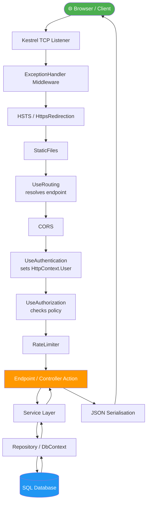

---

## Diagram 2 — DI Lifetime Scopes

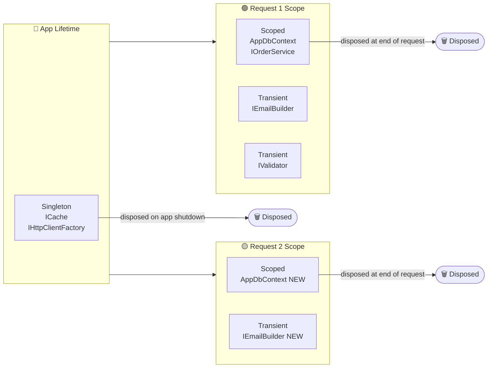

---

## Diagram 3 — Middleware Chain Execution

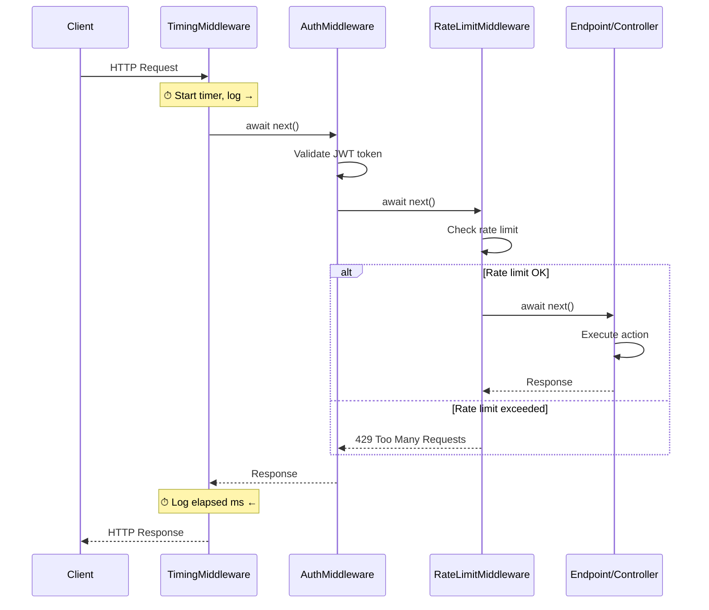

---

## Diagram 4 — Async/Await Thread Flow

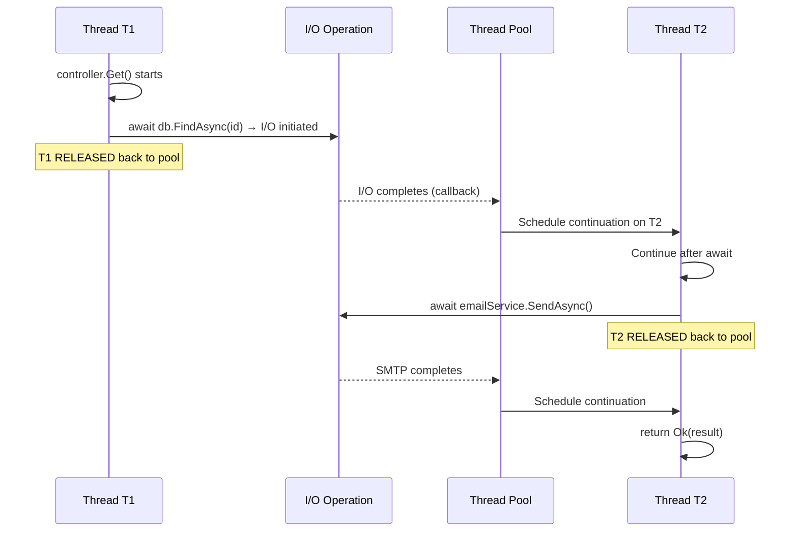

---

## Diagram 6 — gRPC vs REST Comparison

```mermaid
flowchart LR
    subgraph REST["REST — HTTP/1.1 + JSON"]
        RC([Client]) -->|HTTP GET /orders/1
Accept: application/json| RS[REST Server]
        RS -->|200 OK
Content-Type: application/json
{ id:1, status:'pending' }| RC
        RS2([Client]) -->|HTTP POST /orders
JSON body
~500 bytes| RS3[REST Server]
        RS3 -->|201 Created
JSON response| RS2
    end

    subgraph GRPC["gRPC — HTTP/2 + Protobuf"]
        GC([Client]) -->|Binary Protobuf frame
~50 bytes
Streaming possible| GS[gRPC Server]
        GS -->|Binary Protobuf response
or server-stream| GC
        GC2([Client]) -->|Bidirectional stream
real-time| GS2[gRPC Server]
        GS2 -->|Stream of messages| GC2
    end

    subgraph COMPARE["When to Use"]
        R1[REST: public APIs
browser clients
human-readable
wide tooling support]
        G1[gRPC: internal microservices
low-latency
streaming
strongly typed contracts]
    end

    style REST fill:#2196F3,color:#fff
    style GRPC fill:#4CAF50,color:#fff
    style COMPARE fill:#FF9800,color:#fff
```

---

## Diagram 5 — Singleton Pattern Flow

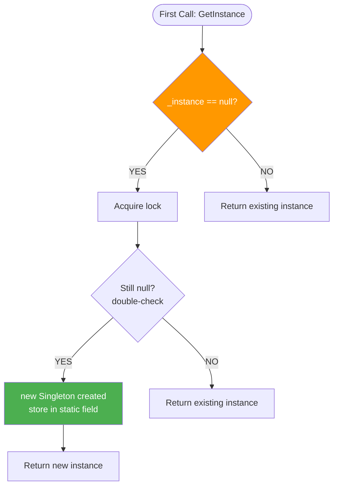

---

# async/await in .NET — Deep Dive

---

## Q: How does async/await actually work under the hood in .NET?

When you mark a method `async`, the C# compiler transforms it into a **state machine** that implements `IAsyncStateMachine`. Each `await` point becomes a numbered state. The runtime calls `MoveNext()` to advance through states.

Key mechanics:
- The method returns an incomplete `Task` to the caller immediately when it hits the first `await`
- A `SynchronizationContext` (if present) captures where the continuation should resume
- `ConfigureAwait(false)` tells the runtime: *do not capture the current SynchronizationContext* — resume on any ThreadPool thread
- In **ASP.NET Core** there is no SynchronizationContext, so `ConfigureAwait(false)` has no practical scheduling effect, but it is still a best practice in library code to avoid problems when your library is consumed from WinForms/WPF

```csharp
// What you write:
public async Task<string> GetDataAsync()
{
    var result = await _httpClient.GetStringAsync("https://api.example.com/data");
    return result.ToUpper();
}

// What the compiler generates (simplified):
private struct GetDataAsyncStateMachine : IAsyncStateMachine
{
    public int _state;           // -1 = not started, 0 = awaiting, -2 = done
    public AsyncTaskMethodBuilder<string> _builder;
    private TaskAwaiter<string> _awaiter;

    public void MoveNext()
    {
        switch (_state)
        {
            case -1:  // STEP 1: first call
                _awaiter = _httpClient.GetStringAsync("...").GetAwaiter();
                if (!_awaiter.IsCompleted)
                {
                    _state = 0;
                    _builder.AwaitUnsafeOnCompleted(ref _awaiter, ref this);
                    return;  // ← returns incomplete Task to caller
                }
                goto case 0;

            case 0:   // STEP 2: continuation — called when HTTP response arrives
                var result = _awaiter.GetResult();
                _builder.SetResult(result.ToUpper());  // ← completes the returned Task
                break;
        }
    }
}

// ❌ WRONG — async void: exceptions are unobservable and crash the process
public async void FireAndForget() { await DoSomethingAsync(); }

// ✅ CORRECT — async Task: exceptions are captured in the returned Task
public async Task DoWorkAsync()
{
    // Library code: use ConfigureAwait(false) to avoid context capture
    var data = await _repo.GetAsync().ConfigureAwait(false);
    await _cache.SetAsync(data).ConfigureAwait(false);
}
```

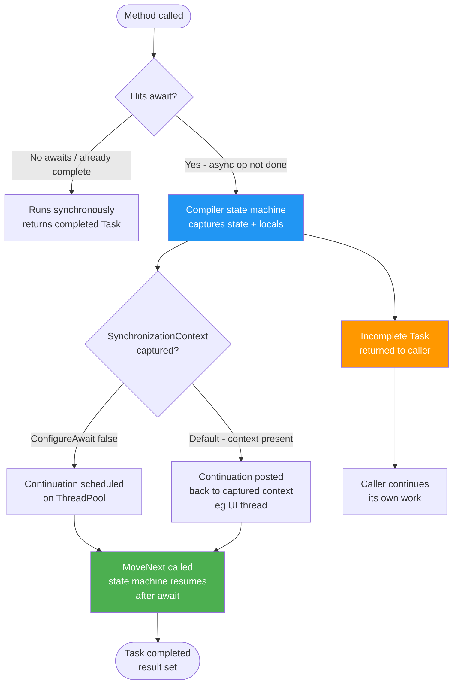

---

## Q: What is the difference between Task, ValueTask, and IAsyncEnumerable?

| Type | Allocation | Best For |
|------|-----------|----------|
| `Task<T>` | Always heap-allocated | General async operations |
| `ValueTask<T>` | Zero alloc when synchronous | Cache hits, hot paths |
| `IAsyncEnumerable<T>` | Streaming | Large result sets, real-time feeds |

```csharp
// Task<T> — standard, always allocates a Task object on the heap
public async Task<Order> GetOrderAsync(Guid id)
{
    return await _db.Orders.FindAsync(id);
}

// ValueTask<T> — avoids allocation when result is already available (cache hit)
private readonly Dictionary<Guid, Order> _cache = new();

public ValueTask<Order> GetOrderAsync(Guid id)
{
    if (_cache.TryGetValue(id, out var order))
        return new ValueTask<Order>(order);  // ← zero allocation, synchronous path

    return new ValueTask<Order>(FetchFromDbAsync(id));  // async path
}

// ❌ WRONG — ValueTask must only be awaited ONCE
var vt = GetOrderAsync(id);
var r1 = await vt;
var r2 = await vt;  // undefined behavior — second await on ValueTask is not allowed

// ✅ CORRECT — if you need to await multiple times, convert to Task first
var task = GetOrderAsync(id).AsTask();
var r1 = await task;
var r2 = await task;  // fine — Task can be awaited multiple times

// IAsyncEnumerable<T> — async streaming, one item at a time
public async IAsyncEnumerable<Order> StreamOrdersAsync(
    [EnumeratorCancellation] CancellationToken ct = default)
{
    await foreach (var order in _db.Orders.AsAsyncEnumerable().WithCancellation(ct))
    {
        yield return order;  // ← each item delivered as it arrives, no buffering all into memory
    }
}

// Consumer
await foreach (var order in StreamOrdersAsync(cancellationToken))
{
    await ProcessAsync(order);  // process each item as it streams in
}
```

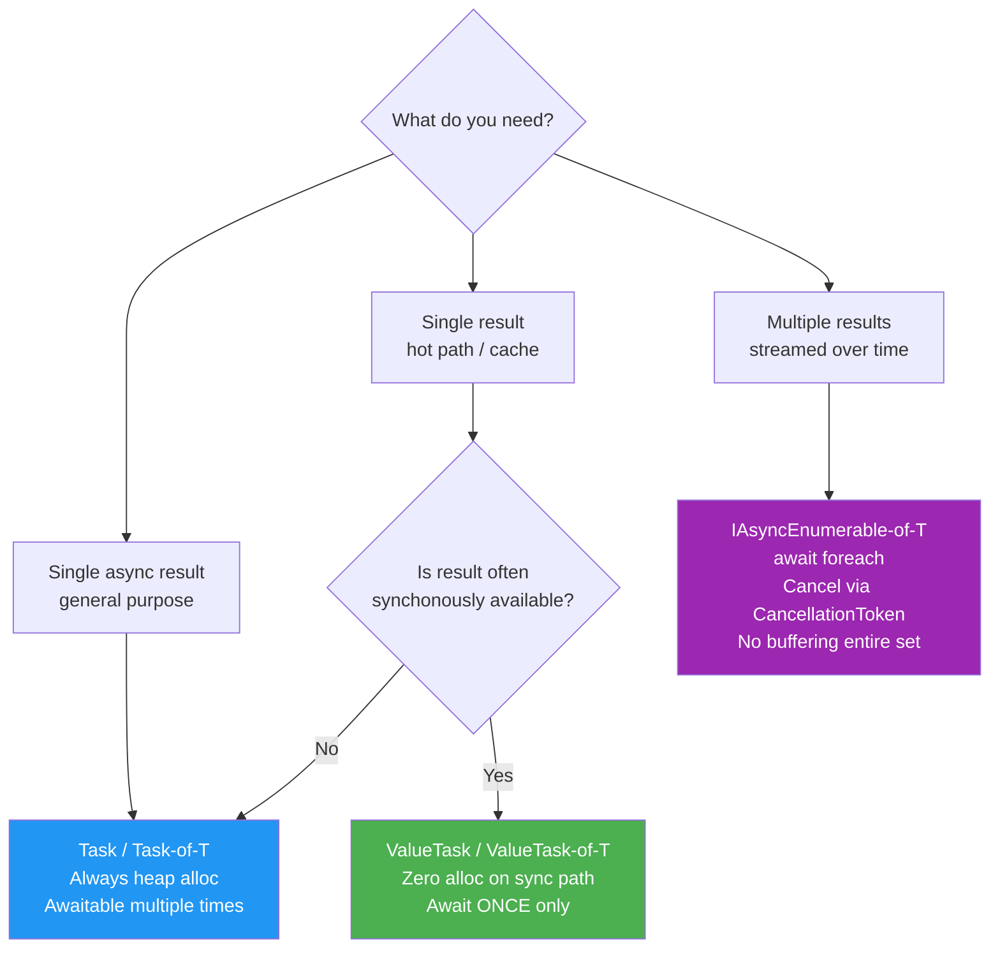

---

## Q: What is SynchronizationContext and how does it interact with async/await?

> **Why this matters:** Calling `.Result` or `.Wait()` on a Task inside a context-bearing runtime (WinForms, WPF, classic ASP.NET) is the most reliable way to create a deadlock that only appears in production. Knowing *why* it deadlocks — not just that it does — shows deep async understanding.

**💡 Production Example:**
A migration from WebForms to ASP.NET Core left one helper calling `GetDataAsync().Result` inside a synchronous property getter. It worked fine in unit tests (no SynchronizationContext) but deadlocked intermittently in the legacy WebForms layer that still ran alongside the new app. Fully awaiting the call chain resolved it.

`SynchronizationContext` is a mechanism to marshal work back to a specific thread or context (e.g., the UI thread in WinForms/WPF, or the request thread in old ASP.NET).

| Runtime | SynchronizationContext | Continuation behavior |
|---------|----------------------|----------------------|
| WinForms / WPF | Present (UI thread) | Continuation posted back to UI thread |
| ASP.NET (classic) | Present (request context) | Continuation posted back to request thread |
| **ASP.NET Core** | **None** | Continuation runs on any ThreadPool thread |
| Console app | None (default) | ThreadPool |

```csharp
// ❌ DEADLOCK in old ASP.NET or WinForms — blocking on async
public string GetData()
{
    // SynchronizationContext is captured by GetStringAsync
    // .Result blocks the current thread
    // Continuation tries to post back to this SAME blocked thread → DEADLOCK
    return _httpClient.GetStringAsync("https://api.example.com").Result;
}

// ✅ FIX 1 — go async all the way
public async Task<string> GetDataAsync()
{
    return await _httpClient.GetStringAsync("https://api.example.com");
}

// ✅ FIX 2 — use ConfigureAwait(false) to detach from the captured context
// (continuation runs on ThreadPool, not blocked UI/request thread)
public string GetData()
{
    return _httpClient.GetStringAsync("https://api.example.com")
                      .ConfigureAwait(false)
                      .GetAwaiter()
                      .GetResult();  // still blocking, but no deadlock
}
```

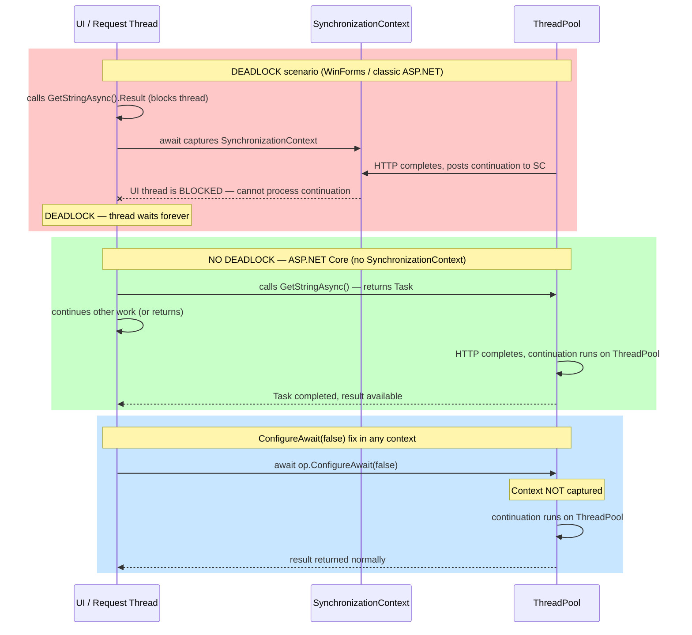

---

## Q: What are common async/await pitfalls and anti-patterns?

### 1. async void

```csharp
// ❌ async void — exception escapes, crashes the process
public async void LoadData() { await FetchAsync(); throw new Exception("boom"); }

// ✅ async Task — exception captured in Task
public async Task LoadDataAsync() { await FetchAsync(); }

// async void is ONLY acceptable for event handlers
private async void Button_Click(object s, EventArgs e) { await LoadDataAsync(); }
```

### 2. Fire and forget without error handling

```csharp
// ❌ Lost exception — nobody observes the Task
_ = DoWorkAsync();

// ✅ Explicit fire-and-forget with error logging
_ = DoWorkAsync().ContinueWith(t =>
    _logger.LogError(t.Exception, "Background task failed"),
    TaskContinuationOptions.OnlyOnFaulted);
```

### 3. Blocking on async (.Result / .Wait())

```csharp
// ❌ Potential deadlock (especially in SynchronizationContext environments)
var data = GetDataAsync().Result;
GetDataAsync().Wait();

// ✅ Await all the way up
var data = await GetDataAsync();
```

### 4. Sequential awaits in a loop when parallel is possible

```csharp
// ❌ Sequential — total time = sum of all operations
foreach (var id in orderIds)
{
    var order = await _repo.GetAsync(id);  // waits for each one before starting next
    results.Add(order);
}

// ✅ Parallel — total time ≈ slowest single operation
var tasks = orderIds.Select(id => _repo.GetAsync(id));
var results = await Task.WhenAll(tasks);
```

### 5. CancellationToken not propagated

```csharp
// ❌ Long operation can never be cancelled
public async Task<byte[]> ProcessFileAsync()
{
    var data = await File.ReadAllBytesAsync("huge.bin");  // no cancellation
    return await TransformAsync(data);
}

// ✅ CancellationToken threaded through every layer
public async Task<byte[]> ProcessFileAsync(CancellationToken ct = default)
{
    var data = await File.ReadAllBytesAsync("huge.bin", ct);
    ct.ThrowIfCancellationRequested();
    return await TransformAsync(data, ct);
}
```

### 6. Async over sync (unnecessary Task.Run)

```csharp
// ❌ Fake async — wastes a thread, adds overhead
public Task<int> ComputeAsync() => Task.Run(() => 1 + 1);

// ✅ Only use Task.Run for CPU-bound work that would block the calling thread
public async Task<int> ProcessImageAsync(byte[] data, CancellationToken ct)
{
    // CPU-bound: offload to ThreadPool so the calling thread is free
    return await Task.Run(() => _imageProcessor.Process(data), ct);
}
```

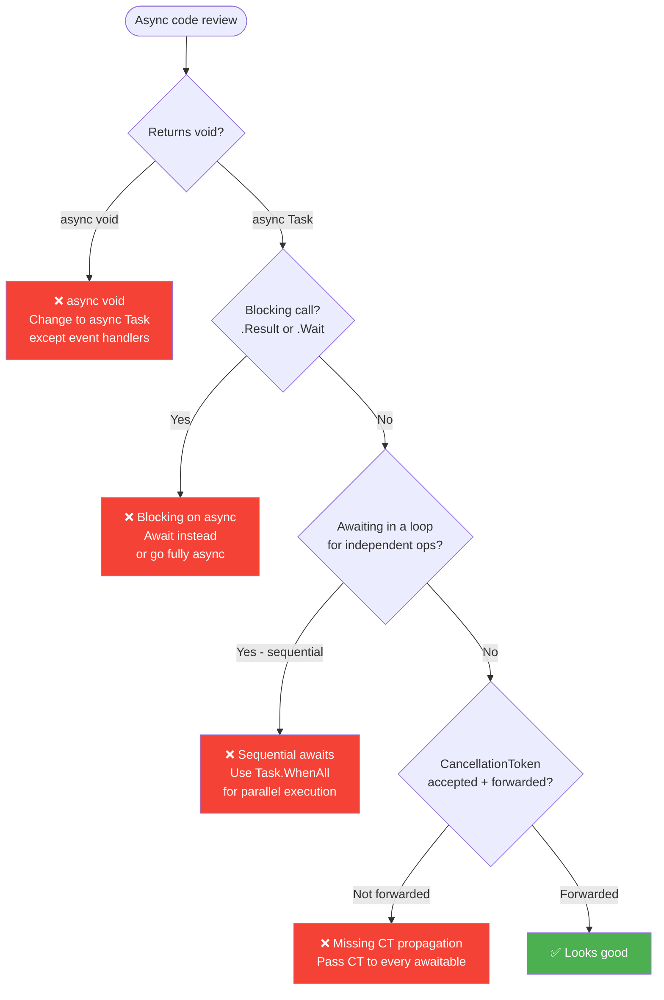

---

## Q: How do you run multiple async operations in parallel?

```csharp
var ids = new[] { Guid.NewGuid(), Guid.NewGuid(), Guid.NewGuid() };

// ── Task.WhenAll — wait for ALL to complete ──────────────────────────────

// ❌ Sequential — each await waits before starting the next
var results = new List<Order>();
foreach (var id in ids)
    results.Add(await _repo.GetOrderAsync(id));  // 3 x 200ms = ~600ms total

// ✅ Parallel — all start simultaneously
var tasks   = ids.Select(id => _repo.GetOrderAsync(id));
var orders  = await Task.WhenAll(tasks);          // ~200ms total (runs concurrently)

// ── Task.WhenAny — first one to finish ───────────────────────────────────
var fastest = await Task.WhenAny(
    _primaryService.GetAsync(id),
    _fallbackService.GetAsync(id));
var result = await fastest;  // unwrap the winning Task

// ── SemaphoreSlim — bounded concurrency (throttle parallel ops) ──────────
var semaphore = new SemaphoreSlim(5); // max 5 concurrent operations

var tasks2 = ids.Select(async id =>
{
    await semaphore.WaitAsync();          // acquire slot
    try   { return await _repo.GetOrderAsync(id); }
    finally { semaphore.Release(); }      // always release
});
var bounded = await Task.WhenAll(tasks2);

// ── Parallel.ForEachAsync (.NET 6+) ──────────────────────────────────────
await Parallel.ForEachAsync(ids,
    new ParallelOptions { MaxDegreeOfParallelism = 5 },
    async (id, ct) => await ProcessAsync(id, ct));
```

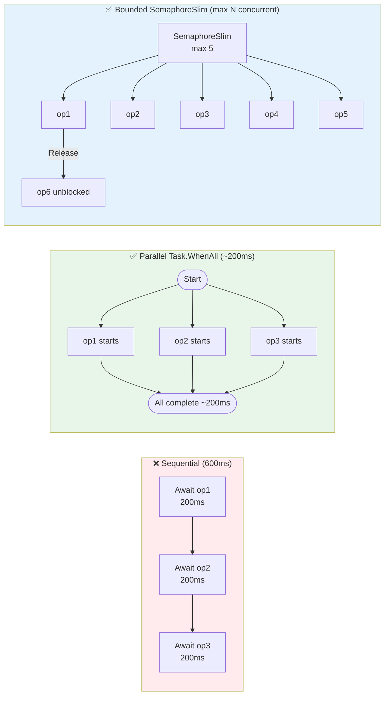

---

## Q: How does CancellationToken work and why should you always support it?

> **Why this matters:** Without cancellation token propagation, disconnected clients still consume CPU, database connections, and downstream service quota. In high-traffic APIs this translates directly to wasted infrastructure cost and increased tail latency for other requests.

**💡 Production Example:**
A mobile client had an aggressive 3-second timeout on search requests. The server had no cancellation support, so the underlying EF Core query and three downstream HTTP calls ran to completion even after the client had already given up. Adding `CancellationToken` propagation through every layer cut wasted DB query time by ~40% during peak load.

```csharp
// ── Setup ────────────────────────────────────────────────────────────────

// Cancellable after 30 seconds OR when user cancels
using var cts     = new CancellationTokenSource(TimeSpan.FromSeconds(30));
using var userCts = new CancellationTokenSource();

// Link multiple cancellation sources
using var linked = CancellationTokenSource.CreateLinkedTokenSource(
    cts.Token, userCts.Token);  // cancels if EITHER fires

// ── Producing the token ──────────────────────────────────────────────────
// ASP.NET Core: HttpContext.RequestAborted is provided automatically
[HttpGet("{id}")]
public async Task<IActionResult> Get(Guid id, CancellationToken ct)  // ← injected by framework
{
    var order = await _service.GetOrderAsync(id, ct);
    return Ok(order);
}

// ── Consuming the token ──────────────────────────────────────────────────

// ❌ Ignoring cancellation — runs forever even if client disconnects
public async Task<Order> GetOrderAsync(Guid id)
{
    await Task.Delay(5000);                        // simulate slow work, no cancellation
    return await _db.Orders.FindAsync(id);
}

// ✅ Propagating cancellation throughout
public async Task<Order> GetOrderAsync(Guid id, CancellationToken ct = default)
{
    await Task.Delay(5000, ct);                    // throws OperationCanceledException if cancelled
    ct.ThrowIfCancellationRequested();             // explicit check after CPU-bound work
    return await _db.Orders.FindAsync(new object[] { id }, ct);
}

// ── Handling cancellation at the top level ───────────────────────────────
try
{
    var result = await GetOrderAsync(id, ct);
}
catch (OperationCanceledException)
{
    // Normal cancellation — log if needed, do NOT rethrow as 500
    _logger.LogInformation("Request cancelled for order {Id}", id);
    return StatusCode(499); // Client Closed Request
}
```

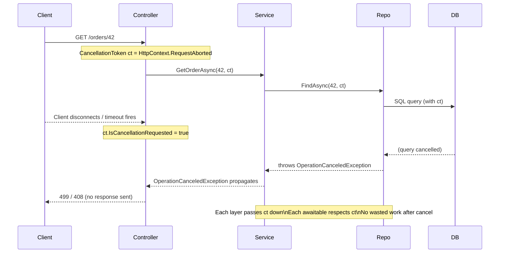

---

# Additional .NET Concepts

---

## Q: What is the difference between IEnumerable, IQueryable, and IAsyncEnumerable?

> **Why this matters:** The `IEnumerable` vs `IQueryable` distinction is one of the most common sources of N+1 queries and full-table scans in EF Core applications. Knowing where LINQ executes separates developers who write scalable data layers from those who accidentally load entire tables into memory.

**💡 Production Example:**
A product search endpoint filtered and sorted on the application side after calling `.ToList()` too early. Under load, the query pulled 500k rows into memory on every request. Keeping the query as `IQueryable<T>` until the final `.ToListAsync()` call pushed all filtering to SQL and cut response time from 4 s to 80 ms.

| Interface | Where LINQ runs | When data loads | Use case |
|-----------|----------------|----------------|----------|
| `IEnumerable<T>` | CLR / in-memory | When iterated | In-memory collections |
| `IQueryable<T>` | Database (SQL) | When materialized (ToList/First/etc.) | EF Core queries |
| `IAsyncEnumerable<T>` | Async source | One item at a time, async | Large streams, real-time |

```csharp
// IQueryable<T> — expression tree, translated to SQL, deferred execution
IQueryable<Order> query = _db.Orders
    .Where(o => o.Status == "Pending")    // ← adds WHERE clause, no SQL yet
    .OrderBy(o => o.CreatedAt);           // ← adds ORDER BY, no SQL yet

// SQL executes HERE when materialized:
var orders = await query.ToListAsync();   // SELECT * FROM Orders WHERE Status='Pending' ORDER BY CreatedAt

// ❌ WRONG — calling ToList() early materializes ALL rows, LINQ runs in CLR
var allOrders = await _db.Orders.ToListAsync();                      // loads everything
var pending   = allOrders.Where(o => o.Status == "Pending").ToList(); // filters in memory

// ✅ CORRECT — compose query before materializing
var pending = await _db.Orders
    .Where(o => o.Status == "Pending")    // translated to SQL WHERE
    .Select(o => new OrderDto(o.Id, o.Status))  // translated to SELECT columns
    .ToListAsync();

// ❌ WRONG — IEnumerable parameter forces client-side evaluation in EF
public IEnumerable<Order> Filter(IEnumerable<Order> src, string status)
    => src.Where(o => o.Status == status);  // already materialized — too late

// ✅ CORRECT — keep IQueryable for composable server-side filters
public IQueryable<Order> Filter(IQueryable<Order> src, string status)
    => src.Where(o => o.Status == status);  // still an expression tree

// IAsyncEnumerable<T> — stream large results without buffering all in memory
public async IAsyncEnumerable<OrderDto> StreamLargeReportAsync(
    [EnumeratorCancellation] CancellationToken ct = default)
{
    await foreach (var order in _db.Orders.AsAsyncEnumerable().WithCancellation(ct))
    {
        yield return new OrderDto(order.Id, order.Total);
    }
}
```

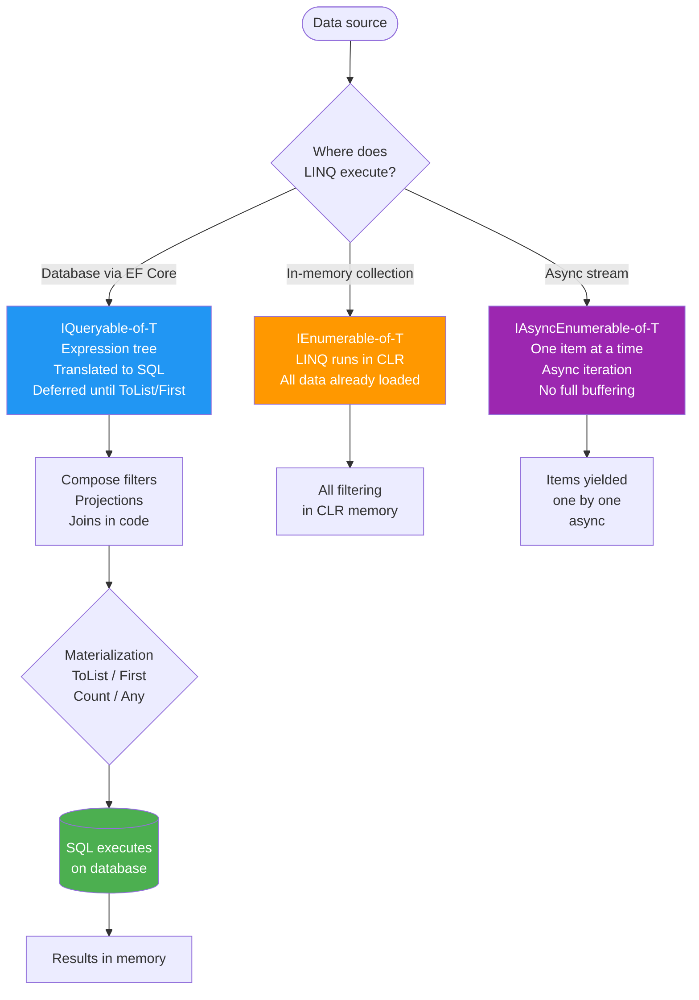

---

## Q: Explain .NET memory management — stack vs heap, GC generations, and LOH

> **Why this matters:** GC pauses directly affect tail latency. Candidates who understand allocation patterns and object lifetimes can prevent p99 spikes without guessing — and can explain why ArrayPool and Span<T> exist.

**💡 Production Example:**
A reporting service allocated large `string[]` arrays inside a tight loop generating CSV exports. Gen 0 collections spiked and p99 latency doubled under load. Switching to `ArrayPool<char>` and pre-allocating with `StringBuilder` cut allocations by 80% and stabilised response times.

```
Stack                              Managed Heap
─────────────────────────         ──────────────────────────────────────────
Value types (int, bool, struct)   Reference types (class instances, strings)
Method locals & params            Gen0 → Gen1 → Gen2 (promotion on survival)
Fast: just move stack pointer     LOH: objects > 85 KB (infrequent collection)
LIFO — auto freed on scope end    GC: mark-compact, background GC in .NET 6+
```

```csharp
// ── Value types on stack ──────────────────────────────────────────────────
void Process()
{
    int x = 42;           // stack
    var pt = new Point(1, 2); // struct → stack (if local)
}   // x and pt freed immediately when method returns

// ── Reference types on heap ───────────────────────────────────────────────
var order = new Order();  // Gen0 heap allocation; GC manages lifetime

// ── LOH pitfall — large arrays repeatedly allocated ───────────────────────
// ❌ Each call allocates >85KB → goes to LOH → rare collection → heap fragmentation
public byte[] ProcessRequest(int size)
{
    var buffer = new byte[1024 * 1024]; // 1MB → LOH allocation every request
    // ... use buffer ...
    return buffer;
}

// ✅ ArrayPool<T> — rent from pool, return after use (no GC pressure)
public void ProcessRequest()
{
    var buffer = ArrayPool<byte>.Shared.Rent(1024 * 1024);
    try
    {
        // ... use buffer ...
    }
    finally
    {
        ArrayPool<byte>.Shared.Return(buffer); // returned to pool, not GC'd
    }
}

// ✅ Struct for small, frequently created value objects
// ❌ class OrderId { public Guid Value; }   // heap alloc per instance
public readonly record struct OrderId(Guid Value); // stack / inline in parent object

// ── GC.Collect() — almost never call manually ────────────────────────────
// GC knows better. Forcing collection disrupts background GC heuristics.
```

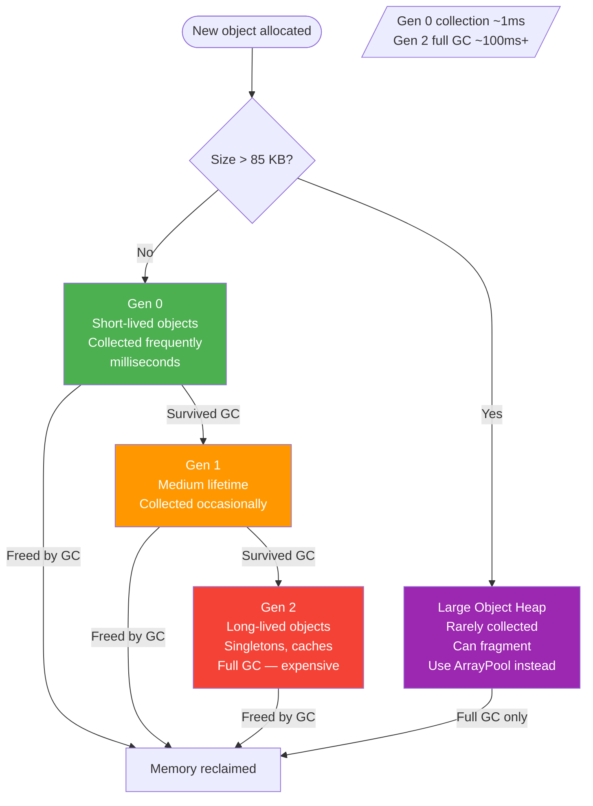

---

## Q: What is Span&lt;T&gt; and Memory&lt;T&gt; and when should you use them?

> **Why this matters:** Span<T> and Memory<T> are the primary tools for eliminating hot-path allocations in .NET without unsafe code. Understanding them signals that you can write high-throughput parsers, serializers, and pipeline stages that don't hammer the GC.

**💡 Production Example:**
A CSV import service split each line with `string.Split(',')` allocating thousands of short-lived strings per file. Replacing the inner loop with `ReadOnlySpan<char>` slicing dropped Gen 0 collections to near zero during bulk imports and cut peak memory usage by over 60%.

`Span<T>` is a **stack-only** ref struct that represents a contiguous slice of memory without copying it. `Memory<T>` is the heap-safe, async-compatible version.

```csharp
// ── The problem with traditional string/array operations ──────────────────
string csv = "Alice,30,Engineer";

// ❌ Allocates 3 new strings — each Substring is a heap allocation
string[] parts = csv.Split(',');
string name = parts[0];

// ✅ ReadOnlySpan<char> — zero allocation, slices original string
ReadOnlySpan<char> span = csv.AsSpan();
int first  = span.IndexOf(',');
int second = span[(first + 1)..].IndexOf(',') + first + 1;

ReadOnlySpan<char> namePart = span[..first];                  // no alloc
ReadOnlySpan<char> agePart  = span[(first + 1)..second];      // no alloc
// int.Parse can accept ReadOnlySpan<char> directly:
int age = int.Parse(agePart);

// ── Span over stack-allocated memory ─────────────────────────────────────
Span<byte> buffer = stackalloc byte[256];   // on the stack, zero heap alloc
FillData(buffer);

// ── Memory<T> — for async code (Span can't be used across await) ──────────
public async Task<int> ReadAsync(Memory<byte> buffer, CancellationToken ct)
{
    // Memory<T> is heap-safe — can be stored as a field, used across awaits
    int bytesRead = await _stream.ReadAsync(buffer, ct);
    return bytesRead;
}

// Convert between Span and Memory:
Memory<byte> mem = new byte[1024];
Span<byte> sp = mem.Span;   // Span from Memory (synchronous code only)
```

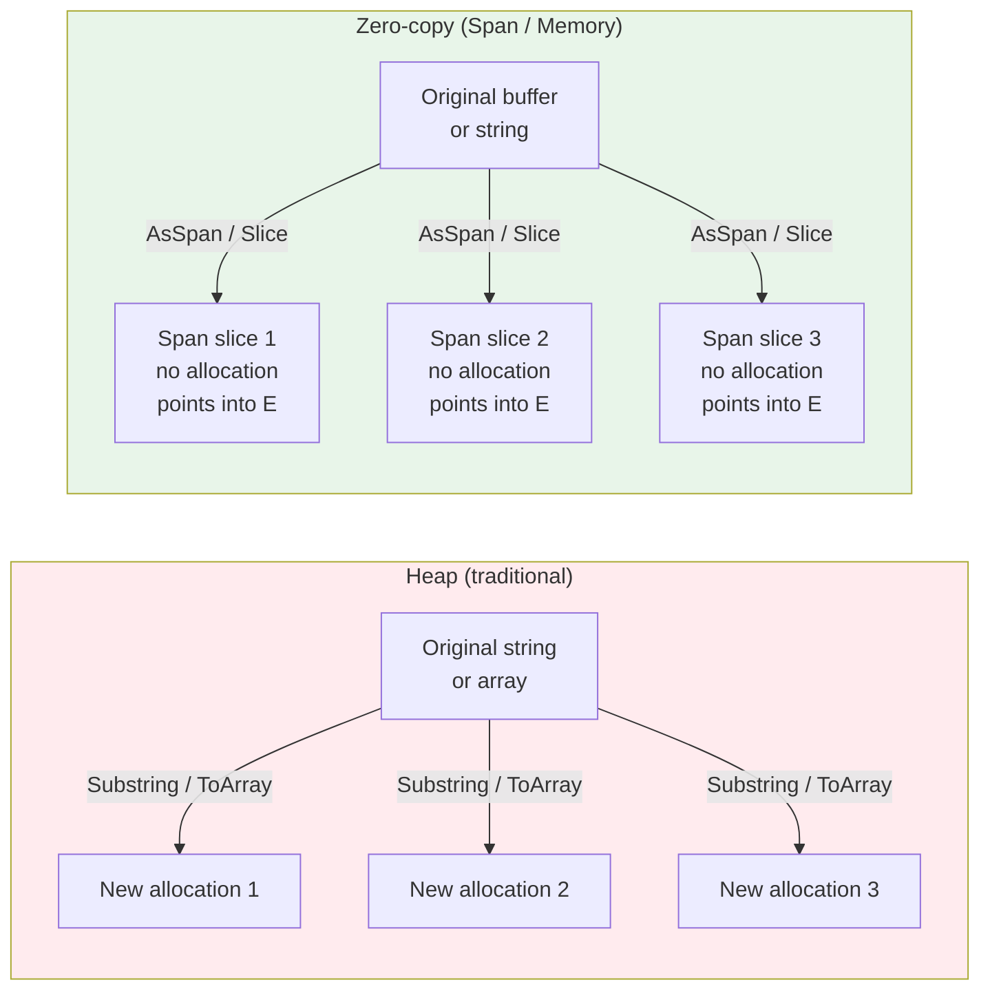

---

## Q: What is the Channel&lt;T&gt; class and how does it enable producer-consumer patterns?

`System.Threading.Channels` provides a **high-performance async queue** purpose-built for producer-consumer workflows. It replaces patterns like `ConcurrentQueue<T>` + polling.

```csharp
// ── Create a channel ─────────────────────────────────────────────────────

// Unbounded — unlimited capacity (careful: can grow unboundedly under load)
var channel = Channel.CreateUnbounded<WorkItem>();

// Bounded — backpressure: producers slow down when channel is full
var channel = Channel.CreateBounded<WorkItem>(new BoundedChannelOptions(100)
{
    FullMode = BoundedChannelFullMode.Wait,           // producer awaits when full
    SingleWriter = false,
    SingleReader = false
});

// ── Producer ─────────────────────────────────────────────────────────────
async Task ProduceAsync(CancellationToken ct)
{
    await foreach (var item in GetItemsAsync(ct))
    {
        await channel.Writer.WriteAsync(item, ct);    // async backpressure built in
    }
    channel.Writer.Complete();                         // signal: no more items
}

// ── Consumer ─────────────────────────────────────────────────────────────
async Task ConsumeAsync(CancellationToken ct)
{
    // ReadAllAsync waits for items, respects completion + cancellation
    await foreach (var item in channel.Reader.ReadAllAsync(ct))
    {
        await ProcessAsync(item, ct);
    }
}

// ── Multiple producers + multiple consumers ───────────────────────────────
var writers = Enumerable.Range(0, 3).Select(_ => ProduceAsync(ct));
var readers = Enumerable.Range(0, 2).Select(_ => ConsumeAsync(ct));
await Task.WhenAll(writers.Concat(readers));

// ❌ Avoid: ConcurrentQueue + polling loop wastes CPU
var queue = new ConcurrentQueue<WorkItem>();
while (!ct.IsCancellationRequested)
{
    if (queue.TryDequeue(out var item))
        Process(item);
    else
        await Task.Delay(10, ct);  // busy-wait: wastes CPU + adds latency
}
```

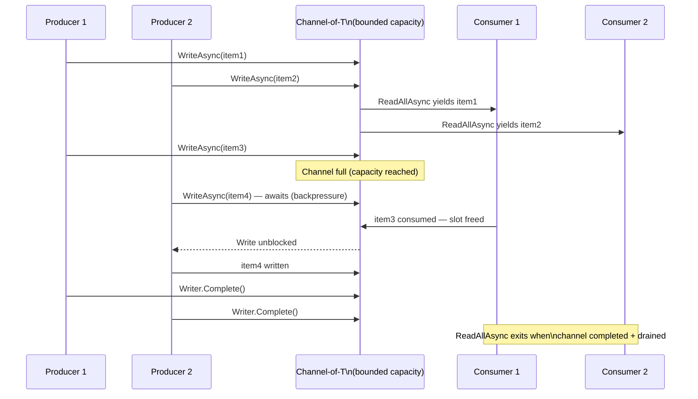

---

## Q: What are Source Generators and how do they improve performance?

Source Generators run at **compile time** and emit additional C# code into your compilation. The key benefit is eliminating runtime reflection — which is slow, AOT-incompatible, and trim-unfriendly.

```csharp
// ── System.Text.Json Source Generator ────────────────────────────────────

// ❌ Reflection-based serialization (default before .NET 6 source gen)
// At runtime, Json serializer reflects on Order's properties via reflection
var json = JsonSerializer.Serialize(order);

// ✅ Source Generator — serialization code generated at compile time
[JsonSerializable(typeof(Order))]
[JsonSerializable(typeof(List<Order>))]
public partial class AppJsonContext : JsonSerializerContext { }  // ← compiler fills in the rest

// Usage — zero reflection at runtime
var json = JsonSerializer.Serialize(order, AppJsonContext.Default.Order);
var obj  = JsonSerializer.Deserialize(json, AppJsonContext.Default.Order);

// ── Regex Source Generator (.NET 7+) ──────────────────────────────────────

// ❌ Interpreted regex — compiled at runtime
private static readonly Regex _emailRegex = new(@"^[\w.-]+@[\w.-]+\.\w+$",
    RegexOptions.Compiled);

// ✅ Source-generated regex — compiled to IL at build time
[GeneratedRegex(@"^[\w.-]+@[\w.-]+\.\w+$")]
private static partial Regex EmailRegex();

// ── DI Source Generator ───────────────────────────────────────────────────
// Microsoft.Extensions.DependencyInjection source gen creates a compile-time
// container, avoiding runtime reflection for service resolution

// ── Benefits ─────────────────────────────────────────────────────────────
// 1. Faster startup — no runtime type discovery
// 2. Native AOT compatible — no reflection = trimmable
// 3. Build-time errors — misconfiguration caught at compile, not runtime
// 4. Better performance in hot paths — no reflection overhead per call
```

```mermaid
flowchart LR
    subgraph BUILD["Compile Time"]
        SRC[Your C# source code] --> ROSLYN[Roslyn Compiler]
        ROSLYN --> SG[Source Generator\nanalyzes your types]
        SG --> GEN[Generated C# code\nserializers / regex / DI wiring]
        GEN --> ROSLYN
        ROSLYN --> IL[Final IL assembly\nno reflection needed at runtime]
    end

    subgraph RUNTIME["Runtime"]
        IL --> EXEC[Execute generated code\ndirectly — no reflection]
        EXEC --> FAST[⚡ Fast startup\n⚡ Trim-safe\n⚡ AOT compatible]
    end

    subgraph OLD["Old approach — Runtime Reflection"]
        RCODE[Your code] --> REFL[Runtime reflection\nType.GetProperties\nActivator.CreateInstance]
        REFL --> SLOW[🐢 Slower\n🐢 Not trim-safe\n🐢 AOT incompatible]
    end

    style BUILD fill:#e3f2fd
    style RUNTIME fill:#e8f5e9
    style OLD fill:#ffebee
```

---

# C# & .NET Fundamentals — Interview Q&A

---

## Q: What is the difference between a value type and a reference type?

**Answer:**
Value types (`struct`, `int`, `bool`, `DateTime`) are stored inline — on the stack when they are locals, or embedded inside the containing object when they are fields. Assigning one copies the entire value. Reference types (`class`, `string`, arrays, interfaces) store a reference (pointer) on the stack/field; the actual object lives on the managed heap. Assigning copies the reference, so multiple variables can point to the same instance. `string` is a reference type but behaves like a value type because it is immutable — every "modification" produces a new string object.

> **Why this matters:** Value/reference confusion causes subtle bugs in caching, equality checks, and concurrent code. A developer who cannot explain this clearly will struggle with struct performance optimisation, defensive copy bugs, and unexpected aliasing.

**💡 Production Example:**
In a high-throughput order service a custom `struct` was passed between layers, creating a deep copy on every method call and causing invisible memory pressure under load. Switching to a `class` with explicit ownership semantics eliminated the hidden allocation regression.

❌ **Anti-pattern:**
```csharp
// Struct aliasing surprise — modifying 'b' does NOT affect 'a'
var a = new Point(1, 2);
var b = a;          // full copy
b.X = 99;
Console.WriteLine(a.X); // still 1 — surprising if you expected reference semantics
```

✅ **Best practice:**
```csharp
// Be explicit: use struct for small, immutable value objects
public readonly record struct Point(int X, int Y);

// Use class when shared identity / mutation is needed
public class Order { public Guid Id { get; init; } public decimal Total { get; set; } }
```

---

## Q: Walk me through a production bug caused by mutable shared state and how you'd prevent it.

**Answer:**
Mutable shared state means multiple execution paths can read and write the same object without coordination. In a multi-threaded service, one request can partially mutate an object while another request is reading it, producing torn reads, data bleed, or `InvalidOperationException`. The prevention playbook: make objects immutable after construction, keep object lifetimes short (scoped, not singleton), avoid static mutable fields, and use thread-safe collections when sharing across threads is unavoidable.

> **Why this matters:** Mutable shared state is one of the most common sources of production race conditions and data corruption in multi-threaded services. These bugs reproduce intermittently and are extremely hard to debug without understanding the root cause.

**💡 Production Example:**
A session cache service stored a mutable `Dictionary<string, object>` per user, but the instance was accidentally registered as a singleton in the DI container. Two concurrent requests from different users mutated the same dictionary, causing intermittent data bleed between sessions. Making the dictionary immutable after initialisation and using `ConcurrentDictionary` for any runtime updates fixed the bug.

❌ **Anti-pattern:**
```csharp
// Singleton with mutable shared state — race condition waiting to happen
public class RequestContext
{
    public Dictionary<string, string> Headers { get; set; } = new(); // mutated per request
}
// Registered as: builder.Services.AddSingleton<RequestContext>(); ← WRONG
```

✅ **Best practice:**
```csharp
// Immutable after construction; register as Scoped
public class RequestContext
{
    public IReadOnlyDictionary<string, string> Headers { get; }
    public RequestContext(IReadOnlyDictionary<string, string> headers) => Headers = headers;
}
// builder.Services.AddScoped<RequestContext>();
```

---

## Q: When do you use string versus StringBuilder in C#?

**Answer:**
Use `string` for fixed or small concatenations — one or two joins, literal formatting, or interpolation on a single line. Use `StringBuilder` when concatenating repeatedly in a loop or building large dynamic text (reports, CSV, HTML templates). `string` is immutable: every `+=` allocates a new string object and copies the old content, so N concatenations in a loop produce O(N²) allocations. `StringBuilder` maintains an internal buffer and amortises the cost, growing it geometrically when needed.

> **Why this matters:** Text handling appears everywhere — logging, serialisation, templating, report generation. Knowing when allocation spikes prevents avoidable latency and Gen 0 churn in batch workloads.

**💡 Production Example:**
A loop generating monthly invoice emails for 200 k customers used `+=` inside nested iterations, producing heavy Gen 0 churn and batch execution times well over acceptable limits. Switching to `StringBuilder` with a pre-allocated capacity cut allocations per email by ~90% and reduced total batch time significantly.

❌ **Anti-pattern:**
```csharp
string result = "";
foreach (var item in largeCollection)
    result += item.Name + ", "; // O(N²) allocations
```

✅ **Best practice:**
```csharp
var sb = new StringBuilder(largeCollection.Count * 20); // pre-size estimate
foreach (var item in largeCollection)
    sb.Append(item.Name).Append(", ");
string result = sb.ToString();
```

---

## Q: What is the difference between ==, .Equals(), and ReferenceEquals() in C#?

**Answer:**
`==` is an operator that can be overloaded per type. For primitives and `string`, it compares values. For unsealed classes it defaults to reference equality unless overloaded. `.Equals()` is an instance method defined on `object`; types override it to provide value-based comparison semantics. `ReferenceEquals(a, b)` is a static method that always checks whether two variables point to the exact same heap object — it ignores all overloads and overrides, making it the definitive identity check.

> **Why this matters:** Equality bugs leak into caching keys, deduplication logic, and security checks. A custom type that doesn't override `Equals`/`GetHashCode` will silently break dictionary lookups and LINQ `Distinct()` calls.

**💡 Production Example:**
In a pricing service, discount rules were cached by a custom `RuleKey` class that never overrode `Equals` or `GetHashCode`. Every lookup created a new instance so the cache hit rate was 0% — logically equal keys were treated as different objects. Implementing `Equals`/`GetHashCode` (or switching to a `record`) fixed both correctness and cache performance.

❌ **Anti-pattern:**
```csharp
public class RuleKey { public string Region; public int Tier; }
// RuleKey a = new("EU", 1);  RuleKey b = new("EU", 1);
// dictionary[a] != dictionary[b] — different instances, no Equals override
```

✅ **Best practice:**
```csharp
// Option 1: record — value equality built in
public record RuleKey(string Region, int Tier);

// Option 2: manual override
public class RuleKey
{
    public string Region { get; init; }
    public int Tier { get; init; }
    public override bool Equals(object? obj) =>
        obj is RuleKey other && Region == other.Region && Tier == other.Tier;
    public override int GetHashCode() => HashCode.Combine(Region, Tier);
}
```

---

## Q: When would you choose an abstract class over an interface in modern C#?

**Answer:**
Choose an **interface** when you need a contract that multiple unrelated types can implement — it keeps coupling loose and enables composability. Choose an **abstract class** when you need shared state, protected helper methods, or constructor-enforced invariants that all subtypes must initialise. Default interface methods (C# 8+) allow adding new members without breaking implementors, but they cannot carry instance state or enforce constructor logic.

> **Why this matters:** Poor base-type decisions create rigid hierarchies or require duplicated logic across implementations. Getting this wrong early in a project is expensive to refactor.

**💡 Production Example:**
A payment gateway SDK used an interface (`IPaymentProvider`) for the public contract so any provider could be swapped. An abstract base class (`PaymentProviderBase`) held common retry logic, telemetry hooks, and request signature validation. New providers inherited the base class to stay consistent without copy-pasting infrastructure code.

❌ **Anti-pattern:**
```csharp
// Fat abstract class with both contract AND all implementations tightly coupled
public abstract class PaymentProvider
{
    public abstract Task<Result> ChargeAsync(decimal amount);
    // forces ALL subclasses to inherit retry + logging even if they don't want it
    public virtual async Task<Result> ChargeWithRetryAsync(decimal amount) { /* ... */ }
}
```

✅ **Best practice:**
```csharp
// Public contract — loose coupling, mockable
public interface IPaymentProvider
{
    Task<Result> ChargeAsync(decimal amount, CancellationToken ct = default);
}

// Shared infrastructure — opt-in via inheritance
public abstract class PaymentProviderBase : IPaymentProvider
{
    public abstract Task<Result> ChargeAsync(decimal amount, CancellationToken ct = default);
    protected Task<Result> WithRetryAsync(Func<Task<Result>> op) { /* shared retry */ }
    protected void RecordTelemetry(string operation, TimeSpan elapsed) { /* shared metrics */ }
}
```

---

## Q: What is the difference between readonly and const, and what are common gotchas?

**Answer:**
`const` values are compile-time constants — the value is baked directly into every consuming assembly's IL at build time. `readonly` fields are assigned at declaration or in the constructor and resolved at runtime. The critical gotcha: if you change a `public const` in a library, consuming assemblies that were not recompiled still use the old baked-in value. `static readonly` fields are resolved at runtime on first access, so redeploying the library is sufficient.

> **Why this matters:** `const` creates an invisible coupling between assemblies that only surfaces after partial deployments. This is a real operational risk in microservices and NuGet package versioning.

**💡 Production Example:**
An internal shared package exposed `public const int DefaultTimeoutSeconds = 30`. After updating it to 60 and deploying the package, one consuming service still timed out at 30 seconds because it had not been rebuilt against the new package version. Changing to `public static readonly int DefaultTimeoutSeconds = 60` ensured all consumers picked up the value at runtime without requiring a rebuild.

❌ **Anti-pattern:**
```csharp
// In a shared library — dangerous for values that might ever change
public static class Config
{
    public const int MaxRetries = 3;          // baked into every consumer's IL
    public const string DefaultRegion = "EU"; // same problem
}
```

✅ **Best practice:**
```csharp
public static class Config
{
    public static readonly int MaxRetries = 3;          // runtime resolution
    public static readonly string DefaultRegion = "EU"; // safe to change and redeploy
}
// Reserve const for truly universal constants: Math.PI, "magic" protocol values
```

---

## Q: Where does boxing/unboxing hurt in .NET, and how do you avoid it?

**Answer:**
Boxing wraps a value type in a heap-allocated `object`; unboxing extracts it back. Each box is a separate heap allocation, and accumulated boxing in hot paths generates significant GC pressure. Boxing sneaks in through: non-generic APIs (`ArrayList`, `Hashtable`), `string.Format` with value-type arguments before interpolation, interface calls on structs, `object`-typed collections, and older reflection paths.

> **Why this matters:** The per-call overhead of boxing is tiny, but in hot code paths — tight loops, metrics pipelines, serialisation — it compounds into measurable GC activity and p95 latency spikes.

**💡 Production Example:**
A metrics pipeline used `ArrayList` and `object`-typed payloads to store integer counters. Under heavy traffic, boxing each `int` created constant Gen 0 pressure. Migrating to `List<int>` and `Dictionary<string, long>` (generic, no boxing) reduced GC collection frequency and stabilised p95 latency.

❌ **Anti-pattern:**
```csharp
// Non-generic collection — every int is boxed on Add, unboxed on retrieval
ArrayList counters = new();
counters.Add(42);               // boxes int → object
int val = (int)counters[0];     // unboxes object → int

// string.Format boxes value-type args in older patterns
string msg = string.Format("Count: {0}", count); // boxes 'count'
```

✅ **Best practice:**
```csharp
// Generic collections — zero boxing for value types
List<int> counters = new();
counters.Add(42);  // no boxing

// String interpolation — compiler avoids boxing in most cases
string msg = $"Count: {count}";

// Avoid interface calls on structs in hot paths:
// IComparable<T> on a generic constraint is fine; casting struct to interface boxes it
```

---

## Q: When should you use a record instead of a class?

**Answer:**
Use `record` for immutable, data-centric models where value equality is the right semantic — DTOs, integration event contracts, configuration snapshots, query results. Records provide value-based `Equals`/`GetHashCode`/`ToString` and non-destructive mutation via `with` expressions for free. Use `class` for entities with identity, mutable lifecycle, or complex behaviour. `readonly record struct` is ideal for small value objects that benefit from stack allocation.

> **Why this matters:** Choosing the wrong type semantics can silently break identity logic (two "equal" entities treated as different) or make unit tests noisy (having to override equality just to assert on data).

**💡 Production Example:**
In an event-driven order system, integration event contracts were defined as mutable classes. Tests required verbose custom comparers, and equality checks in idempotency guards were unreliable. Moving the contracts to `record` types eliminated all hand-written equality code and made contract tests one-liners.

❌ **Anti-pattern:**
```csharp
// Mutable class for a DTO — equality broken, mutation dangerous
public class OrderCreatedEvent
{
    public Guid OrderId { get; set; }
    public decimal Total { get; set; }
}
// new OrderCreatedEvent { OrderId = id, Total = 99 }
// == new OrderCreatedEvent { OrderId = id, Total = 99 }  → FALSE (reference equality)
```

✅ **Best practice:**
```csharp
// record — value equality, immutable by default, with-expression for copies
public record OrderCreatedEvent(Guid OrderId, decimal Total, DateTimeOffset OccurredAt);

// Non-destructive mutation:
var updated = original with { Total = 110m };

// Small value object — stack-allocated
public readonly record struct Money(decimal Amount, string Currency);
```

---

## Q: Why and when would you mark a class as sealed?

**Answer:**
Mark a class `sealed` when extension is not a supported design goal — particularly for security-sensitive validators, value-like helpers, and performance-critical types where the JIT can devirtualise method calls. `sealed` also makes the type's contract explicit: callers cannot subclass and override behaviour in unexpected ways.

> **Why this matters:** Open inheritance is a long-term API commitment. Every public unsealed class is implicitly an extension point. Sealing by default and opening deliberately keeps surface area manageable and enables JIT optimisations.

**💡 Production Example:**
An authentication token validator that enforced strict signing and expiry invariants was left unsealed. A downstream team subclassed it and overrode the expiry check to "simplify testing", inadvertently disabling it in a staging environment that later received a production traffic shift. Sealing the class and providing a test-friendly interface (`ITokenValidator`) prevented the bypass.

❌ **Anti-pattern:**
```csharp
// Open class with security-critical logic — anyone can override Validate()
public class JwtTokenValidator
{
    public virtual bool Validate(string token) { /* strict logic */ return true; }
}
```

✅ **Best practice:**
```csharp
// Sealed — no overrides possible; testable via interface
public interface ITokenValidator { bool Validate(string token); }

public sealed class JwtTokenValidator : ITokenValidator
{
    public bool Validate(string token) { /* strict logic */ return true; }
}
```

---

## Q: How do you decide between exceptions and result objects for error handling in domain code?

**Answer:**
Use **exceptions** for truly unexpected, unrecoverable failures: infrastructure outages, violated invariants the caller cannot anticipate, programming errors. Use **result objects** (`Result<T, TError>`, `OneOf`, discriminated unions) for expected business-rule outcomes where the caller is expected to handle each case explicitly. Result types make the error surface visible in the method signature and remove the need for try/catch in normal business flow.

> **Why this matters:** Mixing exceptions and result types incorrectly makes control flow unpredictable and forces callers to read implementation details to understand which errors can occur. Exception-driven business logic also harms performance — exception handling is expensive when triggered frequently.

**💡 Production Example:**
In a loan approval service, early code threw a custom `CreditScoreTooLowException` for rejections. Performance profiling showed the exception was being thrown (and caught) thousands of times per minute during normal traffic. Replacing it with `Result<Approval, RejectionReason>` eliminated the exception overhead and made rejection handling explicit at every call site.

❌ **Anti-pattern:**
```csharp
// Using exceptions for expected business outcomes
public Approval Approve(LoanApplication app)
{
    if (app.CreditScore < 600)
        throw new CreditScoreTooLowException(app.CreditScore); // expected outcome → not exceptional
    return new Approval(app.Id);
}
```

✅ **Best practice:**
```csharp
public Result<Approval, RejectionReason> Approve(LoanApplication app)
{
    if (app.CreditScore < 600)
        return Result.Failure<Approval, RejectionReason>(RejectionReason.InsufficientCredit);
    if (app.DebtToIncomeRatio > 0.43m)
        return Result.Failure<Approval, RejectionReason>(RejectionReason.HighDebtRatio);
    return Result.Success<Approval, RejectionReason>(new Approval(app.Id));
}

// Caller is forced to handle both paths explicitly
var result = _service.Approve(application);
if (result.IsSuccess) return Ok(result.Value);
return BadRequest(result.Error.ToString());
```

---

## Q: Your team added async everywhere but throughput did not improve. How do you investigate?

**Answer:**
Async improves throughput only when the full call chain is non-blocking. Common culprits when it does not help: (1) a synchronous I/O call somewhere in the chain blocking a thread pool thread, (2) thread pool starvation from too many concurrent operations queuing up, (3) `Task.Run` wrapping sync code masking the problem, (4) a downstream dependency serialising all requests regardless. Investigation: profile with `dotnet-trace` or Application Insights, look at thread pool queue depth and blocked thread counts, check for `.Result`/`.Wait()`, and trace every `await` to confirm none resolve synchronously via a blocking path.

> **Why this matters:** Async misconceptions are a leading cause of performance regressions in .NET APIs. "We made it async" is not a performance fix — it is only a fix when I/O was the bottleneck and the thread was being wasted waiting.

**💡 Production Example:**
A document processing API added `async`/`await` to all handlers but throughput did not improve. Profiling revealed the PDF rendering library called internally used synchronous file I/O and `Thread.Sleep` internally. The async wrapper was hiding a fully blocking operation. Moving the synchronous rendering call to a `Task.Run` with a bounded `SemaphoreSlim` queue restored scalability by preventing thread pool exhaustion.

❌ **Anti-pattern:**
```csharp
// Fake async — wraps a blocking call, wastes a thread pool thread
public async Task<byte[]> RenderAsync(string templatePath)
{
    // SyncRenderer.Render() does blocking file I/O internally
    return await Task.Run(() => SyncRenderer.Render(templatePath)); // hides the problem
}
```

✅ **Best practice:**
```csharp
// Bounded concurrency — prevents thread pool exhaustion from sync-over-async
private static readonly SemaphoreSlim _renderSlot = new(Environment.ProcessorCount);

public async Task<byte[]> RenderAsync(string templatePath, CancellationToken ct)
{
    await _renderSlot.WaitAsync(ct);
    try
    {
        // Acknowledge the sync nature; bound the parallelism explicitly
        return await Task.Run(() => SyncRenderer.Render(templatePath), ct);
    }
    finally { _renderSlot.Release(); }
}
```

```mermaid
flowchart TD
    START([Async added — no throughput gain]) --> Q1{Any .Result or .Wait?}
    Q1 -->|Yes| FIX1[Remove blocking calls\nAwait the full chain]
    Q1 -->|No| Q2{Thread pool\nstarvation?\ncheck dotnet-trace}
    Q2 -->|Yes| FIX2[Bound concurrency\nwith SemaphoreSlim\nor reduce parallelism]
    Q2 -->|No| Q3{Downstream dependency\nserialising requests?}
    Q3 -->|Yes| FIX3[Scale downstream\nor add circuit breaker]
    Q3 -->|No| Q4{Sync I/O inside\nasync method?}
    Q4 -->|Yes| FIX4[Replace with async I/O\nor use bounded Task.Run]
    Q4 -->|No| PERF[Profile CPU path —\nbottleneck may not be I/O]

    style FIX1 fill:#4CAF50,color:#fff
    style FIX2 fill:#4CAF50,color:#fff
    style FIX3 fill:#4CAF50,color:#fff
    style FIX4 fill:#4CAF50,color:#fff
```

---

## Q: How do you enforce null-safety across a large .NET solution?

**Answer:**
Enable nullable reference types (`<Nullable>enable</Nullable>`) project by project, treat nullable warnings as errors in CI for migrated projects, and fix boundary contracts first — API DTOs, persistence models, and external integrations are where nulls most often enter the system. Use `!` (null-forgiving) sparingly and document why. For new code, design APIs to return `T?` only when null is a meaningful domain value; otherwise use `Option<T>` or throw on missing data.

> **Why this matters:** Null reference exceptions are one of the most common runtime errors in .NET. Nullable reference types shift that class of bug from runtime to compile time, which is where it is cheapest to fix.

**💡 Production Example:**
On a 200-project solution, `<Nullable>enable</Nullable>` was rolled out incrementally starting with shared domain libraries. CI was configured to treat nullable warnings as errors in fully migrated projects. Within three months, null reference exceptions in production dropped by over 60%, and new nullable bugs were caught at build time rather than in incident reports.

❌ **Anti-pattern:**
```csharp
// No nullable annotations — NullReferenceException at runtime
public Order GetOrder(Guid id)
{
    return _cache.Get(id); // returns null if not found — no warning at call sites
}

// Call site has no idea a null is possible:
var total = order.Total; // NullReferenceException in production
```

✅ **Best practice:**
```csharp
// Project file: <Nullable>enable</Nullable>

public Order? GetOrder(Guid id) => _cache.Get(id); // nullable return is explicit

// Call site is forced to handle null:
var order = GetOrder(id);
if (order is null) return NotFound();
var total = order.Total; // compiler knows non-null here
```

---

## Q: How do you make shared in-memory state thread-safe in .NET without killing throughput?

**Answer:**
Start by questioning whether sharing is necessary at all — immutable objects and per-request state need no synchronisation. When sharing is unavoidable, choose the smallest synchronisation primitive: `lock` for simple critical sections with short hold times, `ReaderWriterLockSlim` for read-heavy data that is rarely written, `Interlocked` for atomic counter/flag operations, and `ConcurrentDictionary`/`ConcurrentQueue` for collections accessed from multiple threads. Avoid `lock` on large code blocks or across I/O calls.

> **Why this matters:** Thread-safety defects are some of the hardest production bugs to reproduce because they depend on timing. But over-synchronisation (locking everything) serialises throughput. Picking the right primitive matters.

**💡 Production Example:**
A rate limiter used a plain `Dictionary<string, int>` for per-client counters. Under traffic spikes it threw intermittent `InvalidOperationException: Collection was modified`. Replacing it with `ConcurrentDictionary` and `Interlocked.Increment` for the counter updates eliminated the exceptions and preserved throughput — no global lock needed.

❌ **Anti-pattern:**
```csharp
// Unsynchronised shared dictionary — race condition under concurrent access
private static readonly Dictionary<string, int> _hits = new();

public void RecordHit(string clientId)
{
    if (_hits.ContainsKey(clientId)) _hits[clientId]++;
    else _hits[clientId] = 1;
    // ↑ Not atomic — two threads can interleave between ContainsKey and assignment
}
```

✅ **Best practice:**
```csharp
private static readonly ConcurrentDictionary<string, int> _hits = new();

public void RecordHit(string clientId)
{
    // AddOrUpdate is atomic at the dictionary level
    _hits.AddOrUpdate(clientId, 1, (_, existing) => existing + 1);
}

// For simple counters, Interlocked is even cheaper:
private static long _totalRequests;
public void CountRequest() => Interlocked.Increment(ref _totalRequests);
```

---

## Q: How do you benchmark .NET code changes before claiming a performance win?

**Answer:**
Isolate the hot path and benchmark it with **BenchmarkDotNet** — it handles warmup, multiple runs, and statistical analysis automatically. Compare distributions (median, p99) not single runs. Validate assumptions in a production-like environment because microbenchmarks can hide I/O latency, allocation behaviour under real load, and JIT differences between Debug and Release builds. After a benchmark win, confirm in staging with a realistic load test before declaring victory.

> **Why this matters:** "I tested it and it's faster" without a benchmark is not engineering — it is guesswork. BenchmarkDotNet separates measurement from intuition and provides reproducible evidence that can be committed alongside the code change.

**💡 Production Example:**
After changing JSON serialisation settings to use source generation, a developer ran BenchmarkDotNet and saw a CPU throughput improvement. However, a staging load test revealed extra allocations caused by a change in buffer strategy. The benchmark had not captured allocation pressure. Adjusting the implementation based on both the microbenchmark and the allocation profile (checked with `dotnet-trace` + `--counters`) produced a change that was both faster and had lower GC pressure before it reached production.

❌ **Anti-pattern:**
```csharp
// Manual stopwatch timing — unreliable (no warmup, JIT not stabilised, GC interference)
var sw = Stopwatch.StartNew();
for (int i = 0; i < 1000; i++) DoWork();
sw.Stop();
Console.WriteLine($"Elapsed: {sw.ElapsedMilliseconds}ms"); // not meaningful
```

✅ **Best practice:**
```csharp
// BenchmarkDotNet — run with: dotnet run -c Release
[MemoryDiagnoser]   // shows allocations per operation
[SimpleJob(RuntimeMoniker.Net80)]
public class SerializationBenchmarks
{
    private readonly Order _order = new(Guid.NewGuid(), 99.99m);

    [Benchmark(Baseline = true)]
    public string Reflection() => JsonSerializer.Serialize(_order);

    [Benchmark]
    public string SourceGen() => JsonSerializer.Serialize(_order, AppJsonContext.Default.Order);
}
// Compare: Mean, Allocated columns — both must improve before shipping
```

---

# 🏢 FAANG .NET / Backend Deep-Dive Questions

> These are the kinds of questions asked at Amazon, Microsoft, Google, and Netflix for senior .NET/backend engineers.

---

## FAANG-1. How would you build a high-throughput event processing pipeline in .NET? (Amazon/Netflix)

> **Why this matters:** Distributed systems at Amazon and Netflix process millions of events per second. Interviewers test whether you know how to build backpressure-aware, ordered, gracefully-draining pipelines in process — before even touching external queues.

```
Producers (N threads)
      │
      ▼
┌──────────────────────────────────┐
│   System.Threading.Channel<T>    │  ← bounded: applies backpressure
│   BoundedChannelOptions           │
│   capacity: 10_000               │
│   FullMode: Wait                 │  ← producer awaits when full
└──────────────────────────────────┘
      │
      ▼
Consumer Pool (M workers)
  Worker 0 — partitionKey % M == 0  ← ordering guarantee within partition
  Worker 1 — partitionKey % M == 1
  ...
  Worker M-1

Graceful shutdown:
  CancellationToken signalled
  → producers stop writing
  → Channel.Writer.Complete()
  → consumers drain remaining items
  → IHostedService.StopAsync returns
```

```csharp
// ── Registration ─────────────────────────────────────────────────────────
builder.Services.AddSingleton(_ =>
    Channel.CreateBounded<OrderEvent>(new BoundedChannelOptions(10_000)
    {
        FullMode        = BoundedChannelFullMode.Wait,   // backpressure: producer awaits
        SingleWriter    = false,                          // multiple producers
        SingleReader    = false                           // multiple consumers
    }));

builder.Services.AddHostedService<OrderEventConsumer>();

// ── Producer ─────────────────────────────────────────────────────────────
public class OrderController : ControllerBase
{
    private readonly ChannelWriter<OrderEvent> _writer;
    public OrderController(Channel<OrderEvent> ch) => _writer = ch.Writer;

    [HttpPost]
    public async Task<IActionResult> Post([FromBody] OrderEvent evt,
                                          CancellationToken ct)
    {
        await _writer.WriteAsync(evt, ct);   // blocks if channel full — backpressure in action
        return Accepted();
    }
}

// ── Consumer (IHostedService) ─────────────────────────────────────────────
public class OrderEventConsumer : BackgroundService
{
    private readonly ChannelReader<OrderEvent> _reader;
    private const int WorkerCount = 8;

    public OrderEventConsumer(Channel<OrderEvent> ch) => _reader = ch.Reader;

    protected override async Task ExecuteAsync(CancellationToken stoppingToken)
    {
        // Spin up N workers — partition by customerId for ordering
        var workers = Enumerable.Range(0, WorkerCount)
            .Select(partition => ProcessPartitionAsync(partition, stoppingToken))
            .ToArray();

        await Task.WhenAll(workers);
    }

    private async Task ProcessPartitionAsync(int partition, CancellationToken ct)
    {
        await foreach (var evt in _reader.ReadAllAsync(ct))
        {
            // Route to worker whose partition matches — ordering guaranteed per key
            if (Math.Abs(evt.CustomerId.GetHashCode()) % WorkerCount != partition)
            {
                // Not ours — re-queue (real impl: use N separate channels)
                continue;
            }
            await HandleAsync(evt, ct);
        }
        // ReadAllAsync completes when Writer.Complete() is called — drain guaranteed
    }

    private Task HandleAsync(OrderEvent evt, CancellationToken ct)
    {
        // Process event...
        return Task.CompletedTask;
    }
}
```

```mermaid
flowchart TD
    P1[Producer Thread 1] -->|WriteAsync| CH
    P2[Producer Thread 2] -->|WriteAsync| CH
    P3[Producer Thread N] -->|WriteAsync| CH

    CH["BoundedChannel&lt;OrderEvent&gt;\ncapacity: 10,000\nFullMode: Wait"]

    CH -->|ReadAllAsync| W0[Worker 0\npartition 0]
    CH -->|ReadAllAsync| W1[Worker 1\npartition 1]
    CH -->|ReadAllAsync| WN[Worker M-1\npartition M-1]

    W0 --> DB[(Database /\nDownstream API)]
    W1 --> DB
    WN --> DB

    STOP([CancellationToken\nsignalled]) -->|Writer.Complete| CH
    CH -->|drains remaining| W0

    style CH fill:#FF9800,color:#fff
    style STOP fill:#f44336,color:#fff
    style DB fill:#9C27B0,color:#fff
```

**Key talking points:**
- `BoundedChannelFullMode.Wait` is backpressure — producer slows down instead of dropping
- Separate channels per partition key gives strict ordering without locking
- `ReadAllAsync` drains on `Writer.Complete()` — clean shutdown, zero message loss
- Compare to external queues: Channels are in-process, sub-microsecond latency; use SQS/Kafka for cross-service durability

---

## FAANG-2. Design a thread-safe, high-performance cache in .NET with expiry (Google/Amazon)

> **Why this matters:** Google and Amazon ask this to test understanding of cache stampede, atomic initialization, and the tradeoffs between IMemoryCache and IDistributedCache. Most candidates suggest a `Dictionary` — that's the wrong answer at scale.

```
Cache Lookup Flow:
  Request for key K
    │
    ├─ Key exists + not expired?
    │       └─ Return cached value   ← fast path (no lock)
    │
    └─ Key missing or expired
            │
            ├─ Multiple concurrent requests for same key?
            │       └─ Lazy<T> ensures only ONE initializes  ← prevents stampede
            │
            └─ Compute value → store with TTL → return
```

```csharp
// ── Option A: IMemoryCache (in-process, single node) ─────────────────────
public class ProductCache
{
    private readonly IMemoryCache _cache;

    public ProductCache(IMemoryCache cache) => _cache = cache;

    public async Task<Product?> GetOrAddAsync(int id, Func<Task<Product?>> factory)
    {
        // GetOrCreateAsync uses Lazy<T> internally — prevents cache stampede
        return await _cache.GetOrCreateAsync($"product:{id}", async entry =>
        {
            entry.AbsoluteExpirationRelativeToNow = TimeSpan.FromMinutes(10);
            entry.SlidingExpiration = TimeSpan.FromMinutes(2);    // reset on access
            entry.Priority = CacheItemPriority.High;
            entry.RegisterPostEvictionCallback((key, value, reason, _) =>
                Console.WriteLine($"Evicted {key}: {reason}"));  // observability

            return await factory();
        });
    }
}

// ── Option B: Custom ConcurrentDictionary + Lazy<T> + TTL ────────────────
public class TtlCache<TKey, TValue> where TKey : notnull
{
    private record CacheEntry(Lazy<Task<TValue>> Value, DateTimeOffset Expiry);

    private readonly ConcurrentDictionary<TKey, CacheEntry> _store = new();
    private readonly TimeSpan _ttl;

    public TtlCache(TimeSpan ttl) => _ttl = ttl;

    public Task<TValue> GetOrAddAsync(TKey key, Func<TKey, Task<TValue>> factory)
    {
        var now = DateTimeOffset.UtcNow;

        // Remove expired entry — atomic swap
        _store.TryGetValue(key, out var existing);
        if (existing is not null && existing.Expiry <= now)
            _store.TryRemove(new KeyValuePair<TKey, CacheEntry>(key, existing));

        var entry = _store.GetOrAdd(key, k =>
            new CacheEntry(
                new Lazy<Task<TValue>>(() => factory(k),   // Lazy<T> = one initialization
                    LazyThreadSafetyMode.ExecutionAndPublication),
                now.Add(_ttl)));

        return entry.Value.Value;  // multiple threads await same Task
    }

    public void Invalidate(TKey key) => _store.TryRemove(key, out _);
}
```

**Cache patterns comparison:**

| Pattern | When to use | Write | Read |
|---------|-------------|-------|------|
| **Cache-aside** | Read-heavy, cache misses tolerable | App writes DB then cache | App reads cache, falls back to DB |
| **Write-through** | Strong consistency needed | App writes cache + DB together | Cache always current |
| **Write-behind** | Write-heavy, async durability OK | App writes cache; async flush to DB | Cache always current, DB eventually |

```mermaid
flowchart TD
    REQ[Request for key K] --> HIT{Cache Hit?\nNot Expired?}
    HIT -->|Yes| RET[Return cached value\nO(1) lookup]
    HIT -->|No| LAZY{Lazy&lt;T&gt;\ninitialized?}
    LAZY -->|No - first caller| INIT[Call factory\ncompute value]
    LAZY -->|Yes - concurrent| WAIT[Await same Task\nno duplicate work]
    INIT --> STORE[Store with TTL\nConcurrentDictionary]
    STORE --> RET2[Return value]
    WAIT --> RET2

    style HIT fill:#FF9800,color:#fff
    style LAZY fill:#2196F3,color:#fff
    style INIT fill:#4CAF50,color:#fff
    style WAIT fill:#9C27B0,color:#fff
```

**Key talking points:**
- `Lazy<T>` with `ExecutionAndPublication` ensures exactly one thread runs the factory — prevents cache stampede under concurrent load
- `IMemoryCache` = in-process, single node; `IDistributedCache` (Redis) = shared across all instances
- Always set both AbsoluteExpiration (hard limit) and SlidingExpiration (activity-based) where appropriate
- Cache invalidation strategy: publish an event on write, all nodes evict their local entry

---

## FAANG-3. How do you implement distributed locking in .NET? (Amazon/Meta)

> **Why this matters:** Distributed locks appear in leader election, inventory reservation, cron-job deduplication, and any "exactly-once" operation. Interviewers want the Redlock algorithm, fencing tokens, and awareness of failure modes.

```
Distributed Lock Acquire Flow:
  Client A wants lock on "inventory:sku-42"
    │
    ├─ SET inventory:sku-42 <token-A> NX PX 30000
    │     NX = only if Not eXists
    │     PX = expire in 30 seconds (safety net for crashed client)
    │
    ├─ Success? → Client A holds lock
    │     └─ Do work, then:
    │          DEL inventory:sku-42 WHERE value == token-A  (Lua script — atomic)
    │
    └─ Fail? → Client B already holds lock
          └─ Retry with exponential backoff + jitter

Fencing Token Problem:
  Client A holds lock, GC pause for 35 seconds
  Lock expires, Client B acquires lock
  Client A resumes (thinks it still holds lock!)
  → Both writing to storage simultaneously

  Fix: fencing token (monotonically increasing number)
  Storage rejects writes with token < current max seen
```

```csharp
// ── Redis distributed lock (Redlock single-node) ─────────────────────────
public class RedisDistributedLock : IAsyncDisposable
{
    private readonly IDatabase _db;
    private readonly string _key;
    private readonly string _token;   // unique per acquisition — prevents foreign release
    private readonly TimeSpan _expiry;
    private bool _acquired;

    public RedisDistributedLock(IDatabase db, string resource, TimeSpan expiry)
    {
        _db     = db;
        _key    = $"lock:{resource}";
        _token  = Guid.NewGuid().ToString("N");
        _expiry = expiry;
    }

    public async Task<bool> AcquireAsync(int maxRetries = 3, int retryDelayMs = 100)
    {
        for (int i = 0; i < maxRetries; i++)
        {
            // SET key token NX PX expiry_ms — atomic, returns true only if key was absent
            _acquired = await _db.StringSetAsync(_key, _token, _expiry,
                when: When.NotExists);

            if (_acquired) return true;

            // Exponential backoff + jitter (Amazon pattern — avoids thundering herd)
            var delay = retryDelayMs * (int)Math.Pow(2, i)
                        + Random.Shared.Next(0, retryDelayMs);
            await Task.Delay(delay);
        }
        return false;
    }

    public async ValueTask DisposeAsync()
    {
        if (!_acquired) return;

        // Lua script: check + delete are ATOMIC — prevents releasing another client's lock
        const string script = @"
            if redis.call('GET', KEYS[1]) == ARGV[1] then
                return redis.call('DEL', KEYS[1])
            else
                return 0
            end";

        await _db.ScriptEvaluateAsync(script,
            keys:   new RedisKey[]  { _key },
            values: new RedisValue[] { _token });
    }
}

// Usage
await using var lock_ = new RedisDistributedLock(_db, "inventory:sku-42", TimeSpan.FromSeconds(30));
if (await lock_.AcquireAsync())
{
    // Critical section — inventory reservation
    await ReserveInventoryAsync("sku-42", quantity: 1);
}
else
{
    throw new ConflictException("Could not acquire inventory lock — try again");
}
```

```mermaid
flowchart TD
    CA[Client A] -->|SET lock:res token-A NX PX 30000| REDIS[(Redis)]
    REDIS -->|OK - acquired| CA_WORK[Client A: do work]
    CA_WORK -->|Lua: DEL if value==token-A| REDIS

    CB[Client B] -->|SET lock:res token-B NX PX 30000| REDIS
    REDIS -->|nil - lock held| CB_WAIT[Client B: retry\nexp backoff + jitter]
    CB_WAIT -->|after A releases| CB_ACQ[Client B: acquired]

    GC([GC pause / crash]) -.->|lock TTL expires| REDIS
    REDIS -.->|auto-release after 30s| CB_ACQ

    style REDIS fill:#f44336,color:#fff
    style CA_WORK fill:#4CAF50,color:#fff
    style CB_WAIT fill:#FF9800,color:#fff
    style GC fill:#9C27B0,color:#fff
```

**Key talking points:**
- Unique token per lock acquisition prevents Client B from releasing Client A's lock
- Lua script makes check-and-delete atomic — no race between check and delete
- TTL is the safety net for crashed clients — size it to slightly exceed your operation's SLA
- Fencing tokens: pass a monotonically increasing counter to storage, storage rejects stale writes
- Redlock (multi-node): acquire on N/2+1 Redis nodes — protects against single Redis node failure

---

## FAANG-4. Walk me through implementing the Circuit Breaker pattern from scratch in .NET (Netflix)

> **Why this matters:** Netflix invented Hystrix specifically because cascading failures took down their entire platform. Circuit breakers are a critical resilience primitive. Interviewers want the state machine, thread safety, and a comparison with Polly.

```
Circuit Breaker States:
  ┌─────────────────────────────────────────────────────────┐
  │  CLOSED (normal)                                        │
  │    → calls pass through                                 │
  │    → failure count tracked                             │
  │    → threshold exceeded? → trip to OPEN                │
  └─────────────────────────────────────────────────────────┘
             │ failure threshold exceeded
             ▼
  ┌─────────────────────────────────────────────────────────┐
  │  OPEN (failing fast)                                    │
  │    → all calls rejected immediately                     │
  │    → no traffic to failing downstream                   │
  │    → timeout elapsed? → transition to HALF-OPEN         │
  └─────────────────────────────────────────────────────────┘
             │ timeout elapsed
             ▼
  ┌─────────────────────────────────────────────────────────┐
  │  HALF-OPEN (probing)                                    │
  │    → allow ONE probe request through                    │
  │    → success? → reset to CLOSED                        │
  │    → failure? → back to OPEN                           │
  └─────────────────────────────────────────────────────────┘
```

```csharp
public enum CircuitState { Closed, Open, HalfOpen }

public class CircuitBreaker
{
    private volatile CircuitState _state = CircuitState.Closed;
    private int _failureCount;
    private long _openedAtTicks;

    private readonly int _failureThreshold;
    private readonly TimeSpan _openDuration;
    private readonly int _successThreshold;
    private int _halfOpenSuccesses;

    public CircuitBreaker(int failureThreshold = 5,
                          TimeSpan openDuration = default,
                          int successThreshold = 2)
    {
        _failureThreshold = failureThreshold;
        _openDuration     = openDuration == default ? TimeSpan.FromSeconds(30) : openDuration;
        _successThreshold = successThreshold;
    }

    public async Task<T> ExecuteAsync<T>(Func<Task<T>> operation)
    {
        switch (_state)
        {
            case CircuitState.Open:
                // Check if timeout has elapsed — transition to half-open
                if (DateTimeOffset.UtcNow.Ticks - Interlocked.Read(ref _openedAtTicks)
                    >= _openDuration.Ticks)
                {
                    Interlocked.CompareExchange(
                        ref Unsafe.As<CircuitState, int>(ref _state),
                        (int)CircuitState.HalfOpen,
                        (int)CircuitState.Open);
                }
                else
                {
                    throw new CircuitOpenException("Circuit is OPEN — failing fast");
                }
                break;

            case CircuitState.HalfOpen:
                // Only ONE probe through — others rejected
                if (Interlocked.CompareExchange(
                        ref Unsafe.As<CircuitState, int>(ref _state),
                        (int)CircuitState.HalfOpen,
                        (int)CircuitState.HalfOpen) != (int)CircuitState.HalfOpen)
                    throw new CircuitOpenException("Circuit HALF-OPEN — probe in progress");
                break;
        }

        try
        {
            var result = await operation();
            OnSuccess();
            return result;
        }
        catch (Exception)
        {
            OnFailure();
            throw;
        }
    }

    private void OnSuccess()
    {
        if (_state == CircuitState.HalfOpen)
        {
            if (Interlocked.Increment(ref _halfOpenSuccesses) >= _successThreshold)
            {
                // Reset — circuit closed again
                Interlocked.Exchange(ref _failureCount, 0);
                Interlocked.Exchange(ref _halfOpenSuccesses, 0);
                _state = CircuitState.Closed;
            }
        }
        else
        {
            Interlocked.Exchange(ref _failureCount, 0); // reset on success
        }
    }

    private void OnFailure()
    {
        var failures = Interlocked.Increment(ref _failureCount);
        if (failures >= _failureThreshold && _state == CircuitState.Closed)
        {
            Interlocked.Exchange(ref _openedAtTicks, DateTimeOffset.UtcNow.Ticks);
            _state = CircuitState.Open;
        }
        else if (_state == CircuitState.HalfOpen)
        {
            // Probe failed — back to open
            Interlocked.Exchange(ref _openedAtTicks, DateTimeOffset.UtcNow.Ticks);
            Interlocked.Exchange(ref _halfOpenSuccesses, 0);
            _state = CircuitState.Open;
        }
    }
}

// ── Polly equivalent (production recommendation) ─────────────────────────
var pipeline = new ResiliencePipelineBuilder()
    .AddCircuitBreaker(new CircuitBreakerStrategyOptions
    {
        FailureRatio          = 0.5,          // 50% failure rate
        MinimumThroughput     = 10,           // minimum 10 calls before evaluating
        SamplingDuration      = TimeSpan.FromSeconds(30),
        BreakDuration         = TimeSpan.FromSeconds(15),
        OnOpened  = args => { /* alert / metric */ return ValueTask.CompletedTask; },
        OnClosed  = args => { /* alert / metric */ return ValueTask.CompletedTask; }
    })
    .Build();
```

```mermaid
stateDiagram-v2
    [*] --> Closed

    Closed --> Open : failure count >= threshold
    Open --> HalfOpen : open duration elapsed
    HalfOpen --> Closed : success count >= threshold
    HalfOpen --> Open : any failure

    Closed : Closed\nRequests pass through\nfailures counted
    Open : Open\nRequests fail immediately\n(CircuitOpenException)
    HalfOpen : Half-Open\nOne probe request\nallowed through
```

**Key talking points:**
- `Interlocked` operations make state transitions thread-safe without locks
- Half-Open prevents thundering herd when the downstream recovers
- Production recommendation: use Polly — it handles sampling windows, not just raw counts
- Pair with bulkhead (semaphore) to prevent thread pool exhaustion while circuit is closed

---

## FAANG-5. How does .NET's ThreadPool work and how can it become a bottleneck? (Microsoft)

> **Why this matters:** ThreadPool starvation is one of the hardest production bugs to diagnose in .NET. Microsoft interviewers specifically probe for this because it causes latency spikes and request timeouts that look like network issues.

```
ThreadPool Architecture:
  ┌───────────────────────────────────────────────────────┐
  │  Work Queue                                            │
  │  [Task1][Task2][Task3]...[TaskN]                      │
  └───────────────────────────────────────────────────────┘
          │
          ▼
  ┌───────────────────────────────────────────────────────┐
  │  Worker Thread Pool (CPU-bound work)                  │
  │  Min: Environment.ProcessorCount  (e.g. 8)           │
  │  Max: 32767 (default)                                 │
  │  Hill-climbing algorithm adds threads every 500ms     │
  └───────────────────────────────────────────────────────┘
          │
  ┌───────────────────────────────────────────────────────┐
  │  IOCP Thread Pool (I/O-bound: network, disk)          │
  │  Separate pool — not consumed by CPU work             │
  └───────────────────────────────────────────────────────┘

Starvation Scenario:
  All 8 (min) worker threads blocked on Task.Result / .Wait()
  New tasks can't run until a thread is freed
  Hill-climbing adds one thread every 500ms
  → Under load: seconds of delay before enough threads created
  → Appears as latency spike / timeout cascade
```

```csharp
// ❌ Causing starvation — blocking calls in async context
[HttpGet("{id}")]
public IActionResult Get(int id)
{
    var result = _service.GetByIdAsync(id).Result;  // BLOCKS the ThreadPool thread
    return Ok(result);
    // Under load: all threads blocked → new requests queue up → timeouts
}

// ✅ Proper async — thread returns to pool while awaiting I/O
[HttpGet("{id}")]
public async Task<IActionResult> Get(int id)
{
    var result = await _service.GetByIdAsync(id);   // thread released during await
    return Ok(result);
}

// ── Diagnosing starvation with dotnet-counters ────────────────────────────
// dotnet-counters monitor --process-id <pid> System.Runtime

// Key counters to watch:
//   ThreadPool.Queue.Length        > 0 sustained = starvation
//   ThreadPool.Thread.Count        climbing = adding threads to compensate
//   ThreadPool.Completed.Items/s   dropping = throughput degraded
//   Monitor.Lock.Contention.Count  rising = lock pressure

// ── Increasing min threads (fix for thread-pool-dependent legacy code) ────
ThreadPool.SetMinThreads(
    workerThreads:      Environment.ProcessorCount * 4,
    completionPortThreads: Environment.ProcessorCount * 4);
// Use sparingly — symptom fix; async I/O is the real solution

// ── Custom TaskScheduler for background work ──────────────────────────────
// Prevents background tasks from competing with request-serving threads
var scheduler = new LimitedConcurrencyLevelTaskScheduler(maxDegreeOfParallelism: 4);
var factory   = new TaskFactory(scheduler);
await factory.StartNew(() => HeavyCpuWork(), TaskCreationOptions.LongRunning);
```

```mermaid
flowchart TD
    REQ[HTTP Requests\narriving] --> QUEUE[Work Queue]
    QUEUE --> TP[ThreadPool\nWorker Threads]

    TP -->|async I/O| IOCP[IOCP Threads\nNetwork/Disk I/O]
    IOCP -->|I/O complete| TP

    BLOCK[".Result / .Wait()\nblocking calls"] -->|thread consumed| TP
    BLOCK -->|all threads busy| STARV[Starvation\nNew tasks queue up\n500ms per new thread]

    STARV --> TIMEOUT[Request Timeouts\nLatency Spikes]

    ASYNC[await keyword\nasync I/O] -->|thread released\nduring I/O| TP
    ASYNC --> SCALE[Scales to thousands\nof concurrent requests]

    style BLOCK fill:#f44336,color:#fff
    style STARV fill:#f44336,color:#fff
    style TIMEOUT fill:#f44336,color:#fff
    style ASYNC fill:#4CAF50,color:#fff
    style SCALE fill:#4CAF50,color:#fff
```

**Key talking points:**
- Min threads = CPU count by default; hill-climbing adds one every 500ms when saturated — the 500ms gap is the starvation signature
- `Task.Result` and `.Wait()` are the primary culprits — they synchronously block a ThreadPool thread
- IOCP threads are separate — they're not consumed by CPU work, only by I/O callbacks
- `dotnet-counters` `ThreadPool.Queue.Length` > 0 sustained is the smoking gun for starvation
- Fix hierarchy: 1) make everything async, 2) raise min threads as a bridge, 3) custom scheduler for CPU-bound isolation

---

## FAANG-6. Design an idempotent background processor in .NET (Amazon style)

> **Why this matters:** Amazon SQS delivers messages at-least-once. Without idempotency, duplicate deliveries cause double-charges, duplicate emails, and corrupted state. The Inbox/Outbox pattern is a standard solution.

```
Idempotent Processing Flow:
  Message arrives (SQS / Service Bus)
    │
    ├─ Check Inbox table for message.IdempotencyKey
    │       └─ Already processed? → Acknowledge + skip
    │
    ├─ Begin DB transaction
    │       ├─ INSERT INTO Inbox (IdempotencyKey, ProcessedAt)  ← unique constraint
    │       ├─ Execute business logic
    │       └─ COMMIT
    │
    ├─ Unique constraint violation? → Duplicate detected → safe to ignore
    │
    └─ Acknowledge message to broker
         (message removed from queue only after successful processing)

Outbox Pattern (for reliable event publishing):
  Business logic commit + event record in same transaction
  Separate relay process reads Outbox and publishes to broker
  → No "processed but event not sent" inconsistency
```

```csharp
// ── EF Core entities ──────────────────────────────────────────────────────
public class InboxMessage
{
    public string IdempotencyKey { get; set; } = default!;  // unique index
    public string MessageType    { get; set; } = default!;
    public DateTimeOffset ProcessedAt { get; set; }
}

public class OutboxMessage
{
    public Guid   Id          { get; set; } = Guid.NewGuid();
    public string EventType   { get; set; } = default!;
    public string Payload     { get; set; } = default!;     // serialized event
    public bool   Published   { get; set; } = false;
    public DateTimeOffset CreatedAt { get; set; }
}

// ── Background processor ──────────────────────────────────────────────────
public class OrderMessageProcessor : BackgroundService
{
    private readonly ServiceBusProcessor _processor;
    private readonly IServiceScopeFactory _scopeFactory;

    protected override async Task ExecuteAsync(CancellationToken stoppingToken)
    {
        _processor.ProcessMessageAsync  += HandleMessageAsync;
        _processor.ProcessErrorAsync    += HandleErrorAsync;
        await _processor.StartProcessingAsync(stoppingToken);
    }

    private async Task HandleMessageAsync(ProcessMessageEventArgs args)
    {
        var idempotencyKey = args.Message.MessageId;     // SQS MessageId / deduplication ID
        var body           = args.Message.Body.ToString();

        using var scope = _scopeFactory.CreateScope();
        var db = scope.ServiceProvider.GetRequiredService<AppDbContext>();

        // Check + insert in one transaction — unique constraint is the guard
        await using var tx = await db.Database.BeginTransactionAsync();
        try
        {
            var alreadyProcessed = await db.InboxMessages
                .AnyAsync(m => m.IdempotencyKey == idempotencyKey);

            if (alreadyProcessed)
            {
                await args.CompleteMessageAsync(args.Message);  // ack + skip
                return;
            }

            // Business logic
            var order = JsonSerializer.Deserialize<PlaceOrderCommand>(body)!;
            await ProcessOrderAsync(order, db);

            // Record outbox event in same transaction
            db.OutboxMessages.Add(new OutboxMessage
            {
                EventType = nameof(OrderPlacedEvent),
                Payload   = JsonSerializer.Serialize(new OrderPlacedEvent(order.OrderId)),
                CreatedAt = DateTimeOffset.UtcNow
            });

            // Mark as processed
            db.InboxMessages.Add(new InboxMessage
            {
                IdempotencyKey = idempotencyKey,
                MessageType    = "PlaceOrderCommand",
                ProcessedAt    = DateTimeOffset.UtcNow
            });

            await db.SaveChangesAsync();
            await tx.CommitAsync();

            await args.CompleteMessageAsync(args.Message);     // ack AFTER commit
        }
        catch (DbUpdateException ex) when (ex.IsUniqueConstraintViolation())
        {
            await tx.RollbackAsync();
            await args.CompleteMessageAsync(args.Message);     // duplicate — safe to ack
        }
        catch
        {
            await tx.RollbackAsync();
            // Do NOT complete — message returns to queue after visibility timeout
            // After maxDeliveryCount attempts → dead letter queue
            throw;
        }
    }
}
```

```mermaid
flowchart TD
    SQS[Azure Service Bus\nor AWS SQS] -->|delivers message| PROC[Background Processor\nIHostedService]

    PROC --> CHECK{Inbox table\nhas IdempotencyKey?}
    CHECK -->|Yes - duplicate| ACK1[Acknowledge + Skip\nno processing]
    CHECK -->|No - new message| TX[Begin DB Transaction]

    TX --> BIZ[Execute Business Logic]
    BIZ --> OUTBOX[Write Outbox event\n+ Inbox record]
    OUTBOX --> COMMIT[COMMIT transaction]
    COMMIT --> ACK2[Acknowledge message\nremoved from queue]

    COMMIT -->|unique constraint violation| DUP[Duplicate detected\nRollback + Ack]
    COMMIT -->|other error| DLQ[No Ack\nmessage returns to queue\nmax retries → DLQ]

    RELAY[Outbox Relay\nBackgroundService] -->|polls Outbox| PUB[Publish events\nto broker]

    style CHECK fill:#FF9800,color:#fff
    style ACK1 fill:#9C27B0,color:#fff
    style COMMIT fill:#4CAF50,color:#fff
    style DLQ fill:#f44336,color:#fff
    style RELAY fill:#2196F3,color:#fff
```

**Key talking points:**
- Unique constraint on `IdempotencyKey` is the database-level guarantee — not application-level logic
- Acknowledge the message AFTER the transaction commits — if process crashes between commit and ack, re-delivery is safe (idempotent)
- Outbox pattern decouples "processing succeeded" from "event published" — both are atomic with business logic via the same transaction
- Dead letter queue catches poison messages after `maxDeliveryCount` retries — always wire up a DLQ consumer for alerting
