# 🧩 DSA Interview Questions — Complete Guide

> **60+ questions** grouped by concept · With definitions, ✅ good examples, ❌ bad examples & 📚 reference links.
> Use `Ctrl+F` / `Cmd+F` to jump to any topic.

---

## 📋 Table of Contents
1. [Arrays & Strings](#1-arrays--strings)
2. [Linked Lists](#2-linked-lists)
3. [Stacks & Queues](#3-stacks--queues)
4. [Trees & Binary Search Trees](#4-trees--binary-search-trees)
5. [Graphs](#5-graphs)
6. [Sorting & Searching](#6-sorting--searching)
7. [Dynamic Programming](#7-dynamic-programming)
8. [Two Pointers & Sliding Window](#8-two-pointers--sliding-window)
9. [Recursion & Backtracking](#9-recursion--backtracking)
10. [Complexity Analysis](#10-complexity-analysis)

---

# 1. Arrays & Strings

> 📚 Reference: https://learn.microsoft.com/en-us/dotnet/csharp/programming-guide/arrays/
> 📚 LeetCode Patterns: https://leetcode.com/explore/learn/card/array-and-string/

---

## 1.1 Two Sum / Hash Map Lookup

### Q1. How do you find two numbers in an array that sum to a target value?

**Answer:**
The brute-force approach checks every pair in O(n²). The optimal approach uses a hash map: iterate through the array, and for each element check if `target - element` exists in the map. If yes, return the pair. If no, store the element. This runs in O(n) time and O(n) space.

❌ **Wrong — O(n²) nested loop, doesn't scale:**
```csharp
public int[] TwoSum(int[] nums, int target) {
    for (int i = 0; i < nums.Length; i++)
        for (int j = i + 1; j < nums.Length; j++)
            if (nums[i] + nums[j] == target)
                return new[] { i, j };
    return Array.Empty<int>();
}
```

✅ **Correct — O(n) with hash map:**
```csharp
public int[] TwoSum(int[] nums, int target) {
    var map = new Dictionary<int, int>();
    for (int i = 0; i < nums.Length; i++) {
        int complement = target - nums[i];
        if (map.ContainsKey(complement))
            return new[] { map[complement], i };
        map[nums[i]] = i;
    }
    return Array.Empty<int>();
}
```

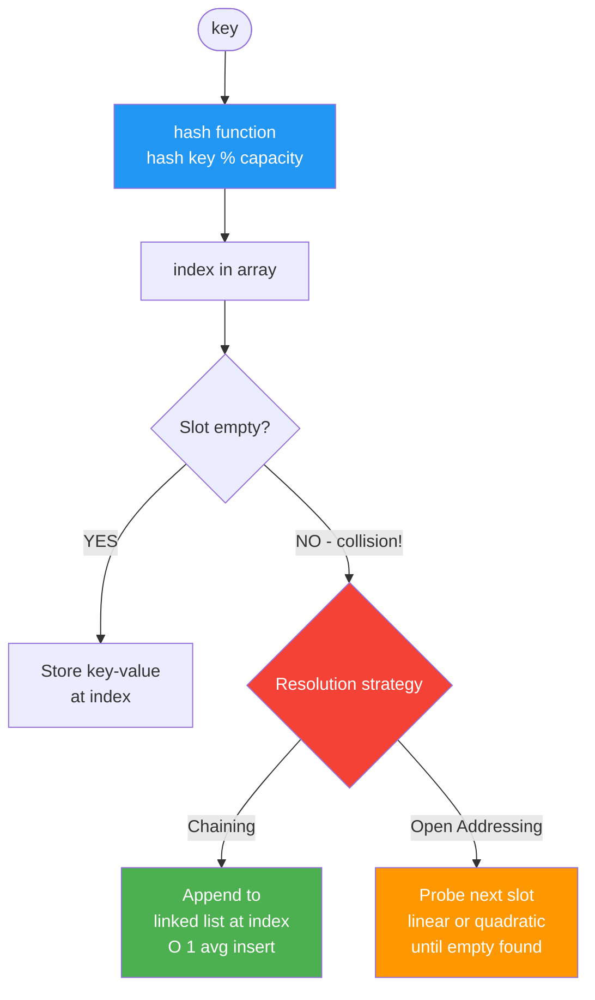

---

## 1.2 Maximum Subarray (Kadane's Algorithm)

### Q2. How do you find the contiguous subarray with the largest sum?

**Answer:**
Kadane's algorithm maintains a running sum. At each element, decide whether to extend the current subarray or start fresh from that element. Track the global maximum. Time: O(n), Space: O(1).

❌ **Wrong — recomputes every subarray, O(n²) time:**
```csharp
public int MaxSubArray(int[] nums) {
    int max = int.MinValue;
    for (int i = 0; i < nums.Length; i++) {
        int sum = 0;
        for (int j = i; j < nums.Length; j++) {
            sum += nums[j];
            max = Math.Max(max, sum);
        }
    }
    return max;
}
```

✅ **Correct — Kadane's, O(n) time:**
```csharp
public int MaxSubArray(int[] nums) {
    int maxSum = nums[0], currentSum = nums[0];
    for (int i = 1; i < nums.Length; i++) {
        currentSum = Math.Max(nums[i], currentSum + nums[i]);
        maxSum = Math.Max(maxSum, currentSum);
    }
    return maxSum;
}
```

---

## 1.3 Palindrome Check

### Q3. How do you check if a string is a palindrome efficiently?

**Answer:**
Use two pointers — one from the start, one from the end — moving inward and comparing characters. Time: O(n), Space: O(1). Avoid reversing the string unnecessarily, which creates an O(n) space copy.

❌ **Wrong — creates a reversed copy, wastes O(n) space:**
```csharp
public bool IsPalindrome(string s) {
    string reversed = new string(s.Reverse().ToArray());
    return s == reversed;
}
```

✅ **Correct — two pointer, O(1) space:**
```csharp
public bool IsPalindrome(string s) {
    int left = 0, right = s.Length - 1;
    while (left < right) {
        if (s[left] != s[right]) return false;
        left++;
        right--;
    }
    return true;
}
```

---

## 1.4 Array Rotation

### Q4. How do you rotate an array to the right by k positions in-place?

**Answer:**
The triple-reverse trick: reverse the whole array, reverse the first k elements, then reverse the rest. No extra array needed. Time: O(n), Space: O(1).

❌ **Wrong — uses O(n) extra space:**
```csharp
public void Rotate(int[] nums, int k) {
    int n = nums.Length;
    k %= n;
    int[] temp = new int[n];
    for (int i = 0; i < n; i++)
        temp[(i + k) % n] = nums[i];
    Array.Copy(temp, nums, n);
}
```

✅ **Correct — in-place triple reverse:**
```csharp
public void Rotate(int[] nums, int k) {
    k %= nums.Length;
    Reverse(nums, 0, nums.Length - 1);
    Reverse(nums, 0, k - 1);
    Reverse(nums, k, nums.Length - 1);
}

private void Reverse(int[] nums, int left, int right) {
    while (left < right) {
        (nums[left], nums[right]) = (nums[right], nums[left]);
        left++; right--;
    }
}
```

---

# 2. Linked Lists

> 📚 Reference: https://learn.microsoft.com/en-us/dotnet/api/system.collections.generic.linkedlist-1
> 📚 Visual guide: https://visualgo.net/en/list

---

## 2.1 Cycle Detection

### Q5. How do you detect a cycle in a linked list?

**Answer:**
Floyd's Cycle Detection (Tortoise and Hare): two pointers — slow moves one step, fast moves two steps. If they meet, a cycle exists. Time: O(n), Space: O(1).

❌ **Wrong — uses a HashSet, O(n) space:**
```csharp
public bool HasCycle(ListNode head) {
    var visited = new HashSet<ListNode>();
    while (head != null) {
        if (!visited.Add(head)) return true;
        head = head.next;
    }
    return false;
}
```

✅ **Correct — Floyd's two-pointer, O(1) space:**
```csharp
public bool HasCycle(ListNode head) {
    var slow = head;
    var fast = head;
    while (fast != null && fast.next != null) {
        slow = slow.next;
        fast = fast.next.next;
        if (slow == fast) return true;
    }
    return false;
}
```

---

## 2.2 Reverse a Linked List

### Q6. How do you reverse a singly linked list in-place?

**Answer:**
Iteratively maintain three pointers: `prev` (null), `current` (head), `next`. At each step save `current.next`, redirect `current.next` to `prev`, advance both. Time: O(n), Space: O(1).

❌ **Wrong — recursive approach uses O(n) call stack space:**
```csharp
public ListNode Reverse(ListNode head) {
    if (head == null || head.next == null) return head;
    var newHead = Reverse(head.next);
    head.next.next = head;
    head.next = null;
    return newHead;
}
```

✅ **Correct — iterative, O(1) space:**
```csharp
public ListNode ReverseList(ListNode head) {
    ListNode prev = null, current = head;
    while (current != null) {
        var next = current.next;
        current.next = prev;
        prev = current;
        current = next;
    }
    return prev;
}
```

---

## 2.3 Merge Two Sorted Lists

### Q7. How do you merge two sorted linked lists?

**Answer:**
Use a dummy head node to simplify edge cases. Compare the two heads, attach the smaller, advance that list's pointer. Attach any remaining list at the end. Time: O(m+n), Space: O(1).

❌ **Wrong — creates a new list with extra allocation:**
```csharp
public ListNode MergeTwoLists(ListNode l1, ListNode l2) {
    var result = new List<int>();
    while (l1 != null) { result.Add(l1.val); l1 = l1.next; }
    while (l2 != null) { result.Add(l2.val); l2 = l2.next; }
    result.Sort();
    // rebuild list from sorted array — extra O(m+n) space
    ...
}
```

✅ **Correct — in-place weave with dummy head:**
```csharp
public ListNode MergeTwoLists(ListNode l1, ListNode l2) {
    var dummy = new ListNode(0);
    var current = dummy;
    while (l1 != null && l2 != null) {
        if (l1.val <= l2.val) { current.next = l1; l1 = l1.next; }
        else { current.next = l2; l2 = l2.next; }
        current = current.next;
    }
    current.next = l1 ?? l2;
    return dummy.next;
}
```

---

# 3. Stacks & Queues

> 📚 Reference: https://learn.microsoft.com/en-us/dotnet/api/system.collections.generic.stack-1
> 📚 NeetCode: https://neetcode.io/roadmap (Stack section)

---

## 3.1 Valid Parentheses

### Q8. How do you check if a string of brackets is balanced?

**Answer:**
Use a stack. Push opening brackets. For closing brackets, check if the stack top matches. At the end, the stack must be empty. Time: O(n), Space: O(n).

❌ **Wrong — counter-based, fails on interleaved types like `"([)]"`:**
```csharp
public bool IsValid(string s) {
    int count = 0;
    foreach (char c in s) {
        if (c == '(' || c == '{' || c == '[') count++;
        else count--;
        if (count < 0) return false;
    }
    return count == 0;
}
```

✅ **Correct — stack-based, handles all bracket types:**
```csharp
public bool IsValid(string s) {
    var stack = new Stack<char>();
    foreach (char c in s) {
        if (c == '(' || c == '{' || c == '[') stack.Push(c);
        else {
            if (stack.Count == 0) return false;
            char top = stack.Pop();
            if (c == ')' && top != '(') return false;
            if (c == '}' && top != '{') return false;
            if (c == ']' && top != '[') return false;
        }
    }
    return stack.Count == 0;
}
```

---

## 3.2 Monotonic Stack — Next Greater Element

### Q9. How do you find the next greater element for each position in an array?

**Answer:**
A monotonic decreasing stack stores indices of unresolved elements. When a greater element is found, pop and record the answer for popped indices. Time: O(n), Space: O(n).

❌ **Wrong — O(n²) nested loop:**
```csharp
public int[] NextGreaterElement(int[] nums) {
    int n = nums.Length;
    int[] result = new int[n];
    for (int i = 0; i < n; i++) {
        result[i] = -1;
        for (int j = i + 1; j < n; j++) {
            if (nums[j] > nums[i]) { result[i] = nums[j]; break; }
        }
    }
    return result;
}
```

✅ **Correct — monotonic stack, O(n):**
```csharp
public int[] NextGreaterElement(int[] nums) {
    int n = nums.Length;
    int[] result = Enumerable.Repeat(-1, n).ToArray();
    var stack = new Stack<int>(); // stores indices
    for (int i = 0; i < n; i++) {
        while (stack.Count > 0 && nums[i] > nums[stack.Peek()])
            result[stack.Pop()] = nums[i];
        stack.Push(i);
    }
    return result;
}
```

---

# 4. Trees & Binary Search Trees

> 📚 Reference: https://learn.microsoft.com/en-us/dotnet/api/system.collections.generic.sorteddictionary-2
> 📚 Visualizer: https://visualgo.net/en/bst

---

## 4.1 Level-Order (BFS) Traversal

### Q10. How do you traverse a binary tree level by level?

**Answer:**
Use a queue. Enqueue the root, then for each level, process exactly `queue.Count` nodes, enqueue their children. Time: O(n), Space: O(n).

❌ **Wrong — DFS pre-order, not level-order:**
```csharp
public IList<IList<int>> LevelOrder(TreeNode root) {
    var result = new List<IList<int>>();
    void Dfs(TreeNode node) {
        if (node == null) return;
        result.Add(new List<int> { node.val }); // wrong structure
        Dfs(node.left);
        Dfs(node.right);
    }
    Dfs(root);
    return result;
}
```

✅ **Correct — BFS with queue:**
```csharp
public IList<IList<int>> LevelOrder(TreeNode root) {
    var result = new List<IList<int>>();
    if (root == null) return result;
    var queue = new Queue<TreeNode>();
    queue.Enqueue(root);
    while (queue.Count > 0) {
        int size = queue.Count;
        var level = new List<int>();
        for (int i = 0; i < size; i++) {
            var node = queue.Dequeue();
            level.Add(node.val);
            if (node.left != null) queue.Enqueue(node.left);
            if (node.right != null) queue.Enqueue(node.right);
        }
        result.Add(level);
    }
    return result;
}
```

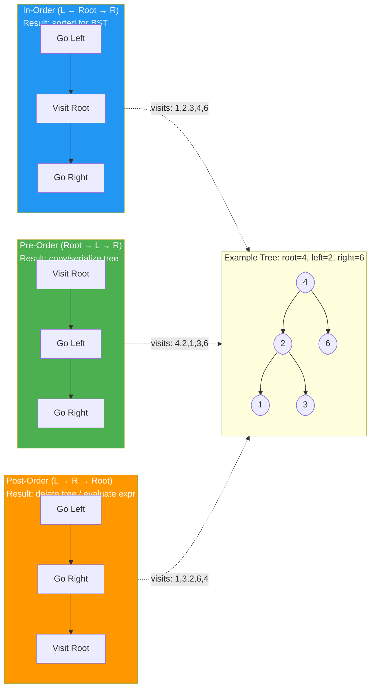

---

## 4.2 Validate Binary Search Tree

### Q11. How do you verify that a binary tree is a valid BST?

**Answer:**
Pass min/max bounds through recursion. Each node must be strictly within the bounds inherited from its ancestors. Time: O(n), Space: O(h).

❌ **Wrong — only checks immediate children, misses deeper violations:**
```csharp
public bool IsValidBST(TreeNode root) {
    if (root == null) return true;
    if (root.left != null && root.left.val >= root.val) return false;
    if (root.right != null && root.right.val <= root.val) return false;
    return IsValidBST(root.left) && IsValidBST(root.right);
    // fails for: root=5, left subtree has a node with val=6 (should be < 5)
}
```

✅ **Correct — propagates min/max bounds:**
```csharp
public bool IsValidBST(TreeNode root) => Validate(root, long.MinValue, long.MaxValue);

private bool Validate(TreeNode node, long min, long max) {
    if (node == null) return true;
    if (node.val <= min || node.val >= max) return false;
    return Validate(node.left, min, node.val) &&
           Validate(node.right, node.val, max);
}
```

---

## 4.3 Lowest Common Ancestor

### Q12. How do you find the LCA of two nodes in a BST?

**Answer:**
In a BST, if both values are less than the current node go left; if both are greater go right; otherwise the current node is the LCA. Time: O(h).

❌ **Wrong — uses a general tree approach on a BST, ignores the sorted property:**
```csharp
public TreeNode LowestCommonAncestor(TreeNode root, TreeNode p, TreeNode q) {
    if (root == null || root == p || root == q) return root;
    var left = LowestCommonAncestor(root.left, p, q);
    var right = LowestCommonAncestor(root.right, p, q);
    if (left != null && right != null) return root;
    return left ?? right;
    // works but doesn't exploit BST ordering — O(n) instead of O(h)
}
```

✅ **Correct — exploits BST ordering, O(h):**
```csharp
public TreeNode LowestCommonAncestor(TreeNode root, TreeNode p, TreeNode q) {
    while (root != null) {
        if (p.val < root.val && q.val < root.val)
            root = root.left;
        else if (p.val > root.val && q.val > root.val)
            root = root.right;
        else
            return root;
    }
    return null;
}
```

---

# 5. Graphs

> 📚 Reference: https://cp-algorithms.com/graph/bfs.html
> 📚 Visual: https://visualgo.net/en/dfsbfs

---

## 5.1 BFS Shortest Path

### Q13. How do you find the shortest path in an unweighted graph?

**Answer:**
BFS guarantees shortest path in unweighted graphs because it explores nodes level by level. Track visited nodes to avoid cycles. Time: O(V+E).

❌ **Wrong — DFS finds a path but not the shortest one:**
```csharp
public int ShortestPath(int[][] graph, int start, int end) {
    // DFS may return a longer path
    bool[] visited = new bool[graph.Length];
    int Dfs(int node, int depth) {
        if (node == end) return depth;
        visited[node] = true;
        foreach (var neighbor in graph[node])
            if (!visited[neighbor]) return Dfs(neighbor, depth + 1);
        return -1;
    }
    return Dfs(start, 0);
}
```

✅ **Correct — BFS guarantees shortest path:**
```csharp
public int ShortestPath(int[][] graph, int start, int end) {
    var visited = new bool[graph.Length];
    var queue = new Queue<(int node, int dist)>();
    queue.Enqueue((start, 0));
    visited[start] = true;
    while (queue.Count > 0) {
        var (node, dist) = queue.Dequeue();
        if (node == end) return dist;
        foreach (var neighbor in graph[node]) {
            if (!visited[neighbor]) {
                visited[neighbor] = true;
                queue.Enqueue((neighbor, dist + 1));
            }
        }
    }
    return -1;
}
```

---

## 5.2 Cycle Detection in Directed Graph

### Q14. How do you detect a cycle in a directed graph?

**Answer:**
Use DFS with three node states: 0 = unvisited, 1 = in current DFS path, 2 = fully processed. If you reach a node in state 1, a cycle exists. Time: O(V+E).

❌ **Wrong — simple visited array doesn't work for directed graphs:**
```csharp
public bool HasCycle(int n, int[][] edges) {
    var visited = new bool[n];
    bool[] adj = BuildAdj(n, edges);
    bool Dfs(int node) {
        visited[node] = true;
        foreach (var neighbor in adj[node])
            if (visited[neighbor] || Dfs(neighbor)) return true; // wrong: visited ≠ in current path
        return false;
    }
    for (int i = 0; i < n; i++)
        if (!visited[i] && Dfs(i)) return true;
    return false;
}
```

✅ **Correct — three-state DFS:**
```csharp
public bool HasCycle(int n, IList<IList<int>> adj) {
    int[] state = new int[n]; // 0=unvisited, 1=in-path, 2=done

    bool Dfs(int node) {
        state[node] = 1;
        foreach (var neighbor in adj[node]) {
            if (state[neighbor] == 1) return true;   // back edge = cycle
            if (state[neighbor] == 0 && Dfs(neighbor)) return true;
        }
        state[node] = 2;
        return false;
    }

    for (int i = 0; i < n; i++)
        if (state[i] == 0 && Dfs(i)) return true;
    return false;
}
```

---

## 5.3 Topological Sort (Kahn's Algorithm)

### Q15. How do you perform topological sort on a DAG?

**Answer:**
Kahn's algorithm: compute in-degrees, enqueue all nodes with in-degree 0, process them and reduce neighbors' in-degrees. If all nodes are processed, no cycle exists. Time: O(V+E).

❌ **Wrong — DFS post-order is correct but hard to detect cycles mid-sort:**
```csharp
// DFS post-order works but doesn't detect cycles cleanly
void Dfs(int node, bool[] visited, Stack<int> stack) {
    visited[node] = true;
    foreach (var n in adj[node])
        if (!visited[n]) Dfs(n, visited, stack);
    stack.Push(node); // added after processing children
}
```

✅ **Correct — Kahn's BFS with in-degree tracking:**
```csharp
public int[] TopologicalSort(int n, int[][] edges) {
    var adj = new List<int>[n].Select(_ => new List<int>()).ToArray();
    int[] inDegree = new int[n];
    foreach (var e in edges) { adj[e[0]].Add(e[1]); inDegree[e[1]]++; }

    var queue = new Queue<int>();
    for (int i = 0; i < n; i++) if (inDegree[i] == 0) queue.Enqueue(i);

    var order = new List<int>();
    while (queue.Count > 0) {
        int node = queue.Dequeue();
        order.Add(node);
        foreach (var neighbor in adj[node])
            if (--inDegree[neighbor] == 0) queue.Enqueue(neighbor);
    }
    return order.Count == n ? order.ToArray() : Array.Empty<int>(); // empty = cycle detected
}
```

---

# 6. Sorting & Searching

> 📚 Reference: https://learn.microsoft.com/en-us/dotnet/api/system.array.sort
> 📚 Sorting visualizer: https://visualgo.net/en/sorting

---

## 6.1 Binary Search

### Q16. How do you implement binary search correctly?

**Answer:**
Requires a sorted array. Compare target to the middle element. Halve the search space each iteration. Common bug: integer overflow when computing mid — use `left + (right - left) / 2`. Time: O(log n).

❌ **Wrong — integer overflow risk on large arrays:**
```csharp
public int BinarySearch(int[] nums, int target) {
    int left = 0, right = nums.Length - 1;
    while (left <= right) {
        int mid = (left + right) / 2; // overflow if left + right > int.MaxValue
        if (nums[mid] == target) return mid;
        if (nums[mid] < target) left = mid + 1;
        else right = mid - 1;
    }
    return -1;
}
```

✅ **Correct — overflow-safe mid calculation:**
```csharp
public int BinarySearch(int[] nums, int target) {
    int left = 0, right = nums.Length - 1;
    while (left <= right) {
        int mid = left + (right - left) / 2; // safe
        if (nums[mid] == target) return mid;
        if (nums[mid] < target) left = mid + 1;
        else right = mid - 1;
    }
    return -1;
}
```

```mermaid
flowchart TD
    START([Binary Search
Sorted Array]) --> INIT[left=0, right=len-1]
    INIT --> LOOP{left <= right?}
    LOOP -->|NO| NOTFOUND([Return -1
Not Found])
    LOOP -->|YES| MID[mid = left + right-left / 2]
    MID --> CMP{arr[mid] vs target}
    CMP -->|arr[mid] == target| FOUND([Return mid
Found!])
    CMP -->|arr[mid] < target| GORIGHT[left = mid + 1
Search right half]
    CMP -->|arr[mid] > target| GOLEFT[right = mid - 1
Search left half]
    GORIGHT --> LOOP
    GOLEFT --> LOOP

    style FOUND fill:#4CAF50,color:#fff
    style NOTFOUND fill:#f44336,color:#fff
    style MID fill:#2196F3,color:#fff
```

---

## 6.2 Quick Sort

### Q17. How does Quick Sort work and what is its weakness?

**Answer:**
Quick Sort picks a pivot, partitions elements smaller/larger around it, and recurses. Average O(n log n). Worst case O(n²) when the pivot is always the min/max (already sorted array). Mitigated by random pivot selection.

❌ **Wrong — always picks first element as pivot, O(n²) on sorted input:**
```csharp
void QuickSort(int[] arr, int low, int high) {
    if (low < high) {
        int pivot = arr[low]; // bad choice on sorted arrays
        int i = low + 1;
        for (int j = low + 1; j <= high; j++)
            if (arr[j] < pivot) { Swap(arr, i, j); i++; }
        Swap(arr, low, i - 1);
        QuickSort(arr, low, i - 2);
        QuickSort(arr, i, high);
    }
}
```

✅ **Correct — randomized pivot to avoid worst case:**
```csharp
private Random _rand = new Random();

void QuickSort(int[] arr, int low, int high) {
    if (low < high) {
        int pivotIdx = _rand.Next(low, high + 1);
        Swap(arr, pivotIdx, high); // move pivot to end
        int pivot = arr[high];
        int i = low - 1;
        for (int j = low; j < high; j++)
            if (arr[j] <= pivot) { i++; Swap(arr, i, j); }
        Swap(arr, i + 1, high);
        int pi = i + 1;
        QuickSort(arr, low, pi - 1);
        QuickSort(arr, pi + 1, high);
    }
}
```

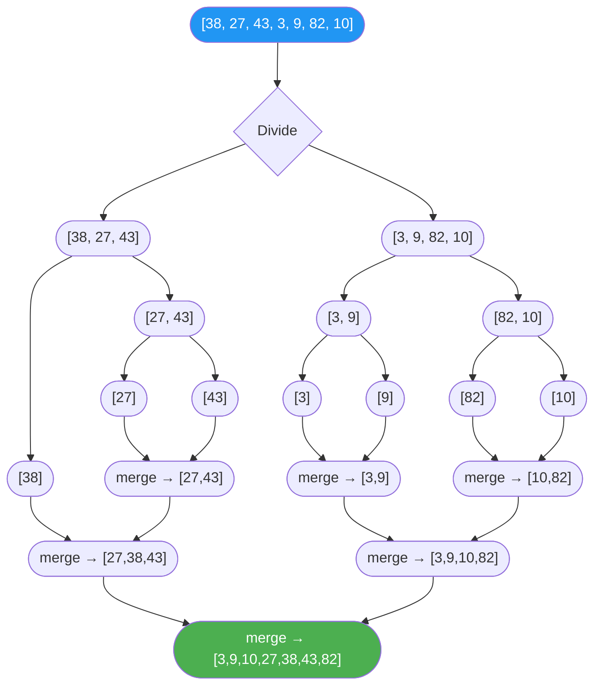

---

# 7. Dynamic Programming

> 📚 Reference: https://leetcode.com/explore/learn/card/dynamic-programming/
> 📚 Patterns: https://leetcode.com/discuss/general-discussion/458695/dynamic-programming-patterns

---

## 7.1 Fibonacci — Memoization vs Tabulation

### Q18. What is the difference between top-down (memoization) and bottom-up (tabulation) DP?

**Answer:**
Memoization is recursive with a cache — compute subproblems only when needed. Tabulation is iterative — fill a table from base cases up. Tabulation avoids stack overflow and is usually more space-efficient.

❌ **Wrong — naive recursion, exponential O(2^n) time:**
```csharp
public int Fib(int n) {
    if (n <= 1) return n;
    return Fib(n - 1) + Fib(n - 2); // recomputes same values repeatedly
}
```

✅ **Correct — tabulation, O(n) time, O(1) space:**
```csharp
public int Fib(int n) {
    if (n <= 1) return n;
    int prev2 = 0, prev1 = 1;
    for (int i = 2; i <= n; i++) {
        int curr = prev1 + prev2;
        prev2 = prev1;
        prev1 = curr;
    }
    return prev1;
}
```

---

## 7.2 0/1 Knapsack

### Q19. How do you solve the 0/1 Knapsack problem?

**Answer:**
`dp[w]` = max value achievable with capacity `w`. Iterate items outer, capacity inner (reverse to avoid using item twice). Time: O(n×W), Space: O(W).

❌ **Wrong — forward inner loop allows using same item multiple times (unbounded knapsack):**
```csharp
for (int i = 0; i < n; i++)
    for (int w = weights[i]; w <= capacity; w++) // forward = unbounded
        dp[w] = Math.Max(dp[w], dp[w - weights[i]] + values[i]);
```

✅ **Correct — reverse inner loop for 0/1 constraint:**
```csharp
public int Knapsack(int[] weights, int[] values, int capacity) {
    int n = weights.Length;
    int[] dp = new int[capacity + 1];
    for (int i = 0; i < n; i++)
        for (int w = capacity; w >= weights[i]; w--) // reverse = use each item at most once
            dp[w] = Math.Max(dp[w], dp[w - weights[i]] + values[i]);
    return dp[capacity];
}
```

---

## 7.3 Coin Change

### Q20. How do you find the minimum number of coins to reach a target amount?

**Answer:**
Bottom-up DP: `dp[i]` = min coins for amount `i`. For each amount, try each coin. Initialize to infinity, `dp[0] = 0`. Time: O(amount × coins).

❌ **Wrong — greedy fails for non-standard denominations (e.g., coins = [1,3,4], amount = 6, greedy gives 3 coins, optimal is 2):**
```csharp
public int CoinChange(int[] coins, int amount) {
    Array.Sort(coins, (a, b) => b - a); // sort descending
    int count = 0;
    foreach (int coin in coins) {
        count += amount / coin;
        amount %= coin;
    }
    return amount == 0 ? count : -1;
}
```

✅ **Correct — bottom-up DP:**
```csharp
public int CoinChange(int[] coins, int amount) {
    int[] dp = new int[amount + 1];
    Array.Fill(dp, amount + 1); // use amount+1 as "infinity"
    dp[0] = 0;
    for (int i = 1; i <= amount; i++)
        foreach (int coin in coins)
            if (coin <= i)
                dp[i] = Math.Min(dp[i], dp[i - coin] + 1);
    return dp[amount] > amount ? -1 : dp[amount];
}
```

---

# 8. Two Pointers & Sliding Window

> 📚 Reference: https://leetcode.com/explore/learn/card/array-and-string/205/array-two-pointer-technique/
> 📚 Patterns: https://medium.com/leetcode-patterns/leetcode-pattern-2-sliding-windows-for-strings-e19af105316b

---

## 8.1 Longest Substring Without Repeating Characters

### Q21. How do you find the longest substring without repeating characters?

**Answer:**
Sliding window with a HashSet. Expand right; if duplicate found, shrink from left until duplicate is removed. Track max window size. Time: O(n).

❌ **Wrong — O(n²) substring generation:**
```csharp
public int LengthOfLongestSubstring(string s) {
    int max = 0;
    for (int i = 0; i < s.Length; i++) {
        var seen = new HashSet<char>();
        for (int j = i; j < s.Length; j++) {
            if (!seen.Add(s[j])) break;
            max = Math.Max(max, j - i + 1);
        }
    }
    return max;
}
```

✅ **Correct — O(n) sliding window:**
```csharp
public int LengthOfLongestSubstring(string s) {
    var set = new HashSet<char>();
    int left = 0, maxLen = 0;
    for (int right = 0; right < s.Length; right++) {
        while (set.Contains(s[right]))
            set.Remove(s[left++]);
        set.Add(s[right]);
        maxLen = Math.Max(maxLen, right - left + 1);
    }
    return maxLen;
}
```

---

# 9. Recursion & Backtracking

> 📚 Reference: https://leetcode.com/explore/learn/card/recursion-ii/470/divide-and-conquer/
> 📚 Patterns: https://medium.com/leetcode-patterns/leetcode-pattern-3-backtracking-4d7e7a0ef93

---

## 9.1 Generate All Subsets

### Q22. How do you generate all subsets (power set) of an array?

**Answer:**
Backtracking: at each index, include or exclude the element and recurse. Time: O(2^n × n), Space: O(n) recursion depth.

❌ **Wrong — bit manipulation works but is harder to read and extend (e.g., for subset sum constraints):**
```csharp
public IList<IList<int>> Subsets(int[] nums) {
    int n = nums.Length;
    var result = new List<IList<int>>();
    for (int mask = 0; mask < (1 << n); mask++) {
        var subset = new List<int>();
        for (int i = 0; i < n; i++)
            if ((mask & (1 << i)) != 0) subset.Add(nums[i]);
        result.Add(subset);
    }
    return result; // correct but inflexible for variants
}
```

✅ **Correct — backtracking, easily extended to handle constraints:**
```csharp
public IList<IList<int>> Subsets(int[] nums) {
    var result = new List<IList<int>>();
    Backtrack(nums, 0, new List<int>(), result);
    return result;
}

private void Backtrack(int[] nums, int start, List<int> current, IList<IList<int>> result) {
    result.Add(new List<int>(current)); // add a copy of current subset
    for (int i = start; i < nums.Length; i++) {
        current.Add(nums[i]);
        Backtrack(nums, i + 1, current, result);
        current.RemoveAt(current.Count - 1); // undo choice
    }
}
```

---

# 10. Complexity Analysis

> 📚 Reference: https://www.bigocheatsheet.com/
> 📚 Reference: https://learn.microsoft.com/en-us/dotnet/standard/collections/selecting-a-collection-class

---

## 10.1 Big O Notation

### Q23. What is Big O notation and how do you analyze time complexity?

**Answer:**
Big O describes the upper bound on an algorithm's growth rate as input size n grows. Drop constants and lower-order terms. Analyze loops: single loop = O(n), nested loops = O(n²), halving each iteration = O(log n), halving with inner loop = O(n log n).

❌ **Wrong — incorrectly states O(n²) for this code due to not analyzing carefully:**
```csharp
// Is this O(n²)?
for (int i = 0; i < n; i++)           // O(n)
    for (int j = i; j < n; j++)       // O(n-i) — still O(n²) total iterations
        Console.Write(arr[i] + arr[j]);
// Total pairs: n(n+1)/2 → O(n²) ✓ — but easy to misread as O(n log n)
```

✅ **Correct — identifying the pattern for common complexities:**
```
O(1)        — array index, hash map lookup (avg)
O(log n)    — binary search, BST operation (balanced)
O(n)        — single loop, linear scan
O(n log n)  — merge sort, heap sort, efficient sort
O(n²)       — nested loops over same input
O(2^n)      — subsets, many backtracking problems
O(n!)       — all permutations
```

---

## 10.2 Amortized Analysis

### Q24. What does amortized O(1) mean? Give an example.

**Answer:**
Amortized analysis averages the cost over a sequence of operations. A `List<T>` has amortized O(1) `Add` — most adds are O(1), but occasional doubling resizes are O(n). Spread over n adds, the total work is O(n), so average is O(1) per add.

❌ **Wrong — using `LinkedList<T>` when `List<T>` amortized append is sufficient:**
```csharp
// LinkedList has O(1) append but O(n) index access and poor cache locality
var list = new LinkedList<int>();
for (int i = 0; i < n; i++) list.AddLast(i);
int val = list.ElementAt(500); // O(n) traversal to index
```

✅ **Correct — `List<T>` for sequential append + index access:**
```csharp
var list = new List<int>();
for (int i = 0; i < n; i++) list.Add(i); // amortized O(1) per add
int val = list[500]; // O(1) index access
```

---

# 11. Heap & Priority Queue

> 📚 Reference: https://learn.microsoft.com/en-us/dotnet/api/system.collections.generic.priorityqueue-2
> 📚 Patterns: https://leetcode.com/explore/learn/card/heap/

---

## 11.1 K Largest / K Smallest Elements

### Q25. How do you find the K largest elements in an array efficiently?

**Answer:**
Use a min-heap of size K. Iterate the array: push each element; if heap size exceeds K, pop the minimum. After processing, the heap contains the K largest. Time: O(n log K), Space: O(K). Far better than sorting the entire array O(n log n) when K << n.

❌ **Wrong — sort the entire array just to get top K:**
```csharp
public int[] TopKElements(int[] nums, int k) {
    Array.Sort(nums, (a, b) => b - a); // O(n log n) — overkill for small K
    return nums.Take(k).ToArray();
}
```

✅ **Correct — min-heap of size K, O(n log K):**
```csharp
public int[] TopKElements(int[] nums, int k) {
    // PriorityQueue is a min-heap by default in .NET
    var minHeap = new PriorityQueue<int, int>();
    foreach (int num in nums) {
        minHeap.Enqueue(num, num);
        if (minHeap.Count > k) minHeap.Dequeue(); // remove smallest
    }
    return minHeap.UnorderedItems.Select(x => x.Element).ToArray();
}
```

---

## 11.2 Merge K Sorted Lists

### Q26. How do you merge K sorted linked lists efficiently?

**Answer:**
Use a min-heap seeded with the head of each list. Pop the minimum, add it to the result, then push the next node from that list. Time: O(N log K) where N = total nodes, K = number of lists.

❌ **Wrong — collect all values, sort, rebuild list — O(N log N) + O(N) space:**
```csharp
public ListNode MergeKLists(ListNode[] lists) {
    var all = new List<int>();
    foreach (var l in lists) { var n = l; while (n != null) { all.Add(n.val); n = n.next; } }
    all.Sort();
    var dummy = new ListNode(0); var cur = dummy;
    foreach (var v in all) { cur.next = new ListNode(v); cur = cur.next; }
    return dummy.next;
}
```

✅ **Correct — min-heap on list heads, O(N log K):**
```csharp
public ListNode MergeKLists(ListNode[] lists) {
    var heap = new PriorityQueue<ListNode, int>();
    foreach (var node in lists)
        if (node != null) heap.Enqueue(node, node.val);

    var dummy = new ListNode(0);
    var cur = dummy;
    while (heap.Count > 0) {
        var node = heap.Dequeue();
        cur.next = node;
        cur = cur.next;
        if (node.next != null) heap.Enqueue(node.next, node.next.val);
    }
    return dummy.next;
}
```

---

## 11.3 K Closest Points to Origin

### Q27. How do you find the K closest points to the origin?

**Answer:**
Use a max-heap of size K keyed by distance. When the heap exceeds K, evict the farthest point — leaving only the K closest. No need to compute actual square root (compare distance² to avoid floating point).

❌ **Wrong — sort all points by distance, O(n log n):**
```csharp
public int[][] KClosest(int[][] points, int k) {
    return points.OrderBy(p => p[0] * p[0] + p[1] * p[1]).Take(k).ToArray();
}
```

✅ **Correct — max-heap of size K, O(n log K):**
```csharp
public int[][] KClosest(int[][] points, int k) {
    // max-heap: negate distance so PriorityQueue (min-heap) acts as max-heap
    var maxHeap = new PriorityQueue<int[], int>();
    foreach (var p in points) {
        int dist = p[0] * p[0] + p[1] * p[1];
        maxHeap.Enqueue(p, -dist);       // negative = largest distance first
        if (maxHeap.Count > k) maxHeap.Dequeue(); // remove farthest
    }
    return maxHeap.UnorderedItems.Select(x => x.Element).ToArray();
}
```

---

# 12. Trie (Prefix Tree)

> 📚 Reference: https://leetcode.com/explore/learn/card/trie/
> 📚 Use cases: autocomplete, spell-check, IP routing

---

## 12.1 Implement a Trie

### Q28. How do you implement a Trie and what are its use cases?

**Answer:**
A Trie is a tree where each node represents a character. Used for prefix search, autocomplete, dictionary lookups. Insert and search are O(L) where L = word length, independent of dictionary size. Space: O(total characters across all words).

❌ **Wrong — using a sorted list of strings for prefix search:**
```csharp
public class AutoComplete {
    private List<string> _words = new();
    public void Insert(string word) => _words.Add(word);
    public List<string> StartsWith(string prefix) =>
        _words.Where(w => w.StartsWith(prefix)).ToList(); // O(n × L) per query
}
```

✅ **Correct — Trie with O(L) insert and search:**
```csharp
public class TrieNode {
    public Dictionary<char, TrieNode> Children = new();
    public bool IsEndOfWord = false;
}

public class Trie {
    private readonly TrieNode _root = new();

    public void Insert(string word) {
        var node = _root;
        foreach (char c in word) {
            if (!node.Children.ContainsKey(c))
                node.Children[c] = new TrieNode();
            node = node.Children[c];
        }
        node.IsEndOfWord = true;
    }

    public bool Search(string word) {
        var node = _root;
        foreach (char c in word) {
            if (!node.Children.ContainsKey(c)) return false;
            node = node.Children[c];
        }
        return node.IsEndOfWord;
    }

    public bool StartsWith(string prefix) {
        var node = _root;
        foreach (char c in prefix) {
            if (!node.Children.ContainsKey(c)) return false;
            node = node.Children[c];
        }
        return true; // prefix exists
    }
}
```

---

## 12.2 Word Search II (Trie + DFS)

### Q29. How do you find all words from a dictionary that exist in a character board?

**Answer:**
Build a Trie from the word list. DFS from every cell on the board, following valid Trie paths. This prunes the search space — if no word starts with the current path prefix, stop exploring. Time: O(M × N × 4^L) but with aggressive pruning via Trie.

❌ **Wrong — run separate DFS for every word in the dictionary:**
```csharp
// For each of W words, run a separate DFS over the entire M×N board
// O(W × M × N × 4^L) — extremely slow for large dictionaries
foreach (var word in words)
    if (Exists(board, word)) result.Add(word);
```

✅ **Correct — single DFS pass guided by Trie:**
```csharp
public IList<string> FindWords(char[][] board, string[] words) {
    var trie = new Trie();
    foreach (var w in words) trie.Insert(w);

    var result = new HashSet<string>();
    int m = board.Length, n = board[0].Length;
    var visited = new bool[m, n];

    void Dfs(int r, int c, TrieNode node, StringBuilder path) {
        if (r < 0 || r >= m || c < 0 || c >= n || visited[r, c]) return;
        char ch = board[r][c];
        if (!node.Children.ContainsKey(ch)) return; // prune — no word with this prefix

        node = node.Children[ch];
        path.Append(ch);
        if (node.IsEndOfWord) result.Add(path.ToString());

        visited[r, c] = true;
        Dfs(r+1,c,node,path); Dfs(r-1,c,node,path);
        Dfs(r,c+1,node,path); Dfs(r,c-1,node,path);
        visited[r, c] = false;
        path.Remove(path.Length - 1, 1);
    }

    for (int i = 0; i < m; i++)
        for (int j = 0; j < n; j++)
            Dfs(i, j, trie.Root, new StringBuilder());

    return result.ToList();
}
```

---

# 13. Matrix / 2D Grid Problems

> 📚 Reference: https://leetcode.com/explore/learn/card/queue-and-stack/
> 📚 Patterns: flood fill, multi-source BFS, island counting

---

## 13.1 Number of Islands

### Q30. How do you count connected regions (islands) in a grid?

**Answer:**
DFS or BFS from each unvisited land cell, marking all connected cells as visited. Each DFS call from a new unvisited land cell = one island. Time: O(M×N), Space: O(M×N) recursion stack.

❌ **Wrong — count cells without marking visited, causing infinite loops:**
```csharp
public int NumIslands(char[][] grid) {
    int count = 0;
    for (int r = 0; r < grid.Length; r++)
        for (int c = 0; c < grid[0].Length; c++)
            if (grid[r][c] == '1') { count++; DFS(grid, r, c); }
    return count;

    void DFS(char[][] g, int r, int c) {
        if (r<0||r>=g.Length||c<0||c>=g[0].Length||g[r][c]!='1') return;
        // Missing: mark as visited before recursing → infinite loop on adjacent cells
        DFS(g,r+1,c); DFS(g,r-1,c); DFS(g,r,c+1); DFS(g,r,c-1);
    }
}
```

✅ **Correct — mark visited by overwriting cell:**
```csharp
public int NumIslands(char[][] grid) {
    int count = 0;
    for (int r = 0; r < grid.Length; r++)
        for (int c = 0; c < grid[0].Length; c++)
            if (grid[r][c] == '1') { DFS(grid, r, c); count++; }
    return count;
}

private void DFS(char[][] grid, int r, int c) {
    if (r < 0 || r >= grid.Length || c < 0 || c >= grid[0].Length || grid[r][c] != '1') return;
    grid[r][c] = '0'; // mark visited — avoids extra visited array
    DFS(grid, r+1, c); DFS(grid, r-1, c);
    DFS(grid, r, c+1); DFS(grid, r, c-1);
}
```

---

## 13.2 Shortest Path in Matrix (Multi-Source BFS)

### Q31. How do you find the nearest zero for each cell in a binary matrix?

**Answer:**
Multi-source BFS: enqueue ALL zero cells simultaneously as the starting layer. BFS naturally propagates distances outward level by level. Time: O(M×N).

❌ **Wrong — run BFS separately from each zero cell:**
```csharp
// For each '0' cell, run its own BFS to fill distances — O(M²×N²)
for (int r = 0; r < m; r++)
    for (int c = 0; c < n; c++)
        if (mat[r][c] == 0) BfsFromCell(r, c, dist);
```

✅ **Correct — single multi-source BFS:**
```csharp
public int[][] UpdateMatrix(int[][] mat) {
    int m = mat.Length, n = mat[0].Length;
    int[][] dist = new int[m][];
    for (int i = 0; i < m; i++) dist[i] = Enumerable.Repeat(int.MaxValue, n).ToArray();

    var queue = new Queue<(int r, int c)>();
    for (int r = 0; r < m; r++)
        for (int c = 0; c < n; c++)
            if (mat[r][c] == 0) { dist[r][c] = 0; queue.Enqueue((r, c)); }

    int[][] dirs = { new[]{1,0}, new[]{-1,0}, new[]{0,1}, new[]{0,-1} };
    while (queue.Count > 0) {
        var (r, c) = queue.Dequeue();
        foreach (var d in dirs) {
            int nr = r + d[0], nc = c + d[1];
            if (nr >= 0 && nr < m && nc >= 0 && nc < n && dist[nr][nc] > dist[r][c] + 1) {
                dist[nr][nc] = dist[r][c] + 1;
                queue.Enqueue((nr, nc));
            }
        }
    }
    return dist;
}
```

---

# 14. Merge Intervals

> 📚 Reference: https://leetcode.com/problems/merge-intervals/
> 📚 Pattern: sort + linear scan

---

## 14.1 Merge Overlapping Intervals

### Q32. How do you merge all overlapping intervals?

**Answer:**
Sort by start time. Iterate: if the current interval overlaps with the last merged interval (current.start ≤ last.end), extend the last interval's end. Otherwise add a new interval. Time: O(n log n) for sort, O(n) for merge pass.

❌ **Wrong — nested loop comparison, O(n²):**
```csharp
public int[][] Merge(int[][] intervals) {
    var result = new List<int[]>();
    foreach (var iv in intervals) {
        bool merged = false;
        foreach (var r in result) {
            if (iv[0] <= r[1] && iv[1] >= r[0]) { // overlap check
                r[0] = Math.Min(r[0], iv[0]);
                r[1] = Math.Max(r[1], iv[1]);
                merged = true; break;
            }
        }
        if (!merged) result.Add(iv);
    }
    return result.ToArray(); // incorrect for chains of overlaps
}
```

✅ **Correct — sort then linear merge:**
```csharp
public int[][] Merge(int[][] intervals) {
    Array.Sort(intervals, (a, b) => a[0] - b[0]); // sort by start
    var result = new List<int[]> { intervals[0] };

    for (int i = 1; i < intervals.Length; i++) {
        var last = result[^1];
        if (intervals[i][0] <= last[1])               // overlaps
            last[1] = Math.Max(last[1], intervals[i][1]); // extend
        else
            result.Add(intervals[i]);                 // no overlap → new interval
    }
    return result.ToArray();
}
```

---

## 14.2 Meeting Rooms — Can Attend All?

### Q33. How do you check if a person can attend all meetings (no overlaps)?

**Answer:**
Sort intervals by start. Check if any adjacent pair overlaps (next.start < current.end). Time: O(n log n).

❌ **Wrong — check all pairs, O(n²):**
```csharp
for (int i = 0; i < intervals.Length; i++)
    for (int j = i + 1; j < intervals.Length; j++)
        if (intervals[i][1] > intervals[j][0]) return false;
```

✅ **Correct — sort and check adjacent pairs:**
```csharp
public bool CanAttendMeetings(int[][] intervals) {
    Array.Sort(intervals, (a, b) => a[0] - b[0]);
    for (int i = 1; i < intervals.Length; i++)
        if (intervals[i][0] < intervals[i-1][1]) return false;
    return true;
}
```

---

## 14.3 Minimum Meeting Rooms Required

### Q34. How do you find the minimum number of meeting rooms needed?

**Answer:**
Separate start and end times into sorted arrays. Use two pointers: if the next meeting starts before the earliest ending meeting, we need a new room. Otherwise reuse the room. The answer is the maximum simultaneous overlap. Time: O(n log n).

❌ **Wrong — use a list and scan for a free room each time, O(n²):**
```csharp
// Track end times of rooms, scan all for the earliest free — O(n²)
```

✅ **Correct — sorted start/end times with two pointers:**
```csharp
public int MinMeetingRooms(int[][] intervals) {
    int n = intervals.Length;
    int[] starts = intervals.Select(i => i[0]).OrderBy(x=>x).ToArray();
    int[] ends   = intervals.Select(i => i[1]).OrderBy(x=>x).ToArray();

    int rooms = 0, maxRooms = 0, e = 0;
    for (int s = 0; s < n; s++) {
        if (starts[s] < ends[e]) rooms++;  // new meeting starts before any ends
        else { rooms--; e++; }             // reuse a room that just ended
        maxRooms = Math.Max(maxRooms, rooms);
    }
    return maxRooms;
}
```

---

# 15. Union-Find (Disjoint Set Union)

> 📚 Reference: https://cp-algorithms.com/data_structures/disjoint_set_union.html
> 📚 Used in: Kruskal's MST, cycle detection, number of connected components

---

## 15.1 Implement Union-Find

### Q35. How do you implement Union-Find with path compression and union by rank?

**Answer:**
`find` returns the root of a node's component (with path compression — flattens the tree). `union` merges two components by attaching the smaller-rank tree under the larger one. Both operations are effectively O(1) amortized (inverse Ackermann time).

❌ **Wrong — no path compression or union by rank, degenerates to O(n) per operation:**
```csharp
public class UnionFind {
    private int[] parent;
    public UnionFind(int n) { parent = Enumerable.Range(0, n).ToArray(); }
    public int Find(int x) {
        while (parent[x] != x) x = parent[x]; // no path compression — O(n) depth
        return x;
    }
    public void Union(int x, int y) { parent[Find(x)] = Find(y); } // no rank — chain grows
}
```

✅ **Correct — path compression + union by rank:**
```csharp
public class UnionFind {
    private int[] parent, rank;

    public UnionFind(int n) {
        parent = Enumerable.Range(0, n).ToArray();
        rank = new int[n];
    }

    public int Find(int x) {
        if (parent[x] != x)
            parent[x] = Find(parent[x]); // path compression: flatten to root
        return parent[x];
    }

    public bool Union(int x, int y) {
        int rx = Find(x), ry = Find(y);
        if (rx == ry) return false; // already connected
        if (rank[rx] < rank[ry]) (rx, ry) = (ry, rx);
        parent[ry] = rx;            // attach smaller tree under larger
        if (rank[rx] == rank[ry]) rank[rx]++;
        return true;
    }

    public bool Connected(int x, int y) => Find(x) == Find(y);
}
```

---

## 15.2 Number of Connected Components

### Q36. How do you find the number of connected components in an undirected graph?

**Answer:**
Use Union-Find: initialize n components. For each edge, union the two nodes — if they weren't already connected, decrement the component count. Final count = number of components.

❌ **Wrong — DFS from every unvisited node works but uses O(V+E) space for adjacency list:**
```csharp
// DFS is correct but Union-Find is more elegant and efficient for this pattern
int count = 0;
bool[] visited = new bool[n];
foreach (var start in Enumerable.Range(0, n))
    if (!visited[start]) { DFS(start); count++; }
```

✅ **Correct — Union-Find with component counter:**
```csharp
public int CountComponents(int n, int[][] edges) {
    var uf = new UnionFind(n);
    int components = n;
    foreach (var e in edges)
        if (uf.Union(e[0], e[1])) components--; // merge reduces component count
    return components;
}
```

---

# 16. Bit Manipulation

> 📚 Reference: https://learn.microsoft.com/en-us/dotnet/csharp/language-reference/operators/bitwise-and-shift-operators
> 📚 Tricks: https://graphics.stanford.edu/~seander/bithacks.html

---

## 16.1 Single Number (XOR Trick)

### Q37. How do you find the element that appears once when all others appear twice?

**Answer:**
XOR all numbers. Since `a ^ a = 0` and `a ^ 0 = a`, pairs cancel out and only the single element remains. Time: O(n), Space: O(1).

❌ **Wrong — uses a HashSet, O(n) space:**
```csharp
public int SingleNumber(int[] nums) {
    var set = new HashSet<int>();
    foreach (int n in nums)
        if (!set.Add(n)) set.Remove(n); // toggle
    return set.First(); // O(n) space
}
```

✅ **Correct — XOR, O(1) space:**
```csharp
public int SingleNumber(int[] nums) {
    int result = 0;
    foreach (int n in nums) result ^= n; // all pairs cancel, only single remains
    return result;
}
```

---

## 16.2 Count Set Bits (Brian Kernighan's Algorithm)

### Q38. How do you count the number of 1 bits in an integer?

**Answer:**
Brian Kernighan: `n & (n-1)` clears the lowest set bit. Count iterations until n becomes 0. Time: O(number of set bits) — faster than checking all 32 bits.

❌ **Wrong — checks every bit position, always 32 iterations:**
```csharp
public int HammingWeight(uint n) {
    int count = 0;
    while (n != 0) {
        count += (int)(n & 1); // check rightmost bit
        n >>= 1;               // always 32 iterations
    }
    return count;
}
```

✅ **Correct — Brian Kernighan, O(set bits):**
```csharp
public int HammingWeight(uint n) {
    int count = 0;
    while (n != 0) {
        n &= (n - 1); // clears the lowest set bit
        count++;
    }
    return count;
}
```

---

## 16.3 Power of Two Check

### Q39. How do you check if a number is a power of two using bit manipulation?

**Answer:**
A power of two has exactly one set bit. `n & (n-1)` clears the lowest set bit — for a power of two this produces 0. Also handle the edge case n ≤ 0.

❌ **Wrong — loop dividing by 2, misses edge cases:**
```csharp
public bool IsPowerOfTwo(int n) {
    while (n > 1) n /= 2;
    return n == 1; // O(log n) and doesn't handle 0 or negatives cleanly
}
```

✅ **Correct — single bitwise operation:**
```csharp
public bool IsPowerOfTwo(int n) => n > 0 && (n & (n - 1)) == 0;
```

---

# 17. Greedy Algorithms

> 📚 Reference: https://cp-algorithms.com/greedy/
> 📚 Patterns: make locally optimal choice at each step

---

## 17.1 Jump Game

### Q40. How do you determine if you can reach the last index in a jump game?

**Answer:**
Track the maximum reachable index as you walk forward. If you're ever at a position beyond the max reachable, you're stuck. Time: O(n), Space: O(1).

❌ **Wrong — BFS/DFS explores all paths, O(n²) or O(2^n):**
```csharp
// Recursive: try every possible jump from each position
bool CanJump(int[] nums, int pos) {
    if (pos >= nums.Length - 1) return true;
    for (int jump = 1; jump <= nums[pos]; jump++)
        if (CanJump(nums, pos + jump)) return true;
    return false; // exponential without memoization
}
```

✅ **Correct — greedy, track max reach:**
```csharp
public bool CanJump(int[] nums) {
    int maxReach = 0;
    for (int i = 0; i < nums.Length; i++) {
        if (i > maxReach) return false; // can't reach this position
        maxReach = Math.Max(maxReach, i + nums[i]);
    }
    return true;
}
```

---

## 17.2 Gas Station (Circular Route)

### Q41. How do you find the starting gas station from which you can complete a circular route?

**Answer:**
If total gas ≥ total cost, a solution exists. The starting point is the station after the last point where the running tank went negative. Time: O(n), Space: O(1).

❌ **Wrong — try every starting station, O(n²):**
```csharp
for (int start = 0; start < n; start++) {
    int tank = 0; bool ok = true;
    for (int i = 0; i < n; i++) {
        tank += gas[(start+i)%n] - cost[(start+i)%n];
        if (tank < 0) { ok = false; break; }
    }
    if (ok) return start;
}
```

✅ **Correct — single pass greedy:**
```csharp
public int CanCompleteCircuit(int[] gas, int[] cost) {
    int totalTank = 0, currentTank = 0, start = 0;
    for (int i = 0; i < gas.Length; i++) {
        int diff = gas[i] - cost[i];
        totalTank += diff;
        currentTank += diff;
        if (currentTank < 0) { start = i + 1; currentTank = 0; } // reset start
    }
    return totalTank >= 0 ? start : -1;
}
```

---

# 18. Binary Search on Answer

> 📚 Reference: https://leetcode.com/explore/learn/card/binary-search/
> 📚 Pattern: "minimize the maximum" or "find the smallest value satisfying a condition"

---

## 18.1 Search in Rotated Sorted Array

### Q42. How do you search a rotated sorted array in O(log n)?

**Answer:**
At every midpoint, one half is always sorted. Determine which half, then check if the target falls in that half. Narrow the search to the relevant half.

❌ **Wrong — linear scan, ignores sorted property:**
```csharp
public int Search(int[] nums, int target) {
    for (int i = 0; i < nums.Length; i++)
        if (nums[i] == target) return i;
    return -1; // O(n)
}
```

✅ **Correct — modified binary search, O(log n):**
```csharp
public int Search(int[] nums, int target) {
    int left = 0, right = nums.Length - 1;
    while (left <= right) {
        int mid = left + (right - left) / 2;
        if (nums[mid] == target) return mid;

        if (nums[left] <= nums[mid]) {          // left half is sorted
            if (target >= nums[left] && target < nums[mid]) right = mid - 1;
            else left = mid + 1;
        } else {                                // right half is sorted
            if (target > nums[mid] && target <= nums[right]) left = mid + 1;
            else right = mid - 1;
        }
    }
    return -1;
}
```

---

## 18.2 Koko Eating Bananas (Binary Search on Answer)

### Q43. How do you apply binary search when the answer itself is a range?

**Answer:**
Binary search on the speed K: for a given K, can Koko finish in H hours? The answer space is [1, max_pile]. Find the minimum K where the condition holds. Time: O(n log(max_pile)).

❌ **Wrong — linear scan through all possible speeds, O(n × max_pile):**
```csharp
for (int k = 1; k <= piles.Max(); k++)
    if (CanFinish(piles, k, h)) return k;
```

✅ **Correct — binary search on the answer space:**
```csharp
public int MinEatingSpeed(int[] piles, int h) {
    int left = 1, right = piles.Max();
    while (left < right) {
        int mid = left + (right - left) / 2;
        if (CanFinish(piles, mid, h)) right = mid; // mid works, try smaller
        else left = mid + 1;
    }
    return left;
}

private bool CanFinish(int[] piles, int speed, int h) {
    int hours = 0;
    foreach (int pile in piles)
        hours += (int)Math.Ceiling((double)pile / speed);
    return hours <= h;
}
```

---

# 19. String Problems

> 📚 Reference: https://leetcode.com/explore/learn/card/array-and-string/
> 📚 Patterns: sliding window, hashing, two pointers for strings

---

## 19.1 Group Anagrams

### Q44. How do you group strings that are anagrams of each other?

**Answer:**
For each string, compute a canonical key (either sorted characters, or a 26-length frequency count string). Group by key. Time: O(n × L log L) with sort key, or O(n × L) with frequency key.

❌ **Wrong — compare every pair, O(n² × L log L):**
```csharp
// Compare all pairs to find anagrams — nested loops
for (int i = 0; i < strs.Length; i++)
    for (int j = i+1; j < strs.Length; j++)
        if (AreAnagrams(strs[i], strs[j])) /* group them */;
```

✅ **Correct — hash by character frequency, O(n × L):**
```csharp
public IList<IList<string>> GroupAnagrams(string[] strs) {
    var groups = new Dictionary<string, List<string>>();
    foreach (var s in strs) {
        var key = GetKey(s);
        if (!groups.ContainsKey(key)) groups[key] = new List<string>();
        groups[key].Add(s);
    }
    return groups.Values.Cast<IList<string>>().ToList();
}

private string GetKey(string s) {
    var count = new int[26];
    foreach (char c in s) count[c - 'a']++;
    return string.Join(",", count); // e.g., "1,0,0,...,1,..." — unique per anagram group
}
```

---

## 19.2 Minimum Window Substring

### Q45. How do you find the smallest window in s containing all characters of t?

**Answer:**
Sliding window with two frequency maps. Expand right until window is valid (contains all of t). Then shrink from left to find the minimum valid window. Track how many required characters are satisfied. Time: O(|s| + |t|).

❌ **Wrong — generate all substrings and check each, O(n² × m):**
```csharp
for (int i = 0; i < s.Length; i++)
    for (int j = i; j <= s.Length; j++)
        if (ContainsAll(s.Substring(i, j-i), t)) UpdateMin(...);
```

✅ **Correct — sliding window with satisfied-count tracking:**
```csharp
public string MinWindow(string s, string t) {
    var need = new Dictionary<char, int>();
    foreach (char c in t) need[c] = need.GetValueOrDefault(c) + 1;

    int left = 0, minLen = int.MaxValue, minStart = 0;
    int have = 0, required = need.Count;
    var window = new Dictionary<char, int>();

    for (int right = 0; right < s.Length; right++) {
        char c = s[right];
        window[c] = window.GetValueOrDefault(c) + 1;
        if (need.ContainsKey(c) && window[c] == need[c]) have++; // this char is satisfied

        while (have == required) { // window is valid — try to shrink
            if (right - left + 1 < minLen) { minLen = right - left + 1; minStart = left; }
            char lc = s[left++];
            window[lc]--;
            if (need.ContainsKey(lc) && window[lc] < need[lc]) have--;
        }
    }
    return minLen == int.MaxValue ? "" : s.Substring(minStart, minLen);
}
```

---

## 19.3 Valid Anagram

### Q46. How do you check if two strings are anagrams?

**Answer:**
Count character frequencies in one string, then subtract for the other. If all counts reach zero, they're anagrams. Time: O(n), Space: O(1) — bounded by alphabet size (26 lowercase letters).

❌ **Wrong — sort both strings, O(n log n) time and O(n) space:**
```csharp
public bool IsAnagram(string s, string t) {
    return s.OrderBy(c => c).SequenceEqual(t.OrderBy(c => c)); // O(n log n)
}
```

✅ **Correct — frequency count, O(n):**
```csharp
public bool IsAnagram(string s, string t) {
    if (s.Length != t.Length) return false;
    int[] count = new int[26];
    for (int i = 0; i < s.Length; i++) {
        count[s[i] - 'a']++;
        count[t[i] - 'a']--;
    }
    return count.All(c => c == 0);
}
```

---

# ⚖️ DSA Comparisons — Side-by-Side Differences

---

## DSA-C1 — Array vs LinkedList vs ArrayList

| | Array | `List<T>` (dynamic array) | `LinkedList<T>` |
|-|-------|--------------------------|-----------------|
| Random access | O(1) | O(1) | O(n) |
| Insert at end | O(1) amortised | O(1) amortised | O(1) |
| Insert at middle | O(n) shift | O(n) shift | O(1) with node ref |
| Memory layout | Contiguous | Contiguous | Scattered (nodes + pointers) |
| Cache efficiency | ✅ Excellent | ✅ Good | ❌ Poor |
| Fixed vs dynamic size | Fixed | Dynamic | Dynamic |

**Rule:** Use `List<T>` (dynamic array) almost always. `LinkedList<T>` only when you have a reference to a node and need O(1) insert/delete at that position.

---

## DSA-C2 — Stack vs Queue vs Deque

| | Stack (LIFO) | Queue (FIFO) | Deque (both ends) |
|-|-------------|-------------|-------------------|
| Add | Push (top) | Enqueue (back) | AddFirst / AddLast |
| Remove | Pop (top) | Dequeue (front) | RemoveFirst / RemoveLast |
| Peek | Peek (top) | Peek (front) | PeekFirst / PeekLast |
| Use for | DFS, undo/redo, call stack | BFS, task queues | Sliding window, monotonic deque |

```csharp
var stack = new Stack<int>();
stack.Push(1); stack.Push(2);
stack.Pop();   // 2 (LIFO)

var queue = new Queue<int>();
queue.Enqueue(1); queue.Enqueue(2);
queue.Dequeue(); // 1 (FIFO)

var deque = new LinkedList<int>(); // .NET deque
deque.AddFirst(1); deque.AddLast(2);
deque.RemoveFirst(); // 1
```

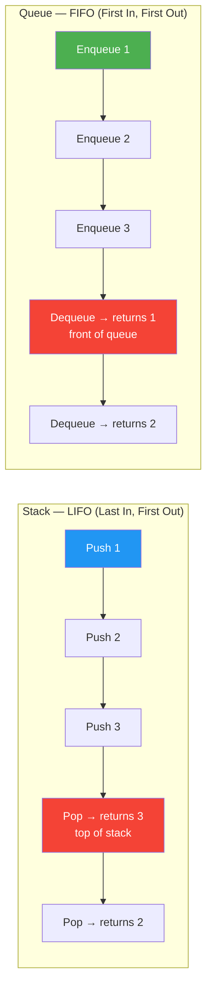

---

## DSA-C3 — BFS vs DFS

| | BFS (Breadth-First) | DFS (Depth-First) |
|-|--------------------|-------------------|
| Data structure | Queue | Stack (or recursion) |
| Finds shortest path | ✅ Yes (unweighted) | ❌ No |
| Memory (wide graph) | ❌ High (stores entire level) | ✅ Low (path depth) |
| Memory (deep graph) | ✅ Low | ❌ High (stack overflow risk) |
| Use for | Shortest path, level-order, nearest node | Cycle detection, topological sort, backtracking, maze solving |
| Completeness | ✅ Always finds solution | ✅ (iterative), ❌ (recursive on infinite graphs) |

```csharp
// BFS — Level-order, uses Queue
void BFS(int start, int[][] adj)
{
    var visited = new HashSet<int> { start };
    var queue   = new Queue<int>(new[] { start });
    while (queue.Count > 0)
    {
        var node = queue.Dequeue();
        foreach (var neighbor in adj[node])
            if (visited.Add(neighbor)) queue.Enqueue(neighbor);
    }
}

// DFS — Uses Stack (iterative) or recursion
void DFS(int node, bool[] visited, int[][] adj)
{
    visited[node] = true;
    foreach (var neighbor in adj[node])
        if (!visited[neighbor]) DFS(neighbor, visited, adj);
}
```

---

## DSA-C4 — QuickSort vs MergeSort vs HeapSort

| | QuickSort | MergeSort | HeapSort |
|-|----------|-----------|----------|
| Average time | O(n log n) | O(n log n) | O(n log n) |
| Worst case | O(n²) pivot issues | O(n log n) | O(n log n) |
| Space | O(log n) in-place | O(n) extra | O(1) in-place |
| Stable | ❌ Not stable | ✅ Stable | ❌ Not stable |
| Cache perf | ✅ Excellent | ❌ Poor (scattered) | ❌ Poor |
| Use for | General purpose (in-place) | Need stable sort / linked list | Guaranteed O(n log n), no extra space |

**Rule:** .NET's `Array.Sort` uses IntroSort (QuickSort + HeapSort fallback for worst case). Use `OrderBy` for stable LINQ sorts (TimSort).

---

## DSA-C5 — HashMap vs TreeMap vs LinkedHashMap (C# equivalents)

| | `Dictionary<K,V>` (HashMap) | `SortedDictionary<K,V>` (TreeMap) | `SortedList<K,V>` |
|-|-----------------------------|----------------------------------|-------------------|
| Order | ❌ Unordered | ✅ Sorted by key | ✅ Sorted by key |
| Lookup | O(1) average | O(log n) | O(log n) |
| Insert | O(1) average | O(log n) | O(n) (array shift) |
| Use for | Fast lookup, no order needed | Range queries, ordered iteration | Memory-efficient sorted list |

```csharp
// Dictionary — O(1), no order
var dict = new Dictionary<string, int> { ["b"] = 2, ["a"] = 1 };
// Iteration order: unpredictable

// SortedDictionary — O(log n), always sorted
var sorted = new SortedDictionary<string, int> { ["b"] = 2, ["a"] = 1 };
// Iteration order: a, b (sorted)
```

---

## DSA-C6 — Binary Search Tree vs Heap vs Hash Table

| | BST | Heap (Min/Max) | Hash Table |
|-|-----|----------------|------------|
| Find min/max | O(log n) | O(1) | O(n) |
| Search arbitrary | O(log n) balanced | O(n) | O(1) average |
| Insert | O(log n) | O(log n) | O(1) average |
| Delete | O(log n) | O(log n) | O(1) average |
| Ordered traversal | ✅ In-order = sorted | ❌ | ❌ |
| Use for | Sorted data, range queries | Priority queue, top-K | Fast lookup |

---

## DSA-C7 — Dynamic Programming vs Greedy vs Backtracking

| | DP | Greedy | Backtracking |
|-|----|---------|----|
| Approach | Optimal substructure + memo | Local optimal choice | Exhaustive search + prune |
| Correctness | ✅ Always optimal | ✅ Sometimes (not always) | ✅ Always finds solution |
| Time complexity | Polynomial (usually) | Fast (usually O(n)) | Exponential (worst case) |
| Use for | Longest subsequence, knapsack, coin change | Activity selection, Dijkstra, Huffman | N-Queens, Sudoku, permutations |

```csharp
// DP — coin change: O(amount × coins)
int CoinChange(int[] coins, int amount)
{
    var dp = new int[amount + 1];
    Array.Fill(dp, int.MaxValue);
    dp[0] = 0;
    for (int i = 1; i <= amount; i++)
        foreach (var c in coins)
            if (c <= i && dp[i - c] != int.MaxValue)
                dp[i] = Math.Min(dp[i], dp[i - c] + 1);
    return dp[amount] == int.MaxValue ? -1 : dp[amount];
}

// Greedy — coin change only works for standard denominations (e.g., US coins)
// Fails for denominations like [1,3,4] with amount=6
// (Greedy: 4+1+1=3 coins, DP: 3+3=2 coins)
```

---

## DSA-C8 — Two Pointers vs Sliding Window vs Binary Search

| | Two Pointers | Sliding Window | Binary Search |
|-|-------------|----------------|---------------|
| Input | Sorted array or string | Array / string | Sorted array |
| Pointer movement | Both move inward or same-direction | Window expands/contracts | Halves search space |
| Use for | Pair sum, three sum, palindrome | Max subarray, longest substring | Find element, first/last occurrence, answer search |
| Time | O(n) | O(n) | O(log n) |

```csharp
// Two Pointers — pair sum in sorted array
bool HasPairSum(int[] arr, int target)
{
    int l = 0, r = arr.Length - 1;
    while (l < r)
    {
        int sum = arr[l] + arr[r];
        if (sum == target) return true;
        if (sum < target) l++; else r--;
    }
    return false;
}

// Sliding Window — longest substring without repeat
int LengthOfLongestSubstring(string s)
{
    var seen = new Dictionary<char, int>();
    int max = 0, left = 0;
    for (int right = 0; right < s.Length; right++)
    {
        if (seen.TryGetValue(s[right], out int prev) && prev >= left)
            left = prev + 1;
        seen[s[right]] = right;
        max = Math.Max(max, right - left + 1);
    }
    return max;
}
```


---

# 📊 DSA Flow Diagrams — Visual Reference

---

## DSA-D1 — Binary Search Tree Operations

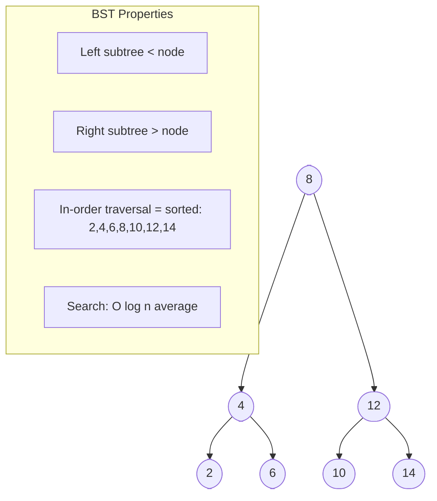

---

## DSA-D2 — BFS vs DFS Traversal Order

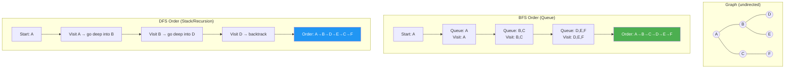

---

## DSA-D3 — Sorting Algorithm Comparison

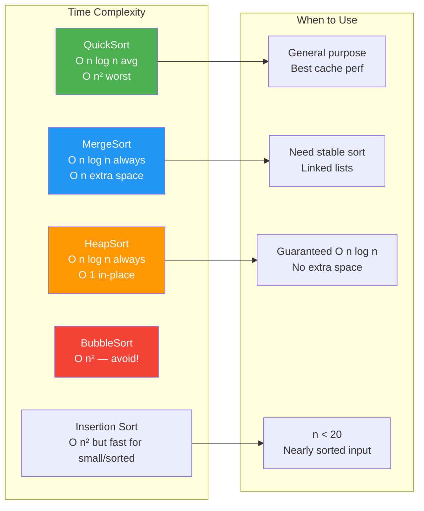

---

## DSA-D4 — Dynamic Programming vs Greedy Decision

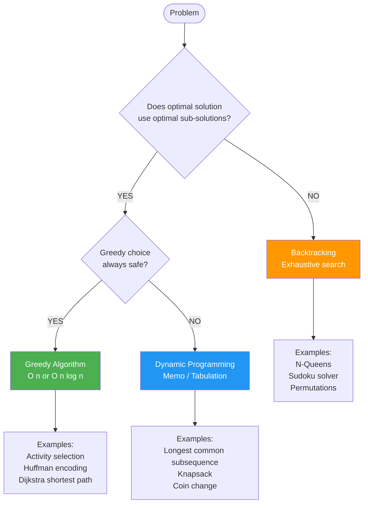

---

## DSA-D5 — Two Pointers Pattern

```mermaid
flowchart LR
    subgraph Inward["Pair Sum in Sorted Array\nTwo pointers moving inward"]
        ARR1["[1, 3, 5, 7, 9]  target=10"]
        L1[L=0 ①] --> CHECK1{arr[L]+arr[R]\n= 1+9 = 10 ✅}
        R1[R=4 ⑨] --> CHECK1
        CHECK1 -->|found!| ANS1[Return indices 0,4]
    end

    subgraph Same["Sliding Window\nTwo pointers same direction"]
        ARR2["abcabcbb  — longest without repeat"]
        L2[L=0] --> WIN[window expands right]
        R2[R moves right] --> WIN
        WIN --> SHRINK[When duplicate found\nL moves right to shrink]
        SHRINK --> MAX[Track max window size]
    end

    style ANS1 fill:#4CAF50,color:#fff
    style MAX fill:#2196F3,color:#fff
```

---

## DSA-D6 — Big O Complexity Chart

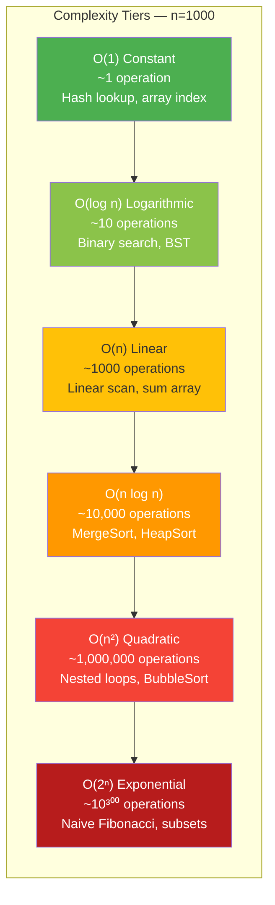

---

# 🏢 FAANG DSA Patterns & Problems

> 10 core patterns used repeatedly at Google, Amazon, Meta, Apple, Netflix — with C# templates, complexity analysis, example problems, and Mermaid diagrams.

---

## Pattern 1: Sliding Window

### Why this pattern?
When you need to track a contiguous subarray or substring that satisfies a condition, sliding window avoids recomputing from scratch on each step. Both pointers only move forward → O(n) instead of O(n²).

### Fixed vs Variable Window

| | Fixed Window | Variable Window |
|-|-------------|-----------------|
| Window size | Constant K | Shrinks/expands based on condition |
| Pointer movement | Right advances, left = right - K | Both advance independently |
| Use for | Max sum of size K, moving average | Longest/shortest valid substring |

### C# Template

```csharp
// Fixed window — max sum subarray of size K
public int MaxSumSubarrayK(int[] nums, int k)
{
    int windowSum = nums[..k].Sum(); // initial window
    int maxSum = windowSum;

    for (int i = k; i < nums.Length; i++)
    {
        windowSum += nums[i] - nums[i - k]; // slide: add right, remove left
        maxSum = Math.Max(maxSum, windowSum);
    }
    return maxSum;
    // Time: O(n), Space: O(1)
}

// Variable window — longest substring without repeating chars
public int LongestUniqueSubstring(string s)
{
    var seen = new HashSet<char>();
    int left = 0, maxLen = 0;

    for (int right = 0; right < s.Length; right++)
    {
        while (seen.Contains(s[right]))
            seen.Remove(s[left++]); // shrink from left until valid

        seen.Add(s[right]);
        maxLen = Math.Max(maxLen, right - left + 1);
    }
    return maxLen;
    // Time: O(n), Space: O(min(n, alphabet))
}
```

### Example Problems

| Problem | Window Type | Key Idea | Time |
|---------|------------|----------|------|
| Maximum sum subarray of size K | Fixed | Subtract left, add right | O(n) |
| Longest substring without repeating chars | Variable | Shrink on duplicate | O(n) |
| Minimum window substring | Variable | Shrink when all chars satisfied | O(n) |

---

## Pattern 2: Two Pointers

### Why this pattern?
Two pointers eliminate the need for nested loops when the array is sorted or when you need pairs/triplets satisfying a condition.

### Same Direction vs Opposite Direction

| | Same Direction | Opposite Direction |
|-|---------------|-------------------|
| Start positions | Both at left (or fast/slow) | One at each end |
| Use for | Remove duplicates, Floyd's cycle | Pair sum, palindrome, 3Sum |
| Example | Remove duplicates in-place | Two Sum (sorted array) |

### C# Template

```csharp
// Opposite direction — Two Sum in sorted array
public int[] TwoSumSorted(int[] nums, int target)
{
    int left = 0, right = nums.Length - 1;
    while (left < right)
    {
        int sum = nums[left] + nums[right];
        if (sum == target) return new[] { left, right };
        if (sum < target) left++;   // need larger sum
        else right--;               // need smaller sum
    }
    return Array.Empty<int>();
    // Time: O(n), Space: O(1)
}

// 3Sum — fix one element, two-pointer for the rest
public IList<IList<int>> ThreeSum(int[] nums)
{
    Array.Sort(nums);
    var result = new List<IList<int>>();

    for (int i = 0; i < nums.Length - 2; i++)
    {
        if (i > 0 && nums[i] == nums[i - 1]) continue; // skip duplicates

        int left = i + 1, right = nums.Length - 1;
        while (left < right)
        {
            int sum = nums[i] + nums[left] + nums[right];
            if (sum == 0)
            {
                result.Add(new List<int> { nums[i], nums[left], nums[right] });
                while (left < right && nums[left] == nums[left + 1]) left++;
                while (left < right && nums[right] == nums[right - 1]) right--;
                left++; right--;
            }
            else if (sum < 0) left++;
            else right--;
        }
    }
    return result;
    // Time: O(n²), Space: O(1) excluding output
}

// Remove duplicates in-place (same direction)
public int RemoveDuplicates(int[] nums)
{
    int slow = 0;
    for (int fast = 1; fast < nums.Length; fast++)
        if (nums[fast] != nums[slow]) nums[++slow] = nums[fast];
    return slow + 1;
    // Time: O(n), Space: O(1)
}
```

### When to use Two Pointers vs Sliding Window
```
Two Pointers: pair/triplet problems, sorted arrays, palindrome check
Sliding Window: contiguous subarray problems, substring conditions
Both: O(n), avoid nested loops — but different pointer movement patterns
```

---

## Pattern 3: Fast & Slow Pointers (Floyd's Cycle)

### Why this pattern?
Two pointers at different speeds — if there's a cycle, the fast pointer will lap the slow pointer. Works in O(1) space where a HashSet would use O(n).

### C# Template

```csharp
// Cycle detection in linked list
public bool HasCycle(ListNode head)
{
    var slow = head;
    var fast = head;
    while (fast?.next != null)
    {
        slow = slow!.next;
        fast = fast.next.next;
        if (slow == fast) return true; // cycle detected
    }
    return false;
    // Time: O(n), Space: O(1)
}

// Find middle of linked list
public ListNode FindMiddle(ListNode head)
{
    var slow = head;
    var fast = head;
    while (fast?.next != null)
    {
        slow = slow!.next;
        fast = fast.next.next;
    }
    return slow!; // slow is at middle when fast reaches end
    // Time: O(n), Space: O(1)
}

// Happy number (detect cycle in number sequence)
public bool IsHappy(int n)
{
    int slow = n, fast = n;
    do
    {
        slow = SumOfSquares(slow);
        fast = SumOfSquares(SumOfSquares(fast));
    } while (slow != fast);

    return slow == 1; // cycle at 1 = happy; cycle elsewhere = not happy

    static int SumOfSquares(int x)
    {
        int sum = 0;
        while (x > 0) { int d = x % 10; sum += d * d; x /= 10; }
        return sum;
    }
    // Time: O(log n), Space: O(1)
}
```

---

## Pattern 4: Merge Intervals

### Why this pattern?
After sorting by start time, overlapping intervals can be merged in a single linear pass. Used in calendar scheduling, resource allocation, and range-based queries.

### Algorithm Flowchart

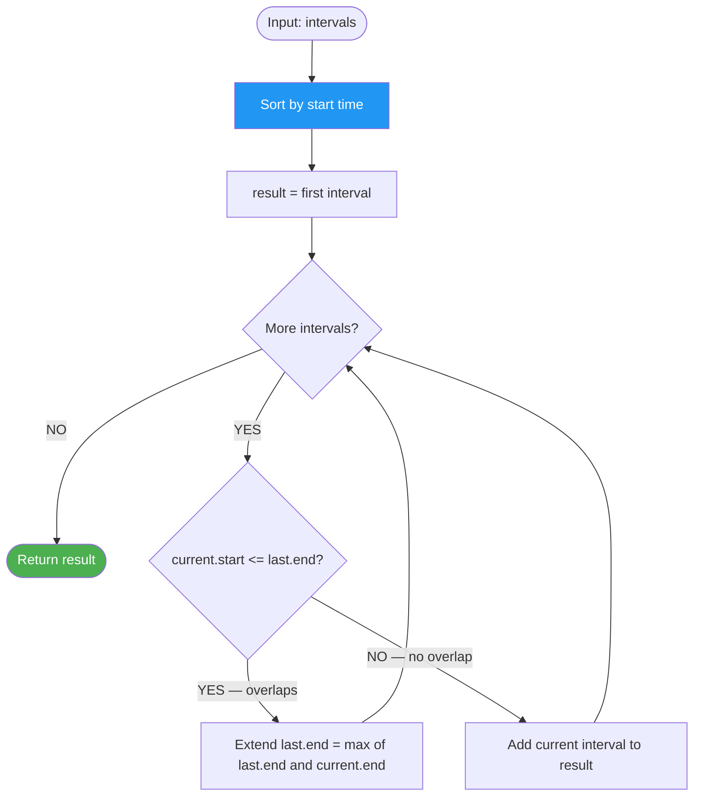

### C# Template

```csharp
// Merge overlapping intervals
public int[][] MergeIntervals(int[][] intervals)
{
    Array.Sort(intervals, (a, b) => a[0] - b[0]); // sort by start
    var result = new List<int[]> { intervals[0] };

    foreach (var interval in intervals.Skip(1))
    {
        var last = result[^1];
        if (interval[0] <= last[1])
            last[1] = Math.Max(last[1], interval[1]); // merge: extend end
        else
            result.Add(interval); // no overlap: add as new
    }
    return result.ToArray();
    // Time: O(n log n), Space: O(n)
}

// Insert interval into sorted non-overlapping list
public int[][] InsertInterval(int[][] intervals, int[] newInterval)
{
    var result = new List<int[]>();
    int i = 0;

    // Add all intervals that end before newInterval starts
    while (i < intervals.Length && intervals[i][1] < newInterval[0])
        result.Add(intervals[i++]);

    // Merge all overlapping intervals
    while (i < intervals.Length && intervals[i][0] <= newInterval[1])
    {
        newInterval[0] = Math.Min(newInterval[0], intervals[i][0]);
        newInterval[1] = Math.Max(newInterval[1], intervals[i][1]);
        i++;
    }
    result.Add(newInterval);

    // Add remaining
    while (i < intervals.Length) result.Add(intervals[i++]);
    return result.ToArray();
    // Time: O(n), Space: O(n)
}
```

---

## Pattern 5: Binary Search Variations

### Why this pattern?
Any time the search space is monotonic (sorted array, or answer space with a monotonic predicate), binary search halves it in O(log n).

### C# Templates

```csharp
// Standard binary search
public int BinarySearch(int[] nums, int target)
{
    int left = 0, right = nums.Length - 1;
    while (left <= right)
    {
        int mid = left + (right - left) / 2;
        if (nums[mid] == target) return mid;
        if (nums[mid] < target) left = mid + 1;
        else right = mid - 1;
    }
    return -1;
    // Time: O(log n), Space: O(1)
}

// Find FIRST position of target (left boundary)
public int FirstPosition(int[] nums, int target)
{
    int left = 0, right = nums.Length - 1, result = -1;
    while (left <= right)
    {
        int mid = left + (right - left) / 2;
        if (nums[mid] == target) { result = mid; right = mid - 1; } // keep searching left
        else if (nums[mid] < target) left = mid + 1;
        else right = mid - 1;
    }
    return result;
}

// Find LAST position (right boundary)
public int LastPosition(int[] nums, int target)
{
    int left = 0, right = nums.Length - 1, result = -1;
    while (left <= right)
    {
        int mid = left + (right - left) / 2;
        if (nums[mid] == target) { result = mid; left = mid + 1; } // keep searching right
        else if (nums[mid] < target) left = mid + 1;
        else right = mid - 1;
    }
    return result;
}

// Search in rotated sorted array
public int SearchRotated(int[] nums, int target)
{
    int left = 0, right = nums.Length - 1;
    while (left <= right)
    {
        int mid = left + (right - left) / 2;
        if (nums[mid] == target) return mid;
        if (nums[left] <= nums[mid]) // left half sorted
        {
            if (target >= nums[left] && target < nums[mid]) right = mid - 1;
            else left = mid + 1;
        }
        else // right half sorted
        {
            if (target > nums[mid] && target <= nums[right]) left = mid + 1;
            else right = mid - 1;
        }
    }
    return -1;
    // Time: O(log n), Space: O(1)
}

// Binary search on ANSWER (not array) — find minimum speed to finish in H hours
public int MinEatingSpeed(int[] piles, int h)
{
    int left = 1, right = piles.Max();
    while (left < right)
    {
        int mid = left + (right - left) / 2;
        int hours = piles.Sum(p => (int)Math.Ceiling((double)p / mid));
        if (hours <= h) right = mid; // mid works, try smaller
        else left = mid + 1;
    }
    return left;
    // Time: O(n log maxPile), Space: O(1)
}
```

---

## Pattern 6: Tree BFS (Level Order)

### Why this pattern?
BFS with a queue processes a tree level by level. Essential for: level-order traversal, zigzag traversal, right-side view, minimum depth, and any problem where distance from root matters.

### C# Generic Template

```csharp
// Generic level-order BFS template
public IList<IList<int>> LevelOrder(TreeNode root)
{
    var result = new List<IList<int>>();
    if (root == null) return result;

    var queue = new Queue<TreeNode>();
    queue.Enqueue(root);

    while (queue.Count > 0)
    {
        int levelSize = queue.Count; // snapshot: process exactly this many nodes
        var level = new List<int>();

        for (int i = 0; i < levelSize; i++)
        {
            var node = queue.Dequeue();
            level.Add(node.val);
            if (node.left != null) queue.Enqueue(node.left);
            if (node.right != null) queue.Enqueue(node.right);
        }
        result.Add(level);
    }
    return result;
    // Time: O(n), Space: O(n) — max queue size = widest level
}

// Zigzag level order (alternate left-to-right and right-to-left)
public IList<IList<int>> ZigzagLevelOrder(TreeNode root)
{
    var result = new List<IList<int>>();
    if (root == null) return result;

    var queue = new Queue<TreeNode>();
    queue.Enqueue(root);
    bool leftToRight = true;

    while (queue.Count > 0)
    {
        int size = queue.Count;
        var level = new int[size];
        for (int i = 0; i < size; i++)
        {
            var node = queue.Dequeue();
            int idx = leftToRight ? i : size - 1 - i; // direction determines index
            level[idx] = node.val;
            if (node.left != null) queue.Enqueue(node.left);
            if (node.right != null) queue.Enqueue(node.right);
        }
        result.Add(level);
        leftToRight = !leftToRight;
    }
    return result;
}

// Right side view — last node at each level
public IList<int> RightSideView(TreeNode root)
{
    var result = new List<int>();
    if (root == null) return result;

    var queue = new Queue<TreeNode>();
    queue.Enqueue(root);

    while (queue.Count > 0)
    {
        int size = queue.Count;
        for (int i = 0; i < size; i++)
        {
            var node = queue.Dequeue();
            if (i == size - 1) result.Add(node.val); // last node = rightmost visible
            if (node.left != null) queue.Enqueue(node.left);
            if (node.right != null) queue.Enqueue(node.right);
        }
    }
    return result;
}
```

---

## Pattern 7: Tree DFS Patterns

### Why this pattern?
DFS naturally follows the tree's recursive structure. Pre/in/post order determines when you process the current node relative to its children. Most tree problems (path sum, LCA, diameter) reduce to a single DFS pass.

### C# Templates

```csharp
// Pre-order (Root → Left → Right) — serialise, copy tree
void PreOrder(TreeNode node, List<int> result)
{
    if (node == null) return;
    result.Add(node.val);       // process BEFORE children
    PreOrder(node.left, result);
    PreOrder(node.right, result);
}

// In-order (Left → Root → Right) — sorted output for BST
void InOrder(TreeNode node, List<int> result)
{
    if (node == null) return;
    InOrder(node.left, result);
    result.Add(node.val);       // process BETWEEN children
    InOrder(node.right, result);
}

// Post-order (Left → Right → Root) — delete tree, evaluate expression
void PostOrder(TreeNode node, List<int> result)
{
    if (node == null) return;
    PostOrder(node.left, result);
    PostOrder(node.right, result);
    result.Add(node.val);       // process AFTER children
}

// Path sum — does any root-to-leaf path sum to target?
public bool HasPathSum(TreeNode root, int targetSum)
{
    if (root == null) return false;
    if (root.left == null && root.right == null) return root.val == targetSum; // leaf
    return HasPathSum(root.left, targetSum - root.val) ||
           HasPathSum(root.right, targetSum - root.val);
    // Time: O(n), Space: O(h)
}

// Diameter of binary tree — longest path between any two nodes
public int DiameterOfBinaryTree(TreeNode root)
{
    int maxDiameter = 0;

    int Depth(TreeNode node)
    {
        if (node == null) return 0;
        int left = Depth(node.left);
        int right = Depth(node.right);
        maxDiameter = Math.Max(maxDiameter, left + right); // path through current node
        return Math.Max(left, right) + 1;
    }

    Depth(root);
    return maxDiameter;
    // Time: O(n), Space: O(h)
}

// Lowest Common Ancestor (general binary tree, not BST)
public TreeNode LCA(TreeNode root, TreeNode p, TreeNode q)
{
    if (root == null || root == p || root == q) return root;
    var left = LCA(root.left, p, q);
    var right = LCA(root.right, p, q);
    if (left != null && right != null) return root; // p and q in different subtrees
    return left ?? right; // both in same subtree
    // Time: O(n), Space: O(h)
}
```

---

## Pattern 8: Dynamic Programming Patterns

### Why this pattern?
DP solves problems with overlapping subproblems and optimal substructure. Identify the state, transition, base case, and whether 1D or 2D table is needed.

### 1D DP Templates

```csharp
// Climbing stairs — number of ways to reach step n (1 or 2 steps at a time)
public int ClimbStairs(int n)
{
    if (n <= 2) return n;
    int prev2 = 1, prev1 = 2;
    for (int i = 3; i <= n; i++)
    {
        int curr = prev1 + prev2; // ways(n) = ways(n-1) + ways(n-2)
        prev2 = prev1; prev1 = curr;
    }
    return prev1;
    // Time: O(n), Space: O(1)
}

// House robber — max sum with no two adjacent elements
public int Rob(int[] nums)
{
    int prev2 = 0, prev1 = 0;
    foreach (int num in nums)
    {
        int curr = Math.Max(prev1, prev2 + num); // rob current or skip
        prev2 = prev1; prev1 = curr;
    }
    return prev1;
    // Time: O(n), Space: O(1)
}

// Coin change — minimum coins to make amount
public int CoinChange(int[] coins, int amount)
{
    int[] dp = new int[amount + 1];
    Array.Fill(dp, amount + 1); // ∞ sentinel
    dp[0] = 0;
    for (int i = 1; i <= amount; i++)
        foreach (int coin in coins)
            if (coin <= i) dp[i] = Math.Min(dp[i], dp[i - coin] + 1);
    return dp[amount] > amount ? -1 : dp[amount];
    // Time: O(amount × coins), Space: O(amount)
}
```

### 2D DP Templates

```csharp
// Unique paths — grid navigation, only right/down moves
public int UniquePaths(int m, int n)
{
    var dp = new int[m, n];
    for (int i = 0; i < m; i++) dp[i, 0] = 1; // first column
    for (int j = 0; j < n; j++) dp[0, j] = 1; // first row
    for (int i = 1; i < m; i++)
        for (int j = 1; j < n; j++)
            dp[i, j] = dp[i - 1, j] + dp[i, j - 1]; // from above + from left
    return dp[m - 1, n - 1];
    // Time: O(m×n), Space: O(m×n) → can be optimised to O(n)
}

// Edit distance (Levenshtein) — min operations to transform word1 → word2
public int EditDistance(string word1, string word2)
{
    int m = word1.Length, n = word2.Length;
    var dp = new int[m + 1, n + 1];
    for (int i = 0; i <= m; i++) dp[i, 0] = i; // delete all chars of word1
    for (int j = 0; j <= n; j++) dp[0, j] = j; // insert all chars of word2

    for (int i = 1; i <= m; i++)
        for (int j = 1; j <= n; j++)
            dp[i, j] = word1[i - 1] == word2[j - 1]
                ? dp[i - 1, j - 1]                                // no operation needed
                : 1 + Math.Min(dp[i - 1, j - 1],                  // replace
                      Math.Min(dp[i - 1, j], dp[i, j - 1]));      // delete, insert
    return dp[m, n];
    // Time: O(m×n), Space: O(m×n)
}

// Longest Common Subsequence
public int LCS(string text1, string text2)
{
    int m = text1.Length, n = text2.Length;
    var dp = new int[m + 1, n + 1];
    for (int i = 1; i <= m; i++)
        for (int j = 1; j <= n; j++)
            dp[i, j] = text1[i - 1] == text2[j - 1]
                ? dp[i - 1, j - 1] + 1
                : Math.Max(dp[i - 1, j], dp[i, j - 1]);
    return dp[m, n];
    // Time: O(m×n), Space: O(m×n)
}
```

### 0/1 Knapsack Template

```csharp
// 0/1 Knapsack — each item used at most once
public int Knapsack(int[] weights, int[] values, int capacity)
{
    int n = weights.Length;
    int[] dp = new int[capacity + 1]; // 1D optimisation

    for (int i = 0; i < n; i++)
        for (int w = capacity; w >= weights[i]; w--) // REVERSE to enforce 0/1
            dp[w] = Math.Max(dp[w], dp[w - weights[i]] + values[i]);

    return dp[capacity];
    // Time: O(n×capacity), Space: O(capacity)
    // FORWARD inner loop = unbounded knapsack (items reused)
    // REVERSE inner loop = 0/1 knapsack (each item once)
}
```

---

## Pattern 9: Graph Algorithms

### Why this pattern?
Graph problems appear as explicit graphs or disguised grids/matrices. Choose BFS for shortest path, DFS for connectivity/cycle detection, Union-Find for component counting, Dijkstra for weighted shortest path.

### BFS / DFS Templates

```csharp
// Graph BFS — shortest path in unweighted graph
public int[] BfsShortestPath(List<int>[] adj, int start, int n)
{
    int[] dist = Enumerable.Repeat(int.MaxValue, n).ToArray();
    dist[start] = 0;
    var queue = new Queue<int>();
    queue.Enqueue(start);

    while (queue.Count > 0)
    {
        int node = queue.Dequeue();
        foreach (int neighbor in adj[node])
        {
            if (dist[neighbor] == int.MaxValue)
            {
                dist[neighbor] = dist[node] + 1;
                queue.Enqueue(neighbor);
            }
        }
    }
    return dist;
    // Time: O(V+E), Space: O(V)
}

// Topological sort — Kahn's algorithm (BFS-based)
public int[] TopologicalSort(int n, int[][] edges)
{
    var adj = new List<int>[n].Select(_ => new List<int>()).ToArray();
    int[] inDegree = new int[n];
    foreach (var e in edges) { adj[e[0]].Add(e[1]); inDegree[e[1]]++; }

    var queue = new Queue<int>();
    for (int i = 0; i < n; i++) if (inDegree[i] == 0) queue.Enqueue(i);

    var order = new List<int>();
    while (queue.Count > 0)
    {
        int node = queue.Dequeue();
        order.Add(node);
        foreach (int nb in adj[node])
            if (--inDegree[nb] == 0) queue.Enqueue(nb);
    }
    return order.Count == n ? order.ToArray() : Array.Empty<int>(); // empty = cycle
    // Time: O(V+E), Space: O(V)
}

// Dijkstra's shortest path — weighted graph, non-negative weights
public int[] Dijkstra(List<(int neighbor, int weight)>[] adj, int start, int n)
{
    int[] dist = Enumerable.Repeat(int.MaxValue, n).ToArray();
    dist[start] = 0;

    // (distance, node) min-heap
    var pq = new PriorityQueue<int, int>();
    pq.Enqueue(start, 0);

    while (pq.Count > 0)
    {
        pq.TryDequeue(out int node, out int d);
        if (d > dist[node]) continue; // stale entry

        foreach (var (neighbor, weight) in adj[node])
        {
            int newDist = dist[node] + weight;
            if (newDist < dist[neighbor])
            {
                dist[neighbor] = newDist;
                pq.Enqueue(neighbor, newDist);
            }
        }
    }
    return dist;
    // Time: O((V+E) log V), Space: O(V)
}

// Union-Find (covered in section 15, repeated here for pattern completeness)
public class UnionFind
{
    private int[] _parent, _rank;
    public UnionFind(int n) { _parent = Enumerable.Range(0, n).ToArray(); _rank = new int[n]; }
    public int Find(int x) => _parent[x] == x ? x : (_parent[x] = Find(_parent[x]));
    public bool Union(int x, int y)
    {
        int rx = Find(x), ry = Find(y);
        if (rx == ry) return false;
        if (_rank[rx] < _rank[ry]) (rx, ry) = (ry, rx);
        _parent[ry] = rx;
        if (_rank[rx] == _rank[ry]) _rank[rx]++;
        return true;
    }
}
```

### Example Problems

| Problem | Algorithm | Time |
|---------|-----------|------|
| Number of Islands | DFS/BFS flood fill | O(M×N) |
| Course Schedule (cycle detection) | DFS 3-color or Kahn's | O(V+E) |
| Network Delay Time | Dijkstra | O((V+E) log V) |
| Word Ladder | BFS (treat as unweighted graph) | O(M² × N) |
| Clone Graph | DFS + HashMap | O(V+E) |

---

## Pattern 10: Heap / Priority Queue Patterns

### Why this pattern?
When you need the K-th largest/smallest element, or need to process items in priority order without full sorting, a heap gives O(log n) insert/delete and O(1) peek at the min/max.

### C# Templates

```csharp
// Top K elements — K largest using min-heap of size K
public int[] TopKElements(int[] nums, int k)
{
    var minHeap = new PriorityQueue<int, int>(); // min-heap by default
    foreach (int num in nums)
    {
        minHeap.Enqueue(num, num);
        if (minHeap.Count > k) minHeap.Dequeue(); // evict smallest
    }
    return minHeap.UnorderedItems.Select(x => x.Element).ToArray();
    // Time: O(n log k), Space: O(k)
}

// K-th largest element
public int KthLargest(int[] nums, int k)
{
    var minHeap = new PriorityQueue<int, int>();
    foreach (int num in nums)
    {
        minHeap.Enqueue(num, num);
        if (minHeap.Count > k) minHeap.Dequeue();
    }
    minHeap.TryPeek(out int result, out _);
    return result;
    // Time: O(n log k), Space: O(k)
}

// Merge K sorted lists
public ListNode MergeKLists(ListNode[] lists)
{
    var heap = new PriorityQueue<ListNode, int>();
    foreach (var node in lists)
        if (node != null) heap.Enqueue(node, node.val);

    var dummy = new ListNode(0);
    var cur = dummy;
    while (heap.Count > 0)
    {
        var node = heap.Dequeue();
        cur.next = node;
        cur = cur.next;
        if (node.next != null) heap.Enqueue(node.next, node.next.val);
    }
    return dummy.next;
    // Time: O(N log K) where N = total nodes, K = number of lists
}

// Median from data stream — two heaps
public class MedianFinder
{
    // maxHeap: lower half | minHeap: upper half
    private readonly PriorityQueue<int, int> _maxHeap = new(); // negate priority for max
    private readonly PriorityQueue<int, int> _minHeap = new();

    public void AddNum(int num)
    {
        // Always add to maxHeap first
        _maxHeap.Enqueue(num, -num); // negate = max-heap behaviour

        // Balance: move maxHeap top to minHeap if needed
        _minHeap.TryPeek(out _, out int minPrio);
        _maxHeap.TryPeek(out _, out int maxNegPrio);

        if (_maxHeap.Count > 0 && _minHeap.Count > 0 && -maxNegPrio > minPrio)
        {
            _maxHeap.TryDequeue(out int val, out _);
            _minHeap.Enqueue(val, val);
        }

        // Keep sizes balanced (maxHeap can have 1 more)
        if (_maxHeap.Count > _minHeap.Count + 1)
        {
            _maxHeap.TryDequeue(out int val, out _);
            _minHeap.Enqueue(val, val);
        }
        else if (_minHeap.Count > _maxHeap.Count)
        {
            _minHeap.TryDequeue(out int val, out _);
            _maxHeap.Enqueue(val, -val);
        }
    }

    public double FindMedian()
    {
        if (_maxHeap.Count > _minHeap.Count)
        {
            _maxHeap.TryPeek(out int val, out _);
            return val;
        }
        _maxHeap.TryPeek(out int maxVal, out _);
        _minHeap.TryPeek(out int minVal, out _);
        return (maxVal + minVal) / 2.0;
    }
    // AddNum: O(log n), FindMedian: O(1)
}
```

---

## FAANG Favorite Problems (Company-Tagged)

### 🟠 Amazon
| Problem | Pattern | Key Insight |
|---------|---------|-------------|
| Two Sum | HashMap | O(n) with complement lookup |
| LRU Cache | HashMap + DoublyLinkedList | O(1) get and put |
| Meeting Rooms II | Min-Heap or sort ends | Track min rooms needed |
| Top K Frequent Elements | Bucket sort or Max-Heap | O(n) with bucket sort |
| Number of Islands | DFS/BFS flood fill | Mark visited in-place |

```csharp
// Top K Frequent Elements — O(n) bucket sort approach
public int[] TopKFrequent(int[] nums, int k)
{
    var freq = new Dictionary<int, int>();
    foreach (int n in nums) freq[n] = freq.GetValueOrDefault(n) + 1;

    // Bucket: index = frequency, value = list of numbers with that frequency
    var buckets = new List<int>[nums.Length + 1];
    foreach (var (num, count) in freq)
    {
        buckets[count] ??= new List<int>();
        buckets[count].Add(num);
    }

    var result = new List<int>();
    for (int i = buckets.Length - 1; i >= 1 && result.Count < k; i--)
        if (buckets[i] != null) result.AddRange(buckets[i]);

    return result.Take(k).ToArray();
    // Time: O(n), Space: O(n)
}
```

### 🟢 Google
| Problem | Pattern | Key Insight |
|---------|---------|-------------|
| Word Ladder | BFS (shortest path) | Each word = graph node, edge if differ by 1 char |
| Trapping Rain Water | Two pointers or stack | min(maxLeft, maxRight) - height[i] |
| Serialize/Deserialize Binary Tree | DFS pre-order | Use sentinel for null nodes |

```csharp
// Trapping Rain Water — Two Pointer O(n) O(1)
public int Trap(int[] height)
{
    int left = 0, right = height.Length - 1;
    int maxLeft = 0, maxRight = 0, water = 0;

    while (left < right)
    {
        if (height[left] <= height[right])
        {
            if (height[left] >= maxLeft) maxLeft = height[left];
            else water += maxLeft - height[left];
            left++;
        }
        else
        {
            if (height[right] >= maxRight) maxRight = height[right];
            else water += maxRight - height[right];
            right--;
        }
    }
    return water;
    // Time: O(n), Space: O(1)
}
```

### 🔵 Meta
| Problem | Pattern | Key Insight |
|---------|---------|-------------|
| Merge K Sorted Lists | Min-Heap | O(N log K) |
| Valid Parentheses | Stack | Push open, match on close |
| Clone Graph | DFS + HashMap (original→clone) | Avoid infinite loop with visited map |

```csharp
// Clone Graph — DFS with HashMap
public Node CloneGraph(Node node)
{
    if (node == null) return null!;
    var visited = new Dictionary<Node, Node>();

    Node Clone(Node n)
    {
        if (visited.ContainsKey(n)) return visited[n]; // already cloned
        var copy = new Node(n.val);
        visited[n] = copy;
        foreach (var neighbor in n.neighbors)
            copy.neighbors.Add(Clone(neighbor));
        return copy;
    }
    return Clone(node);
    // Time: O(V+E), Space: O(V)
}
```

### 🔴 Netflix (focus: data processing at scale)
| Problem | Pattern | Key Insight |
|---------|---------|-------------|
| Top K Most Watched | Min-Heap | Streaming top-K without full sort |
| Sliding Window Max | Monotonic Deque | O(n) with deque maintaining decreasing order |
| Median of Data Stream | Two Heaps | O(log n) add, O(1) median |

```csharp
// Sliding Window Maximum — Monotonic Deque O(n)
public int[] MaxSlidingWindow(int[] nums, int k)
{
    var deque = new LinkedList<int>(); // stores indices, front = max
    int[] result = new int[nums.Length - k + 1];

    for (int i = 0; i < nums.Length; i++)
    {
        // Remove indices outside window
        while (deque.Count > 0 && deque.First!.Value < i - k + 1)
            deque.RemoveFirst();

        // Remove smaller elements from back (they'll never be the max)
        while (deque.Count > 0 && nums[deque.Last!.Value] < nums[i])
            deque.RemoveLast();

        deque.AddLast(i);

        if (i >= k - 1) result[i - k + 1] = nums[deque.First!.Value];
    }
    return result;
    // Time: O(n), Space: O(k)
}
```

### 🍎 Apple
| Problem | Pattern | Key Insight |
|---------|---------|-------------|
| Spiral Matrix | Simulation with boundaries | Shrink boundaries after each direction |
| Valid Sudoku | HashMap/HashSet per row/col/box | Check 9 rows + 9 cols + 9 boxes |
| Number of Islands | DFS flood fill | Mark visited by overwriting |

```csharp
// Spiral Matrix — boundary shrink approach
public IList<int> SpiralOrder(int[][] matrix)
{
    var result = new List<int>();
    int top = 0, bottom = matrix.Length - 1;
    int left = 0, right = matrix[0].Length - 1;

    while (top <= bottom && left <= right)
    {
        for (int c = left; c <= right; c++) result.Add(matrix[top][c]); top++;
        for (int r = top; r <= bottom; r++) result.Add(matrix[r][right]); right--;
        if (top <= bottom) { for (int c = right; c >= left; c--) result.Add(matrix[bottom][c]); bottom--; }
        if (left <= right) { for (int r = bottom; r >= top; r--) result.Add(matrix[r][left]); left++; }
    }
    return result;
    // Time: O(M×N), Space: O(1) excluding output
}
```

---

## Pattern Quick Reference

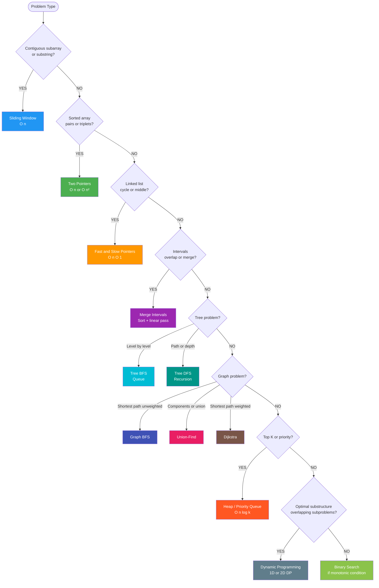

