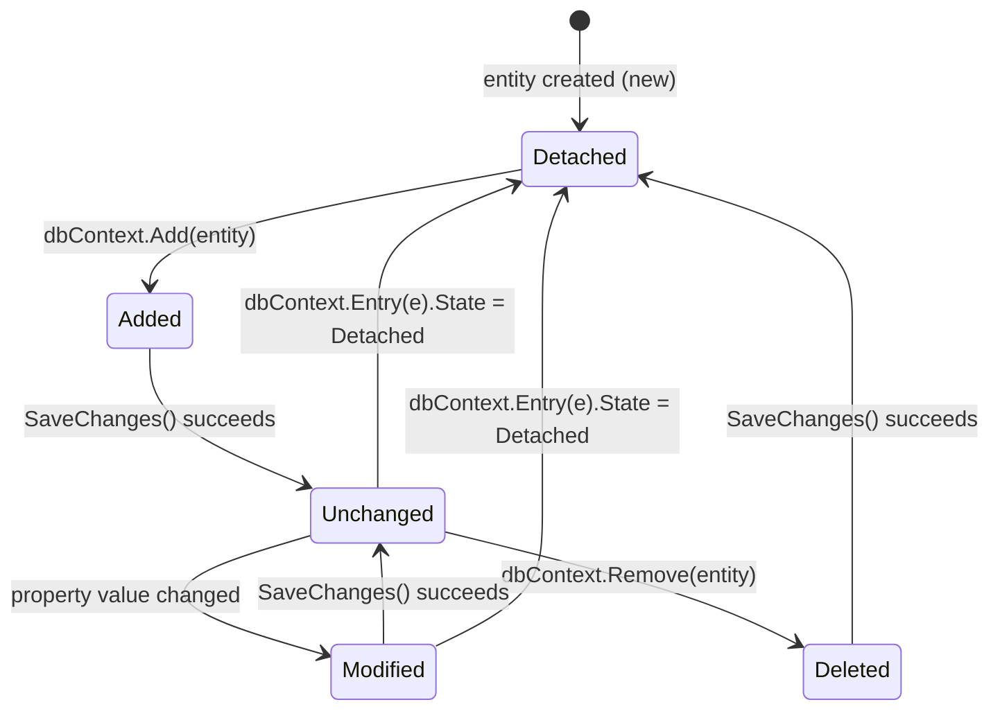
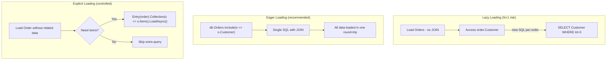
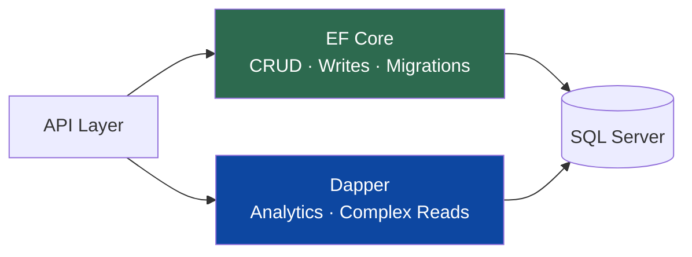

# 🗃️ Entity Framework Core Interview Questions — Complete Guide

> **100+ questions** grouped by concept · With definitions, ✅ good examples, ❌ bad examples & 📚 reference links.
> Use `Ctrl+F` / `Cmd+F` to jump to any topic.

---

## 📋 Table of Contents
1. [DbContext & Configuration](#1-dbcontext--configuration)
2. [Code First & Migrations](#2-code-first--migrations)
3. [Querying with LINQ](#3-querying-with-linq)
4. [Relationships](#4-relationships)
5. [Change Tracking & SaveChanges](#5-change-tracking--savechanges)
6. [Performance Optimization](#6-performance-optimization)
7. [Raw SQL & Stored Procedures](#7-raw-sql--stored-procedures)
8. [Transactions & Concurrency](#8-transactions--concurrency)
9. [Testing with EF Core](#9-testing-with-ef-core)
10. [Advanced EF Core Patterns](#10-advanced-ef-core-patterns)

---

## 1. DbContext & Configuration

📚 **References:**
- [DbContext – Microsoft Docs](https://learn.microsoft.com/en-us/ef/core/dbcontext-configuration/)
- [Registering DbContext with DI](https://learn.microsoft.com/en-us/ef/core/dbcontext-configuration/#dbcontext-in-dependency-injection-for-aspnet-core)

---

### Q1: What is DbContext and what roles does it play in EF Core?

`DbContext` is the central class in EF Core that serves as the **unit of work**, **identity map**, and **change tracker**. Every entity that EF Core manages is loaded through and tracked by a `DbContext` instance. You expose each entity type via a `DbSet<T>` property, which lets you query and save instances of that type. In ASP.NET Core applications, `DbContext` should be registered as **Scoped** (one instance per HTTP request) using `AddDbContext<T>()`. For scenarios requiring multiple short-lived contexts (e.g., Blazor Server), prefer `AddDbContextFactory<T>()`.

❌ **Bad — registering DbContext as Singleton:**
```csharp
// WRONG: Singleton DbContext causes concurrency bugs,
// stale change tracker data, and connection exhaustion.
builder.Services.AddSingleton<AppDbContext>(sp =>
{
    var options = new DbContextOptionsBuilder<AppDbContext>()
        .UseSqlServer("Server=.;Database=MyDb;Trusted_Connection=True;")
        .Options;
    return new AppDbContext(options);
});
```
*Why wrong:* A singleton `DbContext` is shared across all requests simultaneously. EF Core's change tracker is not thread-safe, leading to data corruption, stale cached entities, and hard-to-debug concurrency exceptions.

✅ **Good — Scoped registration via AddDbContext:**
```csharp
// Program.cs
builder.Services.AddDbContext<AppDbContext>(options =>
    options.UseSqlServer(
        builder.Configuration.GetConnectionString("DefaultConnection")));

// AppDbContext.cs
public class AppDbContext : DbContext
{
    public AppDbContext(DbContextOptions<AppDbContext> options)
        : base(options) { }

    public DbSet<Blog> Blogs => Set<Blog>();
    public DbSet<Post> Posts => Set<Post>();
}

// appsettings.json
{
  "ConnectionStrings": {
    "DefaultConnection": "Server=.;Database=MyDb;Trusted_Connection=True;TrustServerCertificate=True;"
  }
}
```
*Why correct:* `AddDbContext<T>()` registers the context as Scoped. Each HTTP request gets its own isolated `DbContext` instance with its own change tracker, preventing cross-request data leakage.

---

### Q2: How do you configure DbContextOptions and connection strings?

`DbContextOptions<T>` carries all configuration (provider, connection string, logging, etc.) and is injected into the `DbContext` constructor. You should configure it via **constructor injection** (not `OnConfiguring`) to keep the context testable — `OnConfiguring` hard-codes configuration inside the class, making it impossible to swap providers in tests. Connection strings live in `appsettings.json` and are resolved via `IConfiguration`.

❌ **Bad — hard-coding connection string in OnConfiguring:**
```csharp
public class AppDbContext : DbContext
{
    // WRONG: Hard-coded connection string; cannot be overridden in tests
    protected override void OnConfiguring(DbContextOptionsBuilder optionsBuilder)
    {
        optionsBuilder.UseSqlServer(
            "Server=PROD-SERVER;Database=MyDb;User=sa;Password=secret;");
    }
}
```
*Why wrong:* Hard-coding the connection string prevents testability, leaks credentials in source code, and makes it impossible to switch environments without recompiling.

✅ **Good — constructor injection with IConfiguration:**
```csharp
// appsettings.json
{
  "ConnectionStrings": {
    "DefaultConnection": "Server=.;Database=MyDb;Trusted_Connection=True;TrustServerCertificate=True;"
  }
}

// Program.cs
builder.Services.AddDbContext<AppDbContext>(options =>
    options.UseSqlServer(builder.Configuration.GetConnectionString("DefaultConnection"))
           .EnableSensitiveDataLogging(builder.Environment.IsDevelopment())
           .EnableDetailedErrors(builder.Environment.IsDevelopment()));

// AppDbContext.cs
public class AppDbContext : DbContext
{
    // Constructor injection — options come from DI, easily overridden in tests
    public AppDbContext(DbContextOptions<AppDbContext> options) : base(options) { }

    public DbSet<Product> Products => Set<Product>();
}

// In a unit test:
var options = new DbContextOptionsBuilder<AppDbContext>()
    .UseInMemoryDatabase("TestDb")
    .Options;
using var ctx = new AppDbContext(options); // Works because OnConfiguring is not used
```
*Why correct:* Constructor injection makes the context fully testable. Configuration is externalised to `appsettings.json`, and different environments can supply different connection strings without code changes.

---

### Q3: When and why would you use multiple DbContexts in one application?

Multiple `DbContext` classes are used to implement **bounded contexts** from Domain-Driven Design — each context owns a subset of the domain and its schema. This keeps contexts small, focused, and independently deployable. They can all point at the same database but manage different tables. When using multiple contexts with migrations, each context needs its own **migrations history table** (via `MigrationsHistoryTable`) and a dedicated migrations assembly.

❌ **Bad — one giant DbContext for everything:**
```csharp
// WRONG: One context with 50+ DbSets becomes a god object
public class GodDbContext : DbContext
{
    public DbSet<User> Users => Set<User>();
    public DbSet<Order> Orders => Set<Order>();
    public DbSet<Product> Products => Set<Product>();
    public DbSet<Invoice> Invoices => Set<Invoice>();
    public DbSet<Shipment> Shipments => Set<Shipment>();
    // ... 45 more DbSets
}
```
*Why wrong:* A single massive context violates the Single Responsibility Principle. All teams are coupled through the same context, migrations conflict, and the change tracker loads far more metadata than any single feature needs.

✅ **Good — separate bounded-context DbContexts:**
```csharp
// Catalog bounded context
public class CatalogDbContext : DbContext
{
    public CatalogDbContext(DbContextOptions<CatalogDbContext> options) : base(options) { }
    public DbSet<Product> Products => Set<Product>();
    public DbSet<Category> Categories => Set<Category>();

    protected override void OnModelCreating(ModelBuilder modelBuilder)
    {
        modelBuilder.HasDefaultSchema("catalog");
    }
}

// Orders bounded context
public class OrdersDbContext : DbContext
{
    public OrdersDbContext(DbContextOptions<OrdersDbContext> options) : base(options) { }
    public DbSet<Order> Orders => Set<Order>();
    public DbSet<OrderLine> OrderLines => Set<OrderLine>();

    protected override void OnModelCreating(ModelBuilder modelBuilder)
    {
        modelBuilder.HasDefaultSchema("orders");
    }
}

// Program.cs
builder.Services.AddDbContext<CatalogDbContext>(o =>
    o.UseSqlServer(connStr, sql => sql.MigrationsHistoryTable("__CatalogMigrationsHistory")));

builder.Services.AddDbContext<OrdersDbContext>(o =>
    o.UseSqlServer(connStr, sql => sql.MigrationsHistoryTable("__OrdersMigrationsHistory")));
```
*Why correct:* Each context is small, focused, and independently migratable. Teams can work on their bounded contexts without conflicts, and migration histories are kept separate.

---

### Q4: What is the difference between Fluent API and Data Annotations, and which takes precedence?

**Data Annotations** are attributes placed directly on entity classes and properties (e.g., `[Required]`, `[MaxLength(100)]`). **Fluent API** is configured in `OnModelCreating` via the `ModelBuilder`. Both achieve the same result, but **Fluent API always takes precedence** when both are present. Fluent API is preferred for complex configurations (composite keys, table splitting, owned entities) because it keeps domain classes free of infrastructure concerns and supports all EF Core features.

❌ **Bad — mixing annotations and Fluent API inconsistently:**
```csharp
// Entity has [MaxLength(50)] annotation...
public class Product
{
    [MaxLength(50)] // Developer thinks this sets the max length
    public string Name { get; set; } = string.Empty;
}

// ...but OnModelCreating silently overrides it to 200
protected override void OnModelCreating(ModelBuilder modelBuilder)
{
    modelBuilder.Entity<Product>()
        .Property(p => p.Name)
        .HasMaxLength(200); // This wins — annotation is ignored
}
// Developer is confused why 200 characters are allowed, not 50
```
*Why wrong:* Mixing both styles for the same property creates confusion. The Fluent API silently overrides the annotation, leading to bugs that are hard to spot.

✅ **Good — use Fluent API exclusively for infrastructure config:**
```csharp
// Clean domain entity — no EF annotations
public class Product
{
    public int Id { get; set; }
    public string Name { get; set; } = string.Empty;
    public decimal Price { get; set; }
    public bool IsActive { get; set; }
}

// All EF config in Fluent API
protected override void OnModelCreating(ModelBuilder modelBuilder)
{
    modelBuilder.Entity<Product>(entity =>
    {
        entity.ToTable("Products");
        entity.HasKey(p => p.Id);
        entity.Property(p => p.Name)
              .IsRequired()
              .HasMaxLength(100);
        entity.Property(p => p.Price)
              .HasColumnType("decimal(18,2)");
        entity.HasIndex(p => p.Name).IsUnique();
    });
}
```
*Why correct:* The domain entity is infrastructure-agnostic. All persistence concerns live in `OnModelCreating`, making it easy to find, change, and reason about the schema configuration.

---

### Q5: What is IEntityTypeConfiguration<T> and why should you use it?

`IEntityTypeConfiguration<T>` is an interface that lets you split entity configuration into dedicated classes instead of putting everything in `OnModelCreating`. Each class implements `Configure(EntityTypeBuilder<T> builder)` and handles one entity type. You register all configurations at once using `modelBuilder.ApplyConfigurationsFromAssembly(Assembly.GetExecutingAssembly())`. This keeps `OnModelCreating` clean and makes large projects maintainable.

❌ **Bad — everything crammed into OnModelCreating:**
```csharp
protected override void OnModelCreating(ModelBuilder modelBuilder)
{
    // 500+ lines configuring every entity inline — unmaintainable
    modelBuilder.Entity<User>(e => {
        e.ToTable("Users");
        e.HasKey(u => u.Id);
        e.Property(u => u.Email).IsRequired().HasMaxLength(256);
        // ... 20 more lines
    });
    modelBuilder.Entity<Order>(e => {
        // ... 30 more lines
    });
    modelBuilder.Entity<Product>(e => {
        // ... 25 more lines
    });
    // ... 10 more entities
}
```
*Why wrong:* A monolithic `OnModelCreating` becomes impossible to navigate in real projects. Merge conflicts are frequent when multiple developers work on different entities.

✅ **Good — separate IEntityTypeConfiguration classes:**
```csharp
// Infrastructure/Configurations/UserConfiguration.cs
public class UserConfiguration : IEntityTypeConfiguration<User>
{
    public void Configure(EntityTypeBuilder<User> builder)
    {
        builder.ToTable("Users");
        builder.HasKey(u => u.Id);
        builder.Property(u => u.Email)
               .IsRequired()
               .HasMaxLength(256);
        builder.HasIndex(u => u.Email).IsUnique();
        builder.Property(u => u.CreatedAt)
               .HasDefaultValueSql("GETUTCDATE()");
    }
}

// Infrastructure/Configurations/OrderConfiguration.cs
public class OrderConfiguration : IEntityTypeConfiguration<Order>
{
    public void Configure(EntityTypeBuilder<Order> builder)
    {
        builder.ToTable("Orders");
        builder.HasKey(o => o.Id);
        builder.Property(o => o.TotalAmount)
               .HasColumnType("decimal(18,2)");
    }
}

// AppDbContext.cs — clean OnModelCreating
protected override void OnModelCreating(ModelBuilder modelBuilder)
{
    // One line registers ALL configuration classes in the assembly
    modelBuilder.ApplyConfigurationsFromAssembly(typeof(AppDbContext).Assembly);
}
```
*Why correct:* Each entity has its own focused configuration file. `OnModelCreating` stays minimal. Files are easy to find, test in isolation, and modify without merge conflicts.

---

### Q6: What are Global Query Filters and how do you implement soft delete?

**Global query filters** are LINQ predicates automatically applied to every query for a given entity type, defined via `HasQueryFilter()` in `OnModelCreating`. They are invisible to the caller unless explicitly bypassed with `.IgnoreQueryFilters()`. The most common use case is **soft delete**: instead of physically removing rows, you set an `IsDeleted` flag and the query filter ensures deleted records never appear in normal queries.

❌ **Bad — manually adding WHERE clause in every query:**
```csharp
// Developers must remember to add !IsDeleted on EVERY query — easy to forget
public async Task<List<Product>> GetActiveProductsAsync()
    => await _context.Products
        .Where(p => !p.IsDeleted) // Easy to forget this line
        .ToListAsync();

public async Task<Product?> GetByIdAsync(int id)
    => await _context.Products
        .Where(p => p.Id == id) // FORGOT the soft-delete filter — returns deleted items!
        .FirstOrDefaultAsync();
```
*Why wrong:* Every query must manually add the soft-delete filter. When a developer forgets it, deleted data leaks into the UI. This is fragile and unscalable.

✅ **Good — global query filter applied once:**
```csharp
// Entity
public class Product
{
    public int Id { get; set; }
    public string Name { get; set; } = string.Empty;
    public bool IsDeleted { get; set; }
    public DateTime? DeletedAt { get; set; }
}

// AppDbContext.cs
protected override void OnModelCreating(ModelBuilder modelBuilder)
{
    modelBuilder.Entity<Product>()
        .HasQueryFilter(p => !p.IsDeleted); // Applied to ALL Product queries automatically
}

// Usage — filter is applied automatically, no manual Where needed
var products = await _context.Products.ToListAsync(); // SQL: WHERE IsDeleted = 0

// Explicitly bypass the filter when needed (e.g., admin restore screen)
var allProducts = await _context.Products
    .IgnoreQueryFilters()
    .ToListAsync();

// Soft delete — don't call Remove(), set the flag
public async Task SoftDeleteAsync(int id)
{
    var product = await _context.Products.FindAsync(id);
    if (product != null)
    {
        product.IsDeleted = true;
        product.DeletedAt = DateTime.UtcNow;
        await _context.SaveChangesAsync();
    }
}
```
*Why correct:* The filter is defined once and applied automatically to every query, navigation property load, and `.Include()`. Developers cannot accidentally forget it.

---

### Q7: What are Owned Entities in EF Core and when should you use them?

**Owned entities** are types that conceptually belong to another entity and have no identity of their own — they represent **value objects** in DDD. Configured with `OwnsOne` or `OwnsMany`, owned entities are stored in the same table as the owner by default (no separate table, no FK). They cannot exist without their owner and cannot be queried directly. Common examples: `Address` embedded in `Customer`, `Money` embedded in `Order`.

❌ **Bad — separate table for a value object:**
```csharp
// Address as a full entity with its own table and ID
public class Address
{
    public int Id { get; set; } // Value objects shouldn't have IDs
    public string Street { get; set; } = string.Empty;
    public string City { get; set; } = string.Empty;
}

public class Customer
{
    public int Id { get; set; }
    public int AddressId { get; set; } // FK — unnecessary join for value data
    public Address Address { get; set; } = null!;
}
```
*Why wrong:* Address is a value object — it has no independent identity. Giving it a separate table and primary key adds unnecessary complexity, an extra join on every customer query, and breaks DDD semantics.

✅ **Good — owned entity embedded in owner's table:**
```csharp
// Value object — no ID, no DbSet
public class Address
{
    public string Street { get; set; } = string.Empty;
    public string City { get; set; } = string.Empty;
    public string PostalCode { get; set; } = string.Empty;
    public string Country { get; set; } = string.Empty;
}

public class Customer
{
    public int Id { get; set; }
    public string Name { get; set; } = string.Empty;
    public Address ShippingAddress { get; set; } = new();
    public Address BillingAddress { get; set; } = new();
}

// Configuration
public class CustomerConfiguration : IEntityTypeConfiguration<Customer>
{
    public void Configure(EntityTypeBuilder<Customer> builder)
    {
        builder.OwnsOne(c => c.ShippingAddress, addr =>
        {
            addr.Property(a => a.Street).HasColumnName("ShippingStreet").HasMaxLength(200);
            addr.Property(a => a.City).HasColumnName("ShippingCity").HasMaxLength(100);
            addr.Property(a => a.PostalCode).HasColumnName("ShippingPostalCode").HasMaxLength(20);
            addr.Property(a => a.Country).HasColumnName("ShippingCountry").HasMaxLength(100);
        });
        builder.OwnsOne(c => c.BillingAddress, addr =>
        {
            addr.Property(a => a.Street).HasColumnName("BillingStreet").HasMaxLength(200);
            addr.Property(a => a.City).HasColumnName("BillingCity").HasMaxLength(100);
            addr.Property(a => a.PostalCode).HasColumnName("BillingPostalCode").HasMaxLength(20);
            addr.Property(a => a.Country).HasColumnName("BillingCountry").HasMaxLength(100);
        });
    }
}
// Generated table: Customers (Id, Name, ShippingStreet, ShippingCity, ..., BillingStreet, ...)
```
*Why correct:* Address is stored inline in the `Customers` table — no join needed. The domain model correctly expresses that Address is a value object belonging to Customer.

---

### Q8: What is Table Splitting in EF Core?

**Table splitting** maps multiple entity types to the **same database table**, sharing the primary key. It's useful when you want to load a lightweight version of an entity for list views and a full version (with expensive columns like large blobs) only when needed. Both entities must share the same primary key and be related with a one-to-one relationship.

❌ **Bad — loading full entity with expensive columns for list views:**
```csharp
// User has a large ProfilePhoto byte array (potentially megabytes)
public class User
{
    public int Id { get; set; }
    public string Name { get; set; } = string.Empty;
    public string Email { get; set; } = string.Empty;
    public byte[]? ProfilePhoto { get; set; } // Megabytes of data
    public string? Bio { get; set; } // Large text
}

// Loading all users for a list — pulls megabytes of photos unnecessarily
var users = await _context.Users.ToListAsync(); // SELECT * including huge photo columns
```
*Why wrong:* Every user list query transfers megabytes of binary data over the network unnecessarily, killing performance.

✅ **Good — table splitting to separate lightweight and heavy data:**
```csharp
// Lightweight entity for list views
public class User
{
    public int Id { get; set; }
    public string Name { get; set; } = string.Empty;
    public string Email { get; set; } = string.Empty;
    public UserDetail Detail { get; set; } = null!;
}

// Heavy entity loaded on demand
public class UserDetail
{
    public int UserId { get; set; } // Shared PK
    public byte[]? ProfilePhoto { get; set; }
    public string? Bio { get; set; }
    public User User { get; set; } = null!;
}

// Configuration
protected override void OnModelCreating(ModelBuilder modelBuilder)
{
    modelBuilder.Entity<User>().ToTable("Users");

    modelBuilder.Entity<UserDetail>(entity =>
    {
        entity.ToTable("Users"); // Same table!
        entity.HasKey(d => d.UserId);
        entity.HasOne(d => d.User)
              .WithOne(u => u.Detail)
              .HasForeignKey<UserDetail>(d => d.UserId);
    });
}

// Fast list query — no photo data loaded
var users = await _context.Users.ToListAsync();

// Full profile — explicit include for heavy data
var userWithPhoto = await _context.Users
    .Include(u => u.Detail)
    .FirstAsync(u => u.Id == userId);
```
*Why correct:* Both entities live in one table but the expensive columns are only loaded when explicitly included, giving you performance control without schema duplication.

---

### Q9: What are Keyless Entities in EF Core?

**Keyless entities** are entity types configured with `HasNoKey()` — they have no primary key and cannot be inserted, updated, deleted, or change-tracked. They are used to map the results of **database views**, **raw SQL queries**, or **stored procedures** that return custom result shapes that don't correspond to a tracked entity. They must be mapped with `ToView()` or used directly with `FromSqlRaw()`.

❌ **Bad — using a full entity to map a view result:**
```csharp
// Trying to use a tracked entity for a view — causes errors
public class ProductSalesSummary
{
    public int ProductId { get; set; } // EF tries to track this as PK
    public string ProductName { get; set; } = string.Empty;
    public decimal TotalSales { get; set; }
    // View doesn't have a unique key — SaveChanges would fail
}

// EF creates a migration to create a "ProductSalesSummaries" table — WRONG
```
*Why wrong:* EF Core treats it as a regular entity and tries to create a table for it in migrations, which is not what you want for a view.

✅ **Good — keyless entity mapped to a view:**
```csharp
// Keyless entity — no primary key
public class ProductSalesSummary
{
    public int ProductId { get; set; }
    public string ProductName { get; set; } = string.Empty;
    public decimal TotalSales { get; set; }
    public int OrderCount { get; set; }
}

// AppDbContext.cs
public DbSet<ProductSalesSummary> ProductSalesSummaries => Set<ProductSalesSummary>();

protected override void OnModelCreating(ModelBuilder modelBuilder)
{
    modelBuilder.Entity<ProductSalesSummary>(entity =>
    {
        entity.HasNoKey();
        entity.ToView("vw_ProductSalesSummary"); // Maps to existing DB view
    });
}

// Create the view via migration
// migrationBuilder.Sql(@"
//     CREATE VIEW vw_ProductSalesSummary AS
//     SELECT p.Id AS ProductId, p.Name AS ProductName,
//            SUM(ol.Quantity * ol.UnitPrice) AS TotalSales,
//            COUNT(DISTINCT o.Id) AS OrderCount
//     FROM Products p
//     JOIN OrderLines ol ON ol.ProductId = p.Id
//     JOIN Orders o ON o.Id = ol.OrderId
//     GROUP BY p.Id, p.Name");

// Query the view
var summary = await _context.ProductSalesSummaries
    .Where(s => s.TotalSales > 1000)
    .OrderByDescending(s => s.TotalSales)
    .ToListAsync();
```
*Why correct:* `HasNoKey()` tells EF Core not to create a table or attempt change tracking. The entity correctly maps to an existing view and can be queried with full LINQ support.

---

### Q10: What are Shadow Properties in EF Core?

**Shadow properties** exist in the EF Core model and database schema but have **no corresponding C# property** on the entity class. They are defined in `OnModelCreating` using `Property<T>("PropertyName")` and accessed via `EF.Property<T>(entity, "PropertyName")` or through the change tracker. They are ideal for infrastructure concerns like `CreatedAt`, `UpdatedAt`, and `TenantId` that should not pollute the domain model.

❌ **Bad — polluting domain model with infrastructure properties:**
```csharp
// Domain entity carries infrastructure concerns — violates DDD
public class Order
{
    public int Id { get; set; }
    public decimal Total { get; set; }
    // These are infrastructure concerns, not domain concepts:
    public DateTime CreatedAt { get; set; }
    public DateTime? UpdatedAt { get; set; }
    public string? CreatedBy { get; set; }
    public string? UpdatedBy { get; set; }
}
```
*Why wrong:* Audit fields are an infrastructure concern. They don't belong in the domain model and add noise to every entity class in the application.

✅ **Good — shadow properties for audit columns:**
```csharp
// Clean domain entity — no infrastructure concerns
public class Order
{
    public int Id { get; set; }
    public decimal Total { get; set; }
    public List<OrderLine> Lines { get; set; } = new();
}

// Configuration — shadow properties defined in Fluent API
public class OrderConfiguration : IEntityTypeConfiguration<Order>
{
    public void Configure(EntityTypeBuilder<Order> builder)
    {
        builder.Property<DateTime>("CreatedAt")
               .HasDefaultValueSql("GETUTCDATE()");
        builder.Property<DateTime?>("UpdatedAt");
        builder.Property<string>("CreatedBy")
               .HasMaxLength(256);
    }
}

// SaveChangesInterceptor to auto-set shadow properties
public class AuditInterceptor : SaveChangesInterceptor
{
    private readonly ICurrentUserService _currentUser;
    public AuditInterceptor(ICurrentUserService currentUser)
        => _currentUser = currentUser;

    public override InterceptionResult<int> SavingChanges(
        DbContextEventData eventData, InterceptionResult<int> result)
    {
        var context = eventData.Context!;
        foreach (var entry in context.ChangeTracker.Entries()
            .Where(e => e.State is EntityState.Added or EntityState.Modified))
        {
            if (entry.State == EntityState.Added)
                entry.Property("CreatedAt").CurrentValue = DateTime.UtcNow;

            entry.Property("UpdatedAt").CurrentValue = DateTime.UtcNow;
            entry.Property("CreatedBy").CurrentValue = _currentUser.UserId;
        }
        return result;
    }
}

// Reading a shadow property
var order = await _context.Orders.FirstAsync();
var createdAt = _context.Entry(order).Property<DateTime>("CreatedAt").CurrentValue;

// Querying via shadow property
var recentOrders = await _context.Orders
    .Where(o => EF.Property<DateTime>(o, "CreatedAt") > DateTime.UtcNow.AddDays(-7))
    .ToListAsync();
```
*Why correct:* The domain `Order` class stays clean. Audit columns are managed transparently by the interceptor and accessed through the EF Core model when needed.


---

# ⚖️ Entity Framework Comparisons



---

## EF-C0 — LINQ to SQL Pipeline


---

## EF-C1 — EF Core vs Dapper vs ADO.NET

| | EF Core | Dapper | ADO.NET |
|-|---------|--------|---------|
| Abstraction | High (ORM, LINQ) | Low (raw SQL + mapping) | Lowest (manual everything) |
| Productivity | ✅ Fastest for CRUD | Medium | Slowest |
| Performance | Good (with AsNoTracking) | ✅ Near-raw SQL | ✅ Maximum |
| Complex queries | LINQ (sometimes awkward) | ✅ Raw SQL = full control | ✅ Full control |
| Change tracking | ✅ Built-in | ❌ Manual | ❌ Manual |
| Migrations | ✅ Built-in | ❌ Manual | ❌ Manual |
| Use for | Standard CRUD, rapid dev | Performance-critical reads, complex SQL | Max performance, stored proc heavy |

```csharp
// EF Core — LINQ, tracked, migrations
var order = await _db.Orders.Include(o => o.Items).FirstOrDefaultAsync(o => o.Id == id);

// Dapper — raw SQL, fast reads
var orders = await _conn.QueryAsync<OrderDto>(
    "SELECT Id, Total FROM Orders WHERE CustomerId = @id", new { id });

// ADO.NET — maximum control
using var cmd = new SqlCommand("SELECT * FROM Orders WHERE Id = @id", conn);
cmd.Parameters.AddWithValue("@id", id);
using var reader = await cmd.ExecuteReaderAsync();
```

---

## EF-C2 — Code First vs Database First vs Model First


| | Code First | Database First | Model First |
|-|------------|---------------|-------------|
| Source of truth | C# classes + migrations | Existing DB | Visual designer |
| DB creation | EF generates DB from models | Scaffold models from DB | EF creates DB from designer |
| Team workflow | Code review migrations | DBA controls schema | Rarely used today |
| Best for | Greenfield projects | Legacy DB integration | ❌ Mostly obsolete |

---

## EF-C3 — Lazy vs Eager vs Explicit Loading



| | Lazy Loading | Eager Loading | Explicit Loading |
|-|-------------|---------------|-----------------|
| When loaded | On first access (N+1 risk!) | In same query (JOIN) | Manually called |
| Setup | `.UseLazyLoadingProxies()` | `.Include(o => o.Items)` | `Entry(o).Collection(o => o.Items).LoadAsync()` |
| SQL generated | N+1 queries | Single JOIN | Extra query on demand |
| Use for | Rarely — usually a code smell | Default for known relations | Conditional loading |

```csharp
// ❌ Lazy loading — N+1
foreach (var order in _db.Orders.ToList())
    Console.WriteLine(order.Customer.Name); // NEW query per order!

// ✅ Eager loading — single JOIN
var orders = await _db.Orders.Include(o => o.Customer).ToListAsync();

// Explicit — controlled extra query
var order = await _db.Orders.FindAsync(id);
if (needsItems) await _db.Entry(order!).Collection(o => o.Items).LoadAsync();
```

---

## EF-C4 — Tracked vs Untracked Queries

| | Tracked (default) | AsNoTracking |
|-|------------------|-------------|
| Change detection | ✅ Automatic | ❌ None |
| SaveChanges detects | ✅ Modified properties | ❌ Nothing |
| Memory | Higher (identity map) | Lower |
| Speed | Slower | ✅ Faster (~20–30%) |
| Use for | Read-then-update | Read-only, projections, list views |

```csharp
// Tracked — use when you'll modify and save
var order = await _db.Orders.FindAsync(id); // tracked
order!.Status = "Shipped";
await _db.SaveChangesAsync(); // detects change automatically

// Untracked — use for read-only (faster, less memory)
var dtos = await _db.Orders
    .AsNoTracking()
    .Select(o => new OrderDto(o.Id, o.Status))
    .ToListAsync();
```

---

## EF-C5 — `SaveChanges` vs `ExecuteUpdate` vs `ExecuteDelete`

| | `SaveChanges` | `ExecuteUpdateAsync` | `ExecuteDeleteAsync` |
|-|--------------|---------------------|---------------------|
| Load entities first | ✅ Yes (tracked) | ❌ No | ❌ No |
| Change tracking overhead | ✅ Full tracking | ❌ None | ❌ None |
| Single SQL | N statements | ✅ One UPDATE | ✅ One DELETE |
| Use for | CRUD on few records | Bulk updates | Bulk deletes |

```csharp
// SaveChanges — load all, track all, update all (slow for bulk)
var orders = await _db.Orders.Where(o => o.Status == "Pending").ToListAsync();
orders.ForEach(o => o.Status = "Archived");
await _db.SaveChangesAsync(); // N UPDATEs

// ExecuteUpdateAsync — single SQL, no load (EF Core 7+)
await _db.Orders
    .Where(o => o.Status == "Pending")
    .ExecuteUpdateAsync(s => s.SetProperty(o => o.Status, "Archived")); // one UPDATE
```

---

### Q: You're building a new API. How do you decide between EF Core and Dapper?

**Answer:**

EF Core is the default choice for productivity, consistency, and maintainability. It handles CRUD operations, migrations, change tracking, and relationships with minimal boilerplate. Dapper is a targeted tool for performance-critical, read-heavy paths where hand-tuned SQL gives a measurable advantage over EF Core's generated queries.

A mixed strategy works well when the boundary is explicit:

| Scenario | Use |
|----------|-----|
| Standard CRUD, domain operations | ✅ EF Core |
| Complex analytics, reporting queries | ✅ Dapper |
| Multi-table joins with window functions | ✅ Dapper |
| Write operations requiring change tracking | ✅ EF Core |

❌ **Bad — using raw ADO.NET or Dapper everywhere "for performance":**
```csharp
// Every endpoint hand-rolls SQL — even simple CRUD
public async Task<User> GetUserAsync(int id)
{
    using var conn = new SqlConnection(_connStr);
    return await conn.QuerySingleAsync<User>(
        "SELECT Id, Name, Email FROM Users WHERE Id = @id", new { id });
}

public async Task UpdateUserAsync(User user)
{
    using var conn = new SqlConnection(_connStr);
    await conn.ExecuteAsync(
        "UPDATE Users SET Name = @Name, Email = @Email WHERE Id = @Id", user);
}
// Hundreds of hand-maintained SQL strings, no migrations, no change tracking
```

✅ **Good — EF Core for CRUD, Dapper for complex reads:**
```csharp
// EF Core for standard domain operations
public class UserRepository
{
    private readonly AppDbContext _db;
    public UserRepository(AppDbContext db) => _db = db;

    public async Task<User?> GetByIdAsync(int id)
        => await _db.Users.FindAsync(id);

    public async Task UpdateAsync(User user)
    {
        _db.Users.Update(user);
        await _db.SaveChangesAsync();
    }
}

// Dapper for performance-critical analytics query
public class ReportRepository
{
    private readonly IDbConnection _conn;
    public ReportRepository(IDbConnection conn) => _conn = conn;

    public async Task<IEnumerable<SalesDto>> GetSalesSummaryAsync(DateRange range)
    {
        // Complex 6-table join with window functions — hand-tuned SQL
        const string sql = @"
            SELECT c.Name, SUM(ol.Qty * ol.Price) AS Revenue,
                   RANK() OVER (ORDER BY SUM(ol.Qty * ol.Price) DESC) AS Rank
            FROM Orders o
            JOIN Customers c ON c.Id = o.CustomerId
            JOIN OrderLines ol ON ol.OrderId = o.Id
            JOIN Products p ON p.Id = ol.ProductId
            JOIN Categories cat ON cat.Id = p.CategoryId
            JOIN Regions r ON r.Id = c.RegionId
            WHERE o.PlacedAt BETWEEN @From AND @To
            GROUP BY c.Id, c.Name";

        return await _conn.QueryAsync<SalesDto>(sql, new { range.From, range.To });
    }
}
```

> **Why this matters:** Picking the wrong data access tool creates either unmaintainable generated SQL or needless complexity. Interviews test whether you treat this as a deliberate architectural boundary rather than a blanket preference.

**💡 Production Example:**
A reporting dashboard API used EF Core for all CRUD operations on the main domain but switched to Dapper for a complex analytics query joining six tables with window functions. The EF Core-generated SQL for that query took 3 seconds due to inefficient join ordering. Hand-tuned Dapper cut query time to 200ms. EF Core remained for all writes and simpler reads — the boundary was a single repository class.



---

### Q: What is the N+1 query problem and how do you fix it?

**Answer:**

The N+1 problem occurs when one query loads N parent records, and then N additional queries are issued — one per parent — to load related child data. With 500 orders, that is 501 database round-trips instead of 1.

**Root causes in EF Core:**

| Cause | Example |
|-------|---------|
| Lazy loading enabled | Accessing `order.LineItems` inside a loop |
| Missing `.Include()` | Forgetting to eager-load a navigation |
| `.Select()` projecting navigations without including | `o.Customer.Name` in a projection without `.Include()` |

❌ **Bad — lazy loading causes N+1:**
```csharp
// Lazy loading enabled — each access to .LineItems triggers a new query
var orders = await _db.Orders.ToListAsync(); // 1 query: SELECT * FROM Orders

foreach (var order in orders)
{
    // NEW query per iteration: SELECT * FROM LineItems WHERE OrderId = X
    var total = order.LineItems.Sum(li => li.Price);
    Console.WriteLine($"Order {order.Id}: {total}");
}
// 500 orders → 501 queries → 4s page load
```

✅ **Good — eager loading collapses to a single JOIN:**
```csharp
// .Include() generates one SQL with JOIN
var orders = await _db.Orders
    .Include(o => o.LineItems)
    .ToListAsync();
// 1 query: SELECT o.*, li.* FROM Orders o JOIN LineItems li ON li.OrderId = o.Id

foreach (var order in orders)
{
    var total = order.LineItems.Sum(li => li.Price); // data already loaded — no query
    Console.WriteLine($"Order {order.Id}: {total}");
}
```

✅ **Better — project only what you need (no unnecessary columns):**
```csharp
var summaries = await _db.Orders
    .Select(o => new OrderSummaryDto
    {
        Id = o.Id,
        Total = o.LineItems.Sum(li => li.Price), // translated to SQL SUM — 1 query
        ItemCount = o.LineItems.Count
    })
    .ToListAsync();
```

**Always verify generated SQL:**
```csharp
// In development: log all SQL to console
optionsBuilder.LogTo(Console.WriteLine, LogLevel.Information)
              .EnableSensitiveDataLogging();

// Or use MiniProfiler / Application Insights to count queries per request
```

> **Why this matters:** N+1 queries are invisible in small datasets and only appear under production load. They are one of the most common causes of slow EF Core endpoints — every interviewer asking about EF performance expects you to name this pattern first.

**💡 Production Example:**
A dashboard endpoint listing orders with line items was issuing 1 query for the order list plus N queries for each order's items. The developer had only tested with 5 orders locally. In production with 500 orders on the same page, 501 round-trips were issued and page load reached 4 seconds. Adding `.Include(o => o.LineItems)` reduced round-trips to 1, and page load dropped to under 200ms.

---

### Q: How do you review a pull request for hidden query performance problems in EF Core?

**Answer:**

EF Core query issues rarely appear in unit tests — they require production-scale data and load to surface. A PR review must check the query shape, not just the C# code.

**Checklist for EF Core PRs:**

| Check | What to look for |
|-------|-----------------|
| Missing `.Include()` | Navigation properties accessed in loops without eager loading |
| Client-side evaluation | `.Where()`, `.OrderBy()`, or `.Select()` after `.ToList()` / `.AsEnumerable()` |
| No `.AsNoTracking()` on reads | Read-only endpoints tracking entities unnecessarily |
| Unbounded queries | No `.Take()` on potentially large result sets |
| Scalar subqueries in projections | `o.Customer.Name` in a `.Select()` without `.Include()` |
| Cardinality explosion via `.Include()` | Including large collections on already-large parent sets |

❌ **Bad — client-side filtering on the entire table:**
```csharp
// WRONG: .ToList() materialises the entire table FIRST, then filters in memory
public async Task<List<Order>> GetRecentOrdersAsync(int customerId)
{
    var allOrders = await _db.Orders.ToListAsync(); // SELECT * FROM Orders — entire table!
    return allOrders.Where(o => o.CustomerId == customerId).ToList(); // filtered in C#
}
// 8 million rows pulled into memory; passes tests on a dev DB with 50 rows
```

✅ **Good — predicate translated to SQL WHERE clause:**
```csharp
// Correct: .Where() before .ToListAsync() is translated to SQL
public async Task<List<Order>> GetRecentOrdersAsync(int customerId)
{
    return await _db.Orders
        .Where(o => o.CustomerId == customerId) // SQL: WHERE CustomerId = @p0
        .AsNoTracking()
        .Take(100)
        .ToListAsync();
}
```

❌ **Bad — accidental AsEnumerable switches to LINQ-to-Objects:**
```csharp
var results = await _db.Products
    .AsEnumerable()            // switches to in-memory evaluation HERE
    .Where(p => p.Price > 100) // no longer translated to SQL
    .ToListAsync();
```

✅ **Good — stay in IQueryable until the terminal call:**
```csharp
var results = await _db.Products
    .Where(p => p.Price > 100) // SQL WHERE
    .OrderBy(p => p.Name)      // SQL ORDER BY
    .Take(50)                  // SQL TOP 50
    .AsNoTracking()
    .ToListAsync();
```

**During PR review, ask:**
- "Can you share the generated SQL for this endpoint?" (use `ToQueryString()` in EF Core 5+)
- "What does the query plan look like on the production table size?"
- "Is this endpoint protected by a `.Take()` limit?"

```csharp
// Quick way to inspect generated SQL in code review / local testing
var query = _db.Orders.Where(o => o.Status == "Pending").Take(100);
Console.WriteLine(query.ToQueryString()); // prints the SQL
```

> **Why this matters:** Query performance issues rarely appear in unit tests and often slip into production. A reviewer who only reads C# logic without asking "what SQL does this produce?" will miss the most common class of EF Core bugs.

**💡 Production Example:**
A LINQ query used `.Where()` after `.ToList()`, which pulled the entire table into memory before filtering. The staging dataset had 200 rows so all tests passed with sub-millisecond response. Production had 8 million rows — the endpoint pulled the entire Orders table into application memory, exhausted the container's heap, and caused an OOM crash. The fix was a one-line reorder: move `.Where()` before `.ToListAsync()`.

