# 🌍 High Level Design (HLD) Interview Questions — Complete Guide

> **65+ questions** grouped by concept · With definitions, ✅ good examples, ❌ bad examples & 📚 reference links.
> Use `Ctrl+F` / `Cmd+F` to jump to any topic.

---

## 📋 Table of Contents
1. [Scalability Fundamentals](#1-scalability-fundamentals)
2. [Load Balancing & Traffic Management](#2-load-balancing--traffic-management)
3. [Caching Strategies](#3-caching-strategies)
4. [Databases — SQL vs NoSQL & Sharding](#4-databases--sql-vs-nosql--sharding)
5. [Messaging & Event-Driven Architecture](#5-messaging--event-driven-architecture)
6. [Microservices & Service Design](#6-microservices--service-design)
7. [CAP Theorem & Consistency](#7-cap-theorem--consistency)
8. [Common HLD Problems](#8-common-hld-problems)
9. [System Design — Google Calendar](#9-system-design--google-calendar)
10. [System Design — WhatsApp](#10-system-design--whatsapp)
11. [System Design — Facebook News Feed](#11-system-design--facebook-news-feed)
12. [System Design — Netflix](#12-system-design--netflix)
13. [System Design — Uber](#13-system-design--uber)

---

# 1. Scalability Fundamentals

> 📚 Reference: https://learn.microsoft.com/en-us/azure/architecture/guide/
> 📚 Patterns: https://learn.microsoft.com/en-us/azure/architecture/patterns/

---

## 1.1 Vertical vs Horizontal Scaling

### Q1. What is the difference between vertical and horizontal scaling and when do you choose each?

**Answer:**
Vertical scaling (scale-up) adds more resources to a single machine — more CPU, RAM, SSD. Horizontal scaling (scale-out) adds more machines and distributes load. Vertical has a hard physical ceiling and creates a single point of failure. Horizontal is theoretically unlimited but requires stateless services, distributed coordination, and network-aware design.

❌ **Wrong — designing a stateful service that can only be vertically scaled:**
```
Architecture:
[Web Server] → stores user sessions in local memory
              → writes temporary files to local disk

Problem: Can only run ONE instance because:
- Session state is local memory — second instance has no access to it
- File uploads go to local disk — can't be shared
→ When traffic spikes, only option is to buy a bigger machine
```

✅ **Correct — stateless service design that supports horizontal scaling:**
```
Architecture:
[Load Balancer]
  ├── [App Server 1] ─┐
  ├── [App Server 2] ─┼── [Redis: distributed sessions]
  └── [App Server 3] ─┘        [Azure Blob: file storage]
                               [SQL / NoSQL: persistent data]

- Any request can go to any app server
- Sessions stored in Redis — shared across instances
- Files stored in Blob Storage — not on local disk
- Scale out by adding more app servers behind the load balancer
```

---

## 1.2 Stateless vs Stateful Services

### Q2. Why must services be stateless for horizontal scaling?

**Answer:**
A stateful service stores request-specific data (session, in-progress work) in local memory. If the next request from the same user hits a different instance, the state is missing. Stateless services push state to external stores (Redis, databases), so any instance can serve any request.

❌ **Wrong — ASP.NET Core service storing session data in a static in-memory dictionary:**
```csharp
public class SessionController : ControllerBase {
    // Static dictionary — only lives in this process, not shared across instances
    private static Dictionary<string, UserSession> _sessions = new();

    [HttpPost("login")]
    public IActionResult Login([FromBody] LoginDto dto) {
        var session = CreateSession(dto);
        _sessions[session.Token] = session; // stored in local memory only
        return Ok(session.Token);
    }
    // Works on one instance, breaks silently on second instance
}
```

✅ **Correct — session stored in Redis, shareable across all instances:**
```csharp
// Program.cs
builder.Services.AddStackExchangeRedisCache(options =>
    options.Configuration = config["Redis:ConnectionString"]);
builder.Services.AddSession(options => options.IdleTimeout = TimeSpan.FromMinutes(30));

// Controller — session reads/writes go to Redis
[HttpPost("login")]
public IActionResult Login([FromBody] LoginDto dto) {
    var session = CreateSession(dto);
    HttpContext.Session.SetString("UserId", session.UserId.ToString());
    return Ok(session.Token); // any instance can validate this token via Redis
}
```

---

# 2. Load Balancing & Traffic Management

> 📚 Reference: https://learn.microsoft.com/en-us/azure/load-balancer/load-balancer-overview
> 📚 API Gateway: https://learn.microsoft.com/en-us/azure/api-management/

---

## 2.1 Load Balancing Algorithms

### Q3. What load balancing algorithms exist and when do you use each?

**Answer:**
Round Robin cycles through servers equally — good when all servers have equal capacity. Least Connections routes to the server with the fewest active connections — better for variable request durations. IP Hash routes the same client IP to the same server — useful for sticky sessions. Weighted routes more traffic to higher-capacity servers.

❌ **Wrong — Round Robin for services with unequal processing times:**
```
Round Robin: each request cycles to next server
Request 1 (2ms task)  → Server A
Request 2 (30s task)  → Server B  ← Server B overloaded while A is idle
Request 3 (2ms task)  → Server C
Request 4 (2ms task)  → Server A
Request 5 (2ms task)  → Server B  ← still processing 30s task!
```

✅ **Correct — Least Connections for variable-duration requests:**
```
Least Connections: route to server with fewest active connections
Request 1 (30s task)  → Server A (1 active)
Request 2 (2ms task)  → Server B (0 active) ← B is free
Request 3 (2ms task)  → Server C (0 active) ← C is free
Request 4 (2ms task)  → Server B (0 active) ← not Server A which has a long-running task
→ Load is distributed by actual work, not just request count
```

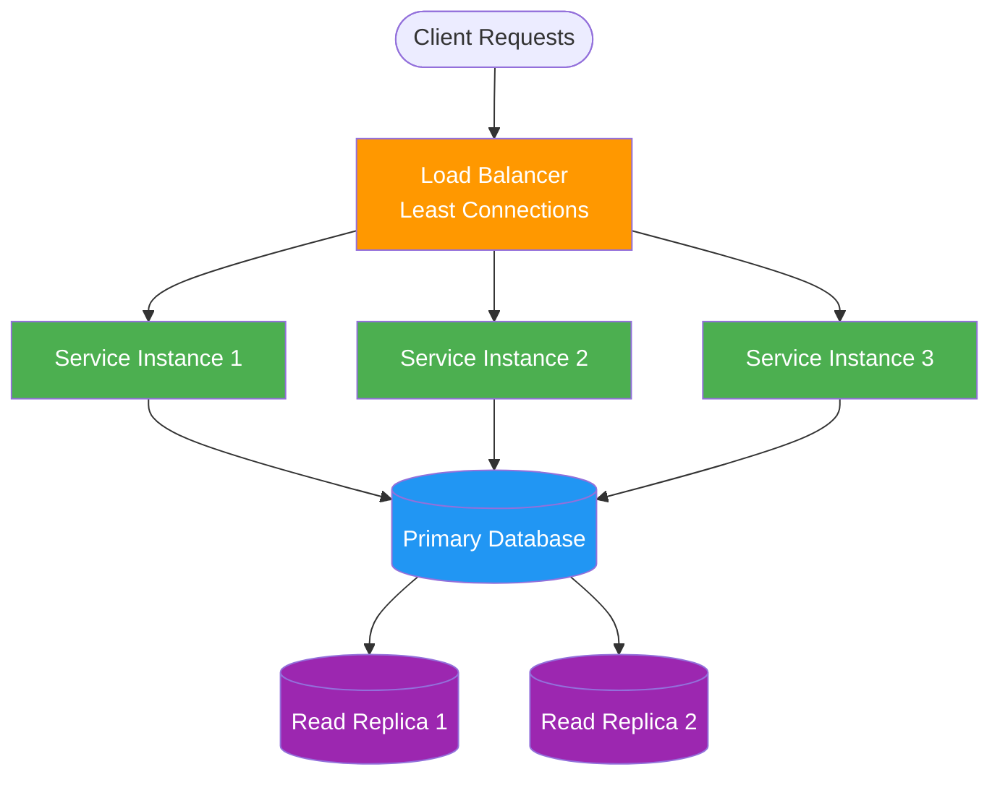

---

## 2.2 API Gateway Pattern

### Q4. What is an API Gateway and what problems does it solve?

**Answer:**
An API Gateway is the single entry point for all client traffic. It handles cross-cutting concerns — authentication, rate limiting, SSL termination, request routing, response aggregation, and observability — so individual microservices don't need to implement these themselves.

❌ **Wrong — clients call microservices directly, duplicated auth and rate limiting everywhere:**
```
Mobile App → directly calls: OrderService:3001, UserService:3002, ProductService:3003
                             Each service implements its own auth, rate limiting, CORS, logging
                             Client must know all internal service URLs
                             A service port change breaks the mobile app
```

✅ **Correct — single API Gateway entry point:**
```
Mobile App → [API Gateway (Azure API Management / NGINX / Ocelot)]
                 ├── Auth & JWT validation (once, in the gateway)
                 ├── Rate limiting per client/endpoint
                 ├── SSL termination
                 ├── Route: /api/orders  → OrderService (internal)
                 ├── Route: /api/users   → UserService (internal)
                 └── Route: /api/products → ProductService (internal)

Services: no public ports, no auth logic, focus on business logic only
```

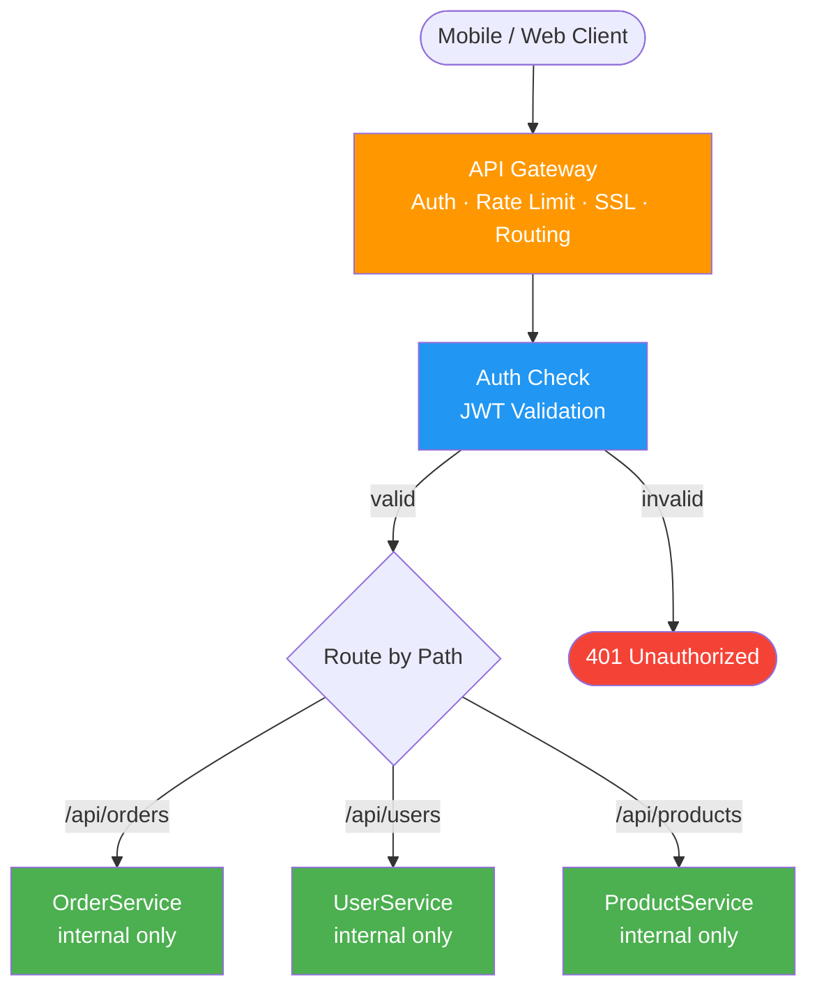

---

# 3. Caching Strategies

> 📚 Reference: https://learn.microsoft.com/en-us/azure/architecture/patterns/cache-aside
> 📚 Redis: https://learn.microsoft.com/en-us/azure/azure-cache-for-redis/cache-overview

---

## 3.1 Cache-Aside Pattern

### Q5. What is the Cache-Aside (Lazy Loading) pattern and when do you use it?

**Answer:**
Cache-Aside: application checks the cache first; on miss, reads from the database and writes to the cache. The cache doesn't auto-populate — it's lazy. Good for read-heavy data that can tolerate slight staleness. The application owns cache invalidation logic.

❌ **Wrong — always reading from the database, no caching:**
```csharp
public async Task<Product?> GetProductAsync(int id) {
    return await _db.Products.FindAsync(id);
    // 1000 users requesting the same product = 1000 identical DB queries
    // Product catalog rarely changes — perfect candidate for caching
}
```

✅ **Correct — Cache-Aside with Redis:**
```csharp
public async Task<Product?> GetProductAsync(int id) {
    string key = $"product:{id}";

    // 1. Check cache
    var cached = await _cache.GetStringAsync(key);
    if (cached is not null)
        return JsonSerializer.Deserialize<Product>(cached);

    // 2. Cache miss — query DB
    var product = await _db.Products.FindAsync(id);
    if (product is null) return null;

    // 3. Populate cache with TTL
    await _cache.SetStringAsync(key,
        JsonSerializer.Serialize(product),
        new DistributedCacheEntryOptions { AbsoluteExpirationRelativeToNow = TimeSpan.FromMinutes(15) });

    return product;
}

// On update: invalidate the cache
public async Task UpdateProductAsync(Product product) {
    await _db.SaveChangesAsync();
    await _cache.RemoveAsync($"product:{product.Id}");
}
```

---

## 3.2 Cache Eviction Policies

### Q6. What are the common cache eviction policies and when do you choose each?

**Answer:**
LRU (Least Recently Used) evicts the least recently accessed items — best for general-purpose caches. LFU (Least Frequently Used) evicts items accessed least often — better when access frequency matters more than recency. TTL-based eviction removes items after a fixed time — best for time-sensitive data like session tokens or API responses.

❌ **Wrong — no TTL on session tokens (security risk — tokens never expire in cache):**
```csharp
await _cache.SetStringAsync($"session:{token}", userId.ToString());
// No expiration — token lives in cache forever even after user logs out
// Security vulnerability: stolen token is valid indefinitely
```

✅ **Correct — TTL matches the session's intended lifetime:**
```csharp
await _cache.SetStringAsync(
    $"session:{token}",
    userId.ToString(),
    new DistributedCacheEntryOptions {
        AbsoluteExpirationRelativeToNow = TimeSpan.FromHours(1),  // hard expiry
        SlidingExpiration = TimeSpan.FromMinutes(20)               // extends on activity
    });
```

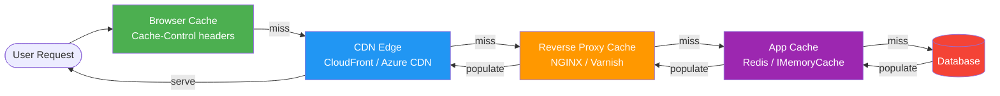

---

# 4. Databases — SQL vs NoSQL & Sharding

> 📚 Reference: https://learn.microsoft.com/en-us/azure/architecture/data-guide/
> 📚 CAP: https://en.wikipedia.org/wiki/CAP_theorem

---

## 4.1 SQL vs NoSQL Trade-offs

### Q7. How do you choose between SQL and NoSQL for a new system?

**Answer:**
SQL (relational): ACID transactions, complex joins, structured schema — best for financial data, CRMs, inventory. NoSQL: flexible schema, horizontal scale, high write throughput — best for user activity feeds, IoT telemetry, product catalogs, session data. Many modern systems use both — polyglot persistence.

❌ **Wrong — using a document store for transactional financial data:**
```
Payment System using MongoDB:
- Transfer $100 from Account A to Account B
- Debit A: { $set: { balance: A.balance - 100 } }
- Credit B: { $set: { balance: B.balance + 100 } }

Problem: if the process crashes between the two operations,
money is lost with no atomic guarantee (without multi-doc transactions).
Financial data requires ACID — use a relational DB.
```

✅ **Correct — polyglot: SQL for transactions, NoSQL for scale-out reads:**
```
System:
├── PostgreSQL  — Orders, Payments, Users (ACID, joins, integrity)
├── MongoDB     — Product catalog (flexible schema, fast reads, easy sharding)
├── Redis       — Sessions, rate limiting counters, leaderboards (in-memory speed)
└── Elasticsearch — Full-text search across products and orders (search-optimized)

Each store is chosen for what it's good at.
```

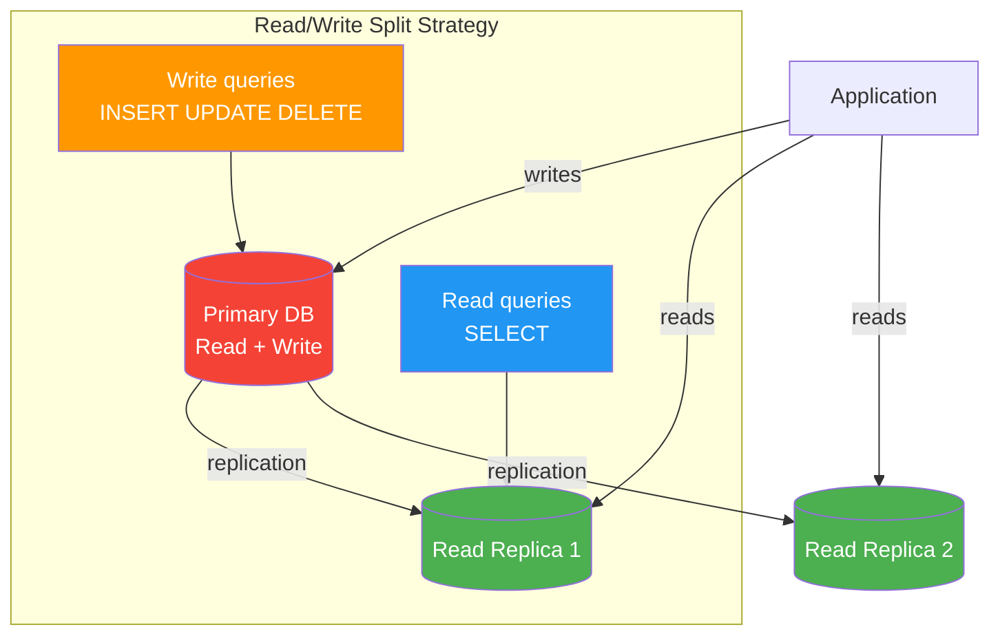

---

## 4.2 Database Sharding

### Q8. What is database sharding and what are common sharding strategies?

**Answer:**
Sharding splits a table across multiple database instances (shards) based on a shard key. Each shard holds a subset of rows. Strategies: range-based (users A–M on shard 1, N–Z on shard 2 — uneven load risk), hash-based (consistent hash of user ID — even distribution), geography-based (users by region — data residency compliance).

❌ **Wrong — sharding by timestamp on a write-heavy system (hot shard problem):**
```
Shard 1: records from 2020
Shard 2: records from 2021
Shard 3: records from 2022
Shard 4: records from 2024 ← ALL current writes go here (hot shard)

The current shard gets 100% of write load while older shards sit idle.
```

✅ **Correct — hash-based sharding distributes writes evenly:**
```
Shard key: hash(user_id) % num_shards

user_id=1001 → hash → Shard 2
user_id=1002 → hash → Shard 0
user_id=1003 → hash → Shard 3
user_id=1004 → hash → Shard 1

Writes and reads are evenly distributed across all shards.
Cross-shard queries require fan-out, but most user-specific queries hit one shard.
```

---

# 5. Messaging & Event-Driven Architecture

> 📚 Reference: https://learn.microsoft.com/en-us/azure/service-bus-messaging/service-bus-messaging-overview
> 📚 Event-driven: https://learn.microsoft.com/en-us/azure/architecture/guide/architecture-styles/event-driven

---

## 5.1 Message Queues vs Event Streams

### Q9. What is the difference between a message queue and an event stream?

**Answer:**
Message queue (Azure Service Bus, RabbitMQ): each message is consumed by one consumer and then deleted — point-to-point delivery. Event stream (Kafka, Azure Event Hubs): messages are retained and multiple consumers read independently at their own offset — pub/sub, replayable. Use queues for task distribution (e.g., send one email); use streams for event sourcing, multiple independent consumers, or replay scenarios.

❌ **Wrong — using a queue when multiple services need the same event:**
```
OrderPlaced event → [Queue] → EmailService reads and deletes the message
                               InventoryService never sees it — message is gone
                               AnalyticsService never sees it — message is gone

A queue delivers to ONE consumer. Multiple consumers need a topic or stream.
```

✅ **Correct — event stream (or topic with subscriptions) for multiple consumers:**
```
Azure Service Bus Topic: "order-placed"
├── Subscription: EmailService       → sends confirmation email
├── Subscription: InventoryService   → reduces stock
└── Subscription: AnalyticsService   → records purchase event

Each subscription gets a copy of the message.
Or use Azure Event Hubs / Kafka for high-throughput + replay capability.
```

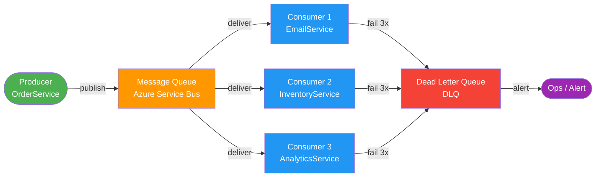

---

## 5.2 Outbox Pattern

### Q10. What is the Transactional Outbox pattern and why is it important?

**Answer:**
The Outbox pattern guarantees that a database write and a message publication happen atomically. Instead of publishing to a message broker directly (which could fail independently), write the message to an `Outbox` table in the same DB transaction. A separate relay process reads the outbox and publishes to the broker.

❌ **Wrong — DB save and message publish in non-atomic steps (data loss risk):**
```csharp
public async Task PlaceOrderAsync(Order order) {
    _db.Orders.Add(order);
    await _db.SaveChangesAsync();  // Step 1: DB saved
    // CRASH HERE? Message is never sent — order exists but downstream services don't know
    await _bus.PublishAsync(new OrderPlacedEvent(order.Id)); // Step 2: may never execute
}
```

✅ **Correct — Outbox pattern, message written atomically with the order:**
```csharp
public async Task PlaceOrderAsync(Order order) {
    _db.Orders.Add(order);

    // Written in the SAME transaction as the order
    _db.OutboxMessages.Add(new OutboxMessage {
        Type = "OrderPlaced",
        Payload = JsonSerializer.Serialize(new OrderPlacedEvent(order.Id)),
        CreatedAt = DateTime.UtcNow
    });

    await _db.SaveChangesAsync(); // atomic: both order + outbox message saved or neither

    // Separate background relay reads outbox and publishes (at-least-once delivery)
}
```

---

# 6. Microservices & Service Design

> 📚 Reference: https://learn.microsoft.com/en-us/azure/architecture/microservices/
> 📚 Patterns: https://microservices.io/patterns/

---

## 6.1 Service Decomposition

### Q11. How do you decide how to split a monolith into microservices?

**Answer:**
Split along business domain boundaries (Domain-Driven Design bounded contexts) — not by technical layers. Signs a monolith should be split: independent scaling needs, different deployment frequencies, different team ownership, or different availability requirements. Avoid micro-splitting — too-small services create distributed monolith overhead with none of the benefits.

❌ **Wrong — splitting by technical layer (creates a distributed monolith):**
```
"Microservices":
- DataAccessService (just the database layer)
- BusinessLogicService (just the logic layer)
- APIService (just the web layer)

These must be deployed together and call each other synchronously —
this is a monolith split across the network. Worse than the original.
```

✅ **Correct — split by business domain (bounded contexts):**
```
Domain-Driven decomposition:

OrderService     — place order, view order status, order history
ProductService   — product catalog, pricing, inventory levels
UserService      — registration, profiles, authentication
NotificationService — email, SMS, push notifications
PaymentService   — payment processing, refunds, invoicing

Each service: owns its data, can be deployed independently,
can scale independently, can be owned by a different team.
```

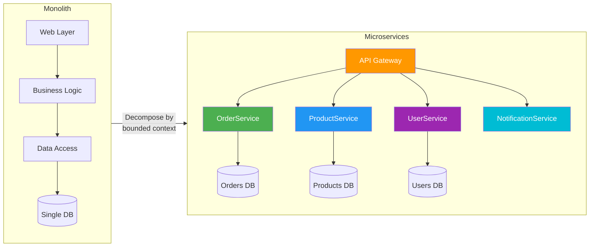

---

## 6.2 Saga Pattern for Distributed Transactions

### Q12. How do you handle transactions that span multiple microservices?

**Answer:**
Two-phase commit across services is an anti-pattern in microservices (tight coupling, poor availability). Instead use the Saga pattern: a sequence of local transactions, each publishing events that trigger the next service. On failure, compensating transactions undo completed steps.

❌ **Wrong — distributed 2PC across microservices (tight coupling, availability risk):**
```
Begin distributed transaction:
  → OrderService.ReserveOrder()
  → InventoryService.DeductStock()
  → PaymentService.ChargeCard()
  → NotificationService.SendEmail()
Commit all or rollback all

Problem: if PaymentService is slow, all services hold locks.
One slow service kills the entire transaction.
```

✅ **Correct — Saga with compensating transactions:**
```
Choreography-based Saga:

1. OrderService creates order (status: PENDING), publishes OrderCreated
2. InventoryService deducts stock, publishes StockReserved
3. PaymentService charges card, publishes PaymentProcessed
4. OrderService marks order CONFIRMED

On failure at step 3 (payment fails):
← PaymentService publishes PaymentFailed
← InventoryService hears PaymentFailed → restores stock (compensating tx)
← OrderService hears PaymentFailed → marks order CANCELLED

Each step is a local transaction. No distributed locks.
```

---

# 7. CAP Theorem & Consistency

> 📚 Reference: https://en.wikipedia.org/wiki/CAP_theorem
> 📚 Eventual consistency: https://learn.microsoft.com/en-us/azure/cosmos-db/consistency-levels

---

## 7.1 CAP Theorem

### Q13. What is the CAP theorem and how does it guide system design decisions?

**Answer:**
CAP states a distributed system can guarantee at most two of three properties: Consistency (every read receives the latest write), Availability (every request receives a response), and Partition Tolerance (the system continues operating despite network partitions). Since network partitions are unavoidable, real systems choose between CP (consistency over availability) and AP (availability over consistency).

❌ **Wrong — claiming a distributed system can be fully consistent AND always available:**
```
"Our distributed database guarantees:
 - All nodes always return the most recent data (strong consistency)
 - Every request always gets a response (100% availability)
 - Works fine even when the network partitions"

This violates CAP theorem — impossible to guarantee all three simultaneously.
```

✅ **Correct — making a conscious CP vs AP trade-off based on business need:**
```
Banking system → CP (choose consistency over availability)
  - A failed network partition means refusing writes rather than risking inconsistent balances
  - Users may get temporary errors, but data is never stale or duplicated
  - "We cannot debit an account if we can't confirm the current balance"

Social media feed → AP (choose availability over strong consistency)
  - A user might see slightly stale like counts during a partition
  - Better to show the feed (possibly slightly stale) than an error page
  - "Eventual consistency is fine — a like count being off by 2 for 200ms is acceptable"
```

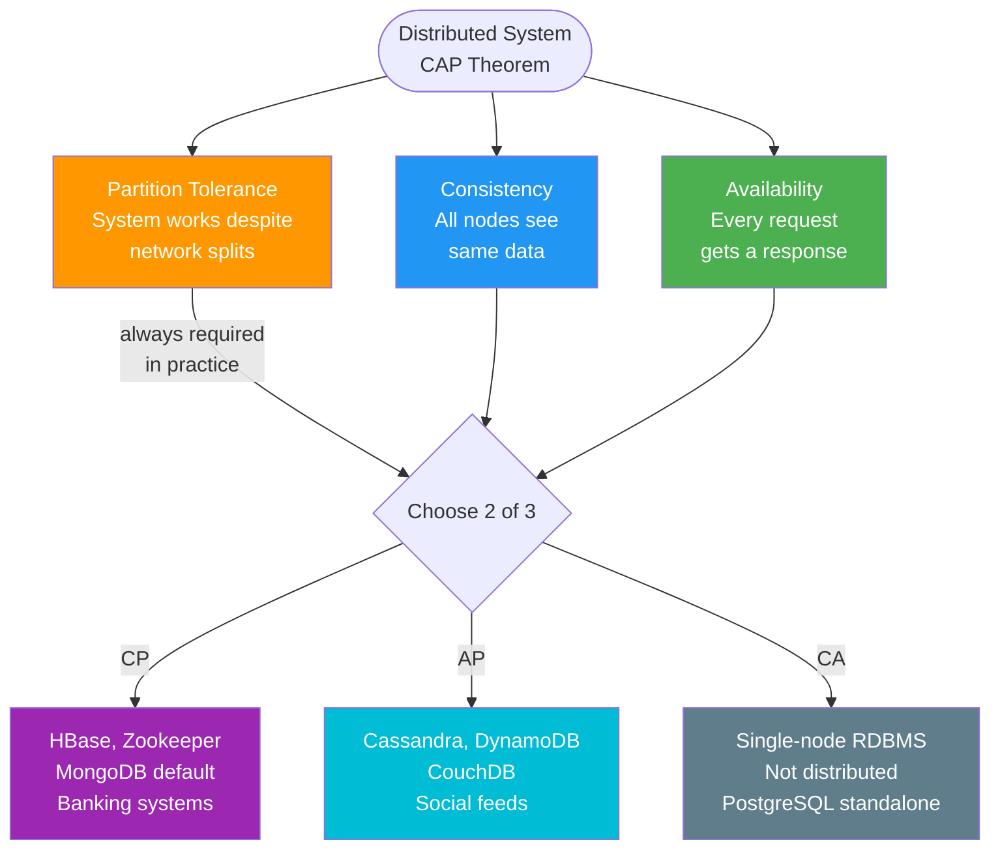

---

## 7.2 Eventual Consistency

### Q14. What is eventual consistency and what are the design implications?

**Answer:**
In an eventually consistent system, replicas will converge to the same value given enough time with no new updates. Reads may return stale data during the convergence window. Design implications: UI should handle stale reads gracefully, operations should be idempotent, and writes should be designed to be conflict-resolvable.

❌ **Wrong — application assumes immediate consistency after a write:**
```csharp
await _userService.UpdateProfileAsync(userId, newName);

// Immediately reading from a replica that may not have the update yet
var user = await _userService.GetProfileAsync(userId);
// user.Name may still be the old name — confusing UX
Assert.Equal(newName, user.Name); // flaky in distributed systems
```

✅ **Correct — read your own writes by routing to the primary, or use optimistic UI:**
```csharp
await _userService.UpdateProfileAsync(userId, newName);

// Option 1: Read from primary/leader after write (read-your-writes guarantee)
var user = await _userService.GetProfileFromPrimaryAsync(userId);

// Option 2: Optimistic UI — assume update succeeded, update local state immediately
// Don't wait for a round-trip to confirm; show the new name immediately in the UI
// If the write failed, reconcile on next sync
```

---

# 8. Common HLD Problems

> 📚 Reference: https://github.com/donnemartin/system-design-primer
> 📚 Azure architectures: https://learn.microsoft.com/en-us/azure/architecture/browse/

---

## 8.1 Design a URL Shortener

### Q15. How do you design a URL shortener at the system level?

**Answer:**
Core components: hash/encode function for unique short codes, database to map short → long URLs, cache for popular URLs, redirect service. Scale concerns: read-heavy (most traffic is redirects), high availability, low latency redirects. Use Base62 encoding on an auto-incremented ID for unique collision-free short codes.

❌ **Wrong — MD5 hash of the URL as short code (collision risk, too long):**
```
short_code = MD5(long_url).Substring(0, 7)
Problem: two different URLs could produce the same 7-char prefix (collision)
Solution requires collision checking + retry, which adds complexity
MD5 is non-deterministic in distribution — same URL gives same code (deduplication is accidental)
```

✅ **Correct — Base62 encoding of auto-incremented ID:**
```
1. Store URL in DB: INSERT INTO urls (long_url) VALUES (?) → returns id = 10000000
2. Encode: Base62(10000000) = "FXdiS" (6 characters)
3. Store mapping: short_code = "FXdiS", long_url = "https://..."

Redirect flow:
GET /FXdiS
  → Check Redis cache for "FXdiS" (cache hit: ~1ms redirect)
  → Cache miss: query DB for "FXdiS" → get long_url → cache it → redirect

Architecture:
[Client] → [CDN/Edge: caches popular redirects]
         → [API Gateway]
         → [Redirect Service (stateless, many instances)]
         → [Redis Cache: hot short codes]
         → [PostgreSQL: source of truth for all mappings]
```

---

## 8.2 Design a Notification System

### Q16. How do you design a notification system that supports email, SMS, and push?

**Answer:**
Decouple notification delivery from the business events that trigger them. Use a message queue with per-channel workers. Handle retries, deduplication, and user preferences centrally. Scale each channel independently.

❌ **Wrong — synchronous notification sending in the same API request:**
```csharp
[HttpPost("order")]
public async Task<IActionResult> PlaceOrder([FromBody] OrderDto dto) {
    var order = await _orderService.CreateAsync(dto);
    await _emailService.SendAsync(dto.Email, "Order Confirmed", BuildEmailBody(order)); // slow
    await _smsService.SendAsync(dto.Phone, $"Order #{order.Id} confirmed");            // slow
    await _pushService.SendAsync(dto.UserId, "Your order is confirmed");               // slow
    return Ok(order); // response delayed by all notification calls
}
// If SMS provider is slow, the order API is slow. If it fails, order appears to fail.
```

✅ **Correct — async event-driven notification pipeline:**
```
OrderService → publishes "OrderConfirmed" event to Service Bus Topic

Subscription: EmailWorker
  - Reads event, sends email via SendGrid
  - Retries up to 3 times with exponential backoff
  - Dead-letters after 3 failures

Subscription: SmsWorker
  - Reads event, sends SMS via Twilio
  - Independent retry policy

Subscription: PushWorker
  - Reads event, sends push via Firebase

NotificationPreferenceService:
  - Each worker checks user preferences before sending
  - Respects unsubscribe/opt-out

Architecture advantages:
- PlaceOrder API returns immediately (fast user experience)
- Each channel scales independently
- Failures in one channel don't affect others
- Full audit trail of all notifications sent
```

---

# 9. System Design — Google Calendar

> 📚 Reference: https://learn.microsoft.com/en-us/azure/architecture/patterns/event-sourcing
> 📚 Calendar RFC: https://datatracker.ietf.org/doc/html/rfc5545

---

## 9.1 Requirements Clarification

### Q17. Walk through the full design of Google Calendar from scratch.

**Answer:**

**Functional Requirements**
- Create, read, update, delete events (single and recurring)
- Invite attendees; attendees accept/decline
- Notifications (email, push) before events
- View: day, week, month, agenda
- Multiple calendars per user (personal, work, shared)
- Timezone support

**Non-Functional Requirements**
- 500M+ users, ~1B events created per day
- Read-heavy: users view their calendar far more than they create events
- High availability (99.99%) — users rely on it for business meetings
- Eventual consistency acceptable for attendee responses, not for event creation
- Low-latency calendar load (< 200ms for a week view)

---

## 9.2 Capacity Estimation

```
Users:            500M active
Events/day:       1B creates → ~12,000 writes/sec (peak 3x = 36,000)
Reads/day:        50B reads  → ~580,000 reads/sec (calendar opens all day)
Event size:       ~1KB (title, description, time, attendees, recurrence rule)
Storage/day:      1B × 1KB = 1TB/day → ~365TB/year
```

---

## 9.3 API Design

```
POST   /calendars/{calId}/events                    → Create event
GET    /calendars/{calId}/events?timeMin=&timeMax=  → List events in range
GET    /calendars/{calId}/events/{eventId}           → Get event detail
PUT    /calendars/{calId}/events/{eventId}           → Update event
DELETE /calendars/{calId}/events/{eventId}           → Delete event
POST   /calendars/{calId}/events/{eventId}/attendees → Invite attendees
PUT    /events/{eventId}/attendees/{userId}          → Accept / decline
```

---

## 9.4 Data Model

```sql
-- Core tables (PostgreSQL)
Calendar (id, owner_user_id, name, color, timezone, is_public)
Event (
  id, calendar_id, creator_id,
  title, description, location,
  start_utc TIMESTAMPTZ, end_utc TIMESTAMPTZ,
  timezone VARCHAR,                    -- user's local timezone at creation
  recurrence_rule TEXT,               -- iCalendar RRULE string
  recurrence_exception_dates TEXT[],  -- dates where recurrence is overridden
  status ENUM(confirmed, tentative, cancelled),
  created_at, updated_at
)
Attendee (event_id, user_id, response ENUM(accepted, declined, tentative, needs_action), notified_at)
EventOverride (event_id, original_start_utc, new_start_utc, new_end_utc, title, ...)
-- Overrides handle "edit this and following" for recurring events
```

---

## 9.5 Architecture

```
                        ┌─────────────────────────────────────┐
Client (Web/Mobile)     │         API Gateway                 │
        ↓               │   (Auth, Rate Limiting, Routing)    │
        └───────────────┤                                     │
                        └──────────┬──────────────────────────┘
                                   │
          ┌────────────────────────┼────────────────────────┐
          ↓                        ↓                        ↓
  [Calendar Service]      [Notification Service]    [Sharing Service]
  (CRUD events,           (schedules reminders,     (ACL, public cals,
   recurrence expand)      fan-out to push/email)    shared calendars)
          │                        │                        │
          ↓                        ↓                        ↓
  [PostgreSQL              [Message Queue          [Redis: permission
   (events, attendees)]     Azure Service Bus]      cache for hot cals]
          │
  [Read Replicas ×N]  ← Most traffic hits read replicas
  [Redis Cache]       ← Cache week-view results per user (TTL 5 min)
  [Elasticsearch]     ← Full-text search across event titles/descriptions
```

---

## 9.6 Key Design Decisions

**Recurring Events — Expand on Read vs Store Instances**

❌ **Wrong — pre-generate all recurrence instances at write time:**
```
Create "Daily standup, forever" → INSERT 365+ rows immediately
Create "Weekly meeting, 5 years" → INSERT 260 rows
Problem: infinite recurrences can't be stored; updates require updating thousands of rows
```

✅ **Correct — store the RRULE, expand on read within the requested time window:**
```
DB stores: recurrence_rule = "FREQ=DAILY;BYHOUR=9"
Query for week of June 1–7:
  CalendarService.ExpandRecurrence(rule, windowStart, windowEnd)
  → returns 7 virtual event instances on the fly
  → overrides table checked for any individual edits to specific instances

Benefits:
- 1 row per recurring event series (not thousands)
- "Edit this and following" creates an EventOverride record
- Deletion of one instance adds a date to recurrence_exception_dates
```

**Timezone Handling**

❌ **Wrong — storing event times in the user's local time:**
```csharp
// Stored as "9:00 AM" with no timezone
// When user travels to Tokyo, standup shows at the wrong time
// Daylight saving time changes break all stored times
```

✅ **Correct — always store UTC, convert on read:**
```csharp
// Store: start_utc = 2024-06-10T07:00:00Z, timezone = "America/New_York"
// Display: convert UTC → user's current timezone at render time
// Recurrence expansion uses the original timezone to find the correct local time
// DST transitions handled by the timezone conversion library (NodaTime in .NET)
```

**Notification Scheduling**

```
Approach: Delayed message queue
1. On event create/update → publish message to Service Bus with a scheduledEnqueueTimeUtc
   = event.start_utc - reminder_minutes
2. NotificationService receives it at the right time
3. Sends push + email to all attendees

Why not a cron job polling the DB?
- Polling 1B events every minute is expensive
- Delayed messages are more efficient — only fire when needed
```

---

# 10. System Design — WhatsApp

> 📚 Reference: https://highscalability.com/blog/2014/2/26/the-whatsapp-architecture-facebook-bought-for-19-billion.html
> 📚 WebSockets: https://learn.microsoft.com/en-us/aspnet/core/fundamentals/websockets

---

## 10.1 Requirements Clarification

### Q18. Walk through the full design of WhatsApp (messaging system).

**Answer:**

**Functional Requirements**
- One-to-one and group messaging (up to 1024 members)
- Message delivery statuses: sent ✓, delivered ✓✓, read ✓✓ (blue)
- Media sharing (images, video, documents)
- Online/last-seen presence
- End-to-end encryption
- Message history on new devices

**Non-Functional Requirements**
- 2B users, 100B messages/day → ~1.2M messages/sec
- Messages delivered in < 500ms when both users are online
- High availability (99.99%) — downtime is newsworthy
- Store messages for 30 days on server (after delivery, messages live on device)

---

## 10.2 Capacity Estimation

```
Messages/day:     100B → 1.2M/sec
Avg message size: 100 bytes text + metadata
Media:            10% of messages include media → 10B media messages/day
Media avg size:   200KB
Storage/day:      100B × 100B text = 10TB text/day
                  10B × 200KB media = 2PB media/day
Connections:      500M concurrent open WebSocket connections (peak)
```

---

## 10.3 API Design

```
WebSocket connection:
  Client connects to: wss://chat.whatsapp.com/connect?token=JWT

Messages (over WebSocket):
  SEND_MESSAGE   { to, content, type, clientMsgId, timestamp }
  ACK_DELIVERED  { msgId }
  ACK_READ       { msgId }
  TYPING_START   { conversationId }
  TYPING_STOP    { conversationId }

REST (for history/media):
  POST   /media/upload          → Get upload URL (pre-signed S3)
  GET    /messages/{convId}     → Message history (paginated)
  GET    /users/{userId}/presence → Online status
```

---

## 10.4 Data Model

```sql
-- Cassandra (write-heavy, time-series, horizontal scale)
Messages (
  conversation_id UUID,          -- partition key
  message_id      TIMEUUID,      -- clustering key (time-ordered)
  sender_id       UUID,
  content         TEXT,
  content_type    ENUM(text, image, video, doc, audio),
  media_url       TEXT,          -- CDN URL if media
  status          ENUM(sent, delivered, read),
  created_at      TIMESTAMP
) PRIMARY KEY (conversation_id, message_id)

-- PostgreSQL (structured user/group data)
User (id, phone_hash, display_name, avatar_url, last_seen, public_key)
Conversation (id, type ENUM(direct, group), created_at)
ConversationMember (conversation_id, user_id, joined_at, role)
```

---

## 10.5 Architecture

```
Client A (online)                                  Client B (online)
    │                                                    │
    │ WebSocket                                WebSocket │
    ↓                                                    ↓
[Chat Server A] ─── Pub/Sub (Redis) ──────── [Chat Server B]
    │                    │                              │
    │           [Presence Service]             (delivers to B)
    │           (Redis: who's online)
    │
    ↓
[Message Queue (Kafka)]
    │
    ├── [Message Storage Service] → Cassandra (persist message)
    ├── [Push Notification Service] → FCM/APNs (if B is offline)
    └── [Delivery Receipt Service] → updates message status

[Media Service]
    ├── Upload: Client → Pre-signed URL → S3/Blob Storage
    └── Download: Client → CDN (CloudFront/Azure CDN) → S3
```

---

## 10.6 Key Design Decisions

**WebSocket Connection Management**

❌ **Wrong — HTTP polling for messages:**
```
Client polls every 2 seconds: GET /messages/new
- 2B users × polling every 2s = massive wasted traffic
- Minimum 2-second message delay
- Server under constant unnecessary load even when no new messages
```

✅ **Correct — persistent WebSocket per client:**
```
Client establishes one WebSocket connection to a Chat Server
Chat Server keeps connection open (heartbeat every 30s)
New message → push to client immediately over existing socket
Reconnection logic in client for dropped connections

Challenge: 500M concurrent connections → need ~50,000 Chat Servers
(each server handles ~10,000 concurrent WebSocket connections)
Load balancer uses consistent hashing on user_id to route to same server
```

**Message Delivery When Receiver Is Offline**

```
Flow:
1. Sender sends message → Chat Server A
2. Chat Server A checks Presence Service → User B is OFFLINE
3. Message saved to Cassandra via Message Storage Service
4. Push Notification Service sends FCM/APNs notification to B's device
5. B's device comes online → opens WebSocket
6. Chat Server fetches undelivered messages from Cassandra
7. Delivers to B, B sends ACK_DELIVERED
8. Delivery receipt flows back to Sender → ✓✓ appears
```

**Group Messages Fan-Out**

❌ **Wrong — synchronous fan-out to all group members in the request path:**
```csharp
// For a 1024-member group, sending to each member synchronously:
foreach (var member in group.Members) // 1024 iterations
    await chatServer.DeliverAsync(member.UserId, message); // each may be on different server
// Request takes seconds, not milliseconds
```

✅ **Correct — async fan-out via message queue:**
```
1. Sender sends group message → saved to Cassandra once
2. Fan-out Worker reads the message, publishes one delivery task per member
3. Each Chat Server picks up delivery tasks for its connected users
4. Offline members get push notifications via batch push service

Optimization: for large groups, store one copy of the message,
each member's read receipt tracked separately in a receipts table
```

---

# 11. System Design — Facebook News Feed

> 📚 Reference: https://engineering.fb.com/2021/02/22/production-engineering/news-feed-consistency/
> 📚 Fan-out: https://learn.microsoft.com/en-us/azure/architecture/patterns/publisher-subscriber

---

## 11.1 Requirements Clarification

### Q19. Walk through the full design of a Facebook-style News Feed.

**Answer:**

**Functional Requirements**
- Users post text, images, videos
- Follow/friend other users
- News feed shows posts from followed users in ranked order
- Like, comment on posts
- Feed updates in near real-time

**Non-Functional Requirements**
- 3B users, 500M DAU
- 500M posts/day → ~6,000 writes/sec
- Feed reads: each user loads feed ~5x/day = 2.5B reads/day → ~30,000 reads/sec
- Feed must load in < 500ms
- High availability — feed must work even if some services are degraded

---

## 11.2 Core Architecture Challenge: Fan-Out Strategy

The central problem: when a celebrity with 100M followers posts, how do you populate 100M feeds?

**Fan-Out on Write (Push model)** vs **Fan-Out on Read (Pull model)**

❌ **Wrong — pure Fan-Out on Write for all users including celebrities:**
```
Taylor Swift (100M followers) posts a photo:
→ Write to 100M feed tables immediately
→ 100M writes in seconds — overwhelms the write pipeline
→ Writes for users who may never open the app (wasted work)
→ Storage: 100M × post reference = massive fan-out amplification
```

❌ **Wrong — pure Fan-Out on Read for all users:**
```
User opens feed → query all N friends' posts → merge and rank
→ A user with 5,000 friends = 5,000 queries per feed load
→ 30,000 feed loads/sec × 5,000 queries = 150M queries/sec to post DB
→ Completely unscalable
```

✅ **Correct — Hybrid: fan-out on write for regular users, fan-out on read for celebrities:**
```
Classify users: "regular" (< 10,000 followers) vs "celebrity" (≥ 10,000)

Regular user posts:
  → Fan-out on WRITE → push post_id to each follower's feed cache in Redis
  → O(followers) writes, manageable

Celebrity posts:
  → Fan-out on READ → stored in Celebrity Post Store
  → At feed load time: merge user's pre-populated feed + celebrity posts user follows

Feed Load:
  → Read user's feed from Redis (pre-populated, O(1))
  → Add any celebrity posts from users they follow (small set of celebrities)
  → Rank combined list
  → Return top 20 posts
```

---

## 11.3 Data Model

```sql
-- PostgreSQL (relational)
User (id, name, profile_pic, created_at)
Post (id, author_id, content, media_url[], created_at, like_count, comment_count)
Follow (follower_id, followee_id, created_at)  -- INDEX on both columns

-- Redis (feed cache per user)
Key:   feed:{user_id}
Type:  Sorted Set
Score: post creation timestamp (for ranking)
Value: post_id

-- Cassandra (likes, comments — high write throughput)
Like (post_id, user_id, created_at) PRIMARY KEY (post_id, user_id)
Comment (post_id, comment_id TIMEUUID, author_id, text) PRIMARY KEY (post_id, comment_id)
```

---

## 11.4 Architecture

```
[Client]
    │
    ↓
[API Gateway]
    │
    ├─── [Post Service]          → PostgreSQL (posts)
    │        │                      + Media Upload → CDN
    │        └── on new post → [Kafka: post-created topic]
    │
    ├─── [Feed Service]
    │        ├── Write: Fan-out Worker reads Kafka, populates Redis feed sets
    │        └── Read:  Fetch from Redis + celebrity merge + rank → return feed
    │
    ├─── [Social Graph Service]  → Neo4j or PostgreSQL (follow relationships)
    │
    ├─── [Ranking Service]       → ML model scores posts (engagement prediction)
    │
    └─── [Notification Service]  → push when someone likes/comments your post

[Redis Cluster]    ← pre-computed feeds per user (top 1000 posts kept per user)
[CDN]              ← images and videos (cache at edge near user)
[Elasticsearch]    ← search posts and people
```

---

## 11.5 Feed Ranking

❌ **Wrong — purely chronological feed (reverse time order):**
```
Show posts sorted by created_at DESC
Problem: a post from a close friend 2 hours ago ranked below
a post from a page the user barely follows posted 1 hour ago
Engagement drops — users miss content they care about
```

✅ **Correct — scored ranking with engagement signals:**
```
Score = w1 × recency_score
      + w2 × relationship_score   (close friend vs acquaintance)
      + w3 × engagement_velocity  (likes/comments in first hour)
      + w4 × content_type_preference  (user watches more videos)
      + w5 × post_quality_score   (spam/clickbait penalty)

Ranking Service uses a pre-trained ML model, runs on each feed load
Top 20 scored posts returned to client
Feed freshness check: if user scrolls, fetch next batch
```

---

# 12. System Design — Netflix

> 📚 Reference: https://netflixtechblog.com/
> 📚 CDN: https://learn.microsoft.com/en-us/azure/cdn/cdn-overview

---

## 12.1 Requirements Clarification

### Q20. Walk through the full design of Netflix (video streaming platform).

**Answer:**

**Functional Requirements**
- Browse and search content catalog
- Stream video in adaptive quality (360p → 4K based on bandwidth)
- Resume playback where you left off
- User profiles, watchlists, continue watching
- Recommendations

**Non-Functional Requirements**
- 238M subscribers, ~100M concurrent streams at peak
- Content: 15,000+ titles, each encoded in 10+ quality/codec variants
- Streaming bandwidth: 100M × avg 5Mbps = 500 Tbps total throughput
- Video must start in < 2 seconds, buffering < 1% of playback time
- Catalog reads must be < 100ms

---

## 12.2 The Core Problem: Video Delivery at Scale

```
500 Tbps of video cannot be served from a central data center.
The network alone would cost billions and latency would be terrible.
Solution: Push content to the edge — Open Connect CDN.
```

---

## 12.3 Architecture

```
UPLOAD / INGESTION PIPELINE (offline, before users see it)
──────────────────────────────────────────────────────────
[Studio Master File]
    → [Transcoding Service (thousands of parallel FFmpeg jobs)]
        Produces: 1080p H.264, 720p H.264, 4K HEVC, HDR, Dolby Atmos audio
        × 10+ quality levels = ~50 files per title
    → [Quality Validation]
    → [Storage: AWS S3 (origin)]
    → [CDN Population: push to Open Connect Appliances (OCAs)]
       Netflix installs OCA servers inside ISPs worldwide
       Popular content is proactively pushed to local OCAs

PLAYBACK PIPELINE (real-time)
──────────────────────────────────────────────────────────
[Client]
    │
    │ 1. "Play Breaking Bad S1E1"
    ↓
[API Gateway]
    │
    ├─ [Steering Service]
    │   → picks best OCA for this client (nearest, least loaded)
    │   → returns CDN URLs for the video manifest
    │
    ├─ [License Service] → DRM token (Widevine/FairPlay)
    │
    └─ [Bookmark Service] → resume position

[Client] ──── HTTPS ────→ [OCA (inside user's ISP)]
                              serves video chunks directly
                              no Netflix origin involved for popular content

[Adaptive Bitrate Player (ABR)]
    - Downloads video in 2-4 second chunks (MPEG-DASH or HLS)
    - Measures download speed each chunk
    - Selects quality level for next chunk to fill buffer
    - Smooth transitions: 720p → 1080p as bandwidth improves
```

---

## 12.4 Key Design Decisions

**Adaptive Bitrate Streaming (ABR)**

❌ **Wrong — serving fixed quality video regardless of network:**
```
Client requests 4K stream
Network degrades → buffer empties → playback stalls
User sees spinning wheel → bad experience
```

✅ **Correct — ABR with per-chunk quality selection:**
```
Video is segmented into 2-second chunks.
Each chunk is available at multiple bitrates: 235kbps, 750kbps, 3Mbps, 15Mbps, 40Mbps

ABR algorithm (BOLA / Buffer-Based):
  - Buffer > 30s → try higher quality
  - Buffer < 10s → drop quality immediately
  - Buffer < 5s  → drop to lowest quality to prevent stall

Client always plays the highest quality sustainable given current network.
Quality changes happen at chunk boundaries — seamless to user.
```

**Recommendation System**

```
Two-stage: Candidate Generation → Ranking

Candidate Generation:
  - Collaborative Filtering: "users like you watched X" (matrix factorization)
  - Content-Based: similar genre/director/cast to things you liked
  - Trending: popular in your region this week

Ranking:
  - ML model scores each candidate for this specific user
  - Signals: watch history, ratings, time of day, device type
  - Contextual: Friday night → action/comedy; Sunday morning → documentaries

Output: personalized rows on homepage
  "Continue Watching", "Because you watched Stranger Things", "Top Picks for You"
```

**Watchlist & Bookmarks Service**

```
Data Model:
  UserActivity (user_id, title_id, profile_id, last_watched_utc, progress_seconds, completed)
  PRIMARY KEY (user_id, profile_id, title_id)

Storage: Cassandra — high write throughput (progress saved every 30s during playback)
Cache: Redis — "continue watching" list per profile, updated on each save
```

---

## 12.5 Fault Tolerance

❌ **Wrong — single point of failure if any one service goes down:**
```
Payment fails → user can't play anything
Recommendations service down → homepage won't load
DRM service slow → all playbacks timeout
```

✅ **Correct — graceful degradation with fallbacks:**
```
Recommendations down → show globally popular titles (no personalization, but page loads)
Steering service slow → fall back to closest geographic OCA (not optimal but works)
Bookmark service down → start from beginning (can't resume, but content plays)
Each service has: circuit breaker, fallback response, timeout, retry with backoff
Netflix pioneered Chaos Engineering (Chaos Monkey) — randomly kills services in production
to ensure every service has a tested fallback path
```

---

# 13. System Design — Uber

> 📚 Reference: https://eng.uber.com/
> 📚 Geospatial: https://learn.microsoft.com/en-us/azure/cosmos-db/nosql/query/geospatial-query

---

## 13.1 Requirements Clarification

### Q21. Walk through the full design of Uber (ride-hailing platform).

**Answer:**

**Functional Requirements**
- Rider requests a ride from A to B
- Match rider with nearby available driver
- Real-time driver location tracking during ride
- ETA and fare estimation
- Trip lifecycle: requested → accepted → en route → arrived → in trip → completed
- Payments, ratings

**Non-Functional Requirements**
- 5M trips/day → ~60 requests/sec (peaks 10x during rush hours = 600/sec)
- 6M active drivers → location updates every 4 seconds
- Location updates: 6M drivers × 1 update/4s = 1.5M location writes/sec
- Match latency: driver must be assigned in < 3 seconds
- High availability — riders stranded if system goes down

---

## 13.2 The Core Problem: Real-Time Geospatial Matching

```
Finding available drivers near a rider's location in < 3 seconds
across millions of active drivers worldwide.
```

---

## 13.3 Geospatial Indexing — S2 / Geohash

❌ **Wrong — brute-force distance calculation across all drivers:**
```sql
SELECT driver_id,
       SQRT(POW(lat - rider_lat, 2) + POW(lng - rider_lng, 2)) AS dist
FROM driver_locations
WHERE is_available = true
ORDER BY dist ASC
LIMIT 10;
-- Scans ALL 6M drivers on every match request — impossible at scale
```

✅ **Correct — geohash cells for efficient spatial lookup:**
```
Divide the world into a grid using Geohash or Google S2 cells.
Each cell has a string key (e.g., "dp3wj2").
Nearby cells share a common prefix.

Driver location update:
  1. Compute geohash for driver's (lat, lng) at precision level 6 (~1.2km × 0.6km cell)
  2. Store in Redis: GEOADD drivers_available {lng} {lat} {driver_id}
     Redis Geo uses Geohash internally

Match request:
  1. Compute geohash cell for rider location
  2. GEORADIUS drivers_available {rider_lng} {rider_lat} 5 km ASC COUNT 10
     → returns up to 10 nearest available drivers in O(log N + M)
  3. Apply surge pricing zone, driver rating filters
  4. Select best driver, send offer
```

---

## 13.4 Architecture

```
[Rider App]                                    [Driver App]
    │                                               │
    │ Request ride                                  │ Location update every 4s
    ↓                                               ↓
[API Gateway]                              [Location Service]
    │                                           → Redis Geo (current positions)
    ↓                                           → Kafka (location event stream)
[Trip Service]                                  → DynamoDB (location history for trips)
    │ "Find driver for rider at lat/lng"
    ↓
[Matching Service]
    ├── GEORADIUS query → Redis (nearby drivers)
    ├── ETA Service (road distance via Google Maps / OSRM)
    ├── Surge Pricing Service
    └── Driver Score / Acceptance Rate filter
    │
    │ Send offer to best driver
    ↓
[Notification Service] → push to Driver App
    │
    │ Driver accepts
    ↓
[Trip Service] updates trip state machine
    │
    ↓
[Rider App] — real-time driver location via WebSocket / long-poll

[Payment Service]   → Stripe / internal wallet
[Rating Service]    → PostgreSQL
[Analytics (Kafka)] → trip events streamed for fraud, surge pricing, ML
```

---

## 13.5 Trip State Machine

```
REQUESTED
    │ Driver accepts (< 30s timeout, else re-offer to next driver)
    ↓
ACCEPTED
    │ Driver arrives at pickup
    ↓
DRIVER_ARRIVED
    │ Rider boards
    ↓
IN_TRIP
    │ Driver ends trip
    ↓
COMPLETED
    │ Payment processed, rating prompted
    ↓
CLOSED

Cancelation paths:
  REQUESTED → CANCELLED_BY_RIDER (no charge)
  ACCEPTED  → CANCELLED_BY_RIDER (possible cancellation fee)
  ACCEPTED  → CANCELLED_BY_DRIVER (re-match rider)
```

---

## 13.6 Surge Pricing

❌ **Wrong — static pricing regardless of demand:**
```
Price = base_fare + (distance × rate) + (time × rate)
Problem: during rain/rush hour, all drivers get taken immediately,
riders can't get cars, drivers have no incentive to be available
```

✅ **Correct — dynamic surge pricing balances supply and demand:**
```
Surge Multiplier = f(demand_score, supply_score)
  demand_score = ride requests in cell in last 5 minutes
  supply_score = available drivers in cell right now

Multiplier zones:
  demand/supply < 1.5  → 1.0x  (normal)
  demand/supply 1.5-3  → 1.5x
  demand/supply 3-5    → 2.0x
  demand/supply > 5    → 3.0x cap

Implementation:
- Geohash cells maintained as Redis counters
- Supply: GEORADIUS query for available drivers per cell
- Demand: Kafka consumer counts requests per cell per 5-minute window
- Surge Service recomputes every 30 seconds
- Rider shown surge multiplier and must confirm before booking
```

---

## 13.7 Driver-Rider Matching Algorithm

```
Given: N nearby drivers (e.g., 10 candidates from GEORADIUS)
Goal: assign the optimal driver

Score each candidate driver:
  score = w1 × (1 / eta_seconds)          ← closer is better
        + w2 × acceptance_rate             ← drivers who accept get priority
        + w3 × driver_rating               ← higher rated drivers preferred
        + w4 × consecutive_trips_bonus     ← reward drivers working long shifts

Send offer to top-scored driver.
If no acceptance in 15s → offer to next driver.
If all N drivers reject → expand search radius and repeat.

At high surge: relax acceptance_rate weight to include more drivers
```

---

# 14. Consistent Hashing

> 📚 Reference: https://en.wikipedia.org/wiki/Consistent_hashing
> 📚 Used in: distributed caches, load balancers, Cassandra, DynamoDB ring topology

---

## 14.1 Why Consistent Hashing?

### Q22. What is consistent hashing and why is it superior to modular hashing for distributed systems?

**Answer:**
With modular hashing (`key % N`), adding or removing a node remaps nearly all keys — causing massive cache invalidation or data reshuffling. Consistent hashing places both nodes and keys on a virtual ring (0 to 2³²). A key is assigned to the first node clockwise from it. Adding/removing a node only remaps the keys in that node's segment — O(K/N) keys instead of O(K).

❌ **Wrong — modular hashing, catastrophic reshuffling on node change:**
```
3 nodes, key → node = hash(key) % 3

State:  Node0, Node1, Node2
key "user:1" → hash = 100 → 100 % 3 = Node1

Add Node3:
key "user:1" → hash = 100 → 100 % 4 = Node0  ← MOVED!
~75% of all keys reassigned to different nodes
→ Cache miss storm, database overload during scale-out
```

✅ **Correct — consistent hashing, only O(K/N) keys remapped:**
```
Virtual ring (0 → 2³²):
  Node0 at position 100
  Node1 at position 300
  Node2 at position 700

key "user:1" hash = 150 → first node clockwise = Node1

Add Node3 at position 200:
  key "user:1" hash = 150 → first node clockwise = Node3  ← only keys between 100-200 affected
  Keys between Node0 (100) and Node3 (200) move from Node1 → Node3
  All other keys: unchanged

→ Only ~25% of keys move (1/N proportion), not 75%

Virtual nodes (vnodes): each physical node gets 100-150 positions on the ring
→ Evens out load distribution even with heterogeneous node capacities
```

---

## 14.2 Consistent Hashing in .NET

### Q23. How would you implement consistent hashing in C# for a distributed cache?

**Answer:**
Use a sorted dictionary keyed by hash position. Virtual nodes improve distribution. `SortedDictionary` allows O(log N) lookup of the first key ≥ hash(key).

❌ **Wrong — linear scan through all nodes to find the nearest, O(N) per lookup:**
```csharp
public string GetNode(string key) {
    int hash = Math.Abs(key.GetHashCode());
    string? best = null; int bestDist = int.MaxValue;
    foreach (var (pos, node) in _ring) {
        int dist = pos >= hash ? pos - hash : int.MaxValue;
        if (dist < bestDist) { bestDist = dist; best = node; }
    }
    return best ?? _ring.Values.First();
}
```

✅ **Correct — sorted dictionary with O(log N) lookup:**
```csharp
public class ConsistentHashRing {
    private readonly SortedDictionary<int, string> _ring = new();
    private readonly int _virtualNodes;
    private readonly HashAlgorithm _hasher = MD5.Create();

    public ConsistentHashRing(int virtualNodes = 150) => _virtualNodes = virtualNodes;

    public void AddNode(string node) {
        for (int i = 0; i < _virtualNodes; i++) {
            int hash = GetHash($"{node}:vnode{i}");
            _ring[hash] = node;
        }
    }

    public void RemoveNode(string node) {
        for (int i = 0; i < _virtualNodes; i++)
            _ring.Remove(GetHash($"{node}:vnode{i}"));
    }

    public string GetNode(string key) {
        if (_ring.Count == 0) throw new InvalidOperationException("No nodes in ring");
        int hash = GetHash(key);
        // Find first node with position >= hash (wrap around the ring)
        var node = _ring.FirstOrDefault(kv => kv.Key >= hash);
        return node.Value ?? _ring.Values.First(); // wrap around
    }

    private int GetHash(string input) {
        var bytes = _hasher.ComputeHash(Encoding.UTF8.GetBytes(input));
        return Math.Abs(BitConverter.ToInt32(bytes, 0));
    }
}
```

---

# 15. Circuit Breaker & Resilience

> 📚 Reference: https://learn.microsoft.com/en-us/dotnet/architecture/microservices/implement-resilient-applications/implement-circuit-breaker-pattern
> 📚 Polly: https://github.com/App-vNext/Polly

---

## 15.1 Circuit Breaker Pattern

### Q24. What is the Circuit Breaker pattern and what are its three states?

**Answer:**
Circuit Breaker prevents an application from repeatedly calling a failing service. Three states: **Closed** (normal operation, failures counted), **Open** (calls fail immediately without hitting the service — fast fail), **Half-Open** (probe: allow one call through; if it succeeds → Closed, if it fails → back to Open). Prevents cascade failures across microservices.

❌ **Wrong — retrying indefinitely with no circuit breaker, cascading failure:**
```csharp
public async Task<Product?> GetProductAsync(int id) {
    while (true) {                              // retry forever
        try {
            return await _httpClient.GetFromJsonAsync<Product>($"/products/{id}");
        } catch {
            await Task.Delay(1000);             // ProductService is down for 10 min
            // This service's thread pool drains → this service also becomes unavailable
            // Cascade failure: one service down takes down the whole system
        }
    }
}
```

✅ **Correct — Polly circuit breaker with retry + exponential backoff:**
```csharp
// Program.cs — resilience pipeline with Polly v8
builder.Services.AddHttpClient<IProductClient, ProductClient>()
    .AddResilienceHandler("product-pipeline", pipeline => {
        // 1. Retry with exponential backoff (for transient errors)
        pipeline.AddRetry(new HttpRetryStrategyOptions {
            MaxRetryAttempts = 3,
            Delay = TimeSpan.FromMilliseconds(200),
            BackoffType = DelayBackoffType.Exponential,
            ShouldHandle = new PredicateBuilder<HttpResponseMessage>()
                .HandleResult(r => r.StatusCode >= HttpStatusCode.InternalServerError)
        });

        // 2. Circuit breaker (stops retrying when service is consistently down)
        pipeline.AddCircuitBreaker(new HttpCircuitBreakerStrategyOptions {
            FailureRatio = 0.5,                          // open if 50%+ requests fail
            SamplingDuration = TimeSpan.FromSeconds(30),
            MinimumThroughput = 10,                      // need at least 10 calls to evaluate
            BreakDuration = TimeSpan.FromSeconds(30),    // stay open for 30s
            OnOpened = args => { logger.LogWarning("Circuit opened for ProductService"); return default; }
        });

        // 3. Timeout (don't wait more than 3s per attempt)
        pipeline.AddTimeout(TimeSpan.FromSeconds(3));
    });
```

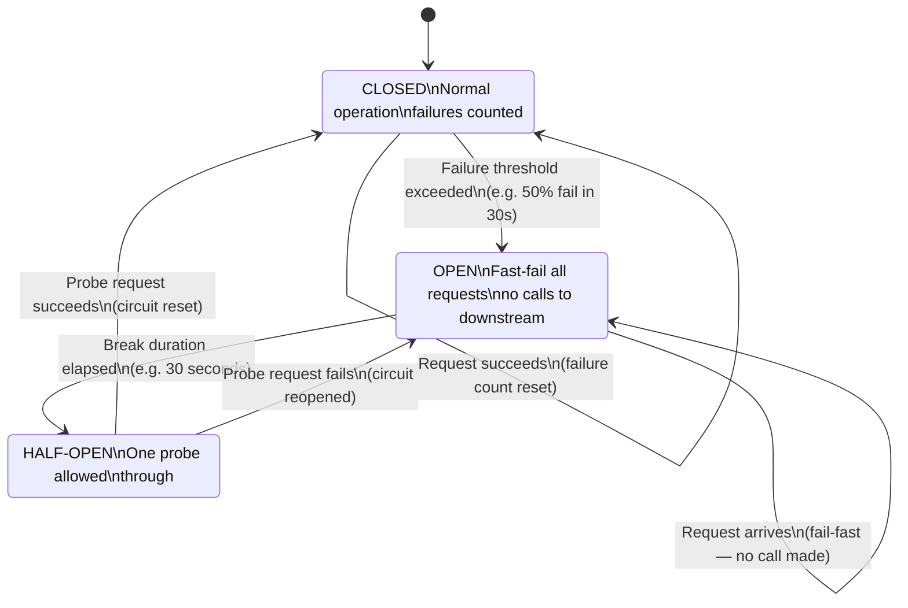

---

## 15.2 Bulkhead Pattern

### Q25. What is the Bulkhead pattern and how does it prevent resource exhaustion?

**Answer:**
Bulkhead isolates resources (thread pool slots, connection pool) per downstream service. If Service A is slow and consumes all threads, it doesn't starve requests to Service B. Named after watertight ship compartments — one flooded compartment doesn't sink the ship.

❌ **Wrong — all outbound HTTP calls share the same HttpClient and thread pool:**
```csharp
// Single shared HttpClient for all downstream services
// If InventoryService is slow → threads pile up waiting → OrderService can't call PaymentService
builder.Services.AddSingleton<HttpClient>();
```

✅ **Correct — separate named HttpClients with concurrency limits per service:**
```csharp
// Each downstream service gets its own named client with its own connection pool
builder.Services.AddHttpClient("inventory")
    .AddResilienceHandler("inventory", p =>
        p.AddConcurrencyLimiter(new ConcurrencyLimiterOptions { PermitLimit = 20 }));

builder.Services.AddHttpClient("payment")
    .AddResilienceHandler("payment", p =>
        p.AddConcurrencyLimiter(new ConcurrencyLimiterOptions { PermitLimit = 10 }));

// Inventory being slow only consumes its 20 slots — payment's 10 slots are unaffected
```

---

# 16. CQRS & Read/Write Separation

> 📚 Reference: https://learn.microsoft.com/en-us/azure/architecture/patterns/cqrs
> 📚 Event Sourcing: https://learn.microsoft.com/en-us/azure/architecture/patterns/event-sourcing

---

## 16.1 CQRS Pattern

### Q26. What is CQRS and when does it add value?

**Answer:**
CQRS (Command Query Responsibility Segregation) separates the write model (commands that change state) from the read model (queries that return data). Write side uses a normalized domain model; read side uses denormalized projections optimized for query patterns. Valuable when read and write workloads have very different shapes, scale requirements, or consistency needs.

❌ **Wrong — single model serving both reads and writes, complex queries on normalized schema:**
```csharp
// Same Order entity used for both creating orders AND generating the orders list page
public class OrderService {
    public async Task CreateOrderAsync(CreateOrderDto dto) {
        // Write: validate, apply business rules, save normalized entity
        var order = new Order(dto); // normalized domain object
        await _db.Orders.AddAsync(order);
    }

    public async Task<List<Order>> GetOrdersForUserAsync(int userId) {
        // Read: loading full Order + nested OrderItems + Customer + Product for every row
        // Just to show order ID, date, and total on a list page — massive over-fetch
        return await _db.Orders
            .Include(o => o.Items).ThenInclude(i => i.Product)
            .Include(o => o.Customer)
            .Where(o => o.UserId == userId).ToListAsync();
    }
}
```

✅ **Correct — separate command handlers and query handlers with tailored projections:**
```csharp
// Command side — enforces business rules, uses domain model
public class CreateOrderCommandHandler : IRequestHandler<CreateOrderCommand, Guid> {
    public async Task<Guid> Handle(CreateOrderCommand cmd, CancellationToken ct) {
        var order = Order.Create(cmd.UserId, cmd.Items);  // domain logic
        await _repo.AddAsync(order, ct);
        await _mediator.Publish(new OrderCreatedEvent(order.Id), ct); // update read model
        return order.Id;
    }
}

// Query side — dedicated read model, SQL projection, no domain object overhead
public class GetUserOrdersQueryHandler : IRequestHandler<GetUserOrdersQuery, List<OrderSummaryDto>> {
    public async Task<List<OrderSummaryDto>> Handle(GetUserOrdersQuery q, CancellationToken ct) {
        // Direct SQL projection — returns exactly what the UI needs, nothing more
        return await _db.Database.SqlQuery<OrderSummaryDto>(
            $"SELECT o.Id, o.CreatedAt, o.TotalAmount, COUNT(i.Id) as ItemCount " +
            $"FROM Orders o JOIN OrderItems i ON i.OrderId = o.Id " +
            $"WHERE o.UserId = {q.UserId} GROUP BY o.Id, o.CreatedAt, o.TotalAmount").ToListAsync(ct);
    }
}
```

---

## 16.2 Read Replicas

### Q27. How do you route reads to replicas and writes to the primary in .NET?

**Answer:**
Use multiple `DbContext` registrations or a custom `IDbConnectionFactory` that returns the read replica connection string for queries. In EF Core, use two contexts sharing the same model but different connection strings.

❌ **Wrong — all reads and writes go through the primary, primary becomes a bottleneck:**
```csharp
// Single DbContext, all queries hit the primary database
builder.Services.AddDbContext<AppDbContext>(o => o.UseSqlServer(config["DB:Primary"]));
// For a read-heavy app (90% reads), the primary is overloaded and writes slow down
```

✅ **Correct — separate contexts for read replica and primary:**
```csharp
// Register two DbContexts
builder.Services.AddDbContext<WriteDbContext>(o => o.UseSqlServer(config["DB:Primary"]));
builder.Services.AddDbContext<ReadDbContext>(o =>
    o.UseSqlServer(config["DB:ReadReplica"]).UseQueryTrackingBehavior(QueryTrackingBehavior.NoTracking));

// Write operations use WriteDbContext (primary)
public class OrderCommandService(WriteDbContext db) {
    public async Task CreateAsync(Order order) { db.Orders.Add(order); await db.SaveChangesAsync(); }
}

// Read operations use ReadDbContext (replica, no tracking overhead)
public class OrderQueryService(ReadDbContext db) {
    public Task<List<OrderSummaryDto>> GetSummariesAsync(int userId) =>
        db.Orders.Where(o => o.UserId == userId)
                 .Select(o => new OrderSummaryDto(o.Id, o.CreatedAt, o.Total))
                 .ToListAsync();
}
```

---

# 17. Service Discovery & Communication

> 📚 Reference: https://learn.microsoft.com/en-us/dotnet/core/extensions/service-discovery
> 📚 Consul: https://developer.hashicorp.com/consul

---

## 17.1 Service Discovery

### Q28. What is service discovery and what are the client-side vs server-side approaches?

**Answer:**
Service discovery lets microservices find each other without hardcoded URLs. **Server-side** (AWS ALB, Kubernetes Service): load balancer or DNS resolves service name — client calls a stable name, infrastructure routes to a healthy instance. **Client-side** (Consul, Eureka): client queries a registry, gets a list of instances, and picks one with its own load balancing logic.

❌ **Wrong — hardcoded service URLs, breaks on scaling or deployment:**
```csharp
// Hardcoded URL — if InventoryService moves or scales, this breaks
var response = await _http.GetAsync("http://10.0.1.45:8080/api/stock/123");
// Different IPs in dev/staging/prod = manual config changes everywhere
```

✅ **Correct — Kubernetes DNS-based service discovery (server-side):**
```csharp
// In Kubernetes: InventoryService is exposed as a K8s Service named "inventory-svc"
// DNS resolves "inventory-svc" to healthy pod IPs via kube-proxy

// appsettings.json
{ "Services": { "Inventory": "http://inventory-svc" } }

// Program.cs — .NET 8 Microsoft.Extensions.ServiceDiscovery
builder.Services.AddServiceDiscovery();
builder.Services.ConfigureHttpClientDefaults(http =>
    http.AddServiceDiscovery()); // resolves "inventory-svc" via DNS

builder.Services.AddHttpClient<IInventoryClient, InventoryClient>(client =>
    client.BaseAddress = new Uri("http://inventory-svc")); // K8s DNS handles routing

// No IP addresses in code — works across all environments
```

---

# 18. More System Design Problems

> 📚 Reference: https://github.com/donnemartin/system-design-primer

---

## 18.1 Design Twitter

### Q29. Walk through the design of a Twitter-like microblogging platform.

**Answer:**

**Requirements:** Post tweets (≤280 chars), follow users, home timeline (tweets from followed users), trending topics, search, notifications.

**Scale:** 400M users, 500M tweets/day, 150M DAU reading timelines 8x/day = 1.2B timeline reads/day → ~14,000 reads/sec vs 6,000 writes/sec. Very read-heavy — cache is critical.

**The Core Challenge — Timeline Fan-Out**

Twitter's "celebrity problem" is more acute than Facebook's: Katy Perry has 100M followers. Each tweet must reach 100M timelines.

```
Write path:
Tweet posted → Kafka "tweets" topic
   ↓
Fan-out Service reads Kafka:
  - For regular users: push tweet_id to each follower's timeline cache (Redis sorted set)
  - For celebrities (>1M followers): skip fan-out — use pull at read time

Read path (home timeline):
  1. Fetch pre-computed timeline from Redis
  2. Merge in tweets from celebrities the user follows (pulled on read)
  3. Sort merged result by time
  4. Return top 200 tweets

Why this hybrid?
  - Katy Perry tweets → 100M Redis writes = 100M × 16 bytes = 1.6GB Redis writes per tweet
  - Instead: store tweet once, read-merge for the 0.01% of users who ARE celebrities
```

**Data Model:**
```sql
Tweet (id BIGINT, user_id, content VARCHAR(280), created_at, like_count, retweet_count, reply_to_tweet_id)
Follow (follower_id, followee_id, created_at)  INDEX on both columns
UserTimeline: Redis sorted set  key=timeline:{user_id}  score=timestamp  value=tweet_id
TrendingTopics: Redis sorted set  key=trending:{window}  score=mention_count  value=hashtag
```

**Trending Topics:**
```
Kafka consumer counts hashtag mentions with a 1-hour sliding window
Top 50 hashtags by count per region stored in Redis
Trending Service recomputes every 60 seconds
```

**Architecture:**
```
[Client] → [API Gateway]
            ├── [Tweet Service]       → Cassandra (tweets), Kafka (fan-out events)
            ├── [Timeline Service]    → Redis (pre-computed timelines), Celebrity pull
            ├── [Search Service]      → Elasticsearch (full-text tweet search)
            ├── [Trending Service]    → Redis (hashtag counts via Kafka consumer)
            ├── [Notification Service]→ Push/email on likes, retweets, follows
            └── [Media Service]       → S3 + CDN (images, videos in tweets)
```

---

## 18.2 Design Google Drive / Dropbox

### Q30. Walk through the design of a file storage and sync system like Google Drive.

**Answer:**

**Requirements:** Upload/download files, folder hierarchy, sync across devices, share files, version history, collaborative editing (for docs).

**Scale:** 1B users, average 15GB free storage = 15 exabytes total. 10M concurrent syncing clients. Upload/download: 50M operations/day.

**The Core Challenge — Chunked Upload & Delta Sync**

❌ **Wrong — upload entire file on every change:**
```
User edits a 500MB video file, changes 1 frame:
→ Upload all 500MB again → 500MB bandwidth × millions of users = petabytes/day wasted
```

✅ **Correct — chunked upload with delta sync:**
```
File split into fixed-size chunks (4MB each).
Each chunk is content-addressed: id = SHA-256(chunk_bytes)

Upload flow:
  1. Client computes SHA-256 of each chunk
  2. Client sends chunk IDs to server: "which of these do you already have?"
  3. Server responds: "I'm missing chunks [3, 7, 12]"
  4. Client uploads ONLY missing chunks → if file barely changed, ~0 data transferred
  5. Server assembles file from chunks (deduplication: same chunk shared across users)

Edit 1 line of a 100KB text file:
  → Only 1 chunk (4KB) changed → upload 4KB, not 100KB
```

**Data Model:**
```sql
File    (id, owner_id, name, parent_folder_id, created_at, is_deleted)
FileVersion (id, file_id, version_num, size_bytes, created_at, created_by)
Chunk   (id=SHA256_hash, size_bytes, storage_path)  -- global dedup table
FileVersionChunk (version_id, chunk_id, sequence_num)

-- Redis: sync state per device
device_sync_state:{device_id} → { last_sync_cursor: timestamp, pending_events: [...] }
```

**Sync Protocol:**
```
Long-polling or WebSocket per client device.
Server maintains a change log (event stream): file_created, file_modified, file_deleted.
Client subscribes to changes for its user_id.
On reconnect: client sends last_sync_cursor, server returns all changes since then.
Conflict resolution: last-write-wins for most files; for collaborative docs, OT/CRDT.
```

**Architecture:**
```
[Desktop/Mobile Client]
    │
    ├── Chunk Upload: Client → [Upload Service] → S3 (chunks) → Metadata DB
    ├── Download: Client → [CDN] → S3 (cached chunks by SHA-256)
    └── Sync: Client ←WebSocket→ [Sync Service] → Change Event Stream (Kafka)

[Metadata Service] → PostgreSQL (folder tree, file metadata, permissions)
[Version Service]  → stores version history, handles rollback
[Share Service]    → ACL management, public link generation
[Search Service]   → Elasticsearch (filename, content if text-extractable)
[Thumbnail Service]→ async thumbnail generation for images/videos → CDN
```

---

## 18.3 Design an E-Commerce Platform (Amazon)

### Q31. Walk through the design of a large-scale e-commerce platform.

**Answer:**

**Requirements:** Product catalog, search, cart, checkout, order management, inventory, recommendations, seller management, reviews.

**Scale:** 300M products, 1B+ users, 1M+ orders/day, 100K+ concurrent users during flash sales.

**Domain Services (Microservices Decomposition):**
```
ProductService     — catalog, descriptions, images, pricing
SearchService      — Elasticsearch for full-text + faceted search
InventoryService   — stock levels, reservations, warehouse locations
CartService        — user carts (Redis, short TTL)
CheckoutService    — orchestrates: reserve inventory → charge → create order → notify
OrderService       — order lifecycle, fulfillment, returns
PaymentService     — payment processing, refunds (PCI-DSS isolated)
UserService        — accounts, addresses, payment methods
RecommendationService — "customers also bought", personalized homepage
SellerService      — seller onboarding, listings, payouts
NotificationService   — email, SMS, push for order updates
```

**Flash Sale / Inventory Contention:**

❌ **Wrong — stock decrement in application layer with optimistic locking, thundering herd:**
```
10,000 users buy last 100 items simultaneously
→ 10,000 concurrent SELECT + UPDATE on inventory row
→ Database lock contention → timeouts → bad user experience
```

✅ **Correct — Redis atomic counter for hot inventory:**
```
Pre-sale: SET inventory:{product_id} 100  (atomic counter in Redis)

On "Add to Cart" for flash sale item:
  DECR inventory:{product_id}
  If result >= 0: reservation succeeded (atomic, no DB involved)
  If result < 0:  INCR (restore), return "sold out"

Async reconciliation: Kafka consumer writes final inventory to DB every 5s
Result: 1M+ reservation attempts/sec without database lock contention
```

**Product Search Architecture:**
```
Write path: Product created/updated → Kafka → Elasticsearch indexer
            Indexed fields: name, description, brand, category, price, rating, seller_id

Read path: Search query → Search Service
  1. Elasticsearch: full-text + filters (category, price range, brand, rating ≥ 4★)
  2. Apply personalization boost (user's past purchases, browsing history)
  3. Apply business rules (promoted products, in-stock only)
  4. Return ranked product IDs

Elasticsearch cluster: 3 masters + 6 data nodes, 1 replica per shard
Index size: 300M products × ~2KB = ~600GB → manageable on 6 data nodes
```

**Order State Machine:**
```
CART_ACTIVE → CHECKOUT_INITIATED → PAYMENT_PENDING → PAYMENT_CONFIRMED
           → INVENTORY_RESERVED → AWAITING_FULFILLMENT → SHIPPED
           → OUT_FOR_DELIVERY → DELIVERED → REVIEW_REQUESTED

Cancellation paths:
  Any state before SHIPPED: CANCELLED (inventory released, refund initiated)
  After SHIPPED: RETURN_REQUESTED → RETURN_IN_TRANSIT → RETURNED → REFUNDED
```

---

# ⚖️ HLD Comparisons — Side-by-Side Differences

---

## HLD-C1 — SQL vs NoSQL

| | SQL (RDBMS) | NoSQL |
|-|------------|-------|
| Schema | Fixed, enforced | Flexible / schema-less |
| ACID | ✅ Full | Varies (Mongo: document-level; Cassandra: eventual) |
| Joins | ✅ Native | ❌ Denormalize or application-level |
| Scale | Vertical (+ read replicas) | Horizontal (sharding built-in) |
| Query language | SQL (standardised) | Varies per DB |
| Use for | Financial records, orders, users | Catalogs, social feeds, time-series, logs |
| Examples | SQL Server, PostgreSQL, MySQL | MongoDB, Cassandra, DynamoDB, Redis |

```
Choose SQL when:
✅ Data is relational with many joins
✅ ACID transactions critical (payments, orders)
✅ Complex reporting / aggregations

Choose NoSQL when:
✅ Massive scale (> 1TB, > 100k writes/sec)
✅ Schema changes frequently
✅ Document, key-value, or time-series shape
✅ Geographic distribution needed (Cassandra multi-region)
```

---

## HLD-C2 — Monolith vs Microservices vs Modular Monolith

| | Monolith | Microservices | Modular Monolith |
|-|---------|--------------|-----------------|
| Deployment | Single unit | Independent per service | Single unit |
| Team autonomy | ❌ Shared codebase | ✅ Per service | Partial |
| Operational complexity | Low | ❌ High (K8s, tracing, etc.) | Low |
| Network calls | In-process (fast) | Remote (slower, failure risk) | In-process |
| Data isolation | Shared DB | Per-service DB | Shared DB (module boundaries in code) |
| Use when | Early stage, small team | Scale per service needed, independent deploys | Growing monolith, not ready for micro |

---

## HLD-C3 — Synchronous vs Asynchronous Communication

| | Synchronous (REST/gRPC) | Asynchronous (Events/Queue) |
|-|------------------------|---------------------------|
| Coupling | Tight (caller waits) | Loose (fire and forget) |
| Latency | Immediate response | Eventual response |
| Failure isolation | ❌ Cascade failure | ✅ Queue buffers failures |
| Consistency | Strong | Eventual |
| Use for | Query responses, simple CRUD | Workflows, fan-out, long-running tasks |

---

## HLD-C4 — Message Queue vs Event Streaming

| | Message Queue (RabbitMQ, Service Bus) | Event Streaming (Kafka) |
|-|---------------------------------------|------------------------|
| Message retention | Deleted after consume | Retained for days/forever |
| Replay | ❌ No (deleted) | ✅ Yes |
| Consumers | One queue → one consumer group | One topic → many independent groups |
| Ordering | Per-queue FIFO | Per-partition ordering |
| Throughput | Up to ~50k/sec | Millions/sec |
| Use for | Work queues, notifications | Event sourcing, audit log, analytics |

---

## HLD-C5 — CDN vs Load Balancer vs Reverse Proxy vs API Gateway

| | CDN | Load Balancer | Reverse Proxy | API Gateway |
|-|-----|---------------|---------------|-------------|
| Primary role | Cache + edge delivery | Distribute traffic | Route to backend | API management |
| SSL termination | ✅ | ✅ L7 | ✅ | ✅ |
| Caching | ✅ Static content | ❌ | Optional | Optional |
| Auth / rate limiting | ✅ (basic) | ❌ | ❌ | ✅ |
| Protocol translation | ❌ | ❌ | ❌ | ✅ REST↔gRPC |
| Examples | Cloudflare, Azure CDN | Azure LB, AWS ALB | nginx, YARP | Azure APIM, Kong |

---

## HLD-C6 — Horizontal vs Vertical Scaling

| | Vertical (Scale Up) | Horizontal (Scale Out) |
|-|--------------------|------------------------|
| How | Bigger machine (CPU/RAM) | More machines |
| Cost | Exponential (premium hardware) | Linear |
| Ceiling | ❌ Hard limit | ✅ Near-unlimited |
| Downtime | ❌ Required | ✅ Zero (rolling) |
| Complexity | Low (no code change) | High (stateless required, LB needed) |
| Use for | DB servers (short-term), simple apps | Web servers, API servers, stateless workers |

---

## HLD-C7 — Read Replica vs Caching vs CQRS (for Read Scalability)

| | Read Replica | Cache (Redis) | CQRS Read Model |
|-|-------------|--------------|-----------------|
| Data freshness | Near-real-time (replication lag) | TTL-based staleness | Event-driven (milliseconds lag) |
| Query flexibility | Full SQL | Key-value / simple | Custom denormalised model |
| Complexity | Low | Low–Medium | High |
| Use for | Heavy read load, same queries | Repeated identical lookups | Complex read patterns, different shape from write |

---

## HLD-C8 — Strong vs Eventual Consistency

| | Strong Consistency | Eventual Consistency |
|-|-------------------|--------------------|
| Guarantee | Every read returns latest write | Reads may return stale data temporarily |
| Availability | ❌ May reject requests during partition | ✅ Always available |
| Examples | PostgreSQL, ZooKeeper, HBase | DynamoDB, Cassandra, DNS |
| Use for | Financial transactions, inventory (exact) | Social feeds, search indexes, caches |

```
Practical rule:
- Same row, same moment → needs strong consistency → RDBMS / Cosmos with strong
- Notification that order shipped → eventual is fine → Kafka event

A shopping cart can be eventually consistent (user adds items).
The final payment deduction must be strongly consistent.
```


---

# 📊 HLD Flow Diagrams — Visual Reference

---

## HLD-D1 — Microservices Architecture

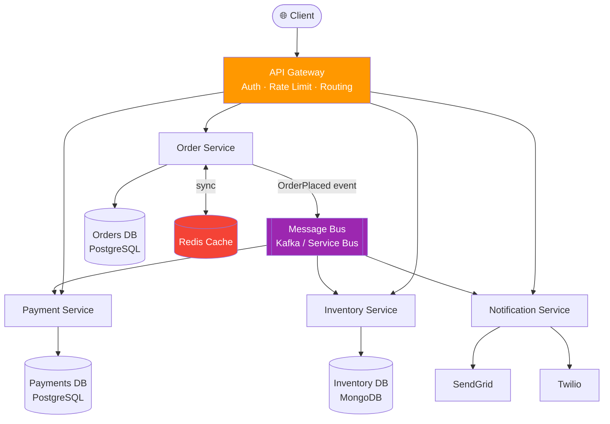

---

## HLD-D2 — Caching Layers (Cache-Aside Pattern)

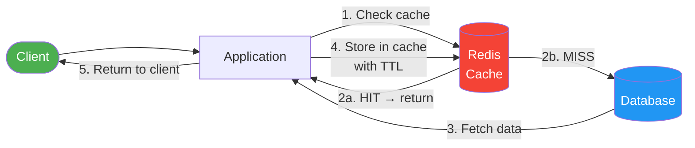

---

## HLD-D3 — Load Balancer Algorithms

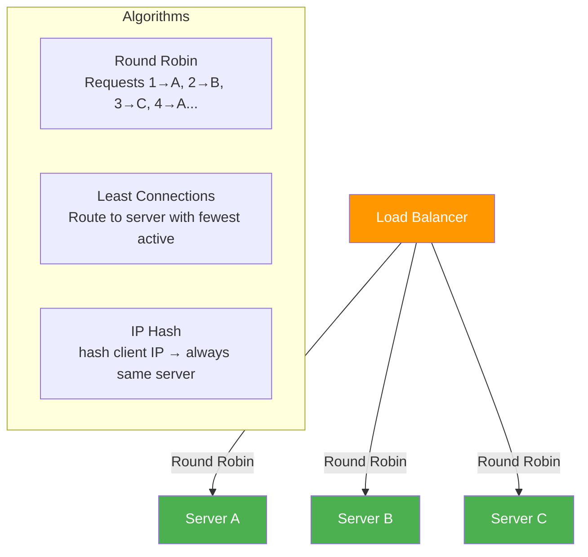

---

## HLD-D4 — SQL vs NoSQL Decision Tree

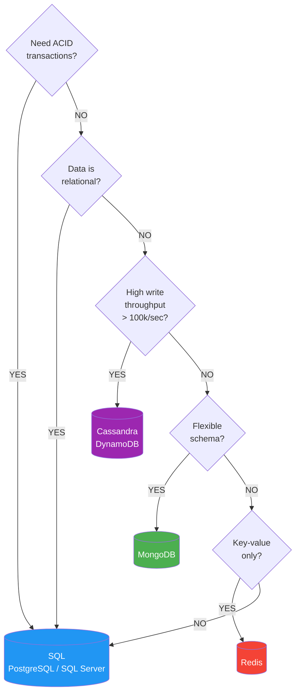

---

## HLD-D5 — CAP Theorem Venn Diagram

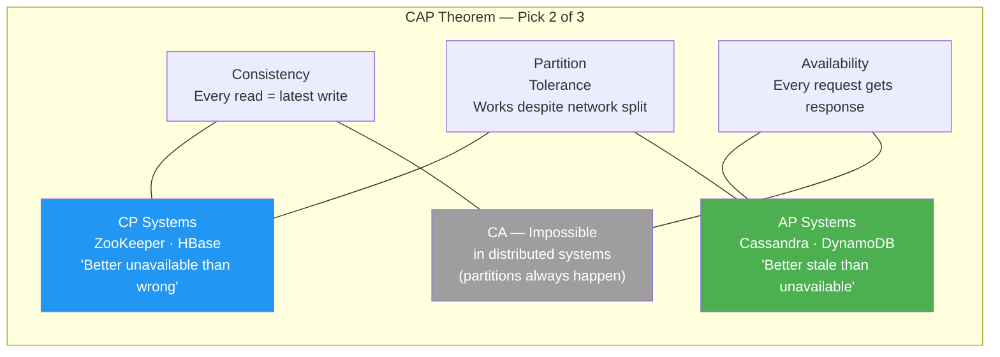

---

## HLD-D6 — Event-Driven Architecture vs Synchronous

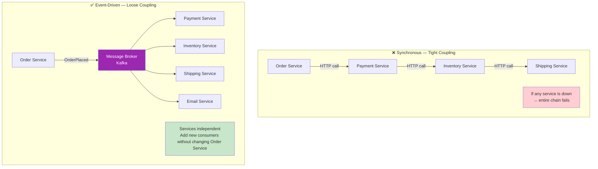

---

## HLD-D7 — Read/Write Scaling Patterns

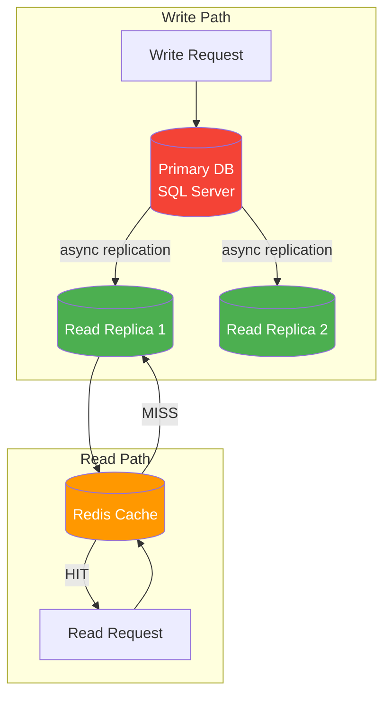

---

## HLD-D8 — Saga Pattern (Order Flow)

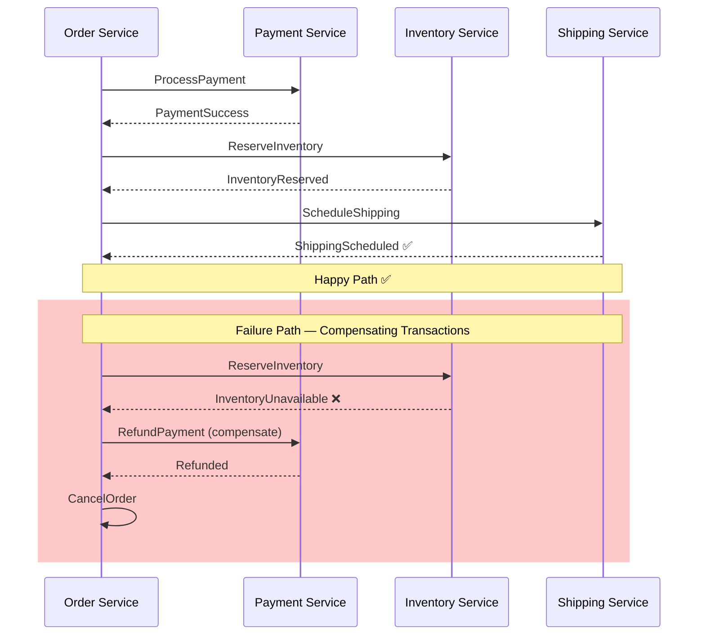

---

## HLD-D9 — Consistent Hashing Ring

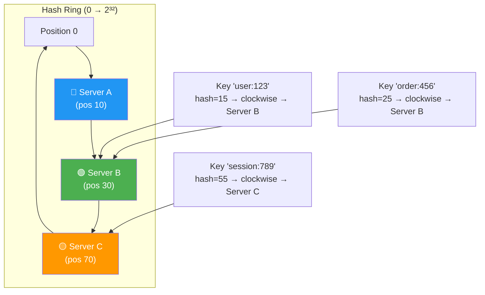


---

# 19. Redundancy & High Availability Patterns

> 📚 Reference: https://learn.microsoft.com/en-us/azure/architecture/framework/resiliency/redundancy
> 📚 AWS Well-Architected: https://docs.aws.amazon.com/wellarchitected/latest/reliability-pillar/redundancy.html

---

## 19.1 Redundancy Fundamentals

### Q32. What is redundancy and why is it critical in distributed systems?

**Answer:**
Redundancy means duplicating critical components so that if one fails, another immediately takes over. Without redundancy, any single component becomes a Single Point of Failure (SPOF) — one crash takes the entire system down. High-availability systems target 99.9% (8.7 hrs/year downtime), 99.99% (52 min/year), or 99.999% (5 min/year) uptime, and redundancy is the primary mechanism to achieve those SLAs.

**Key redundancy models:**

| Model | Description | Failover Time | Cost |
|-------|-------------|---------------|------|
| **Active-Active** | All nodes serve live traffic simultaneously | Zero (already serving) | Highest (full capacity × N) |
| **Active-Passive** | One node active; standby waits idle | Seconds–minutes (promotion needed) | Medium (standby unused) |
| **Hot Standby** | Passive is fully running, in sync, ready instantly | < 30 seconds | High |
| **Warm Standby** | Passive is running but not fully in sync | 1–5 minutes | Medium |
| **Cold Standby** | Passive is off; must be booted and restored | 15–60 minutes | Low |
| **N+1 Redundancy** | N nodes needed; 1 extra as spare | Automatic load redistribution | Low overhead |

**N+1 example:** 3 web servers handle peak load (N=3), deploy 4 — if one fails, the other 3 still cover full capacity.

❌ **Wrong — single node, no redundancy:**
```
Architecture:
[Client] → [Single Web Server] → [Single DB]

Problem:
- Web server crash = 100% downtime
- DB crash = 100% downtime
- Maintenance window = planned downtime
→ No SLA above 95% is achievable
```

✅ **Correct — Active-Active web tier + Active-Passive DB:**
```
Architecture:
[Client]
   ↓
[Load Balancer]
  ├── [Web Server 1]  ← Active, serving traffic
  ├── [Web Server 2]  ← Active, serving traffic
  └── [Web Server 3]  ← Active, serving traffic (N+1 spare capacity)
         ↓
[DB Primary] ──replication──> [DB Replica]  ← Hot Standby
                                              (promoted in < 30s if primary fails)
```

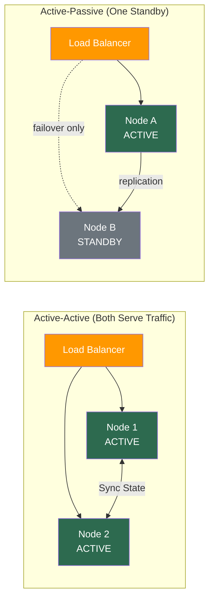

> 📚 Reference: https://learn.microsoft.com/en-us/azure/architecture/patterns/health-endpoint-monitoring

---

## 19.2 Eliminating Single Points of Failure

### Q33. What are the key strategies for eliminating single points of failure (SPOF)?

**Answer:**
A SPOF is any component whose failure causes total system failure. Systematic SPOF elimination requires auditing every layer — network, compute, load balancing, storage, DNS — and adding redundancy at each. The most common SPOFs and their fixes:

| Layer | SPOF | Fix |
|-------|------|-----|
| Load Balancer | Single LB | VRRP / floating IP — two LBs share a virtual IP; if active LB dies, passive takes the VIP |
| Web Tier | Single server | Multiple instances behind LB |
| Database | Single primary | Primary + replicas; automatic failover (e.g., Always On AG) |
| Storage | Single disk | RAID, distributed storage (Azure Blob, S3) |
| Network | Single NIC / switch | Redundant NICs, redundant switches, dual uplinks |
| DNS | Single DNS server | Multiple DNS servers; TTL-aware failover |
| Availability Zone | Single AZ | Multi-AZ deployment |
| Region | Single region | Multi-region with GeoDNS |

❌ **Wrong — system with multiple SPOFs:**
```
Internet → [Single Load Balancer] → [Single App Server] → [Single DB]
                ↑ SPOF #1              ↑ SPOF #2            ↑ SPOF #3
```

✅ **Correct — all SPOFs removed:**
```
Internet
   ↓
[GeoDNS] → routes to nearest healthy region
   ↓
[LB Pair: Active + Passive via VRRP/Floating IP]
   ↓
[App Server 1]  [App Server 2]  [App Server 3]   ← multiple instances
   ↓                  ↓               ↓
[DB Primary] ──Always On AG──> [DB Replica 1]
                                [DB Replica 2]   ← automatic failover
   ↓
[Azure Blob Storage]  ← replicated, no single disk
```

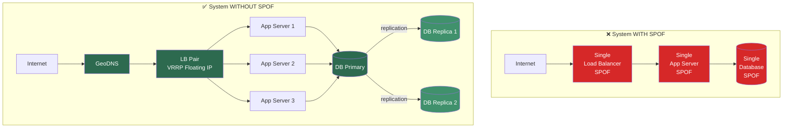

> 📚 Reference: https://learn.microsoft.com/en-us/azure/load-balancer/load-balancer-ha-ports-overview

---

## 19.3 Replication Lag

### Q34. What is replication lag and how do you handle it?

**Answer:**
Replication lag is the delay between a write committed on the primary database and that write becoming visible on a replica. With **synchronous replication** the primary waits for the replica to confirm before acknowledging the write — zero lag, but higher write latency. With **asynchronous replication** the primary acknowledges immediately and replicates in the background — lower write latency, but replicas may be seconds (or more) behind.

**Problems caused by replication lag:**
- User writes a record, immediately reads from a replica, sees old data ("I just created it — where is it?")
- Load balancer sends a read to a lagging replica — user sees stale counts, stale balances

**Strategies to handle lag:**

| Strategy | How | Trade-off |
|----------|-----|-----------|
| **Read-your-own-writes** | After a write, route that user's reads to primary for a short window | Primary gets slightly more read load |
| **Sticky sessions / session consistency** | Pin user to same replica for the session duration | Uneven replica load |
| **Monotonic reads** | Once user has seen version N, always route to a replica that has at least version N | Requires version tracking |
| **Synchronous replication** | Wait for replica ACK before confirming write | Higher write latency |
| **Write to primary, read from primary for critical paths** | Use replica only for analytics / reporting reads | Replica underutilised for writes |

❌ **Wrong — always reading from replica after write:**
```csharp
// User updates their profile, then reads it back
await _db.ExecuteAsync("UPDATE Users SET Name = @name WHERE Id = @id", ...);
// Routes to replica — may return old name for up to seconds
var user = await _readReplicaDb.QueryFirstAsync<User>("SELECT * FROM Users WHERE Id = @id", ...);
// User sees their old name → confused, thinks the save failed
```

✅ **Correct — read-your-own-writes: route to primary immediately after write:**
```csharp
await _primaryDb.ExecuteAsync("UPDATE Users SET Name = @name WHERE Id = @id", ...);

// For THIS user's next read, use primary (or wait for replication + verify)
// Option 1: always read from primary for profile page (critical path)
var user = await _primaryDb.QueryFirstAsync<User>("SELECT * FROM Users WHERE Id = @id", ...);

// Option 2: set a short-lived flag in Redis, route to primary while flag exists
await _cache.SetAsync($"read-primary:{userId}", "1", TimeSpan.FromSeconds(10));
// Middleware checks flag and routes accordingly
```

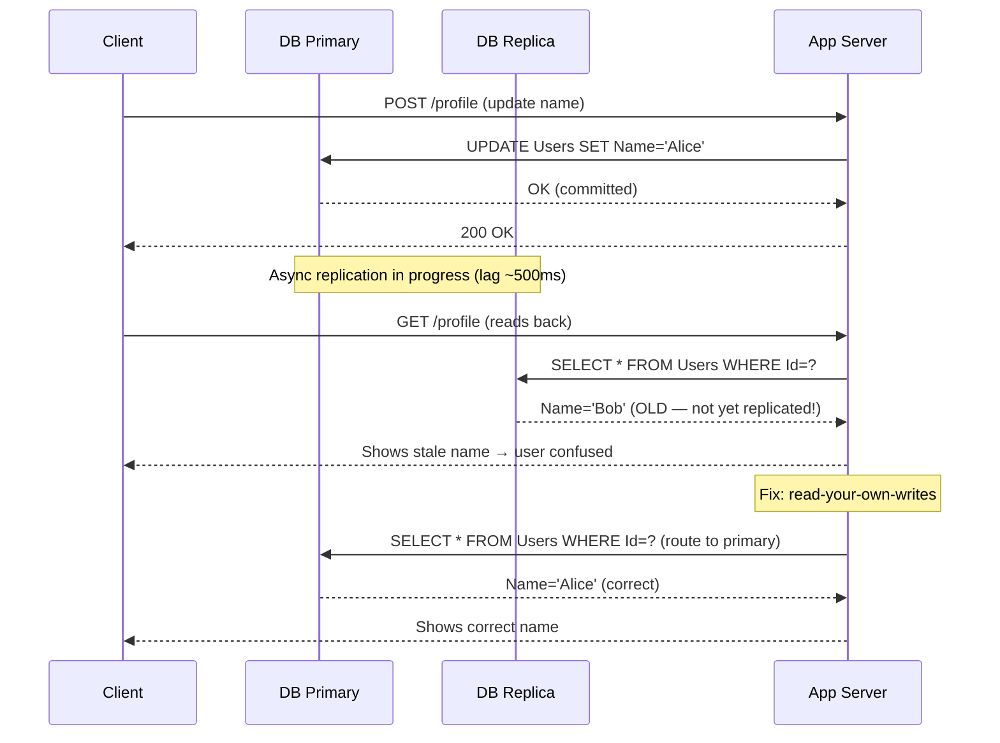

> 📚 Reference: https://learn.microsoft.com/en-us/azure/azure-sql/database/read-scale-out

---

## 19.4 Failover & Automatic Failover

### Q35. What is a failover and how does automatic failover work?

**Answer:**
A **failover** is the process of switching from a failed component to a healthy standby. **Automatic failover** removes human intervention from this process — the system detects failure and promotes a replica within seconds.

**Key metrics:**
- **RTO (Recovery Time Objective):** Maximum acceptable time the system can be down. Example: RTO = 30 seconds means failover must complete within 30 seconds.
- **RPO (Recovery Point Objective):** Maximum acceptable data loss measured in time. Example: RPO = 5 seconds means you can lose at most 5 seconds of writes.

| Replication Type | Typical RTO | Typical RPO | Notes |
|-----------------|-------------|-------------|-------|
| Synchronous (Always On AG sync) | < 30 sec | 0 (zero data loss) | Higher write latency |
| Asynchronous | 30 sec – 2 min | Seconds–minutes of data | Lower write latency |
| Log shipping | Minutes–hours | Minutes–hours | Simple, low cost |

**Automatic failover sequence:**
1. Health check fails (timeout / no heartbeat)
2. Quorum/consensus reached among cluster nodes (avoids split-brain)
3. Replica promoted to primary
4. Virtual IP (VIP) or DNS record updated to point to new primary
5. Application connections re-established

❌ **Wrong — manual failover with no health checks:**
```
System relies on on-call engineer to:
1. Notice alert at 3am
2. SSH into server to confirm failure
3. Manually run promotion script
4. Update DNS record
5. Notify team

MTTR (Mean Time To Recover): 20–60 minutes
Data loss: up to 60 minutes of writes
```

✅ **Correct — automated failover with SQL Server Always On AG:**
```sql
-- Always On Availability Group configured:
-- Primary: SQL-01 (sync commit)
-- Secondary: SQL-02 (sync commit, automatic failover partner)
-- Witness: Azure Cloud Witness (quorum)

-- Failover listener: app connects to AG Listener (virtual name)
-- Connection string: Server=AGListener,1433;...
-- On SQL-01 failure:
--   1. SQL-02 detects missed heartbeats (< 10 sec)
--   2. Quorum with Cloud Witness confirms failure
--   3. SQL-02 promoted automatically (< 30 sec)
--   4. AG Listener VIP moves to SQL-02
--   5. App reconnects transparently via same connection string
-- RTO: < 30 seconds | RPO: 0 (sync commit)
```

```mermaid
flowchart TD
    A([Health Check Fails]) --> B{Retry threshold\nexceeded?}
    B -->|No| A
    B -->|Yes| C[Declare node FAILED]
    C --> D{Quorum\nreached?}
    D -->|No — split-brain risk| E[❌ Halt: wait for\nmanual resolution]
    D -->|Yes| F[Promote Replica\nto Primary]
    F --> G[Update VIP /\nDNS record]
    G --> H[Drain old connections]
    H --> I[Applications reconnect\nvia Listener / VIP]
    I --> J([✅ System Restored\nRTO met])

    style A fill:#d62828,color:#fff
    style E fill:#d62828,color:#fff
    style J fill:#2d6a4f,color:#fff
    style F fill:#FF9800,color:#fff
    style G fill:#FF9800,color:#fff
```

> 📚 Reference: https://learn.microsoft.com/en-us/sql/database-engine/availability-groups/windows/automatic-failover-conditions

---

## 19.5 Geo-Redundancy & Multi-Region Architecture

### Q36. What is geo-redundancy and how do you design a multi-region architecture?

**Answer:**
Geo-redundancy distributes your system across multiple geographic regions to survive regional outages (data-center fires, natural disasters, large-scale cloud provider incidents). It also reduces latency by serving users from the nearest region.

**Two primary multi-region patterns:**

| Pattern | Description | RTO | RPO | Cost |
|---------|-------------|-----|-----|------|
| **Active-Active** | All regions serve live traffic; data replicated bi-directionally | Near-zero | Near-zero (sync) or seconds (async) | Highest |
| **Active-Passive (DR site)** | One region active; DR region is a warm/cold standby | Minutes | Minutes–hours | Lower |

**Key components:**

- **GeoDNS:** Routes users to nearest healthy region based on DNS resolution. Failover by updating DNS records (TTL matters — keep low for fast failover, e.g., 60 seconds).
- **Anycast:** Single IP announced from multiple locations; BGP routes traffic to nearest PoP. Used by Cloudflare, Akamai, AWS Global Accelerator.
- **Data sovereignty:** Laws (GDPR, local data residency) may prohibit replicating certain data outside specific regions. Requires per-region data isolation for regulated data.
- **Conflict resolution:** Active-Active writes to two regions simultaneously can create conflicts. Strategies: last-write-wins (timestamp), CRDT, application-level merge.

❌ **Wrong — single region, no DR plan:**
```
All traffic → Region: East US
  - DB Primary: East US only
  - No replication to another region
  - No DNS failover configured

East US outage (Azure incident, ~4 hrs) = 4 hours of downtime
No data recovery path if East US data is lost
```

✅ **Correct — Active-Passive multi-region with GeoDNS:**
```
Normal operation:
  GeoDNS → East US (primary region, 100% traffic)
              ├── App Servers (3×)
              ├── DB Primary
              └── Async replication ──────────────────────────────►
                                                          West Europe (DR)
                                                            ├── App Servers (1× warm)
                                                            └── DB Replica (hot standby)

East US failure:
  1. Health probe fails (GeoDNS / Azure Traffic Manager)
  2. DNS TTL expires (60 sec) → traffic reroutes to West Europe
  3. DB Replica promoted to Primary in West Europe
  4. App scales out in West Europe
  RTO: ~5 minutes | RPO: seconds (async lag)
```

```mermaid
flowchart TD
    U([🌐 Users]) --> GDNS[GeoDNS /\nAzure Traffic Manager]

    GDNS -->|Normal: 100%| EUS

    subgraph EUS["Region: East US (Primary)"]
        LB_E[Load Balancer] --> APP_E1[App Server 1]
        LB_E --> APP_E2[App Server 2]
        APP_E1 & APP_E2 --> DBP[(DB Primary)]
    end

    subgraph WEU["Region: West Europe (DR / Passive)"]
        LB_W[Load Balancer] --> APP_W[App Server\nWarm Standby]
        APP_W --> DBR[(DB Replica\nHot Standby)]
    end

    DBP -->|Async Replication| DBR

    GDNS -.->|Failover: East US down| WEU

    style EUS fill:#1a1a2e,color:#fff
    style WEU fill:#16213e,color:#fff
    style DBP fill:#2d6a4f,color:#fff
    style DBR fill:#40916c,color:#fff
    style GDNS fill:#FF9800,color:#fff
```

> 📚 Reference: https://learn.microsoft.com/en-us/azure/architecture/patterns/geodes
> 📚 Azure Traffic Manager: https://learn.microsoft.com/en-us/azure/traffic-manager/traffic-manager-overview

---

❌ **Wrong — manual failover with no health checks:**
```
System relies on on-call engineer to:
1. Notice alert at 3am
2. SSH into server to confirm failure
3. Manually run promotion script
4. Update DNS record
5. Notify team

MTTR (Mean Time To Recover): 20-60 minutes
Data loss: up to 60 minutes of writes
```

✅ **Correct — automated failover with SQL Server Always On AG:**
```sql
-- Always On Availability Group configured:
-- Primary: SQL-01 (sync commit)
-- Secondary: SQL-02 (sync commit, automatic failover partner)
-- Witness: Azure Cloud Witness (quorum)

-- Failover listener: app connects to AG Listener (virtual name)
-- Connection string: Server=AGListener,1433;...
-- On SQL-01 failure:
--   1. SQL-02 detects missed heartbeats (< 10 sec)
--   2. Quorum with Cloud Witness confirms failure
--   3. SQL-02 promoted automatically (< 30 sec)
--   4. AG Listener VIP moves to SQL-02
--   5. App reconnects transparently via same connection string
-- RTO: < 30 seconds | RPO: 0 (sync commit)
```

```mermaid
flowchart TD
    A([Health Check Fails]) --> B{Retry threshold\nexceeded?}
    B -->|No| A
    B -->|Yes| C[Declare node FAILED]
    C --> D{Quorum\nreached?}
    D -->|No — split-brain risk| E[Halt: wait for\nmanual resolution]
    D -->|Yes| F[Promote Replica\nto Primary]
    F --> G[Update VIP /\nDNS record]
    G --> H[Drain old connections]
    H --> I[Applications reconnect\nvia Listener / VIP]
    I --> J([System Restored\nRTO met])

    style A fill:#d62828,color:#fff
    style E fill:#d62828,color:#fff
    style J fill:#2d6a4f,color:#fff
    style F fill:#FF9800,color:#fff
    style G fill:#FF9800,color:#fff
```

> 📚 Reference: https://learn.microsoft.com/en-us/sql/database-engine/availability-groups/windows/automatic-failover-conditions

---

## 19.5 Geo-Redundancy & Multi-Region Architecture

### Q36. What is geo-redundancy and how do you design a multi-region architecture?

**Answer:**
Geo-redundancy distributes your system across multiple geographic regions to survive regional outages (data-center fires, natural disasters, large-scale cloud provider incidents). It also reduces latency by serving users from the nearest region.

**Two primary multi-region patterns:**

| Pattern | Description | RTO | RPO | Cost |
|---------|-------------|-----|-----|------|
| **Active-Active** | All regions serve live traffic; data replicated bi-directionally | Near-zero | Near-zero (sync) or seconds (async) | Highest |
| **Active-Passive (DR site)** | One region active; DR region is a warm/cold standby | Minutes | Minutes-hours | Lower |

**Key components:**

- **GeoDNS:** Routes users to nearest healthy region based on DNS resolution. Failover by updating DNS records (keep TTL low, e.g., 60 seconds, for fast failover).
- **Anycast:** Single IP announced from multiple PoPs; BGP routes traffic to nearest one. Used by Cloudflare, Akamai, AWS Global Accelerator.
- **Data sovereignty:** Laws (GDPR, local data residency requirements) may prohibit replicating certain data outside specific regions. Requires per-region data isolation for regulated data.
- **Conflict resolution:** Active-Active writes to two regions simultaneously can create conflicts. Strategies: last-write-wins (timestamp), CRDTs, application-level merge.

❌ **Wrong — single region, no DR plan:**
```
All traffic -> Region: East US
  - DB Primary: East US only
  - No replication to another region
  - No DNS failover configured

East US outage = hours of downtime with no recovery path
```

✅ **Correct — Active-Passive multi-region with GeoDNS:**
```
Normal operation:
  GeoDNS -> East US (primary region, 100% traffic)
    - App Servers (3x)
    - DB Primary
    - Async replication ──────────────────────>
                                    West Europe (DR)
                                      - App Servers (1x warm)
                                      - DB Replica (hot standby)

East US failure:
  1. Health probe fails (Azure Traffic Manager detects)
  2. DNS TTL expires (60 sec) -> traffic reroutes to West Europe
  3. DB Replica promoted to Primary in West Europe
  4. App scales out in West Europe
  RTO: ~5 minutes | RPO: seconds (async lag)
```

```mermaid
flowchart TD
    U([Users]) --> GDNS[GeoDNS /\nAzure Traffic Manager]

    GDNS -->|Normal: 100%| EUS

    subgraph EUS["Region: East US (Primary)"]
        LB_E[Load Balancer] --> APP_E1[App Server 1]
        LB_E --> APP_E2[App Server 2]
        APP_E1 & APP_E2 --> DBP[(DB Primary)]
    end

    subgraph WEU["Region: West Europe (DR / Passive)"]
        LB_W[Load Balancer] --> APP_W[App Server\nWarm Standby]
        APP_W --> DBR[(DB Replica\nHot Standby)]
    end

    DBP -->|Async Replication| DBR

    GDNS -.->|Failover: East US down| WEU

    style DBP fill:#2d6a4f,color:#fff
    style DBR fill:#40916c,color:#fff
    style GDNS fill:#FF9800,color:#fff
```

> 📚 Reference: https://learn.microsoft.com/en-us/azure/architecture/patterns/geodes
> 📚 Azure Traffic Manager: https://learn.microsoft.com/en-us/azure/traffic-manager/traffic-manager-overview

---

# 20. Architecture & Design — Senior Engineer Questions

> This section covers senior-level design and architecture questions drawn from real interview guides. Each question tests judgment, tradeoff literacy, and production experience.

---

## 20.1 Project Structure & Monolith vs Microservices

### Q102. How do you structure a .NET project? Walk me through your decisions.

**Answer:**
Choose structure based on team size, domain complexity, and change patterns. Clear boundaries and feature-oriented organization reduce accidental coupling.

> **Why this matters:** Project structure determines how easy it is to add features, find code, and maintain clear boundaries.

**💡 Production Example:**
A monolith organized by layer (Controllers/Services/Repositories) had every feature spanning all four layers. Switching to feature-sliced folders reduced the scope of most features to a single folder and made ownership clear.

---

### Q103. When would you break a monolith into microservices?

**Answer:**
Only when scaling, deployment independence, or team autonomy needs justify operational complexity. Premature decomposition often slows delivery.

> **Why this matters:** Premature microservice decomposition is one of the most costly architectural mistakes.

**💡 Production Example:**
A team decomposed prematurely, now managing 15 services with one engineer. Deployment time tripled and debugging became nightmarish. Consolidating back to a modular monolith restored velocity.

---

## 20.2 API Resilience & Graceful Degradation

### Q104. How do you design an API to be resilient to downstream failures?

**Answer:**
Use timeouts, retries, circuit breakers, fallbacks, and bulkhead isolation with explicit SLAs.

> **Why this matters:** Resilience must be designed in from the start — retrofitting after the first outage is much more expensive.

**💡 Production Example:**
A checkout service called three downstream APIs without timeout or retry. When a loyalty service had a 30-second outage, all checkout requests stacked up and the service exhausted its thread pool. Adding Polly-based timeouts and circuit breakers per downstream call isolated the failure.

```csharp
// Polly resilience pipeline per downstream dependency
services.AddHttpClient<ILoyaltyClient, LoyaltyClient>()
    .AddResilienceHandler("loyalty", builder =>
    {
        builder.AddTimeout(TimeSpan.FromSeconds(2));
        builder.AddRetry(new HttpRetryStrategyOptions { MaxRetryAttempts = 2 });
        builder.AddCircuitBreaker(new HttpCircuitBreakerStrategyOptions
        {
            FailureRatio = 0.5,
            MinimumThroughput = 10,
            BreakDuration = TimeSpan.FromSeconds(30)
        });
    });
```

---

### Q108. How do you design for graceful degradation when a non-critical dependency fails?

**Answer:**
Identify critical user paths, define fallback behavior, and communicate partial availability clearly.

> **Why this matters:** Non-critical dependency failures should never cascade into full service failures.

**💡 Production Example:**
A product detail page called a recommendation service for 'related items'. When that service was slow, the entire page timed out. Wrapping the call with a 200ms timeout and returning empty recommendations on failure ensured the critical product data was never affected.

```csharp
public async Task<IReadOnlyList<Product>> GetRecommendationsAsync(int productId)
{
    try
    {
        using var cts = new CancellationTokenSource(TimeSpan.FromMilliseconds(200));
        return await _recommendationClient.GetAsync(productId, cts.Token);
    }
    catch (Exception ex) when (ex is OperationCanceledException or HttpRequestException)
    {
        _logger.LogWarning("Recommendations unavailable for product {Id}, returning empty", productId);
        return Array.Empty<Product>(); // graceful fallback
    }
}
```

---

## 20.3 Feature Delivery & Domain Modeling

### Q105. A product manager asks you to build a feature. Walk me through your process.

**Answer:**
Clarify outcomes, align scope, design thin vertical slices, ship incrementally, and validate with telemetry.

> **Why this matters:** The process from requirements to shipping determines delivery quality and speed.

**💡 Production Example:**
A PM requested a 'bulk discount' feature. Success metrics were clarified (increase in average order value), API contract sketched, thin vertical slice built for a single discount type, shipped behind a feature flag to 10% of users, and iterated based on conversion data before expanding.

---

### Q106. What's the most important architectural decision you've made, and what tradeoffs did you consider?

**Answer:**
Explain context, options, decision criteria, downside acceptance, and retrospective learning.

> **Why this matters:** Architectural decisions have long-term consequences. Tradeoff literacy scales.

**💡 Production Example:**
Event sourcing was chosen for an audit-critical compliance system. The tradeoff was increased query complexity and a steeper learning curve. After six months, most queries needed current state, so CQRS projections were added. Lesson: event sourcing's audit benefits are real but read-side cost must be planned upfront.

---

### Q107. How do you decide bounded contexts in a domain with overlapping business terms?

**Answer:**
Model by ownership of invariants and change cadence, not by database tables. Shared vocabulary can hide different business meanings.

> **Why this matters:** Bounded contexts are the primary design tool for keeping microservices independent.

**💡 Production Example:**
In an e-commerce platform, 'Product' meant different things in catalog (description, pricing) and inventory (quantity, location). Modeled as separate bounded contexts with explicit translation at integration points, letting each team evolve their model independently.

```mermaid
flowchart LR
    subgraph CAT["Catalog Context"]
        CP["Product\n• Name\n• Description\n• Price"]
    end
    subgraph INV["Inventory Context"]
        IP["Product\n• SKU\n• Quantity\n• Location"]
    end
    CAT -->|"ProductId (shared key)\nAnti-Corruption Layer"| INV

    style CAT fill:#2196F3,color:#fff
    style INV fill:#4CAF50,color:#fff
```

---

### Q109. How do you decide where domain logic should live in a layered or slice-based architecture?

**Answer:**
Domain rules belong near the domain model and use cases, not buried in controllers or data access code.

> **Why this matters:** Domain logic scattered across controllers, services, and database queries is the most common source of duplication and inconsistency.

**💡 Production Example:**
A controller had 200 lines of pricing logic. Adding a discount type required changing the controller and its test. Extracting into a PricingEngine domain service made it independently testable and reusable across batch and API paths.

---

### Q114. How would you model a complex domain so business rules stay explicit and maintainable?

**Answer:**
Start with business invariants and language from domain experts, then shape aggregates and value objects around those invariants. Keep transactional consistency inside aggregate boundaries.

> **Why this matters:** Weak domain modeling leads to duplicated rules, data corruption, and fragile change velocity.

**💡 Production Example:**
In a subscription platform, plan, entitlement, and billing-cycle rules were modeled as explicit value objects and policies. That reduced conditional sprawl in controllers and made rule changes safer to test.

---

## 20.4 Legacy Migration & Team Standards

### Q110. How do you design migration paths when replacing a legacy subsystem?

**Answer:**
Use strangler patterns, dual-read or dual-write only when necessary, and clear cutover milestones with rollback options.

> **Why this matters:** Replacing legacy subsystems is one of the highest-risk activities in software engineering.

**💡 Production Example:**
A legacy invoicing module replaced over 18 months. Old and new ran side by side for 6 months, outputs compared daily, cutover only when discrepancy rates hit zero. Strangler pattern let them ship incrementally without a big-bang migration.

```mermaid
flowchart TD
    REQ([Incoming Request]) --> ROUTER{Feature Flag\nor % Rollout}
    ROUTER -->|Legacy path| OLD[Legacy Invoicing\nModule]
    ROUTER -->|New path| NEW[New Invoicing\nService]
    OLD --> COMPARE[Output Comparator\n(shadow mode)]
    NEW --> COMPARE
    COMPARE -->|Discrepancy| ALERT([Alert / Log])
    COMPARE -->|Match| CUTOVER([Increase rollout %])

    style OLD fill:#d62828,color:#fff
    style NEW fill:#2d6a4f,color:#fff
    style ROUTER fill:#FF9800,color:#fff
```

---

### Q111. How do you balance local team autonomy with enterprise-wide standards?

**Answer:**
Set non-negotiable guardrails for security and reliability, then allow flexibility in implementation details.

> **Why this matters:** Both extremes — full autonomy and complete standardization — create problems.

**💡 Production Example:**
A security team mandated JWT validation libraries across all teams. One team diverged and used a homegrown parser that missed the exp claim check. Audit caught it 3 months in. Made the standard library a NuGet package and added a CI check rejecting homegrown parsers.

---

## 20.5 Microservice Communication & Platform Design

### Q112. How do you choose between synchronous HTTP and asynchronous messaging for microservice communication?

**Answer:**
Use synchronous calls when the caller needs an immediate result and latency budgets are predictable. Use asynchronous messaging when workflows can tolerate eventual consistency, need resilience to spikes, or must decouple service availability.

> **Why this matters:** Communication style is a fundamental architectural decision that affects failure modes, consistency guarantees, and system coupling.

**💡 Production Example:**
Checkout used synchronous calls for fraud scoring required before payment capture, but order confirmation and email fan-out moved to asynchronous events so downstream outages did not block purchases.

```mermaid
flowchart TD
    Q["New integration point"] --> NeedResult{"Caller needs\nimmediate result?"}
    NeedResult -->|Yes| Latency{"Latency budget\npredictable?"}
    Latency -->|Yes| SYNC["Synchronous HTTP\n(REST / gRPC)"]
    Latency -->|No| ASYNC["Async Messaging\n+ timeout fallback"]
    NeedResult -->|No| ASYNC2["Async Messaging\n(Service Bus / Kafka)"]

    style SYNC fill:#4CAF50,color:#fff
    style ASYNC fill:#FF9800,color:#fff
    style ASYNC2 fill:#FF9800,color:#fff
```

---

### Q113. What role should an API gateway and service mesh play in a .NET microservices platform?

**Answer:**
API gateway for north-south concerns (authentication, routing, rate limits, request shaping). Service mesh for east-west concerns (mTLS, retries, traffic policy, service-level observability). Avoid introducing both unless scale and operational maturity justify the complexity.

> **Why this matters:** Senior engineers should explain capability boundaries and the operational cost of each layer.

**💡 Production Example:**
Started with only an API gateway during early growth, then added mesh capabilities later when service count and security requirements made centralized east-west policy worthwhile.

```mermaid
flowchart TD
    CLIENT([External Client]) --> GW["API Gateway\n(APIM / Ocelot)\nAuth · Rate Limit · SSL · Routing\nnorth-south traffic"]
    GW --> SVC_A[Service A]
    GW --> SVC_B[Service B]
    SVC_A <-->|"Service Mesh\n(Dapr / Linkerd)\nmTLS · retries · observability\neast-west traffic"| SVC_B
    SVC_B <--> SVC_C[Service C]

    style GW fill:#FF9800,color:#fff
    style SVC_A fill:#2196F3,color:#fff
    style SVC_B fill:#2196F3,color:#fff
    style SVC_C fill:#2196F3,color:#fff
```

---

## 20.6 Code Reviews & Team Leadership

### Q115. How do you run effective code reviews as a senior engineer and mentor the team?

**Answer:**
Review for correctness, security, performance risk, and long-term maintainability. Prioritize high-impact feedback, explain the why behind comments, and use patterns and examples so the same issue does not repeat.

> **Why this matters:** Senior developers are expected to raise team output, not only ship their own tickets.

**💡 Production Example:**
A lightweight review checklist was introduced for API contracts, telemetry, and failure handling. Review quality improved, rework dropped, and newer engineers ramped faster because expectations were clearer.

---

---

## 🏢 FAANG / Big Tech — High Level Design

> These questions are asked at Google, Amazon, Meta, Apple, Netflix, and Microsoft for Senior/Staff Engineer roles. Each requires a Requirements → Capacity → API → Data Model → Architecture → Trade-offs walkthrough.

---

### 🔵 Meta/Facebook: Design a News Feed System

**Asked at:** Meta, Twitter/X, LinkedIn, Pinterest
**Difficulty:** Senior / Staff

#### Requirements
**Functional:** Generate a ranked, personalized feed of posts from followed users. Support text, images, and video posts. Like, comment, and share. Infinite scroll / pagination.
**Non-functional:** 500M DAU. Feed load p99 < 500ms. Post write SLA: visible to followers within 5 seconds for non-celebrities. Eventual consistency acceptable. 99.99% availability.

#### Capacity Estimation
```
DAU: 500M users
Feed reads:  500M × 10 feed loads/day = 5B reads/day → ~58,000 reads/sec
Post writes: 500M × 0.1 posts/day    = 50M writes/day → ~580 writes/sec

Fan-out writes (push model):
  Average user has 200 followers → 580 × 200 = 116,000 fan-out writes/sec
  Celebrity with 50M followers   → 1 post = 50M fan-out writes (spike!)

Storage:
  Post: ~1KB metadata + media references
  50M posts/day × 1KB = 50GB/day metadata
  Timeline per user:   store last 1000 post IDs → 1000 × 8 bytes = 8KB/user
  500M users × 8KB = 4TB for all precomputed timelines
```

#### API Design
```
GET  /v1/feed?userId={id}&cursor={cursor}&limit=20
     → { posts: [...], nextCursor: "...", hasMore: true }

POST /v1/posts
     Body: { text, mediaUrls[], visibility }
     → { postId, createdAt }

POST /v1/posts/{postId}/like
POST /v1/posts/{postId}/comment
     Body: { text }
```

#### Data Model
```sql
-- Post service
CREATE TABLE posts (
    post_id    BIGINT PRIMARY KEY,      -- Snowflake ID (timestamp + machineId + seq)
    user_id    BIGINT NOT NULL,
    content    TEXT,
    media_urls JSONB,                   -- ["https://cdn.../img1.jpg"]
    created_at TIMESTAMP NOT NULL,
    like_count BIGINT DEFAULT 0,
    comment_count BIGINT DEFAULT 0
);

-- Social graph (separate service)
CREATE TABLE follows (
    follower_id BIGINT,
    followee_id BIGINT,
    created_at  TIMESTAMP,
    PRIMARY KEY (follower_id, followee_id)
);

-- Timeline (Redis or Cassandra)
-- Key: user:{userId}:timeline
-- Value: sorted set of post_ids ordered by score = timestamp
-- Each user's precomputed feed: top 1000 post_ids

-- Sharding: partition posts by post_id % N_shards
-- Partition follows by follower_id
```

#### Architecture & Key Design Decisions

**Hybrid Fanout Strategy (the core interview answer):**

| Approach | How it works | Problem |
|----------|-------------|---------|
| **Fanout on Write (Push)** | On post creation, write post_id to all followers' timeline caches | Celebrity with 50M followers = 50M cache writes per post |
| **Fanout on Read (Pull)** | On feed request, fetch posts from all followees, merge and rank | 500 followees × DB read = latency too high |
| **Hybrid** | Push to regular users (<10K followers); Pull + merge for celebrities | Best of both — used by Meta, Twitter |

```
Post Write Flow (Hybrid):
  1. User posts → Post Service → persist to Posts DB → publish PostCreated event
  2. FanOut Service consumes event
     a. If author.followerCount < 10K:
          → Write post_id to all followers' Redis timeline (push)
     b. If author is celebrity (>10K followers):
          → Skip push; mark post in Celebrity Post Store
  3. Feed is precomputed for non-celebrity followees instantly

Feed Read Flow:
  1. GET /feed → FeedService
  2. Fetch user's precomputed timeline from Redis (post_ids)
  3. For each celebrity the user follows:
       → Fetch latest posts from Celebrity Post Store (pull)
  4. Merge and deduplicate post_id lists
  5. Batch-fetch post details from Posts DB (or post cache)
  6. Run ranking model (recency + engagement + affinity)
  7. Return paginated results
```

#### Trade-offs & Follow-up Questions

| Decision | Trade-off |
|----------|-----------|
| Push vs pull | Push = fast reads, expensive writes for celebrities; Pull = slow reads, cheap writes |
| Redis timeline TTL | Keep last 1000 posts in cache; cold start for inactive users (>30 days) falls back to DB |
| Ranking placement | Do ranking at read time (fresh scores) vs pre-rank at write time (stale but faster) |
| Eventual consistency | A post may take 5s to appear in follower feeds — acceptable vs strong consistency overhead |

**Follow-up questions interviewers ask:**
- "What happens when a celebrity posts and 50M writes need to fan out?" → Hybrid model, background job queue
- "User A follows 5000 people — how do you keep feed fresh?" → TTL + lazy refresh on read
- "How do you handle inactive users?" → Don't precompute feeds for users inactive >30 days; compute on-demand on login
- "How do you rank posts?" → ML ranking service, features: recency, like velocity, user affinity score

```mermaid
flowchart TD
    USER([User]) -->|POST /posts| PS[Post Service]
    PS --> PDB[(Posts DB\nCassandra/MySQL)]
    PS --> MQ[Message Queue\nKafka]

    MQ --> FS[FanOut Service]
    FS --> CHECK{"Celebrity?\n> 10K followers"}

    CHECK -->|No — regular user| PUSH["Push to followers'\nRedis timelines"]
    CHECK -->|Yes — celebrity| CELEB["Write to\nCelebrity Post Store"]

    USER2([Feed Reader]) -->|GET /feed| FEED[Feed Service]
    FEED --> REDIS[(Redis\nPrecomputed Timeline)]
    FEED --> CELEB
    FEED --> MERGE[Merge + Deduplicate\npost_ids]
    MERGE --> RANK[Ranking Service\nML model]
    RANK --> POSTDB[(Posts DB\nbatch fetch details)]
    POSTDB --> RESP([Ranked Feed Response])

    style CHECK fill:#FF9800,color:#fff
    style PUSH fill:#4CAF50,color:#fff
    style CELEB fill:#9C27B0,color:#fff
    style RANK fill:#2196F3,color:#fff
    style REDIS fill:#f44336,color:#fff
```

---

### 🔴 Netflix: Design a Video Streaming Platform

**Asked at:** Netflix, YouTube, Twitch, Disney+, Hulu
**Difficulty:** Senior / Staff

#### Requirements
**Functional:** Upload video content (admin). Users browse catalog, search, play video. Resume playback. Adaptive quality based on bandwidth. Subtitles and audio tracks. Recommendation feed.
**Non-functional:** 250M subscribers. 100M hours of video watched/day. Upload pipeline SLA: available for streaming within 30 minutes of upload. Stream start latency < 2 seconds. CDN cache hit rate > 95%.

#### Capacity Estimation
```
Streaming:
  100M hours/day = 4.2M hours/hour = 70,000 hours/sec
  Average bitrate: 5 Mbps (HD)
  Bandwidth: 70,000 × 5 Mbps = 350 Gbps peak egress

Content Storage:
  1 hour raw video ≈ 10 GB
  Transcoded to 10 resolutions/formats ≈ 40 GB per hour of content
  Netflix library: ~50,000 titles × ~2 hrs avg × 40 GB = 4 PB

CDN:
  Popular content cached at edge — top 1000 titles = 80% of traffic
  Open Connect Appliances (OCA) at ISPs serve majority of bytes
```

#### API Design
```
GET  /v1/catalog?genre=drama&page=1
     → { titles: [{ id, title, thumbnailUrl, matchScore }] }

GET  /v1/titles/{titleId}
     → { title, description, genres, cast, availableQualities, subtitleTracks }

POST /v1/playback/start
     Body: { titleId, profileId, deviceType }
     → { sessionId, manifestUrl, licenseServerUrl }
     (manifestUrl = HLS/DASH manifest listing available quality segments)

POST /v1/playback/progress
     Body: { sessionId, positionSeconds, quality, bandwidth }
     → { nextSegmentUrl, recommendedQuality }

GET  /v1/recommendations?userId={id}
     → { titles: [...] }
```

#### Data Model
```sql
-- Content metadata
CREATE TABLE titles (
    title_id    UUID PRIMARY KEY,
    name        VARCHAR(500),
    description TEXT,
    genres      TEXT[],
    release_year INT,
    rating      VARCHAR(10)     -- "PG-13"
);

-- Video assets (one title → many encodings)
CREATE TABLE video_assets (
    asset_id    UUID PRIMARY KEY,
    title_id    UUID REFERENCES titles(title_id),
    resolution  VARCHAR(20),    -- "1080p", "720p", "480p", "4K"
    codec       VARCHAR(20),    -- "H.264", "H.265", "AV1"
    bitrate_kbps INT,
    storage_path TEXT,          -- s3://netflix-content/title_id/1080p/...
    duration_sec INT,
    created_at  TIMESTAMP
);

-- Viewing history (Cassandra — write-heavy, time-series)
-- Partition key: user_id, Clustering key: watched_at DESC
CREATE TABLE viewing_history (
    user_id      BIGINT,
    title_id     UUID,
    profile_id   UUID,
    watched_at   TIMESTAMP,
    position_sec INT,           -- resume position
    completed    BOOLEAN,
    PRIMARY KEY ((user_id), watched_at, title_id)
) WITH CLUSTERING ORDER BY (watched_at DESC);
```

#### Architecture & Key Design Decisions

**Content Ingestion Pipeline:**
```
Studio Upload
  → Raw Storage (S3/GCS — original master file)
  → Transcoding Workers (FFmpeg clusters, GPU-accelerated)
      ├── 4K  HDR  HEVC  ~20 Mbps
      ├── 1080p SDR H.264  ~8 Mbps
      ├── 720p  SDR H.264  ~5 Mbps
      ├── 480p  SDR H.264  ~2 Mbps
      └── 240p  SDR H.264  ~0.5 Mbps
  → Each resolution split into 4-second segments (HLS/DASH chunks)
  → Segments pushed to Origin Storage
  → CDN prefetch for new releases (cache warming)
  → Metadata updated → title marked "available"
```

**Adaptive Bitrate Streaming (ABR):**
```
Client holds HLS/DASH manifest listing all quality variants.
Every ~4s, client measures download speed of last segment.
ABR algorithm (e.g., Netflix BOLA) selects next segment quality:
  - Bandwidth estimate > 8 Mbps → fetch 1080p segment
  - Bandwidth drops to 3 Mbps → switch to 480p seamlessly
  - Buffer runs low (<10s) → drop quality immediately to prevent rebuffering
```

**Netflix Open Connect (CDN):**
```
Netflix ships physical appliances (OCA servers, 100+ TB SSD) to ISPs.
ISP installs OCA in their data center.
During off-peak hours: Netflix pushes popular content to OCAs.
Playback: user's ISP resolves CDN hostname → routed to local OCA.
Cache hit → no internet transit cost, lowest latency.
Cache miss → OCA fetches from Netflix origin, caches for future.
```

#### Trade-offs & Follow-up Questions

| Decision | Trade-off |
|----------|-----------|
| Segment length (4s) | Shorter = faster quality switches, more HTTP overhead; Longer = better compression, slower adaptation |
| H.264 vs AV1 | AV1 = 30% better compression, slower encode; H.264 = universal device support |
| Push CDN vs pull CDN | Push (Open Connect) = predictable, works for top 1000 titles; Pull CDN for long-tail content |
| Recommendation: offline vs online | Offline ML (hours stale) + online feature layer (real-time signals like current session) |

**Follow-up questions interviewers ask:**
- "What if a CDN node goes down?" → Client retries with fallback CDN URL in manifest; health checks reroute DNS
- "How do you handle 4K streams in regions with poor bandwidth?" → ABR drops to lowest quality; offline download feature for mobile
- "How does the recommendation system work?" → Collaborative filtering + content embeddings, trained daily offline, served by feature store online

```mermaid
flowchart TD
    STUDIO([Studio Upload]) --> RAW[(Raw Storage\nS3/GCS)]
    RAW --> TC[Transcoding Farm\nFFmpeg + GPU]
    TC --> SEG["Segmented Assets\n4K / 1080p / 720p / 480p\n4-second chunks"]
    SEG --> ORIGIN[(Origin Storage\nS3)]
    ORIGIN --> CDN[CDN Layer\nCloudfront + Open Connect]

    USER([User]) -->|Start playback| API[API Gateway]
    API --> PS[Playback Service]
    PS --> DRM[DRM License\nWidevine / FairPlay]
    PS --> MANIFEST["HLS/DASH Manifest\n(quality variant URLs)"]
    MANIFEST --> USER

    USER -->|Fetch segment| CDN
    CDN -->|Cache HIT| USER
    CDN -->|Cache MISS| ORIGIN
    ORIGIN --> CDN

    USER --> ABR[Client ABR Algorithm\nadapts quality every 4s]

    style TC fill:#f44336,color:#fff
    style CDN fill:#FF9800,color:#fff
    style ABR fill:#4CAF50,color:#fff
    style DRM fill:#9C27B0,color:#fff
```

---

### 🟠 Amazon: Design a Product Recommendation System

**Asked at:** Amazon, Spotify, Netflix, Airbnb, Etsy
**Difficulty:** Senior / Staff

#### Requirements
**Functional:** "Customers who bought X also bought Y". Personalized homepage recommendations. Similar items on product detail page. Recently viewed. Trending items by category.
**Non-functional:** 300M active customers. Recommendations served in < 100ms. Model updated at least daily. A/B testing support. Handle cold-start (new user, new item).

#### Capacity Estimation
```
Recommendation requests:
  300M users × 20 page views/day = 6B requests/day → 70,000 req/sec

Event ingestion (clicks, purchases, views):
  300M users × 50 events/day = 15B events/day → 174,000 events/sec

Model storage:
  Item embedding vectors: 500M items × 128 dimensions × 4 bytes = 256 GB
  User embedding vectors: 300M users × 128 dimensions × 4 bytes = 154 GB
  Item-to-item similarity matrix (top-K only): 500M items × 20 similar × 8 bytes = 80 GB
```

#### API Design
```
GET  /v1/recommendations/homepage?userId={id}&limit=20
     → { items: [{ itemId, title, price, score, reason: "because you bought..." }] }

GET  /v1/recommendations/similar?itemId={id}&limit=10
     → { items: [...] }

GET  /v1/recommendations/trending?categoryId={id}&limit=20
     → { items: [...] }

POST /v1/events
     Body: { userId, itemId, eventType: "view|click|add_to_cart|purchase", timestamp }
     → 204 No Content
```

#### Data Model
```
-- Feature Store (offline, updated daily)
item_features:
  item_id (string PK)
  category, price, brand, avg_rating, review_count
  embedding_vector (float[128])    ← from product2vec model
  updated_at

user_features:
  user_id (string PK)
  preferred_categories[], price_sensitivity
  embedding_vector (float[128])    ← from user behavior model
  last_active_at

-- Pre-computed recommendations (Redis / DynamoDB)
item_similarity:
  item_id → [top-20 similar item_ids with scores]
  TTL: 24 hours

user_recommendations:
  user_id → [top-100 recommended item_ids with scores]
  TTL: 1 hour
```

#### Architecture & Key Design Decisions

**Two-Stage Architecture (Recall → Rank):**
```
Stage 1 — RECALL (fast, coarse-grained, millions → hundreds):
  Candidate generators run in parallel:
    a. Item-to-item CF:    similar to items user bought (precomputed)
    b. User CF:            items liked by similar users (ANN search on embeddings)
    c. Trending:           top items in user's favorite categories
    d. Recently viewed:    last 20 items viewed
  Union candidates → ~500 items

Stage 2 — RANK (slower, fine-grained, hundreds → 20):
  Features: user embedding, item embedding, context (device, time of day)
  Model: LightGBM or small neural net
  Scores each of 500 candidates → top 20
  Latency: ~50ms for 500 candidates

Total pipeline latency: < 100ms
```

**Pre-computation Pipeline:**
```
Daily Batch (Spark / EMR):
  Raw events (clicks, purchases) → compute item co-occurrence matrix
  → Item-to-item similarity (cosine similarity of embeddings)
  → Write top-20 similar items per item to Redis

  User purchase history → train matrix factorization model
  → User and item embedding vectors
  → Write to Feature Store

Real-time layer:
  User events stream into Kafka
  Flink job updates "recently viewed" list (hot cache)
  Session-level signals feed online ranking features
```

#### Trade-offs & Follow-up Questions

| Decision | Trade-off |
|----------|-----------|
| Item-to-item CF vs User CF | Item-CF: stable, explainable ("bought together"); User-CF: personalized but sparsity problem for new users |
| Batch vs real-time | Batch: accurate, stale (24h lag); Real-time: fresh signals, harder to train |
| Two-stage (recall+rank) vs end-to-end | Two-stage: scalable; end-to-end neural ranking: better quality, 10× more expensive |
| Cold start (new user) | Use popularity-based recommendations + category preference from signup flow |
| Cold start (new item) | Use content-based features (category, description embeddings) until enough interaction data |

**Follow-up questions interviewers ask:**
- "How do you run A/B tests on recommendation models?" → Randomize user_id % 100 to bucket, log impressions and conversions, measure CTR and conversion lift
- "Item has 0 purchases — how do you recommend it?" → Content-based: embed description + category, find items with similar embeddings
- "How do you prevent filter bubbles?" → Inject exploration items (ε-greedy), diversity constraints in ranker

```mermaid
flowchart LR
    EVENTS([User Events\nclicks/purchases]) --> KAFKA[Kafka\nEvent Stream]
    KAFKA --> FLINK[Flink\nReal-time processing]
    FLINK --> RECENT[(Recently Viewed\nRedis)]

    KAFKA --> BATCH[Daily Spark\nBatch Job]
    BATCH --> EMBED[Item + User\nEmbeddings]
    BATCH --> SIMSTORE[(Item Similarity\nStore Redis/DDB)]
    EMBED --> FEATSTORE[(Feature Store\nDynamoDB)]

    REQ([User Request]) --> RECALL[Recall Service\nCandidate Generation]
    RECALL --> SIMSTORE
    RECALL --> RECENT
    RECALL --> TREND[(Trending Items\nby Category)]
    RECALL -->|~500 candidates| RANK[Ranking Service\nLightGBM model]
    RANK --> FEATSTORE
    RANK -->|top 20| RESP([Recommendation Response])

    style RECALL fill:#FF9800,color:#fff
    style RANK fill:#4CAF50,color:#fff
    style BATCH fill:#2196F3,color:#fff
    style KAFKA fill:#9C27B0,color:#fff
```

---

### 🟢 Google: Design Search Autocomplete (Typeahead)

**Asked at:** Google, Amazon, Twitter, LinkedIn, DoorDash
**Difficulty:** Senior / Staff

#### Requirements
**Functional:** As user types a query prefix, return top-5 suggestions ranked by search frequency. Suggestions update within 50ms of each keystroke. Support multiple languages. Trending queries updated within 1 hour.
**Non-functional:** 5B searches/day on Google. Autocomplete requests: 5B × avg 5 keystrokes = 25B requests/day → ~290,000 req/sec. p99 latency < 100ms. High availability — users don't notice degradation.

#### Capacity Estimation
```
Requests: 290,000 req/sec peak
Query space: ~1 billion unique prefix strings (English alone)

Trie size estimate:
  Average prefix: 10 chars
  1B unique prefixes × 10 chars × ~50 bytes/node = ~500 GB
  → Cannot fit in single machine; must distribute

Top-K storage (pre-aggregated):
  Store top-5 suggestions per prefix node
  1B prefixes × 5 suggestions × 30 bytes = 150 GB
  → Fits in a distributed cache (Redis cluster / in-memory shards)
```

#### API Design
```
GET /v1/autocomplete?q=searc&lang=en&limit=5
    Headers: X-User-Location: US
    → {
        query: "searc",
        suggestions: [
          { text: "search engine", score: 9823410 },
          { text: "search console", score: 4120300 },
          { text: "searching for you", score: 1209400 },
          ...
        ]
      }
```

#### Data Model
```
Trie Node (in-memory, distributed):
  char:        'a'-'z', '0'-'9', space, special chars
  children:    Map<char, TrieNode>
  is_terminal: bool
  top_k:       [(query_string, frequency)]  ← pre-aggregated at build time

Redis representation (alternative to in-memory trie):
  Key:   "ac:en:searc"      (lang + prefix)
  Value: sorted set of (query, score)
  e.g.: ZADD ac:en:searc 9823410 "search engine"
        ZADD ac:en:searc 4120300 "search console"
  Lookup: ZREVRANGE ac:en:searc 0 4 WITHSCORES → O(log N)

Sharding:
  Shard by hash(first 2 chars of prefix)
  "se" → shard 3,  "go" → shard 7
  Each shard owns all prefixes starting with its assigned bigrams
```

#### Architecture & Key Design Decisions

**Trie Update Pipeline:**
```
1. Raw search logs → Kafka topic (290K events/sec)
2. Flink streaming job:
     - 1-minute tumbling window
     - Aggregate query frequencies
     - Emit (query, count) pairs
3. Frequency Aggregation Service:
     - Maintain running totals (last 7 days, exponential decay for recency)
     - Threshold filter: only queries with >1000 searches/day qualify
4. Trie Builder (hourly batch):
     - For each prefix of each qualifying query:
         update top-K list at that prefix node
     - Serialize new trie snapshot
5. Atomic swap:
     - Load new trie into standby shard
     - Health-check standby
     - Swap active ↔ standby (zero downtime)

Latency breakdown for p99 < 100ms:
  Network (client → server): ~10ms
  Cache lookup (Redis ZREVRANGE): ~1ms
  Trie traversal (in-memory): ~0.5ms
  Serialization + response: ~5ms
  Total: ~17ms → well within budget
```

#### Trade-offs & Follow-up Questions

| Decision | Trade-off |
|----------|-----------|
| Trie vs Redis sorted sets | Trie: memory-efficient for prefix matching; Redis sorted sets: operationally simpler, slightly higher memory |
| Real-time vs batch updates | Real-time: always fresh; Batch (hourly): simpler, prevents gaming/spam injection |
| Top-K at each node vs compute on-the-fly | Pre-store top-K: O(1) lookup; compute on-the-fly: always accurate but O(subtree) traversal |
| Frequency decay | Pure count: old viral queries dominate; Exponential decay: recent queries weighted higher |

**Follow-up questions interviewers ask:**
- "How do you prevent malicious queries (profanity, hate speech) from appearing?" → Blocklist filter applied before storing in trie; human review queue for trending queries
- "What if one prefix shard gets 10× more traffic?" → Consistent hashing with virtual nodes; replicate hot shards; local L1 cache in each app server
- "How do you support 100+ languages?" → Separate trie per language; language detection from user profile + request headers; ~150 GB × 50 languages = 7.5 TB total

```mermaid
flowchart TD
    LOGS([Search Logs\n290K events/sec]) --> KAFKA[Kafka\nRaw Query Stream]
    KAFKA --> FLINK[Flink\n1-min aggregation windows]
    FLINK --> FREQ[Frequency Store\nquery → rolling count]
    FREQ --> BUILDER[Trie Builder\nhourly batch job]
    BUILDER --> TRIE_NEW[(New Trie Snapshot\nstandby shards)]
    TRIE_NEW -->|Health check + atomic swap| TRIE_ACTIVE[(Active Trie\nin-memory shards)]

    USER([User Keystroke]) --> AG[API Gateway]
    AG --> AC[Autocomplete Service]
    AC --> L1[L1 Cache\nlocal per server]
    L1 -->|Miss| REDIS[(Redis Cluster\nac:en:prefix → sorted set)]
    REDIS -->|Miss| TRIE_ACTIVE
    TRIE_ACTIVE --> TOP5[Top-5 suggestions]
    TOP5 --> USER

    style FLINK fill:#FF9800,color:#fff
    style BUILDER fill:#2196F3,color:#fff
    style TRIE_ACTIVE fill:#4CAF50,color:#fff
    style L1 fill:#9C27B0,color:#fff
```

---

### 🔵 Meta: Design Instagram / Photo Sharing

**Asked at:** Meta/Instagram, Pinterest, Snapchat, TikTok
**Difficulty:** Senior / Staff

#### Requirements
**Functional:** Upload photos/videos. Follow users. View feed of followed users' posts. Like and comment. Explore/discover trending content. Stories (24h expiry). Profile page.
**Non-functional:** 2B MAU, 500M DAU. 100M photos/videos uploaded per day. Feed load < 300ms. Upload complete (processing done) within 30s. Like counters eventually consistent (±1% error acceptable).

#### Capacity Estimation
```
Uploads:
  100M uploads/day → ~1,160 uploads/sec
  Average photo: 3 MB compressed → 100M × 3MB = 300 TB/day raw
  Stored in multiple resolutions: thumbnail (50KB), medium (500KB), full (3MB)
  Total with resolutions: ~350 TB/day → ~128 PB/year (must use tiered storage)

Feed reads:
  500M DAU × 15 feed loads/day = 7.5B reads/day → 87,000 reads/sec

Social graph:
  500M active users, average 200 followers = 100B follow edges
  Sharded graph DB (TAO at Meta) or Neo4j cluster
```

#### API Design
```
POST /v1/media/upload
     Body: multipart/form-data { file, caption, location, tags[] }
     → { mediaId, status: "processing" }

GET  /v1/media/{mediaId}/status
     → { status: "ready|processing|failed", urls: { thumbnail, medium, full } }

GET  /v1/feed?userId={id}&cursor={cursor}
     → { posts: [...], nextCursor }

POST /v1/posts/{postId}/like
     → { likeCount }     (approximate — sharded counter)

GET  /v1/users/{userId}/profile
     → { username, bio, followerCount, followingCount, posts: [...] }
```

#### Data Model
```sql
-- Media metadata (sharded by media_id)
CREATE TABLE media (
    media_id    BIGINT PRIMARY KEY,     -- Snowflake ID
    user_id     BIGINT NOT NULL,
    media_type  VARCHAR(10),            -- "photo" | "video"
    caption     TEXT,
    location    POINT,
    cdn_urls    JSONB,                  -- { thumbnail, medium, full, video_hls }
    created_at  TIMESTAMP,
    is_deleted  BOOLEAN DEFAULT FALSE
);

-- Like counters — sharded to avoid hot row
-- Do NOT store count in media row; use separate counter shards
CREATE TABLE like_counters (
    media_id    BIGINT,
    shard_id    INT,                    -- 0..99
    count       BIGINT DEFAULT 0,
    PRIMARY KEY (media_id, shard_id)
);
-- Total likes = SUM(count) WHERE media_id = X
-- Write: UPDATE like_counters SET count = count+1
--        WHERE media_id=X AND shard_id = hash(userId) % 100

-- Social graph (TAO / separate graph service)
CREATE TABLE follows (
    follower_id BIGINT,
    followee_id BIGINT,
    created_at  TIMESTAMP,
    PRIMARY KEY (follower_id, followee_id)
);
```

#### Architecture & Key Design Decisions

**Photo Upload Flow:**
```
1. Client → POST /upload → Upload Service (returns pre-signed S3 URL)
2. Client uploads directly to S3 (bypasses app servers, no bandwidth bottleneck)
3. S3 triggers Lambda → publishes "MediaUploaded" event to Kafka
4. Media Processing Workers consume event:
     a. Validate (NSFW check via ML model)
     b. Resize to thumbnail/medium/full resolutions
     c. Transcode video to HLS (multiple bitrates)
     d. Push all variants to CDN origin
5. Update media.status = "ready", populate cdn_urls
6. Push notification to user: "Your photo is ready"
```

**Celebrity Problem / Thundering Herd:**
```
Problem: Kylie Jenner posts → 400M followers → 400M feed cache invalidations simultaneously
Solution:
  1. Hybrid fanout (same as Facebook News Feed — see above)
  2. For celebrities: do NOT fan out on write
  3. On feed read: merge celebrity posts at read time
  4. CDN protects media assets regardless of post volume
  5. Rate-limit fan-out workers per second to smooth the spike
```

**Sharded Like Counters:**
```
Naive: UPDATE media SET like_count = like_count + 1 WHERE media_id = X
Problem: Single row → hot spot → DB bottleneck at 10K likes/sec on viral photo

Solution — sharded counter:
  Write: pick shard_id = hash(user_id) % 100
         UPDATE like_counters SET count=count+1
         WHERE media_id=X AND shard_id=shard_id
  Read:  SELECT SUM(count) FROM like_counters WHERE media_id=X
  Cost:  100 reads for exact count (acceptable) OR
         cache SUM with 30s TTL (approximate but fast)
```

#### Trade-offs & Follow-up Questions

| Decision | Trade-off |
|----------|-----------|
| Client-direct S3 upload | Pros: no bandwidth on app servers; Cons: harder to validate before storage (validate after via async worker) |
| Sharded counters | Pros: no hot row; Cons: eventual consistency, SUM query cost |
| Fanout for celebrities | Pros: no 400M writes; Cons: slightly higher feed latency for followers of celebrities |
| Story 24h TTL | Implement as soft delete (expires_at column + cron cleanup) vs hard TTL in cache |

**Follow-up questions interviewers ask:**
- "Viral photo gets 1M likes in 1 minute — how does your counter handle it?" → Sharded counters + Redis for hot items with write batching
- "How do you serve photos to users in Brazil with low latency?" → CDN PoPs in South America; S3 replication to sa-east-1 region
- "How does Stories work differently from regular posts?" → TTL-based expiry; stored separately; no fan-out needed (users pull on Stories open)

```mermaid
flowchart TD
    CLIENT([Mobile Client]) -->|1. Request upload URL| US[Upload Service]
    US -->|2. Pre-signed S3 URL| CLIENT
    CLIENT -->|3. Direct upload| S3[(S3 Raw Storage)]
    S3 -->|4. S3 Event trigger| KAFKA[Kafka\nMediaUploaded event]
    KAFKA --> PROC[Media Processing Workers]
    PROC --> NSFW[NSFW Classifier\nML Service]
    PROC --> RESIZE[Image Resizer\nthumbnail/medium/full]
    PROC --> TRANSCODE[Video Transcoder\nHLS bitrates]
    RESIZE --> CDN[CDN Origin\nCloudFront / Fastly]
    TRANSCODE --> CDN
    PROC --> META[(Media Metadata\nDB update: status=ready)]

    CLIENT2([Feed Reader]) -->|GET /feed| FEED[Feed Service]
    FEED --> TIMELINE[(Redis Timeline\npre-computed post_ids)]
    FEED --> CELEB[(Celebrity\nPost Store)]
    FEED --> META
    FEED --> CDN

    style PROC fill:#FF9800,color:#fff
    style CDN fill:#4CAF50,color:#fff
    style KAFKA fill:#9C27B0,color:#fff
    style NSFW fill:#f44336,color:#fff
```

---

### 🟡 Uber: Design a Ride Matching System

**Asked at:** Uber, Lyft, DoorDash, Instacart, Grab
**Difficulty:** Senior / Staff

#### Requirements
**Functional:** Rider requests ride → match to nearest available driver → track driver location in real-time → calculate fare (including surge pricing) → manage trip state machine (requested → accepted → en-route → arrived → in-trip → completed).
**Non-functional:** 5M rides/day globally. 3M active drivers at peak. Driver location update every 4 seconds. Match latency: rider sees driver assignment < 3 seconds. 99.9% uptime.

#### Capacity Estimation
```
Location updates:
  3M drivers × 1 update/4sec = 750,000 location writes/sec

Ride requests:
  5M rides/day ÷ 86400s = ~58 ride requests/sec (peak 10× = 580/sec)

Geospatial reads (find nearby drivers):
  580 match requests/sec × search radius query = 580 queries/sec

Storage (location — keep only latest per driver):
  3M drivers × ~100 bytes = 300 MB (fits in Redis easily)

Trip history:
  5M trips/day × 1KB per trip = 5 GB/day → ~1.8 TB/year
```

#### API Design
```
-- Driver side
POST /v1/driver/location
     Body: { driverId, lat, lng, heading, speed, timestamp }
     → 204 No Content

PUT  /v1/driver/status
     Body: { driverId, status: "available|busy|offline" }

-- Rider side
POST /v1/rides/request
     Body: { riderId, pickupLat, pickupLng, dropoffLat, dropoffLng, rideType }
     → { rideId, status: "searching", estimatedWait: 4 }

GET  /v1/rides/{rideId}
     → { rideId, status, driver: { name, photo, rating, currentLat, currentLng }, eta }

POST /v1/rides/{rideId}/cancel
```

#### Data Model
```sql
-- Driver live location (Redis — not DB, updated every 4s)
-- Key: driver:{driverId}:location
-- Value: HASH { lat, lng, heading, updated_at, status }
-- Geo index: GEOADD drivers:available lng lat driverId
-- Query:     GEORADIUS drivers:available lng lat 5 km ASC COUNT 20

-- Geospatial: Uber uses H3 hexagonal grid (open-sourced)
-- Each hex has a unique ID at multiple resolutions
-- Resolution 9 hex ≈ 0.1 km² (city block level)
-- Driver stored in their current hex: SET driver_hex:{hexId} → [driverIds]
-- On request: find rider's hex → expand outward until N drivers found

-- Trip table (PostgreSQL, sharded by city/region)
CREATE TABLE trips (
    trip_id      UUID PRIMARY KEY,
    rider_id     BIGINT,
    driver_id    BIGINT,
    status       VARCHAR(20),          -- requested|accepted|en_route|in_trip|completed|cancelled
    pickup_lat   DECIMAL(9,6),
    pickup_lng   DECIMAL(9,6),
    dropoff_lat  DECIMAL(9,6),
    dropoff_lng  DECIMAL(9,6),
    fare_cents   INT,
    surge_multiplier DECIMAL(4,2),
    requested_at TIMESTAMP,
    accepted_at  TIMESTAMP,
    completed_at TIMESTAMP
);

CREATE TABLE surge_pricing (
    hex_id       VARCHAR(20),          -- H3 hex ID
    multiplier   DECIMAL(4,2),         -- 1.0 = normal, 2.5 = 2.5x surge
    demand_count INT,                  -- active requests in hex
    supply_count INT,                  -- available drivers in hex
    updated_at   TIMESTAMP,
    PRIMARY KEY (hex_id)
);
```

#### Architecture & Key Design Decisions

**Driver Location Update Flow:**
```
Driver app → WebSocket connection → Location Service
  → GEOADD to Redis geo index (lng lat driverId)
  → SET driver:{id}:location (for individual lookups)
  → Publish to Kafka (for analytics / trip tracking)
  WebSocket preferred over polling:
    Polling 3M drivers every 4s = 750K HTTP requests/sec
    WebSocket: persistent connection, minimal overhead
```

**Matching Algorithm:**
```
Rider requests ride:
  1. MatchingService receives request
  2. Get rider location (lat, lng)
  3. GEORADIUS search in Redis: find available drivers within 5km, ordered by distance
  4. Apply ranking:
       score = f(distance, driver_rating, acceptance_rate, vehicle_type)
  5. Send "trip offer" to top-3 drivers simultaneously (first-accept wins)
  6. If no driver accepts within 15s: expand radius to 10km, retry
  7. If still no match: notify rider "no drivers available"
  8. On driver accept: lock trip_id to driver, update status → accepted
```

**Surge Pricing:**
```
Every 60 seconds, Surge Calculation Service:
  For each H3 hex at resolution 9:
    demand = active_ride_requests in hex (last 5min)
    supply = available_drivers in hex
    ratio  = demand / supply
    multiplier = surge_curve(ratio):
      ratio < 0.5 → 1.0x
      ratio 0.5–1 → 1.0x–1.5x
      ratio 1–2   → 1.5x–2.5x
      ratio > 2   → 2.5x (capped)
  Write multiplier to surge_pricing table
  Push to Redis for fast lookup at request time
```

**Trip State Machine:**
```
requested → [driver accepts] → accepted
accepted  → [driver starts driving to pickup] → en_route
en_route  → [driver arrives at pickup] → arrived
arrived   → [rider boards, driver starts trip] → in_trip
in_trip   → [driver ends trip] → completed
                                         OR
Any state → [rider/driver cancels] → cancelled
```

#### Trade-offs & Follow-up Questions

| Decision | Trade-off |
|----------|-----------|
| H3 hexagonal grid | Uniform cell sizes; no edge distortion near poles; easy hierarchical aggregation for surge |
| Redis for live locations | Ultra-fast GEORADIUS queries; volatile (if Redis crashes, location state lost for seconds — acceptable) |
| WebSocket vs polling | WebSocket: efficient for high-frequency updates; harder to scale (sticky connections); polling: simpler, higher overhead |
| First-accept vs best-match | First-accept: lower latency; best-match: better driver utilization and ratings but adds latency |

**Follow-up questions interviewers ask:**
- "What if the matching service goes down?" → Stateless service; restart quickly; rider request is in DB, can be re-matched by another instance
- "How do you handle surge pricing fairly?" → Cap at 2.5x; show surge to rider before they confirm; notification when surge ends
- "Driver is assigned but their GPS signal is lost — what happens?" → Trip status stays in DB; grace period before auto-cancel; driver can reconnect via new WebSocket and resume

```mermaid
flowchart TD
    DRIVER([Driver App]) -->|WebSocket\nlocation update every 4s| LS[Location Service]
    LS --> REDIS_GEO[(Redis Geo Index\nGEOADD drivers:available)]
    LS --> KAFKA[Kafka\nLocation Events]

    RIDER([Rider App]) -->|POST /rides/request| RS[Ride Request Service]
    RS --> REDIS_GEO
    REDIS_GEO -->|GEORADIUS 5km| CANDIDATES[Nearest Drivers\nordered by distance]
    CANDIDATES --> MATCH[Matching Service\nrank + score drivers]
    MATCH --> OFFER[Send Offer\nto top-3 drivers]
    OFFER -->|First accept| ASSIGN[Assign Trip\nupdate status=accepted]
    ASSIGN --> TRIPDB[(Trips DB\nPostgreSQL)]

    SURGE[Surge Service\nevery 60s] --> HEX[H3 Hex\ndemand/supply ratio]
    HEX --> SURGEDB[(Surge Table\nmultiplier per hex)]
    SURGEDB --> RS

    ASSIGN --> NOTIFY[Push Notification\n"Driver is on the way"]
    NOTIFY --> RIDER

    style LS fill:#FF9800,color:#fff
    style MATCH fill:#4CAF50,color:#fff
    style SURGE fill:#f44336,color:#fff
    style REDIS_GEO fill:#9C27B0,color:#fff
```

