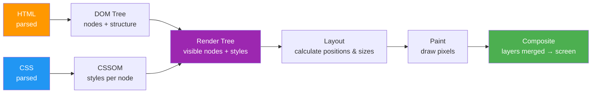

# 🎨 HTML5, CSS3 & SASS Interview Questions — Complete Guide

> A focused set of side-by-side explanations for HTML semantics, layout, sizing, specificity, the box model, and browser rendering.

---

## Table of Contents

1. [HTML and CSS Comparisons](#html-css-comparisons)
2. [Browser Rendering Pipeline](#css-d1--browser-rendering-pipeline)
3. [Semantic HTML and Keyboard Accessibility](#html-m1)
4. [Responsive Layout with Grid and Flexbox](#html-m2)
5. [Accessible Forms and Validation](#html-m3)
6. [Cascade, Layers, and Design Tokens](#html-m4)
7. [Responsive Images and Rendering Performance](#html-m5)

---

---

<a id="html-css-comparisons"></a>
# ⚖️ HTML & CSS Comparisons — Side-by-Side Differences

---

## HTML-C1 — `<div>` vs Semantic Elements

| | `<div>` / `<span>` | Semantic (`<article>`, `<nav>`, etc.) |
|-|------------------|--------------------------------------|
| Meaning to browser | None (generic) | Describes purpose |
| SEO | ❌ No benefit | ✅ Search engines understand structure |
| Accessibility | ❌ No ARIA role | ✅ Screen readers announce purpose |
| Styling | Same | Same |
| Use for | Layout containers with no semantic meaning | Content sections with clear purpose |

```html
<!-- ❌ div soup — no meaning -->
<div class="header"><div class="nav">...</div></div>
<div class="main"><div class="post">...</div></div>

<!-- ✅ Semantic HTML -->
<header><nav aria-label="Main">...</nav></header>
<main><article>...</article></main>
<footer>...</footer>
```

---

## HTML-C2 — `id` vs `class` vs `data-*` attribute

| | `id` | `class` | `data-*` |
|-|------|---------|---------|
| Uniqueness | Must be unique per page | Reusable on many elements | Custom key-value data |
| CSS selector | `#id` | `.class` | `[data-x]` |
| JS access | `getElementById` | `getElementsByClassName` | `dataset.x` |
| Specificity | Highest (100) | Medium (10) | Low (0 attribute) |
| Use for | Anchors, JS hooks, single unique element | Styling groups of elements | Embed data in HTML for JS |

```html
<button id="submit-btn" class="btn btn-primary" data-order-id="123" data-action="confirm">
  Confirm
</button>

<script>
  const btn = document.getElementById('submit-btn');
  const orderId = btn.dataset.orderId; // "123"
</script>
```

---

## HTML-C3 — `<script>` placement: `defer` vs `async` vs body-end

| | Inline (head, no attr) | `async` | `defer` | Body end |
|-|----------------------|---------|---------|---------|
| Blocks HTML parse | ✅ Yes | Partially | ❌ No | ❌ No |
| Execute order | Immediately | When downloaded (random) | DOM-ready, in order | In order |
| Use for | ❌ Avoid | Analytics, independent scripts | App JS (order matters) | Legacy fallback |

```html
<!-- ❌ Blocks parsing -->
<head><script src="app.js"></script></head>

<!-- ✅ defer — download in parallel, execute after DOM ready, in order -->
<head><script src="app.js" defer></script></head>

<!-- async — download in parallel, execute ASAP (no order guarantee) -->
<head><script src="analytics.js" async></script></head>
```

---

## CSS-C1 — `display: flex` vs `display: grid`

| | Flexbox | Grid |
|-|---------|------|
| Dimensions | 1D (row OR column) | 2D (rows AND columns simultaneously) |
| Content-driven | ✅ Items define size | ❌ Layout-driven (you define tracks) |
| Alignment | Main axis + cross axis | Row axis + column axis |
| Use for | Navigation bar, card row, button groups | Page layout, dashboard, complex alignment |

```css
/* Flexbox — horizontal nav */
nav { display: flex; gap: 16px; align-items: center; justify-content: space-between; }

/* Grid — two-column page layout */
.layout {
  display: grid;
  grid-template-columns: 260px 1fr;  /* sidebar + main */
  grid-template-rows: 60px 1fr 40px; /* header + content + footer */
  min-height: 100vh;
}
.sidebar { grid-row: 2; }
.main    { grid-row: 2; }
```

---

## CSS-C2 — `position: relative` vs `absolute` vs `fixed` vs `sticky`

| | `static` | `relative` | `absolute` | `fixed` | `sticky` |
|-|----------|-----------|-----------|---------|---------|
| Flow | Normal | Normal (offset from self) | Removed from flow | Removed from flow | Normal then fixed |
| Positioned relative to | N/A | Self | Nearest positioned ancestor | Viewport | Scroll container |
| Use for | Default | Offset / parent for absolute children | Tooltips, dropdowns, badges | Sticky headers, cookie banners | Table headers, TOC |

```css
.parent { position: relative; }         /* makes parent the anchor */
.badge  { position: absolute; top: 0; right: 0; } /* positions within .parent */

.navbar { position: sticky; top: 0; z-index: 100; } /* sticks at top when scrolling */
```

---

## CSS-C3 — `em` vs `rem` vs `px` vs `%` vs `vw/vh`

| | `px` | `em` | `rem` | `%` | `vw`/`vh` |
|-|------|------|-------|-----|----------|
| Absolute | ✅ | ❌ | ❌ | ❌ | ❌ |
| Relative to | — | Parent font-size | Root `<html>` font-size | Parent dimension | Viewport |
| Scales with user preference | ❌ | ✅ | ✅ | Depends | ❌ |
| Use for | Borders, shadows | Component-relative spacing | Typography, global spacing | Fluid widths | Full-screen sections |

```css
:root { font-size: 16px; }       /* 1rem = 16px globally */

h1 { font-size: 2rem; }         /* 32px — scales if user changes browser font */
p  { font-size: 1rem; }         /* 16px */
.card { padding: 1.5rem; }      /* relative to root — consistent */

.container { width: 90%; max-width: 1200px; } /* fluid */
.hero { height: 100vh; }        /* full viewport height */
```

---

## CSS-C4 — CSS Specificity: Which Rule Wins?

```mermaid
flowchart TD
    IS[Inline style\nstyle= attribute\n1000 points] --> ID
    ID[ID selector\n#myId\n100 points] --> CL
    CL[Class / pseudo-class / attribute\n.myClass :hover\[attr\]\n10 points] --> EL
    EL[Element / pseudo-element\np  h1  ::before\n1 point]

    IS -.->|highest specificity wins| WIN[Winning rule\napplied to element]

    style IS fill:#f44336,color:#fff
    style ID fill:#FF9800,color:#fff
    style CL fill:#2196F3,color:#fff
    style EL fill:#4CAF50,color:#fff
    style WIN fill:#9C27B0,color:#fff
```

```
Specificity scoring:
  Inline style          → 1,0,0,0 (1000)
  ID selector (#id)     → 0,1,0,0 (100)
  Class / attr / pseudo → 0,0,1,0 (10)
  Element / pseudo-elem → 0,0,0,1 (1)
  !important            → Overrides everything (avoid)

Examples:
  p                        → 0,0,0,1 (1)
  .card p                  → 0,0,1,1 (11)
  #main .card p            → 0,1,1,1 (111)
  style="color: red"       → 1,0,0,0 (1000)
  p { color: blue !important } → beats everything except inline !important
```

```css
/* ❌ !important arms race — hard to maintain */
.button { color: red !important; }
.nav .button { color: blue !important; } /* now need !important everywhere */

/* ✅ Use specificity intentionally — BEM keeps it flat */
.button { color: red; }
.button--primary { color: blue; } /* same specificity, last rule wins */
```

---

## CSS-C5 — `margin` vs `padding` vs `border` (Box Model)

```mermaid
flowchart TD
    subgraph BOX["CSS Box Model"]
        MAR["margin\nouter spacing — transparent"]
        subgraph INNER[""]
            BOR["border\nvisual boundary"]
            subgraph CONTENT_AREA[""]
                PAD["padding\ninner spacing — background fills here"]
                subgraph CORE[""]
                    CONT["content\ntext · image · children"]
                end
            end
        end
    end

    style MAR fill:#FFF9C4,color:#333
    style BOR fill:#FFCCBC,color:#333
    style PAD fill:#C8E6C9,color:#333
    style CONT fill:#BBDEFB,color:#333
```

| | `padding` | `border` | `margin` |
|-|----------|---------|---------|
| Background colour fills | ✅ Yes | N/A | ❌ No (always transparent) |
| Clickable area | ✅ | ✅ | ❌ |
| Collapse with adjacent | ❌ | ❌ | ✅ Vertical margins collapse |
| Use for | Inner spacing | Visual boundary | Outer spacing between elements |

```css
/* box-sizing: border-box — width includes padding + border */
* { box-sizing: border-box; } /* ✅ makes layout predictable */

.card {
  width: 300px;      /* total width = 300px including padding + border */
  padding: 16px;     /* inner space — background-coloured */
  border: 1px solid; /* visual boundary */
  margin: 8px;       /* outer space — transparent */
}
```

---

## CSS-D1 — Browser Rendering Pipeline



**Question:** What causes layout, paint, and composite work, and why does that distinction matter?

**Answer:** Layout calculates geometry, paint draws visual pixels, and compositing assembles already-painted layers. A change to `width` may require layout and paint; a compositor-friendly `transform` can often move an existing layer without recalculating surrounding geometry.

**Before optimization:** Code alternates DOM reads and writes in a loop. Each read may force the browser to finish the layout invalidated by the previous write.

❌ **Wrong example — layout thrashing:**

```javascript
for (const card of cards) {
  card.style.width = `${container.offsetWidth / 3}px`; // write, then forced read
}
```

✅ **Better example — measure once, then mutate together:**

```javascript
const width = container.getBoundingClientRect().width;
const cardWidth = width / 3;

requestAnimationFrame(() => {
  for (const card of cards) {
    card.style.width = `${cardWidth}px`;
  }
});
```

**How it works now:** The browser performs one measurement, batches the writes in the next animation frame, and can calculate the new layout as one unit of work.

**Trade-off:** Do not promote every element to its own compositor layer with `will-change`; layers consume memory. Measure with browser performance tools before optimizing.

---

<a id="html-m1"></a>
## HTML-M1 — Semantic HTML and Keyboard Accessibility

**Question:** Why should interactive controls use semantic HTML instead of clickable `<div>` elements?

**Answer:** Native elements expose meaning, keyboard behavior, focus handling, and accessibility semantics by default. A `<button>` already supports Enter/Space activation, disabled state, focus, and an accessible role. A `<div>` supplies none of those behaviors automatically.

**What problem does it solve?** It prevents interfaces that work with a mouse but fail for keyboard, screen-reader, voice-control, or switch-device users.

**Before this concept:** Every element is a generic container and JavaScript tries to recreate browser behavior.

❌ **Wrong/before example:**

```html
<div class="save" onclick="save()">Save profile</div>
<div class="nav-item" onclick="goToOrders()">Orders</div>
```

This code is not naturally focusable, does not announce the intended roles, and does not respond to keyboard activation without more code.

✅ **After/correct example:**

```html
<header>
  <nav aria-label="Primary navigation">
    <a href="/orders">Orders</a>
  </nav>
</header>

<main>
  <h1>Edit profile</h1>
  <button type="submit" form="profile-form">Save profile</button>
</main>
```

**How it works now:** The browser creates meaningful accessibility-tree nodes. The link participates in navigation history, the button receives keyboard focus, and assistive technology announces each control correctly.

**Trade-offs and when not to use it:** ARIA is useful when no native element represents a complex widget, but ARIA does not automatically add keyboard behavior. Prefer native HTML first; build custom widget semantics only when the product truly needs a non-native interaction.

**Production checks:** Navigate using only Tab, Shift+Tab, Enter, Space, and Escape. Ensure focus is visible, heading levels form a logical outline, landmarks have useful labels, and automated accessibility checks are supplemented by keyboard and screen-reader testing.

**Try it:** Replace one clickable `<div>` with a native control and verify that it works after temporarily disconnecting the mouse.

---

<a id="html-m2"></a>
## HTML-M2 — Responsive Layout with Grid and Flexbox

**Question:** When should you use CSS Grid, Flexbox, and normal document flow?

**Answer:** Use normal flow as the baseline, Flexbox for one-dimensional alignment, and Grid for two-dimensional rows and columns. A responsive layout combines them instead of forcing one tool to solve every problem.

**What problem does it solve?** It removes brittle fixed coordinates and device-specific widths that overlap, overflow, or leave unused space when content or viewport size changes.

**Before this concept:** Cards use fixed pixel widths and absolute positions derived from one design screenshot.

❌ **Wrong/before example:**

```css
.card { position: absolute; width: 320px; }
.card:nth-child(2) { left: 340px; }
.card:nth-child(3) { left: 680px; }
```

At 700 px, the third card overflows. Longer translated text can also overlap because layout no longer responds to content.

✅ **After/correct example:**

```css
.catalog {
  display: grid;
  grid-template-columns: repeat(auto-fit, minmax(min(100%, 16rem), 1fr));
  gap: 1rem;
}

.card-actions {
  display: flex;
  flex-wrap: wrap;
  align-items: center;
  justify-content: space-between;
  gap: .75rem;
}

.card { min-inline-size: 0; }
```

**How it works now:** Grid creates as many columns as fit while preserving a usable minimum. Flexbox aligns the actions within each card and allows wrapping. Normal flow increases card height when content grows.

**Trade-offs and when not to use it:** A one-column article does not need Grid. Avoid media queries for every device model; create breakpoints where the content stops working. Test long words, zoom, localization, and user-selected font sizes.

**Production checks:** Verify 320 px width, 200% zoom, landscape/portrait changes, long localized strings, and no horizontal scrolling except for intentionally scrollable components.

**Try it:** Build the same three-card layout using fixed positions and responsive Grid, then add a card title twice as long and compare the behavior.

---

<a id="html-m3"></a>
## HTML-M3 — Accessible Forms and Validation

**Question:** How should a form connect labels, instructions, errors, and server validation?

**Answer:** Give every control a programmatic label, connect help/error text with `aria-describedby`, use appropriate input types and autocomplete tokens, and keep the server authoritative. Client validation improves feedback; it is not a security boundary.

**What problem does it solve?** It makes data entry understandable and operable while preventing the UI and server from silently applying different rules.

**Before this concept:** Placeholder text acts as the label, errors are shown only by color, and the API trusts the browser’s `required` attribute.

❌ **Wrong/before example:**

```html
<input placeholder="Email" required>
<span class="red">Invalid</span>
```

✅ **After/correct example:**

```html
<form id="profile-form" method="post" novalidate>
  <div class="field">
    <label for="email">Work email</label>
    <input id="email"
           name="email"
           type="email"
           autocomplete="email"
           aria-describedby="email-help email-error"
           aria-invalid="true"
           required>
    <p id="email-help">Use the address where order alerts should be sent.</p>
    <p id="email-error" role="alert">Enter a valid email address.</p>
  </div>
  <button type="submit">Save profile</button>
</form>
```

**How it works now:** Clicking the label focuses the input; assistive technology announces the label, help, and error; the browser offers the correct keyboard and autofill behavior. The server repeats validation and returns field-level errors using stable field names.

**Trade-offs and when not to use it:** `role="alert"` is appropriate for a newly appearing error, but announcing a full page of alerts at once is noisy. On submit, move focus to an error summary and link each summary item to its field.

**Production checks:** Preserve user input after failure, never reveal whether a sensitive account exists, validate on the server, use clear recovery instructions, and test errors without relying on color alone.

**Try it:** Submit the form with a keyboard and a screen reader, then confirm the error can be found and corrected without guessing.

---

<a id="html-m4"></a>
## HTML-M4 — Cascade, Layers, and Design Tokens

**Question:** How do cascade layers and custom properties reduce specificity conflicts?

**Answer:** Cascade layers define an explicit order between groups of styles, while custom properties hold reusable design decisions such as color and spacing. Together they replace accidental selector wars with a predictable system.

**What problem does it solve?** Teams stop adding deeper selectors and `!important` each time a component style loses to an unrelated stylesheet.

**Before this concept:** Override order depends on import timing and escalating specificity.

❌ **Wrong/before example:**

```css
#app .page .checkout .button.primary { background: blue !important; }
.dark #app .page .checkout .button.primary { background: navy !important; }
```

✅ **After/correct example:**

```css
@layer reset, base, components, utilities;

@layer base {
  :root {
    --color-action: #1455d9;
    --color-on-action: white;
    --space-3: .75rem;
  }
}

@layer components {
  .button {
    padding: var(--space-3) 1rem;
    color: var(--color-on-action);
    background: var(--color-action);
  }
}

@media (prefers-color-scheme: dark) {
  :root { --color-action: #7aa2ff; --color-on-action: #101522; }
}
```

**How it works now:** Layer order decides which category wins before selector specificity is compared. Tokens allow themes to change values without duplicating component rules.

**Trade-offs and when not to use it:** Tokens should express intentional design choices, not wrap every literal in an unreadable variable. Layers clarify precedence but cannot repair poorly scoped global selectors.

**Production checks:** Test contrast in every theme, provide visible focus styles, respect `prefers-reduced-motion`, and document which layer owns third-party overrides.

**Try it:** Remove three `!important` declarations by introducing a layer order and one component-level class.

---

<a id="html-m5"></a>
## HTML-M5 — Responsive Images and Rendering Performance

**Question:** How do `srcset`, `sizes`, dimensions, and lazy loading improve image delivery without causing layout shift?

**Answer:** `srcset` gives the browser image candidates, `sizes` describes the rendered width, explicit dimensions reserve layout space, and lazy loading defers off-screen images. The browser selects a suitable resource for the viewport and pixel density.

**What problem does it solve?** It avoids sending desktop-sized images to small screens and prevents content from jumping when an image’s dimensions become known.

**Before this concept:** Every device downloads one large asset and the page reserves no image space.

❌ **Wrong/before example:**

```html

```

✅ **After/correct example:**

```html


```

**How it works now:** The browser can choose an appropriate file before downloading it. Width and height establish an aspect ratio, so layout space is reserved. Only below-the-fold images are lazy-loaded; the primary visual remains discoverable immediately.

**Trade-offs and when not to use it:** Do not lazy-load the likely largest above-the-fold image because discovery delay can make the page feel slower. Excessive image variants increase build and storage complexity.

**Production checks:** Compress at build/upload time, use a CDN cache key that includes transformations, provide meaningful alt text or empty alt for decoration, and measure layout shift and the largest visible element on real devices.

**Try it:** Compare transferred bytes and layout shift before and after adding candidates, dimensions, and below-the-fold lazy loading.
