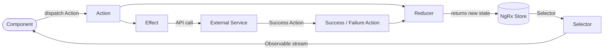
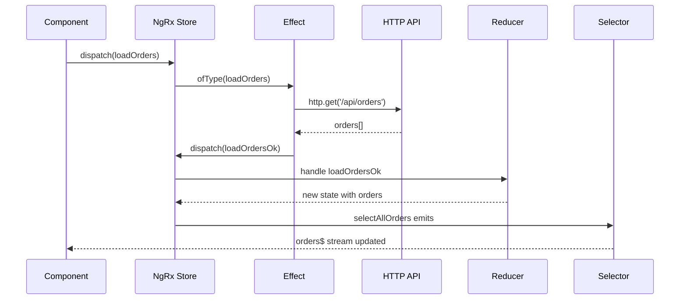
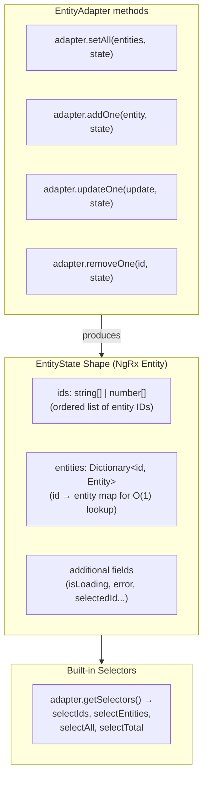

# 🏪 NgRx Interview Questions — Complete Guide

> Focused store questions and comparisons with definitions, ✅ good examples, ❌ bad examples & 📚 reference links.
> Use `Ctrl+F` / `Cmd+F` to jump to any topic.

---

## 📋 Table of Contents
1. [Core Concepts & Store](#1-core-concepts--store)
2. [NgRx Comparisons](#ngrx-comparisons)
3. [Applied NgRx Mastery](#ngrx-mastery)

---

## 1. Core Concepts & Store



> 📚 Reference: https://ngrx.io/guide/store
> 📚 Medium: https://medium.com/angular-in-depth/ngrx-store-understanding-state-selectors-actions-effects-f0b58ded56ac

### Q1. What is NgRx and the Redux pattern? What are the 3 core Redux principles, and when should you choose NgRx over a plain service + BehaviorSubject?

**Answer:** NgRx is a reactive state management library for Angular built on the Redux pattern and powered by RxJS. Redux follows three core principles: (1) Single source of truth — the entire application state lives in one store; (2) State is read-only — the only way to change state is to dispatch an action; (3) Changes are made with pure functions — reducers take the previous state and an action and return a new state. Choose NgRx over a BehaviorSubject service when your app has complex shared state, many components need the same data, you need time-travel debugging, or multiple async operations interact with the same state slice. For simple, localised state a BehaviorSubject service is lighter and easier.

❌ **Violates** — Mutating state directly inside a service, bypassing the Redux flow:
```typescript
// BAD: direct mutation, no action, no reducer, no time-travel
@Injectable({ providedIn: 'root' })
export class ProductService {
  products: Product[] = []; // mutable public field

  addProduct(p: Product) {
    this.products.push(p); // mutation — cannot be tracked or replayed
  }
}
```

✅ **Satisfies** — Redux flow: dispatch action → reducer produces new state → selector reads it:
```typescript
// 1. Action
export const addProduct = createAction('[Products] Add Product', props<{ product: Product }>());

// 2. Reducer — pure function, returns new state
export const productsReducer = createReducer(
  initialState,
  on(addProduct, (state, { product }) => ({
    ...state,
    products: [...state.products, product]
  }))
);

// 3. Component dispatches
this.store.dispatch(addProduct({ product: newProduct }));
```

---

### Q2. How do you set up the NgRx Store in a module-based app (StoreModule.forRoot, StoreModule.forFeature) vs a standalone app (provideStore, provideState)? Show both.

**Answer:** In module-based apps, you register the root store with `StoreModule.forRoot(reducers)` in `AppModule` and feature slices with `StoreModule.forFeature('featureName', featureReducer)` in the feature module. In standalone Angular apps (Angular 14+), you use `provideStore(reducers)` in `bootstrapApplication` providers and `provideState('featureName', featureReducer)` in the route's providers array. Both approaches achieve the same result — a single global store with lazy-loaded feature slices. Prefer standalone for new Angular 17+ projects.

❌ **Violates** — Calling `StoreModule.forRoot` in a lazy-loaded feature module (causes the store to reset):
```typescript
// BAD: forRoot inside a feature module
@NgModule({
  imports: [
    StoreModule.forRoot({ products: productsReducer }) // ❌ should be forFeature
  ]
})
export class ProductsModule {}
```

✅ **Satisfies** — Module-based and standalone setup:
```typescript
// ===== MODULE-BASED =====
// app.module.ts
@NgModule({
  imports: [
    StoreModule.forRoot({ router: routerReducer }, {
      metaReducers,
      runtimeChecks: { strictStateImmutability: true, strictActionImmutability: true }
    }),
    StoreDevtoolsModule.instrument({ maxAge: 25 })
  ]
})
export class AppModule {}

// products.module.ts (feature)
@NgModule({
  imports: [
    StoreModule.forFeature('products', productsReducer),
    EffectsModule.forFeature([ProductsEffects])
  ]
})
export class ProductsModule {}

// ===== STANDALONE =====
// main.ts
bootstrapApplication(AppComponent, {
  providers: [
    provideStore({ router: routerReducer }, { metaReducers }),
    provideStoreDevtools({ maxAge: 25 }),
    provideEffects()
  ]
});

// products.routes.ts — lazy loaded route
export const PRODUCTS_ROUTES: Routes = [{
  path: '',
  component: ProductsComponent,
  providers: [
    provideState('products', productsReducer),
    provideEffects(ProductsEffects)
  ]
}];
```

---

### Q3. How should you design your state shape? What belongs in the store vs component state vs URL? Why is flat/normalised state better than deeply nested?

**Answer:** Put in the NgRx store only state that is shared across multiple components, needs to survive navigation, or is driven by async server data. Keep transient UI state (form validity, hover states, open/closed toggles) in component state. Put pagination, filters, and selected IDs in the URL so they are bookmarkable and shareable. Flat, normalised state stores entities as a dictionary keyed by ID (like a database table) with other slices holding only IDs as references — this avoids deeply nested updates, eliminates data duplication, and makes lookups O(1). Deeply nested state requires complex spread chains to update a single field and risks inconsistency when the same entity appears in multiple places.

❌ **Violates** — Deeply nested, denormalised state with duplicate data:
```typescript
// BAD: order contains full customer and full product objects
interface AppState {
  orders: {
    list: Array<{
      id: string;
      customer: { id: string; name: string; email: string }; // duplicated
      items: Array<{
        product: { id: string; name: string; price: number }; // duplicated
        quantity: number;
      }>;
    }>;
  };
}
```

✅ **Satisfies** — Flat, normalised state with ID references:
```typescript
// GOOD: each entity type lives in its own flat slice
interface AppState {
  orders: {
    ids: string[];
    entities: Record<string, Order>; // Order has customerId, itemIds
  };
  customers: {
    ids: string[];
    entities: Record<string, Customer>;
  };
  products: {
    ids: string[];
    entities: Record<string, Product>;
  };
}

interface Order {
  id: string;
  customerId: string; // reference only
  itemIds: string[];  // reference only
  status: OrderStatus;
}

// Join in a selector — not in the state
export const selectOrderWithDetails = createSelector(
  selectCurrentOrder,
  selectCustomerEntities,
  selectProductEntities,
  (order, customers, products) => ({
    ...order,
    customer: customers[order.customerId],
    items: order.itemIds.map(id => products[id])
  })
);
```

---

### Q4. How do you read state from the store using store.select()? How does the async pipe work with it, and why should you avoid manual subscribe/unsubscribe in components?

**Answer:** `store.select(selector)` returns an Observable that emits a new value every time the selected slice of state changes. The Angular `async` pipe subscribes to that Observable in the template, automatically unsubscribes when the component is destroyed, and triggers change detection only when a new value arrives. Manual `subscribe()` calls in components require you to track the subscription and call `unsubscribe()` in `ngOnDestroy`, or use `takeUntil` — forgetting either causes memory leaks. The async pipe eliminates this entire class of bugs and pairs perfectly with `OnPush` change detection.

❌ **Violates** — Manual subscribe without cleanup, causing a memory leak:
```typescript
// BAD: subscription never unsubscribed
@Component({ template: `<div>{{ products.length }} products</div>` })
export class ProductsComponent implements OnInit {
  products: Product[] = [];

  constructor(private store: Store) {}

  ngOnInit() {
    // Leak: this subscription lives forever
    this.store.select(selectAllProducts).subscribe(p => this.products = p);
  }
}
```

✅ **Satisfies** — async pipe handles subscription lifecycle automatically:
```typescript
@Component({
  template: `
    <ng-container *ngIf="products$ | async as products">
      <div>{{ products.length }} products</div>
      <app-product-card *ngFor="let p of products" [product]="p" />
    </ng-container>
  `,
  changeDetection: ChangeDetectionStrategy.OnPush
})
export class ProductsComponent {
  products$ = this.store.select(selectAllProducts);
  isLoading$ = this.store.select(selectProductsLoading);
  error$ = this.store.select(selectProductsError);

  constructor(private store: Store) {}
}
```

---

### Q5. How do you dispatch actions using store.dispatch()? Show dispatching on component init, on button click, and from a service.

**Answer:** `store.dispatch(action)` sends an action object into the store, which passes through all meta-reducers, then all reducers, and then all effects. You call it with the result of an action creator function. You can dispatch from anywhere that has the `Store` injected: a component lifecycle hook, an event handler, a service method, or even another effect. The convention is to dispatch from components for user events and from effects for chained async operations.

❌ **Violates** — Dispatching a raw object instead of using the typed action creator:
```typescript
// BAD: no type safety, typos go undetected at compile time
this.store.dispatch({ type: 'Load Prodcuts' }); // typo, wrong format
```

✅ **Satisfies** — Dispatching from lifecycle, button click, and service:
```typescript
// products.component.ts
@Component({ template: `<button (click)="onAdd()">Add</button>` })
export class ProductsComponent implements OnInit {
  constructor(private store: Store) {}

  // On init — load data
  ngOnInit() {
    this.store.dispatch(ProductsActions.loadProducts());
  }

  // On button click — user event
  onAdd() {
    this.store.dispatch(ProductsActions.openAddProductDialog());
  }

  onDelete(id: string) {
    this.store.dispatch(ProductsActions.deleteProduct({ id }));
  }
}

// products-api.service.ts — dispatch from a service
@Injectable({ providedIn: 'root' })
export class ProductsApiService {
  constructor(private store: Store) {}

  refreshAfterSync() {
    // A service can dispatch when external events happen (e.g. WebSocket message)
    this.store.dispatch(ProductsActions.loadProducts());
  }
}
```

---

### Q6. How do you set up NgRx DevTools (StoreDevtoolsModule / provideStoreDevtools)? What is time-travel debugging, and what can you do in the Redux DevTools panel?

**Answer:** NgRx DevTools connects to the Redux DevTools browser extension to give you a live view of every dispatched action and the resulting state tree. In module-based apps, add `StoreDevtoolsModule.instrument({ maxAge: 25, logOnly: environment.production })` to `AppModule`. In standalone apps use `provideStoreDevtools(...)`. Time-travel debugging lets you click any past action in the history list and the UI reverts to exactly what the state looked like at that point — without re-running the app. In the DevTools panel you can inspect action payloads, diff state before/after each action, replay action sequences, import/export state snapshots, and skip individual actions to test different flows.

❌ **Violates** — Enabling full DevTools in production, leaking state to the browser:
```typescript
// BAD: full devtools in production — exposes entire app state
StoreDevtoolsModule.instrument({ maxAge: 100 }) // no production guard
```

✅ **Satisfies** — DevTools setup with production guard:
```typescript
// Module-based
@NgModule({
  imports: [
    StoreModule.forRoot(reducers),
    StoreDevtoolsModule.instrument({
      maxAge: 25,              // keep last 25 actions
      logOnly: environment.production, // read-only in prod
      autoPause: true,         // pause when devtools closed
      trace: false,
      traceLimit: 75
    })
  ]
})
export class AppModule {}

// Standalone (main.ts)
bootstrapApplication(AppComponent, {
  providers: [
    provideStore(reducers),
    provideStoreDevtools({
      maxAge: 25,
      logOnly: !isDevMode(),
      connectInZone: true
    })
  ]
});
```

---

### Q7. What are meta-reducers? Show a logging meta-reducer and a hydration meta-reducer that restores state from localStorage on startup.

**Answer:** A meta-reducer is a higher-order reducer — a function that takes a reducer and returns a new reducer, wrapping it to add cross-cutting behaviour. They run before the actual reducers, in order, for every dispatched action. Common uses include logging every action, resetting all state on logout, and hydrating state from localStorage on startup. Meta-reducers are registered in the `metaReducers` array passed to `StoreModule.forRoot` or `provideStore`.

❌ **Violates** — Performing side effects (localStorage write) inside the reducer instead of a meta-reducer:
```typescript
// BAD: side effects in reducer — impure, hard to test
on(saveSuccess, (state, action) => {
  localStorage.setItem('state', JSON.stringify(state)); // ❌ side effect
  return { ...state, saved: true };
})
```

✅ **Satisfies** — Logging meta-reducer and hydration meta-reducer:
```typescript
// logging.meta-reducer.ts
export function loggingMetaReducer(reducer: ActionReducer<AppState>): ActionReducer<AppState> {
  return (state, action) => {
    console.group(action.type);
    console.log('prev state', state);
    const nextState = reducer(state, action);
    console.log('next state', nextState);
    console.groupEnd();
    return nextState;
  };
}

// hydration.meta-reducer.ts
export function hydrationMetaReducer(reducer: ActionReducer<AppState>): ActionReducer<AppState> {
  return (state, action) => {
    if (action.type === INIT || action.type === UPDATE) {
      const stored = localStorage.getItem('appState');
      if (stored) {
        try {
          return JSON.parse(stored) as AppState;
        } catch {
          localStorage.removeItem('appState');
        }
      }
    }
    const nextState = reducer(state, action);
    localStorage.setItem('appState', JSON.stringify(nextState));
    return nextState;
  };
}

// app.module.ts
export const metaReducers: MetaReducer<AppState>[] = !environment.production
  ? [loggingMetaReducer, hydrationMetaReducer]
  : [hydrationMetaReducer];

@NgModule({
  imports: [StoreModule.forRoot(reducers, { metaReducers })]
})
export class AppModule {}
```

---

### Q8. What is AppState / RootState? How do you combine feature state interfaces using ActionReducerMap?

**Answer:** `AppState` (also called `RootState`) is a TypeScript interface that represents the shape of the entire store. Each key in `AppState` corresponds to a feature slice, and its value type is that feature's state interface. `ActionReducerMap<AppState>` is a typed object that maps each key to its corresponding reducer function — NgRx uses this to combine all reducers into one root reducer internally. Defining this interface gives you type-safe access throughout the codebase.

❌ **Violates** — Using `any` for the state type, losing all type safety:
```typescript
// BAD: any state — no autocomplete, no compile-time checking
const store: Store<any> = inject(Store);
store.select((s: any) => s.products.items); // no type checking
```

✅ **Satisfies** — Typed AppState and ActionReducerMap:
```typescript
// app.state.ts
import { RouterReducerState } from '@ngrx/router-store';
import { ProductsState } from './products/products.state';
import { AuthState } from './auth/auth.state';

export interface AppState {
  router: RouterReducerState;
  products: ProductsState;
  auth: AuthState;
}

// app.reducers.ts
import { ActionReducerMap } from '@ngrx/store';

export const reducers: ActionReducerMap<AppState> = {
  router: routerReducer,
  products: productsReducer,
  auth: authReducer
};

// Feature state is merged automatically when using forFeature
export interface ProductsState {
  ids: string[];
  entities: Record<string, Product>;
  isLoading: boolean;
  error: string | null;
}
```

---

### Q9. Why is immutability a strict requirement in NgRx reducers? Show the spread-based immutable update pattern for objects and arrays. What goes wrong if you mutate state directly?

**Answer:** NgRx selectors use reference equality checks (`===`) to detect changes — if you mutate the existing state object, the reference does not change, so the selector sees the same object and does not emit a new value, meaning the UI never updates. Additionally, time-travel debugging depends on having distinct immutable snapshots for each action; mutation corrupts these snapshots. Angular's `OnPush` change detection also relies on reference changes to know when to re-render. NgRx's `strictStateImmutability` runtime check will throw if you mutate, helping catch bugs early.

❌ **Violates** — Direct mutation inside a reducer:
```typescript
// BAD: mutates existing state, reference unchanged, UI won't update
on(updateProduct, (state, { product }) => {
  const existing = state.entities[product.id];
  existing.name = product.name; // ❌ mutation
  existing.price = product.price; // ❌ mutation
  return state; // same reference — selector won't fire
})
```

✅ **Satisfies** — Immutable spread patterns for objects and arrays:
```typescript
// Updating a property on a nested object
on(updateProduct, (state, { product }) => ({
  ...state,
  entities: {
    ...state.entities,
    [product.id]: { ...state.entities[product.id], ...product }
  }
})),

// Adding to an array
on(addTag, (state, { tag }) => ({
  ...state,
  tags: [...state.tags, tag]
})),

// Removing from an array by id
on(removeTag, (state, { id }) => ({
  ...state,
  tags: state.tags.filter(t => t.id !== id)
})),

// Updating one item in an array
on(toggleTag, (state, { id }) => ({
  ...state,
  tags: state.tags.map(t => t.id === id ? { ...t, active: !t.active } : t)
}))
```

---

### Q10. How does NgRx integrate with OnPush change detection? Why does store.select() + async pipe + OnPush give the best performance?

**Answer:** `ChangeDetectionStrategy.OnPush` tells Angular to only run change detection for a component when its `@Input` references change, an event fires within it, or an Observable bound with the `async` pipe emits. `store.select(selector)` only emits when the selected value changes (memoised by the selector), so the `async` pipe only triggers change detection when the data actually changes — not on every global change detection cycle. This combination means large lists and dashboards only re-render the components whose data changed, dramatically reducing unnecessary DOM work in complex applications.

❌ **Violates** — Default change detection with manual subscribe re-renders everything constantly:
```typescript
// BAD: Default CD, manual subscribe — re-renders on every CD cycle
@Component({
  // no changeDetection: ChangeDetectionStrategy.OnPush
  template: `<div *ngFor="let p of products">{{ p.name }}</div>`
})
export class ProductsComponent implements OnInit, OnDestroy {
  products: Product[] = [];
  private sub!: Subscription;

  ngOnInit() { this.sub = this.store.select(selectAllProducts).subscribe(p => this.products = p); }
  ngOnDestroy() { this.sub.unsubscribe(); }
}
```

✅ **Satisfies** — OnPush + async pipe, renders only when data changes:
```typescript
@Component({
  selector: 'app-products',
  template: `
    <ng-container *ngIf="vm$ | async as vm">
      <app-loading *ngIf="vm.isLoading" />
      <app-error *ngIf="vm.error" [message]="vm.error" />
      <app-product-card
        *ngFor="let p of vm.products; trackBy: trackById"
        [product]="p"
      />
    </ng-container>
  `,
  changeDetection: ChangeDetectionStrategy.OnPush // ✅ only re-render when vm$ emits
})
export class ProductsComponent implements OnInit {
  vm$ = combineLatest({
    products: this.store.select(selectAllProducts),
    isLoading: this.store.select(selectProductsLoading),
    error: this.store.select(selectProductsError)
  });

  constructor(private store: Store) {}
  ngOnInit() { this.store.dispatch(ProductsActions.loadProducts()); }
  trackById(_: number, p: Product) { return p.id; }
}
```

---

---

<a id="ngrx-comparisons"></a>
# Core NgRx Comparisons — Side-by-Side Differences

---

## NGRX-C1 — NgRx Store vs Service + BehaviorSubject vs Angular Signals

| | NgRx Store | Service + BehaviorSubject | Angular Signals |
|-|-----------|--------------------------|-----------------|
| Boilerplate | ❌ High (actions, reducers, effects, selectors) | Low | ✅ Minimal |
| DevTools / time-travel | ✅ Yes (Redux DevTools) | ❌ No | Limited |
| Immutability enforced | ✅ Yes (reducers are pure) | ❌ Manual | ✅ Yes |
| Side effects | `@ngrx/effects` | RxJS in service | `effect()` |
| Best for | Large app, complex state, team, audit trail | Small/medium app | Simple reactive state |
| Reactive | ✅ Observable-based | ✅ Observable-based | ✅ Fine-grained reactive |

```typescript
// NgRx — full ceremony
this.store.dispatch(loadOrders()); // action
orders$ = this.store.select(selectOrders); // selector

// Service + BehaviorSubject — simpler
this.orderService.orders$; // BehaviorSubject exposed as Observable
this.orderService.loadOrders(); // calls HTTP, updates subject

// Angular Signals — simplest reactive state
orders = signal<Order[]>([]);
loadOrders() { this.orders.set(await this.http.get<Order[]>('/api/orders').toPromise()); }
// Template: {{ orders() }}
```

---

## NGRX-C2 — Actions vs Effects vs Reducers vs Selectors



| | Actions | Reducers | Effects | Selectors |
|-|---------|---------|---------|-----------|
| Purpose | Describe what happened | Produce new state from action | Handle side effects (HTTP, router) | Derive computed state |
| Pure function | ✅ | ✅ | ❌ (side effects) | ✅ |
| Returns | Nothing | New state | Observable of actions | Memoised value |
| Subscribes to store | ❌ | ❌ | ✅ `Actions` stream | ❌ |

```typescript
// Action — intent
export const loadOrders     = createAction('[Orders] Load');
export const loadOrdersOk   = createAction('[Orders] Load Success', props<{ orders: Order[] }>());
export const loadOrdersFail = createAction('[Orders] Load Fail',    props<{ error: string }>());

// Reducer — pure state transition
export const ordersReducer = createReducer(
  initialState,
  on(loadOrders,     state => ({ ...state, loading: true })),
  on(loadOrdersOk,   (state, { orders }) => ({ ...state, orders, loading: false })),
  on(loadOrdersFail, (state, { error }) => ({ ...state, error, loading: false }))
);

// Effect — side effect (HTTP call)
loadOrders$ = createEffect(() => this.actions$.pipe(
  ofType(loadOrders),
  switchMap(() => this.http.get<Order[]>('/api/orders').pipe(
    map(orders => loadOrdersOk({ orders })),
    catchError(error => of(loadOrdersFail({ error: error.message })))
  ))
));

// Selector — memoised derived state
export const selectOrders        = createSelector(selectOrdersState, s => s.orders);
export const selectPendingOrders = createSelector(selectOrders, orders =>
  orders.filter(o => o.status === 'pending')
);
```

---

## NGRX-C3 — `createSelector` vs `createFeatureSelector`

```typescript
// createFeatureSelector — access feature state slice by key
export const selectOrdersState = createFeatureSelector<OrdersState>('orders');
// 'orders' must match the key in StoreModule.forFeature('orders', reducer)

// createSelector — compose selectors (memoised)
export const selectAllOrders = createSelector(
  selectOrdersState,
  state => state.orders         // recalculates only when selectOrdersState changes
);

export const selectOrderById = (id: string) => createSelector(
  selectAllOrders,
  orders => orders.find(o => o.id === id)
);

// Memoisation: if selectAllOrders hasn't changed, selectOrderById returns cached result
// This prevents unnecessary re-renders in components using OnPush
```

---

## NGRX-C4 — `dispatch` vs `select` vs `store.pipe`

```typescript
// dispatch — send action to store
this.store.dispatch(loadOrders());
this.store.dispatch(createOrder({ order: newOrder }));

// select — subscribe to state slice (Observable)
this.orders$ = this.store.select(selectAllOrders);
// or: this.store.pipe(select(selectAllOrders))

// Component usage
export class OrderListComponent {
  orders$    = this.store.select(selectAllOrders);
  isLoading$ = this.store.select(selectOrdersLoading);

  constructor(private store: Store) {
    this.store.dispatch(loadOrders()); // trigger effect on init
  }

  deleteOrder(id: string) {
    this.store.dispatch(deleteOrder({ id })); // dispatch on user action
  }
}
```

---

## NGRX-C5 — NgRx Component Store vs Global Store

| | Global NgRx Store | NgRx Component Store |
|-|------------------|---------------------|
| Scope | App-wide singleton | Per component instance |
| Shared across components | ✅ | ❌ Local to component tree |
| Boilerplate | High | Low |
| DevTools | ✅ | ✅ |
| Use for | Global auth, cart, app config | Complex component-level state (modal, wizard, data table) |

```typescript
// ComponentStore — local state for a complex component
@Injectable()
export class OrderTableStore extends ComponentStore<OrderTableState> {
  constructor(private http: HttpClient) {
    super({ orders: [], loading: false, filter: '' });
  }

  // Selector
  readonly orders$  = this.select(s => s.orders);
  readonly loading$ = this.select(s => s.loading);

  // Updater — sync state mutation
  readonly setFilter = this.updater((state, filter: string) => ({ ...state, filter }));

  // Effect — async operation
  readonly loadOrders = this.effect((trigger$: Observable<void>) =>
    trigger$.pipe(
      tap(() => this.patchState({ loading: true })),
      switchMap(() => this.http.get<Order[]>('/api/orders').pipe(
        tapResponse(
          orders => this.patchState({ orders, loading: false }),
          err    => this.patchState({ loading: false })
        )
      ))
    )
  );
}
```


---

# Extended NgRx Comparisons — Side-by-Side Differences

---

## NGRX-C1 — NgRx vs Services (BehaviorSubject) vs Signals

| | Services + BehaviorSubject | NgRx Store | Angular Signals |
|-|--------------------------|-----------|----------------|
| Boilerplate | Low | ❌ High (actions/reducers/effects/selectors) | Low |
| DevTools / time-travel | ❌ | ✅ Redux DevTools | ❌ |
| Immutability enforced | ❌ Manual | ✅ | ✅ |
| Async side effects | Manual | Effects | `rxResource` / `effect()` |
| Shared across many components | Medium | ✅ Excellent | ✅ Good |
| Learning curve | Low | ❌ High | Low |
| Use for | Small/medium apps | Large app with complex shared state | Angular 17+ reactive apps |

```ts
// Services + BehaviorSubject — simple, low ceremony
@Injectable({ providedIn: 'root' })
export class CartService {
  private items$ = new BehaviorSubject<CartItem[]>([]);
  readonly cart$ = this.items$.asObservable();
  add(item: CartItem) { this.items$.next([...this.items$.value, item]); }
}

// NgRx — verbose but powerful, full DevTools support
// Action → Reducer → Selector pattern (see main NgRx sections above)

// Signals — Angular 17+ reactive primitive
export class CartComponent {
  private cartService = inject(CartService);
  items = this.cartService.items; // signal
  total = computed(() => this.items().reduce((s, i) => s + i.price, 0));
}
```

---

## NGRX-C2 — Actions vs Reducers vs Selectors vs Effects

| | Action | Reducer | Selector | Effect |
|-|--------|---------|---------|--------|
| Purpose | Describe WHAT happened | HOW state changes | READ derived state | Handle SIDE EFFECTS |
| Pure function | N/A | ✅ Must be pure | ✅ Must be pure | ❌ Side effects allowed |
| Returns | Event object | New state | Derived value | Observable of Action |
| When used | Dispatch events | Called by store on action | Subscribe to state slice | Async ops (HTTP, router) |

```ts
// Action — describes event
export const loadOrders  = createAction('[Orders] Load');
export const ordersLoaded = createAction('[Orders] Loaded', props<{ orders: Order[] }>());
export const loadFailed   = createAction('[Orders] Load Failed', props<{ error: string }>());

// Reducer — pure state transformation
export const ordersReducer = createReducer(
  initialState,
  on(loadOrders,   state => ({ ...state, loading: true })),
  on(ordersLoaded, (state, { orders }) => ({ ...state, orders, loading: false })),
  on(loadFailed,   (state, { error }) => ({ ...state, error, loading: false }))
);

// Selector — memoised derived state
export const selectOrders  = createSelector(selectOrdersState, s => s.orders);
export const selectPending = createSelector(selectOrders, orders =>
  orders.filter(o => o.status === 'pending'));

// Effect — async side effect
@Injectable()
export class OrderEffects {
  load$ = createEffect(() => this.actions$.pipe(
    ofType(loadOrders),
    switchMap(() => this.http.get<Order[]>('/api/orders').pipe(
      map(orders => ordersLoaded({ orders })),
      catchError(err  => of(loadFailed({ error: err.message })))
    ))
  ));
  constructor(private actions$: Actions, private http: HttpClient) {}
}
```

---

## NGRX-C3 — `createSelector` vs `createFeatureSelector` vs `createSelectorFactory`

| | `createFeatureSelector` | `createSelector` | `createSelectorFactory` |
|-|------------------------|-----------------|------------------------|
| Purpose | Root slice accessor | Derive computed state | Custom memoisation |
| Memoisation | ✅ | ✅ | Custom |
| Inputs | Feature key string | Up to 8 projectors | Custom comparison fn |

```ts
// Step 1: feature selector — entry point to feature state
const selectOrderFeature = createFeatureSelector<OrderState>('orders');

// Step 2: derive from feature
const selectAllOrders = createSelector(selectOrderFeature, s => s.orders);
const selectLoading   = createSelector(selectOrderFeature, s => s.loading);

// Step 3: combine multiple selectors
const selectViewModel = createSelector(
  selectAllOrders,
  selectLoading,
  selectCurrentUserId,  // from auth feature
  (orders, loading, userId) => ({
    orders: orders.filter(o => o.userId === userId),
    loading
  })
);
// ✅ Memoised — only recomputes when orders, loading, OR userId changes
```

---

## Entity Adapter State Shape



## NGRX-C4 — `dispatch` + `store.select` vs `ComponentStore` vs `SignalStore` (NgRx 17)

| | Global Store | ComponentStore | SignalStore |
|-|-------------|--------------|-------------|
| State scope | Application-wide | Component-scoped | Flexible |
| Boilerplate | High | Medium | Low |
| DevTools | ✅ Full | ❌ | ✅ (NgRx 17+) |
| Reactive primitive | Observable | Observable | ✅ Signals |
| Best for | Cross-feature shared state | Component-local complex state | Angular 17+ modern apps |

```ts
// ComponentStore — local state, no global actions
@Injectable()
export class OrderListStore extends ComponentStore<OrderListState> {
  constructor() { super({ orders: [], loading: false }); }

  // Updaters — synchronous state changes
  readonly setOrders = this.updater((state, orders: Order[]) => ({ ...state, orders }));

  // Effects — async side effects
  readonly loadOrders = this.effect((trigger$: Observable<void>) =>
    trigger$.pipe(
      switchMap(() => this.http.get<Order[]>('/api/orders').pipe(
        tap(orders => this.setOrders(orders))
      ))
    )
  );

  // Selectors
  readonly orders$  = this.select(s => s.orders);
  readonly loading$ = this.select(s => s.loading);
}
```

---

## NGRX-C5 — `switchMap` vs `mergeMap` vs `concatMap` in Effects

| Use case | Correct operator | Reason |
|----------|----------------|--------|
| Search autocomplete | `switchMap` | Cancel previous, only latest search matters |
| Like/unlike button | `mergeMap` | Each action independent, order not critical |
| Sequential checkout steps | `concatMap` | Order critical, must complete before next |
| Login (ignore double-click) | `exhaustMap` | Ignore new actions while first in progress |

```ts
// ✅ switchMap for latest-wins (search, navigation)
loadProduct$ = createEffect(() => this.actions$.pipe(
  ofType(loadProduct),
  switchMap(({ id }) => this.http.get<Product>(`/api/products/${id}`).pipe(
    map(p => loadProductSuccess({ product: p })),
    catchError(err => of(loadProductFailed({ error: err.message })))
  ))
));

// ✅ exhaustMap for login (prevent double-submit)
login$ = createEffect(() => this.actions$.pipe(
  ofType(loginRequest),
  exhaustMap(({ credentials }) => this.auth.login(credentials).pipe(
    map(user => loginSuccess({ user })),
    catchError(err => of(loginFailed({ error: err.message })))
  ))
));
```

---

<a id="ngrx-mastery"></a>
# Applied NgRx Mastery

These walkthroughs use one order feature from UI intent through actions, reducers, selectors, effects, normalized state, and tests. The goal is to understand ownership and event flow—not merely memorize NgRx functions.

References: [NgRx Effects](https://ngrx.io/guide/effects) and [NgRx Entity Adapter](https://ngrx.io/guide/entity/adapter).

## NGRX-M1 — Design One Complete Feature Flow

**Question:** How should data move from a component through NgRx and back to the UI?

**Answer:** The component dispatches an event describing user intent. A reducer handles synchronous state transitions, an effect performs external work and emits a result event, and selectors derive the smallest view model the component needs.

**What problem does it solve?** It replaces scattered subscriptions and mutable service state with an explicit event history and predictable state transitions.

**Before this concept:** A component fetches data, mutates arrays, controls loading flags, and handles errors itself.

❌ **Wrong/before example:**

```typescript
export class OrdersPage {
  orders: Order[] = [];
  loading = false;
  error = '';

  ngOnInit() {
    this.loading = true;
    this.api.getOrders().subscribe({
      next: orders => {
        this.orders = orders;
        this.loading = false;
      },
      error: () => {
        this.error = 'Could not load orders';
        this.loading = false;
      }
    });
  }
}
```

✅ **After/correct example — events and reducer:**

```typescript
export const OrdersPageActions = createActionGroup({
  source: 'Orders Page',
  events: { Opened: emptyProps(), Refreshed: emptyProps() }
});

export const OrdersApiActions = createActionGroup({
  source: 'Orders API',
  events: {
    'Load Succeeded': props<{ orders: readonly Order[] }>(),
    'Load Failed': props<{ message: string }>(),
    'Order Changed': props<{ order: Order }>()
  }
});

export interface OrdersState {
  orders: readonly Order[];
  loading: boolean;
  error: string | null;
}

const initialState: OrdersState = { orders: [], loading: false, error: null };

export const ordersFeature = createFeature({
  name: 'orders',
  reducer: createReducer(
    initialState,
    on(OrdersPageActions.opened, OrdersPageActions.refreshed,
      state => ({ ...state, loading: true, error: null })),
    on(OrdersApiActions.loadSucceeded,
      (state, { orders }) => ({ ...state, orders, loading: false })),
    on(OrdersApiActions.loadFailed,
      (state, { message }) => ({ ...state, loading: false, error: message }))
  )
});
```

✅ **Effect and component:**

```typescript
export const loadOrders = createEffect(
  (actions$ = inject(Actions), api = inject(OrdersApi)) =>
    actions$.pipe(
      ofType(OrdersPageActions.opened, OrdersPageActions.refreshed),
      exhaustMap(() => api.getOrders().pipe(
        map(orders => OrdersApiActions.loadSucceeded({ orders })),
        catchError(() => of(OrdersApiActions.loadFailed({
          message: 'Could not load orders'
        })))
      ))
    ),
  { functional: true }
);

export class OrdersPage {
  private readonly store = inject(Store);
  readonly orders = this.store.selectSignal(ordersFeature.selectOrders);
  readonly loading = this.store.selectSignal(ordersFeature.selectLoading);
  readonly error = this.store.selectSignal(ordersFeature.selectError);

  ngOnInit() { this.store.dispatch(OrdersPageActions.opened()); }
  refresh() { this.store.dispatch(OrdersPageActions.refreshed()); }
}
```

**How it works now:** The page states what happened. The effect converts that event into an API result event. The reducer is the only writer of feature state, and selectors expose read models. DevTools can show the exact transition that produced the screen.

**Trade-offs and when not to use it:** A small isolated component does not need a global event architecture. Use local signals or component state when data is short-lived, unshared, and not restored across navigation.

**Production checks:** Keep action payloads serializable, avoid secrets in actions/DevTools, map transport errors to safe domain messages, cancel work where latest-wins semantics are required, and log correlation IDs outside user-visible state.

**Try it:** Add an `OrderCancelled` flow and prove the component never calls `OrdersApi` directly.

---

## NGRX-M2 — Keep Effects Alive and Choose Concurrency Deliberately

**Question:** Why must `catchError` usually be inside the flattening operator in an effect?

**Answer:** If the outer action stream errors, the effect subscription can terminate and stop responding to future actions. Catching the request error inside `switchMap`, `exhaustMap`, `concatMap`, or `mergeMap` converts that one failure into a failure action while leaving the long-running effect alive.

**What problem does it solve?** One failed HTTP call no longer disables a feature until the application reloads.

**Before this concept:**

❌ **Wrong/before example:**

```typescript
load$ = createEffect(() => this.actions$.pipe(
  ofType(OrdersPageActions.opened),
  switchMap(() => this.api.getOrders()),
  map(orders => OrdersApiActions.loadSucceeded({ orders })),
  catchError(() => of(OrdersApiActions.loadFailed({ message: 'Failed' })))
)); // catch belongs to the outer stream; future actions may no longer be processed
```

✅ **After/correct example:**

```typescript
load$ = createEffect(() => this.actions$.pipe(
  ofType(OrdersPageActions.opened),
  switchMap(() => this.api.getOrders().pipe(
    map(orders => OrdersApiActions.loadSucceeded({ orders })),
    catchError(error => of(OrdersApiActions.loadFailed({
      message: toSafeMessage(error)
    })))
  ))
));
```

**How it works now:** The inner request completes with either a success or failure action. The outer `Actions` subscription continues listening for the next page-open event.

**Choose the operator by business semantics:**

| Operator | New action while work is active | Suitable example |
|---|---|---|
| `switchMap` | Cancels previous work | Search or route-driven latest result |
| `exhaustMap` | Ignores the new action | Login or initial load that must not double-submit |
| `concatMap` | Queues in order | Ordered writes or drafts |
| `mergeMap` | Runs concurrently | Independent deletes with idempotent endpoints |

**Trade-offs and when not to use it:** Cancellation stops the client subscription, but the server may already be processing the request. Destructive operations still require server-side idempotency and concurrency controls.

**Production checks:** Test rapid repeated actions, timeout/error responses, navigation cancellation, and whether a stale response may overwrite newer state.

**Try it:** Fire three actions within 50 ms under each operator and write down which requests start, finish, or are ignored.

---

## NGRX-M3 — Normalize Collections with Entity Adapter

**Question:** What does normalized entity state solve compared with storing one nested array?

**Answer:** Normalized state stores entities by ID and maintains an ordered ID list. Updates can target one entity without rebuilding or duplicating nested object graphs, and adapter methods provide consistent immutable CRUD operations.

**What problem does it solve?** It prevents duplicated entities drifting out of sync across lists, selections, and detail screens.

**Before this concept:**

❌ **Wrong/before example:**

```typescript
interface State {
  orders: Order[];
  selectedOrder: Order | null; // duplicate copy of an item in orders
}

// Only the list copy is updated; selectedOrder is now stale.
const orders = state.orders.map(o => o.id === updated.id ? updated : o);
```

✅ **After/correct example:**

```typescript
export interface OrdersState extends EntityState<Order> {
  selectedOrderId: string | null;
  loading: boolean;
}

export const ordersAdapter = createEntityAdapter<Order>({
  selectId: order => order.id,
  sortComparer: (a, b) => b.createdAt.localeCompare(a.createdAt)
});

const initialState = ordersAdapter.getInitialState({
  selectedOrderId: null,
  loading: false
});

export const reducer = createReducer(
  initialState,
  on(OrdersApiActions.loadSucceeded,
    (state, { orders }) => ordersAdapter.setAll(orders, { ...state, loading: false })),
  on(OrdersApiActions.orderChanged,
    (state, { order }) => ordersAdapter.upsertOne(order, state))
);

const entitySelectors = ordersAdapter.getSelectors();
export const selectSelectedOrder = createSelector(
  (state: OrdersState) => state,
  state => state.selectedOrderId,
  (state, id) => id ? entitySelectors.selectEntities(state)[id] ?? null : null
);
```

**How it works now:** Each order has one canonical stored copy. Selection stores only an ID, and selectors join the data for the view. Adapter methods preserve the `ids`/`entities` invariants.

**Trade-offs and when not to use it:** Normalization adds selectors and indirection. A short immutable list with no cross-feature references may be simpler as an array. Avoid storing every API response globally just because Entity exists.

**Production checks:** Decide how deleted entities affect selection, avoid unstable sort functions, define cache freshness, and ensure tenant/account changes clear entity state.

**Try it:** Load a list, select one order, process an update event, and prove both list and detail selectors return the new value from one stored entity.

---

## NGRX-M4 — Put State in the Right Owner

**Question:** Should a value live in the URL, component state, a feature store, or server state?

**Answer:** Ownership follows required lifetime and sharing. Put shareable navigation state in the URL, ephemeral visual state in the component, cross-component workflow state in a feature store, and durable truth on the server.

**What problem does it solve?** It prevents the global store from becoming a second database or a dumping ground for modal flags and temporary form keystrokes.

**Before this concept:** Every value is dispatched globally, including hover state, open menus, raw form controls, and server entities with no freshness policy.

❌ **Wrong/before example:**

```typescript
store.dispatch(menuHovered({ menuId: 'orders' }));
store.dispatch(searchTextChanged({ value: event.target.value }));
store.dispatch(modalPixelOffsetChanged({ x: 14, y: 22 }));
```

✅ **After/correct example — explicit ownership:**

```text
URL:        /orders?status=pending&page=2  (shareable and restorable)
Component:  menuOpen, hoveredRow, draft input before submit
Feature:    selectedOrderId, loaded entities, workflow status
Server:     authoritative order status, prices, permissions, audit history
```

```typescript
readonly menuOpen = signal(false);
readonly status = toSignal(
  inject(ActivatedRoute).queryParamMap.pipe(map(p => p.get('status') ?? 'all'))
);
readonly orders = this.store.selectSignal(ordersFeature.selectOrders);
```

**How it works now:** Refreshing or sharing the URL restores filters. Local rendering changes remain cheap and isolated. Feature state coordinates screens, while server refresh/invalidation rules protect authoritative data.

**Trade-offs and when not to use it:** Duplicating a value in URL and Store creates synchronization work. Choose one source of truth and derive the other representation.

**Production checks:** Clear user-specific state on logout, do not store secrets in browser state, bound persisted caches, and define how stale data is invalidated after writes.

**Try it:** Classify every property in one component by owner and remove at least one value that does not belong in the global store.

---

## NGRX-M5 — Test Transitions, Derivations, and Effects Separately

**Question:** What should NgRx tests verify without re-testing the framework?

**Answer:** Reducer tests verify state transitions, selector tests verify derivation, effect tests verify action-to-service-to-result behavior, and a small integration test verifies registration and component wiring.

**What problem does it solve?** It creates fast failure localization: a broken transition, derivation, or external interaction points to one focused test.

**Before this concept:** One large component test mocks Store internals and asserts private implementation details.

❌ **Wrong/before example:**

```typescript
expect((component as any).store.source.value.orders.length).toBe(1);
```

✅ **After/correct examples:**

```typescript
it('records a load failure and stops loading', () => {
  const loading = reducer(initialState, OrdersPageActions.opened());
  const failed = reducer(loading, OrdersApiActions.loadFailed({ message: 'Unavailable' }));

  expect(failed.loading).toBeFalse();
  expect(failed.error).toBe('Unavailable');
});

it('derives the selected order from its id', () => {
  const state = ordersAdapter.setAll(
    [{ id: 'o-1', createdAt: '2026-01-01' } as Order],
    { ...initialState, selectedOrderId: 'o-1' }
  );

  expect(selectSelectedOrder.projector(state, 'o-1')?.id).toBe('o-1');
});
```

```typescript
it('maps an API error to a failure action', () => {
  actions$ = hot('-a', { a: OrdersPageActions.opened() });
  api.getOrders.and.returnValue(cold('-#', {}, new Error('network')));
  const output$ = loadOrders(actions$, api);

  expect(output$).toBeObservable(cold('--b', {
    b: OrdersApiActions.loadFailed({ message: 'Could not load orders' })
  }));
});
```

**How it works now:** Pure tests cover reducers and selector projectors without Angular. Marble or scheduler-based tests control effect timing. One shallow UI test confirms the component dispatches intent and renders selected state.

**Trade-offs and when not to use it:** Over-testing every adapter method duplicates NgRx’s tests. Focus on your transition rules, operator choice, error mapping, and selector logic.

**Production checks:** Include repeated-action timing, stale response, logout/reset, and effect error-survival cases. Avoid snapshots that hide the exact invariant under test.

**Try it:** Introduce an outer `catchError` bug, prove a second action is ignored, then move error handling inward and make the test pass.
