# 🏗️ OOP Concepts & Design Patterns — Complete Interview Guide

> **100+ questions** grouped by concept · With definitions, ✅ good examples, ❌ bad examples & 📚 reference links.
> Use `Ctrl+F` / `Cmd+F` to jump to any topic.

---

## 📋 Table of Contents
1. [OOP Pillars](#1-oop-pillars)
2. [SOLID Principles](#2-solid-principles)
3. [Creational Patterns](#3-creational-patterns)
4. [Structural Patterns](#4-structural-patterns)
5. [Behavioral Patterns](#5-behavioral-patterns)
6. [Architectural Patterns](#6-architectural-patterns)
7. [Concurrency Patterns](#7-concurrency-patterns)
8. [Anti-Patterns](#8-anti-patterns)
9. [Design Principles Beyond SOLID](#9-design-principles-beyond-solid)
10. [Patterns in .NET & Angular](#10-patterns-in-net--angular)

---

## 1. OOP Pillars

📚 **References**
- [Microsoft C# OOP Guide](https://learn.microsoft.com/en-us/dotnet/csharp/fundamentals/tutorials/oop)
- [Refactoring.Guru — OOP Basics](https://refactoring.guru/design-patterns/what-is-pattern)

---

### Q1: What is Encapsulation and why does it matter?

**Encapsulation** is the practice of bundling data (fields) and the methods that operate on that data within a single unit (class), and restricting direct access to some of the object's components. The object's internal state is hidden behind a public API — callers interact through well-defined methods and properties. This gives you controlled mutation: setters can validate, log, or trigger side effects before changing state. It also means you can change the internal representation later without breaking callers, as long as the public contract stays the same.

❌ **Bad — public field, zero control:**
```csharp
public class BankAccount
{
    public decimal Balance; // Anyone can set Balance = -9999999

    public void Deposit(decimal amount)
    {
        Balance += amount; // No validation
    }
}

// Caller can do:
var account = new BankAccount();
account.Balance = -500; // Silent corruption
```
*Why bad:* Any code can corrupt the balance directly. There is no way to validate, audit, or enforce business rules. Changing the internal representation (e.g., storing balance in cents) requires updating every call site.

✅ **Good — private field, public validated API:**
```csharp
public class BankAccount
{
    private decimal _balance;
    private readonly List<string> _auditLog = new();

    public decimal Balance => _balance; // read-only property

    public void Deposit(decimal amount)
    {
        if (amount <= 0) throw new ArgumentException("Deposit must be positive.", nameof(amount));
        _balance += amount;
        _auditLog.Add($"Deposited {amount:C} at {DateTime.UtcNow}");
    }

    public void Withdraw(decimal amount)
    {
        if (amount <= 0) throw new ArgumentException("Withdrawal must be positive.", nameof(amount));
        if (amount > _balance) throw new InvalidOperationException("Insufficient funds.");
        _balance -= amount;
        _auditLog.Add($"Withdrew {amount:C} at {DateTime.UtcNow}");
    }

    public IReadOnlyList<string> GetAuditLog() => _auditLog.AsReadOnly();
}

// Caller cannot set Balance directly — must go through Deposit/Withdraw
var account = new BankAccount();
account.Deposit(1000);
account.Withdraw(200);
Console.WriteLine(account.Balance); // 800
```
*Why good:* Business rules (positive amount, sufficient funds) are enforced in one place. The audit log is maintained automatically. The internal `_balance` field could be changed to store in a different currency unit without any caller change.

---

### Q2: What is Abstraction and how do you implement it in C#?

**Abstraction** means exposing *what* an object does while hiding *how* it does it. You define a contract — through abstract classes or interfaces — that describes capabilities without specifying implementation details. Callers depend on the abstraction, not on any particular implementation. This decouples high-level policy from low-level details, making it easy to swap implementations (e.g., test doubles, new vendors) without touching calling code. In C#, interfaces are the primary abstraction mechanism; abstract classes add partial implementation when subclasses share common behavior.

❌ **Bad — direct dependency on concrete class:**
```csharp
public class OrderService
{
    private readonly StripePaymentProcessor _stripe = new StripePaymentProcessor();

    public void ProcessPayment(decimal amount)
    {
        // Directly tied to Stripe — can't swap to PayPal without changing OrderService
        _stripe.ChargeCard(amount, "tok_visa");
    }
}

public class StripePaymentProcessor
{
    public void ChargeCard(decimal amount, string token) { /* Stripe API call */ }
}
```
*Why bad:* `OrderService` is welded to Stripe. Adding PayPal means modifying `OrderService`. Unit testing requires a real Stripe connection or hacky workarounds.

✅ **Good — depend on IPaymentGateway abstraction:**
```csharp
public interface IPaymentGateway
{
    Task<PaymentResult> ChargeAsync(decimal amount, string paymentToken, CancellationToken ct = default);
    Task RefundAsync(string transactionId, decimal amount, CancellationToken ct = default);
}

public class StripePaymentGateway : IPaymentGateway
{
    private readonly StripeClient _client;

    public StripePaymentGateway(StripeClient client) => _client = client;

    public async Task<PaymentResult> ChargeAsync(decimal amount, string paymentToken, CancellationToken ct)
    {
        var charge = await _client.Charges.CreateAsync(new ChargeCreateOptions
        {
            Amount = (long)(amount * 100),
            Currency = "usd",
            Source = paymentToken
        }, cancellationToken: ct);
        return new PaymentResult(charge.Id, charge.Status == "succeeded");
    }

    public async Task RefundAsync(string transactionId, decimal amount, CancellationToken ct)
    {
        await _client.Refunds.CreateAsync(new RefundCreateOptions
        {
            Charge = transactionId,
            Amount = (long)(amount * 100)
        }, cancellationToken: ct);
    }
}

public class PayPalPaymentGateway : IPaymentGateway
{
    public async Task<PaymentResult> ChargeAsync(decimal amount, string paymentToken, CancellationToken ct)
    {
        // PayPal-specific implementation
        await Task.Delay(10, ct); // simulate API call
        return new PaymentResult(Guid.NewGuid().ToString(), true);
    }

    public async Task RefundAsync(string transactionId, decimal amount, CancellationToken ct)
    {
        await Task.Delay(10, ct);
    }
}

public class OrderService
{
    private readonly IPaymentGateway _gateway;

    public OrderService(IPaymentGateway gateway) => _gateway = gateway;

    public async Task<bool> ProcessPaymentAsync(decimal amount, string token, CancellationToken ct)
    {
        var result = await _gateway.ChargeAsync(amount, token, ct);
        return result.Success;
    }
}

public record PaymentResult(string TransactionId, bool Success);

// Registration in DI:
// builder.Services.AddScoped<IPaymentGateway, StripePaymentGateway>();
// Swap to PayPal by changing ONE line — OrderService never changes.
```
*Why good:* `OrderService` knows nothing about Stripe or PayPal. Swapping vendors = one DI registration change. Unit testing = inject a mock `IPaymentGateway`. New gateways never touch existing code.

---

### Q3: What is Inheritance, when should you use it, and when should you prefer Composition?

**Inheritance** expresses an *is-a* relationship: a `Dog` is an `Animal`. The subclass inherits all public and protected members of the superclass and can override virtual members. Inheritance is appropriate when there is a genuine taxonomic relationship and the subclass truly substitutes for the parent (Liskov Substitution Principle). However, inheritance is often misused for code reuse alone — when the real relationship is *has-a*, composition is almost always better. Composition keeps classes loosely coupled; inheritance creates tight compile-time coupling that propagates base-class changes to every subclass.

❌ **Bad — Square inheriting Rectangle violates LSP:**
```csharp
public class Rectangle
{
    public virtual int Width { get; set; }
    public virtual int Height { get; set; }
    public int Area() => Width * Height;
}

public class Square : Rectangle
{
    // Square forces Width == Height, breaking the Rectangle contract
    public override int Width
    {
        get => base.Width;
        set { base.Width = value; base.Height = value; }
    }
    public override int Height
    {
        get => base.Height;
        set { base.Height = value; base.Width = value; }
    }
}

// This function works for Rectangle but breaks with Square:
static void SetDimensions(Rectangle r)
{
    r.Width = 4;
    r.Height = 5;
    Console.WriteLine(r.Area()); // Expected: 20, Actual with Square: 25 (both set to 5)
}
```
*Why bad:* A Square is NOT substitutable for Rectangle despite the mathematical relationship. This breaks LSP.

✅ **Good — valid inheritance (Animal/Dog) + composition for code reuse:**
```csharp
// Valid inheritance: Dog IS-A Animal
public abstract class Animal
{
    public string Name { get; }
    protected Animal(string name) => Name = name;

    public abstract string Speak();
    public override string ToString() => $"{GetType().Name} named {Name}";
}

public class Dog : Animal
{
    public Dog(string name) : base(name) { }
    public override string Speak() => "Woof!";
    public void Fetch() => Console.WriteLine($"{Name} fetches the ball!");
}

public class Cat : Animal
{
    public Cat(string name) : base(name) { }
    public override string Speak() => "Meow!";
}

// Composition for code reuse (HAS-A, not IS-A)
public interface ILogger
{
    void Log(string message);
}

public class ConsoleLogger : ILogger
{
    public void Log(string message) => Console.WriteLine($"[LOG] {message}");
}

// OrderService HAS-A logger — not IS-A logger
public class OrderService
{
    private readonly ILogger _logger; // composition, not inheritance

    public OrderService(ILogger logger) => _logger = logger;

    public void PlaceOrder(string item)
    {
        _logger.Log($"Placing order for {item}");
        // business logic
    }
}
```
*Why good:* `Dog` genuinely is an `Animal` — substitution works perfectly. `OrderService` uses composition for logging — it can switch logger implementations without class hierarchy changes.

---

### Q4: What is Polymorphism? Explain compile-time vs runtime polymorphism.

**Polymorphism** (Greek: "many forms") allows objects of different types to be treated through a common interface. **Compile-time polymorphism** (static dispatch) is achieved via method overloading — the compiler selects the correct method based on argument types at compile time. **Runtime polymorphism** (dynamic dispatch) is achieved via method overriding with `virtual`/`override` keywords — the CLR uses a virtual method table (vtable) to dispatch to the correct subclass implementation at runtime. Polymorphism is what makes the Open/Closed Principle possible: you can add new types without modifying code that works through the base abstraction.

❌ **Bad — type-checking instead of polymorphism:**
```csharp
public class ShapeRenderer
{
    public void Draw(object shape)
    {
        // Every new shape type requires modifying this method — OCP violation
        if (shape is Circle c)
            Console.WriteLine($"Drawing circle with radius {c.Radius}");
        else if (shape is Rectangle r)
            Console.WriteLine($"Drawing rectangle {r.Width}x{r.Height}");
        else if (shape is Triangle t)
            Console.WriteLine($"Drawing triangle");
        // Adding Square means editing this method
    }
}
```
*Why bad:* Every new shape type requires modifying `ShapeRenderer`. This is fragile and violates OCP.

✅ **Good — runtime polymorphism via virtual/override:**
```csharp
// Runtime polymorphism
public abstract class Shape
{
    public abstract void Draw();
    public abstract double Area();
}

public class Circle : Shape
{
    public double Radius { get; }
    public Circle(double radius) => Radius = radius;

    public override void Draw() => Console.WriteLine($"Drawing circle with radius {Radius}");
    public override double Area() => Math.PI * Radius * Radius;
}

public class Rectangle : Shape
{
    public double Width { get; }
    public double Height { get; }
    public Rectangle(double width, double height) { Width = width; Height = height; }

    public override void Draw() => Console.WriteLine($"Drawing rectangle {Width}x{Height}");
    public override double Area() => Width * Height;
}

public class Triangle : Shape
{
    public double Base { get; }
    public double Height { get; }
    public Triangle(double b, double h) { Base = b; Height = h; }

    public override void Draw() => Console.WriteLine($"Drawing triangle base={Base} height={Height}");
    public override double Area() => 0.5 * Base * Height;
}

// Compile-time polymorphism (method overloading)
public class Printer
{
    public void Print(string text) => Console.WriteLine($"Text: {text}");
    public void Print(int number) => Console.WriteLine($"Number: {number}");
    public void Print(double value, int decimals) => Console.WriteLine($"Double: {value:F{decimals}}");
}

// Usage — runtime dispatch, no type checks needed:
var shapes = new List<Shape> { new Circle(5), new Rectangle(4, 6), new Triangle(3, 8) };
foreach (var shape in shapes)
{
    shape.Draw();  // CLR picks the right Draw() at runtime
    Console.WriteLine($"Area: {shape.Area():F2}");
}
```
*Why good:* Adding `Pentagon` means adding a new class only. All existing rendering code works without modification.

---

### Q5: What is "Composition over Inheritance" and when should you apply it?

**Composition over Inheritance** is the principle that classes should achieve polymorphic behavior and code reuse by *containing* instances of other classes (HAS-A) rather than *inheriting* from them (IS-A). Inheritance creates rigid hierarchies: changing a base class ripples through all subclasses, and you can only inherit from one class in C#. Composition is more flexible — you can mix and match behaviors at runtime, swap implementations through dependency injection, and test components in isolation. The classic tell is when you find yourself adding a base class purely to share code, not because there is a genuine is-a relationship.

❌ **Bad — inheriting to reuse logging behavior:**
```csharp
public abstract class BaseService
{
    protected void Log(string message) => Console.WriteLine($"[LOG] {message}");
    protected void LogError(string message) => Console.WriteLine($"[ERROR] {message}");
}

// These classes inherit ONLY to get Log() — not because they ARE a BaseService
public class OrderService : BaseService
{
    public void PlaceOrder() { Log("Placing order"); /* ... */ }
}

public class UserService : BaseService
{
    public void CreateUser() { Log("Creating user"); /* ... */ }
}
// Problem: Can't swap to a file logger or mock the logger in tests
// Problem: OrderService can't also inherit from BaseRepository if needed
```
*Why bad:* Inheritance is used purely for code reuse, not because of an is-a relationship. You can't inject a mock logger in tests. You waste the single inheritance slot.

✅ **Good — compose with ILogger for full flexibility:**
```csharp
public interface ILogger
{
    void Log(string message);
    void LogError(string message, Exception? ex = null);
}

public class ConsoleLogger : ILogger
{
    public void Log(string message) => Console.WriteLine($"[LOG {DateTime.UtcNow:HH:mm:ss}] {message}");
    public void LogError(string message, Exception? ex = null)
        => Console.WriteLine($"[ERROR {DateTime.UtcNow:HH:mm:ss}] {message} {ex?.Message}");
}

public class FileLogger : ILogger
{
    private readonly string _path;
    public FileLogger(string path) => _path = path;
    public void Log(string message) => File.AppendAllText(_path, $"[LOG] {message}\n");
    public void LogError(string message, Exception? ex = null)
        => File.AppendAllText(_path, $"[ERROR] {message} {ex?.Message}\n");
}

// Services compose with ILogger — no inheritance needed
public class OrderService
{
    private readonly ILogger _logger;
    public OrderService(ILogger logger) => _logger = logger;
    public void PlaceOrder() { _logger.Log("Placing order"); }
}

public class UserService
{
    private readonly ILogger _logger;
    public UserService(ILogger logger) => _logger = logger;
    public void CreateUser() { _logger.Log("Creating user"); }
}

// In tests: inject a mock ILogger — no console output, no files
// In prod: inject ConsoleLogger or FileLogger via DI
```
*Why good:* Complete flexibility — swap `ConsoleLogger` for `FileLogger` or a mock without touching service classes. Each class has a single inheritance slot free for a genuine is-a relationship.

---

### Q6: What is the difference between method overloading and method overriding?

**Method overloading** is compile-time polymorphism: multiple methods share the same name but differ in parameter count, types, or order. The compiler resolves which method to call based on the argument signature at compile time — no runtime cost. **Method overriding** is runtime polymorphism: a subclass provides a new implementation for a `virtual` method in its parent class using the `override` keyword. The CLR dispatches the call through the vtable at runtime. The `new` keyword is different — it *hides* the parent method rather than overriding it, breaking polymorphism because base-class references still call the original method.

❌ **Bad — using `new` thinking it overrides:**
```csharp
public class Animal
{
    public virtual string Speak() => "...";
    public string Name() => "Animal";
}

public class Dog : Animal
{
    public override string Speak() => "Woof"; // correct override
    public new string Name() => "Dog";        // HIDES, does not override
}

Animal a = new Dog();
Console.WriteLine(a.Speak()); // "Woof"  — virtual dispatch works
Console.WriteLine(a.Name());  // "Animal" — new keyword breaks polymorphism!
```
*Why bad:* `new` hides rather than overrides. When accessed through a base-class reference, the original method is called — a source of subtle runtime bugs.

✅ **Good — overloading and overriding used correctly:**
```csharp
public class Calculator
{
    // Method OVERLOADING — compile-time resolution
    public int Add(int a, int b) => a + b;
    public double Add(double a, double b) => a + b;
    public int Add(int a, int b, int c) => a + b + c;
    public string Add(string a, string b) => a + b; // concatenation overload
}

public abstract class Shape
{
    // Method OVERRIDING — runtime virtual dispatch
    public virtual string Describe() => "I am a shape";
    public abstract double Area();
}

public class Circle : Shape
{
    public double Radius { get; }
    public Circle(double r) => Radius = r;

    public override string Describe() => $"I am a circle with radius {Radius}";
    public override double Area() => Math.PI * Radius * Radius;
}

// Overloading resolution at compile time:
var calc = new Calculator();
calc.Add(1, 2);         // resolves to Add(int, int)
calc.Add(1.5, 2.5);     // resolves to Add(double, double)
calc.Add(1, 2, 3);      // resolves to Add(int, int, int)

// Override dispatch at runtime:
Shape s = new Circle(5);
Console.WriteLine(s.Describe()); // "I am a circle with radius 5" — runtime dispatch
Console.WriteLine(s.Area());     // 78.54 — runtime dispatch
```
*Why good:* Overloading gives a clean API for multiple input types. Overriding gives true polymorphism through base-class references.

---

### Q7: When should you use an abstract class vs an interface?

Both define contracts but serve different purposes. An **interface** defines a pure contract: a set of method/property signatures with no implementation (except C# 8+ default implementations). A class can implement multiple interfaces. Use an interface when you need to define a capability that unrelated types can share. An **abstract class** can have both abstract (unimplemented) and concrete (implemented) members, can hold state and constructors, supports `protected` members, and supports single inheritance only. Use an abstract class when you have a genuine is-a hierarchy AND want to share common implementation among subclasses.

❌ **Bad — forcing unrelated types into a hierarchy:**
```csharp
// Forcing Bird, Airplane, Superman into one hierarchy just to share Fly()
public abstract class FlyingThing
{
    public string Name { get; set; }
    public abstract void Fly();
    public void Land() => Console.WriteLine($"{Name} lands"); // shared impl
}

public class Bird : FlyingThing
{
    public override void Fly() => Console.WriteLine("Flaps wings");
    // Bird can't also extend Animal now — slot used
}
```
*Why bad:* Wastes the single inheritance slot. Airplane and Bird share nothing meaningful beyond Fly().

✅ **Good — interface for capability, abstract class for shared template:**
```csharp
// Interface: defines a CAPABILITY shared by unrelated types
public interface IFlyable
{
    void Fly();
    double MaxAltitudeFeet { get; }
}

public interface ISwimmable
{
    void Swim();
}

// Abstract class: shared implementation for a true hierarchy
public abstract class Animal
{
    public string Name { get; }
    protected Animal(string name) => Name = name;

    public abstract string Speak();
    public virtual void Sleep() => Console.WriteLine($"{Name} is sleeping");
}

// Duck IS-A Animal AND CAN fly AND CAN swim
public class Duck : Animal, IFlyable, ISwimmable
{
    public Duck(string name) : base(name) { }

    public override string Speak() => "Quack!";
    public void Fly() => Console.WriteLine($"{Name} flies low over the pond");
    public double MaxAltitudeFeet => 3000;
    public void Swim() => Console.WriteLine($"{Name} paddles around");
}

// Airplane CAN fly but IS NOT an Animal
public class Airplane : IFlyable
{
    public string Model { get; }
    public Airplane(string model) => Model = model;
    public void Fly() => Console.WriteLine($"{Model} takes off at 180 knots");
    public double MaxAltitudeFeet => 41000;
}

// When to use abstract class:
// - Shared state/constructor logic exists
// - Template Method pattern (define algorithm skeleton)
// - protected members make sense
// When to use interface:
// - Multiple implementation (a class needs multiple capabilities)
// - Unrelated types share a contract
// - You want to support mocking/testing easily
```
*Why good:* Interfaces let `Duck` and `Airplane` share the `IFlyable` contract without inheritance. `Animal` abstract class shares `Name` and `Sleep()` for all animals without duplication.

---

### Q8: What does the `sealed` keyword do and when should you use it?

The `sealed` keyword prevents a class from being subclassed or prevents a specific virtual method from being further overridden in subclasses. From a performance standpoint, the JIT compiler can **devirtualize** calls to sealed methods — since no further override is possible, the vtable lookup is eliminated and the call can be inlined. From a design standpoint, sealing communicates intent: this class or method is a final, complete implementation not designed for extension. Value objects, immutable types, and leaf nodes in a class hierarchy are good candidates for sealing.

❌ **Bad — leaving extensible what should be final:**
```csharp
public class CryptographicHash
{
    // SHA-256 is a standard — there should be no "custom" SHA-256
    public virtual byte[] Compute(byte[] data)
    {
        using var sha = System.Security.Cryptography.SHA256.Create();
        return sha.ComputeHash(data);
    }
}

// Nothing stops someone from doing this:
public class WeakenedHash : CryptographicHash
{
    public override byte[] Compute(byte[] data) => new byte[32]; // all zeros — security hole
}
```
*Why bad:* Security-critical algorithms should not be extensible. Allowing override opens doors to subtle security vulnerabilities.

✅ **Good — sealed class and sealed override:**
```csharp
// Sealed class — cannot be inherited
public sealed class Sha256Hash
{
    private Sha256Hash() { } // private constructor + factory

    public static readonly Sha256Hash Instance = new();

    public byte[] Compute(byte[] data)
    {
        using var sha = System.Security.Cryptography.SHA256.Create();
        return sha.ComputeHash(data);
    }
}

// Sealed override — stops further overriding of a specific method
public abstract class LoggerBase
{
    public abstract void Write(string message);
    public virtual void WriteError(string message) => Write($"[ERROR] {message}");
}

public class ConsoleLogger : LoggerBase
{
    public override void Write(string message) => Console.WriteLine(message);

    // Seal this override — no subclass should change error formatting
    public sealed override void WriteError(string message)
        => Console.ForegroundColor = ConsoleColor.Red;
    // (demonstrates the sealed override keyword — body simplified)
}

// Good use cases for sealing:
// 1. Immutable value objects: Money, Temperature, Color
// 2. Algorithm implementations where deviation is a bug
// 3. Performance-sensitive leaf classes (JIT devirtualization)
// 4. string in .NET is sealed for this reason

public sealed class Money
{
    public decimal Amount { get; }
    public string Currency { get; }

    public Money(decimal amount, string currency)
    {
        if (amount < 0) throw new ArgumentException("Amount cannot be negative");
        Amount = amount;
        Currency = currency ?? throw new ArgumentNullException(nameof(currency));
    }

    public Money Add(Money other)
    {
        if (Currency != other.Currency) throw new InvalidOperationException("Currency mismatch");
        return new Money(Amount + other.Amount, Currency);
    }
}
```
*Why good:* Sealing `Sha256Hash` prevents security-compromising overrides. Sealing `Money` signals it is a complete value object. JIT can devirtualize method calls for sealed types.

---

### Q9: Explain constructors in OOP — types, chaining, and alternatives.

A **constructor** initializes an object to a valid state. C# supports: the **default constructor** (no params, provided by compiler if none defined), **parameterized constructors**, **static constructors** (run once per type for type initialization), **copy constructors** (convention, not a language feature), and **primary constructors** (C# 12). **Constructor chaining** with `: this(...)` avoids duplication within a class; `: base(...)` calls the parent constructor. **Static factory methods** (`User.Create()`, `Result.Success()`) are often preferable to constructors because they have descriptive names, can return subtypes, and can return cached instances.

❌ **Bad — telescoping constructors with duplication:**
```csharp
public class HttpRequest
{
    public string Url { get; }
    public string Method { get; }
    public int TimeoutSeconds { get; }
    public Dictionary<string, string> Headers { get; }

    public HttpRequest(string url)
    {
        Url = url;
        Method = "GET";           // duplicated
        TimeoutSeconds = 30;      // duplicated
        Headers = new Dictionary<string, string>(); // duplicated
    }

    public HttpRequest(string url, string method)
    {
        Url = url;
        Method = method;
        TimeoutSeconds = 30;      // duplicated again
        Headers = new Dictionary<string, string>(); // duplicated again
    }

    public HttpRequest(string url, string method, int timeout)
    {
        Url = url;
        Method = method;
        TimeoutSeconds = timeout;
        Headers = new Dictionary<string, string>(); // still duplicated
    }
}
```
*Why bad:* Defaults are repeated in every constructor. Adding a new field means updating all constructors.

✅ **Good — constructor chaining + static factory methods:**
```csharp
public class HttpRequest
{
    public string Url { get; }
    public string Method { get; }
    public int TimeoutSeconds { get; }
    public IReadOnlyDictionary<string, string> Headers { get; }

    // Primary/canonical constructor — all others chain to this
    public HttpRequest(string url, string method, int timeoutSeconds,
                       Dictionary<string, string>? headers = null)
    {
        Url = url ?? throw new ArgumentNullException(nameof(url));
        Method = method ?? throw new ArgumentNullException(nameof(method));
        TimeoutSeconds = timeoutSeconds > 0 ? timeoutSeconds
            : throw new ArgumentException("Timeout must be positive");
        Headers = (headers ?? new Dictionary<string, string>()).AsReadOnly();
    }

    // Chained constructors — DRY
    public HttpRequest(string url) : this(url, "GET", 30) { }
    public HttpRequest(string url, string method) : this(url, method, 30) { }

    // Static factory methods — descriptive names
    public static HttpRequest Get(string url) => new(url, "GET", 30);
    public static HttpRequest Post(string url) => new(url, "POST", 30);
    public static HttpRequest WithTimeout(string url, int seconds) => new(url, "GET", seconds);
}

// C# 12 primary constructor syntax
public class Point(double x, double y)
{
    public double X { get; } = x;
    public double Y { get; } = y;
    public double DistanceTo(Point other)
        => Math.Sqrt(Math.Pow(X - other.X, 2) + Math.Pow(Y - other.Y, 2));
}

// Copy constructor pattern
public class Configuration
{
    public string Host { get; }
    public int Port { get; }
    public bool UseSsl { get; }

    public Configuration(string host, int port, bool useSsl)
    { Host = host; Port = port; UseSsl = useSsl; }

    // Copy constructor
    public Configuration(Configuration source) : this(source.Host, source.Port, source.UseSsl) { }

    // "With" method for immutable mutation
    public Configuration WithPort(int port) => new(Host, port, UseSsl);
    public Configuration WithSsl(bool useSsl) => new(Host, Port, useSsl);
}
```
*Why good:* Constructor chaining eliminates duplication. Static factories (`Get`, `Post`) communicate intent. The `With*` pattern enables immutable updates cleanly.

---

### Q10: Explain object cloning — shallow copy vs deep copy, and the Prototype pattern.

**Shallow copy** duplicates the object's value-type fields by value but copies only the *references* to reference-type fields — both the original and the copy share the same nested objects. Modifying a nested object through either reference affects both. **Deep copy** recursively duplicates all nested objects so the copy is entirely independent. C#'s `MemberwiseClone()` performs a shallow copy. `ICloneable` is a design mistake in the BCL (it doesn't specify shallow vs deep), so prefer explicit `Clone()` or copy constructor patterns. The **Prototype pattern** uses cloning to create new objects from a pre-configured template, avoiding expensive initialization.

❌ **Bad — shallow copy causes aliasing bugs:**
```csharp
public class Order
{
    public string Id { get; set; }
    public List<string> Items { get; set; } = new();

    // MemberwiseClone is SHALLOW
    public Order ShallowClone() => (Order)MemberwiseClone();
}

var original = new Order { Id = "ORD-1", Items = { "Apple", "Banana" } };
var copy = original.ShallowClone();

copy.Id = "ORD-2";          // OK — string is value-like (immutable)
copy.Items.Add("Cherry");   // BUG — modifies original.Items too!

Console.WriteLine(original.Items.Count); // 3 — unexpected!
```
*Why bad:* Both `original` and `copy` reference the same `List<string>` object. Modifying it through `copy` corrupts `original`.

✅ **Good — deep copy + Prototype pattern:**
```csharp
// Prototype pattern with proper deep clone
public abstract class OrderTemplate
{
    public string TemplateId { get; set; } = "";
    public List<OrderItem> DefaultItems { get; set; } = new();
    public decimal DiscountPercent { get; set; }

    // Force subclasses to implement deep clone
    public abstract OrderTemplate DeepClone();
}

public record OrderItem(string Name, decimal Price, int Quantity);

public class StandardOrder : OrderTemplate
{
    public string CustomerTier { get; set; } = "Standard";

    public override StandardOrder DeepClone()
    {
        return new StandardOrder
        {
            TemplateId = TemplateId,
            // Deep copy the list — new list, new item records
            DefaultItems = DefaultItems.Select(i => i with { }).ToList(),
            DiscountPercent = DiscountPercent,
            CustomerTier = CustomerTier
        };
    }
}

// Prototype registry — cache expensive-to-create templates
public class OrderTemplateRegistry
{
    private readonly Dictionary<string, OrderTemplate> _templates = new();

    public void Register(string key, OrderTemplate template)
        => _templates[key] = template;

    public OrderTemplate CreateFromTemplate(string key)
    {
        if (!_templates.TryGetValue(key, out var template))
            throw new KeyNotFoundException($"Template '{key}' not found");
        return template.DeepClone(); // always return a fresh clone
    }
}

// JSON-based deep clone for complex object graphs:
public static T DeepClone<T>(T obj)
{
    var json = System.Text.Json.JsonSerializer.Serialize(obj);
    return System.Text.Json.JsonSerializer.Deserialize<T>(json)!;
}

// Usage:
var registry = new OrderTemplateRegistry();
var vipTemplate = new StandardOrder
{
    TemplateId = "VIP",
    DiscountPercent = 20,
    CustomerTier = "VIP",
    DefaultItems = { new("Gift Wrap", 5m, 1), new("Express Shipping", 0m, 1) }
};
registry.Register("VIP", vipTemplate);

var order1 = (StandardOrder)registry.CreateFromTemplate("VIP");
order1.DefaultItems.Add(new("Widget", 29.99m, 2)); // safe — doesn't affect template
```
*Why good:* Deep cloning ensures independence. The Prototype registry provides expensive templates once and clones them cheaply. Records with `with` make copying value-like items clean.

---

## 2. SOLID Principles

📚 **References**
- [Microsoft: SOLID Principles](https://learn.microsoft.com/en-us/dotnet/architecture/modern-web-apps-azure/architectural-principles)
- [Refactoring.Guru — SOLID](https://refactoring.guru/solid)

---

### Q1: What is the Single Responsibility Principle (SRP)?

The **Single Responsibility Principle** states that a class should have only one reason to change — meaning it should have only one job or responsibility. "Responsibility" here means a *reason to change*: if a class changes both when business logic changes and when persistence changes, it has two responsibilities. SRP doesn't mean a class has only one method; it means all its methods serve a single, cohesive purpose. Violating SRP creates classes that are harder to test, harder to understand, and more fragile — a change to email logic can break database logic if they share a class.

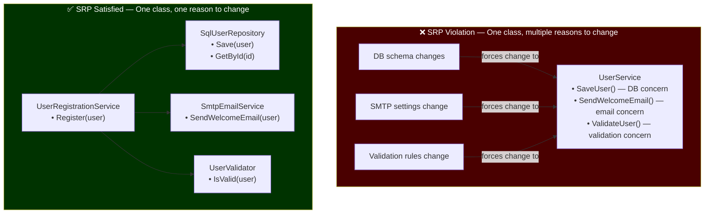

❌ **Bad — UserService with multiple responsibilities:**
```csharp
public class UserService
{
    private readonly string _connectionString;

    public UserService(string connectionString)
        => _connectionString = connectionString;

    // Responsibility 1: Data persistence
    public void SaveUser(User user)
    {
        using var conn = new SqlConnection(_connectionString);
        conn.Open();
        var cmd = new SqlCommand("INSERT INTO Users (Name, Email) VALUES (@name, @email)", conn);
        cmd.Parameters.AddWithValue("@name", user.Name);
        cmd.Parameters.AddWithValue("@email", user.Email);
        cmd.ExecuteNonQuery();
    }

    // Responsibility 2: Email sending (completely different concern)
    public void SendWelcomeEmail(User user)
    {
        var client = new SmtpClient("smtp.example.com");
        var message = new MailMessage("noreply@example.com", user.Email,
            "Welcome!", $"Hi {user.Name}, welcome to our platform!");
        client.Send(message);
    }

    // Responsibility 3: Validation (yet another concern)
    public bool ValidateUser(User user)
        => !string.IsNullOrEmpty(user.Name) && user.Email.Contains("@");
}
// Change to SMTP settings forces changes to UserService
// Change to DB schema forces changes to UserService
// Testing email logic requires a DB connection — tight coupling
```
*Why bad:* Three reasons to change: data persistence, email delivery, and validation logic. Changes to SMTP settings, SQL schema, or validation rules all modify the same class.

✅ **Good — each class has one responsibility:**
```csharp
public class User
{
    public int Id { get; set; }
    public string Name { get; set; } = "";
    public string Email { get; set; } = "";
}

// Responsibility: persistence only
public interface IUserRepository
{
    void Save(User user);
    User? GetById(int id);
}

public class SqlUserRepository : IUserRepository
{
    private readonly string _connectionString;
    public SqlUserRepository(string connectionString) => _connectionString = connectionString;

    public void Save(User user)
    {
        using var conn = new SqlConnection(_connectionString);
        conn.Open();
        var cmd = new SqlCommand("INSERT INTO Users (Name, Email) VALUES (@name, @email)", conn);
        cmd.Parameters.AddWithValue("@name", user.Name);
        cmd.Parameters.AddWithValue("@email", user.Email);
        cmd.ExecuteNonQuery();
    }

    public User? GetById(int id) => null; // implementation omitted for brevity
}

// Responsibility: email delivery only
public interface IEmailService
{
    void SendWelcomeEmail(User user);
}

public class SmtpEmailService : IEmailService
{
    private readonly SmtpClient _client;
    public SmtpEmailService(SmtpClient client) => _client = client;

    public void SendWelcomeEmail(User user)
    {
        var message = new MailMessage("noreply@example.com", user.Email,
            "Welcome!", $"Hi {user.Name}, welcome to our platform!");
        _client.Send(message);
    }
}

// Responsibility: validation only
public interface IUserValidator
{
    bool IsValid(User user);
}

public class UserValidator : IUserValidator
{
    public bool IsValid(User user)
        => !string.IsNullOrWhiteSpace(user.Name)
        && !string.IsNullOrWhiteSpace(user.Email)
        && user.Email.Contains('@');
}

// Orchestrator — thin coordination layer
public class UserRegistrationService
{
    private readonly IUserRepository _repo;
    private readonly IEmailService _email;
    private readonly IUserValidator _validator;

    public UserRegistrationService(IUserRepository repo, IEmailService email, IUserValidator validator)
    { _repo = repo; _email = email; _validator = validator; }

    public void Register(User user)
    {
        if (!_validator.IsValid(user)) throw new ArgumentException("Invalid user");
        _repo.Save(user);
        _email.SendWelcomeEmail(user);
    }
}
```
*Why good:* Each class changes for exactly one reason. Email logic can be tested without a DB. Repository can be swapped (SQL → Mongo) without touching email. Each class is small and focused.

---

### Q2: What is the Open/Closed Principle (OCP)?

The **Open/Closed Principle** states that software entities (classes, modules, functions) should be **open for extension** but **closed for modification**. Once a class is tested and deployed, you should be able to add new behavior by adding new code — not by changing existing code. The classical implementation uses the Strategy or Template Method patterns: define an interface for behavior, then add new behaviors as new classes. The key insight is that `if`/`switch` statements that check a type or category are almost always an OCP violation — every new case requires modifying the original code.

```mermaid
flowchart TD
    subgraph BAD["❌ OCP Violation — Modify existing code to add new tier"]
        DC["DiscountCalculator\n(existing tested class)"]
        ADD_EMP["Add Employee tier"] -->|"must MODIFY"| DC
        DC --> SW["switch(customerType)\n• Regular → 0%\n• Silver → 5%\n• Gold → 10%\n• Platinum → 20%\n+ Employee → 30% ← edit here"]
    end

    subgraph GOOD["✅ OCP Satisfied — Extend without modifying"]
        IFACE["IDiscountStrategy\n+CalculateDiscount(price)"]
        IFACE <|.. REG["NoDiscount (Regular)"]
        IFACE <|.. SIL["SilverDiscount"]
        IFACE <|.. GOLD["GoldDiscount"]
        IFACE <|.. PLAT["PlatinumDiscount"]
        IFACE <|.. EMP["EmployeeDiscount ← NEW class\n(zero changes to existing code)"]
        DCC["DiscountCalculator\n(never changes)"] --> IFACE
    end

    style BAD fill:#4a0000,color:#fff
    style GOOD fill:#003300,color:#fff
```

❌ **Bad — discount calculator with switch per customer type:**
```csharp
public class DiscountCalculator
{
    // Adding a new customer type (e.g., "Employee") requires modifying this method
    public decimal CalculateDiscount(decimal price, string customerType)
    {
        return customerType switch
        {
            "Regular" => price * 0.0m,        // no discount
            "Silver"  => price * 0.05m,       // 5% discount
            "Gold"    => price * 0.10m,       // 10% discount
            "Platinum" => price * 0.20m,      // 20% discount
            _ => throw new ArgumentException($"Unknown customer type: {customerType}")
        };
    }
}
// Adding "Employee" (30% discount) means editing the switch — modifying tested code
```
*Why bad:* Every new customer tier requires modifying the existing, tested `DiscountCalculator` class. Risk of breaking existing discount logic with each change.

✅ **Good — Strategy pattern makes extension require only new class:**
```csharp
// Closed abstraction — never changes
public interface IDiscountStrategy
{
    decimal CalculateDiscount(decimal price);
    string CustomerTier { get; }
}

// Open for extension — add new strategies without touching existing code
public class NoDiscount : IDiscountStrategy
{
    public string CustomerTier => "Regular";
    public decimal CalculateDiscount(decimal price) => 0m;
}

public class SilverDiscount : IDiscountStrategy
{
    public string CustomerTier => "Silver";
    public decimal CalculateDiscount(decimal price) => price * 0.05m;
}

public class GoldDiscount : IDiscountStrategy
{
    public string CustomerTier => "Gold";
    public decimal CalculateDiscount(decimal price) => price * 0.10m;
}

public class PlatinumDiscount : IDiscountStrategy
{
    public string CustomerTier => "Platinum";
    public decimal CalculateDiscount(decimal price) => price * 0.20m;
}

// NEW tier added — zero changes to existing code:
public class EmployeeDiscount : IDiscountStrategy
{
    public string CustomerTier => "Employee";
    public decimal CalculateDiscount(decimal price) => price * 0.30m;
}

// Calculator is closed — never modified
public class DiscountCalculator
{
    private readonly Dictionary<string, IDiscountStrategy> _strategies;

    public DiscountCalculator(IEnumerable<IDiscountStrategy> strategies)
        => _strategies = strategies.ToDictionary(s => s.CustomerTier, StringComparer.OrdinalIgnoreCase);

    public decimal CalculateDiscount(decimal price, string customerTier)
    {
        if (!_strategies.TryGetValue(customerTier, out var strategy))
            throw new ArgumentException($"Unknown customer tier: {customerTier}");
        return strategy.CalculateDiscount(price);
    }
}

// DI registration:
// builder.Services.AddSingleton<IDiscountStrategy, NoDiscount>();
// builder.Services.AddSingleton<IDiscountStrategy, SilverDiscount>();
// builder.Services.AddSingleton<IDiscountStrategy, GoldDiscount>();
// builder.Services.AddSingleton<IDiscountStrategy, PlatinumDiscount>();
// builder.Services.AddSingleton<IDiscountStrategy, EmployeeDiscount>(); // just add this line
```
*Why good:* Adding `EmployeeDiscount` is one new class plus one DI registration. Existing strategies are untouched. The `DiscountCalculator` is closed — it never needs to change.

---

### Q3: What is the Liskov Substitution Principle (LSP)?

The **Liskov Substitution Principle** (formulated by Barbara Liskov) states that objects of a subclass must be substitutable for objects of their superclass without altering the correctness of the program. In practical terms: if code works with a `Rectangle`, it must work equally well with any `Rectangle` subclass. Subtypes must honor the parent's *behavioral contract*, not just its method signatures. Violations manifest as: strengthening preconditions (requiring more from callers), weakening postconditions (promising less to callers), or changing invariants. The classic violation is Square overriding Rectangle because it breaks the independent-width-height invariant.

```mermaid
flowchart TD
    subgraph BAD["❌ LSP Violation — Square breaks Rectangle contract"]
        RECT["Rectangle\n• Width (settable independently)\n• Height (settable independently)\n• Area() = Width × Height"]
        SQ["Square : Rectangle\n• Setting Width ALSO sets Height\n• Breaks postcondition:\n  'Width and Height are independent'"]
        RECT --> SQ
        FUNC["ResizeAndCheck(Rectangle r)\n  r.Width = 4\n  r.Height = 5\n  expect Area = 20"]
        SQ -->|"Area = 25 ≠ 20\nLSP VIOLATED"| FUNC
    end

    subgraph GOOD["✅ LSP Satisfied — Common interface, no forced inheritance"]
        ISHAPE["IShape\n+Area()\n+Perimeter()"]
        RECTG["Rectangle\n• Width, Height independent\n• Area = Width × Height"]
        SQG["Square\n• Side only\n• Area = Side × Side"]
        ISHAPE <|.. RECTG
        ISHAPE <|.. SQG
        PRINTINFO["PrintShapeInfo(IShape s)\n  → always correct for both"]
        RECTG --> PRINTINFO
        SQG --> PRINTINFO
    end

    style BAD fill:#4a0000,color:#fff
    style GOOD fill:#003300,color:#fff
```

❌ **Bad — Square/Rectangle LSP violation:**
```csharp
public class Rectangle
{
    public virtual int Width { get; set; }
    public virtual int Height { get; set; }

    public int Area() => Width * Height;
}

public class Square : Rectangle
{
    private int _side;

    public override int Width
    {
        get => _side;
        set { _side = value; base.Height = value; } // forces Height == Width
    }

    public override int Height
    {
        get => _side;
        set { _side = value; base.Width = value; } // forces Width == Height
    }
}

// Function that works correctly with Rectangle, breaks with Square:
static void ResizeAndCheck(Rectangle r)
{
    r.Width = 4;
    r.Height = 5;
    int expected = 20;
    int actual = r.Area();
    // With Square: Width=5, Height=5, Area=25 — not 20 as expected
    Console.WriteLine($"Expected: {expected}, Actual: {actual}, OK: {actual == expected}");
}

ResizeAndCheck(new Rectangle()); // Expected: 20, Actual: 20, OK: True
ResizeAndCheck(new Square());    // Expected: 20, Actual: 25, OK: FALSE — LSP violated!
```
*Why bad:* Square is NOT substitutable for Rectangle. The postcondition "setting Width doesn't change Height" is violated by Square.

✅ **Good — use a common interface, don't force inheritance:**
```csharp
public interface IShape
{
    double Area();
    double Perimeter();
}

public class Rectangle : IShape
{
    public double Width { get; }
    public double Height { get; }

    public Rectangle(double width, double height)
    {
        if (width <= 0) throw new ArgumentException("Width must be positive");
        if (height <= 0) throw new ArgumentException("Height must be positive");
        Width = width;
        Height = height;
    }

    public double Area() => Width * Height;
    public double Perimeter() => 2 * (Width + Height);
}

public class Square : IShape
{
    public double Side { get; }

    public Square(double side)
    {
        if (side <= 0) throw new ArgumentException("Side must be positive");
        Side = side;
    }

    public double Area() => Side * Side;
    public double Perimeter() => 4 * Side;
}

// Both substitutable for IShape — no surprises:
static void PrintShapeInfo(IShape shape)
{
    Console.WriteLine($"Area: {shape.Area():F2}, Perimeter: {shape.Perimeter():F2}");
}

PrintShapeInfo(new Rectangle(4, 5)); // Area: 20.00, Perimeter: 18.00
PrintShapeInfo(new Square(5));        // Area: 25.00, Perimeter: 20.00
// No LSP violation — each honors the IShape contract fully
```
*Why good:* `Rectangle` and `Square` are independent implementations of `IShape`. Neither overrides the other. Code using `IShape` gets correct, predictable behavior from both.

---

### Q4: What is the Interface Segregation Principle (ISP)?

The **Interface Segregation Principle** states that no client should be forced to depend on methods it does not use. Large ("fat") interfaces force implementors to provide stubs or throw `NotImplementedException` for methods irrelevant to them. This is a design smell — it indicates the interface is doing too much. The fix is to split fat interfaces into smaller, cohesive ones. Clients then depend only on the interfaces they actually use. ISP is closely related to SRP — an interface with too many methods often represents too many responsibilities.

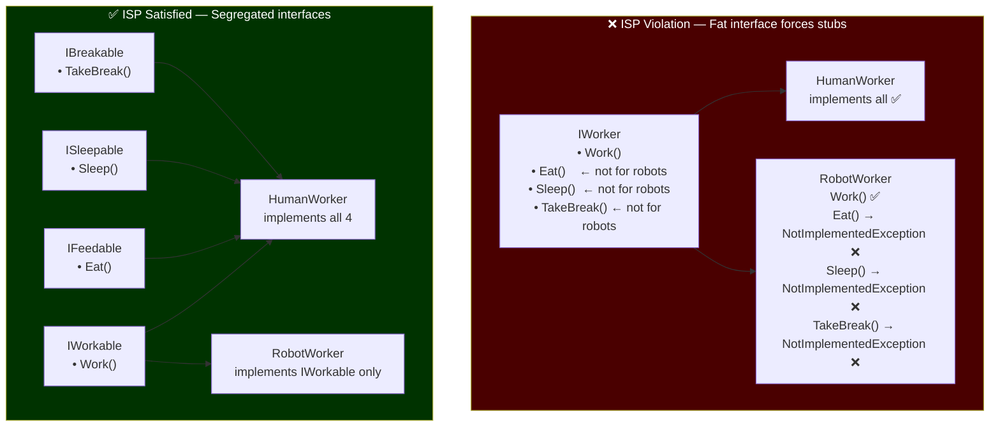

❌ **Bad — fat IWorker interface forces Robot to implement Eat():**
```csharp
public interface IWorker
{
    void Work();
    void Eat();       // Not applicable to robots
    void Sleep();     // Not applicable to robots
    void TakeBreak(); // Not applicable to robots
}

public class HumanWorker : IWorker
{
    public void Work() => Console.WriteLine("Human works");
    public void Eat() => Console.WriteLine("Human eats");
    public void Sleep() => Console.WriteLine("Human sleeps");
    public void TakeBreak() => Console.WriteLine("Human takes a break");
}

public class RobotWorker : IWorker
{
    public void Work() => Console.WriteLine("Robot works 24/7");
    public void Eat() => throw new NotImplementedException(); // forced to implement!
    public void Sleep() => throw new NotImplementedException(); // forced to implement!
    public void TakeBreak() => throw new NotImplementedException(); // forced to implement!
}
```
*Why bad:* `RobotWorker` is forced to implement biological needs it cannot fulfill. `NotImplementedException` at runtime is worse than a compile-time design error.

✅ **Good — segregated interfaces:**
```csharp
// Segregated, focused interfaces
public interface IWorkable
{
    void Work();
}

public interface IFeedable
{
    void Eat();
}

public interface ISleepable
{
    void Sleep();
}

public interface IBreakable
{
    void TakeBreak();
}

// Human implements all capabilities
public class HumanWorker : IWorkable, IFeedable, ISleepable, IBreakable
{
    public void Work() => Console.WriteLine("Human works productively");
    public void Eat() => Console.WriteLine("Human enjoys lunch");
    public void Sleep() => Console.WriteLine("Human sleeps 8 hours");
    public void TakeBreak() => Console.WriteLine("Human takes a coffee break");
}

// Robot only implements what applies to it
public class RobotWorker : IWorkable
{
    public void Work() => Console.WriteLine("Robot works continuously without breaks");
}

// Clients depend only on what they use
public class WorkManager
{
    private readonly IEnumerable<IWorkable> _workers;
    public WorkManager(IEnumerable<IWorkable> workers) => _workers = workers;
    public void StartWork()
    {
        foreach (var worker in _workers)
            worker.Work(); // works for both Human and Robot
    }
}

public class BreakCoordinator
{
    private readonly IEnumerable<IBreakable> _breakableWorkers;
    public BreakCoordinator(IEnumerable<IBreakable> workers) => _breakableWorkers = workers;
    public void TakeBreaks()
    {
        foreach (var worker in _breakableWorkers)
            worker.TakeBreak(); // only Humans — Robot never in this list
    }
}
```
*Why good:* `RobotWorker` only implements `IWorkable` — no forced stubs. New worker types implement only relevant interfaces. Clients depend on the minimal interface they need.

---

### Q5: What is the Dependency Inversion Principle (DIP)?

The **Dependency Inversion Principle** has two rules: (1) High-level modules should not depend on low-level modules — both should depend on abstractions. (2) Abstractions should not depend on details — details should depend on abstractions. This inverts the natural tendency to have business logic depend directly on infrastructure. The result is that business logic (high-level policy) is insulated from changes to databases, APIs, or frameworks (low-level details). DIP is the foundation of dependency injection and makes systems testable, flexible, and replaceable.

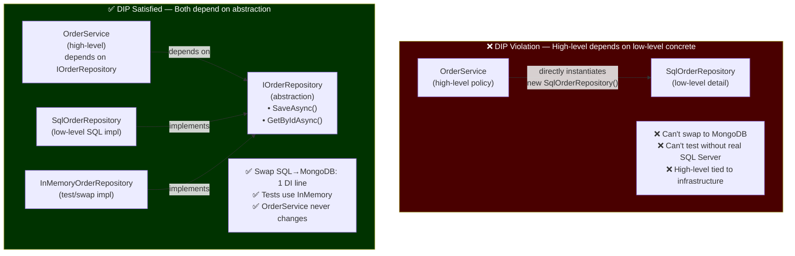

❌ **Bad — OrderService directly depends on SqlOrderRepository:**
```csharp
public class SqlOrderRepository
{
    private readonly string _connectionString;
    public SqlOrderRepository(string cs) => _connectionString = cs;

    public void Save(Order order)
    {
        // Direct SQL — tied to SQL Server
        using var conn = new SqlConnection(_connectionString);
        // ... SQL logic
    }
}

public class OrderService
{
    // Direct dependency on a CONCRETE low-level class — DIP violation
    private readonly SqlOrderRepository _repository = new SqlOrderRepository("Server=.;Database=Orders;");

    public void PlaceOrder(Order order)
    {
        // Validate...
        _repository.Save(order); // can never swap to MongoDB or InMemory for tests
    }
}
```
*Why bad:* `OrderService` is welded to `SqlOrderRepository`. Can't test without a real SQL Server. Can't swap to MongoDB without modifying `OrderService`. High-level module (OrderService) depends on low-level detail (SQL).

✅ **Good — both depend on IOrderRepository abstraction:**
```csharp
public class Order
{
    public int Id { get; set; }
    public string CustomerName { get; set; } = "";
    public decimal Total { get; set; }
    public DateTime PlacedAt { get; set; }
}

// Abstraction — both high-level and low-level depend on this
public interface IOrderRepository
{
    Task SaveAsync(Order order, CancellationToken ct = default);
    Task<Order?> GetByIdAsync(int id, CancellationToken ct = default);
    Task<IReadOnlyList<Order>> GetByCustomerAsync(string customerName, CancellationToken ct = default);
}

// Low-level detail — depends on the abstraction (implements it)
public class SqlOrderRepository : IOrderRepository
{
    private readonly string _connectionString;
    public SqlOrderRepository(string cs) => _connectionString = cs;

    public async Task SaveAsync(Order order, CancellationToken ct)
    {
        await using var conn = new SqlConnection(_connectionString);
        // ... EF Core or Dapper logic
        await Task.CompletedTask;
    }

    public async Task<Order?> GetByIdAsync(int id, CancellationToken ct)
        => await Task.FromResult<Order?>(null); // simplified

    public async Task<IReadOnlyList<Order>> GetByCustomerAsync(string name, CancellationToken ct)
        => await Task.FromResult<IReadOnlyList<Order>>(new List<Order>());
}

// InMemory implementation for tests
public class InMemoryOrderRepository : IOrderRepository
{
    private readonly List<Order> _orders = new();
    public Task SaveAsync(Order order, CancellationToken ct) { _orders.Add(order); return Task.CompletedTask; }
    public Task<Order?> GetByIdAsync(int id, CancellationToken ct)
        => Task.FromResult(_orders.FirstOrDefault(o => o.Id == id));
    public Task<IReadOnlyList<Order>> GetByCustomerAsync(string name, CancellationToken ct)
        => Task.FromResult<IReadOnlyList<Order>>(_orders.Where(o => o.CustomerName == name).ToList());
}

// High-level module — depends on abstraction, not detail
public class OrderService
{
    private readonly IOrderRepository _repository;
    private readonly ILogger _logger;

    // Dependencies injected — class never creates them
    public OrderService(IOrderRepository repository, ILogger logger)
    { _repository = repository; _logger = logger; }

    public async Task PlaceOrderAsync(Order order, CancellationToken ct)
    {
        order.PlacedAt = DateTime.UtcNow;
        await _repository.SaveAsync(order, ct);
        _logger.Log($"Order {order.Id} placed for {order.CustomerName}");
    }
}

// DI registration:
// builder.Services.AddScoped<IOrderRepository, SqlOrderRepository>();
// Tests: new OrderService(new InMemoryOrderRepository(), new FakeLogger())
```
*Why good:* `OrderService` depends only on `IOrderRepository`. Swap SQL for MongoDB or InMemory by changing one DI registration. Unit tests use `InMemoryOrderRepository` — no real database needed.

---

### Q6: How do all five SOLID principles work together? Show an evolution example.

SOLID principles are mutually reinforcing. **SRP** keeps classes focused. **OCP** allows new features without modifying working code. **LSP** ensures substitutability of implementations. **ISP** keeps interfaces lean. **DIP** decouples high-level logic from infrastructure. A `NotificationService` that evolves from a monolith to a SOLID design shows all five at work simultaneously.

❌ **Bad — SOLID violations all at once:**
```csharp
public class NotificationService
{
    // Violates SRP: handles email, SMS, push — three different responsibilities
    // Violates OCP: adding a new channel requires modifying this class
    // Violates DIP: directly instantiates concrete senders

    public void Send(string message, string channel, string recipient)
    {
        if (channel == "Email")
        {
            var smtp = new SmtpClient("smtp.example.com");
            smtp.Send("from@example.com", recipient, "Notification", message);
        }
        else if (channel == "SMS")
        {
            var twilio = new TwilioClient("ACXXXXXXXXX", "authToken");
            // twilio.Messages.Create(recipient, "from", message);
        }
        else if (channel == "Push")
        {
            // Firebase push notification logic
        }
        // Adding Slack requires modifying this entire method
    }
}
```
*Why bad:* All five SOLID principles violated — impossible to test, extend, or maintain independently.

✅ **Good — all SOLID principles applied:**
```csharp
// ISP: lean, focused notification interface (not one fat interface)
public interface INotificationSender
{
    string Channel { get; }
    Task SendAsync(string recipient, string message, CancellationToken ct = default);
}

// SRP: each sender has one responsibility
// OCP: adding Slack = new class, no existing changes
public class EmailNotificationSender : INotificationSender
{
    public string Channel => "Email";
    private readonly SmtpClient _smtp;
    public EmailNotificationSender(SmtpClient smtp) => _smtp = smtp;

    public async Task SendAsync(string recipient, string message, CancellationToken ct)
    {
        // Email-specific sending logic
        _smtp.Send("notifications@example.com", recipient, "Notification", message);
        await Task.CompletedTask;
    }
}

public class SmsNotificationSender : INotificationSender
{
    public string Channel => "SMS";
    public async Task SendAsync(string recipient, string message, CancellationToken ct)
    {
        // Twilio API call
        await Task.Delay(10, ct);
    }
}

public class PushNotificationSender : INotificationSender
{
    public string Channel => "Push";
    public async Task SendAsync(string recipient, string message, CancellationToken ct)
    {
        // Firebase FCM API call
        await Task.Delay(10, ct);
    }
}

// NEW channel — zero changes to existing code (OCP satisfied)
public class SlackNotificationSender : INotificationSender
{
    public string Channel => "Slack";
    public async Task SendAsync(string recipient, string message, CancellationToken ct)
    {
        await Task.Delay(10, ct);
    }
}

// LSP: all senders are substitutable for INotificationSender
// DIP: NotificationService depends on abstraction, not concrete senders
public class NotificationService
{
    private readonly Dictionary<string, INotificationSender> _senders;

    public NotificationService(IEnumerable<INotificationSender> senders)
        => _senders = senders.ToDictionary(s => s.Channel, StringComparer.OrdinalIgnoreCase);

    public async Task SendAsync(string channel, string recipient, string message, CancellationToken ct)
    {
        if (!_senders.TryGetValue(channel, out var sender))
            throw new ArgumentException($"No sender registered for channel: {channel}");
        await sender.SendAsync(recipient, message, ct);
    }
}

// DI registration (adding Slack = one extra line):
// builder.Services.AddSingleton<INotificationSender, EmailNotificationSender>();
// builder.Services.AddSingleton<INotificationSender, SmsNotificationSender>();
// builder.Services.AddSingleton<INotificationSender, PushNotificationSender>();
// builder.Services.AddSingleton<INotificationSender, SlackNotificationSender>();
```
*Why good:* Each principle reinforces the others. Adding a new channel = one new class + one DI line. No existing code changes. Each sender is independently testable. `NotificationService` never changes as channels grow.

---

### Q7: When is SOLID overkill? Discuss YAGNI and premature abstraction.

SOLID principles exist to manage complexity at scale — but they introduce their own complexity: more classes, more interfaces, more indirection. In a small script, a startup prototype, or a feature with one known implementation, adding interfaces and strategy patterns is **premature abstraction**. YAGNI ("You Aren't Gonna Need It") warns against building for hypothetical future needs. The cost of premature abstraction is real: it makes simple code harder to read, slows onboarding, and creates maintenance overhead for flexibility that never gets used. The pragmatic rule: apply SOLID when complexity is already hurting, or when there are two or more concrete cases that justify the abstraction.

❌ **Bad — over-engineered hello world:**
```csharp
// Absurd over-engineering for a simple "format a greeting" feature
public interface IGreetingStrategy
{
    string Format(string name);
}

public class FormalGreetingStrategy : IGreetingStrategy
{
    public string Format(string name) => $"Good day, {name}.";
}

public abstract class GreetingFormatterBase
{
    protected abstract IGreetingStrategy Strategy { get; }
    public string FormatGreeting(string name) => Strategy.Format(name);
}

public class GreetingService : GreetingFormatterBase
{
    protected override IGreetingStrategy Strategy => new FormalGreetingStrategy();
}

// All of this complexity for:
new GreetingService().FormatGreeting("Alice"); // "Good day, Alice."
```
*Why bad:* Four classes/interfaces for a one-liner. There is no current need for strategy switching. This is the definition of over-engineering.

✅ **Good — simple first, refactor when justified:**
```csharp
// Start simple — one method, works great
public static class Greeter
{
    public static string Greet(string name) => $"Hello, {name}!";
}

// When you HAVE two real cases, then extract strategy:
// public interface IGreetingStrategy { string Format(string name); }
// When you have a THIRD, then it's clearly a pattern worth the abstraction.

// Pragmatic SOLID application — the "Rule of Three":
// 1. First implementation: just write it
// 2. Second similar case: duplicate if small, refactor if large
// 3. Third case: now you KNOW the pattern, extract the abstraction

// Real example of appropriate simplicity:
public class OrderEmailer
{
    public void Send(Order order, string to)
    {
        var body = $"Your order #{order.Id} for {order.Total:C} has been confirmed.";
        // Send email directly — no abstraction needed until there's a second email type
        Console.WriteLine($"Sending to {to}: {body}");
    }
}
```
*Why good:* Start with the simplest solution. Introduce abstractions when a genuine second or third use case materializes. "Make it work, make it right, make it fast" — in that order.

---

### Q8: What is the "Tell Don't Ask" principle?

**Tell Don't Ask (TDA)** states that you should tell an object to do something rather than asking it for its data and making decisions yourself externally. Asking for data and deciding externally is a form of encapsulation violation — you're effectively moving the object's logic outside the object. TDA leads to more cohesive objects where behavior lives with data. It is closely related to encapsulation and the Law of Demeter. The violation pattern is: get data, check data, act based on data — all outside the object.

❌ **Bad — ask for data, decide externally:**
```csharp
public class Order
{
    public DateTime PlacedAt { get; set; }
    public string Status { get; set; } = "Active";
    public bool IsCancelled { get; set; }
}

// Caller asks for data and makes the decision — logic lives OUTSIDE Order
public class OrderProcessor
{
    public void ProcessExpiredOrders(List<Order> orders)
    {
        foreach (var order in orders)
        {
            // Asking Order for data, deciding outside — TDA violation
            if (!order.IsCancelled
                && order.Status == "Active"
                && order.PlacedAt < DateTime.UtcNow.AddDays(-30))
            {
                order.Status = "Expired";
                order.IsCancelled = true;
                // This logic should live IN Order, not in the caller
            }
        }
    }
}
```
*Why bad:* The business rule "an order is expired if active and placed 30+ days ago" lives in the caller, not in `Order`. Every caller must duplicate this logic. Changing the expiry rule requires finding all callers.

✅ **Good — tell the object to perform the action:**
```csharp
public class Order
{
    public int Id { get; private set; }
    public DateTime PlacedAt { get; private set; }
    public OrderStatus Status { get; private set; }

    public Order(int id)
    {
        Id = id;
        PlacedAt = DateTime.UtcNow;
        Status = OrderStatus.Active;
    }

    // Business rule lives IN the object
    public bool IsExpired => Status == OrderStatus.Active
                          && PlacedAt < DateTime.UtcNow.AddDays(-30);

    // TELL the order to cancel itself if expired — don't ask and decide outside
    public bool TryCancelIfExpired()
    {
        if (!IsExpired) return false;
        Status = OrderStatus.Expired;
        return true;
    }

    // Tell the order to cancel — validation inside
    public void Cancel(string reason)
    {
        if (Status == OrderStatus.Cancelled)
            throw new InvalidOperationException("Order already cancelled");
        Status = OrderStatus.Cancelled;
        // Domain event could be raised here
    }
}

public enum OrderStatus { Active, Expired, Cancelled, Fulfilled }

// Caller TELLS orders what to do — no business logic leaks out
public class OrderProcessor
{
    public void ProcessExpiredOrders(IEnumerable<Order> orders)
    {
        foreach (var order in orders)
            order.TryCancelIfExpired(); // tell, don't ask
    }
}
```
*Why good:* Expiry logic lives in `Order` where the data is. Any caller can use `TryCancelIfExpired()` without duplicating the rule. Changing the expiry period means one change in one place.

---

### Q9: What is the Law of Demeter (Principle of Least Knowledge)?

The **Law of Demeter** (LoD) states that a method of an object should only call methods on: itself, its parameters, objects it creates, and its direct component objects. Colloquially: "only talk to your immediate friends." The tell-tale sign of a violation is method chains: `a.GetB().GetC().DoSomething()` — reaching through layers of objects. This creates tight coupling to the internal structure of distant objects. If the structure of B or C changes, the caller breaks even though it only nominally depends on A.

❌ **Bad — chained navigation violates LoD:**
```csharp
public class Order
{
    public Customer Customer { get; set; }
}

public class Customer
{
    public Address Address { get; set; }
    public string Name { get; set; }
}

public class Address
{
    public string City { get; set; }
    public string PostalCode { get; set; }
    public string Country { get; set; }
}

public class ShippingService
{
    public decimal CalculateShipping(Order order)
    {
        // Violates LoD — reaching through order → customer → address → city
        string city = order.Customer.Address.City;
        string country = order.Customer.Address.Country;
        // If Address adds a subdivision level, every caller breaks
        return country == "US" ? 5.99m : 14.99m;
    }
}
```
*Why bad:* `ShippingService` is coupled to the internal navigation path `Order → Customer → Address`. Any restructuring of this chain breaks `ShippingService`.

✅ **Good — encapsulate the navigation inside the object:**
```csharp
public class Address
{
    public string City { get; }
    public string PostalCode { get; }
    public string Country { get; }

    public Address(string city, string postalCode, string country)
    { City = city; PostalCode = postalCode; Country = country; }
}

public class Customer
{
    private readonly Address _address;
    public string Name { get; }

    public Customer(string name, Address address) { Name = name; _address = address; }

    // Expose what callers need, hide the navigation
    public string GetDeliveryCity() => _address.City;
    public string GetDeliveryCountry() => _address.Country;
    public string GetDeliveryPostalCode() => _address.PostalCode;
}

public class Order
{
    private readonly Customer _customer;
    public int Id { get; }

    public Order(int id, Customer customer) { Id = id; _customer = customer; }

    // Order encapsulates the customer navigation
    public string GetDeliveryCity() => _customer.GetDeliveryCity();
    public string GetDeliveryCountry() => _customer.GetDeliveryCountry();
}

public class ShippingService
{
    public decimal CalculateShipping(Order order)
    {
        // LoD satisfied — only talking to immediate friend (order)
        string country = order.GetDeliveryCountry();
        return country == "US" ? 5.99m : 14.99m;
    }
}
```
*Why good:* `ShippingService` only calls methods on `Order` — its direct collaborator. `Address` can be restructured without `ShippingService` knowing or caring.

---

### Q10: Explain cohesion and coupling. How do you measure them?

**Cohesion** measures how closely related the responsibilities within a class are. High cohesion means everything in the class belongs together and serves a single purpose — like a `StringParser` that only parses strings. **Coupling** measures how much one class depends on another. Low coupling means classes can change independently — a `UserService` should not need to know SQL syntax. The goal is **high cohesion + low coupling** — each class is focused (cohesion) and classes are largely independent (coupling). Robert Martin formalized coupling into **instability** (ratio of outgoing to total dependencies) and **abstractness** (ratio of abstract types to total types), and the **Stable Abstractions Principle** says abstractions should be stable (low instability).

❌ **Bad — low cohesion + high coupling:**
```csharp
// Low cohesion: this class does reporting, emailing, database access, and PDF generation
// High coupling: depends on 6 different concrete classes
public class ReportManager
{
    private SqlConnection _conn = new SqlConnection("...");
    private SmtpClient _smtp = new SmtpClient("smtp.example.com");

    public void GenerateAndEmailReport(int userId)
    {
        // DB access
        _conn.Open();
        var data = /* query */ "";

        // Business logic
        var processed = data.ToUpper();

        // PDF generation (external concern)
        var pdf = new PdfDocument();
        // pdf.AddPage()...

        // Email delivery
        _smtp.Send("from@x.com", "to@x.com", "Report", processed);

        // Database write-back
        _conn.Close();
    }
}
```
*Why bad:* One class handles DB, business logic, PDF, and email. Any of these changing forces `ReportManager` to change. Impossible to test any concern in isolation.

✅ **Good — high cohesion + low coupling:**
```csharp
// Each class is highly cohesive (one job) and loosely coupled (through interfaces)

public interface IReportDataRepository
{
    Task<ReportData> GetReportDataAsync(int userId);
}

public interface IReportGenerator
{
    byte[] GeneratePdf(ReportData data);
}

public interface IReportEmailer
{
    Task SendReportAsync(string email, byte[] pdfBytes);
}

// Highly cohesive: only orchestration logic
public class ReportOrchestrator
{
    private readonly IReportDataRepository _repo;
    private readonly IReportGenerator _generator;
    private readonly IReportEmailer _emailer;

    public ReportOrchestrator(
        IReportDataRepository repo,
        IReportGenerator generator,
        IReportEmailer emailer)
    { _repo = repo; _generator = generator; _emailer = emailer; }

    public async Task GenerateAndSendReportAsync(int userId, string recipientEmail)
    {
        var data = await _repo.GetReportDataAsync(userId);
        var pdf = _generator.GeneratePdf(data);
        await _emailer.SendReportAsync(recipientEmail, pdf);
    }
}

public record ReportData(int UserId, string Name, IReadOnlyList<string> Lines);

// Coupling metrics:
// Instability(C) = Ce / (Ca + Ce)  where Ce=efferent(outgoing), Ca=afferent(incoming)
// A class with high instability (many outgoing deps) should be concrete
// A class with low instability (many incoming deps) should be abstract
// Abstractness(A) = abstract classes / total classes
// The Stable Abstractions Principle: A + I ≈ 1 (on the "main sequence")
```
*Why good:* Each collaborator is independently testable, replaceable, and focused. `ReportOrchestrator` has low coupling (only interfaces) and high cohesion (only orchestration). Changing PDF library only touches `IReportGenerator`'s implementation.

---

## 3. Creational Patterns

📚 **References**
- [Refactoring.Guru — Creational Patterns](https://refactoring.guru/design-patterns/creational-patterns)
- [Microsoft Patterns & Practices](https://learn.microsoft.com/en-us/dotnet/architecture/microservices/microservice-ddd-cqrs-patterns/)

---

### Q1: What is the Singleton pattern? How do you implement it thread-safely in C#?

The **Singleton** pattern ensures only one instance of a class exists and provides a global point of access to it. It is useful for shared resources like configuration, logging, and connection pools where multiple instances would cause inconsistency or waste. Thread safety is critical — naive implementations create race conditions where two threads simultaneously find no instance and both create one. The modern C# idiom uses `Lazy<T>` for guaranteed thread safety without explicit locking. In most modern applications, **dependency injection** is a better alternative — the DI container manages lifetime (Singleton lifetime) without the global state problem.

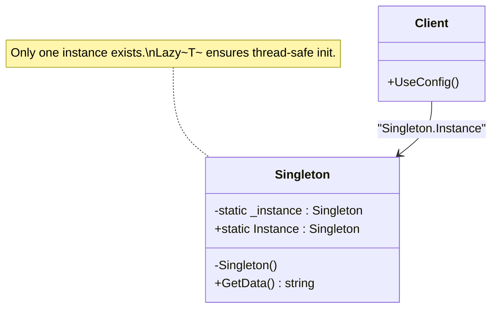

❌ **Bad — not thread-safe, and hard to test:**
```csharp
public class AppConfig
{
    private static AppConfig? _instance;

    private AppConfig()
    {
        // Load from config file
        ConnectionString = "Server=.;Database=App;";
        MaxRetries = 3;
    }

    // NOT thread-safe: two threads can both enter this simultaneously
    public static AppConfig Instance
    {
        get
        {
            if (_instance == null) // Thread A and Thread B can both pass this check
                _instance = new AppConfig(); // Both create instances
            return _instance;
        }
    }

    public string ConnectionString { get; }
    public int MaxRetries { get; }
}
// Also a problem: tests cannot replace AppConfig.Instance with a test double
```
*Why bad:* Race condition if two threads simultaneously check `_instance == null`. Global mutable state makes unit testing impossible.

✅ **Good — Lazy<T> Singleton + DI alternative:**
```csharp
// Thread-safe Singleton using Lazy<T>
public sealed class AppConfig
{
    // Lazy<T> is thread-safe by default (LazyThreadSafetyMode.ExecutionAndPublication)
    private static readonly Lazy<AppConfig> _lazy =
        new(() => new AppConfig(), isThreadSafe: true);

    public static AppConfig Instance => _lazy.Value;

    private AppConfig()
    {
        ConnectionString = Environment.GetEnvironmentVariable("DB_CONNECTION")
                          ?? "Server=.;Database=App;";
        MaxRetries = int.TryParse(Environment.GetEnvironmentVariable("MAX_RETRIES"), out var r)
                    ? r : 3;
    }

    public string ConnectionString { get; }
    public int MaxRetries { get; }
}

// Modern alternative: DI manages lifetime — NO global state
public interface IAppConfig
{
    string ConnectionString { get; }
    int MaxRetries { get; }
}

public class AppConfigFromEnvironment : IAppConfig
{
    public string ConnectionString { get; }
    public int MaxRetries { get; }

    public AppConfigFromEnvironment()
    {
        ConnectionString = Environment.GetEnvironmentVariable("DB_CONNECTION") ?? "Server=.;Database=App;";
        MaxRetries = 3;
    }
}

// Registration:
// builder.Services.AddSingleton<IAppConfig, AppConfigFromEnvironment>();
// Tests inject a fake IAppConfig — no global state problem

// When Singleton is appropriate:
// - Application-wide configuration
// - Logging infrastructure
// - Expensive one-time initialization (ML model loading)

// When Singleton is NOT appropriate:
// - Any state that differs per request/user (use Scoped)
// - Any class with mutable state shared across threads without synchronization
// - Hiding dependencies (prefer DI over global access)
```
*Why good:* `Lazy<T>` guarantees thread-safe initialization. The DI alternative allows tests to inject fakes, making Singleton behavior a container concern rather than a class concern.

---

### Q2: What is the Factory Method pattern?

The **Factory Method** pattern defines an interface for creating an object but lets subclasses (or configuration) decide which class to instantiate. Instead of calling `new ConcreteClass()` directly, clients call a factory method that returns an interface type. This shifts the creation decision away from the caller, enabling the Open/Closed Principle for object creation: new types can be created by adding new factory methods or configurations without changing client code. In .NET, this often takes the form of a factory class registered in DI rather than classical inheritance-based factory.

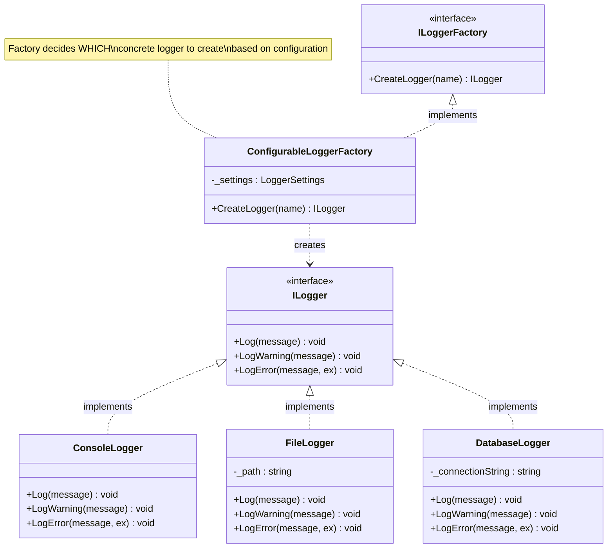

❌ **Bad — caller directly decides which logger to create:**
```csharp
public class Application
{
    public void Run(string logType)
    {
        // Client is responsible for creation — knows all concrete types
        ILogger logger;
        if (logType == "file")
            logger = new FileLogger("app.log");
        else if (logType == "database")
            logger = new DatabaseLogger("Server=.;Database=Logs;");
        else if (logType == "console")
            logger = new ConsoleLogger();
        else
            throw new ArgumentException("Unknown log type");

        logger.Log("Application started");
        // Adding a new logger type requires modifying THIS method
    }
}
```
*Why bad:* The creation logic is tangled with usage logic. Adding a new logger type means changing `Application.Run()`.

✅ **Good — Factory Method abstracts creation:**
```csharp
public interface ILogger
{
    void Log(string message);
    void LogWarning(string message);
    void LogError(string message, Exception? ex = null);
}

public class ConsoleLogger : ILogger
{
    public void Log(string message) => Console.WriteLine($"[INFO]  {message}");
    public void LogWarning(string message) => Console.WriteLine($"[WARN]  {message}");
    public void LogError(string message, Exception? ex = null)
        => Console.WriteLine($"[ERROR] {message} {ex?.Message}");
}

public class FileLogger : ILogger
{
    private readonly string _path;
    public FileLogger(string path) => _path = path;
    public void Log(string message) => File.AppendAllText(_path, $"[INFO]  {message}\n");
    public void LogWarning(string message) => File.AppendAllText(_path, $"[WARN]  {message}\n");
    public void LogError(string message, Exception? ex = null)
        => File.AppendAllText(_path, $"[ERROR] {message} {ex?.Message}\n");
}

public class DatabaseLogger : ILogger
{
    private readonly string _connectionString;
    public DatabaseLogger(string cs) => _connectionString = cs;
    public void Log(string message) { /* Insert to DB */ }
    public void LogWarning(string message) { /* Insert to DB */ }
    public void LogError(string message, Exception? ex = null) { /* Insert to DB */ }
}

// Factory — creation logic isolated here, not in callers
public interface ILoggerFactory
{
    ILogger CreateLogger(string name);
}

public class ConfigurableLoggerFactory : ILoggerFactory
{
    private readonly LoggerSettings _settings;

    public ConfigurableLoggerFactory(LoggerSettings settings) => _settings = settings;

    public ILogger CreateLogger(string name) => _settings.LogType switch
    {
        "Console" => new ConsoleLogger(),
        "File"    => new FileLogger(Path.Combine(_settings.LogDirectory, $"{name}.log")),
        "Database" => new DatabaseLogger(_settings.ConnectionString),
        _ => throw new InvalidOperationException($"Unknown log type: {_settings.LogType}")
    };
}

public class LoggerSettings
{
    public string LogType { get; set; } = "Console";
    public string LogDirectory { get; set; } = "/logs";
    public string ConnectionString { get; set; } = "";
}

// Usage:
var factory = new ConfigurableLoggerFactory(new LoggerSettings { LogType = "Console" });
var logger = factory.CreateLogger("OrderService");
logger.Log("Order placed");
```
*Why good:* Callers request a logger by name and get the right type based on configuration. Adding `ElasticsearchLogger` requires adding a case to the factory — not modifying callers.

---

### Q3: What is the Abstract Factory pattern?

The **Abstract Factory** pattern creates *families* of related objects without specifying their concrete classes. It groups related factories under one interface, guaranteeing that the created objects work together. The classic example is UI themes: a `WindowsUIFactory` creates controls that look and behave like Windows, while a `MacUIFactory` creates Mac-style controls. Client code works exclusively through the abstract factory interface and never knows which concrete family it is using. This ensures consistency — you can't accidentally mix a Mac button with a Windows checkbox.

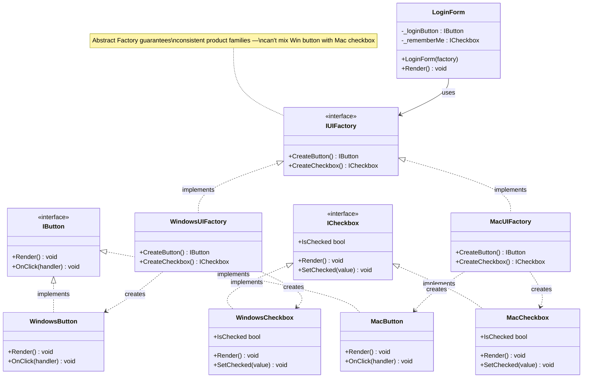

❌ **Bad — mixing UI families:**
```csharp
public class App
{
    public void Render(string os)
    {
        // Mixing family members — Windows button with Mac checkbox is inconsistent
        IButton button = os == "Windows" ? new WindowsButton() : new MacButton();
        ICheckbox checkbox = new WindowsCheckbox(); // always Windows — oops

        button.Render();
        checkbox.Render();
    }
}
```
*Why bad:* Nothing prevents mixing Windows and Mac controls. Inconsistent UI. Adding Linux requires scattering `if (os == "Linux")` throughout.

✅ **Good — Abstract Factory ensures consistent families:**
```csharp
// Abstract products
public interface IButton
{
    void Render();
    void OnClick(Action handler);
}

public interface ICheckbox
{
    void Render();
    bool IsChecked { get; }
    void SetChecked(bool value);
}

// Windows family
public class WindowsButton : IButton
{
    private Action? _handler;
    public void Render() => Console.WriteLine("[Windows] Rendering a flat button");
    public void OnClick(Action handler) => _handler = handler;
}

public class WindowsCheckbox : ICheckbox
{
    public bool IsChecked { get; private set; }
    public void Render() => Console.WriteLine($"[Windows] Checkbox [{(IsChecked ? "X" : " ")}]");
    public void SetChecked(bool value) => IsChecked = value;
}

// Mac family
public class MacButton : IButton
{
    private Action? _handler;
    public void Render() => Console.WriteLine("[Mac] Rendering a rounded button");
    public void OnClick(Action handler) => _handler = handler;
}

public class MacCheckbox : ICheckbox
{
    public bool IsChecked { get; private set; }
    public void Render() => Console.WriteLine($"[Mac] Checkbox ({'●'})");
    public void SetChecked(bool value) => IsChecked = value;
}

// Abstract factory — the interface for creating families
public interface IUIFactory
{
    IButton CreateButton();
    ICheckbox CreateCheckbox();
}

// Concrete factories — each creates a consistent family
public class WindowsUIFactory : IUIFactory
{
    public IButton CreateButton() => new WindowsButton();
    public ICheckbox CreateCheckbox() => new WindowsCheckbox();
}

public class MacUIFactory : IUIFactory
{
    public IButton CreateButton() => new MacButton();
    public ICheckbox CreateCheckbox() => new MacCheckbox();
}

// Client works with abstract factory only — no concrete types visible
public class LoginForm
{
    private readonly IButton _loginButton;
    private readonly ICheckbox _rememberMe;

    public LoginForm(IUIFactory factory)
    {
        _loginButton = factory.CreateButton();
        _rememberMe = factory.CreateCheckbox();
    }

    public void Render()
    {
        _loginButton.Render();
        _rememberMe.Render();
        // Always consistent — both controls from the same family
    }
}

// Switching from Windows to Mac:
IUIFactory factory = Environment.OSVersion.Platform == PlatformID.Win32NT
    ? new WindowsUIFactory()
    : new MacUIFactory();

var form = new LoginForm(factory); // form uses the correct family
form.Render();
```
*Why good:* The factory guarantees consistency — `LoginForm` always gets matching controls. Adding a Linux family means adding three classes (`LinuxButton`, `LinuxCheckbox`, `LinuxUIFactory`) with zero changes to `LoginForm`.

---

### Q4: What is the Builder pattern and when should you use it?

The **Builder** pattern constructs complex objects step by step. It separates the construction algorithm from the representation, allowing the same construction process to create different representations. Builders are ideal when an object has many optional parameters (avoiding "telescoping constructors"), when construction involves multiple steps with validation between steps, or when you want a fluent, readable API for object creation. A **Director** class can encapsulate common construction sequences.

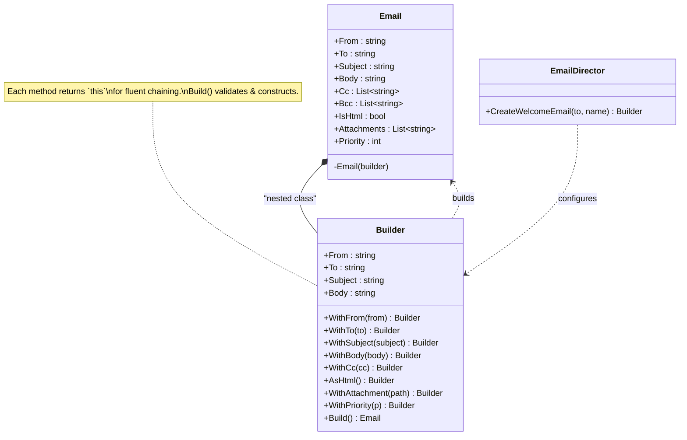

❌ **Bad — telescoping constructors:**
```csharp
public class Email
{
    // 7-parameter constructor — hard to read, easy to mix up args
    public Email(string from, string to, string subject, string body,
                 string? cc, string? bcc, bool isHtml) { }
}

// Which arg is cc vs bcc? Easy to swap:
var email = new Email("from@x.com", "to@x.com", "Hi", "Hello", null, null, true);
```
*Why bad:* Unreadable, error-prone, and adding another optional parameter requires new overloads.

✅ **Good — Fluent Builder pattern:**
```csharp
public sealed class Email
{
    public string From { get; }
    public string To { get; }
    public string Subject { get; }
    public string Body { get; }
    public IReadOnlyList<string> Cc { get; }
    public IReadOnlyList<string> Bcc { get; }
    public bool IsHtml { get; }
    public IReadOnlyList<string> Attachments { get; }
    public int Priority { get; }

    private Email(Builder b)
    {
        From = b.From; To = b.To; Subject = b.Subject; Body = b.Body;
        Cc = b.Cc.AsReadOnly(); Bcc = b.Bcc.AsReadOnly();
        IsHtml = b.IsHtml; Attachments = b.Attachments.AsReadOnly();
        Priority = b.Priority;
    }

    public sealed class Builder
    {
        internal string From { get; private set; } = "";
        internal string To { get; private set; } = "";
        internal string Subject { get; private set; } = "";
        internal string Body { get; private set; } = "";
        internal List<string> Cc { get; } = new();
        internal List<string> Bcc { get; } = new();
        internal bool IsHtml { get; private set; }
        internal List<string> Attachments { get; } = new();
        internal int Priority { get; private set; } = 3;

        public Builder WithFrom(string from) { From = from; return this; }
        public Builder WithTo(string to) { To = to; return this; }
        public Builder WithSubject(string subject) { Subject = subject; return this; }
        public Builder WithBody(string body) { Body = body; return this; }
        public Builder WithCc(string cc) { Cc.Add(cc); return this; }
        public Builder WithBcc(string bcc) { Bcc.Add(bcc); return this; }
        public Builder AsHtml() { IsHtml = true; return this; }
        public Builder WithAttachment(string path) { Attachments.Add(path); return this; }
        public Builder WithPriority(int priority) { Priority = priority; return this; }

        public Email Build()
        {
            if (string.IsNullOrWhiteSpace(From)) throw new InvalidOperationException("From is required");
            if (string.IsNullOrWhiteSpace(To)) throw new InvalidOperationException("To is required");
            if (string.IsNullOrWhiteSpace(Subject)) throw new InvalidOperationException("Subject is required");
            return new Email(this);
        }
    }
}

// Director encapsulates common configurations
public class EmailDirector
{
    public Email.Builder CreateWelcomeEmail(string toAddress, string name)
        => new Email.Builder()
            .WithFrom("noreply@example.com")
            .WithTo(toAddress)
            .WithSubject($"Welcome, {name}!")
            .WithBody($"<h1>Hi {name},</h1><p>Welcome to our platform!</p>")
            .AsHtml()
            .WithPriority(2);
}

// Usage — self-documenting:
var email = new Email.Builder()
    .WithFrom("alice@example.com")
    .WithTo("bob@example.com")
    .WithCc("manager@example.com")
    .WithSubject("Q4 Report")
    .WithBody("<h1>Report</h1>...")
    .AsHtml()
    .WithAttachment("/reports/q4.pdf")
    .WithPriority(1)
    .Build();
```
*Why good:* Every parameter is named at the call site — impossible to swap `cc` and `bcc`. Optional parameters are cleanly handled. `Build()` validates before creating the object.

---

### Q5: What is the Prototype pattern?

The **Prototype** pattern specifies the kinds of objects to create using a prototypical instance, and creates new objects by copying (cloning) that prototype. It is useful when object creation is expensive (DB queries, file I/O, complex calculations), when you need many similar objects that differ only slightly, or when the class to instantiate is specified at runtime. The key decision is always **deep vs shallow clone** — prototypes almost always need deep clones to be independent copies.

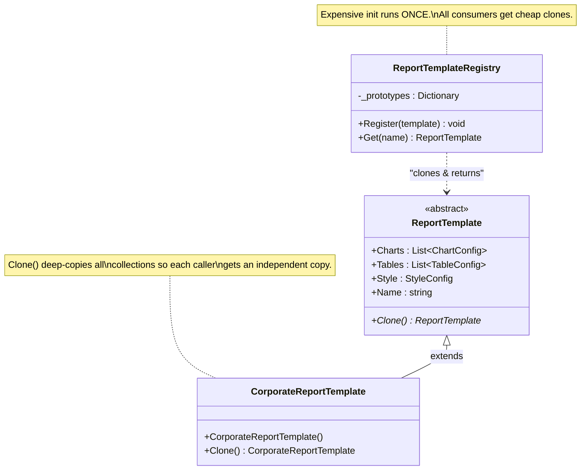

❌ **Bad — re-creating expensive objects from scratch:**
```csharp
public class ReportTemplate
{
    public List<ChartConfig> Charts { get; set; } = new();
    public List<TableConfig> Tables { get; set; } = new();
    public StyleConfig Style { get; set; } = new();

    public ReportTemplate()
    {
        // Expensive: reads from DB, parses XML config, loads fonts
        System.Threading.Thread.Sleep(100); // simulate expensive init
        Charts = LoadDefaultCharts();
        Tables = LoadDefaultTables();
        Style = LoadDefaultStyle();
    }

    private List<ChartConfig> LoadDefaultCharts() => new() { new ChartConfig("Bar"), new ChartConfig("Line") };
    private List<TableConfig> LoadDefaultTables() => new() { new TableConfig("Summary") };
    private StyleConfig LoadDefaultStyle() => new StyleConfig("Corporate");
}

// Every call to new ReportTemplate() pays the full initialization cost
```
*Why bad:* Each new report pays the full initialization cost even when only minor customizations are needed.

✅ **Good — Prototype pattern with deep clone:**
```csharp
public record ChartConfig(string Type, string Title = "", string Color = "#336699");
public record TableConfig(string Name, int Columns = 4);
public record StyleConfig(string Theme, string Font = "Arial", int FontSize = 12);

public abstract class ReportTemplate
{
    public List<ChartConfig> Charts { get; protected set; } = new();
    public List<TableConfig> Tables { get; protected set; } = new();
    public StyleConfig Style { get; protected set; } = new("Default");
    public string Name { get; set; } = "";

    public abstract ReportTemplate Clone();
}

public class CorporateReportTemplate : ReportTemplate
{
    // Expensive initialization happens ONCE
    public CorporateReportTemplate()
    {
        Name = "Corporate";
        Charts = new() { new ChartConfig("Bar", "Revenue"), new ChartConfig("Line", "Trend") };
        Tables = new() { new TableConfig("Summary", 5), new TableConfig("Details", 8) };
        Style = new StyleConfig("Corporate", "Calibri", 11);
    }

    // Cloning is cheap — no re-initialization
    public override CorporateReportTemplate Clone()
    {
        return new CorporateReportTemplate
        {
            Name = Name,
            // Deep clone: new list with new record copies
            Charts = Charts.Select(c => c with { }).ToList(),
            Tables = Tables.Select(t => t with { }).ToList(),
            Style = Style with { }
        };
    }

    // Private constructor for cloning (avoids running expensive init)
    private CorporateReportTemplate() { }
}

// Prototype registry
public class ReportTemplateRegistry
{
    private readonly Dictionary<string, ReportTemplate> _prototypes = new();

    public void Register(ReportTemplate template)
        => _prototypes[template.Name] = template;

    public ReportTemplate Get(string name)
    {
        if (!_prototypes.TryGetValue(name, out var proto))
            throw new KeyNotFoundException($"Template '{name}' not registered");
        return proto.Clone(); // always return a fresh, independent clone
    }
}

// Setup: expensive init happens once
var registry = new ReportTemplateRegistry();
registry.Register(new CorporateReportTemplate()); // one-time cost

// Usage: cheap cloning from here on
var report1 = (CorporateReportTemplate)registry.Get("Corporate");
report1.Charts.Add(new ChartConfig("Pie", "Market Share")); // safe — doesn't affect prototype

var report2 = (CorporateReportTemplate)registry.Get("Corporate"); // fresh clone
```
*Why good:* Expensive initialization runs once. All subsequent copies are cheap clones. Modifying a clone never affects the prototype or other clones.

---

### Q6: What is the Object Pool pattern?

The **Object Pool** pattern reuses a set of pre-initialized objects rather than creating and destroying them on demand. It is critical for expensive-to-create objects: database connections, HTTP connections, threads, byte buffers, and complex objects with heavy initialization. The pool manages a collection of reusable instances; callers acquire an object, use it, and return it to the pool. .NET has built-in pool implementations: `ArrayPool<T>` for byte arrays (avoids GC pressure), `ObjectPool<T>` in `Microsoft.Extensions.ObjectPool` for general objects, and `ThreadPool` for threads.

❌ **Bad — creating and destroying connections on every request:**
```csharp
public class UserRepository
{
    private readonly string _connectionString;

    public UserRepository(string cs) => _connectionString = cs;

    public async Task<User?> GetUserAsync(int id)
    {
        // Creating a new connection every call is expensive
        // Connection establishment: TCP handshake, auth, protocol negotiation
        using var connection = new SqlConnection(_connectionString);
        await connection.OpenAsync();
        // ... query
        return null;
    }
}
// High latency, high resource usage, risk of connection exhaustion under load
```
*Why bad:* Each call creates and tears down a connection — the most expensive database operation. Under load, connection limits are hit quickly.

✅ **Good — connection pool + ArrayPool for buffers:**
```csharp
// SqlConnection uses connection pooling automatically via the connection string
// "Max Pool Size=100;Min Pool Size=5;" in connection string
public class UserRepository
{
    private readonly string _connectionString;

    public UserRepository(string cs) => _connectionString = cs;

    public async Task<User?> GetUserAsync(int id)
    {
        // SqlConnection.OpenAsync() pulls from the connection pool — fast
        await using var connection = new SqlConnection(_connectionString);
        await connection.OpenAsync();
        // connection returned to pool when disposed
        return null; // simplified
    }
}

// Manual object pool with Microsoft.Extensions.ObjectPool
using Microsoft.Extensions.ObjectPool;

public class ExpensiveResource
{
    public List<byte[]> Buffers { get; } = new();
    public void Initialize() { /* expensive setup */ }
    public void Reset() { Buffers.Clear(); } // prepare for reuse
}

public class ExpensiveResourcePolicy : IPooledObjectPolicy<ExpensiveResource>
{
    public ExpensiveResource Create()
    {
        var resource = new ExpensiveResource();
        resource.Initialize();
        return resource;
    }

    public bool Return(ExpensiveResource obj)
    {
        obj.Reset(); // clean state before returning to pool
        return true; // true = return to pool; false = discard
    }
}

// Using ArrayPool for zero-allocation buffer reuse:
public class DataProcessor
{
    public void ProcessData(Stream input)
    {
        // Rent a buffer from the pool — no heap allocation
        byte[] buffer = ArrayPool<byte>.Shared.Rent(4096);
        try
        {
            int bytesRead;
            while ((bytesRead = input.Read(buffer, 0, buffer.Length)) > 0)
            {
                // process buffer[0..bytesRead]
            }
        }
        finally
        {
            // Always return to pool — even on exception
            ArrayPool<byte>.Shared.Return(buffer, clearArray: true);
        }
    }
}

// DI registration:
// builder.Services.AddSingleton<ObjectPoolProvider, DefaultObjectPoolProvider>();
// builder.Services.AddSingleton<ObjectPool<ExpensiveResource>>(sp =>
// {
//     var provider = sp.GetRequiredService<ObjectPoolProvider>();
//     return provider.Create(new ExpensiveResourcePolicy());
// });
```
*Why good:* Connection pooling makes DB access ~10x faster by eliminating connection setup. `ArrayPool<T>` eliminates GC pressure for high-throughput scenarios. `ObjectPool<T>` provides configurable limits and cleanup.

---

### Q7: What is Dependency Injection as a design pattern?

**Dependency Injection (DI)** is a technique where an object's dependencies are provided (injected) from the outside rather than created internally. It is the practical application of the Dependency Inversion Principle. **Constructor injection** (preferred) declares dependencies as constructor parameters — dependencies are explicit, required, and available at construction time. **Property injection** sets dependencies through properties (for optional dependencies). **Method injection** passes dependencies as method parameters. DI containers (Microsoft.Extensions.DependencyInjection) manage registration and lifetime: **Transient** (new per request), **Scoped** (one per HTTP request), **Singleton** (one per application lifetime).

❌ **Bad — dependencies created internally (hidden coupling):**
```csharp
public class OrderController
{
    // Created internally — can't be replaced, can't be mocked in tests
    private readonly OrderService _service = new OrderService(
        new SqlOrderRepository("Server=.;Database=Orders;"),
        new SmtpEmailService(new SmtpClient("smtp.example.com")),
        new ConsoleLogger()
    );

    public IActionResult PlaceOrder(OrderRequest request)
    {
        _service.PlaceOrder(request.ToOrder());
        return Ok();
    }
}
```
*Why bad:* Dependencies are hidden inside the class. Can't test without real SQL and SMTP connections. Can't swap any component without editing the class.

✅ **Good — constructor injection with DI container:**
```csharp
// Dependencies declared as constructor parameters — explicit and testable
public class OrderController : ControllerBase
{
    private readonly IOrderService _service;
    private readonly ILogger<OrderController> _logger;

    public OrderController(IOrderService service, ILogger<OrderController> logger)
    {
        _service = service;
        _logger = logger;
    }

    [HttpPost]
    public async Task<IActionResult> PlaceOrder([FromBody] OrderRequest request, CancellationToken ct)
    {
        try
        {
            var orderId = await _service.PlaceOrderAsync(request.ToOrder(), ct);
            return Ok(new { OrderId = orderId });
        }
        catch (ValidationException ex)
        {
            _logger.LogWarning("Validation failed: {Error}", ex.Message);
            return BadRequest(ex.Message);
        }
    }
}

public interface IOrderService
{
    Task<int> PlaceOrderAsync(Order order, CancellationToken ct);
}

// DI registration — Program.cs
// builder.Services.AddScoped<IOrderService, OrderService>();         // new per HTTP request
// builder.Services.AddScoped<IOrderRepository, SqlOrderRepository>(); // new per HTTP request
// builder.Services.AddSingleton<ILogger, ConsoleLogger>();            // one for app lifetime
// builder.Services.AddTransient<IEmailService, SmtpEmailService>();  // new per injection

// Service lifetimes:
// Singleton  — app-wide shared state: config, caches, connection pools
// Scoped     — per-request: DbContext, unit of work, current user
// Transient  — stateless, cheap: email service, validator, formatter

// Test — inject mocks instead of real implementations
public class OrderControllerTests
{
    [Fact]
    public async Task PlaceOrder_ValidRequest_ReturnsOk()
    {
        var mockService = new Mock<IOrderService>();
        mockService.Setup(s => s.PlaceOrderAsync(It.IsAny<Order>(), It.IsAny<CancellationToken>()))
                   .ReturnsAsync(42);

        var mockLogger = new Mock<ILogger<OrderController>>();
        var controller = new OrderController(mockService.Object, mockLogger.Object);

        var result = await controller.PlaceOrder(new OrderRequest { }, CancellationToken.None);

        Assert.IsType<OkObjectResult>(result);
    }
}
```
*Why good:* Dependencies are visible, replaceable, and mockable. The DI container resolves the entire dependency graph automatically. Tests run without real infrastructure.

---

### Q8: What are static factory methods and when should you prefer them over constructors?

A **static factory method** is a `public static` method that returns an instance of the class (or a subtype). They have advantages over constructors: they have **descriptive names** (`Result.Success()`, `Result.Failure()`, `Color.FromRgb()`), they can **return a subtype** (the return type can be an interface or base class), they can **return cached instances** (flyweight, singleton), and they can use **more expressive validation**. Named factory methods are especially useful for value objects with multiple construction paths that would otherwise have the same parameter signature.

❌ **Bad — constructors with identical signatures or cryptic meaning:**
```csharp
public class Color
{
    // Three constructors, all taking three ints — which is which?
    public Color(int r, int g, int b) { }       // RGB
    // Can't also have: public Color(int h, int s, int v) — same signature!
    // Can't also have: public Color(int c, int m, int y) — same signature!
}

var red = new Color(255, 0, 0); // Is this RGB? HSV? CMYK?
```
*Why bad:* You can't have multiple constructors with the same parameter types. The intent is unclear at the call site.

✅ **Good — static factory methods with descriptive names:**
```csharp
public sealed class Color
{
    public byte R { get; }
    public byte G { get; }
    public byte B { get; }
    public byte A { get; }

    private Color(byte r, byte g, byte b, byte a) { R = r; G = g; B = b; A = a; }

    // Named factory methods — self-documenting
    public static Color FromRgb(byte r, byte g, byte b) => new(r, g, b, 255);
    public static Color FromRgba(byte r, byte g, byte b, byte a) => new(r, g, b, a);

    public static Color FromHex(string hex)
    {
        hex = hex.TrimStart('#');
        return new(
            Convert.ToByte(hex[0..2], 16),
            Convert.ToByte(hex[2..4], 16),
            Convert.ToByte(hex[4..6], 16),
            hex.Length == 8 ? Convert.ToByte(hex[6..8], 16) : (byte)255
        );
    }

    public static Color FromHsv(double hue, double saturation, double value)
    {
        // HSV to RGB conversion
        var c = value * saturation;
        var x = c * (1 - Math.Abs(hue / 60 % 2 - 1));
        var m = value - c;
        var (r, g, b) = (hue % 360) switch
        {
            < 60 => (c, x, 0d), < 120 => (x, c, 0d), < 180 => (0d, c, x),
            < 240 => (0d, x, c), < 300 => (x, 0d, c), _ => (c, 0d, x)
        };
        return new((byte)((r + m) * 255), (byte)((g + m) * 255), (byte)((b + m) * 255), 255);
    }

    // Cached instances — flyweight
    public static readonly Color Red = FromRgb(255, 0, 0);
    public static readonly Color Green = FromRgb(0, 255, 0);
    public static readonly Color Blue = FromRgb(0, 0, 255);
    public static readonly Color Transparent = new(0, 0, 0, 0);
}

// Result pattern with factory methods
public sealed class Result<T>
{
    public T? Value { get; }
    public string? Error { get; }
    public bool IsSuccess { get; }

    private Result(T? value, string? error, bool isSuccess)
    { Value = value; Error = error; IsSuccess = isSuccess; }

    public static Result<T> Success(T value) => new(value, null, true);
    public static Result<T> Failure(string error) => new(default, error, false);
}

// Usage — intention crystal clear:
var color1 = Color.FromRgb(255, 0, 0);
var color2 = Color.FromHex("#FF5733");
var color3 = Color.FromHsv(120, 1.0, 1.0);
var result = Result<User>.Success(user);
var failed = Result<User>.Failure("User not found");
```
*Why good:* Intent is clear at the call site. Multiple construction paths with identical parameter types are possible. Cached instances avoid re-allocation.

---

### Q9: What is Lazy Initialization and how does `Lazy<T>` work in .NET?

**Lazy initialization** defers the creation of an object until the first time it is needed. This is valuable for expensive resources (DB connections, large collections, ML models) that may never be needed in every code path. `Lazy<T>` in .NET wraps this pattern with guaranteed thread safety. By default it uses `LazyThreadSafetyMode.ExecutionAndPublication` — only one thread initializes the value; others block until initialization completes. The initialized value is cached forever after the first access.

❌ **Bad — eager initialization wastes resources:**
```csharp
public class ReportService
{
    // Loaded at construction time even if no report is ever generated this session
    private readonly HeavyReportEngine _engine = new HeavyReportEngine(); // 500ms startup

    public void GenerateReport() => _engine.Generate();
    public void OtherWork() { /* doesn't use _engine but pays initialization cost */ }
}
```
*Why bad:* `HeavyReportEngine` is always initialized, even in sessions that never call `GenerateReport()`. Wastes time and memory.

✅ **Good — Lazy<T> for deferred, thread-safe initialization:**
```csharp
public class HeavyReportEngine
{
    public HeavyReportEngine()
    {
        // Expensive: loads templates, parses config, warms up renderer
        Thread.Sleep(500); // simulate 500ms startup
        Console.WriteLine("HeavyReportEngine initialized");
    }

    public string Generate(string template) => $"Report based on {template}";
}

public class ReportService
{
    // Only initialized when _engine.Value is first accessed
    private readonly Lazy<HeavyReportEngine> _engine =
        new(() => new HeavyReportEngine(), LazyThreadSafetyMode.ExecutionAndPublication);

    public void GenerateReport()
    {
        // First access triggers initialization; subsequent accesses use cached instance
        var result = _engine.Value.Generate("Q4 Template");
        Console.WriteLine(result);
    }

    public void OtherWork()
    {
        // No engine initialization — _engine.IsValueCreated is false
        Console.WriteLine("Doing other work without initializing HeavyReportEngine");
    }
}

// Thread safety modes:
// ExecutionAndPublication (default): Only one thread initializes; all others wait
// None: No thread safety — use only if you know single-threaded
// PublicationOnly: Multiple threads may initialize; first one wins, others discarded

// Lazy with DI:
public class UserProfileCache
{
    private readonly Lazy<Dictionary<int, UserProfile>> _cache;
    private readonly IUserRepository _repo;

    public UserProfileCache(IUserRepository repo)
    {
        _repo = repo;
        _cache = new Lazy<Dictionary<int, UserProfile>>(LoadAllProfiles);
    }

    private Dictionary<int, UserProfile> LoadAllProfiles()
    {
        Console.WriteLine("Loading all profiles from DB...");
        return _repo.GetAll().ToDictionary(p => p.Id);
    }

    public UserProfile? GetProfile(int userId)
        => _cache.Value.TryGetValue(userId, out var profile) ? profile : null;
}

public record UserProfile(int Id, string Name);
```
*Why good:* `HeavyReportEngine` is created only when needed and only once. Thread safety is handled by `Lazy<T>` without explicit locking. `IsValueCreated` lets you inspect initialization state.

---

### Q10: What is the Service Locator pattern and why is it considered an anti-pattern?

The **Service Locator** is a registry that provides service instances on demand — classes call `ServiceLocator.Get<ILogger>()` instead of receiving dependencies through their constructor. While it solves the object graph problem (avoids `new` throughout your code), it is widely considered an anti-pattern because it **hides dependencies** — looking at a class's constructor, you can't tell what it needs. This makes code hard to test (you must configure the locator), hard to understand, and prone to runtime failures when a service isn't registered. Proper constructor injection with a DI container gives all the benefits of Service Locator without the drawbacks.

❌ **Bad — Service Locator hides dependencies:**
```csharp
public static class ServiceLocator
{
    private static readonly Dictionary<Type, object> _services = new();
    public static void Register<T>(T instance) => _services[typeof(T)] = instance!;
    public static T Get<T>() => (T)_services[typeof(T)]; // throws at runtime if not registered
}

public class OrderService
{
    public void PlaceOrder(Order order)
    {
        // Dependencies are hidden — not visible from the class's public API
        var repo = ServiceLocator.Get<IOrderRepository>();
        var emailer = ServiceLocator.Get<IEmailService>();
        var logger = ServiceLocator.Get<ILogger>();

        logger.Log("Placing order");
        repo.Save(order);
        emailer.SendConfirmation(order);
    }
}

// Problems:
// 1. new OrderService() works but PlaceOrder() fails at runtime if locator not configured
// 2. Tests must set up the global ServiceLocator — tests become stateful and order-dependent
// 3. You can't tell from OrderService's API what it needs
```
*Why bad:* Dependencies are hidden inside method bodies. Runtime failures instead of compile-time errors. Tests must manipulate global state.

✅ **Good — constructor injection makes dependencies explicit:**
```csharp
// All dependencies visible and required at construction time
public class OrderService
{
    private readonly IOrderRepository _repo;
    private readonly IEmailService _emailer;
    private readonly ILogger _logger;

    // Compiler enforces dependency provision — no runtime surprises
    public OrderService(IOrderRepository repo, IEmailService emailer, ILogger logger)
    {
        _repo = repo ?? throw new ArgumentNullException(nameof(repo));
        _emailer = emailer ?? throw new ArgumentNullException(nameof(emailer));
        _logger = logger ?? throw new ArgumentNullException(nameof(logger));
    }

    public void PlaceOrder(Order order)
    {
        _logger.Log("Placing order");
        _repo.Save(order);
        _emailer.SendConfirmation(order);
    }
}

// Test — crystal clear what is needed, easily mockable:
var repo = new Mock<IOrderRepository>();
var emailer = new Mock<IEmailService>();
var logger = new Mock<ILogger>();
var svc = new OrderService(repo.Object, emailer.Object, logger.Object);
svc.PlaceOrder(new Order()); // No global state required

// Legitimate use of service locator (the only good one):
// The DI container's root registration — building the object graph initially
// Beyond that bootstrap phase, constructor injection is always preferred.
```
*Why good:* All dependencies are explicit, required, and visible. Tests trivially provide mocks. No global state. Compile errors if a dependency is missing.

---

---

# ⚖️ OOP & Design Pattern Comparisons — Side-by-Side Differences

---

## OOP-C1 — Encapsulation vs Abstraction vs Information Hiding

| | Encapsulation | Abstraction | Information Hiding |
|-|--------------|-------------|-------------------|
| What it does | Bundles data + methods in one unit | Hides implementation, exposes interface | Hides internal details from outside |
| Mechanism | Access modifiers (`private`, `public`) | Abstract class / interface | `private` fields, public API |
| Focus | HOW data is protected | WHAT functionality is exposed | WHICH details are hidden |
| Example | `private decimal _balance; public Deposit()` | `abstract void Speak()` | DB connection string private |

```csharp
// All three working together:
public class BankAccount
{
    private decimal _balance;            // Encapsulation + Information Hiding
    private string _connectionString;   // Information Hiding — callers never see this

    public void Deposit(decimal amount) // Abstraction — caller uses this, not _balance directly
    {
        if (amount <= 0) throw new ArgumentException();
        _balance += amount;
    }

    public decimal GetBalance() => _balance; // Controlled access to hidden state
}
```

---

## OOP-C2 — Overloading vs Overriding vs Hiding (`new`)

| | Overloading | Overriding | Hiding (`new`) |
|-|------------|-----------|----------------|
| Same method name | ✅ | ✅ | ✅ |
| Different signature | ✅ (required) | ❌ (same) | ❌ (same) |
| Resolved at | Compile time | Runtime (polymorphism) | Compile time |
| Polymorphic | ❌ | ✅ | ❌ |
| Keyword | None | `virtual` + `override` | `new` |

```csharp
// Overloading — same name, different params (compile-time resolution)
void Log(string msg) { }
void Log(string msg, LogLevel level) { }
void Log(Exception ex) { }

// Overriding — runtime polymorphism
class Animal     { public virtual  void Speak() => Console.Write("..."); }
class Dog : Animal { public override void Speak() => Console.Write("Woof"); }
Animal a = new Dog(); a.Speak(); // "Woof" — runtime dispatch ✅

// Hiding — NOT polymorphic (breaks at base reference)
class Cat : Animal { public new void Speak() => Console.Write("Meow"); }
Animal c = new Cat(); c.Speak(); // "..." — Animal.Speak called! NOT Cat ❌
```

---

## OOP-C3 — `abstract` class vs `interface` vs `sealed` class vs `record`

| | `abstract` class | `interface` | `sealed` class | `record` |
|-|----------------|-------------|---------------|---------|
| Instantiatable | ❌ | ❌ | ✅ | ✅ |
| Inheritance | Single | Multiple | ❌ (no subclassing) | ✅ (with `record`) |
| State (fields) | ✅ | ❌ | ✅ | ✅ (init-only) |
| Default impl | ✅ | ✅ (C# 8+) | ✅ | ✅ |
| Value equality | ❌ (reference) | ❌ | ❌ | ✅ Generated |
| Use for | Base with shared logic | Contract, multiple impl | Security, immutable | Immutable DTOs, value objects |

---

## OOP-C4 — SOLID Principles Violations Quick Reference

```csharp
// S — SRP violation: class does too much
class OrderService { void Create() {} void SendEmail() {} void GeneratePdf() {} } // 3 reasons to change

// O — OCP violation: adding behaviour by modifying existing code
if (type == "circle") { } else if (type == "square") { } // add shape = edit this method

// L — LSP violation: subclass breaks base class contract
class Rectangle { public virtual int Width { get; set; } public virtual int Height { get; set; } }
class Square : Rectangle {
    public override int Width { set { base.Width = value; base.Height = value; } } // breaks substitution!
}

// I — ISP violation: fat interface forces unused implementation
interface IWorker { void Work(); void Eat(); void Sleep(); }
class RobotWorker : IWorker { public void Eat() => throw new NotSupportedException(); } // ❌

// D — DIP violation: depends on concrete class
class OrderService { private SqlOrderRepo _repo = new SqlOrderRepo(); } // tight coupling ❌
```

---

## OOP-C5 — Cohesion vs Coupling

| | High Cohesion (✅ Good) | Low Cohesion (❌ Bad) |
|-|----------------------|---------------------|
| What it means | Class has one focused responsibility | Class does many unrelated things |
| Change impact | Small — one class changed per feature | Large — many classes touched |


| | Loose Coupling (✅ Good) | Tight Coupling (❌ Bad) |
|-|------------------------|----------------------|
| What it means | Depend on abstractions, not concretions | Classes directly reference each other's internals |
| Change impact | Change one class without touching others | Ripple changes across many classes |

---

## 11. OOAD — Object-Oriented Analysis & Design Concepts

📚 **References**
- [Object-Oriented Analysis and Design — Wikipedia](https://en.wikipedia.org/wiki/Object-oriented_analysis_and_design)
- [GRASP Patterns — Craig Larman](https://en.wikipedia.org/wiki/GRASP_(object-oriented_design))
- [Domain-Driven Design — Eric Evans](https://domainlanguage.com/ddd/)

---

### Q1: What is OOAD and what are its phases?

**Object-Oriented Analysis and Design (OOAD)** is a software engineering approach that models a system as a collection of interacting objects. It has two major phases:

- **Object-Oriented Analysis (OOA):** Understand the *problem domain*. Identify the objects, classes, and their responsibilities from requirements and use cases. Answer: *what* the system must do.
- **Object-Oriented Design (OOD):** Design the *solution*. Map analysis artifacts to class hierarchies, define relationships, assign method responsibilities, and produce design artifacts (class diagrams, sequence diagrams). Answer: *how* the system will do it.

**Key Activities:**
| Activity | Phase | Purpose |
|---|---|---|
| Use-case modeling | OOA | Capture system behavior from user perspective |
| CRC cards | OOA | Identify classes, responsibilities, collaborators |
| Class diagrams | OOD | Show static structure — classes and relationships |
| Sequence diagrams | OOD | Show dynamic behavior — object interactions over time |
| Package diagrams | OOD | Organize classes into modules/layers |

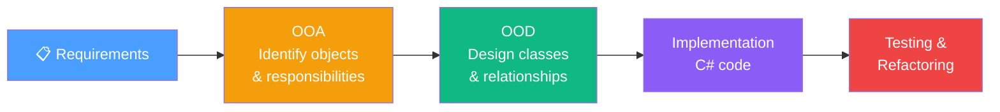

---

### Q2: The Four Pillars of OOP — Deep Interview Answers

The four pillars are **Encapsulation**, **Abstraction**, **Inheritance**, and **Polymorphism**. Most candidates give textbook definitions. The deeper answer connects each pillar to design principles and shows how violations look in practice.

**Encapsulation** — Bundle data and behavior together; protect invariants via access modifiers. The real point is not "private fields" — it is *invariant protection*. An object should always be in a valid state; no external code should be able to corrupt it.

**Abstraction** — Expose *what*, hide *how*. Use interfaces and abstract classes to define contracts. Callers depend on the abstraction, not the implementation. This is the foundation of the Dependency Inversion Principle.

**Inheritance** — IS-A relationship enabling polymorphism and code reuse. The danger is the *fragile base class problem*: changes to a base class silently break all subclasses. Prefer composition when the goal is code reuse, not IS-A substitutability.

**Polymorphism** — *Compile-time* (overloading — resolved by the compiler based on argument types) vs *Runtime* (overriding — resolved by the CLR vtable at runtime). Runtime polymorphism is what makes Open/Closed Principle practical.

❌ **Pillar violations:**
```csharp
// ❌ Encapsulation violation — public mutable field, invariant unprotected
public class Account { public decimal Balance; } // anyone can set Balance = -99999

// ❌ Abstraction violation — depends on concrete, not interface
public class OrderService { private StripeProcessor _stripe = new StripeProcessor(); }

// ❌ Inheritance violation — Square breaks Rectangle LSP contract
public class Square : Rectangle {
    public override int Width { set { base.Width = value; base.Height = value; } }
}
static void Test(Rectangle r) { r.Width = 4; r.Height = 5; Debug.Assert(r.Area() == 20); } // fails for Square

// ❌ Polymorphism violation — type-switch instead of virtual dispatch
public void Draw(object shape) {
    if (shape is Circle c) { /* ... */ }
    else if (shape is Rectangle r) { /* ... */ } // every new shape requires editing this method
}
```

✅ **Pillar correct usage:**
```csharp
// ✅ Encapsulation — private state, validated mutations
public class Account
{
    private decimal _balance;
    public decimal Balance => _balance;
    public void Deposit(decimal amount)
    {
        if (amount <= 0) throw new ArgumentException("Amount must be positive.");
        _balance += amount;
    }
    public void Withdraw(decimal amount)
    {
        if (amount > _balance) throw new InvalidOperationException("Insufficient funds.");
        _balance -= amount;
    }
}

// ✅ Abstraction — depend on interface
public interface IPaymentGateway { Task<PaymentResult> ChargeAsync(decimal amount, string token); }
public class OrderService { public OrderService(IPaymentGateway gw) { _gw = gw; } } // swap freely

// ✅ Inheritance — genuine IS-A with LSP preserved
public abstract class Shape { public abstract double Area(); }
public class Circle : Shape { public override double Area() => Math.PI * Radius * Radius; }
public class Rectangle : Shape { public override double Area() => Width * Height; }
// All subclasses are fully substitutable for Shape ✅

// ✅ Polymorphism — runtime dispatch, no type checks
foreach (var shape in shapes) Console.WriteLine(shape.Area()); // CLR dispatches correctly
```

```mermaid
classDiagram
    class Shape {
        <<abstract>>
        +Area() double
        +Draw() void
    }
    class Circle {
        -double _radius
        +Area() double
        +Draw() void
    }
    class Rectangle {
        -double _width
        -double _height
        +Area() double
        +Draw() void
    }
    class IPaymentGateway {
        <<interface>>
        +ChargeAsync(amount, token) Task
    }
    class StripeGateway {
        +ChargeAsync(amount, token) Task
    }
    class Account {
        -decimal _balance
        +Balance decimal
        +Deposit(amount) void
        +Withdraw(amount) void
    }

    Shape <|-- Circle : Inheritance IS-A
    Shape <|-- Rectangle : Inheritance IS-A
    IPaymentGateway <|.. StripeGateway : Abstraction
    Account --> Account : Encapsulation

    note for Shape "Polymorphism: runtime dispatch\nvia virtual method table"
    note for Account "Encapsulation: _balance is\nprotected by methods"
```

---

### Q3: Relationships Between Classes — Association, Aggregation, Composition, Dependency

Understanding relationship *strength* is a key OOD interview topic. Choosing the wrong relationship leads to lifecycle bugs and tight coupling.

| Relationship | Keyword | Ownership | Lifecycle | Example |
|---|---|---|---|---|
| Dependency | "uses" | None | Independent | Method takes ILogger as parameter |
| Association | "has a ref to" | None/Weak | Independent | Customer references Orders |
| Aggregation | "has a" (weak) | Partial | Part survives whole | Team has Players |
| Composition | "owns" (strong) | Full | Part dies with whole | House owns Rooms |

❌ **Bad — using Composition when Aggregation is correct:**
```csharp
// ❌ Team "owns" Player — if Team is deleted, Player is deleted too
// But players exist independently and can join other teams!
public class Team
{
    private readonly List<Player> _players = new();
    public void AddPlayer(string name) => _players.Add(new Player(name)); // Team creates Player
    // Player objects are destroyed when Team is destroyed — lifecycle coupled ❌
}
```

✅ **Good — correct relationship per domain:**
```csharp
// ✅ Aggregation: Team HAS Players, but Players exist independently
public class Player
{
    public string Name { get; }
    public Player(string name) => Name = name;
}

public class Team
{
    private readonly List<Player> _players = new();
    public void AddPlayer(Player player) => _players.Add(player);   // receives from outside
    public void RemovePlayer(Player player) => _players.Remove(player); // Player still lives ✅
}

// ✅ Composition: House OWNS Rooms — Room cannot meaningfully exist without House
public class House
{
    private readonly List<Room> _rooms;
    public House(int numberOfRooms)
    {
        _rooms = Enumerable.Range(1, numberOfRooms)
                           .Select(i => new Room($"Room {i}"))
                           .ToList(); // House creates and owns Rooms ✅
    }
}

// ✅ Dependency: OrderService uses ILogger only during method execution
public class OrderService
{
    public void PlaceOrder(Order order, ILogger logger) // parameter = dependency, loosest coupling
    {
        logger.Log($"Placing order {order.Id}");
    }
}
```

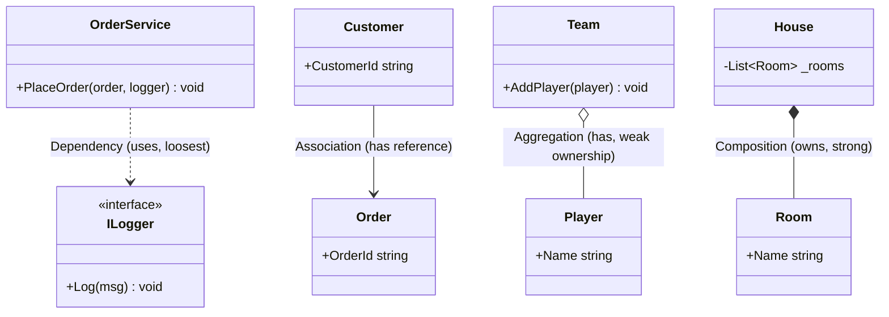

---

### Q4: Cohesion and Coupling

**High cohesion** and **low coupling** are the two most important structural quality metrics in OOD. They directly relate to how easy a codebase is to change, test, and understand.

- **High Cohesion:** A class does one thing well. All its methods and fields serve its single purpose. Related to SRP. Low cohesion = "god class."
- **Low Coupling:** Classes depend on each other as little as possible, and only through stable abstractions. Tight coupling = changes ripple everywhere.

**Coupling types (best to worst):**
| Type | Description |
|---|---|
| Data coupling | Pass only the data needed (primitives/DTOs) |
| Stamp coupling | Pass a whole object when only part is needed |
| Control coupling | Pass a flag that changes the callee's behavior |
| Common coupling | Share global state (singletons, static fields) |
| Content coupling | One class directly modifies another's internals |

❌ **Bad — god class with low cohesion and high coupling:**
```csharp
// ❌ Low cohesion: one class does user management, orders, email, PDF, reporting
// ❌ High coupling: directly newing up concrete classes everywhere
public class ApplicationManager
{
    private SqlConnection _conn = new SqlConnection("...");  // content coupling
    private static int _orderCount = 0;                      // common coupling (static state)

    public void CreateUser(string name)        { /* db logic */ }
    public void SendWelcomeEmail(string email) { /* SMTP logic */ }
    public void PlaceOrder(int userId)         { _orderCount++; }
    public void GenerateInvoicePdf(int id)     { /* PDF logic */ }
    public void RunMonthlyReport()             { /* reporting */ }
    // 5 reasons to change, impossible to unit test ❌
}
```

✅ **Good — focused classes with dependency injection:**
```csharp
// ✅ High cohesion: each class has ONE responsibility
// ✅ Low coupling: depend on interfaces, injected not newed

public interface IUserRepository  { Task SaveAsync(User user); }
public interface IEmailService    { Task SendAsync(string to, string subject, string body); }
public interface IOrderRepository { Task<Order> GetAsync(int orderId); }
public interface IPaymentGateway  { Task<PaymentResult> ChargeAsync(decimal amount, string token); }

public class UserService
{
    private readonly IUserRepository _repo;
    private readonly IEmailService _email;
    public UserService(IUserRepository repo, IEmailService email) { _repo = repo; _email = email; }

    public async Task RegisterAsync(string name, string email)
    {
        var user = new User(name, email);
        await _repo.SaveAsync(user);
        await _email.SendAsync(email, "Welcome!", $"Hello {name}");
    }
}

public class OrderService
{
    private readonly IOrderRepository _orders;
    private readonly IPaymentGateway _payment;
    public OrderService(IOrderRepository orders, IPaymentGateway payment)
    { _orders = orders; _payment = payment; }

    public async Task<bool> CheckoutAsync(int orderId, string paymentToken)
    {
        var order = await _orders.GetAsync(orderId);
        var result = await _payment.ChargeAsync(order.Total, paymentToken);
        return result.Success;
    }
}
// Each class: 1 responsibility, depends only on interfaces — easy to test and swap ✅
```

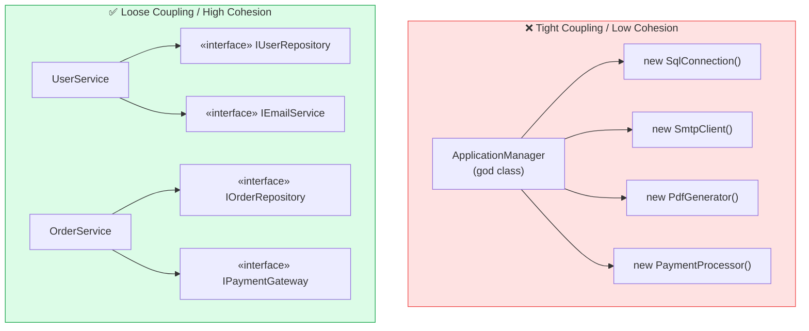

---

### Q5: CRC Cards (Class-Responsibility-Collaborator)

**CRC cards** are a lightweight OOA technique used in design workshops to brainstorm and assign class responsibilities before writing any code. Each index card represents one class:

| Section | Content |
|---|---|
| Class Name (top) | The class being designed |
| Responsibilities (left) | What the class *knows* and *does* |
| Collaborators (right) | Other classes it needs to fulfill responsibilities |

**How to run a CRC session:**
1. Gather stakeholders and developers with index cards and a whiteboard.
2. Walk through each use case or user story step by step.
3. When a responsibility is identified, write it on the card of the most appropriate class.
4. If a class needs help from another, list that class as a collaborator.
5. If a card gets too full — split it into two classes (SRP signal).
6. Simulate interactions by physically handing cards to people playing each class.

**Example CRC for e-commerce checkout:**

```
┌──────────────────────────────────────────────────────┐
│ Class: Order                                         │
├───────────────────────────┬──────────────────────────┤
│ Responsibilities          │ Collaborators            │
│ - Know order lines        │ OrderLine                │
│ - Know total price        │ Money                    │
│ - Know order status       │                          │
│ - Add/remove items        │ Product                  │
└───────────────────────────┴──────────────────────────┘

┌──────────────────────────────────────────────────────┐
│ Class: CheckoutService                               │
├───────────────────────────┬──────────────────────────┤
│ Responsibilities          │ Collaborators            │
│ - Coordinate checkout     │ Order                    │
│ - Validate stock          │ InventoryService         │
│ - Process payment         │ IPaymentGateway          │
│ - Send confirmation       │ INotificationService     │
└───────────────────────────┴──────────────────────────┘

┌──────────────────────────────────────────────────────┐
│ Class: InventoryService                              │
├───────────────────────────┬──────────────────────────┤
│ Responsibilities          │ Collaborators            │
│ - Know stock levels       │ IInventoryRepository     │
│ - Reserve stock           │                          │
│ - Release reserved stock  │                          │
└───────────────────────────┴──────────────────────────┘
```

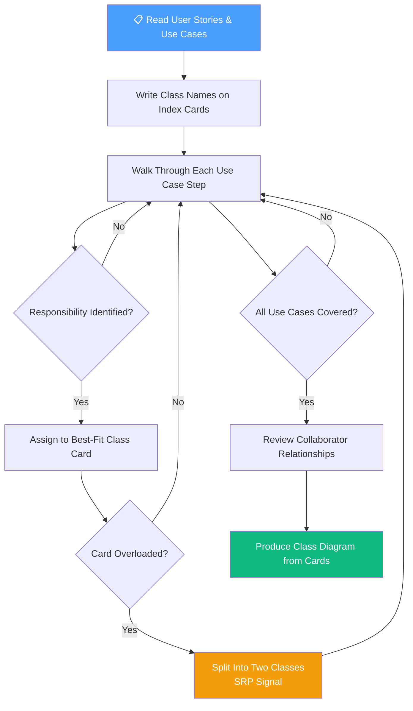

---

### Q6: Use Case Modeling and Sequence Diagrams in OOD

**Use cases** capture system behavior from the *user's perspective* — they describe a goal a user (actor) wants to achieve and the steps the system takes to fulfill it. They are written in OOA to understand *what* the system must do, before deciding *how*.

**Sequence diagrams** are produced in OOD to show *which objects* collaborate and *in what order* to realize a use case. They reveal: which classes are needed, what methods they must expose, and how control flows between them.

**Workflow: Use Case → Sequence Diagram → Class Responsibilities**
1. Write the use case (narrative): "Customer places an order."
2. List participating objects: Customer, Order, Inventory, Payment, Notification.
3. Draw the sequence diagram showing message flow.
4. Extract method signatures from the messages — these become class responsibilities.
5. Assign responsibilities back to classes (GRASP Information Expert guides this).

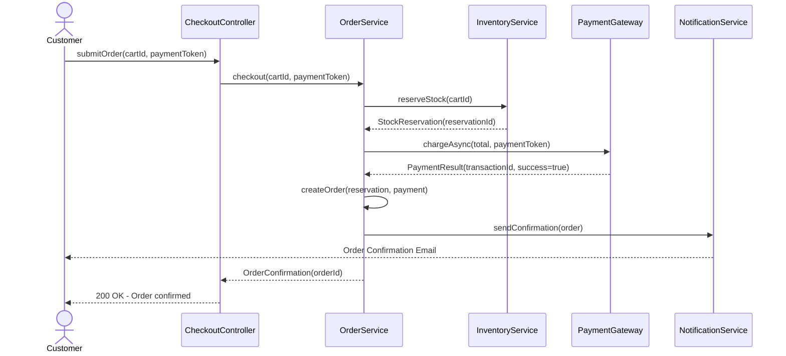

---

### Q7: The Law of Demeter (Principle of Least Knowledge)

The **Law of Demeter** (LoD) states that a method should only call methods on:
1. **Itself** (`this`)
2. **Its direct fields** (instance variables)
3. **Objects passed as parameters**
4. **Objects it creates locally**

The core idea: *don't talk to strangers*. If you find yourself navigating through a chain of object references to get to what you need, that is a LoD violation — sometimes called a **train wreck**.

**Why it matters:** Train wrecks tightly couple the caller to the internal structure of every intermediate object. If any link in the chain changes its type or structure, the caller breaks — even though it has no logical dependency on those intermediaries.

❌ **Bad — train wreck, talking to strangers:**
```csharp
// ❌ OrderService knows about Order, Product, and Price internals
public class OrderService
{
    public decimal GetFirstItemPrice(Customer customer)
    {
        // Violates LoD — navigating through customer → order → product → price
        return customer.GetOrder().GetFirstItem().GetProduct().GetPrice();
        // Coupled to: Customer, Order, OrderItem, Product, Money — all indirectly ❌
    }
}
```

✅ **Good — delegate to the object that knows:**
```csharp
// ✅ Customer knows its own order total — we ask it directly
public class Customer
{
    private readonly Order _currentOrder;
    public Customer(Order order) => _currentOrder = order;

    public decimal GetOrderTotal() => _currentOrder.GetTotal(); // delegates to its own field ✅
}

public class Order
{
    private readonly List<OrderLine> _lines;
    public Order(List<OrderLine> lines) => _lines = lines;

    public decimal GetTotal() => _lines.Sum(l => l.LineTotal); // navigates own internals only ✅
}

public class OrderService
{
    public decimal GetOrderTotal(Customer customer)
    {
        return customer.GetOrderTotal(); // only talks to direct parameter ✅
    }
}
```

```mermaid
flowchart TB
    subgraph BAD["❌ Train Wreck — LoD Violated"]
        OS1["OrderService"]
        C1["Customer"]
        O1["Order"]
        P1["Product"]
        M1["Money"]
        OS1 -->|"customer.GetOrder()"| C1
        C1 -->|".GetFirstItem().GetProduct()"| O1
        O1 -->|".GetPrice()"| P1
        P1 --> M1
    end

    subgraph GOOD["✅ Delegate — LoD Respected"]
        OS2["OrderService"]
        C2["Customer\n+GetOrderTotal()"]
        O2["Order\n+GetTotal()"]
        OS2 -->|"customer.GetOrderTotal()"| C2
        C2 -->|"_order.GetTotal()\n(its own field)"| O2
    end

    style BAD fill:#fee2e2,stroke:#ef4444
    style GOOD fill:#dcfce7,stroke:#16a34a
```

---

### Q8: Tell Don't Ask Principle

The **Tell Don't Ask** principle says: *tell an object what to do* rather than *asking for its state, making a decision, and mutating it externally*. This keeps behavior with the data that drives it — the heart of encapsulation.

When you ask for state and act on it outside the object, you scatter the business rule across the codebase. Every caller has to know the rule. Change the rule — update every caller. The object's invariants leak outside it.

❌ **Bad — Ask pattern (external logic, scattered rules):**
```csharp
// ❌ Caller asks for state, decides, then mutates — business logic is OUTSIDE the object
public class AccountController
{
    public void ProcessWithdrawal(BankAccount account, decimal amount)
    {
        if (account.GetBalance() >= amount && account.IsActive && !account.IsFrozen)
        {
            account.SetBalance(account.GetBalance() - amount);
            account.SetLastTransactionDate(DateTime.UtcNow);
            // Every caller must repeat this rule — fragile, duplicated, not encapsulated ❌
        }
    }
}
```

✅ **Good — Tell pattern (behavior lives with data):**
```csharp
// ✅ Tell the account to withdraw — it owns the rule, the state, and the side effects
public class BankAccount
{
    private decimal _balance;
    private bool _isActive;
    private bool _isFrozen;
    private DateTime _lastTransactionDate;

    public void Withdraw(decimal amount)
    {
        if (!_isActive) throw new InvalidOperationException("Account is not active.");
        if (_isFrozen) throw new InvalidOperationException("Account is frozen.");
        if (amount <= 0) throw new ArgumentException("Amount must be positive.");
        if (amount > _balance) throw new InvalidOperationException("Insufficient funds.");

        _balance -= amount;
        _lastTransactionDate = DateTime.UtcNow;
    }
}

public class AccountController
{
    public void ProcessWithdrawal(BankAccount account, decimal amount)
    {
        account.Withdraw(amount); // Tell, don't ask — one line, no scattered logic ✅
    }
}
```

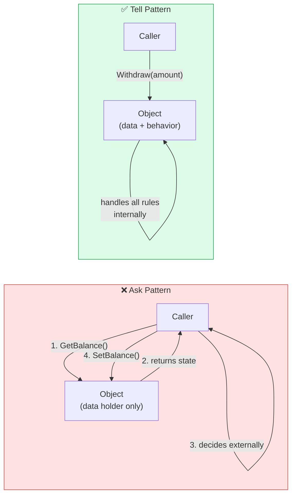

---

### Q9: Design by Contract (DbC)

**Design by Contract**, introduced by Bertrand Meyer, formalizes the obligations and benefits between a method and its callers using three types of assertions:

| Contract Type | Description | Violated By |
|---|---|---|
| **Precondition** | What must be true *before* the method executes | Caller |
| **Postcondition** | What will be true *after* the method executes | Implementer |
| **Invariant** | What must always be true about the object's state | Implementer |

The contract metaphor: the caller must meet preconditions (caller's obligation), and in return the method guarantees postconditions (method's obligation). Invariants protect the object at all times.

❌ **Bad — assumes valid input, crashes with unhelpful errors:**
```csharp
// ❌ No contracts — null and negative inputs crash cryptically
public class InvoiceService
{
    public decimal CalculateTax(decimal amount, string countryCode)
    {
        var rate = _taxRates[countryCode]; // KeyNotFoundException — no hint of what was wrong ❌
        return amount * rate;              // silent wrong result for negative amounts ❌
    }
}
```

✅ **Good — explicit precondition guards, postcondition assertions, invariant protection:**
```csharp
public class InvoiceService
{
    private readonly IReadOnlyDictionary<string, decimal> _taxRates;

    public InvoiceService(IReadOnlyDictionary<string, decimal> taxRates)
    {
        // Constructor invariant: tax rates must be provided and non-empty
        ArgumentNullException.ThrowIfNull(taxRates);
        if (!taxRates.Any()) throw new ArgumentException("Tax rates cannot be empty.", nameof(taxRates));
        _taxRates = taxRates;
    }

    public decimal CalculateTax(decimal amount, string countryCode)
    {
        // Preconditions — caller's obligations
        if (amount < 0) throw new ArgumentOutOfRangeException(nameof(amount), "Amount must be non-negative.");
        ArgumentException.ThrowIfNullOrWhiteSpace(countryCode, nameof(countryCode));
        if (!_taxRates.TryGetValue(countryCode, out var rate))
            throw new ArgumentException($"Unknown country code '{countryCode}'.", nameof(countryCode));

        var tax = amount * rate;

        // Postcondition — method's guarantee
        Debug.Assert(tax >= 0, "Postcondition violated: tax must be non-negative.");
        return tax;
    }
}
// CalculateTax(-100, "US") → ArgumentOutOfRangeException: "Amount must be non-negative."
// CalculateTax(100, "XX") → ArgumentException: "Unknown country code 'XX'."
```

---

### Q10: Object vs Value Object vs Entity vs Aggregate (DDD Alignment)

These distinctions come from **Domain-Driven Design (DDD)** and are frequently asked in senior interviews. They determine how you model identity, equality, and lifecycle in your domain.

| Concept | Identity | Mutability | Equality | Example |
|---|---|---|---|---|
| **Value Object** | By attributes | Immutable | By value | Money(100, USD), Address |
| **Entity** | By unique ID | Mutable | By ID | Customer(id=42) |
| **Aggregate** | By root ID | Partially mutable | By root ID | Order + OrderLines |
| **Aggregate Root** | Root entity ID | Guards consistency | By root ID | Order (guards OrderLines) |

❌ **Bad — treating a Value Object as an Entity:**
```csharp
// ❌ Money as Entity — unnecessary ID, mutability, wrong equality
public class Money
{
    public int Id { get; set; }          // ❌ Money doesn't need identity
    public decimal Amount { get; set; }  // ❌ should be immutable
    public string Currency { get; set; } // ❌ mutable

    // Two Money(100, USD) objects are NOT equal because IDs differ ❌
    public override bool Equals(object obj) => obj is Money m && m.Id == Id;
}
```

✅ **Good — immutable Value Object with equality by value:**
```csharp
// ✅ Money as immutable Value Object — equality by attributes, no ID
public sealed record Money(decimal Amount, string Currency)
{
    public Money Add(Money other)
    {
        if (Currency != other.Currency)
            throw new InvalidOperationException($"Cannot add {Currency} and {other.Currency}.");
        return this with { Amount = Amount + other.Amount };
    }

    public Money Multiply(decimal factor)
    {
        if (factor < 0) throw new ArgumentOutOfRangeException(nameof(factor));
        return this with { Amount = Amount * factor };
    }
}

// ✅ Customer as Entity — identity by CustomerId
public class Customer
{
    public CustomerId Id { get; }
    public string Name { get; private set; }
    public Email Email { get; private set; } // Email is a Value Object

    public Customer(CustomerId id, string name, Email email) { Id = id; Name = name; Email = email; }

    public override bool Equals(object obj) => obj is Customer c && c.Id == Id; // identity by ID ✅
    public override int GetHashCode() => Id.GetHashCode();
}

// ✅ Order as Aggregate Root — guards OrderLines consistency
public class Order
{
    public OrderId Id { get; }
    private readonly List<OrderLine> _lines = new();
    public IReadOnlyList<OrderLine> Lines => _lines.AsReadOnly();

    public Money Total => _lines.Aggregate(new Money(0, "USD"), (acc, l) => acc.Add(l.LineTotal));

    public void AddLine(Product product, int quantity)
    {
        if (quantity <= 0) throw new ArgumentException("Quantity must be positive.");
        var existing = _lines.FirstOrDefault(l => l.ProductId == product.Id);
        if (existing != null) existing.IncreaseQuantity(quantity); // route through root ✅
        else _lines.Add(new OrderLine(product, quantity));
    }
    // OrderLines are NEVER modified from outside — only through Order (the Aggregate Root) ✅
}
```

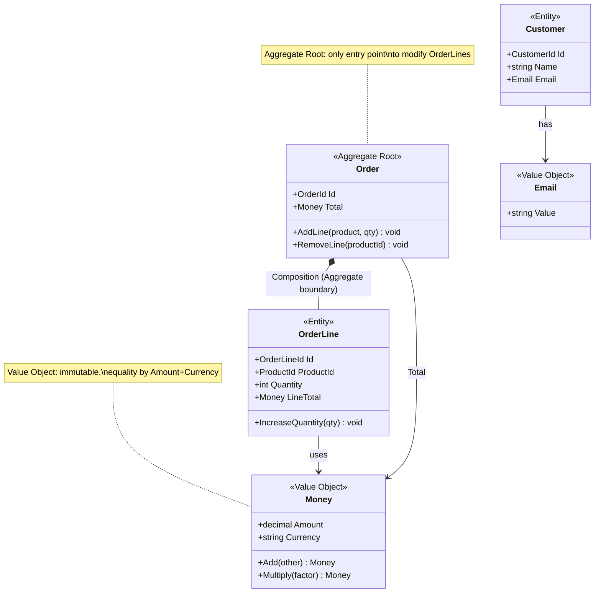

---

### Q11: GRASP Patterns (General Responsibility Assignment Software Patterns)

**GRASP** is a set of nine principles for assigning responsibilities to classes in OOD, introduced by Craig Larman. They answer the question: *"Which class should be responsible for this?"*

| Pattern | Core Question | Answer |
|---|---|---|
| **Information Expert** | Who has the info to fulfill this responsibility? | Assign to the class with the data needed |
| **Creator** | Who should create instances of class X? | The class that aggregates, contains, uses, or records X |
| **Controller** | Who handles system events from the UI? | A use-case controller class (not UI, not domain) |
| **Low Coupling** | How to reduce change impact? | Assign so dependencies are minimized |
| **High Cohesion** | How to keep classes manageable? | Assign so each class stays focused |
| **Polymorphism** | How to handle type-based variation? | Use polymorphism, not type-switch |
| **Pure Fabrication** | No domain class fits — what now? | Create a class with no domain counterpart (e.g., Repository) |
| **Indirection** | How to decouple two classes? | Introduce an intermediary (e.g., interface, adapter) |
| **Protected Variations** | How to protect against changes? | Wrap variation points with stable interfaces |

```csharp
// GRASP Information Expert → Order knows its own total (it has the lines)
public class Order
{
    private readonly List<OrderLine> _lines;
    public decimal Total => _lines.Sum(l => l.LineTotal); // Expert: Order has the data ✅
}

// GRASP Creator → OrderFactory creates Orders (aggregates the data needed)
public class OrderFactory
{
    public Order Create(Customer customer, List<CartItem> items)
        => new Order(customer.Id, items.Select(i => new OrderLine(i.Product, i.Quantity)).ToList());
}

// GRASP Controller → CheckoutController handles the "place order" use-case event
public class CheckoutController
{
    private readonly OrderService _orderService;
    public CheckoutController(OrderService orderService) => _orderService = orderService;
    public async Task<IActionResult> PlaceOrder(PlaceOrderRequest request)
        => Ok(await _orderService.CheckoutAsync(request.CartId, request.PaymentToken));
}

// GRASP Pure Fabrication → IOrderRepository has no domain counterpart, decouples persistence
public interface IOrderRepository { Task SaveAsync(Order order); Task<Order> GetAsync(OrderId id); }

// GRASP Protected Variations → IPaymentGateway wraps the variation point (Stripe / PayPal / etc.)
public interface IPaymentGateway { Task<PaymentResult> ChargeAsync(decimal amount, string token); }
```

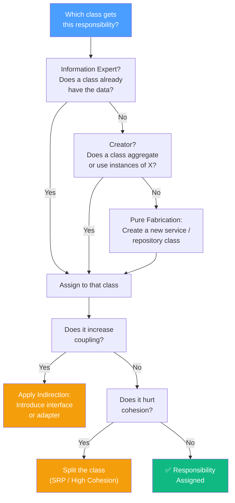

---

### Q12: Common OOD Interview — Design a Parking Lot

This is a classic OOD interview question. The expected approach: identify objects, assign responsibilities (GRASP), choose relationships, and justify design decisions.

**Step 1 — Identify Objects and Responsibilities:**

| Class | Responsibility |
|---|---|
| `ParkingLot` | Knows all floors, entry/exit gates; overall capacity |
| `ParkingFloor` | Knows its spots; finds available spot by type |
| `ParkingSpot` | Knows its type, size, occupation state |
| `Vehicle` | Knows its type (Motorcycle/Car/Truck) and plate |
| `Ticket` | Records entry time, spot assigned, vehicle |
| `Payment` | Calculates fee, processes payment |
| `Gate` (Entry/Exit) | Issues ticket on entry; processes payment on exit |
| `IPricingStrategy` | Calculates fee based on duration and spot type |

**Step 2 — Key Design Decisions:**
- **Spot types** modeled as an enum: `Motorcycle`, `Compact`, `Large` — spot only accepts compatible vehicle types.
- **Pricing** uses the **Strategy pattern** — `IPricingStrategy` with `HourlyPricing`, `FlatRatePricing`. Swap pricing without touching `Payment`.
- **Entry/Exit** uses the **Command pattern** — `EntryCommand`/`ExitCommand` encapsulate the operation and support logging/undo.
- **Finding a spot** follows GRASP Information Expert — `ParkingFloor` knows its spots, so it finds available ones.

```csharp
public enum SpotType { Motorcycle, Compact, Large }
public enum VehicleType { Motorcycle, Car, Truck }

public class Vehicle
{
    public string LicensePlate { get; }
    public VehicleType Type { get; }
    public Vehicle(string plate, VehicleType type) { LicensePlate = plate; Type = type; }
}

public class ParkingSpot
{
    public int SpotId { get; }
    public SpotType Type { get; }
    public bool IsOccupied { get; private set; }
    public ParkingSpot(int id, SpotType type) { SpotId = id; Type = type; }

    public bool CanFit(Vehicle vehicle) => Type switch {
        SpotType.Motorcycle => vehicle.Type == VehicleType.Motorcycle,
        SpotType.Compact    => vehicle.Type is VehicleType.Car or VehicleType.Motorcycle,
        SpotType.Large      => true,
        _                   => false
    };

    public void Occupy()  { if (IsOccupied) throw new InvalidOperationException("Spot already taken."); IsOccupied = true; }
    public void Vacate()  { IsOccupied = false; }
}

public interface IPricingStrategy
{
    decimal Calculate(DateTime entry, DateTime exit, SpotType spotType);
}

public class HourlyPricingStrategy : IPricingStrategy
{
    private readonly IReadOnlyDictionary<SpotType, decimal> _rates;
    public HourlyPricingStrategy(IReadOnlyDictionary<SpotType, decimal> rates) => _rates = rates;

    public decimal Calculate(DateTime entry, DateTime exit, SpotType spotType)
    {
        var hours = Math.Ceiling((exit - entry).TotalHours);
        return (decimal)hours * _rates[spotType];
    }
}

public record Ticket(Guid TicketId, Vehicle Vehicle, ParkingSpot Spot, DateTime EntryTime);

public class ParkingFloor
{
    public int FloorNumber { get; }
    private readonly List<ParkingSpot> _spots;
    public ParkingFloor(int floor, IEnumerable<ParkingSpot> spots) { FloorNumber = floor; _spots = spots.ToList(); }

    // GRASP Information Expert: ParkingFloor knows its spots → finds available spot
    public ParkingSpot? FindAvailableSpot(Vehicle vehicle)
        => _spots.FirstOrDefault(s => !s.IsOccupied && s.CanFit(vehicle));
}

public class ParkingLot
{
    private readonly List<ParkingFloor> _floors;
    private readonly IPricingStrategy _pricing;
    private readonly Dictionary<Guid, Ticket> _activeTickets = new();

    public ParkingLot(IEnumerable<ParkingFloor> floors, IPricingStrategy pricing)
    { _floors = floors.ToList(); _pricing = pricing; }

    public Ticket? Enter(Vehicle vehicle)
    {
        var spot = _floors.Select(f => f.FindAvailableSpot(vehicle)).FirstOrDefault(s => s != null);
        if (spot == null) return null; // lot full
        spot.Occupy();
        var ticket = new Ticket(Guid.NewGuid(), vehicle, spot, DateTime.UtcNow);
        _activeTickets[ticket.TicketId] = ticket;
        return ticket;
    }

    public decimal Exit(Guid ticketId)
    {
        if (!_activeTickets.Remove(ticketId, out var ticket))
            throw new ArgumentException("Invalid ticket.");
        var fee = _pricing.Calculate(ticket.EntryTime, DateTime.UtcNow, ticket.Spot.Type);
        ticket.Spot.Vacate();
        return fee;
    }
}
```

```mermaid
classDiagram
    class ParkingLot {
        -List~ParkingFloor~ _floors
        -IPricingStrategy _pricing
        -Dictionary _activeTickets
        +Enter(vehicle) Ticket
        +Exit(ticketId) decimal
    }
    class ParkingFloor {
        +int FloorNumber
        -List~ParkingSpot~ _spots
        +FindAvailableSpot(vehicle) ParkingSpot
    }
    class ParkingSpot {
        +int SpotId
        +SpotType Type
        +bool IsOccupied
        +CanFit(vehicle) bool
        +Occupy() void
        +Vacate() void
    }
    class Vehicle {
        +string LicensePlate
        +VehicleType Type
    }
    class Ticket {
        <<record>>
        +Guid TicketId
        +Vehicle Vehicle
        +ParkingSpot Spot
        +DateTime EntryTime
    }
    class IPricingStrategy {
        <<interface>>
        +Calculate(entry, exit, spotType) decimal
    }
    class HourlyPricingStrategy {
        -rates Dictionary
        +Calculate(entry, exit, spotType) decimal
    }
    class FlatRatePricingStrategy {
        +Calculate(entry, exit, spotType) decimal
    }

    ParkingLot *-- ParkingFloor : Composition
    ParkingFloor *-- ParkingSpot : Composition
    ParkingLot --> IPricingStrategy : Strategy Pattern
    IPricingStrategy <|.. HourlyPricingStrategy : implements
    IPricingStrategy <|.. FlatRatePricingStrategy : implements
    Ticket --> Vehicle : references
    Ticket --> ParkingSpot : references
    ParkingLot --> Ticket : manages
```

---

# 11. Senior Engineer — Design Patterns & SOLID Deep Dive

> This section covers senior-level design patterns and SOLID questions drawn from real interview guides. Each question targets tradeoff judgment and production reasoning.

---

## 11.1 SOLID in Practice

### Q116. Explain each SOLID principle and give one practical .NET example.

**Answer:**

| Principle | Core Rule | Quick .NET Signal |
|---|---|---|
| **S**RP | One reason to change | Controller doing DB + email = violation |
| **O**CP | Extend without modifying | New behavior = new class, not edited switch |
| **L**SP | Subtypes substitutable | Square breaking Rectangle contract = violation |
| **I**SP | Clients depend only on what they use | Fat `IWorker` forcing `Robot.Eat()` = violation |
| **D**IP | Depend on abstractions | `new SqlRepo()` inside service = violation |

> **Why this matters:** SOLID principles are the foundation of maintainable, testable code. Senior engineers must apply them pragmatically — not dogmatically.

**💡 Production Example:**
A service class had 6 constructor dependencies. Applying SRP revealed it was orchestrating payment, notifications, and logging — three separate responsibilities. Splitting reduced each class to 2 focused dependencies and made unit tests trivial to write.

---

### Q117. How do you spot an SRP violation during code review?

**Answer:**
Look for classes with multiple reasons to change, mixed technical and business concerns, or methods spanning orchestration, validation, persistence, and side effects. Large constructor dependency lists are often a signal.

> **Why this matters:** Senior engineers need to prevent design debt early. SRP violations usually increase bug rate and make onboarding slower.

**💡 Production Example:**
A controller handling mapping, validation, and direct SQL calls was refactored into request handling plus application service orchestration. The controller became thin, and test coverage focused on meaningful behavior.

```csharp
// Signal: constructor with 5+ dependencies often means SRP is broken
// ❌ OrderController(IOrderRepo, IEmailSvc, IInventorySvc, IPaymentSvc, ILogger)
// — this controller does too much

// ✅ Thin controller delegates to an application service
public class OrderController : ControllerBase
{
    private readonly IOrderApplicationService _orders;
    public OrderController(IOrderApplicationService orders) => _orders = orders;

    [HttpPost]
    public async Task<IActionResult> Place([FromBody] PlaceOrderRequest req)
        => Ok(await _orders.PlaceAsync(req));
}
// All orchestration lives in OrderApplicationService — single reason to change
```

---

### Q118. When does the Open/Closed Principle become over-engineering?

**Answer:**
OCP becomes over-engineering when teams create abstractions for variability that does not exist yet. Apply extension points where change is likely and costly, keep simple code simple.

> **Why this matters:** Interviewers test tradeoff judgment. Senior candidates should balance extensibility with readability and delivery speed.

**💡 Production Example:**
A straightforward switch expression was used for two stable payment rules instead of a full strategy hierarchy. Strategies were introduced later only when new partner-specific rules began arriving regularly.

```csharp
// ✅ Acceptable for 2 stable cases — no OCP needed yet
decimal fee = paymentMethod switch
{
    "card"   => amount * 0.015m,
    "wallet" => amount * 0.005m,
    _        => throw new ArgumentException()
};

// ✅ Introduce IFeeStrategy only when third partner arrives with custom rules
public interface IFeeStrategy { decimal Calculate(decimal amount); }
public class CardFee   : IFeeStrategy { public decimal Calculate(decimal a) => a * 0.015m; }
public class WalletFee : IFeeStrategy { public decimal Calculate(decimal a) => a * 0.005m; }
```

---

## 11.2 Pattern Selection & Combination

### Q119. Strategy vs Factory: how do you explain the difference and when would you combine them?

**Answer:**
Strategy encapsulates interchangeable behavior at runtime. Factory encapsulates object creation. Combine them when selection of strategy depends on runtime context.

> **Why this matters:** Many systems misuse patterns by applying one where the other fits better.

**💡 Production Example:**
A factory selected tax-calculation strategies by country and customer type. The calling service depended only on `ITaxStrategy`, keeping both behavior and instantiation logic cleanly separated.

```csharp
public interface ITaxStrategy { decimal Calculate(decimal amount); }
public class UkVatStrategy : ITaxStrategy { public decimal Calculate(decimal a) => a * 0.20m; }
public class UsStateTaxStrategy : ITaxStrategy { public decimal Calculate(decimal a) => a * 0.08m; }

// Factory selects the right strategy based on runtime context
public class TaxStrategyFactory
{
    public ITaxStrategy Create(string countryCode) => countryCode switch
    {
        "GB" => new UkVatStrategy(),
        "US" => new UsStateTaxStrategy(),
        _    => throw new NotSupportedException($"No tax strategy for {countryCode}")
    };
}

// Calling service knows only ITaxStrategy — decoupled from both factory and implementations
public class InvoiceService
{
    private readonly TaxStrategyFactory _factory;
    public InvoiceService(TaxStrategyFactory factory) => _factory = factory;

    public decimal CalculateTotal(decimal subtotal, string countryCode)
        => subtotal + _factory.Create(countryCode).Calculate(subtotal);
}
```

---

### Q120. When is the Observer pattern a better fit than direct service calls in .NET?

**Answer:**
Observer fits when multiple subscribers need to react to a domain event without tight coupling to the publisher. In-process observers are useful for modular monoliths, while integration events are better when crossing service boundaries.

> **Why this matters:** This choice impacts coupling and change velocity. Direct calls are simpler but can turn one change into many coordinated deployments.

**💡 Production Example:**
Publishing an `OrderPlaced` domain event that triggered inventory reservation and notification handlers independently. The order workflow stayed focused while downstream behaviors evolved separately.

```csharp
// Publisher knows nothing about subscribers
public record OrderPlacedEvent(Guid OrderId, decimal Total) : INotification;

public class OrderService
{
    private readonly IMediator _mediator;
    public OrderService(IMediator mediator) => _mediator = mediator;

    public async Task PlaceAsync(Order order)
    {
        // ... save order ...
        await _mediator.Publish(new OrderPlacedEvent(order.Id, order.Total));
        // OrderService doesn't know or care who handles this
    }
}

// Subscribers are independent — add/remove without touching OrderService
public class ReserveInventoryHandler : INotificationHandler<OrderPlacedEvent>
{
    public Task Handle(OrderPlacedEvent e, CancellationToken ct) => /* reserve stock */;
}

public class SendConfirmationHandler : INotificationHandler<OrderPlacedEvent>
{
    public Task Handle(OrderPlacedEvent e, CancellationToken ct) => /* send email */;
}
```

---

### Q121. How would you use the Decorator pattern for cross-cutting concerns in a .NET codebase?

**Answer:**
Decorator is ideal for layering behaviors like caching, logging, retries, or authorization around a core service without modifying its code. In .NET, Scrutor and DI composition make decorator chains straightforward and testable.

> **Why this matters:** Cross-cutting concerns often leak into business logic if not structured well.

**💡 Production Example:**
A pricing service was wrapped with a caching decorator and a telemetry decorator. Business logic stayed unchanged while response times improved and observability became consistent.

```csharp
public interface IPricingService { Task<decimal> GetPriceAsync(int productId); }

// Core implementation — pure business logic
public class PricingService : IPricingService
{
    public async Task<decimal> GetPriceAsync(int productId) => /* DB lookup */ 99.99m;
}

// Caching decorator — adds Redis caching, no pricing logic
public class CachingPricingDecorator : IPricingService
{
    private readonly IPricingService _inner;
    private readonly IDistributedCache _cache;
    public CachingPricingDecorator(IPricingService inner, IDistributedCache cache)
    { _inner = inner; _cache = cache; }

    public async Task<decimal> GetPriceAsync(int productId)
    {
        var key = $"price:{productId}";
        var cached = await _cache.GetStringAsync(key);
        if (cached is not null) return decimal.Parse(cached);
        var price = await _inner.GetPriceAsync(productId);
        await _cache.SetStringAsync(key, price.ToString(),
            new DistributedCacheEntryOptions { AbsoluteExpirationRelativeToNow = TimeSpan.FromMinutes(5) });
        return price;
    }
}

// DI composition using Scrutor
services.AddScoped<IPricingService, PricingService>();
services.Decorate<IPricingService, CachingPricingDecorator>();
// services.Decorate<IPricingService, TelemetryPricingDecorator>(); // add more layers
```

---

### Q122. Mediator pattern versus direct dependency injection: what tradeoffs do you discuss?

**Answer:**
Mediator centralizes request dispatch and can simplify orchestration and pipeline behaviors, but it can hide control flow when overused. Direct DI is clearer for simple interactions.

> **Why this matters:** Evaluates architectural pragmatism. Senior candidates should avoid dogma and optimize for maintainability.

**💡 Production Example:**
MediatR was used for command and query handlers with validation and logging pipelines. For trivial single-step operations, direct service calls were kept to avoid unnecessary abstraction.

```csharp
// ✅ Good use of Mediator — pipeline behaviors (validation, logging, auth) apply automatically
public record PlaceOrderCommand(Guid CartId, string PaymentToken) : IRequest<OrderResult>;

public class PlaceOrderHandler : IRequestHandler<PlaceOrderCommand, OrderResult>
{
    public async Task<OrderResult> Handle(PlaceOrderCommand cmd, CancellationToken ct)
        => /* complex orchestration */;
}

// Pipeline behavior applies to ALL commands — no duplication
public class ValidationBehavior<TReq, TRes> : IPipelineBehavior<TReq, TRes>
    where TReq : IRequest<TRes>
{
    public async Task<TRes> Handle(TReq request, RequestHandlerDelegate<TRes> next, CancellationToken ct)
    {
        // validate request
        return await next();
    }
}

// ❌ Over-using Mediator for simple, single-step operations adds ceremony without value
// Direct DI is clearer: _userService.GetByEmailAsync(email)
// vs: await _mediator.Send(new GetUserByEmailQuery(email)) — unnecessary indirection
```

---

## 11.3 Advanced Patterns

### Q123. How do you use Template Method or policy-based pipelines without creating inheritance-heavy designs?

**Answer:**
Prefer composition-first templates: define the invariant flow once and inject variable steps as delegates or strategy interfaces. If inheritance is used, keep hierarchies shallow.

> **Why this matters:** Rigid inheritance trees become expensive to change.

**💡 Production Example:**
An import pipeline reused common parsing and auditing steps while injecting per-file validation policies. Gained reuse without locking into deep base-class hierarchies.

```csharp
// Composition-based pipeline — no deep inheritance
public class ImportPipeline<T>
{
    private readonly Func<Stream, IEnumerable<T>> _parse;
    private readonly Func<T, bool> _validate;
    private readonly Func<IEnumerable<T>, Task> _persist;

    public ImportPipeline(
        Func<Stream, IEnumerable<T>> parse,
        Func<T, bool> validate,
        Func<IEnumerable<T>, Task> persist)
    { _parse = parse; _validate = validate; _persist = persist; }

    public async Task RunAsync(Stream input)
    {
        var records = _parse(input);                  // variable step
        var valid   = records.Where(_validate);       // variable step
        await _persist(valid);                        // variable step
        // Audit/logging wrapped here once — reused for every import type
    }
}

// Different file types reuse the same pipeline with different steps
var csvPipeline    = new ImportPipeline<Order>(CsvParser.Parse, OrderValidator.IsValid, _repo.BulkInsert);
var jsonPipeline   = new ImportPipeline<Order>(JsonParser.Parse, OrderValidator.IsValid, _repo.BulkInsert);
```

---

### Q124. What anti-patterns do you watch for when teams say they are using design patterns?

**Answer:**
Watch for unnecessary abstractions, pattern cargo-culting, god factories, and repositories that hide useful query capabilities. Also interface-per-class habits that add ceremony without decoupling value.

> **Why this matters:** Patterns are tools, and misuse can make systems harder to understand than no pattern at all.

**💡 Production Example:**
A codebase had five layers of wrappers around a simple HTTP client. Removed redundant abstractions, kept one clear boundary interface, and cut both complexity and defect surface.

| Anti-Pattern | Symptom | Fix |
|---|---|---|
| Interface-per-class | `IUserService` with one implementor, never swapped | Remove interface unless testability or DI swap is needed |
| God Factory | Factory with 200 lines of `if`/`switch` creating every object | Use DI container or strategy registry |
| Repository hiding EF | `GetAll()` loads everything; no filtering capability | Expose `IQueryable` or specification pattern |
| Mediator everywhere | Every read goes through a command/query — even `GetById` | Keep simple reads as direct service calls |
| Decorator chain > 4 deep | Wrapping makes stack traces unreadable | Flatten with middleware or AOP |

---

### Q125. How do SOLID and design patterns influence system design decisions at the service boundary level?

**Answer:**
At service boundaries, SOLID and patterns guide contract stability, dependency direction, and change isolation. DIP supports adapter-based integrations, SRP shapes service responsibilities, and patterns like Anti-Corruption Layer protect domain models from external schema churn.

> **Why this matters:** Senior roles want macro-level design thinking, not only class-level refactoring knowledge.

**💡 Production Example:**
A legacy billing API was wrapped behind an anti-corruption adapter and mapping layer. Internal domain models stayed consistent while the external provider evolved independently.

```csharp
// Anti-Corruption Layer — DIP at the service boundary
public interface IBillingGateway
{
    Task<BillingResult> CreateInvoiceAsync(InvoiceRequest request);
}

// Adapter translates domain model ↔ external provider schema
public class LegacyBillingAdapter : IBillingGateway
{
    private readonly LegacyBillingClient _client;

    public async Task<BillingResult> CreateInvoiceAsync(InvoiceRequest request)
    {
        // Map internal domain model → legacy API model
        var legacyReq = new LegacyInvoiceDto
        {
            ClientCode = request.CustomerId.ToString(),
            LineItems  = request.Lines.Select(l => new LegacyLineItem
            {
                Desc  = l.Description,
                Units = l.Quantity,
                Rate  = (double)l.UnitPrice
            }).ToList()
        };

        var legacyResult = await _client.SubmitAsync(legacyReq);

        // Map response back to domain model
        return new BillingResult(legacyResult.ConfirmationCode, legacyResult.Status == "OK");
    }
}

// Domain code depends only on IBillingGateway — shielded from legacy schema changes
```

```mermaid
flowchart LR
    DOMAIN["Domain Layer\nInvoiceRequest\nBillingResult"] -->|"IBillingGateway\n(DIP)"| ACL["Anti-Corruption Layer\nLegacyBillingAdapter"]
    ACL -->|"LegacyInvoiceDto"| EXT["External Legacy\nBilling API"]

    style DOMAIN fill:#2196F3,color:#fff
    style ACL fill:#FF9800,color:#fff
    style EXT fill:#d62828,color:#fff
```

---

---

# 🏢 FAANG Object-Oriented Design Questions

> These questions test how OOP principles apply at the scale and architectural context of FAANG companies. Expect system-level thinking, not just pattern recitation.

---

## FAANG-OOP-1 — How does Amazon's SOA/microservices architecture apply OOP principles?

**Answer:**
Amazon's famous 2002 "API Mandate" (Jeff Bezos) required every team to expose data and functionality through well-defined service interfaces — no direct database access, no back-channel communication. This is OOP's Encapsulation and the Dependency Inversion Principle applied at the infrastructure level.

**OOP principles at service scale:**

| OOP Principle | Microservice Equivalent |
|---------------|------------------------|
| **Encapsulation** | Each service owns its data store; no other service accesses its DB directly |
| **Abstraction** | Public API is the contract; internal implementation can change freely |
| **Single Responsibility** | One service = one bounded context (orders, inventory, payments) |
| **Open/Closed** | Add new endpoints, never break existing ones (additive-only API changes) |
| **Dependency Inversion** | Services depend on each other's API contracts, not concrete implementations |

**The Bezos API Mandate — applied OOP:**
```
Before (monolith — OOP violation):
  OrderService.cs accesses InventoryRepository directly
  → tight coupling, impossible to deploy independently

After (SOA — OOP applied at scale):
  OrderService calls InventoryService.CheckStock(productId) via HTTP/gRPC
  → encapsulated, contract-based, independently deployable
```

**Additive API changes (Open/Closed at API level):**
```csharp
// v1 contract — never change field names or remove fields
public record OrderResponse(string OrderId, string Status, decimal Total);

// v2 — ADD new fields, never remove (consumers ignore unknown fields)
public record OrderResponseV2(string OrderId, string Status, decimal Total,
                               string? TrackingNumber,     // new — nullable ✅
                               DateTimeOffset? EstimatedDelivery); // new — nullable ✅

// ❌ Breaking change — renaming 'Status' to 'OrderStatus' breaks all consumers
// ✅ Additive change — adding TrackingNumber doesn't break existing consumers
```

**Domain-Driven Design boundary (Encapsulation):**
```csharp
// Each service is an encapsulated object — public interface only
public interface IInventoryService
{
    Task<StockLevel> CheckStockAsync(string productId, CancellationToken ct);
    Task<ReservationId> ReserveStockAsync(string productId, int quantity, CancellationToken ct);
    Task ReleaseReservationAsync(ReservationId reservationId, CancellationToken ct);
}

// OrderService depends on IInventoryService — Dependency Inversion ✅
// It has NO idea if Inventory stores data in DynamoDB, RDS, or Redis — Abstraction ✅
public class OrderService
{
    private readonly IInventoryService _inventory;
    private readonly IPaymentService _payment;
    private readonly INotificationService _notifications;

    public OrderService(IInventoryService inventory, IPaymentService payment,
                        INotificationService notifications)
    {
        _inventory = inventory;
        _payment = payment;
        _notifications = notifications;
    }

    public async Task<OrderResult> PlaceOrderAsync(PlaceOrderRequest request, CancellationToken ct)
    {
        var stock = await _inventory.CheckStockAsync(request.ProductId, ct);
        if (stock.Available < request.Quantity)
            return OrderResult.Fail("Insufficient stock");

        var reservation = await _inventory.ReserveStockAsync(request.ProductId, request.Quantity, ct);
        var payment = await _payment.ChargeAsync(request.PaymentToken, request.Total, ct);

        if (!payment.Success)
        {
            await _inventory.ReleaseReservationAsync(reservation, ct);
            return OrderResult.Fail("Payment failed");
        }

        await _notifications.SendConfirmationAsync(request.CustomerId, payment.TransactionId, ct);
        return OrderResult.Success(payment.TransactionId);
    }
}
```

---

## FAANG-OOP-2 — How does Google's Protocol Buffers system apply Interface Segregation? (Google)

**Answer:**
Protocol Buffers (protobuf) is Google's contract-first interface definition language used for all internal and external gRPC services. Its design enforces Interface Segregation Principle (ISP) structurally — services only expose the methods their consumers need, and message schemas are carefully segregated by concern.

**Contract-first = Interface Segregation by design:**
```protobuf
// ❌ Violates ISP — fat service with unrelated operations
service GodService {
  rpc GetUser(GetUserRequest) returns (User);
  rpc CreateOrder(CreateOrderRequest) returns (Order);
  rpc ProcessPayment(PaymentRequest) returns (PaymentResult);
  rpc SendEmail(EmailRequest) returns (EmailResult);
}

// ✅ Segregated services — each has a single clear responsibility
service UserService {
  rpc GetUser(GetUserRequest) returns (User);
  rpc ListUsers(ListUsersRequest) returns (ListUsersResponse);
  rpc UpdateUser(UpdateUserRequest) returns (User);
}

service OrderService {
  rpc CreateOrder(CreateOrderRequest) returns (Order);
  rpc GetOrder(GetOrderRequest) returns (Order);
  rpc CancelOrder(CancelOrderRequest) returns (CancelOrderResponse);
}
```

**Backward/forward compatibility rules (field numbers are sacred):**
```protobuf
// UserProfile — field NUMBERS are the identity, not names
message UserProfile {
  string user_id = 1;         // NEVER renumber or reuse field 1
  string email = 2;
  string display_name = 3;
  // Field 4 was 'phone_number' — deprecated, NEVER reuse number 4
  reserved 4;
  reserved "phone_number";    // documents why 4 is reserved

  // New fields always get NEW numbers — backward compatible ✅
  string avatar_url = 5;
  google.protobuf.Timestamp created_at = 6;
}
```

**Why field number reuse breaks ISP/compatibility:**
- Old client receives message with field 4 = they read it as deleted `phone_number` type → data corruption
- New client receives message without field 5 = they see zero value (proto3 defaults) → safe, backward compatible
- This is Open/Closed at the wire protocol level: **fields only added, never removed or reused**

**gRPC service definitions as precise interfaces:**
```csharp
// Generated C# from .proto — ISP enforced at the type level
public abstract class UserService : ServerServiceDefinition
{
    public abstract Task<User> GetUser(GetUserRequest request, ServerCallContext context);
    public abstract Task<ListUsersResponse> ListUsers(ListUsersRequest request, ServerCallContext context);
}

// Implementing service — MUST implement all declared methods (no partial implementations)
public class UserServiceImpl : UserService.UserServiceBase
{
    public override async Task<User> GetUser(GetUserRequest request, ServerCallContext context)
    {
        // Only user concerns here — no payment, order, email logic (ISP ✅)
        return await _userRepository.FindByIdAsync(request.UserId, context.CancellationToken);
    }
}
```

---

## FAANG-OOP-3 — Design the Observer pattern for a distributed event system (Meta/Amazon scale)

**Answer:**
In-process Observer (GoF pattern) and distributed pub/sub solve the same logical problem but with fundamentally different guarantees. At FAANG scale, you typically need both: in-process for low-latency domain events within a service, and Kafka/SQS for cross-service event delivery.

**In-process Observer (C# — IObservable/IObserver):**
```csharp
// Using Rx.NET (System.Reactive) — production-grade IObservable implementation
public class OrderService
{
    private readonly Subject<OrderPlacedEvent> _orderPlaced = new();

    // Expose as IObservable — callers subscribe, never push
    public IObservable<OrderPlacedEvent> OrderPlaced => _orderPlaced.AsObservable();

    public async Task<OrderResult> PlaceOrderAsync(PlaceOrderRequest request)
    {
        // ... place order logic ...
        _orderPlaced.OnNext(new OrderPlacedEvent(orderId, request.CustomerId, request.Total));
        return OrderResult.Success(orderId);
    }
}

// Observers register for specific events
public class NotificationObserver : IObserver<OrderPlacedEvent>
{
    public void OnNext(OrderPlacedEvent e) =>
        Console.WriteLine($"Sending confirmation to customer {e.CustomerId}");

    public void OnError(Exception ex) => Console.WriteLine($"Error: {ex.Message}");
    public void OnCompleted() => Console.WriteLine("Stream completed");
}

// Wiring (DI / startup)
var svc = new OrderService();
using var subscription = svc.OrderPlaced
    .Where(e => e.Total > 1000)              // Rx filtering
    .Subscribe(new NotificationObserver());   // automatic unsubscribe via IDisposable
```

**Distributed Observer with Kafka (at-scale):**
```csharp
// Producer — publish domain events as Kafka messages
public class KafkaOrderEventPublisher : IOrderEventPublisher
{
    private readonly IProducer<string, string> _producer;

    public async Task PublishOrderPlacedAsync(OrderPlacedEvent evt)
    {
        var message = new Message<string, string>
        {
            Key = evt.OrderId,   // partition key — all events for same order go to same partition
            Value = JsonSerializer.Serialize(evt)
        };
        await _producer.ProduceAsync("order.placed", message);
    }
}

// Consumer — each consumer group gets its own copy (fan-out)
public class EmailConsumer : BackgroundService
{
    protected override async Task ExecuteAsync(CancellationToken stoppingToken)
    {
        _consumer.Subscribe("order.placed");
        while (!stoppingToken.IsCancellationRequested)
        {
            var result = _consumer.Consume(stoppingToken);
            var evt = JsonSerializer.Deserialize<OrderPlacedEvent>(result.Message.Value)!;
            await _emailService.SendConfirmationAsync(evt.CustomerId, evt.OrderId, stoppingToken);
            _consumer.Commit(result); // manual commit — at-least-once delivery
        }
    }
}
```

**Back-pressure handling (slow consumers):**
- Kafka retains messages in the log — slow consumers fall behind but don't drop messages
- Consumer lag monitoring alerts when a consumer group is too far behind
- Dead Letter Topic (DLT) for messages that fail processing after N retries

```mermaid
flowchart LR
    subgraph IN_PROCESS["In-Process Observer (same service)"]
        ORD["OrderService\nSubject&lt;OrderPlacedEvent&gt;"] -->|"OnNext()"| N1["NotificationObserver"]
        ORD -->|"OnNext()"| N2["AuditObserver"]
        ORD -->|"OnNext()"| N3["AnalyticsObserver"]
    end

    subgraph DISTRIBUTED["Distributed Observer (cross-service)"]
        PROD["OrderService\n(Kafka Producer)"] -->|"order.placed topic"| KAFKA["Kafka\n(durable log)"]
        KAFKA -->|"Consumer Group A"| EMAIL["Email Service"]
        KAFKA -->|"Consumer Group B"| INVENTORY["Inventory Service"]
        KAFKA -->|"Consumer Group C"| ANALYTICS["Analytics Pipeline"]
    end

    style ORD fill:#1565c0,color:#fff
    style KAFKA fill:#e65100,color:#fff
```

---

## FAANG-OOP-4 — How does Netflix use the Null Object pattern to achieve resilience? (Netflix)

**Answer:**
Netflix's microservices architecture operates under the assumption that any dependency can fail at any moment. Instead of returning `null` (and forcing every caller to null-check) or throwing exceptions (and degrading the user experience), they return **Null Objects** — implementations that provide safe, reasonable defaults silently.

**Classic Null Object vs exception vs null:**
```csharp
// ❌ Returning null — every caller must null-check
public interface IRecommendationService
{
    IReadOnlyList<Recommendation> GetRecommendations(string userId);
}

public class RecommendationServiceClient : IRecommendationService
{
    public IReadOnlyList<Recommendation> GetRecommendations(string userId)
    {
        try { return _httpClient.Get<List<Recommendation>>($"/recommendations/{userId}"); }
        catch { return null!; } // ❌ caller will crash on .Count or foreach
    }
}

// Caller — defensive but noisy
var recs = service.GetRecommendations(userId);
if (recs != null) // ❌ null check everywhere
    foreach (var rec in recs) { /* ... */ }
```

✅ **Null Object pattern — safe fallback, no null propagation:**
```csharp
// Null Object implementation — returns empty/default data silently
public class NullRecommendationService : IRecommendationService
{
    // Returns trending/popular content as a safe fallback
    private static readonly IReadOnlyList<Recommendation> _fallback =
        new List<Recommendation>
        {
            new("trending_1", "Popular Show 1", RecommendationType.Trending),
            new("trending_2", "Popular Show 2", RecommendationType.Trending),
        };

    public IReadOnlyList<Recommendation> GetRecommendations(string userId) => _fallback; // ✅
}

// Circuit breaker — return Null Object when circuit is open
public class RecommendationServiceWithFallback : IRecommendationService
{
    private readonly IRecommendationService _real;
    private readonly IRecommendationService _null = new NullRecommendationService();
    private readonly CircuitBreaker _breaker;

    public IReadOnlyList<Recommendation> GetRecommendations(string userId)
    {
        if (_breaker.IsOpen) return _null.GetRecommendations(userId); // Null Object ✅

        try
        {
            var result = _real.GetRecommendations(userId);
            _breaker.RecordSuccess();
            return result;
        }
        catch (Exception ex)
        {
            _breaker.RecordFailure();
            return _null.GetRecommendations(userId); // ✅ degrade gracefully
        }
    }
}

// Caller — NO null checks needed. The contract is always fulfilled.
var recs = service.GetRecommendations(userId);
foreach (var rec in recs) // ✅ always works — might be trending fallback, user doesn't know
    RenderCard(rec);
```

**Null Object vs Maybe/Option monad:**
```csharp
// Option<T> (functional approach — forces caller to handle empty case)
Option<IReadOnlyList<Recommendation>> result = service.TryGetRecommendations(userId);
result.Match(
    some: recs => recs.ForEach(RenderCard),
    none: () => RenderTrending() // explicit — caller decides fallback
);

// Null Object (OOP approach — hides failure behind contract)
// Caller never knows about the failure — appropriate when fallback is universal
```

The key difference: **Null Object** makes the degraded behavior invisible to the caller (Netflix's philosophy — always show something). **Option/Maybe** makes the absence explicit and forces the caller to decide (appropriate when fallback logic varies by call site).

---

## FAANG-OOP-5 — Explain the Flyweight pattern and where FAANG companies use it

**Answer:**
The Flyweight pattern reduces memory by sharing common (intrinsic) state across many objects. Each flyweight stores only the immutable shared data; variable (extrinsic) data is passed in at runtime by the caller.

**Real-world FAANG usage:**
- **.NET/JVM string interning** — `string.Intern()` / `String.intern()` — identical strings share a single object in the string pool (the JVM/CLR are automatic flyweight factories for string literals)
- **Browser DOM text nodes** — browsers pool text node objects where possible
- **Chrome V8 hidden classes** — all objects with the same property layout share one hidden class object
- **Game engines** — thousands of terrain tiles share one "Grass" or "Stone" flyweight object; only position is extrinsic

**C# implementation — character rendering (classic example):**
```csharp
// Intrinsic state — shared, immutable
public class CharacterStyle
{
    public string FontName { get; }
    public int FontSize { get; }
    public bool IsBold { get; }
    public ConsoleColor Color { get; }

    public CharacterStyle(string fontName, int fontSize, bool isBold, ConsoleColor color)
    {
        FontName = fontName; FontSize = fontSize; IsBold = isBold; Color = color;
    }

    // Render — extrinsic state (position, actual char) passed in by caller
    public void Render(char character, int x, int y)
    {
        Console.SetCursorPosition(x, y);
        Console.ForegroundColor = Color;
        Console.Write(character);
        Console.ResetColor();
    }
}

// Flyweight Factory — ensures style objects are shared, not duplicated
public class CharacterStyleFactory
{
    private readonly Dictionary<string, CharacterStyle> _styles = new();

    public CharacterStyle GetStyle(string fontName, int fontSize, bool isBold, ConsoleColor color)
    {
        var key = $"{fontName}|{fontSize}|{isBold}|{color}";
        if (!_styles.TryGetValue(key, out var style))
        {
            style = new CharacterStyle(fontName, fontSize, isBold, color);
            _styles[key] = style; // cache — created once, reused by all characters
        }
        return style; // ✅ shared instance
    }
}

// Character — extrinsic state only (position + value)
public class Character
{
    public char Value { get; }
    public int X { get; }
    public int Y { get; }
    private readonly CharacterStyle _style; // shared flyweight reference

    public Character(char value, int x, int y, CharacterStyle style)
    {
        Value = value; X = x; Y = y; _style = style;
    }

    public void Render() => _style.Render(Value, X, Y);
}

// Usage — 10,000 characters, but only 3 style objects
var factory = new CharacterStyleFactory();
var normalStyle = factory.GetStyle("Arial", 12, false, ConsoleColor.White);
var boldStyle   = factory.GetStyle("Arial", 12, true,  ConsoleColor.White);
var headingStyle = factory.GetStyle("Arial", 18, true, ConsoleColor.Yellow);

var document = new List<Character>();
for (int i = 0; i < 10000; i++)
{
    // Each char has unique position (extrinsic), but shares style object (intrinsic)
    document.Add(new Character('A', i % 80, i / 80, normalStyle)); // all share ONE normalStyle
}
// Memory: 10,000 Character objects + 3 CharacterStyle objects (not 10,000!)
```

**When NOT to use Flyweight:**
- When objects don't share enough intrinsic state to justify the factory complexity
- When extrinsic state is so large it negates the memory savings
- When object creation is rare (premature optimization)
- When the factory's dictionary lookup cost exceeds allocation cost

```mermaid
classDiagram
    class CharacterStyleFactory {
        -Dictionary~string, CharacterStyle~ _styles
        +GetStyle(fontName, fontSize, isBold, color) CharacterStyle
    }

    class CharacterStyle {
        +string FontName
        +int FontSize
        +bool IsBold
        +ConsoleColor Color
        +Render(char, x, y) void
    }

    class Character {
        +char Value
        +int X
        +int Y
        -CharacterStyle _style
        +Render() void
    }

    CharacterStyleFactory --> CharacterStyle : creates and caches
    Character --> CharacterStyle : shared reference (flyweight)
    note for CharacterStyle "Intrinsic state — shared\n(1 instance per unique style)"
    note for Character "Extrinsic state — unique\n(1 instance per character)"
```

