# ⚙️ Real Production Scenarios — Engineering Field Manual

> The questions that separate senior engineers from the rest.
> Every scenario: Problem → Naive approach (why it fails) → Production-grade solution with .NET code.

---

## 📋 Table of Contents

1. [How do you process 1 lakh (100,000) Excel records?](#1-how-do-you-process-1-lakh-100000-excel-records)
2. [How do retries work safely?](#2-how-do-retries-work-safely)
3. [How do you avoid duplicate processing?](#3-how-do-you-avoid-duplicate-processing)
4. [How do you design batch jobs?](#4-how-do-you-design-batch-jobs)
5. [How do you recover failed records?](#5-how-do-you-recover-failed-records)
6. [How do you prevent concurrent job pickup?](#6-how-do-you-prevent-concurrent-job-pickup)
7. [How do you handle database migrations with zero downtime?](#7-how-do-you-handle-database-migrations-with-zero-downtime)
8. [How do you build an audit trail?](#8-how-do-you-build-an-audit-trail)
9. [How do you handle long-running background jobs?](#9-how-do-you-handle-long-running-background-jobs)
10. [How do you deal with third-party API rate limits?](#10-how-do-you-deal-with-third-party-api-rate-limits)
11. [How do you gracefully shutdown a service?](#11-how-do-you-gracefully-shutdown-a-service)
12. [How do you prevent memory leaks in production?](#12-how-do-you-prevent-memory-leaks-in-production)

---

## 1. How do you process 1 lakh (100,000) Excel records?

### Naive Approach (Why It Fails)
```csharp
// ❌ Load entire file into memory → OOM for large files
var workbook = new XSSFWorkbook(stream); // loads all 100k rows into RAM
foreach (var row in workbook.GetSheetAt(0))
{
    var order = MapRow(row);
    await _db.Orders.AddAsync(order);
    await _db.SaveChangesAsync(); // N individual INSERT statements → very slow
}
```
**Problems:** Memory spike, N+1 saves (100k individual inserts), no error recovery, no progress tracking, blocks HTTP thread for minutes.

### Production Solution

```csharp
// Step 1: Receive file, save to Blob, enqueue job — respond immediately
[HttpPost("import/orders")]
[RequestSizeLimit(50 * 1024 * 1024)] // 50 MB limit
public async Task<IActionResult> Import(IFormFile file)
{
    // Save raw file to Blob Storage
    var blobName = $"imports/{Guid.NewGuid()}/{file.FileName}";
    await _blobService.UploadAsync(blobName, file.OpenReadStream());

    // Create import job record
    var job = new ImportJob
    {
        Id         = Guid.NewGuid(),
        BlobName   = blobName,
        Status     = ImportStatus.Queued,
        TotalRows  = 0,
        CreatedBy  = CurrentUserId,
        CreatedAt  = DateTime.UtcNow
    };
    _db.ImportJobs.Add(job);
    await _db.SaveChangesAsync();

    // Enqueue background processing
    await _bus.PublishAsync(new ProcessImportCommand(job.Id));

    return Accepted(new { jobId = job.Id, statusUrl = $"/api/imports/{job.Id}" });
    // Returns 202 immediately — client polls /api/imports/{jobId} for status
}

// Step 2: Background worker processes file in chunks
public class ImportOrdersHandler : IConsumer<ProcessImportCommand>
{
    private const int ChunkSize = 500; // insert 500 rows per batch

    public async Task Consume(ConsumeContext<ProcessImportCommand> ctx)
    {
        var job = await _db.ImportJobs.FindAsync(ctx.Message.JobId);
        job!.Status    = ImportStatus.Processing;
        job.StartedAt  = DateTime.UtcNow;
        await _db.SaveChangesAsync();

        var stream = await _blobService.DownloadAsync(job.BlobName);

        // Step 3: Stream rows from Excel without loading entire file
        var rows = ExcelStreamReader.ReadRows(stream); // yields rows lazily

        var chunk       = new List<Order>(ChunkSize);
        int processed   = 0;
        int failed       = 0;
        var failures    = new List<ImportFailure>();

        await foreach (var row in rows)
        {
            // Step 4: Validate each row
            var (isValid, order, error) = ValidateAndMap(row);
            if (!isValid)
            {
                failures.Add(new ImportFailure { RowNumber = row.Number, Error = error });
                failed++;
                continue;
            }

            chunk.Add(order);

            // Step 5: Bulk insert when chunk is full
            if (chunk.Count >= ChunkSize)
            {
                await BulkInsertAsync(chunk);
                processed += chunk.Count;
                chunk.Clear();

                // Update progress so UI can show "45,000 / 100,000 processed"
                job.ProcessedRows = processed;
                job.FailedRows    = failed;
                await _db.SaveChangesAsync();
            }
        }

        // Insert remaining rows
        if (chunk.Count > 0)
        {
            await BulkInsertAsync(chunk);
            processed += chunk.Count;
        }

        // Step 6: Save failure report to Blob
        if (failures.Any())
        {
            var reportBlob = $"imports/{job.Id}/failures.csv";
            await _blobService.UploadAsync(reportBlob, GenerateCsv(failures));
            job.FailureReportUrl = reportBlob;
        }

        job.Status       = failed == 0 ? ImportStatus.Completed : ImportStatus.CompletedWithErrors;
        job.ProcessedRows = processed;
        job.FailedRows    = failed;
        job.CompletedAt   = DateTime.UtcNow;
        await _db.SaveChangesAsync();
    }

    private async Task BulkInsertAsync(List<Order> orders)
    {
        // EF Core bulk insert — single SQL statement
        await _db.BulkInsertAsync(orders); // EFCore.BulkExtensions
        // Or: SqlBulkCopy for maximum throughput
    }
}

// Step 7: Client polls for status
[HttpGet("imports/{jobId}")]
public async Task<IActionResult> GetStatus(Guid jobId)
{
    var job = await _db.ImportJobs.FindAsync(jobId);
    return Ok(new
    {
        job.Status,
        job.ProcessedRows,
        job.FailedRows,
        job.TotalRows,
        ProgressPct = job.TotalRows > 0 ? (job.ProcessedRows * 100 / job.TotalRows) : 0,
        job.FailureReportUrl
    });
}
```

### Key Design Decisions
| Decision | Reason |
|----------|--------|
| 202 Accepted + job ID | Don't block HTTP connection for minutes |
| Blob storage for file | Don't pass large files through message queues |
| Streaming rows | Don't load 100k rows into RAM |
| Bulk insert in chunks of 500 | Balance: individual inserts too slow; one 100k insert too risky |
| Failure report as CSV | User can fix and re-import failed rows only |
| Progress tracking | User sees live progress, not a spinner |

---

## 2. How do retries work safely?

### The Problem: What Can Go Wrong Without Careful Retry Design
```
1. Retry on non-retriable errors → wastes time, hides bugs
2. Retry without delay → hammers failing downstream (retry storm)
3. Retry without jitter → all instances retry at same time (thundering herd)
4. Retry non-idempotent operations → duplicate payments, double emails
5. Infinite retries → never give up, queue backs up
```

### Safe Retry Implementation
```csharp
// Full production retry strategy with Polly
public static class ResiliencePolicies
{
    public static ResiliencePipeline<HttpResponseMessage> BuildHttpPipeline(
        ILogger logger) =>
        new ResiliencePipelineBuilder<HttpResponseMessage>()
            // Layer 1: Timeout per attempt
            .AddTimeout(TimeSpan.FromSeconds(10))

            // Layer 2: Retry with exponential backoff + jitter
            .AddRetry(new RetryStrategyOptions<HttpResponseMessage>
            {
                MaxRetryAttempts = 4,
                Delay            = TimeSpan.FromMilliseconds(250),
                BackoffType      = DelayBackoffType.Exponential,
                UseJitter        = true,   // prevents thundering herd

                // Only retry on retriable errors
                ShouldHandle = new PredicateBuilder<HttpResponseMessage>()
                    .Handle<TimeoutRejectedException>()
                    .Handle<HttpRequestException>()
                    .HandleResult(r => r.StatusCode is
                        HttpStatusCode.TooManyRequests or       // 429
                        HttpStatusCode.ServiceUnavailable or    // 503
                        HttpStatusCode.GatewayTimeout),         // 504
                    // NOT retrying: 400, 401, 403, 404, 422 — permanent failures

                OnRetry = args =>
                {
                    logger.LogWarning("Retry {Attempt} after {Delay}ms. Reason: {Outcome}",
                        args.AttemptNumber + 1,
                        args.RetryDelay.TotalMilliseconds,
                        args.Outcome.Exception?.Message ?? args.Outcome.Result?.StatusCode.ToString());
                    return ValueTask.CompletedTask;
                }
            })

            // Layer 3: Circuit breaker — stop hammering a dead service
            .AddCircuitBreaker(new CircuitBreakerStrategyOptions<HttpResponseMessage>
            {
                FailureRatio      = 0.5,                       // open at 50% failure rate
                SamplingDuration  = TimeSpan.FromSeconds(10),
                MinimumThroughput = 5,                         // need at least 5 requests to measure
                BreakDuration     = TimeSpan.FromSeconds(30),  // stay open 30s
                OnOpened  = _ => { logger.LogError("Circuit OPEN"); return ValueTask.CompletedTask; },
                OnClosed  = _ => { logger.LogInformation("Circuit CLOSED"); return ValueTask.CompletedTask; }
            })
            .Build();
}
```

### Retry Delay Schedule
```
Attempt | Base Delay | With Jitter (±25%)
1       | 250ms      | 188ms – 313ms
2       | 500ms      | 375ms – 625ms
3       | 1000ms     | 750ms – 1250ms
4       | 2000ms     | 1500ms – 2500ms
Total max wait: ~4.5 seconds before final failure
```

---

## 3. How do you avoid duplicate processing?

### The Problem
```
Message broker delivers message → consumer crashes after processing but before ACK
Broker redelivers message → processed TWICE
→ Duplicate order, double charge, duplicate email
```

### Solution: Idempotent Consumer with Outbox
```csharp
// Idempotency table — tracks processed event IDs
// CREATE TABLE processed_events (
//     event_id    UNIQUEIDENTIFIER PRIMARY KEY,
//     processed_at DATETIME NOT NULL,
//     handler_name NVARCHAR(200)
// );

public class OrderCreatedHandler : IConsumer<OrderCreatedEvent>
{
    public async Task Consume(ConsumeContext<OrderCreatedEvent> ctx)
    {
        var eventId = ctx.Message.EventId;

        // Use a transaction to make the check + process atomic
        await using var tx = await _db.Database.BeginTransactionAsync(
            IsolationLevel.ReadCommitted);

        // Step 1: Check if already processed
        var alreadyProcessed = await _db.ProcessedEvents
            .AnyAsync(e => e.EventId == eventId);

        if (alreadyProcessed)
        {
            _log.LogInformation("Duplicate event {Id} — skipping", eventId);
            await ctx.ConsumeCompleted(); // ACK the duplicate
            return;
        }

        // Step 2: Process business logic
        await _inventoryService.ReserveAsync(ctx.Message.Items);

        // Step 3: Record event ID + commit in same transaction
        _db.ProcessedEvents.Add(new ProcessedEvent
        {
            EventId     = eventId,
            ProcessedAt = DateTime.UtcNow,
            HandlerName = nameof(OrderCreatedHandler)
        });

        await _db.SaveChangesAsync();
        await tx.CommitAsync();
        // If crash here: event not ACKed → redelivered → step 1 finds it → skipped safely
    }
}
```

### Outbox Pattern — Guarantee Event is Published
```csharp
// Problem: save Order to DB + publish event = two operations
// If DB succeeds but broker is down → order saved, event never published

// Solution: save event to DB in same transaction, separate publisher reads and sends

// Step 1: In same transaction — save entity + save outbox record
await using var tx = await _db.Database.BeginTransactionAsync();
_db.Orders.Add(order);
_db.OutboxMessages.Add(new OutboxMessage
{
    Id          = Guid.NewGuid(),
    EventType   = nameof(OrderCreatedEvent),
    Payload     = JsonSerializer.Serialize(new OrderCreatedEvent(order.Id)),
    CreatedAt   = DateTime.UtcNow,
    ProcessedAt = null  // null = not yet sent
});
await _db.SaveChangesAsync();
await tx.CommitAsync(); // atomic: either BOTH saved or NEITHER

// Step 2: Background publisher reads unprocessed outbox messages and sends
public class OutboxPublisher : BackgroundService
{
    protected override async Task ExecuteAsync(CancellationToken ct)
    {
        while (!ct.IsCancellationRequested)
        {
            var messages = await _db.OutboxMessages
                .Where(m => m.ProcessedAt == null)
                .OrderBy(m => m.CreatedAt)
                .Take(50)
                .ToListAsync(ct);

            foreach (var msg in messages)
            {
                await _bus.PublishAsync(msg.EventType, msg.Payload, ct);
                msg.ProcessedAt = DateTime.UtcNow;
            }

            await _db.SaveChangesAsync(ct);
            await Task.Delay(TimeSpan.FromSeconds(5), ct); // poll every 5s
        }
    }
}
```

---

## 4. How do you design batch jobs?

### Production Batch Job Architecture
```csharp
// Use .NET BackgroundService + IServiceScopeFactory for proper DI lifetime

public class DailyReportJob : BackgroundService
{
    private readonly IServiceScopeFactory _scopeFactory;
    private readonly ILogger<DailyReportJob> _log;

    // Use CRON scheduling (e.g. with NCrontab or Hangfire)
    private readonly string _cronExpression = "0 2 * * *"; // 2 AM daily

    protected override async Task ExecuteAsync(CancellationToken stoppingToken)
    {
        while (!stoppingToken.IsCancellationRequested)
        {
            var nextRun = CronExpression.Parse(_cronExpression).GetNextOccurrence(DateTime.UtcNow);
            var delay   = nextRun - DateTime.UtcNow;

            await Task.Delay(delay, stoppingToken);

            // Create scope per job run — proper Scoped/Transient lifetime
            using var scope = _scopeFactory.CreateScope();
            var job = scope.ServiceProvider.GetRequiredService<IDailyReportService>();

            await RunJobSafelyAsync(job, stoppingToken);
        }
    }

    private async Task RunJobSafelyAsync(IDailyReportService job, CancellationToken ct)
    {
        var jobRun = new JobRun
        {
            JobName   = "DailyReport",
            StartedAt = DateTime.UtcNow,
            Status    = "running"
        };

        try
        {
            _log.LogInformation("DailyReport job started");
            await job.ExecuteAsync(ct);

            jobRun.Status      = "completed";
            jobRun.CompletedAt = DateTime.UtcNow;
            _log.LogInformation("DailyReport completed in {Ms}ms",
                (jobRun.CompletedAt - jobRun.StartedAt)!.Value.TotalMilliseconds);
        }
        catch (Exception ex) when (ex is not OperationCanceledException)
        {
            jobRun.Status    = "failed";
            jobRun.ErrorMsg  = ex.Message;
            _log.LogError(ex, "DailyReport job failed");
            // Send alert — do NOT crash the BackgroundService
        }
        finally
        {
            await SaveJobRunAsync(jobRun); // persist every run for audit
        }
    }
}
```

### Chunk Processing Pattern
```csharp
// Process large dataset in chunks to avoid OOM and enable resume
public async Task ExecuteAsync(CancellationToken ct)
{
    Guid? lastProcessedId = await GetCheckpointAsync(); // resume from last good position

    while (true)
    {
        // Keyset pagination — no OFFSET performance issues
        var batch = await _db.Orders
            .Where(o => o.Status == "Pending" &&
                        (lastProcessedId == null || o.Id > lastProcessedId))
            .OrderBy(o => o.Id)
            .Take(1000)
            .AsNoTracking()
            .ToListAsync(ct);

        if (!batch.Any()) break; // no more records

        foreach (var order in batch)
        {
            await ProcessOrderAsync(order, ct);
            lastProcessedId = order.Id;
        }

        // Save checkpoint after each batch — enables resume on crash
        await SaveCheckpointAsync(lastProcessedId!.Value);
        _log.LogInformation("Processed batch up to {Id}", lastProcessedId);
    }
}
```

### Use Hangfire for Production Job Scheduling
```csharp
// Hangfire — persisted job scheduler with dashboard
builder.Services.AddHangfire(config =>
    config.UseSqlServerStorage(connectionString));
builder.Services.AddHangfireServer();

// Recurring job
RecurringJob.AddOrUpdate<IDailyReportService>(
    "daily-report",
    svc => svc.ExecuteAsync(CancellationToken.None),
    Cron.Daily(hour: 2)); // 2 AM UTC

// One-off delayed job
BackgroundJob.Schedule<IEmailService>(
    svc => svc.SendReminderAsync(userId),
    TimeSpan.FromHours(24));

// Hangfire dashboard (admin only)
app.UseHangfireDashboard("/hangfire", new DashboardOptions
{
    Authorization = new[] { new HangfireAuthFilter() } // secure it!
});
```

---

## 5. How do you recover failed records?

### Multi-Level Recovery Architecture
```
Processing flow:
  [Pending Queue]
       │
       ▼ worker picks up record
  [Processing]
       │
       ├─ Success → mark Completed, move to archive
       │
       └─ Failure (transient) → increment RetryCount
                  │
                  ├─ RetryCount < MaxRetries (3) → back to Pending after delay
                  │
                  └─ RetryCount >= MaxRetries → move to Dead state + alert
                                                    │
                                        Manual review or automated DLQ replay
```

### Implementation
```csharp
// Job record tracks retry state
public class ProcessingJob
{
    public Guid     Id           { get; set; }
    public string   Payload      { get; set; } = "";
    public string   Status       { get; set; } = "Pending"; // Pending|Processing|Completed|Failed|Dead
    public int      RetryCount   { get; set; }
    public int      MaxRetries   { get; set; } = 3;
    public DateTime? NextRetryAt { get; set; }
    public string?  LastError    { get; set; }
}

// Worker with retry logic
public async Task ProcessNextJobAsync()
{
    var job = await _db.Jobs
        .Where(j => j.Status == "Pending" && (j.NextRetryAt == null || j.NextRetryAt <= DateTime.UtcNow))
        .OrderBy(j => j.CreatedAt)
        .FirstOrDefaultAsync();

    if (job is null) return;

    // Claim it (optimistic concurrency — prevents two workers picking same job)
    job.Status    = "Processing";
    job.StartedAt = DateTime.UtcNow;
    try
    {
        await _db.SaveChangesAsync(); // will throw DbUpdateConcurrencyException if already claimed
    }
    catch (DbUpdateConcurrencyException)
    {
        return; // another worker got it
    }

    try
    {
        await ProcessAsync(job.Payload);
        job.Status      = "Completed";
        job.CompletedAt = DateTime.UtcNow;
    }
    catch (Exception ex)
    {
        job.RetryCount++;
        job.LastError = ex.Message;

        if (job.RetryCount >= job.MaxRetries)
        {
            job.Status = "Dead"; // give up
            await _alertService.SendAsync($"Job {job.Id} permanently failed: {ex.Message}");
        }
        else
        {
            job.Status      = "Pending";
            // Exponential backoff: retry after 1min, 2min, 4min
            job.NextRetryAt = DateTime.UtcNow.AddMinutes(Math.Pow(2, job.RetryCount));
        }
    }

    await _db.SaveChangesAsync();
}

// DLQ replay endpoint — after fixing the bug
[HttpPost("admin/jobs/replay-dead")]
[Authorize(Roles = "Admin")]
public async Task<IActionResult> ReplayDead([FromQuery] string? jobType = null)
{
    var deadJobs = await _db.Jobs
        .Where(j => j.Status == "Dead" && (jobType == null || j.Type == jobType))
        .ToListAsync();

    foreach (var job in deadJobs)
    {
        job.Status     = "Pending";
        job.RetryCount = 0;            // reset retry counter
        job.NextRetryAt = null;
        job.LastError   = null;
    }

    await _db.SaveChangesAsync();
    return Ok(new { replayed = deadJobs.Count });
}
```

---

## 6. How do you prevent concurrent job pickup?

### The Problem
```
Worker A and Worker B both query: SELECT TOP 1 WHERE Status = 'Pending'
Both get JobId = 42
Both process it → duplicate processing, race conditions
```

### Solution 1: SELECT ... WITH (UPDLOCK, ROWLOCK)
```csharp
// SQL Server-specific: lock the row on SELECT → only one worker gets it
var job = await _db.Jobs
    .FromSqlRaw(@"
        SELECT TOP 1 *
        FROM Jobs WITH (UPDLOCK, ROWLOCK)
        WHERE Status = 'Pending'
          AND (NextRetryAt IS NULL OR NextRetryAt <= GETUTCDATE())
        ORDER BY CreatedAt ASC
    ")
    .FirstOrDefaultAsync();

if (job is null) return;
job.Status = "Processing";
await _db.SaveChangesAsync(); // lock released after commit
```

### Solution 2: Optimistic Concurrency with RowVersion
```csharp
// Entity has RowVersion (concurrency token)
public class Job
{
    public Guid   Id     { get; set; }
    public string Status { get; set; } = "Pending";

    [Timestamp]
    public byte[] RowVersion { get; set; } = []; // EF adds WHERE RowVersion = @original
}

// Worker 1 and Worker 2 both read JobId=42 with same RowVersion
// Worker 1 saves first → RowVersion changes → succeeds
// Worker 2 saves → WHERE RowVersion = old_value → 0 rows updated → DbUpdateConcurrencyException
try
{
    job.Status = "Processing";
    await _db.SaveChangesAsync(); // only one worker wins
}
catch (DbUpdateConcurrencyException)
{
    return; // another worker claimed it — move on
}
```

### Solution 3: Redis Distributed Lock (Best for Multi-Instance)
```csharp
public class JobWorker
{
    private readonly IDistributedLockFactory _lockFactory; // RedLock.net

    public async Task ProcessJobAsync(Guid jobId, CancellationToken ct)
    {
        var lockKey = $"job-lock:{jobId}";
        var expiry  = TimeSpan.FromMinutes(5); // longer than expected job duration

        // Acquire distributed lock — atomic across all instances
        await using var redLock = await _lockFactory.CreateLockAsync(
            lockKey, expiry,
            wait:  TimeSpan.FromSeconds(1),   // how long to try
            retry: TimeSpan.FromMilliseconds(200));

        if (!redLock.IsAcquired)
        {
            _log.LogDebug("Job {Id} already locked by another worker", jobId);
            return; // another worker has it
        }

        // Only one instance executes here
        await ProcessCoreAsync(jobId, ct);
    }
}
```

### Solution 4: Message Queue (Best Architecture)
```
Instead of polling DB, push jobs to a queue with visibility timeout:

Azure Service Bus:
  - Pick up message → message LOCKED (hidden from other consumers) for 5 minutes
  - Process → Complete (delete message) OR Abandon (return to queue)
  - Lock timeout: if worker crashes, message auto-returns to queue after 5min

This is the cleanest solution — no SELECT FOR UPDATE, no concurrency tokens needed.
```

---

## 7. How do you handle database migrations with zero downtime?

### The Problem with Standard Migrations
```
Standard approach: stop app → apply migration (ALTER TABLE) → restart app
→ Downtime! Unacceptable for production

Dangerous patterns:
❌ Rename a column → old code reads old name → crashes immediately
❌ Add NOT NULL column without default → existing rows violate constraint
❌ Drop a column still read by old code → crashes
```

### Expand and Contract Pattern
```
Phase 1 — EXPAND (backward-compatible change, deploy new code):
  - Add new column (nullable or with default)
  - New code writes to BOTH old and new column
  - Old code still works (reads old column)

Phase 2 — MIGRATE DATA (backfill):
  - Background job copies data from old to new column
  - No downtime — can run while app is live

Phase 3 — CONTRACT (remove old):
  - Deploy code that reads ONLY new column
  - Remove old column in migration (nothing reads it anymore)
```

### Code Example: Rename Column Safely
```csharp
// Current state: column named "Name", code uses "Name"
// Goal: rename to "FullName" — zero downtime

// Step 1 — EXPAND migration: add FullName column
migrationBuilder.AddColumn<string>(
    name: "FullName", table: "Customers",
    nullable: true);

// Step 1 — Code writes to BOTH columns:
customer.Name     = dto.Name;     // old code still works
customer.FullName = dto.Name;     // populate new column

// Step 2 — BACKFILL (one-time script):
// UPDATE Customers SET FullName = Name WHERE FullName IS NULL;

// Step 3 — Make FullName NOT NULL after backfill:
migrationBuilder.AlterColumn<string>(
    name: "FullName", table: "Customers", nullable: false);

// Step 3 — Switch code to read ONLY FullName:
// customer.FullName = dto.Name; (remove writing to Name)

// Step 4 — CONTRACT: drop old column in a separate migration:
migrationBuilder.DropColumn(name: "Name", table: "Customers");
```

---

## 8. How do you build an audit trail?

### Requirements
- Track who changed what and when for every entity
- Cannot be deleted or modified
- Queryable: "show all changes to Order #42"

### EF Core SaveChanges Interceptor
```csharp
public class AuditInterceptor : SaveChangesInterceptor
{
    private readonly ICurrentUser _currentUser;

    public override async ValueTask<InterceptionResult<int>> SavingChangesAsync(
        DbContextEventData eventData, InterceptionResult<int> result, CancellationToken ct)
    {
        var db = eventData.Context!;
        var auditEntries = new List<AuditEntry>();

        foreach (var entry in db.ChangeTracker.Entries()
            .Where(e => e.State is EntityState.Added or EntityState.Modified or EntityState.Deleted))
        {
            var audit = new AuditEntry
            {
                EntityName  = entry.Entity.GetType().Name,
                EntityId    = entry.Properties
                    .FirstOrDefault(p => p.Metadata.IsPrimaryKey())?.CurrentValue?.ToString() ?? "",
                Action      = entry.State.ToString(),      // Added|Modified|Deleted
                ChangedBy   = _currentUser.Email,
                ChangedAt   = DateTime.UtcNow,
                OldValues   = entry.State == EntityState.Modified
                    ? JsonSerializer.Serialize(entry.Properties
                        .Where(p => p.IsModified)
                        .ToDictionary(p => p.Metadata.Name, p => p.OriginalValue))
                    : null,
                NewValues   = entry.State != EntityState.Deleted
                    ? JsonSerializer.Serialize(entry.Properties
                        .Where(p => p.IsModified || entry.State == EntityState.Added)
                        .ToDictionary(p => p.Metadata.Name, p => p.CurrentValue))
                    : null
            };
            auditEntries.Add(audit);
        }

        var saveResult = await base.SavingChangesAsync(eventData, result, ct);

        // Save audit log AFTER main changes committed
        db.Set<AuditEntry>().AddRange(auditEntries);
        await db.SaveChangesAsync(ct);

        return saveResult;
    }
}

// Registration
builder.Services.AddDbContext<AppDbContext>((sp, opts) =>
    opts.UseSqlServer(cs)
        .AddInterceptors(sp.GetRequiredService<AuditInterceptor>()));
```

---

## 9. How do you handle long-running background jobs?

### Patterns for Long Jobs
```csharp
// Problem: Job takes 30 minutes. How do you:
// 1. Not block HTTP thread
// 2. Track progress
// 3. Allow cancellation
// 4. Handle app restart mid-job

public class LongRunningExportJob : BackgroundService
{
    protected override async Task ExecuteAsync(CancellationToken appStopping)
    {
        // Listen for both: job cancellation and app shutdown
        while (!appStopping.IsCancellationRequested)
        {
            var nextJob = await _queue.DequeueAsync(appStopping);
            if (nextJob is null) continue;

            // Combine app shutdown token with job-specific cancellation
            using var jobCts = CancellationTokenSource.CreateLinkedTokenSource(
                appStopping, nextJob.CancellationToken);

            try
            {
                await RunJobAsync(nextJob, jobCts.Token);
            }
            catch (OperationCanceledException) when (appStopping.IsCancellationRequested)
            {
                // App shutting down — save checkpoint so job can resume
                await SaveCheckpointAsync(nextJob);
                _log.LogInformation("Job {Id} paused due to app shutdown", nextJob.Id);
                break;
            }
        }
    }

    private async Task RunJobAsync(ExportJob job, CancellationToken ct)
    {
        var progress = 0;
        await foreach (var batch in GetBatchesAsync(job, ct))
        {
            ct.ThrowIfCancellationRequested();
            await ProcessBatchAsync(batch, ct);
            progress += batch.Count;

            // Update progress in DB for polling clients
            await _progressStore.UpdateAsync(job.Id, progress, job.TotalRecords);
        }
    }
}
```

---

## 10. How do you deal with third-party API rate limits?

### Scenario: Sending emails via SendGrid — 100 req/sec limit
```csharp
// SemaphoreSlim as a rate limiter
public class RateLimitedEmailSender
{
    private readonly SemaphoreSlim _semaphore;
    private readonly IEmailClient _client;
    private int _requestsThisSecond = 0;
    private DateTime _windowStart = DateTime.UtcNow;

    public RateLimitedEmailSender(IEmailClient client, int maxPerSecond = 90) // 90% of limit = safety margin
    {
        _semaphore = new SemaphoreSlim(maxPerSecond, maxPerSecond);
        _client    = client;
    }

    public async Task SendAsync(EmailMessage email, CancellationToken ct)
    {
        await _semaphore.WaitAsync(ct); // blocks until a slot is free

        _ = Task.Run(async () =>
        {
            try
            {
                await Task.Delay(TimeSpan.FromSeconds(1), ct); // release slot after 1 second
            }
            finally
            {
                _semaphore.Release();
            }
        }, ct);

        await _client.SendAsync(email, ct);
    }
}

// Better: Use Polly rate limiter + token bucket
var pipeline = new ResiliencePipelineBuilder()
    .AddRateLimiter(new TokenBucketRateLimiter(new TokenBucketRateLimiterOptions
    {
        TokenLimit         = 90,
        ReplenishmentPeriod = TimeSpan.FromSeconds(1),
        TokensPerPeriod    = 90,
        QueueLimit         = 1000        // queue up to 1000 emails
    }))
    .Build();
```

---

## 11. How do you gracefully shutdown a service?

### The Problem
```
Kubernetes sends SIGTERM → app stops immediately
→ In-flight requests cut off (connection reset errors)
→ Background jobs interrupted mid-write (data corruption)
```

### .NET Graceful Shutdown
```csharp
// Program.cs — configure shutdown timeout
builder.Services.Configure<HostOptions>(options =>
{
    options.ShutdownTimeout = TimeSpan.FromSeconds(30); // wait up to 30s for graceful shutdown
});

// BackgroundService — respect cancellation
public class OrderProcessor : BackgroundService
{
    protected override async Task ExecuteAsync(CancellationToken stoppingToken)
    {
        while (!stoppingToken.IsCancellationRequested)
        {
            try
            {
                await ProcessNextOrderAsync(stoppingToken);
            }
            catch (OperationCanceledException)
            {
                _log.LogInformation("Shutdown requested — stopping order processor");
                break; // exit cleanly
            }
        }

        _log.LogInformation("Order processor stopped");
    }
}

// Kubernetes: give the pod time to drain
// In deployment.yaml:
// lifecycle:
//   preStop:
//     exec:
//       command: ["/bin/sh", "-c", "sleep 5"]  ← wait 5s before SIGTERM
// terminationGracePeriodSeconds: 60             ← Kubernetes waits 60s before SIGKILL
```

---

## 12. How do you prevent memory leaks in production?

### Common Leak Patterns and Fixes
```csharp
// ❌ Leak 1: Event handler subscription never unsubscribed
public class OrderService
{
    public OrderService(IEventBus bus)
    {
        bus.OrderPlaced += OnOrderPlaced; // ❌ service held in memory forever by bus
    }
    // Destructor never reached because bus holds reference
}

// ✅ Fix: implement IDisposable, unsubscribe
public class OrderService : IDisposable
{
    private readonly IEventBus _bus;
    public OrderService(IEventBus bus)
    {
        _bus = bus;
        _bus.OrderPlaced += OnOrderPlaced;
    }
    public void Dispose() => _bus.OrderPlaced -= OnOrderPlaced; // unsubscribe
}

// ❌ Leak 2: Static cache grows unbounded
private static Dictionary<Guid, CachedItem> _cache = new(); // never evicted!

// ✅ Fix: use IMemoryCache with size limits
services.AddMemoryCache(opts => opts.SizeLimit = 1000);
_cache.Set(key, value, new MemoryCacheEntryOptions { Size = 1, SlidingExpiration = TimeSpan.FromMinutes(5) });

// ❌ Leak 3: HttpClient created per request
public async Task<string> CallApiAsync()
{
    var client = new HttpClient(); // ❌ port exhaustion, socket leak
    return await client.GetStringAsync("https://api.example.com");
}

// ✅ Fix: IHttpClientFactory manages pool
public class MyService
{
    private readonly HttpClient _client;
    public MyService(IHttpClientFactory factory) => _client = factory.CreateClient("MyApi");
}

// ❌ Leak 4: DbContext not disposed (Singleton DbContext)
services.AddSingleton<AppDbContext>(); // ❌ grows change tracker forever

// ✅ Fix: DbContext must be Scoped
services.AddDbContext<AppDbContext>(); // Scoped by default — disposed after each request
```

---

> ✅ **12 production scenarios** — each one a real interview differentiator.
>
> 💡 **Key patterns to memorise:**
> - Large file import: **202 Accepted + background job + chunked bulk insert + progress tracking**
> - Duplicate prevention: **idempotency key + transactional dedup record**
> - Concurrent job pickup: **message queue visibility lock** (cleanest) or **SELECT WITH (UPDLOCK)**
> - Zero-downtime migration: **expand and contract** — never rename in one step
> - Retries: **exponential backoff + jitter + circuit breaker** — never retry 4xx

---

*Last updated: 2026 | .NET 8 / Hangfire 1.8 / Polly 8.x*

---

# 📊 Production Scenario Flow Diagrams — Visual Reference

---

## PS-D1 — Processing 1 Lakh Excel Records

```mermaid
flowchart TD
    C([Client uploads\n100k row Excel file]) -->|POST /import| API[API Controller]
    API -->|Save file to Blob| BLOB[(Azure Blob Storage)]
    API -->|Create ImportJob record| DB[(Database)]
    API -->|Publish ProcessImportCommand| BUS[[Message Bus]]
    API -->|202 Accepted\n{jobId}| C

    BUS --> WORKER[Background Worker]
    WORKER -->|Download file| BLOB
    WORKER --> STREAM[Stream rows lazily\nDO NOT load all into RAM]

    STREAM --> CHUNK{500 rows\nchunk full?}
    CHUNK -->|YES| BULK[BulkInsertAsync\nsingle SQL statement]
    BULK --> PROG[Update progress\nProcessedRows = N]
    PROG --> CHUNK
    CHUNK -->|NO| NEXT[Continue streaming]

    BULK --> FAIL{Row valid?}
    FAIL -->|NO| FERR[Append to failures list]
    FAIL -->|YES| BULK

    PROG --> DONE([Import complete\nSave failure report to Blob])

    C2([Client polls]) -->|GET /imports/{jobId}| STATUS[Status endpoint]
    STATUS --> DB
    DB -->|ProcessedRows, Status, FailureReportUrl| C2

    style C fill:#4CAF50,color:#fff
    style WORKER fill:#2196F3,color:#fff
    style BULK fill:#FF9800,color:#fff
    style DONE fill:#4CAF50,color:#fff
```

---

## PS-D2 — Safe Retry Architecture

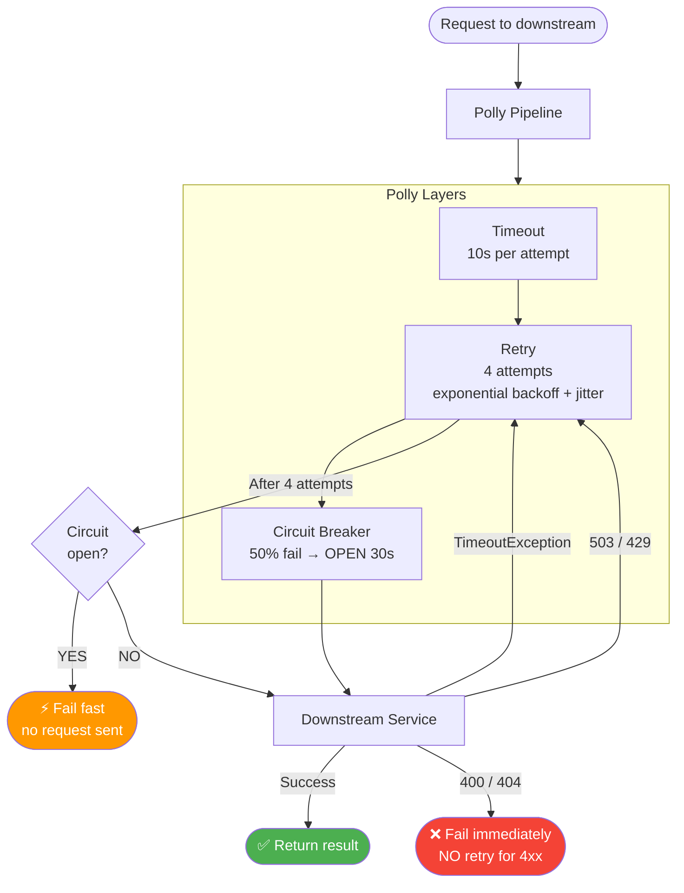

---

## PS-D3 — Outbox Pattern (Guaranteed Event Publishing)

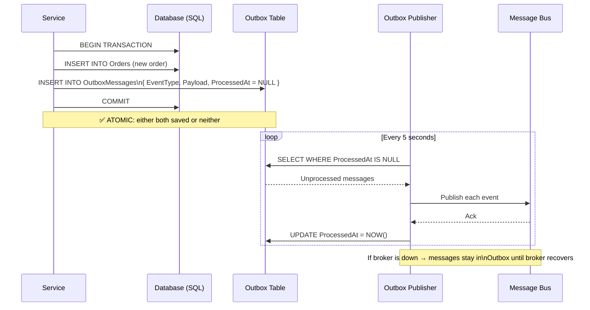

---

## PS-D4 — Concurrent Job Pickup Prevention

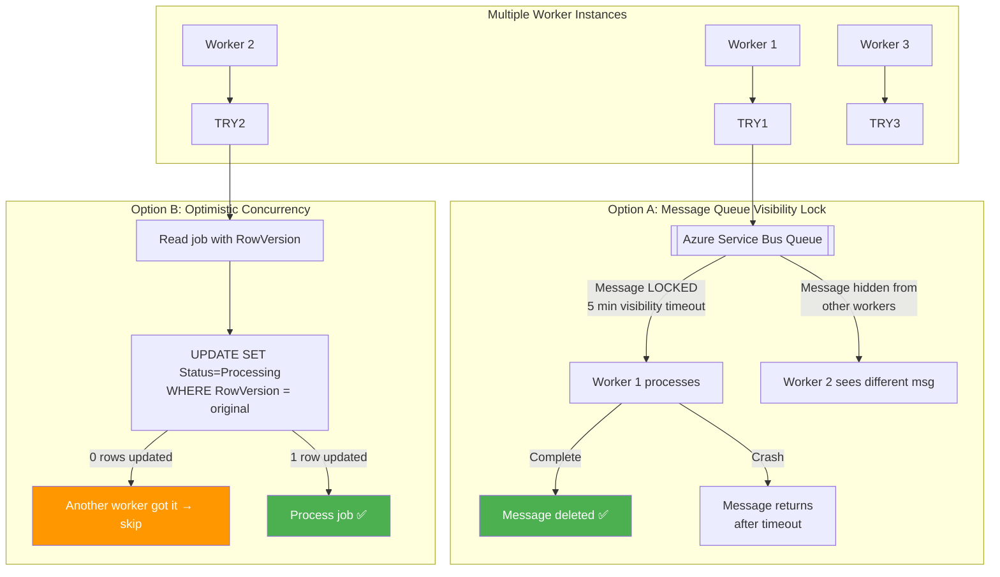

---

## PS-D5 — Zero-Downtime Database Migration (Expand and Contract)

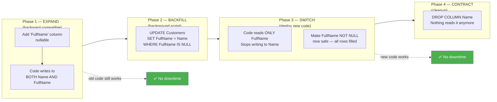

---

## PS-D6 — Incident Response Flow

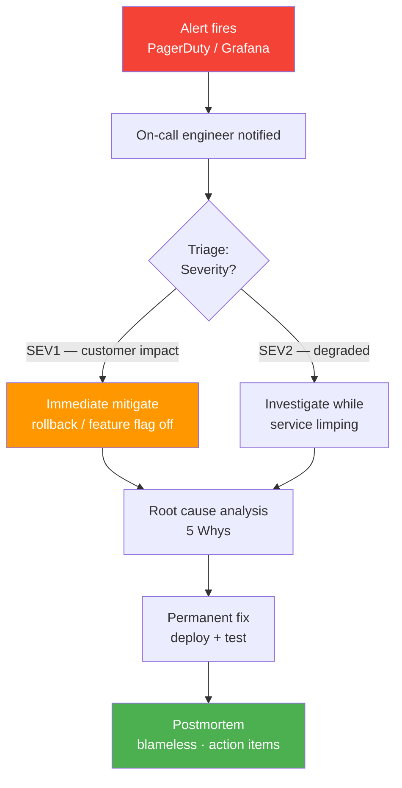

---

## PS-D7 — Blue/Green Deployment

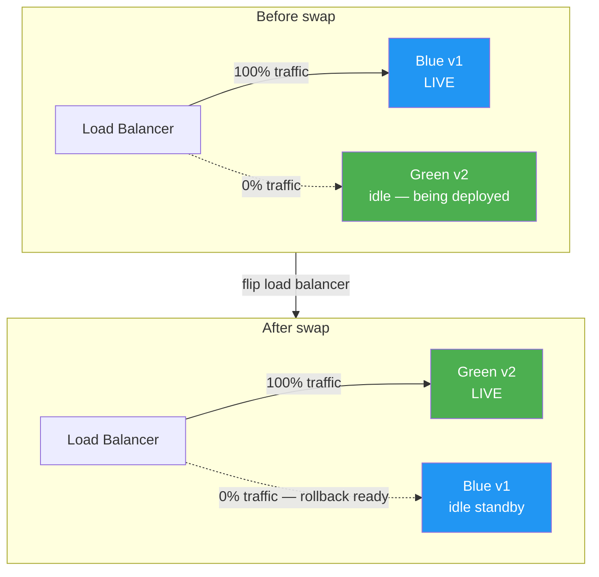

---

## PS-D8 — Canary Release

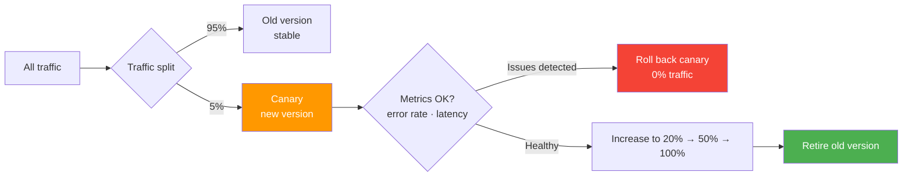

---

## PS-D9 — Rollback Decision Tree

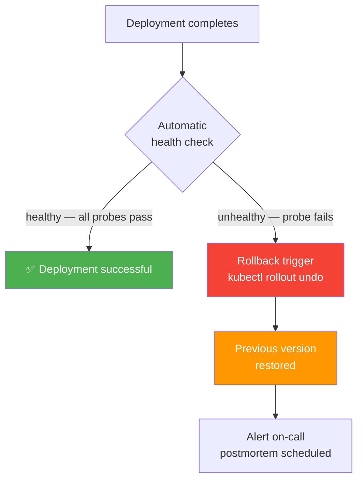

---

# 🎯 Senior Engineer Interview Questions — Observability & Debugging (Q82–Q91)

---

### Q82: Tell me about a production issue you debugged. How did you find the root cause?

**Answer:**
Systematic debugging follows a process: detection (alert or user report), triage (scope and severity), hypothesis testing (narrow candidates using telemetry), root-cause validation (reproduce and confirm), and prevention (fix + add test + add alert). Disciplined process beats heroic guessing.

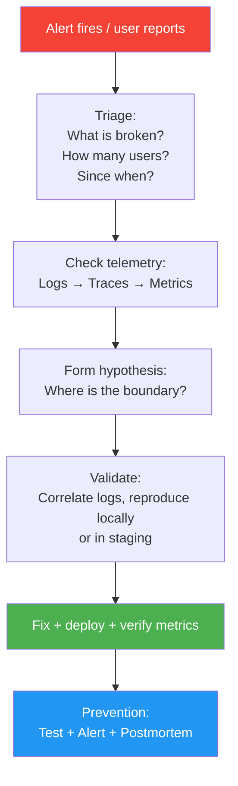

> **Why this matters:** Interviewers want a disciplined process, not heroic guesses. The ability to articulate a structured approach — detection, triage, hypothesis, validation, prevention — demonstrates production readiness.

**💡 Production Example:**
A checkout API started timing out intermittently. Detection: p99 latency alert at 8s threshold. Triage: only checkout affected, 15% of requests, started 40 minutes ago (recent deploy). Telemetry: distributed traces showed API latency was normal but a downstream payment provider call spiked to 10+ seconds. Logs revealed the provider had deployed a change affecting specific card types. Action: added a 5-second timeout with a graceful fallback (queue for retry), worked with the provider to roll back their change. Prevention: added a circuit breaker, provider-specific timeout alert, and a test for timeout behavior.

---

### Q83: What is structured logging and why does it matter?

**Answer:**
Structured logging emits log entries as machine-parseable key-value pairs (JSON) rather than freeform strings. This makes logs queryable, filterable, and correlatable in log aggregation systems. You can query `WHERE statusCode == 500 AND userId == 'alice'` — impossible with string logs.

```csharp
// ❌ String interpolation — unstructured, not queryable
_logger.LogInformation($"Order {orderId} placed by {userId} for {amount:C}");
// Logs as: "Order 3f2c... placed by alice@... for $99.99"
// Cannot filter by orderId without regex — slow, error-prone

// ✅ Structured logging — named properties preserved as fields
_logger.LogInformation(
    "Order {OrderId} placed by {UserId} for {Amount}",
    orderId, userId, amount);
// Logs as JSON: { "OrderId": "3f2c...", "UserId": "alice@...", "Amount": 99.99, "Level": "Information" }
// Queryable: SELECT * WHERE OrderId = '3f2c...' — instant

// Serilog with enrichers — add context automatically
Log.Logger = new LoggerConfiguration()
    .Enrich.FromLogContext()
    .Enrich.WithCorrelationId()          // adds CorrelationId to every log
    .Enrich.WithProperty("Service", "checkout-api")
    .WriteTo.ApplicationInsights(telemetry, TelemetryConverter.Traces)
    .WriteTo.Console(new JsonFormatter()) // structured JSON to stdout
    .CreateLogger();

// Scope enrichment — add request context to all logs within a scope
using (_logger.BeginScope(new Dictionary<string, object>
{
    ["OrderId"] = orderId,
    ["TenantId"] = tenantId
}))
{
    _logger.LogInformation("Validating order");   // OrderId + TenantId in scope
    _logger.LogInformation("Charging payment");   // OrderId + TenantId in scope
}
```

> **Why this matters:** Structured logs reduce mean time to resolution (MTTR) dramatically. Finding a specific user's request in an unstructured 10GB log file is hours of grep. In a structured log store (Application Insights, Seq, Datadog), it is a 2-second query.

**💡 Production Example:**
A support ticket came in: "User alice@company.com says her order from last Tuesday is missing." With unstructured logs, this required grep over 3 days of log files and took 2 hours. After migrating to structured logging with Serilog and Application Insights, the same investigation was: `traces | where Properties.Email == "alice@company.com" and timestamp > ago(7d)` — answered in 30 seconds.

---

### Q84: How do you trace a request that touches multiple services?

**Answer:**
Propagate trace context (W3C TraceContext headers) across all service calls and emit spans with relevant attributes. The trace ID follows the request through every service boundary and lets you reconstruct the full timeline in a distributed trace viewer like Application Insights or Jaeger.

```csharp
// ASP.NET Core — W3C trace context propagation is automatic with OpenTelemetry
builder.Services.AddOpenTelemetry()
    .WithTracing(tracing => tracing
        .AddAspNetCoreInstrumentation()    // traces every incoming HTTP request
        .AddHttpClientInstrumentation()    // propagates context in outgoing HTTP calls
        .AddEntityFrameworkCoreInstrumentation() // traces DB queries
        .AddAzureMonitorTraceExporter(opts =>
            opts.ConnectionString = _config["ApplicationInsights:ConnectionString"]));

// Manual span for custom operations
using var activity = Activity.Current?.Source.StartActivity("ProcessPayment");
activity?.SetTag("payment.provider", "stripe");
activity?.SetTag("payment.amount", amount);
activity?.SetTag("order.id", orderId.ToString());

try
{
    var result = await _paymentClient.ChargeAsync(amount);
    activity?.SetStatus(ActivityStatusCode.Ok);
    return result;
}
catch (Exception ex)
{
    activity?.SetStatus(ActivityStatusCode.Error, ex.Message);
    activity?.RecordException(ex);
    throw;
}

// Headers automatically propagated by HttpClientInstrumentation:
// traceparent: 00-{traceId}-{spanId}-01
// Every service receiving this header continues the same trace
```

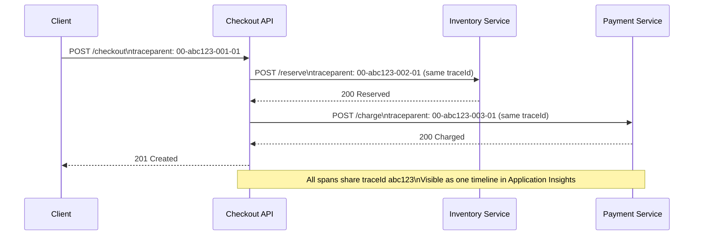

> **Why this matters:** Distributed traces are the only way to reconstruct a request timeline across service boundaries. Without them, a 10-second checkout request becomes a detective story across 5 separate log streams.

**💡 Production Example:**
A checkout request occasionally took 10 seconds with no obvious cause. Distributed tracing revealed a specific downstream inventory service adding 8 seconds on cold cache misses — a span with `db.query.slow = true` that was invisible when looking at logs from any single service. Warming the cache on startup eliminated the spike. Without the distributed trace, the issue would have required coordinated log correlation across three teams.

---

### Q85: Your API is slow. Walk me through how you'd diagnose it.

**Answer:**
Start with high-level metrics, isolate affected endpoints, inspect dependencies, then profile hot paths. Average latency hides p99 issues; always look at percentiles. Work from the outside in — metrics → traces → profiler — rather than jumping straight to code.

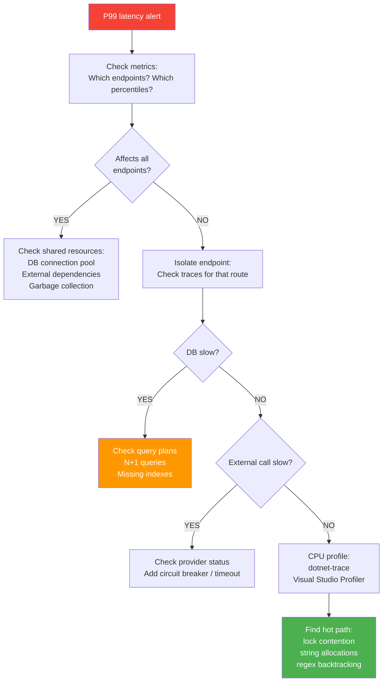

```bash
# Step 1: Check p99 in Application Insights or Prometheus
requests | summarize percentiles(duration, 50, 90, 95, 99) by name

# Step 2: Identify slow traces
traces | where duration > 2000 | project timestamp, id, operation_Name, duration

# Step 3: Profile CPU on live pod (Linux)
dotnet-trace collect -p <pid> --duration 00:00:30
dotnet-trace convert trace.nettrace --format speedscope

# Step 4: Check for N+1 (EF Core)
services.AddDbContextFactory<AppDbContext>(opts =>
    opts.UseSqlServer(connStr)
        .LogTo(Console.WriteLine, LogLevel.Information)  // logs every query
        .EnableSensitiveDataLogging());  // shows parameter values

# Step 5: Memory pressure / GC pauses
dotnet-counters monitor -p <pid> -- System.Runtime
# Watch: gen0-gc-count, gc-pause-time, threadpool-queue-length
```

> **Why this matters:** API latency issues rarely come from a single obvious source. Systematic profiling skills separate engineers who can actually fix production performance from those who guess and hope. The diagnostic ladder — metrics → traces → profiler — prevents wasted effort.

**💡 Production Example:**
A product listing API had good average latency (200ms) but terrible p99 (4 seconds). Standard profiling showed nothing obvious. `dotnet-dump` analysis revealed a lock in a singleton cache wrapper under concurrent reads — every read acquired an exclusive lock, serializing all concurrent requests. Switching from `lock` to `ReaderWriterLockSlim` reduced p99 from 4 seconds to under 200ms at peak traffic. The bug was invisible under sequential testing.

---

### Q86: How do you design correlation IDs so support teams can debug customer tickets quickly?

**Answer:**
Generate a unique correlation ID per request at the gateway, propagate it in all downstream calls and log entries, and return it to the client in the response headers. Support teams include the correlation ID in tickets, which turns a multi-service investigation into a single log query.

```csharp
// Middleware — generate or propagate correlation ID
public class CorrelationIdMiddleware
{
    private const string Header = "X-Correlation-Id";

    public async Task InvokeAsync(HttpContext context)
    {
        // Accept from client (useful for end-to-end tracing) or generate new
        var correlationId = context.Request.Headers[Header].FirstOrDefault()
                         ?? Activity.Current?.TraceId.ToString()
                         ?? Guid.NewGuid().ToString("N");

        context.Items[Header] = correlationId;

        // Add to response so client/support can reference it
        context.Response.Headers[Header] = correlationId;

        // Add to all log entries for this request
        using (_logger.BeginScope(new Dictionary<string, object>
            { [Header] = correlationId }))
        {
            await _next(context);
        }
    }
}

// Propagate to downstream services via HttpClient
services.AddHttpClient("PaymentService")
    .AddHttpMessageHandler<CorrelationIdForwardingHandler>();

public class CorrelationIdForwardingHandler : DelegatingHandler
{
    protected override Task<HttpResponseMessage> SendAsync(
        HttpRequestMessage request, CancellationToken ct)
    {
        if (Activity.Current?.TraceId is { } traceId)
            request.Headers.TryAddWithoutValidation("X-Correlation-Id", traceId.ToString());
        return base.SendAsync(request, ct);
    }
}
```

**Support ticket flow:**
```
User reports: "My payment failed at 14:32 today"
Support team: includes X-Correlation-Id: abc123 from the error page / app
Developer runs: traces | where customDimensions["X-Correlation-Id"] == "abc123"
Result: full request timeline across all services in < 30 seconds
```

> **Why this matters:** Without correlation IDs, debugging a customer's failed request means guessing which log entry corresponds to their request based on timestamp and user ID — slow and error-prone in high-traffic systems. With correlation IDs, a single query reconstructs the entire journey.

**💡 Production Example:**
A financial services team was spending 2+ hours per support ticket correlating logs manually using timestamps and user IDs. After adding correlation ID propagation through 6 microservices and returning the ID in error responses (displayed to users as a "reference number"), investigation time dropped to under 5 minutes. The support team could hand engineers a single reference number that retrieved the complete picture.

---

### Q87: Walk me through reducing alert fatigue in a mature platform.

**Answer:**
Remove non-actionable alerts, tune thresholds to user impact rather than technical thresholds, enforce ownership (every alert has a named team and runbook), and use composite/multi-window alerts to eliminate transient noise. The goal is that every page requires a human decision, not just acknowledgment.

```yaml
# ❌ Noisy alert — fires on every spike, not user-impacting
- alert: ApiErrorRate
  expr: rate(http_requests_total{status=~"5.."}[1m]) > 0.01
  # Fires constantly during deployments, causes alert fatigue

# ✅ Composite alert — sustained user-impacting error rate
- alert: CheckoutErrorRateSustained
  expr: |
    sum(rate(http_requests_total{job="checkout",status=~"5.."}[5m]))
    /
    sum(rate(http_requests_total{job="checkout"}[5m])) > 0.05
  for: 5m  # must sustain for 5 minutes — filters transient spikes
  labels:
    severity: critical
    team: checkout
  annotations:
    summary: "Checkout error rate > 5% sustained for 5 minutes"
    runbook: "https://wiki.internal/runbooks/checkout-errors"
    # Every alert must have a runbook — if you can't write one, the alert shouldn't exist
```

**Alert quality checklist:**
- Every alert is actionable — there is a human decision required
- Every alert has a runbook with clear steps
- Alert threshold correlates to user impact, not technical metric
- Flapping alerts use multi-window evaluation (sustained, not instantaneous)
- Each alert has a clear owner team

> **Why this matters:** Alert fatigue is as dangerous as no alerts. Engineers who get paged 50 times a week for non-critical events learn to dismiss alerts — including the one that matters. Reducing noise restores the trust that makes on-call sustainable.

**💡 Production Example:**
A service emitted hundreds of alerts on every deployment because thresholds were too tight (any error rate > 0.1%). On-call engineers learned to ignore pagerduty notifications during deploy windows. During one incident, a real outage alert was missed for 18 minutes because engineers assumed it was another deploy-time false positive. Switching to composite 5-minute sustained alerts and removing all alerts without runbooks reduced weekly alert volume by 90% and restored on-call confidence.

---

### Q88: How do you instrument business metrics alongside technical telemetry?

**Answer:**
Track domain KPIs (checkout conversion rate, cart abandonment, order success rate) using the same telemetry pipeline as technical metrics. Emit them as custom events or metrics tied to trace context. Business and technical signals together reveal whether a technical regression actually affects users.

```csharp
// Emit business metrics as Application Insights custom events
public class CheckoutService
{
    private readonly TelemetryClient _telemetry;

    public async Task<OrderResult> CheckoutAsync(Cart cart, CancellationToken ct)
    {
        var stopwatch = Stopwatch.StartNew();

        try
        {
            var order = await ProcessOrderAsync(cart, ct);

            // Technical metric — latency
            _telemetry.TrackMetric("checkout.latency_ms", stopwatch.ElapsedMilliseconds);

            // Business metric — conversion
            _telemetry.TrackEvent("checkout.completed", new Dictionary<string, string>
            {
                ["CustomerId"]  = cart.CustomerId.ToString(),
                ["CartValue"]   = cart.TotalAmount.ToString("F2"),
                ["ItemCount"]   = cart.Items.Count.ToString(),
                ["PaymentType"] = cart.PaymentMethod
            });

            return order;
        }
        catch (Exception ex)
        {
            // Business metric — failure with context
            _telemetry.TrackEvent("checkout.failed", new Dictionary<string, string>
            {
                ["FailureReason"] = ex.GetType().Name,
                ["CartValue"]     = cart.TotalAmount.ToString("F2")
            });
            throw;
        }
    }
}

// Cart abandonment tracking — when user leaves without checking out
_telemetry.TrackEvent("cart.abandoned", new Dictionary<string, string>
{
    ["SessionDuration"] = elapsed.TotalSeconds.ToString("F0"),
    ["LastStep"]        = lastCompletedStep,
    ["CartValue"]       = cart.TotalAmount.ToString("F2")
});
```

> **Why this matters:** Technical metrics alone don't tell the full story. A latency regression below the alerting threshold (300ms → 600ms) might not trigger any technical alert but could cause a measurable conversion drop. Business metrics provide the context that clarifies whether a technical issue is actually affecting users.

**💡 Production Example:**
A checkout API had a latency regression (p99 went from 300ms to 600ms) that was below the 1s alerting threshold. No technical alerts fired. However, a business metric dashboard showed checkout conversion rate dropped 8% in the same time window. That correlation was the evidence needed to prioritize a fix that would otherwise have been deprioritized as "below SLA." The latency was traced to an N+1 query on the product catalog endpoint called during checkout.

---

### Q89: How do you debug intermittent failures that you cannot reproduce locally?

**Answer:**
Increase targeted telemetry (add spans, log intermediate state, capture execution context), reproduce in a production-like environment with realistic load, and use distributed tracing to correlate intermittent failures with concurrency patterns, request context, and timing.

```csharp
// ❌ Insufficient telemetry — only logs success/failure
public async Task<PaymentResult> ProcessPaymentAsync(PaymentRequest request)
{
    try
    {
        var result = await _provider.ChargeAsync(request.Amount);
        _logger.LogInformation("Payment succeeded");
        return result;
    }
    catch (Exception ex)
    {
        _logger.LogError(ex, "Payment failed");
        throw;
    }
}

// ✅ Rich telemetry — captures context needed to diagnose intermittent failures
public async Task<PaymentResult> ProcessPaymentAsync(PaymentRequest request)
{
    using var activity = _activitySource.StartActivity("ProcessPayment");
    activity?.SetTag("payment.provider", _provider.Name);
    activity?.SetTag("payment.amount", request.Amount);
    activity?.SetTag("payment.currency", request.Currency);
    activity?.SetTag("thread.id", Environment.CurrentManagedThreadId);

    _logger.LogInformation(
        "Processing payment {PaymentId} via {Provider} on thread {ThreadId}",
        request.PaymentId, _provider.Name, Environment.CurrentManagedThreadId);

    try
    {
        var sw = Stopwatch.StartNew();
        var result = await _provider.ChargeAsync(request.Amount);
        _logger.LogInformation(
            "Payment {PaymentId} succeeded in {Ms}ms on attempt {Attempt}",
            request.PaymentId, sw.ElapsedMilliseconds, request.RetryCount);
        return result;
    }
    catch (Exception ex)
    {
        activity?.RecordException(ex);
        activity?.SetTag("payment.retry_count", request.RetryCount);
        _logger.LogError(ex,
            "Payment {PaymentId} failed after {Ms}ms. Provider: {Provider}. RetryCount: {Retry}",
            request.PaymentId, sw.ElapsedMilliseconds, _provider.Name, request.RetryCount);
        throw;
    }
}
```

> **Why this matters:** Intermittent failures that cannot be reproduced locally are the hardest class of production bugs. They often involve concurrency, timing, environment-specific configuration, or load patterns. Rich telemetry is the only way to see what the code was doing when the failure occurred.

**💡 Production Example:**
A payment service had occasional transaction failures appearing only under concurrent load in production (roughly 1 in 500 requests). Adding distributed tracing with activity IDs and capturing thread IDs during failures revealed that failures always occurred when two requests with the same customer ID were processed simultaneously — a race condition in a shared lock-free queue that was keyed by customer ID. The bug was invisible in single-threaded and low-concurrency testing but immediately obvious in the trace data.

---

### Q90: How do you perform post-incident reviews that actually improve systems?

**Answer:**
Focus on system conditions and decision quality rather than individual blame. Every action item must have an owner and a deadline. Track completion in the sprint board — untracked items decay. The measure of a good postmortem is recurrence rate for the same class of incident.

```markdown
## Postmortem Template

**Incident:** Checkout API 503s — 2026-06-01 14:32 UTC — 47 minutes

### Timeline
- 14:32 — Alert fires: checkout error rate > 5% sustained 5 min
- 14:35 — On-call acknowledges, begins triage
- 14:40 — Root cause identified: missing readiness probe caused traffic to route to pods mid-startup
- 14:55 — Readiness probe added, deployed to staging, validated
- 15:19 — Deployed to production, error rate returns to baseline

### Root Cause
Pods started receiving traffic 30 seconds before they were ready (DB connection pool not warmed).
Missing readiness probe — Kubernetes had no signal to delay traffic.

### Contributing Factors
- No readiness probe in the deployment spec (gap in deployment checklist)
- Recent pod count increase amplified the issue (more pods starting = more unready traffic)

### Action Items
| Item | Owner | Due | Status |
|------|-------|-----|--------|
| Add readiness probe to checkout deployment | @alice | 2026-06-03 | ✅ Done |
| Add readiness probe to deploy checklist | @bob | 2026-06-05 | In progress |
| Alert on pod readiness ratio < 80% | @carol | 2026-06-07 | Planned |
| Integration test for cold-start behavior | @alice | 2026-06-10 | Planned |

### What went well
- Fast detection (alert fired within 5 minutes of issue start)
- Clean rollback path (no data mutation — stateless API)
```

> **Why this matters:** Postmortems are only useful if they change behavior. A postmortem that results in a document nobody reads changes nothing. Action items tracked in the sprint board with owners and deadlines drive actual systemic improvement.

**💡 Production Example:**
After a checkout outage caused by a missing readiness probe, a blameless postmortem identified the root cause and added four action items with owners and sprint-tracked deadlines. All four were completed within two weeks. The same class of issue (unready pod receiving traffic) has not recurred in the 12 months since. The postmortem also resulted in a deploy checklist that now includes probe verification as a required step.

---

### Q91: What is your approach to debugging memory leaks in long-running .NET services?

**Answer:**
Use memory dumps, allocation profiles, and object retention analysis to find the root. Then validate fixes under endurance testing — short test runs cannot reveal leaks that manifest over hours. Typical culprits: event handler subscriptions, static caches, captured closures, and unmanaged resources.

```csharp
// Common leak patterns and fixes

// ❌ Leak 1: Event handler subscription never unsubscribed
public class OrderNotificationService
{
    public OrderNotificationService(IEventBus bus)
    {
        bus.OrderPlaced += OnOrderPlaced; // ❌ bus holds reference to this service forever
        // Garbage collector cannot collect this service as long as bus is alive
    }
}

// ✅ Fix: IDisposable pattern
public class OrderNotificationService : IDisposable
{
    private readonly IEventBus _bus;
    public OrderNotificationService(IEventBus bus)
    {
        _bus = bus;
        _bus.OrderPlaced += OnOrderPlaced;
    }
    public void Dispose() => _bus.OrderPlaced -= OnOrderPlaced;
}

// ❌ Leak 2: Captured HttpContext in async background work
public IActionResult StartExport()
{
    var userId = HttpContext.User.FindFirstValue("sub"); // ❌ captures HttpContext
    _ = Task.Run(async () =>
    {
        await Task.Delay(5000);
        await ProcessExportAsync(userId); // HttpContext is disposed by now — access violation
    });
    return Accepted();
}

// ✅ Fix: extract values before async boundary
public IActionResult StartExport()
{
    var userId = HttpContext.User.FindFirstValue("sub"); // ✅ extract value, not reference
    _ = Task.Run(async () => await ProcessExportAsync(userId));
    return Accepted();
}
```

```bash
# Diagnosing a leak in production (.NET on Linux)

# Step 1: Monitor memory over time
dotnet-counters monitor -p <pid> --counters System.Runtime[gen-2-size,gc-heap-size]
# Watch: gen-2-size growing without recovery = likely leak

# Step 2: Capture memory dump
dotnet-gcdump collect -p <pid>
dotnet-gcdump report <file>.gcdump -rt

# Step 3: Analyze with dotnet-dump (or Visual Studio for Windows)
dotnet-dump analyze <dump-file>
> dumpheap -stat         # objects by type, sorted by total size
> dumpheap -type OrderService  # all instances of OrderService
> gcroot <address>       # what is keeping this object alive?
```

> **Why this matters:** Memory leaks in long-running services cause gradual degradation — the service slows down and eventually OOM-crashes after hours or days. The insidious nature (slow onset, not immediately reproducible) makes them one of the most damaging production issues.

**💡 Production Example:**
A background processing service was being restarted every 6 hours by the ops team because memory climbed steadily until OOM. Profiling with `dotnet-gcdump` showed the handler chain on a static `EventAggregator` growing on every service restart within the pod. Each time the BackgroundService was constructed (DI-registered as Scoped, accidentally instantiated multiple times due to a factory bug), it subscribed to the event without ever unsubscribing. Implementing `IDisposable` to unsubscribe on service stop, combined with fixing the factory to return a singleton, eliminated the leak. Endurance testing over 4 hours confirmed stable memory usage.


---

## 🏢 FAANG Production & On-Call Scenarios

---

### Q: How does Netflix handle a regional AWS outage? (Netflix)

**Netflix's multi-region architecture:**
- Active-active across us-east-1, us-west-2, eu-west-1
- Every region can serve 100% of global traffic independently
- Design principle: no single-region dependency in the critical path

**Stateless services:**
- All application servers are stateless — any region can serve any request
- Session state stored in distributed caches (EVCache — Netflix's Memcached wrapper with multi-region replication)
- No sticky sessions

**Stateful data:**
- **Cassandra:** multi-region replication with tunable consistency (Netflix's primary operational store)
- **DynamoDB Global Tables:** for AWS-native services requiring managed replication
- Write conflict strategy: last-writer-wins with timestamp

**"Chaos Kong" — proactive regional evacuation drill:**
- Netflix intentionally evacuates an entire AWS region several times per year
- Process: shift DNS weights to remove the target region from Route 53, watch traffic drain, verify other regions absorb load
- Teams discover evacuation gaps (unresolved DNS hardcodes, region-specific S3 buckets) before real outages expose them

**Automated runbook — regional failover:**
1. Route 53 health check detects region unavailability (< 30 seconds)
2. DNS weights for the failed region are set to 0 (automated by Lambda + CloudWatch alarm)
3. Traffic redistributed to healthy regions (< 3 minutes total)
4. Alert fires to on-call; team monitors capacity in surviving regions
5. Auto-scaling in healthy regions absorbs the additional load

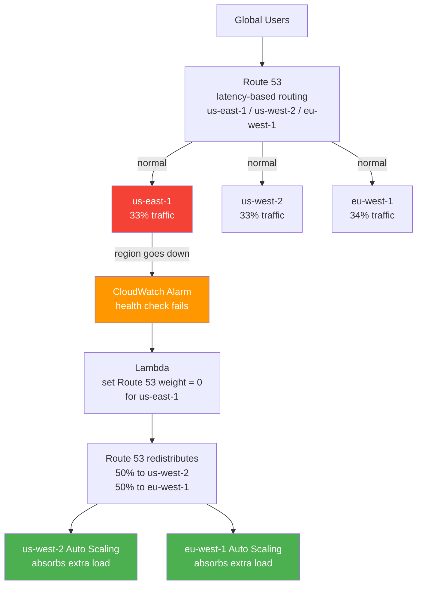

> **Why this matters:** A regional outage without active-active architecture causes a full service outage until a manual failover is executed. Netflix's architecture converts a potential hour-long outage into a 3-minute automated DNS reroute that most customers never notice.

**💡 Production Example:**
During the December 2021 AWS us-east-1 networking event, Netflix's automated regional failover shifted traffic to us-west-2 and eu-west-1 within 3 minutes. Customer-facing impact was limited to a brief increase in latency for us-east-1 users — no widespread streaming outage, unlike services with single-region dependencies.

---

### Q: Walk me through Amazon's incident response process (Amazon)

**Amazon's COE (Correction of Errors) framework:**

COE is Amazon's version of a blameless postmortem — the mandatory document produced after every significant incident. It is a first-class operational artifact tracked by leadership.

**COE structure:**
1. **What happened:** timeline of events from first alert to resolution
2. **Impact:** customer-facing impact, duration, affected services, revenue estimate
3. **Root cause:** 5 Whys analysis — drill down to the systemic cause, not the proximate cause
4. **Contributing factors:** what made the system fragile (missing alarm, no circuit breaker, etc.)
5. **Corrective actions:** specific, time-bound, owner-assigned action items; tracked in tickets

**5 Whys example:**
```
Problem: Checkout service returned 500 errors for 22 minutes

Why 1: The checkout service could not connect to the payments service
Why 2: The payments service was unresponsive because its database was at max connections
Why 3: The database was at max connections because a new deploy had a connection leak
Why 4: The connection leak was not caught because integration tests used an in-memory DB (no connection pool)
Why 5: The team had no runbook for connection pool exhaustion and no alarm on pool wait time

Root cause: Absence of connection pool observability and integration test coverage
Corrective actions: add pool_wait_time alarm, add Testcontainers-based integration test, add runbook
```

**Two-Pizza Team escalation structure:**
- First responder: on-call engineer for the service
- L2 escalation: team tech lead (if not resolved in 15 minutes)
- L3 escalation: service owner + principal engineer (if customer impact ongoing)
- Executive escalation: VP or above (if S1 with prolonged customer impact)

**Pre-mortems:**
- Before launching a new service or major feature, run a "pre-mortem": ask the team "imagine it's 6 months from now and this failed catastrophically — what went wrong?"
- Forces teams to surface operational risks before they become incidents
- Common outputs: missing alarms, undocumented dependencies, single points of failure

**Operational metrics:**
- **MTTD** (Mean Time to Detect): time from issue onset to first alert firing — target: < 5 minutes
- **MTTR** (Mean Time to Resolve): time from first alert to service restored — target: < 30 minutes
- **MTTF** (Mean Time to Failure): average time between incidents — higher is better; tracks reliability trend

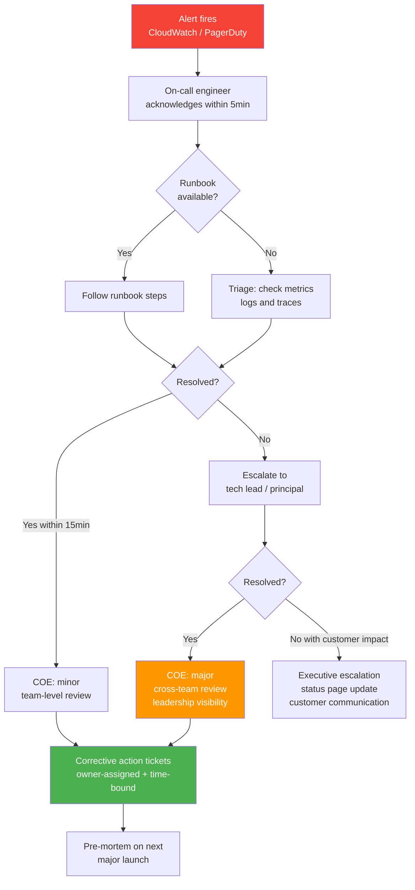

> **Why this matters:** Amazon's COE process treats every incident as a learning opportunity, not a blame session. The 5 Whys forces engineers past the proximate cause to the systemic cause — and the mandatory corrective action tracking ensures the learning is actually applied.

**💡 Production Example:**
After a DynamoDB throttling incident caused order processing delays, the COE 5 Whys revealed the root cause was missing capacity planning for a seasonal traffic surge — the team had never reviewed DynamoDB provisioned capacity vs projected Black Friday traffic. The COE produced three corrective actions: a quarterly capacity review process, CloudWatch alarms on consumed read/write capacity units, and automatic on-demand scaling enabled for all tables.

---

### Q: How does Google handle SLO burn rate alerts? (Google SRE)

**The problem with simple threshold alerts:**
- "Alert if error rate > 1% for 5 minutes" — too noisy for minor blips; misses slow degradations
- Burn rate alerts solve this: alert based on how fast you're consuming your error budget

**Burn rate = actual bad rate / SLO-allowed bad rate**
```
If SLO = 99.9% (0.1% errors allowed):
  Current error rate = 1% → burn rate = 1% / 0.1% = 10x
  At 10x burn rate: 30-day budget exhausted in 3 days
```

**Multi-burn-rate, multi-window alerting (Google's recommended approach):**

| Window | Burn rate | Budget consumed | Action | Urgency |
|---|---|---|---|---|
| 1 hour | > 14.4x | 2% in 1 hour | Page immediately | Critical |
| 6 hours | > 6x | 5% in 6 hours | Create ticket | High |
| 3 days | > 1x | 10% in 3 days | Weekly review | Low |

**Multi-window rationale:**
- Short window alone: detects fast burns but creates false positives for brief spikes
- Long window alone: confirms sustained burns but is too slow to page for fast burns
- Combined: alert only when BOTH windows show elevated burn rate — high precision

**Alert fatigue prevention principles:**
- Alert on **user impact**, not infrastructure symptoms
- "Database CPU > 80%" is a symptom — "Error rate > SLO burn rate" is user impact
- Every alert should have a clear action in a runbook — if there's no action, it's a dashboard metric, not an alert

```yaml
# Example Prometheus alerting rule — fast burn
- alert: HighErrorBudgetBurnRate
  expr: |
    (
      sum(rate(http_requests_total{status=~"5.."}[1h])) /
      sum(rate(http_requests_total[1h]))
    ) > (14.4 * 0.001)   # 14.4x burn rate = 2% budget in 1 hour
  for: 5m
  annotations:
    summary: "Fast error budget burn — will exhaust monthly budget in 2 days"
```

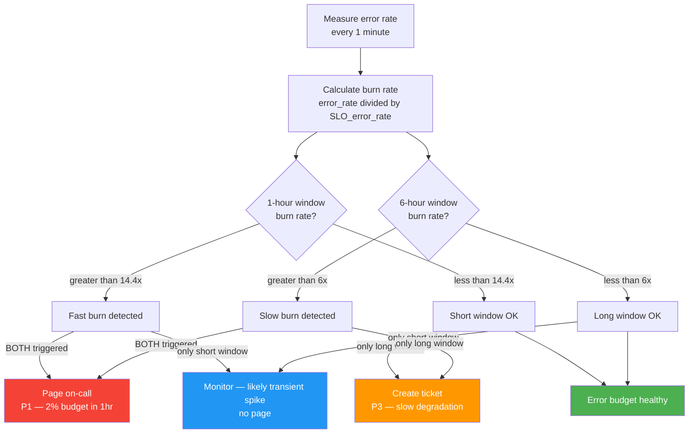

> **Why this matters:** Single-window threshold alerts generate alert fatigue (too many pages for transient spikes) or miss slow degradations. Google's multiwindow approach pages only when there's a sustained, meaningful burn — dramatically improving signal-to-noise and engineer trust in alerts.

**💡 Production Example:**
A team using simple 5-minute error rate alerts was averaging 12 pages per week, most for spikes that auto-recovered. After migrating to multiwindow burn rate alerts (1h + 6h), pages dropped to 2 per week — both actionable incidents. The change improved on-call quality of life and reduced alert fatigue that had led engineers to start ignoring pages.

---

### Q: How would you debug a sudden 10x latency spike at 3am? (Amazon/Google on-call)

**Step 0 — Runbook first (< 2 minutes):**
- Is there a runbook for this alert? Check the alert annotation or team wiki
- Is there a recent deploy? Check deployment history — rollback is often faster than diagnosis
- Is there a known issue? Check status pages of upstream dependencies (AWS, Stripe, Twilio)

**USE method — for each infrastructure resource:**
- **U**tilization: is CPU, memory, disk, or network I/O near capacity?
- **S**aturation: is any queue growing (connection pool, message queue, thread pool)?
- **E**rrors: are there error rates increasing at the resource level?

**RED method — for each service in the call chain:**
- **R**ate: requests per second — is traffic up (load-driven) or down (shed/throttled)?
- **E**rrors: error rate — which service first shows elevated errors?
- **D**uration: latency breakdown — which service in the trace is slow?

**Tools by signal type:**

| Signal | Tool | What to look for |
|---|---|---|
| Distributed traces | Jaeger / X-Ray / Tempo | Which span is slow? What changed in p99? |
| Metrics | CloudWatch / Prometheus / Datadog | CPU, memory, connection pool wait, GC pause time |
| Logs | CloudWatch Logs Insights / Splunk | Error messages, timeout messages, slow query log |
| Database | pg_stat_activity, slow query log | Blocking queries, long transactions, missing index |
| CPU profile | dotnet-trace, async-profiler | Hot code path, lock contention |

**Escalation criteria:**
- Customer-visible impact > 5 minutes → escalate to L2
- Unable to identify root cause in 15 minutes → escalate with current findings
- Revenue impact > threshold → page service owner + director

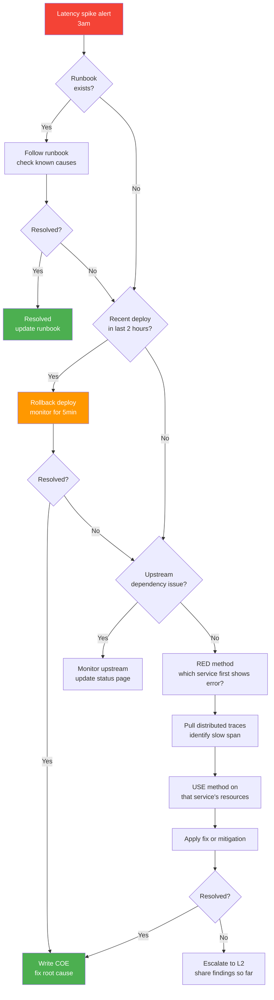

> **Why this matters:** Without a systematic approach, 3am debugging devolves into random log searching. The USE/RED methods provide a structured elimination path. Starting with "was there a recent deploy?" catches the majority of production incidents — most latency regressions are deploy-related.

**💡 Production Example:**
A 10x latency spike at 3am was initially blamed on a traffic surge (rate was up 20%). RED method on the database service showed duration was up 50x, not just 20x — disproportionate to the traffic increase. A slow query log showed a new query introduced in the last deploy was missing an index. Rolling back the deploy resolved the spike in 4 minutes. The COE resulted in a pre-deploy checklist item: run EXPLAIN ANALYZE on all new queries in staging before production promotion.

---

### Q: How does Meta handle data center failures? (Meta)

**Meta's data center architecture:**
- "Data Center Region" (DCR): a cluster of 2–4 physical data centers within ~50 miles of each other
- Connected by dedicated fiber with < 1ms latency between DCs in the same region
- Multiple DCRs globally: US-East, US-West, Europe, Asia

**Service discovery and leader election:**
- **Zookeeper:** distributed coordination service; used for leader election in stateful services
- Each stateful service registers itself in Zookeeper; clients discover the current leader
- On DC failure: Zookeeper leader election automatically promotes a replica in a surviving DC

**Shadow traffic — safe DC cutover:**
- Before cutting production traffic to a new or recovered DC, replay production traffic as shadow traffic
- Shadow responses are compared to primary responses (dark comparison)
- Discrepancies surface bugs before real users are routed to the new DC
- Used for both new DC bring-up and post-failure recovery validation

**Disaster Recovery tiers:**

| Tier | Strategy | RTO | RPO | Use case |
|---|---|---|---|---|
| **Hot standby** | Fully active replica, traffic shifted in seconds | < 1 min | Near zero | Critical: Feed, Messaging |
| **Warm standby** | Replica running but not serving traffic; promoted in minutes | 5–15 min | Minutes | Important: Analytics pipelines |
| **Cold standby** | Infrastructure defined in IaC; provisioned on demand | Hours | Hours | Non-critical: internal tools |

**RTO/RPO targets per service tier:**
- Tier 1 (user-facing, revenue-generating): RTO < 5 min, RPO < 30 seconds
- Tier 2 (internal, SLA-bound): RTO < 30 min, RPO < 5 minutes
- Tier 3 (best-effort): RTO < 4 hours, RPO < 1 hour

> **Why this matters:** Not all services deserve the same recovery investment. Applying hot standby to every service is prohibitively expensive; applying cold standby to a payment service is reckless. Tiering services by business criticality and assigning RTO/RPO targets drives proportionate investment in resilience.

**💡 Production Example:**
During Meta's October 2021 BGP routing outage, the internal backbone between data centers became unreachable. Services with Zookeeper-based leader election that had replicas outside the affected DC group could re-elect leaders automatically. Services tightly coupled to a single DC were effectively unavailable for the full 6-hour duration. The incident drove a review of all Tier 1 services to ensure cross-DCR leader election was functional.

---

### Q: What is a black swan failure and how do you prepare for it? (General FAANG)

**Black swan events in production:**
- Originally from Nassim Taleb: rare, high-impact, retrospectively predictable but hard to forecast
- In infrastructure: events outside the failure model you designed for
- Examples: AWS us-east-1 multi-service outage (2017, 2021), Fastly CDN global outage (2021), CrowdStrike sensor update crashing 8.5 million Windows machines (2024), BGP route leak taking down large portions of the internet

**What makes them different from normal failures:**
- Normal failures: designed for (single instance death, AZ failure, disk failure) — runbooks exist
- Black swan: outside the blast radius you assumed (entire region, entire cloud provider, global DNS, global CDN)

**Preparation strategies:**

| Strategy | How | Example |
|---|---|---|
| **Avoid single dependencies** | Use multiple vendors for critical path | Two CDN providers (CloudFront + Fastly); two DNS providers (Route 53 + Cloudflare) |
| **Multi-cloud egress** | Ensure static assets + DNS can survive loss of one cloud | S3 + GCS for static content; failover DNS via secondary provider |
| **Game days** | Simulate the scenario before it happens | "What if Route 53 was unavailable for 1 hour?" |
| **Chaos engineering** | Discover unknown dependencies proactively | Kill all traffic to provider X; observe what breaks |
| **DR Playbook** | Pre-written, owned, regularly drilled runbook for each scenario | Regional failover runbook, DNS provider failover runbook |
| **Graceful degradation** | Serve partial functionality when dependencies fail | Serve cached content when real-time API is unavailable |

**The DR Playbook principles:**
- Written before the incident, not during
- Owned by a named individual (not "the team")
- Drilled quarterly — if you haven't rehearsed it, it doesn't work at 3am
- Includes explicit "abort criteria" — if step X fails, escalate immediately rather than continue

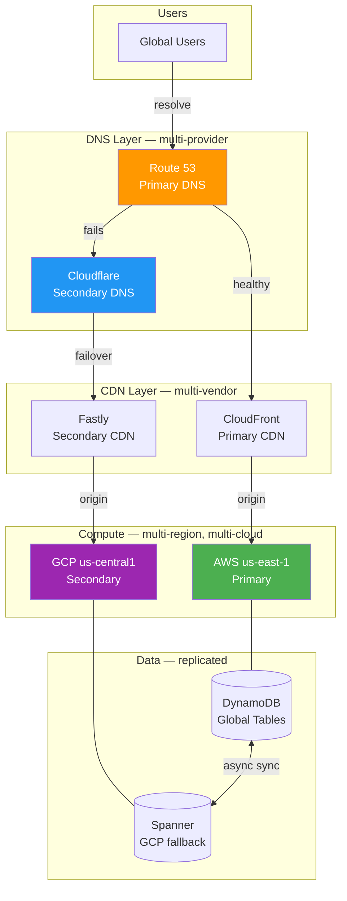

> **Why this matters:** Black swan events expose every shortcut taken in the name of simplicity. A single DNS provider, a single CDN, a single cloud — each is a hidden assumption that "this won't fail completely." The 2021 Fastly outage took down major news sites, governments, and e-commerce platforms simultaneously because they all shared a single CDN point of failure.

**💡 Production Example:**
After the Fastly CDN outage in June 2021 took down a major e-commerce platform for 49 minutes (estimated $2M+ revenue loss), the platform implemented dual-CDN routing: CloudFront as primary, Fastly as secondary, with automatic failover via Route 53 health checks. When Fastly experienced another degradation event in 2022, Route 53 detected the health check failure and redirected all traffic to CloudFront within 45 seconds — zero customer impact.
