# Real-World System Design Case Studies

> Deep dives into how top tech companies solve engineering challenges at scale. Each case study covers the problem, architecture, trade-offs, and interview angles for FAANG preparation.

## Table of Contents
- [Amazon](#amazon)
- [Apple](#apple)
- [Bitly](#bitly)
- [Bluesky](#bluesky)
- [Canva](#canva)
- [Cloudflare](#cloudflare)
- [Disney+](#disney)
- [Discord](#discord)
- [Dropbox](#dropbox)
- [Facebook](#facebook)
- [Figma](#figma)
- [Google](#google)
- [Giphy](#giphy)
- [Hashnode](#hashnode)
- [Halo](#halo)
- [Instagram](#instagram)
- [Khan Academy](#khan-academy)
- [LinkedIn](#linkedin)
- [Lyft](#lyft)
- [McDonald's](#mcdonalds)
- [Meta](#meta)
- [Netflix](#netflix)
- [PayPal](#paypal)
- [Pastebin](#pastebin)
- [Quora](#quora)
- [Razorpay](#razorpay)
- [Reddit](#reddit)
- [Slack](#slack)
- [SeatGeek](#seatgeek)
- [Shopify](#shopify)
- [Stripe](#stripe)
- [Tumblr](#tumblr)
- [Tinder](#tinder)
- [Uber](#uber)
- [WhatsApp](#whatsapp)
- [WeChat](#wechat)
- [YouTube](#youtube)
- [Zoom](#zoom)
- [Zapier](#zapier)

---

## Amazon

### S3: 11-Nines Durability Architecture

**Q: How does Amazon S3 achieve 99.999999999% (11-nines) durability?**

**A:** S3 uses a combination of erasure coding, cross-AZ replication, and continuous integrity checking to achieve mathematically provable durability.

**Erasure Coding (Reed-Solomon 6+3):**
- Each object is split into 6 data shards + 3 parity shards
- Any 6 of the 9 shards can reconstruct the full object
- Tolerates simultaneous loss of any 3 shards

**Cross-AZ distribution:**
- 9 shards spread across 3 Availability Zones (3 per AZ)
- A complete AZ outage loses only 3 shards — still recoverable
- Minimum 3 independent failure domains

**Integrity verification:**
- SHA-256 checksums on every read/write
- Background scrubbing: periodic reads to detect bit rot
- Automatic repair when corruption detected

**Metadata service:**
- (bucket, key) → object_id mapping in a DynamoDB-like distributed KV store
- Strong consistency for metadata (added Nov 2020)
- Read-after-write consistency for all S3 operations

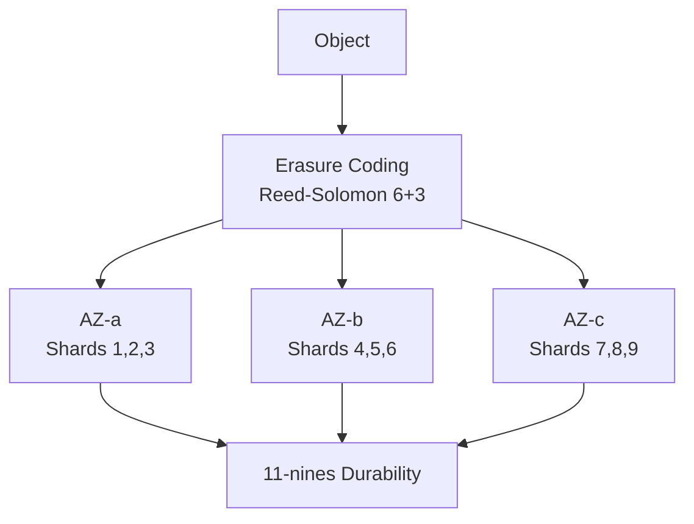

**Why this matters:** S3 architecture combines storage theory (erasure coding is more space-efficient than 3× replication at the same durability) with distributed systems practice. This is asked at every cloud storage interview.

**💡 Production Example:** S3 stores 350 trillion objects. Erasure coding (6+3) requires 1.5× storage overhead vs 3× replication, saving ~50% storage cost at equivalent durability. A single 1GB object costs S3 ~50 API calls to write (one per shard) but the client sees one atomic PUT.

---

### Lambda: Serverless Execution Model

**Q: How does AWS Lambda cold start work and how do you mitigate it in .NET?**

**A:** Lambda cold start occurs when a new execution environment must be initialized before your function code runs.

**Cold start phases:**
1. **Init** (~100-300ms): download code package, start runtime (CLR for .NET), run static initializers
2. **Invoke** (<10ms typical): execute handler with pre-warmed environment
3. **Warm** (subsequent invocations): reuse existing environment, skip Init phase

**Cold start factors:**
- Runtime: .NET 8 Native AOT fastest (~50ms), .NET 8 managed (~300ms)
- Package size: smaller zip = faster download/init
- VPC config: VPC-attached Lambdas had 10s+ cold starts (ENI creation) — fixed with Hyperplane ENI (2019)
- Memory: more memory = more CPU = faster init

**Mitigation strategies:**
```csharp
// 1. Provisioned Concurrency: pre-warm N instances
// Set via Console or IaC — instances always ready, no cold start

// 2. Minimize static initializer work
public class Function {
    // BAD: DB connection in constructor (runs at init)
    private static readonly SqlConnection _conn = new SqlConnection(connStr);
    
    // GOOD: lazy initialization
    private static readonly Lazy<SqlConnection> _conn = 
        new Lazy<SqlConnection>(() => new SqlConnection(connStr));
}

// 3. .NET Native AOT for minimal cold start
// Project file:
// <PublishAot>true</PublishAot>
// <RuntimeIdentifier>linux-x64</RuntimeIdentifier>
```

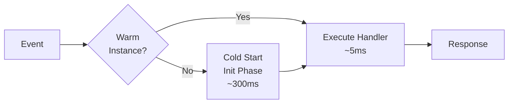

**Why this matters:** Cold starts affect user-facing APIs. .NET historically had one of the longer cold starts; Native AOT and SnapStart patterns are the modern solutions.

**💡 Production Example:** Netflix uses Lambda for data processing pipelines where cold start is acceptable. For user-facing APIs, they use provisioned concurrency on 10-20 instances per function, eliminating cold starts at ~$0.005/instance-hour cost.

---

### DynamoDB: Single-Table Design

**Q: Design a DynamoDB schema for a multi-tenant SaaS application.**

**A:** Single-table design collocates related entities in one table, enabling efficient access patterns without JOINs.

**Access patterns to support:**
1. Get all users for a tenant
2. Get a specific user
3. Get all orders for a user
4. Get orders by status for a tenant

**Single-table schema:**

| PK | SK | GSI1-PK | GSI1-SK | Attributes |
|----|----|---------|---------|----|
| TENANT#t1 | USER#u1 | USER#u1 | TENANT#t1 | name, email |
| TENANT#t1 | USER#u2 | USER#u2 | TENANT#t1 | name, email |
| USER#u1 | ORDER#o1 | STATUS#PENDING | USER#u1 | amount, date |
| USER#u1 | ORDER#o2 | STATUS#SHIPPED | USER#u1 | amount, date |

**Access patterns implemented:**
```
1. GetUsersByTenant: PK=TENANT#t1, SK begins_with USER#
2. GetUser: PK=TENANT#t1, SK=USER#u1
3. GetOrdersByUser: PK=USER#u1, SK begins_with ORDER#
4. GetOrdersByStatus: GSI1 PK=STATUS#PENDING
```

**Why this matters:** DynamoDB single-table design requires upfront access pattern analysis. Migrations in DynamoDB are painful (no schema changes), unlike RDBMS ALTER TABLE. This approach is expected knowledge for AWS-focused roles.

**💡 Production Example:** Amazon.com shopping cart uses DynamoDB with single-table design. Cart items, user preferences, and saved addresses all colocate under USER#{userId} PK. Throughput: 45M operations/second at peak.

---

## Apple

### Apple Pay: Secure Payment Without Exposing Card Numbers

**Q: How does Apple Pay prevent card numbers from being exposed during payment?**

**A:** Apple Pay uses tokenization — the real card number (PAN) is never stored on device or transmitted during payment.

**Setup flow:**
1. User adds card → Apple Wallet contacts bank
2. Bank issues Device Account Number (DAN) — a token unique to this device
3. DAN encrypted with device's Secure Enclave key, stored in Secure Element chip

**Payment flow:**
1. User taps iPhone near NFC terminal
2. Face/Touch ID authenticates
3. Secure Enclave generates one-time dynamic security code (cryptogram)
4. NFC transmits: DAN + cryptogram + timestamp (NOT the real card number)
5. Merchant's terminal sends to payment network
6. Payment network verifies cryptogram → looks up real card → charges bank

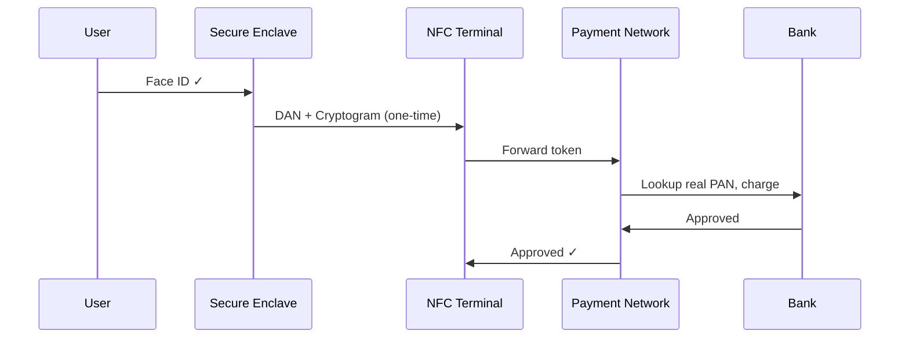

**Why this matters:** Tokenization + hardware security module (HSE = Secure Enclave) is the payment security pattern. PCI-DSS compliance becomes easier when merchants never see real card numbers.

**💡 Production Example:** Apple Pay is accepted at 90% of US retailers. A stolen PAN from a data breach is useless — it can't be used with Apple Pay because the cryptogram is device-specific and one-time. Card-not-present fraud drops 97% vs magnetic stripe.

---

### iCloud Sync: Conflict Resolution

**Q: How does iCloud handle sync conflicts when two devices edit the same data offline?**

**A:** CloudKit (iCloud's sync framework) uses a combination of server-side record versioning and client-side conflict resolution.

**Conflict detection:**
- Each record has a `recordChangeTag` (etag)
- On save: client sends expected `recordChangeTag`
- If server tag differs → conflict detected, server returns error

**Resolution strategies:**
1. **Last-write-wins (LWW)**: simple, loses data. Used for: Notes last-edited timestamp
2. **CRDT (Conflict-free Replicated Data Type)**: mathematically merge concurrent edits. Used for: Reminders, collaborative docs
3. **Application-level merge**: app receives both versions, user or app logic decides. Used for: Calendar events

**CRDT example (G-Counter):**
```
Device A: adds item X → set {X}
Device B: adds item Y → set {X, Y} (offline)
Merge = union = {X, Y} — no conflict possible
```

**Why this matters:** Eventual consistency in distributed systems requires understanding merge semantics. Interview question: "how do you handle offline edits?" This pattern applies to any mobile-first product with offline support.

**💡 Production Example:** Apple Notes uses CRDTs for character-level text merging. Two people editing the same note on separate iPhones while offline results in both edits appearing after sync, not one winning. Contrast with Dropbox files which use LWW for binary files.

---

## Bitly

### URL Shortener at Scale

**Q: Design a URL shortener handling 10 billion clicks per month.**

**A:** Core operations: shorten URL (write) and redirect (read). Read-heavy (100:1 read:write ratio typical).

**Short code generation:**
- Auto-increment ID → Base62 encode (0-9, a-z, A-Z)
- 7 characters → 62^7 = 3.5 trillion possible URLs
- Example: ID 12345678 → "5kEpua"
- Alternative: random + collision check (slower, better for custom aliases)

**301 vs 302 redirect:**
- 301 (Permanent): browser caches redirect permanently. Fewer server requests but can't update destination. Use for: stable links
- 302 (Temporary): no browser caching, all clicks hit your server. Enables: click analytics, A/B testing. Bitly uses 302

**Architecture:**
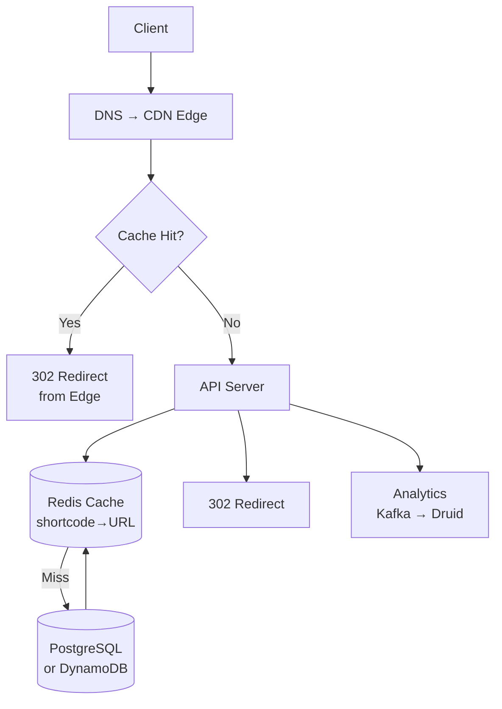

**Click analytics pipeline:**
- On each click: publish event to Kafka (shortcode, timestamp, IP, user-agent, referer)
- Stream processor (Kafka Streams): parse IP → geo, parse UA → device
- OLAP store (Apache Druid or ClickHouse): aggregate queries (clicks per country, per day)

**Scaling reads:**
- Cache top 20% URLs in Redis (80% of traffic — hot URLs)
- CDN edge caching: popular shortcodes cached at edge
- Read replicas for DB

**Why this matters:** URL shortener is a classic interview warm-up that tests: ID generation, caching, DB choice, analytics pipeline. The Base62 encoding trick is widely known and expected.

**💡 Production Example:** Bitly serves 10B+ clicks/month across 600M+ links. They use Redis for hot link caching with ~99% cache hit rate. Analytics processed via Apache Kafka → Apache Druid, supporting real-time dashboard queries over 1T+ click events.

---

## Bluesky

### AT Protocol: Decentralized Social Network

**Q: How does Bluesky's AT Protocol enable decentralized social networking?**

**A:** AT Protocol solves the "lock-in" problem: users own their identity and data regardless of which server hosts them.

**Key concepts:**

**1. Decentralized Identifiers (DIDs):**
- `did:plc:xyz123` — globally unique, portable identity
- Unlike @twitter handle: if Twitter bans you, your DID survives
- DID document maps DID → current server hosting your data

**2. Personal Data Server (PDS):**
- Stores your posts, follows, likes as a Merkle DAG (content-addressed log)
- You can self-host or use Bluesky's PDS
- Moving PDS: update DID document, data migrates → followers unaffected

**3. AppView:**
- Aggregates data from all PDSs → builds searchable index
- Equivalent to Twitter's monolithic database, but replaceable
- Multiple AppViews can coexist (different algorithms)

**4. Federation vs ActivityPub (Mastodon):**

| | Bluesky AT Protocol | Mastodon (ActivityPub) |
|---|---|---|
| Identity | DID (portable) | @user@server.com (server-tied) |
| Data | Merkle DAG on PDS | Server database |
| Algorithm | Swappable AppViews | Per-server |
| Portability | Full (DID + data) | None (lose followers on move) |

**Why this matters:** AT Protocol represents a new architecture paradigm. Understanding federation, content-addressed storage (Merkle DAGs), and portable identity is relevant for Web3 and decentralized systems.

**💡 Production Example:** Bluesky launched in 2023, grew to 25M users by 2024. During Twitter/X policy changes, Bluesky onboarded 1M users in 24 hours. Data portability means a competing AppView (different feed algorithm) can emerge without losing the social graph.

---

## Canva

### Real-Time Collaborative Design

**Q: How does Canva handle two users editing the same design simultaneously?**

**A:** Canva uses Operational Transformation (OT) to merge concurrent edits without conflicts.

**OT basics:**
- Each edit is an operation: `{type: "move", elementId: "rect1", dx: 10, dy: 0}`
- When two concurrent ops arrive, transform them against each other
- Example: User A moves rect1 right; User B resizes rect1. OT ensures both apply correctly.

**Architecture:**
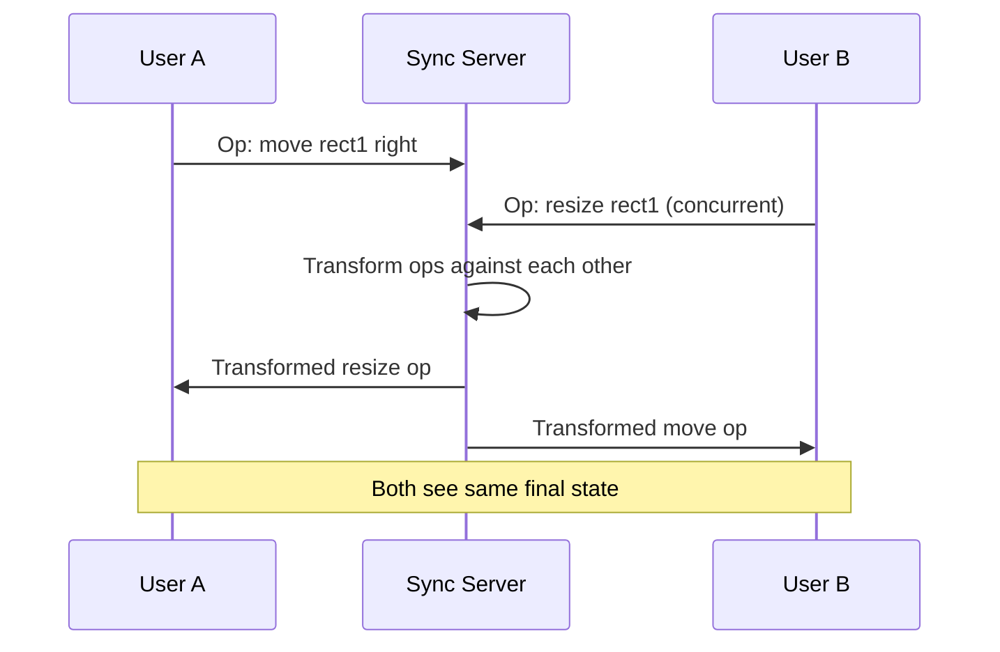

**State synchronization:**
- WebSocket for low-latency op delivery
- Operation log: append-only sequence of transformed ops
- New collaborators: replay op log to reconstruct current state
- Offline edits: queue ops locally, reconcile on reconnect with OT

**CRDT alternative:**
Some platforms (Figma, Notion) use CRDTs instead of OT for simpler conflict resolution without central transform server. Trade-off: CRDT data structures are more complex.

**Why this matters:** Real-time collaboration is now expected in productivity tools. OT vs CRDT is a genuine architectural decision. Google Docs uses OT; Figma and Notion use CRDT.

**💡 Production Example:** Canva serves 150M monthly users with 1B+ designs. Their sync service handles 100K+ concurrent collaborative sessions. They moved from polling to WebSocket-based sync, reducing perceived latency from 2s to <200ms.

---

## Cloudflare

### Anycast Routing and DDoS Mitigation

**Q: How does Cloudflare's anycast routing work and enable DDoS mitigation?**

**A:** Anycast assigns the same IP address to multiple servers globally — BGP routes traffic to the nearest PoP.

**How anycast works:**
1. Cloudflare announces the same IP range (e.g., 104.16.0.0/12) from all 275+ PoPs via BGP
2. Internet routers route to the nearest Cloudflare PoP by BGP path selection
3. Clients connect to their geographically closest PoP

**DDoS mitigation at anycast scale:**
- A 1Tbps DDoS attack spread across 275 PoPs = ~3.6Gbps per PoP (manageable)
- Without anycast: single datacenter absorbs full attack volume
- BGP blackholing: selectively drop attack traffic at BGP level before it enters

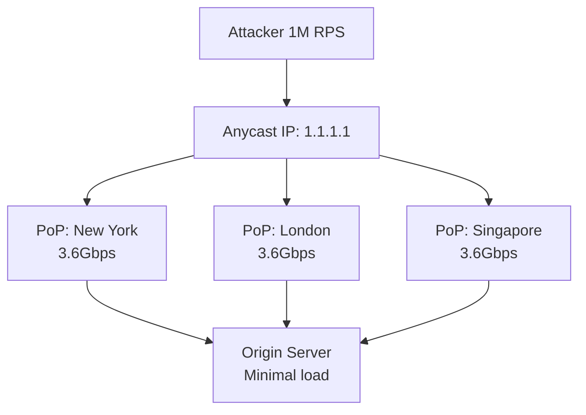

**Why this matters:** Anycast is the backbone of CDNs, DNS (1.1.1.1, 8.8.8.8), and DDoS scrubbing services. Understanding BGP and anycast routing is important for any infrastructure-at-scale role.

**💡 Production Example:** Cloudflare mitigated a 2.5Tbps DDoS attack in 2024 — the largest ever recorded. Anycast distributed it across 275 PoPs, absorbing it with no origin impact. Each PoP has >100Gbps ingress capacity.

---

### Postgres at Scale

**Q: How does Cloudflare run PostgreSQL at global scale for Cloudflare D1?**

**A:** Cloudflare uses a combination of PgBouncer connection pooling, read replicas, and their edge SQLite (D1) product.

**Connection pooling challenge:**
- Postgres handles ~300 concurrent connections before performance degrades
- PgBouncer transaction-mode pooling: 10K client connections → 50 Postgres connections
- Trade-off: transaction-mode breaks session-level features (prepared statements, `SET LOCAL`)

**D1 (SQLite at the Edge):**
- Each D1 database is a SQLite file stored on Cloudflare's R2 (object storage)
- Workers can query SQLite at the edge — no round-trip to origin
- Replication: primary → read replicas in multiple regions via Litestream WAL streaming

**Why this matters:** PgBouncer configuration is critical for any high-traffic .NET application on PostgreSQL. Transaction vs session mode pooling affects which features you can use.

**💡 Production Example:** Cloudflare's internal infrastructure runs on their own products. Their DNS service (1.1.1.1 — 1T+ queries/day) uses SQLite databases at the edge for zone files, achieving <1ms DNS resolution globally.

---

## Disney+

### Launch Day Disaster and Recovery

**Q: What went wrong at Disney+ launch and what architectural lessons were learned?**

**A:** Disney+ launched November 12, 2019 with 10M signups in 24 hours — 5× their peak load estimate.

**Failure modes:**
1. **Entitlement service bottleneck**: third-party service validating subscriptions became overwhelmed
2. **Authentication cascade**: auth service → entitlement check → auth service loop causing 4xx storms
3. **No circuit breakers**: downstream failures propagated upstream without shedding load
4. **Insufficient auto-scaling headroom**: K8s HPA triggers scaled too slowly (minutes, not seconds)

**Fixes implemented:**
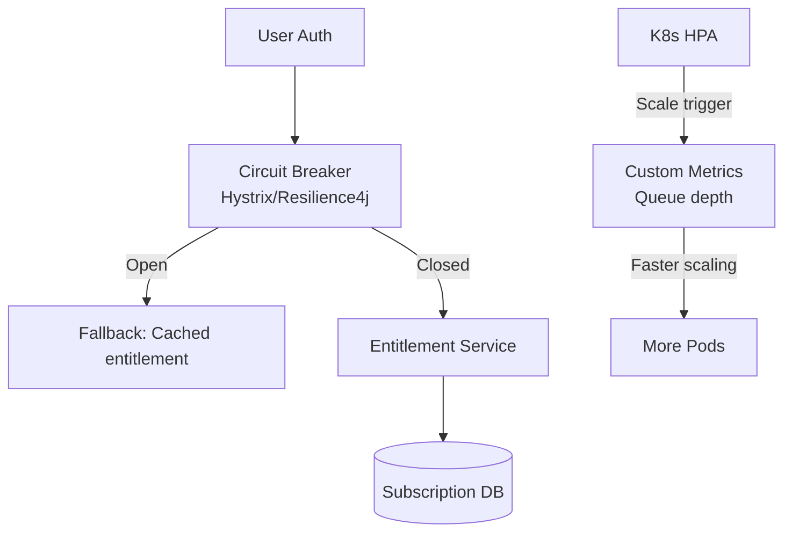

**Key lessons:**
- Pre-scale for known peak events (launch, season premieres)
- Circuit breakers on ALL external service calls
- Fallback to cached data for non-critical validations
- Chaos engineering before launch (Netflix's model)
- Staged rollout (region by region)

**Why this matters:** Disney+ failure is a textbook circuit breaker / graceful degradation case. Every microservices interview asks about handling downstream failures.

**💡 Production Example:** By 2023, Disney+ serves 150M+ subscribers globally. Post-launch, they implemented Polly (for .NET services) and Resilience4j patterns throughout. Pre-scale events are now standard: spin up 3× capacity before "The Mandalorian" season premieres.

---

## Discord

### Message Storage: Cassandra to ScyllaDB Migration

**Q: Why did Discord migrate from MongoDB to Cassandra, then from Cassandra to ScyllaDB?**

**A:** Each migration addressed specific performance and operational problems at scale.

**MongoDB → Cassandra (2015):**
- Problem: 100M messages stored, MongoDB single-server couldn't scale writes
- Cassandra benefits: distributed writes (any node), linear horizontal scaling, no single point of failure
- Data model: `(channel_id, message_id)` as partition+clustering key — time-ordered messages per channel

**Cassandra → ScyllaDB (2023):**
- Problem: Cassandra GC pauses causing latency spikes (p99 latency 40-125ms)
- ScyllaDB: rewritten in C++ (vs Cassandra's Java), no GC, shard-per-core architecture
- Results: 2× throughput, latency p99 dropped from 40ms to 15ms, 5× fewer nodes needed

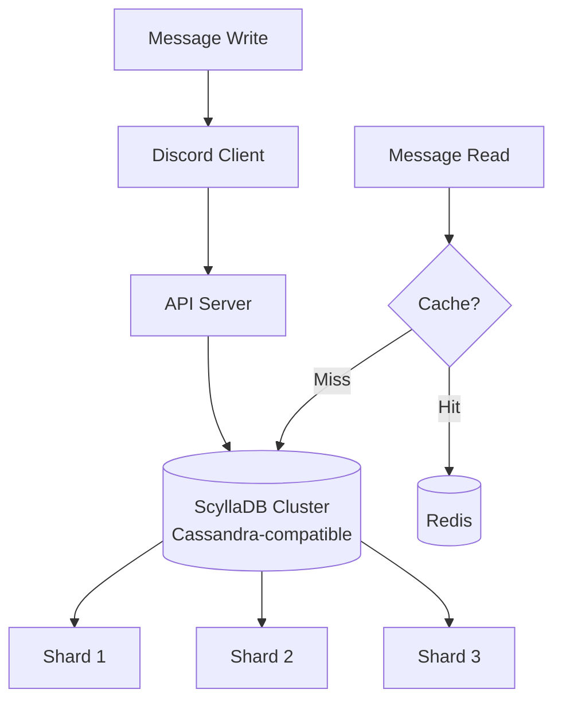

**Snowflake IDs:**
- Discord uses Discord Snowflake: 64-bit ID encoding (timestamp + worker_id + sequence)
- Sortable by creation time without DB query
- Same pattern as Twitter Snowflake, Instagram IDs

**Why this matters:** Database selection for time-series/append-heavy workloads (chat, logs, events) is a common interview topic. Cassandra's wide-row data model for chat messages is canonical.

**💡 Production Example:** Discord stores 4B messages/day across 19+ ScyllaDB nodes (down from 177 Cassandra nodes). Cold message reads (>30 days old) go to Cassandra-compatible ScyllaDB; hot messages (last 7 days) cached in Redis. Migration cut infrastructure costs by 60%.

---

## Dropbox

### Sync Engine: Block-Level Deduplication

**Q: How does Dropbox sync files efficiently when only a small part changes?**

**A:** Dropbox uses content-defined chunking — files split into blocks, only changed blocks uploaded.

**Block deduplication:**
1. File → split into 4MB blocks (content-defined chunking with Rabin fingerprinting)
2. SHA-256 hash per block
3. Client checks: which block hashes are already on server?
4. Upload only NEW blocks
5. Server reconstructs file from block references

**Delta sync for large files:**
- Only 1 block changes in a 10GB video → upload 4MB, not 10GB
- Block hashes stored in SQLite locally (fast lookup)
- Deduplication: if two users upload identical files → only one copy stored on server

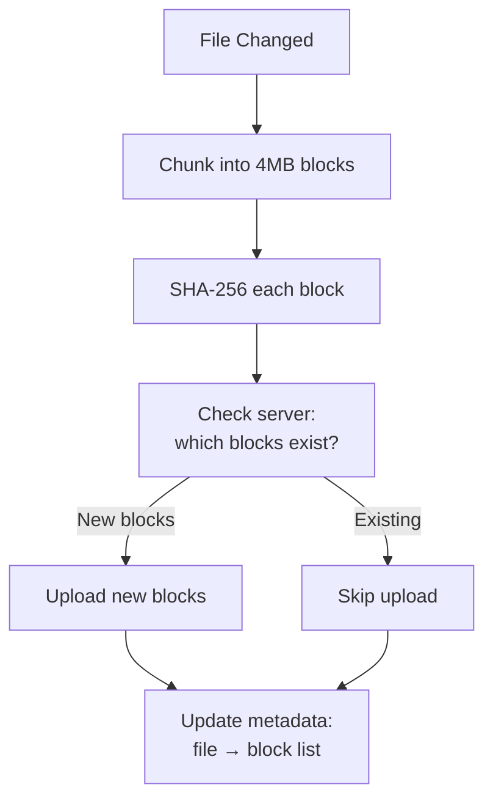

**Lamport clocks for ordering:**
- Each file change has a logical timestamp
- Ensures consistent ordering across devices even if clocks drift
- Conflict detection: two changes with same parent → conflict file created ("file (conflicted copy).txt")

**Why this matters:** Content-defined chunking + deduplication is used by all cloud storage (Dropbox, Google Drive, OneDrive, Restic backup). The block hash approach enables deduplication across users.

**💡 Production Example:** Dropbox stores 4EB (4 billion GB) of data. Deduplication means ~40% of uploaded blocks already exist on Dropbox servers — never re-uploaded. Saving ~2EB of redundant storage and upload bandwidth.

---

## Facebook

### Facebook Live: Video Streaming at Scale

**Q: How does Facebook Live handle millions of simultaneous live streams?**

**A:** Live video requires real-time ingest, transcoding, and delivery — fundamentally different from on-demand video.

**Ingest pipeline:**
1. Broadcaster app → RTMP stream → Facebook edge ingestion server (nearest PoP)
2. Edge server → transcoding farm (1080p, 720p, 480p, 360p in parallel)
3. Packaged into HLS (10-second segments) + DASH
4. Segments uploaded to CDN origin

**Delivery:**
- Viewers connect to CDN edge (nearest PoP)
- ABR (Adaptive Bitrate): client switches quality based on bandwidth
- Live latency: typically 15-30 seconds end-to-end (segmented HLS)
- Low-latency mode: LL-HLS with 2-second segments, <5s latency

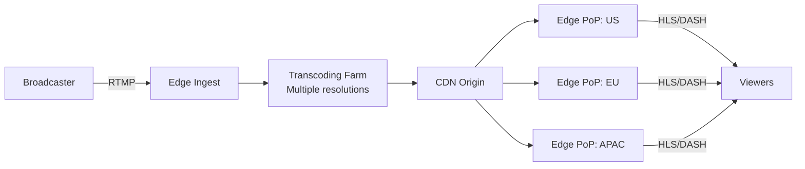

**Why this matters:** Live streaming architecture (RTMP ingest, transcoding, HLS delivery) is a core system design topic for media companies. The latency vs cost trade-off (fewer/longer segments = cheaper but more latency) is a design decision.

**💡 Production Example:** Facebook Live peaked at 800M daily live viewers in 2020. They transcode each stream to 5 bitrate ladders simultaneously. A single viral live stream (Chewbacca Mom: 166M views) required scaling transcoding capacity 10× within minutes.

---

### Katran: eBPF Load Balancer

**Q: How does Facebook's eBPF-based load balancer differ from traditional approaches?**

**A:** Katran uses Linux eBPF to run load balancing logic in the kernel's networking stack — orders of magnitude faster than userspace load balancers.

**Traditional L4 load balancer (HAProxy/nginx):**
- Packet → kernel network stack → userspace process → kernel → forward
- Each packet crosses kernel/userspace boundary twice
- ~100K-1M packets/second per core

**Katran (eBPF):**
- Packet → XDP (eXpress Data Path) in kernel → eBPF program runs in kernel context → forward
- No kernel/userspace boundary crossing
- ~10M+ packets/second per core (10× improvement)

**Consistent hashing for backends:**
- Maglev hashing: compact lookup table in shared memory
- Backend added/removed: only 1/N of connections remapped
- eBPF program reads Maglev table — zero runtime overhead

**Why this matters:** eBPF is revolutionizing networking (Cilium, Katran, Cloudflare's DDoS mitigation). Understanding XDP/eBPF is differentiated knowledge for infrastructure engineers.

**💡 Production Example:** Katran is open-sourced and runs in all of Facebook's datacenters. It handles 1T+ packets/day across Meta's infrastructure. Compared to IPVS (Linux kernel load balancer), Katran uses 10× less CPU, freeing cores for application workloads.

---

## Figma

### Postgres Scaling for Real-Time Collaboration

**Q: How does Figma scale PostgreSQL for millions of real-time collaborative sessions?**

**A:** Figma uses a multi-layered approach: connection pooling, table partitioning, read replicas, and caching.

**Connection pooling (PgBouncer):**
- Problem: PostgreSQL max_connections = 500; Figma has thousands of app servers
- PgBouncer transaction-mode: 10K app connections → 100 Postgres connections
- Trade-off: `SET LOCAL`, advisory locks, prepared statements broken in transaction mode
- Fix: use session-mode pooler for features requiring session state

**Table partitioning:**
- `file_operations` table: 50B rows → partitioned by date (monthly)
- Query: `WHERE file_id = X AND created_at > '2024-01-01'` hits one partition only
- Partition pruning: eliminates 95% of data from query scan

**Read replicas:**
- Primary: all writes + critical reads
- 3 read replicas: analytics queries, historical data reads, non-real-time features
- Replication lag monitoring: alert if replica > 1 second behind

**Why this matters:** PgBouncer is standard in any high-traffic .NET + PostgreSQL setup. Understanding the session vs transaction mode trade-off prevents subtle bugs with .NET connection pooling (Npgsql).

**💡 Production Example:** Figma (2022 acquisition talks) cited their Postgres setup handling 100K+ concurrent collaborative sessions. Post-Figma scale: they partitioned their main operations table reducing query time from 8s to 80ms for historical exports.

---

## Google

### Google Search: Indexing Pipeline

**Q: How does Google Search indexing work at web-scale?**

**A:** Google Search involves three phases: crawling, indexing, and ranking — each distributed across thousands of machines.

**Crawling (Googlebot):**
- Distributed crawler: ~1K servers, politeness controls (robots.txt, crawl-delay)
- Priority: PageRank score determines crawl frequency
- DNS prefetching, connection pooling for speed
- Processes ~15B pages/day

**Indexing:**
- Document parsing: HTML → clean text, extract links, title, metadata
- Inverted index: `term → [(doc_id, positions, tf-idf score)]`
- Bigtable for doc storage; MapReduce for index building
- Forward index (doc → words) and inverted index (word → docs) maintained

**Ranking (simplified):**
- TF-IDF: term frequency × inverse document frequency
- PageRank: link graph analysis (iterative computation)
- BERT (2019+): neural language model for query understanding
- RankBrain: ML for novel queries

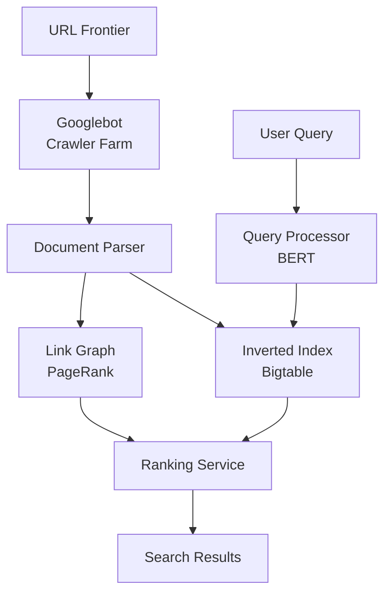

**Why this matters:** Search engine design combines distributed crawling, inverted indexes, and ML ranking. Even if you're not building a search engine, the patterns (inverted index for full-text search, link analysis for graph problems) apply broadly.

**💡 Production Example:** Google's index is ~100PB. The inverted index is built with MapReduce jobs running on Borg (Kubernetes ancestor). Freshness system updates high-priority pages (news, breaking events) within minutes; general web pages may take weeks.

---

### Google Spanner: External Consistency via TrueTime

**Q: What makes Google Spanner unique and what problem does TrueTime solve?**

**A:** Spanner is the first globally distributed SQL database with external consistency — stronger than serializable.

**The problem:**
- Distributed databases need a "happens-before" ordering for consistency
- Network clocks drift; NTP accuracy is ±250ms
- Traditional approach: logical clocks (Lamport) or 2PC coordination

**TrueTime API:**
- Combines GPS receivers + atomic clocks in every Google datacenter
- Returns `TT.now()` = interval `[earliest, latest]` (uncertainty typically ±7ms)
- Guarantee: true current time is within the interval

**External consistency protocol:**
1. Transaction commits at timestamp `s`
2. Before returning commit ACK: wait until `TT.now().earliest > s` (commit wait)
3. Ensures: if T2 starts after T1 commits in wall-clock time, T2's start > T1's commit timestamp
4. Result: globally consistent ordering without coordinator

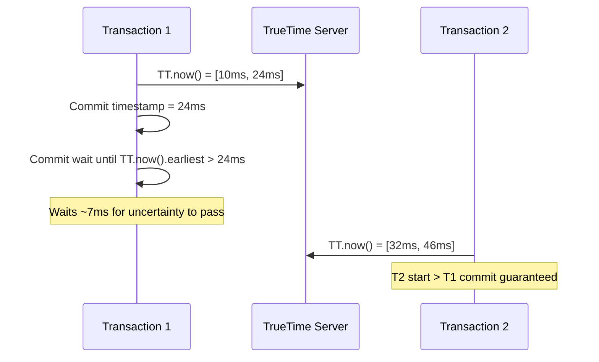

**Why this matters:** Spanner demonstrates that hardware investment (GPS/atomic clocks) can replace algorithmic complexity (2PC/Paxos coordination). CockroachDB and YugabyteDB implement similar guarantees using HLC (Hybrid Logical Clocks).

**💡 Production Example:** Google uses Spanner for Google Ads, Google Play Store, and Gmail. F1 (Google's ads DB, previously on Sharded MySQL) migrated to Spanner in 2012. AdWords: $100B/year revenue flows through Spanner with global consistency.

---

## Giphy

### GIF Delivery at 2 Billion Daily Impressions

**Q: How would you optimize GIF delivery at 2 billion daily impressions?**

**A:** GIFs are bandwidth-intensive. Optimization layers: format conversion, CDN, lazy loading, and intelligent caching.

**Format optimization:**
- WebP animated: 40% smaller than GIF at same quality
- AVIF: 50% smaller than WebP (newer, less browser support)
- Serve format based on Accept header: `image/avif,image/webp,*/*`
- Still frame (JPEG/WebP): show on page scroll, animate on hover/tap

**CDN strategy:**
- Long cache TTL (1 year) for GIF content (content-addressable URLs)
- Regional edge caches: 80% of requests served from CDN without origin hit
- Prefetch popular GIFs to edge based on trending algorithm

**Lazy loading:**
- Intersection Observer API: load GIF only when visible in viewport
- Thumbnail first: low-res thumbnail loads immediately, full GIF deferred
- Pause off-screen GIFs: reduces CPU/battery on mobile

**Why this matters:** Content delivery optimization (format selection, CDN caching, lazy loading) applies to any media-heavy product. The Accept header content negotiation pattern is used throughout modern web.

**💡 Production Example:** Giphy serves 2B daily GIF impressions via Fastly CDN. They transcode all GIFs to WebP on upload (saves ~40% storage/bandwidth). CDN cache hit ratio: 94%. Origin bandwidth reduced by 15× vs serving directly.

---

## Hashnode

### Blog Platform Feed Ranking

**Q: Design a blog platform feed ranking system.**

**A:** A personalized feed requires scoring articles by multiple signals and efficiently querying the ranked list.

**Scoring signals:**
- **Recency**: time_decay = e^(-λ × hours_since_published), λ = 0.1
- **Engagement**: (likes + comments × 2 + bookmarks × 3) / (hours_since + 1)
- **Relevance**: tag overlap between article tags and user's followed tags (Jaccard similarity)
- **Author relationship**: is the author followed? Boosted ×2
- **Trending**: global engagement velocity (engagement delta over last 1 hour)

**Architecture:**
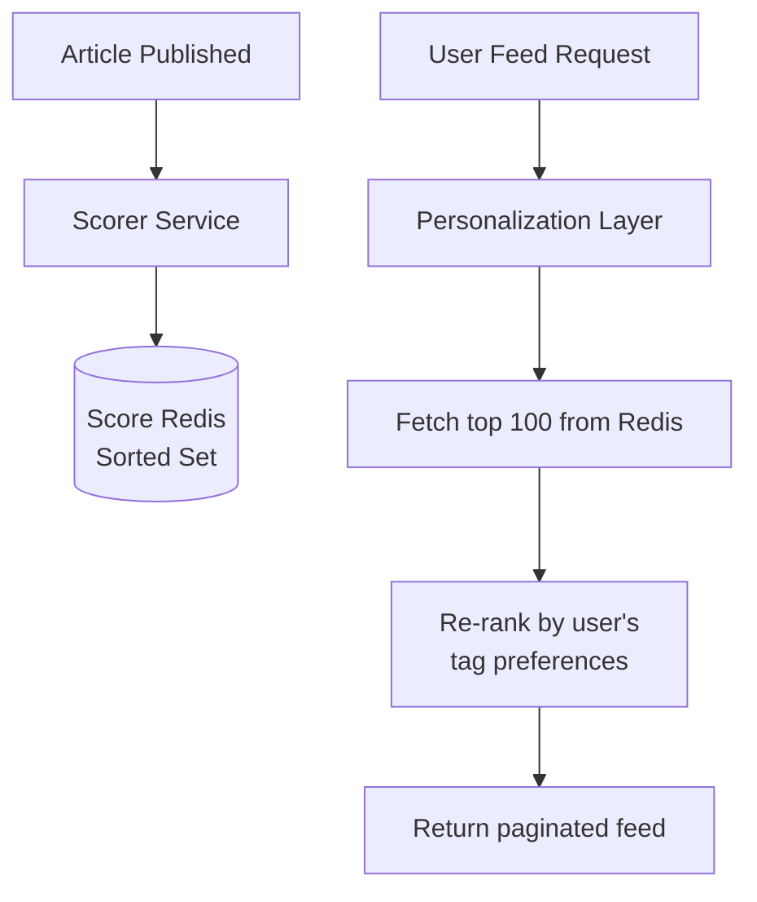

**Pre-compute vs on-demand:**
- Global trending: pre-computed every 5 minutes (Redis Sorted Set)
- Personalized re-ranking: done at request time using pre-computed base scores
- Cold start: new users shown trending/editorial until enough signal

**Why this matters:** Feed ranking architecture (pre-compute global scores, personalize at request time) is the standard pattern at LinkedIn, Twitter, Medium, and Substack.

**💡 Production Example:** Hashnode serves developer communities globally. Their feed uses a hybrid: pre-computed tag affinity scores (batch every hour) × real-time engagement signals (Redis counters). CTR improved 35% after moving from pure recency to hybrid ranking.

---

## Halo

### Saga Pattern in Multiplayer Game Sessions

**Q: How does the Saga pattern apply to a multiplayer game session?**

**A:** Starting a Halo multiplayer session involves multiple services: matchmaking, lobby, game server allocation, stat tracking, anti-cheat. A failure in any step must cleanly roll back.

**Saga choreography:**
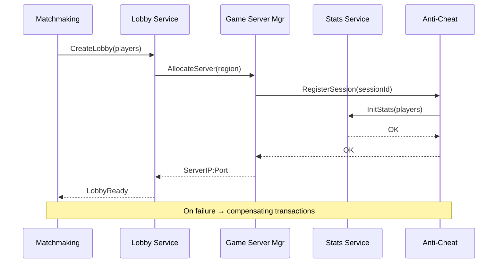

**Compensating transactions (failure at GS allocation):**
1. GS fails → publish `GameServerAllocationFailed`
2. LB listens → `DeleteLobby(lobbyId)`
3. MM listens → `RequeuePlayers(players)`
4. Players shown "Server not available, requeuing"

**Orchestration vs Choreography:**
- **Orchestration** (Saga orchestrator): single service drives the workflow, easier to reason about
- **Choreography** (event-driven): each service reacts to events, more decoupled but harder to debug

**Why this matters:** Saga pattern is the distributed transaction solution for microservices. It replaces 2PC (which requires all services to lock). In .NET, MassTransit and NServiceBus implement Saga state machines.

**💡 Production Example:** Xbox Live uses Saga-like patterns for session management. A failed game server allocation triggers compensation: refund any in-game currency used for match entry, requeue players. MassTransit with Azure Service Bus is the .NET reference implementation.

---

## Instagram

### Feed: Hybrid Push/Pull Fanout

**Q: How does Instagram's feed work for users following celebrities?**

**A:** Instagram uses a hybrid model: push (fanout on write) for regular users, pull (fanout on read) for celebrity accounts.

**Push model (regular users, <1M followers):**
1. User A posts photo
2. Fanout service reads A's follower list (from Cassandra)
3. Writes photo_id to Redis sorted set for each follower (score = timestamp)
4. Reader's feed: read from their Redis sorted set

**Pull model (celebrities, >1M followers):**
1. Beyoncé posts photo (300M followers)
2. Do NOT push to 300M Redis sets immediately
3. On feed read: check if user follows any celebrities → fetch their latest posts separately
4. Merge celebrity posts with regular feed in memory

**Merge at read:**
```
user_feed = sorted_set_pop(user_id, top_100)  # Regular posts
celebrity_posts = fetch_celebrity_posts(celebrity_ids, since=user_last_seen)
merged = merge_sorted([user_feed, celebrity_posts])[:20]  # Top 20 by timestamp
```

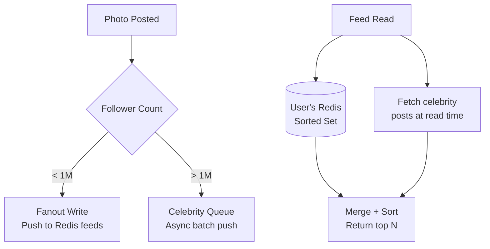

**Why this matters:** Push vs pull fanout trade-off (with celebrity exception) is THE canonical feed design pattern. Every social media company interview includes this. Twitter uses it, LinkedIn uses it, Instagram uses it.

**💡 Production Example:** Instagram has 2B users. Kylie Jenner (400M followers) posting would require 400M Redis writes — infeasible at push latency. Pull model: her 10 most recent posts fetched on demand for her followers' feeds. Regular posts pre-cached in Redis for instant feed loads.

---

## Khan Academy

### Global Education Platform Architecture

**Q: How would you architect a global education platform for students in low-bandwidth regions?**

**A:** Low-bandwidth optimization requires offline support, progressive loading, and content compression.

**Content delivery strategy:**
- **Videos**: hosted on YouTube (global CDN, free) or Cloudflare Stream
- **Exercises**: JSON-based (small payloads), cached in service worker
- **Progressive web app (PWA)**: service worker caches content offline
- **Offline mode**: students download content on WiFi, complete exercises offline

**Bandwidth optimization:**
- Video quality ladder: 240p for 2G, 360p for 3G, 720p for WiFi
- Lazy loading: load next exercise only when current is complete
- Delta sync: only updated exercise content re-downloaded
- Text-first: always show text lesson before loading video

**Learning graph (knowledge tracing):**
- Knowledge components (KCs): atomic skills (e.g., "Solve 2-step linear equations")
- Prerequisite graph: DAG of KC dependencies
- Bayesian Knowledge Tracing (BKT): probability student has mastered KC given responses
- Adaptive path: student struggles → surface prerequisite KC first

**Why this matters:** Designing for constrained environments (low bandwidth, intermittent connectivity) is a real engineering challenge. PWA with service workers is the standard offline-first pattern.

**💡 Production Example:** Khan Academy serves 150M registered learners globally, including significant usage in India, Brazil, and Sub-Saharan Africa. Their Lite version (Khan Academy Lite) reduces bandwidth by 95% using text-only mode. Exercise completion rates increased 40% after implementing offline-first PWA.

---

## LinkedIn

### Architecture Evolution: Monolith to Microservices

**Q: Describe LinkedIn's journey from monolith to microservices.**

**A:** LinkedIn's evolution is a textbook case of scaling pains driving architectural change.

**2003-2010: Monolith (Leo)**
- Single Java app: profiles, connections, messages, jobs
- Problem: deployment risk (any change = full redeploy), scaling (scale whole app for one bottleneck), team velocity

**2010-2015: Service-Oriented Architecture**
- Decomposed by domain: member profile service, connection service, messaging service, search service
- Internal RPC: evolved to Protocol Buffers over HTTP/2
- Problem: too many services, dependency management complex

**2015+: Microservices + Domain ownership**
- 1000+ services, each team owns their domain
- Rest.li framework: REST + IDL + code generation
- Kafka for async service communication (invented at LinkedIn)

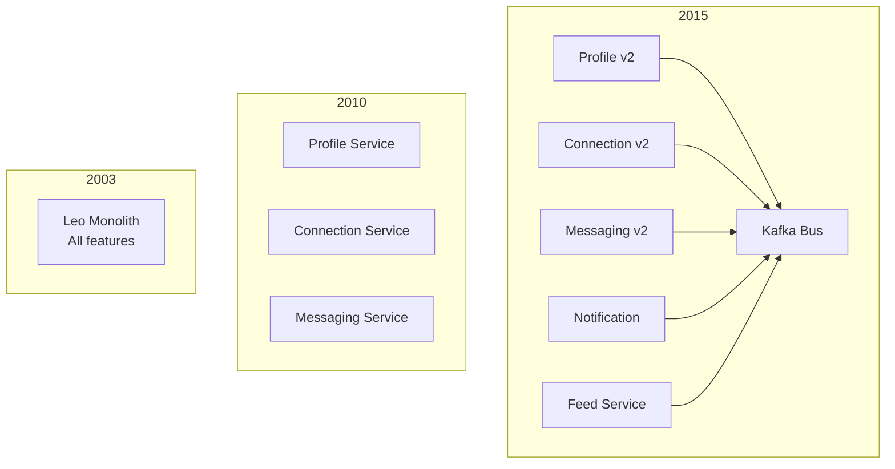

**Why this matters:** LinkedIn's evolution is cited in every microservices discussion. Their specific patterns (Rest.li, Kafka, Brooklin for data replication) influenced the industry.

**💡 Production Example:** LinkedIn serves 1B members. Their 2010 "Project Inversion" — rewriting Leo as services — took 2 years. The migration was done using a strangler fig pattern: new features in services, old features in monolith, gradual migration. Deployment frequency went from monthly to daily.

---

## Lyft

### Geospatial Ride Matching

**Q: How does Lyft match riders to drivers at scale using geospatial indexing?**

**A:** Ride matching is a real-time geospatial query: find available drivers within 3km of a rider.

**Geospatial indexing options:**

| Library | Approach | Query | Use Case |
|---------|----------|-------|----------|
| S2 (Google) | Spherical geometry, cell hierarchy | S2LatLng → S2Cell | Google Maps, Lyft |
| H3 (Uber) | Hexagonal grid, hierarchical | lat/lng → H3 cell ID | Uber, analytics |
| PostGIS | R-tree index | ST_DWithin | PostgreSQL-based |

**S2 cell approach (Lyft):**
1. Earth divided into hierarchical S2 cells (level 1-30; level 14 ≈ 600m² cell)
2. Driver location update → store in Redis hash: `drivers:{s2_cell_id}` → driver locations
3. Rider request → compute S2 cell + neighboring cells at level 14
4. Redis MGET all neighboring cells → candidate drivers
5. Filter by: availability, heading, ETA, driver rating

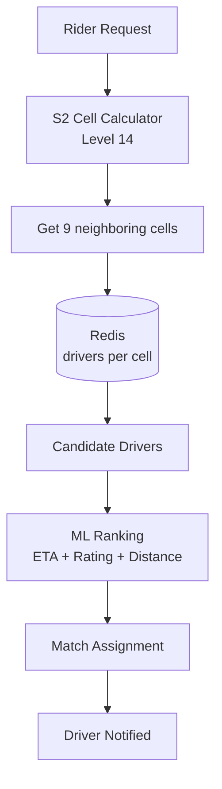

**Why this matters:** Geospatial indexing with S2/H3 is the modern approach for location-based services. Knowing why hexagonal H3 cells are better than rectangular grid cells (uniform neighbor distance) is a differentiator.

**💡 Production Example:** Lyft matches 1M+ rides/day. Their matching service runs in <100ms end-to-end. S2 level 14 cells are ~600m², containing on average 3-5 available drivers in urban areas. Surge pricing activates when driver-to-rider ratio drops below threshold per cell.

---

## McDonald's

### Offline-First POS System

**Q: How does McDonald's POS system handle internet outages?**

**A:** McDonald's POS uses an offline-first architecture with local data storage and conflict-resolution on reconnect.

**Architecture:**
- Local SQLite/embedded DB: full menu, pricing, order history stored locally
- Edge server at each restaurant: aggregates POS terminals, handles local processing
- Cloud sync: order data → HQ for analytics, inventory, payroll
- Conflict resolution: orders created offline use sequence numbers per terminal

**Offline capabilities:**
- Take orders, process cash/card, print receipts: fully functional
- Loyalty points: queue for sync when online
- Menu updates: edge server receives updates, propagates to POS terminals

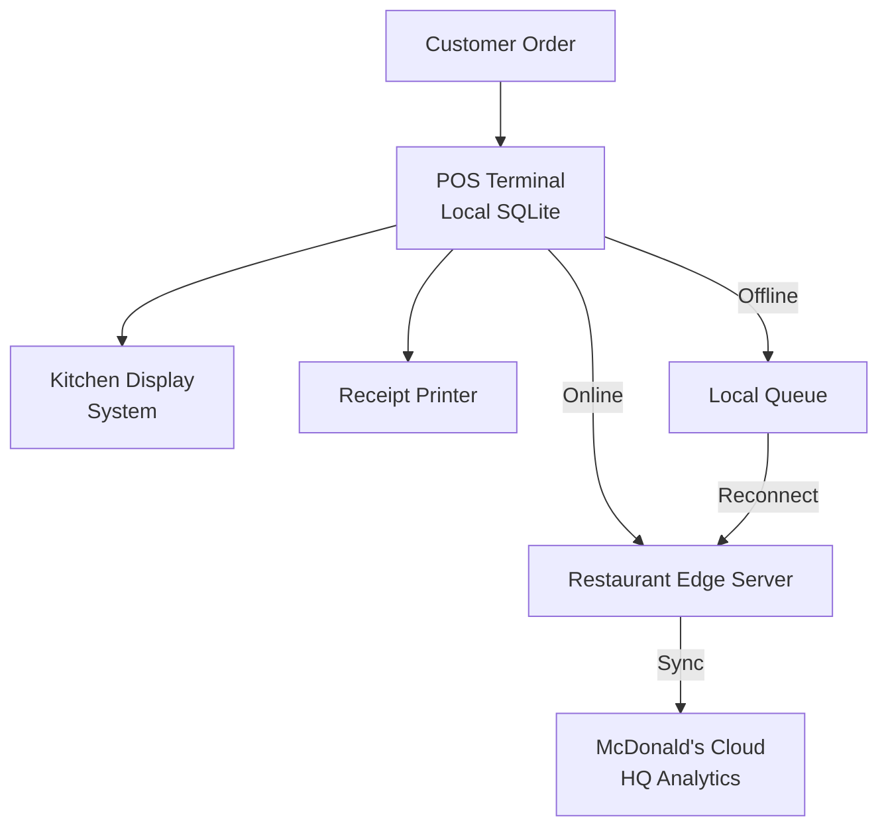

**Why this matters:** Offline-first design applies to any field application (retail POS, healthcare tablets, field service). The CRDT/eventual consistency principles are the same as mobile apps with offline sync.

**💡 Production Example:** McDonald's serves 70M customers/day across 40K locations. A single internet outage without offline capability would halt revenue. Their "edge computing" approach (local processing, cloud sync) keeps operations running during outages. Similar pattern: Square POS, Toast POS for restaurants.

---

## Meta

### Cache Consistency at Facebook Scale

**Q: How does Meta prevent cache stampede at Facebook scale?**

**A:** Meta's 2013 Memcache paper describes how they handle cache invalidation for trillions of reads/day.

**Cache stampede (thundering herd) problem:**
- Popular item expires → 1000 concurrent requests → all hit DB simultaneously → DB overload

**Meta's solutions:**

**1. Leases (primary innovation):**
- On cache miss, client gets a "lease token" (unique ID)
- Only the lease holder fetches from DB and sets the value
- Other clients: either wait or use stale data
- Token expires in 10 seconds → prevents stale lease holding

**2. Stale reads (cold cluster warming):**
- New cache cluster: can serve stale data from old cluster while warming up
- Avoids massive DB read during cluster initialization

**3. Regional replication:**
- Primary region: source of truth for writes
- Remote regions: replica caches, may serve slightly stale data
- Cache invalidation messages sent across regions via McRouter

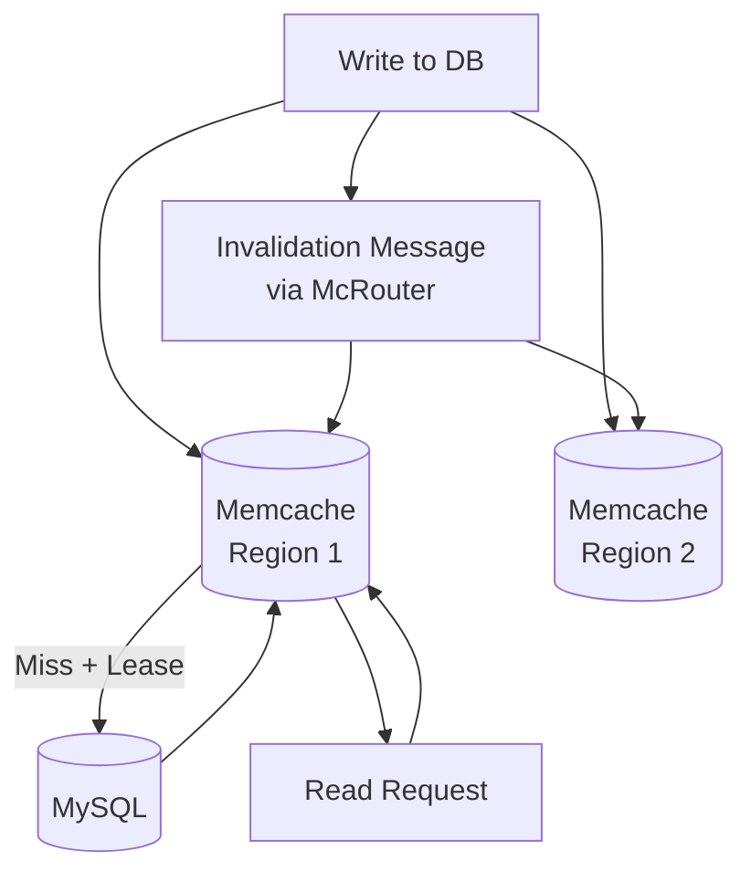

**Why this matters:** Thundering herd / cache stampede is a real production problem. Lease-based invalidation is the production solution. In .NET, similar patterns: `IMemoryCache` with `SemaphoreSlim` for stampede prevention.

**💡 Production Example:** Meta runs ~1000 Memcache servers handling 1B requests/second. Without leases, a popular content expiration (viral post) would result in 50K simultaneous DB queries. Leases reduce this to 1 DB query regardless of concurrent cache miss count.


---

## Netflix

### Microservices Architecture and Chaos Engineering

**Q: How did Netflix pioneer microservices and why do they practice Chaos Engineering?**

**A:** Netflix moved from a monolith to microservices in 2009 after a database corruption caused a 3-day outage. They now run 700+ microservices.

**Netflix microservices principles:**
- **Decentralized data**: each service owns its database (no shared DB)
- **API gateway (Zuul)**: auth, rate limiting, routing at edge
- **Service discovery (Eureka)**: services register/deregister dynamically
- **Client-side load balancing (Ribbon)**: consumers choose which instance to call
- **Circuit breaker (Hystrix)**: fail fast, fallback gracefully

**Chaos Engineering (Chaos Monkey):**
- Philosophy: production failures will happen. Test before users discover them.
- Chaos Monkey: randomly terminates EC2 instances in production
- Chaos Kong: takes down entire AWS regions
- Latency Monkey: introduces artificial latency between services
- Result: services built to expect failures and degrade gracefully

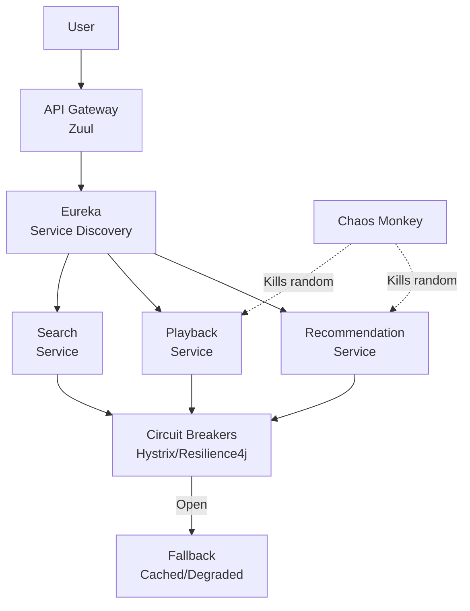

**Why this matters:** Netflix's open-source stack (Hystrix, Eureka, Ribbon, Zuul, Spinnaker, Chaos Monkey) became the blueprint for microservices architecture. All are relevant to .NET microservices on AWS.

**💡 Production Example:** Netflix runs 700+ microservices handling 250M subscribers, 1B+ hours of streaming/month. Chaos Monkey runs in production every weekday. When AWS US-East had an outage in 2012, Netflix continued serving because Chaos Kong had already forced them to build multi-region failover.

---

### Netflix Video Encoding Pipeline

**Q: How does Netflix optimize video quality while minimizing bandwidth?**

**A:** Netflix uses per-title encoding — analyzing each piece of content to find the optimal compression settings.

**Traditional encoding:**
- Same bitrate ladder for all content
- Action movie at same bitrate as static documentary = waste

**Per-title encoding:**
- Run automated analysis on each title
- Find the "convex hull" — bitrate/quality pairs where increasing bitrate gives diminishing return
- Encode at optimal bitrate points per title
- Result: 20% bandwidth savings at same quality

**Per-shot encoding:**
- Further optimization: each scene in a title encoded separately
- Action sequence: higher bitrate (complex motion)
- Static dialogue scene: lower bitrate (minimal change)
- Result: additional 50% bandwidth savings

**Encoding pipeline:**
```mermaid
flowchart TD
    RAW[Raw Video] --> SC[Scene Detector]
    SC --> AN[Per-scene Analyzer\nConvex hull calculation]
    AN --> EF[Encoding Farm\nAWS Spot Instances]
    EF --> VP[VP9 + HEVC + AVC\nMultiple formats]
    VP --> QC[Quality Control\nVMAF score]
    QC --> CDN[Open Connect CDN]
```

**Why this matters:** Video encoding at scale uses AWS Spot Instances (cheaper, can be terminated) with checkpointed workloads. The per-title encoding strategy demonstrates the value of content-aware optimization.

**💡 Production Example:** Netflix encodes each title into 1200+ files (different resolutions, bitrates, codecs, audio tracks). The 2015-era "standard" approach was 15 files per title. Per-title encoding reduced CDN bandwidth costs by ~30% ($100M+/year savings).

---

## PayPal

### Actor Model for Financial Transactions

**Q: How does the actor model apply to high-volume financial transaction processing?**

**A:** PayPal uses Akka actors (JVM) for transaction processing, where each payment session is an actor instance.

**Actor per transaction:**
- `PaymentActor(transactionId)`: holds state for one payment
- Messages: `InitiatePayment`, `ValidateFunds`, `ChargeCard`, `NotifySuccess`, `Rollback`
- Each actor processes messages sequentially → no concurrent modification of payment state
- Actor supervision: parent actor monitors child, restarts on failure

**State machine in actor:**
```
Pending → Validating → Authorizing → Capturing → Complete
                                               ↘ Failed (→ compensate)
```

**Benefits:**
- No locks: actors process one message at a time
- Fault isolation: one failed payment doesn't affect others
- Scale: 1M+ actors per JVM instance (lightweight)
- Audit log: every message is an event → event sourcing naturally

**Why this matters:** Actor model solves concurrent financial processing without locks. Microsoft Orleans (virtual actors) is the .NET equivalent. Azure Durable Functions implement the same state machine pattern.

**💡 Production Example:** PayPal processes 40M+ transactions/day. Their Akka-based system handles $1.5T+ in payment volume annually. Each transaction is isolated in its own actor, preventing cross-contamination. Actor restart on failure provides automatic recovery without manual intervention.

---

## Pastebin

### Text Storage and Retrieval at Scale

**Q: Design a Pastebin-like service for storing and sharing text snippets.**

**A:** Pastebin seems simple but involves interesting distributed systems challenges: unique key generation, content storage, and expiration.

**Key generation:**
- Option 1: Random 8-char Base62 key → check collision in DB (low collision rate)
- Option 2: Pre-generated key service: batch-generate keys offline, use one per request (no collision check at runtime)
- Option 3: UUID → encode → first 8 chars (collision possible but rare)

**Storage tiers:**
- **Hot content** (accessed in last 24h): Redis cache (TTL = 24h)
- **Warm content** (1d-30d): In-memory DB
- **Cold content** (>30d): S3 Glacier (cheap, slow retrieval acceptable)

**Analytics:**
- View count: Redis INCR (fast, eventual consistency acceptable)
- Unique views: HyperLogLog per paste (approximate unique IP count, ~12KB per counter)

```mermaid
flowchart TD
    W[Write paste] --> KS[Key Service\nPre-generated pool]
    KS --> K[Unique key]
    K --> S3[(S3: all content)]
    K --> RC[(Redis: hot content\nTTL 24h)]
    
    R[Read paste] --> RC
    RC -->|Miss| S3
    S3 --> RC
    RC --> U[User]
    
    EXP[Expiration Job] --> S3
    EXP -->|Old pastes| GL[S3 Glacier\nor Delete]
```

**Why this matters:** Pastebin is a classic warm-up interview problem. The key generation strategy (pre-generated key pool) is reusable for any short URL or ID generation problem.

**💡 Production Example:** Pastebin.com hosts 50M+ pastes. 80% are never viewed after 24 hours. Tiered storage (Redis → S3 → Glacier) dramatically reduces cost vs storing everything in hot storage. Key collision: with 62^8 = 218 trillion keys, collision probability at 1B pastes < 0.0001%.

---

## Quora

### MySQL Sharding at Scale

**Q: How does Quora scale MySQL for millions of questions and answers?**

**A:** Quora uses horizontal sharding of MySQL to distribute data across multiple database servers.

**Sharding strategy:**
- Shard key: `user_id` for user-owned data (answers, questions by user)
- Hash sharding: `shard_id = hash(user_id) % N_SHARDS`
- N = 10 physical shards × 10 virtual shards = 100 logical shards

**Challenge: Cross-shard queries**
- "All answers to question Q" — answers from many users on different shards
- Solution 1: Duplicate data (denormalize) — store answer_ids per question on a separate "question shard"
- Solution 2: Scatter-gather — query all shards in parallel, merge results
- Quora: maintains question-centric index on dedicated shards

**Schema changes:**
- ALTER TABLE on sharded MySQL = run on all shards sequentially (risky)
- Online Schema Change (pt-osc, gh-ost): copy table, apply changes, atomic rename
- Zero-downtime migrations even on 100-shard setup

```mermaid
flowchart TD
    Q[Query: user_id=123] --> SH[Shard Router]
    SH --> S1[(Shard 3\nuser_id % 10 = 3)]
    
    Q2[Query: question answers] --> SC[Scatter]
    SC --> S1 & S2 & S3[All Shards]
    S1 & S2 & S3 --> GA[Gather + Merge]
```

**Why this matters:** MySQL sharding is how many large-scale web companies (Pinterest, Quora, Twitter) scale their relational databases. The cross-shard query problem and online schema migration are key challenges.

**💡 Production Example:** Quora has 300M+ questions. They shard MySQL with Vitess (YouTube's MySQL sharding middleware) for transparent sharding. Vitess handles: connection pooling, query routing, online schema changes, and resharding without application changes.

---

## Razorpay

### Payment Gateway Architecture for India

**Q: Design a payment gateway for Indian payment methods (UPI, cards, netbanking).**

**A:** Indian payments have unique characteristics: UPI (instant bank transfer), high transaction volume, regulatory requirements.

**Core components:**
- **Payment orchestrator**: routes payment to appropriate processor (Razorpay → NPCI for UPI, card networks for cards)
- **Idempotency layer**: each payment has unique `razorpay_order_id`; retries don't double-charge
- **Webhook service**: notifies merchant of payment status (with retry queue)
- **Reconciliation service**: daily reconciliation with banks/NPCI to detect discrepancies

**UPI payment flow:**
```mermaid
sequenceDiagram
    participant M as Merchant
    participant R as Razorpay
    participant NPCI as NPCI/UPI
    participant B as Customer Bank
    M->>R: Create order (₹500)
    R->>M: order_id + UPI deep link
    M->>Customer: Show QR/UPI ID
    Customer->>B: Authorize payment
    B->>NPCI: Debit customer
    NPCI->>R: Payment success webhook
    R->>M: Webhook: payment captured
```

**Idempotency:**
```csharp
// Razorpay API pattern
var payment = await razorpayClient.Payment.CaptureAsync(
    paymentId: "pay_xxx",
    amount: 50000,  // in paise
    idempotencyKey: $"capture_{orderId}_{attemptId}"  // unique per attempt
);
// Retrying with same idempotencyKey → returns cached result, no double-charge
```

**Why this matters:** Idempotent payment APIs are critical. Network failures between merchant and payment gateway must never cause double-charges. The idempotency key pattern is used by Stripe, Razorpay, and Braintree.

**💡 Production Example:** Razorpay processes ₹5T+ ($60B+) in payments annually. UPI enables 10B+ transactions/month in India. Razorpay's idempotency layer handles ~5% of API calls as retries — critical for preventing double charges during network hiccups.

---

## Reddit

### Community Feed and Vote System

**Q: How does Reddit scale its vote system and community feed?**

**A:** Reddit's voting system and feed face unique challenges: vote manipulation detection, hot score ranking, and community-based feeds.

**Hot score algorithm:**
```python
# Wilson score (confidence interval for binomial proportion)
# Used for "best" sort
hot_score = log10(max(abs(score), 1)) + sign(score) * seconds / 45000
# Posts age out naturally as time increases denominator
```

**Vote aggregation:**
- Votes stored individually (vote, user_id, post_id, timestamp)
- Aggregated score: periodic batch job OR real-time with Kafka
- Vote fuzzing: display ±10% random variance to prevent brigading detection
- Anti-manipulation: rate limiting, new account restrictions, ML classifier

**Community (subreddit) feed:**
- r/popular: top posts across all subreddits, re-ranked hourly
- Home feed: union of posts from subscribed subreddits, re-ranked by hot score
- Caching: Redis stores top N posts per subreddit, TTL = 15 minutes

```mermaid
flowchart TD
    V[User Votes] --> VQ[Vote Queue\nKafka]
    VQ --> VA[Vote Aggregator]
    VA --> PS[(Post Scores\nPostgreSQL)]
    
    FR[Feed Request] --> RC[(Redis Cache\nTop posts per subreddit)]
    RC -->|Miss| PS
    PS --> HS[Hot Score Ranker]
    HS --> RC
    RC --> U[User Feed]
```

**Why this matters:** Reddit's architecture (PostgreSQL → NoSQL migration, Cassandra for comments) is a case study in organic scaling. Vote counting with anti-manipulation is a unique distributed systems challenge.

**💡 Production Example:** Reddit has 1.5B votes/day. Their Cassandra cluster (replacing PostgreSQL) handles comments and votes at scale. Vote fuzzing (showing 93% instead of exact 93) makes mass-downvote campaigns undetectable and ineffective.

---

## Slack

### Real-Time Messaging Architecture

**Q: How does Slack deliver messages in real-time to millions of simultaneous users?**

**A:** Slack uses a WebSocket-based push architecture with message persistence and offline delivery.

**Connection management:**
- Each client maintains persistent WebSocket to Slack's edge servers
- Consistent hashing: workspace_id → specific edge server cluster
- Connection handoff: on disconnect, client reconnects, requests missed messages since last_seen_id

**Message delivery:**
- Send: HTTP POST → message service → persist to DB → publish to Kafka
- Fan-out: Kafka consumer reads → look up all workspace members → push to their WebSocket connections
- Presence: heartbeat every 30s, shows "active" status

**Offline delivery:**
- Message stored with timestamp; client fetches on reconnect: `GET /messages?since={last_seen_id}`
- Push notifications (APNs, FCM) for mobile offline users
- Notification coalescing: if 10 messages arrive while phone is off, one notification, not 10

```mermaid
sequenceDiagram
    participant A as Alice (sender)
    participant API as Message API
    participant K as Kafka
    participant FO as Fanout Service
    participant WS as WebSocket Pool
    participant B as Bob (receiver)
    A->>API: POST /messages {text: "hello"}
    API->>DB: Persist message
    API->>K: Publish event
    K->>FO: Consume
    FO->>WS: Find Bob's WebSocket
    WS->>B: Push message
```

**Search:**
- Elasticsearch indexes all messages
- Per-workspace index with time-range optimization
- Enterprise Grid: compliance export + eDiscovery for regulated industries

**Why this matters:** Slack's architecture (WebSocket fan-out + persistent messages) is the reference for any real-time messaging system. The Kafka-based fan-out is more scalable than direct WebSocket fan-out.

**💡 Production Example:** Slack serves 20M+ daily active users with 1B+ messages/day. Their Kafka cluster processes 1M+ events/second. During "lunch hour" traffic spikes, the fan-out service scales horizontally using Kubernetes HPA based on Kafka consumer lag.

---

## SeatGeek

### Waiting Room System for High-Demand Ticket Sales

**Q: Design a waiting room system for high-demand ticket on-sale events.**

**A:** Taylor Swift Eras Tour taught the industry: without queue management, concurrent demand crushes checkout systems.

**Architecture:**
- **Queue entry**: users get a virtual position in queue (Redis ZADD with timestamp as score)
- **Token issuance**: every N seconds, issue tokens to next M users in queue
- **Checkout session**: token grants access to purchase window (10-minute TTL)
- **Progress display**: user sees position and estimated wait time

**Queue mechanics:**
```mermaid
flowchart TD
    U[User arrives] --> Q[Join Queue\nZADD with timestamp]
    TI[Token Issuer\nevery 5s] --> Q
    Q --> TK[Issue token to\nnext 100 users]
    TK --> CS[Checkout Session\nTTL 10 min]
    CS -->|Complete| SOLD[Ticket Sold]
    CS -->|Expire| Q2[Return to\nQueue end]
```

**Key design decisions:**
- **Fairness**: first-come-first-served via queue score (join timestamp)
- **Anti-bot**: verified waiting room (Akamai Bot Manager, CAPTCHA after queue)
- **Elasticity**: checkout servers scale independently from queue servers
- **Inventory hold**: ticket held for 10 minutes during checkout (released on timeout)

**Why this matters:** Queue/waiting room systems protect against the "thundering herd" problem for limited inventory events. Same pattern used by Nike SNKRS app for limited sneakers, PS5 drops, vaccine scheduling.

**💡 Production Example:** SeatGeek and Ticketmaster use virtual waiting rooms for major on-sales. Taylor Swift Verified Fan sale: 3.5M people queued simultaneously. Without queuing: checkout servers would crash in seconds. Ticketmaster's 2022 failure (Senate hearings) happened when their queue implementation failed.

---

## Shopify

### Flash Sale Architecture

**Q: How does Shopify handle millions of concurrent users during flash sales?**

**A:** Shopify's "Flash Sale" problem: a merchant like Kylie Cosmetics launches a product → 1M requests in 60 seconds.

**Challenges:**
1. Inventory overselling: concurrent decrements of inventory count
2. Checkout server overload: sudden traffic spike
3. Database hot rows: one product_id row hammered by all writes

**Inventory solution:**
```sql
-- Optimistic locking approach
UPDATE inventory 
SET quantity = quantity - 1, version = version + 1
WHERE product_id = 'xxx' AND quantity > 0 AND version = :expected_version
-- If 0 rows affected → conflict → retry (limited attempts)
```

Alternative: Redis atomic DECR
```redis
DECR inventory:product_123
# Returns new value; if < 0, INCR back and reject
```

**Shopify's queue approach:**
- Flash sale mode: enable queue for storefront
- Purchase requests go to SQS queue instead of directly to checkout
- Workers drain queue at controlled rate (protecting DB)
- Customer sees: "You're in line! Position 847"

**Why this matters:** Flash sale / Black Friday architecture is a staple interview topic. Optimistic locking vs Redis DECR vs queue all have valid use cases.

**💡 Production Example:** Shopify serves 600+ Black Fridays/Cyber Mondays worth of flash sales. Their 2022 BFCM: $7.5B in sales, 3.5M transactions/minute at peak. Shopify Storefront API is served from Cloudflare edge with aggressive caching, reducing origin DB load by 90%.

---

## Stripe

### Idempotency and Rate Limiting

**Q: How does Stripe implement idempotency to prevent double-charges?**

**A:** Network failures between client and Stripe can cause ambiguity: did the charge succeed? Idempotency keys solve this.

**Idempotency key mechanics:**
1. Client generates unique key: `idem_key = UUID()` per payment attempt
2. Include in request header: `Idempotency-Key: idem_xyz123`
3. Stripe: first request → process payment → store `(key, response)` for 24h
4. Retry with same key → return cached response (no new charge)
5. Different key = new payment attempt

```csharp
// .NET Stripe SDK
var options = new ChargeCreateOptions {
    Amount = 2000,
    Currency = "usd",
    Source = "tok_visa",
};
var requestOptions = new RequestOptions {
    IdempotencyKey = $"charge_{orderId}_{attemptNumber}"
};
var charge = await chargeService.CreateAsync(options, requestOptions);
// Safe to retry: same idempotency key = same result
```

**Storage:**
- Redis: store `idempotency_key → {status, response_body}` with 24h TTL
- Before processing: check Redis → if exists, return cached response immediately
- Distributed lock on key: prevents concurrent requests with same key from double-processing

**Why this matters:** Idempotency is mandatory for any payment or mutation API. In .NET, implementing it at the middleware level (checking idempotency key before controller action) is the cleanest pattern.

**💡 Production Example:** Stripe processes $1T+/year in payments. About 2-5% of API calls are retries (network timeouts, client-side retries). Without idempotency, this would result in billions in double-charges annually. Stripe's idempotency implementation is open-sourced in their API design guide.

---

### Stripe Rate Limiting

**Q: How does Stripe implement rate limiting at their API gateway?**

**A:** Stripe uses token bucket rate limiting with per-API-key quotas enforced at the gateway layer.

**Rate limit tiers:**
- Live mode: 100 req/s per API key (burst), 25 req/s sustained
- Test mode: 25 req/s

**Redis token bucket implementation:**
- Key: `rate_limit:{api_key}:{minute_bucket}`
- Lua script for atomic check-and-decrement
- Return headers: `X-RateLimit-Limit: 100`, `X-RateLimit-Remaining: 87`, `Retry-After: 0.8`

**Distributed rate limiting challenge:**
- Multiple gateway servers → each has partial view of requests
- Solution: central Redis cluster as shared state for all gateway nodes
- Alternative: approximate distributed counting (each node tracks locally, sync periodically)

**Why this matters:** Rate limiting protects APIs from abuse and ensures fair usage. The Redis + Lua atomic script pattern is the production standard, avoiding race conditions.

**💡 Production Example:** Stripe processes 1B+ API calls/month. Rate limits protect their infrastructure and prevent abuse. When a customer hits limits, response time is <1ms (Redis lookup only, no backend processing). Rate limit data in Redis adds ~0.5ms overhead per request.

---

## Tumblr

### MySQL to Cloud Migration

**Q: How did Tumblr migrate from MySQL to a cloud-native architecture?**

**A:** Tumblr (acquired by Automattic in 2019) undertook a multi-year migration from bare-metal MySQL to AWS cloud infrastructure.

**Migration challenges:**
- 60PB+ of media content (GIFs, images, video)
- 500M+ blog posts
- MySQL schema: 10+ years of accumulated tech debt
- Continuous service during migration (100M monthly visitors)

**Migration strategy (strangler fig):**
1. New features: write to both old MySQL and new Aurora
2. Backfill: migrate historical data in batches (10M rows/day)
3. Reads: serve from new DB once validated
4. Cut over: switch all reads to new DB, remove old MySQL writes
5. Repeat per table/feature

**Media migration:**
- 60PB to S3: Snowball Edge (physical data transfer) for bulk, then S3 Transfer Acceleration for ongoing
- CDN switch: Fastly → CloudFront, with URL rewrite to avoid breaking existing links
- Content-addressable: SHA-256 of media → object key, avoiding duplicates

**Why this matters:** Legacy system migration (strangler fig pattern, dual-write) is a common senior engineering challenge. The dual-write + backfill approach applies to any DB migration.

**💡 Production Example:** Tumblr's migration took 3 years (2019-2022). 60PB moved to S3 via AWS Snowball (10PB per shipment). Active/passive cutover: run both old and new for 6 months before decommissioning old servers. Reduced infrastructure cost by 40%.

---

## Tinder

### Geospatial Matching and Swipe Architecture

**Q: Design Tinder's profile recommendation and swipe system.**

**A:** Tinder solves: show nearby eligible users, process swipe decisions in real-time, detect mutual matches.

**Geolocation indexing:**
- User location stored in Redis Geo (uses sorted set with geohash as score)
- `GEODIST`, `GEORADIUS` commands: find users within X km
- Update frequency: only update if user moves >100m (reduces Redis writes)

**Recommendation engine:**
- Candidate pool: Redis Geo → users in radius
- Filter: age range, gender preference, already-swiped (Bloom filter)
- Rank: ELO-like score (desirability based on right-swipe rate on your profile)
- Cache: pre-compute recommendation deck (20 cards) on login

**Swipe pipeline:**
```mermaid
flowchart TD
    SW[User Swipes Right] --> SQ[Swipe Event\nKafka]
    SQ --> SC[Swipe Consumer]
    SC --> SD[(Swipe DB\nCassandra)]
    SC --> MC{Mutual Check\nRedis Bloom Filter}
    MC -->|Match| MN[Match Notification\nPush + WebSocket]
    MC -->|No Match| NOP[Store only]
```

**Match detection:**
- On right swipe on user B: check if B has swiped right on A
- Bloom filter: "has B swiped right on A?" — fast O(1) check (small false positive rate acceptable: just miss a match)
- Exact check: confirm in Cassandra on Bloom filter positive
- Match created: open DM chat between both users

**Why this matters:** Tinder combines geospatial queries, real-time swipe processing, and recommendation ranking. The Bloom filter for match detection is a clever space optimization.

**💡 Production Example:** Tinder processes 3B swipes/day and creates 26M matches/day. Their recommendation system pre-computes a "card stack" per user (next 200 profiles) using a combination of location, preferences, and ELO score. Cold-start problem: new profiles get a temporary boost in recommendation frequency.

---

## Uber

### Real-Time Driver-Rider Matching and ETA

**Q: How does Uber match riders to drivers and compute accurate ETAs?**

**A:** Uber's matching system is a real-time optimization problem with geospatial indexing and ML-based ETA computation.

**Driver location updates:**
- Drivers send location every 4 seconds
- Kafka topic `driver_locations`: high-throughput event stream
- Stream processor: update Redis Geo index
- `GEOADD drivers:{city} longitude latitude driver_id`

**Matching algorithm:**
1. Rider request received
2. Fetch candidate drivers: `GEORADIUS` within 3km
3. Filter: online, available, vehicle type matches
4. Compute ETA for each candidate (ML model using real-time traffic)
5. Select driver with minimum ETA × price optimization
6. Offer to driver (30-second window to accept)
7. Driver rejects → offer to next candidate

**ETA computation:**
- Routing graph: road network as weighted graph (edge weight = current travel time)
- Traffic updates: GPS traces from all Uber trips → real-time edge weights
- ETA model: gradient boosting on features (time of day, weather, historical traffic, surge)
- Accuracy target: within ±30% of actual arrival time

```mermaid
flowchart TD
    R[Rider Request] --> DC[Driver Candidates\nRedis GEORADIUS]
    DC --> ETA[ETA Service\nML Routing]
    ETA --> MA[Match Algorithm\nMin ETA]
    MA --> DV[Send to Driver]
    DV -->|Accept| CONF[Confirm Match]
    DV -->|Reject| MA
    
    DR[Driver GPS] --> K[Kafka]
    K --> RT[Redis Geo Update]
```

**Surge pricing:**
- Compute demand/supply ratio per H3 hexagon (level 9 = ~5km² cell)
- Surge multiplier = demand_forecasted / drivers_available
- Real-time update every 60 seconds
- Show in app as heat map

**Why this matters:** Uber's architecture combines: Kafka for high-throughput location streams, geospatial indexing, ML-based ETA, and dynamic pricing. All are standard interview topics for marketplace/gig economy companies.

**💡 Production Example:** Uber operates in 10K+ cities, matching 28M rides/day. Driver location updates: 20M GPS events/minute processed via Kafka. ETA accuracy: mean absolute error of 2 minutes for 20-minute trips. New York City alone has ~50K active driver pings per minute.

---

## WhatsApp

### Architecture for 2 Billion Users

**Q: How does WhatsApp serve 2 billion users with a small engineering team?**

**A:** WhatsApp was famous for serving 450M users with 32 engineers (2014). Key: Erlang's concurrency model + minimal feature set + no ads.

**Erlang/OTP architecture:**
- Each user session = lightweight Erlang process (~2KB memory each)
- 1M+ concurrent processes per VM possible
- Actor model: each process handles one user's messages, no shared state
- OTP supervision trees: automatic restart on failure

**Message flow:**
```mermaid
sequenceDiagram
    participant A as Alice
    participant WA as WhatsApp Server
    participant B as Bob
    A->>WA: Send message (E2EE encrypted)
    WA->>WA: Store if Bob offline
    WA->>B: Deliver (if online)
    B->>WA: Delivery receipt
    WA->>A: Double check mark ✓✓
    B->>WA: Read receipt
    WA->>A: Blue check marks ✓✓ (blue)
```

**End-to-End Encryption (Signal Protocol):**
- Each conversation has a unique Diffie-Hellman key pair
- Messages encrypted on device; server never sees plaintext
- Forward secrecy: new keys per message (ratchet algorithm)
- Group messages: sender sends each recipient their own encrypted copy

**Presence and delivery:**
- Online status: connection = online; disconnect = last seen timestamp
- Message storage on server only until delivered (not persistent for E2EE messages)
- Media: uploaded to WhatsApp media servers (separate from message servers), link in message

**Why this matters:** WhatsApp's Erlang architecture proves that language/runtime choice matters at scale. Erlang's lightweight processes enabled a 32-person team to serve hundreds of millions. Understanding E2EE (Signal Protocol) is essential for security conversations.

**💡 Production Example:** WhatsApp: 100B messages/day, 700M photos shared/day. Erlang processes per server: 10M+. After Facebook acquisition ($19B), WhatsApp kept separate infrastructure. Message delivery P99 latency: <1 second globally. The 32-engineer statistic is the most cited example of leverage through correct technology choices.

---

## WeChat

### Super App Architecture

**Q: How does WeChat's super app architecture work?**

**A:** WeChat is a "super app" — a single app running an ecosystem of mini-programs, combining messaging, payments, social, and commerce.

**Mini Programs platform:**
- Third-party apps running inside WeChat using WeChat's JS framework
- Sandboxed execution: mini programs can't access device APIs directly
- WeChat provides: payments, contacts, location, camera access via controlled APIs
- Distribution: no app store required, share via QR code or link

**Architecture:**
```mermaid
flowchart TD
    U[User] --> WC[WeChat App]
    WC --> MSG[Messaging\nService]
    WC --> PAY[WeChat Pay]
    WC --> MP[Mini Program\nRuntime]
    WC --> MOM[Moments\n(Social Feed)]
    
    MP --> API[WeChat APIs\nPayment, Location]
    MP --> MP1[Mini Program A\nE-commerce]
    MP --> MP2[Mini Program B\nFood Delivery]
    MP --> MP3[Mini Program C\nGovernment Services]
```

**WeChat Pay:**
- Mobile payments via QR code scan
- Linked to bank accounts, not credit cards (China: bank-centric)
- Real-name verification required
- Processing: Tencent's payment rails vs Alipay (Ant Group)

**Moments (Social Feed):**
- Facebook-style news feed for contacts only (not public by default)
- Timeline: contact's posts + ads (native ad product)
- Like/comment restricted to mutual contacts (privacy)

**Why this matters:** Super app architecture (hosting third-party mini programs) is becoming a global pattern. Apple's App Clips, Google's Instant Apps, and Meta's Facebook Instant Games follow the same model.

**💡 Production Example:** WeChat: 1.3B monthly active users (primarily China), 4M+ mini programs. WeChat Pay processes $1T+ annually, comparable to Visa/Mastercard in China. One QR code can launch a specific mini program and payment flow — zero app download required.

---

## YouTube

### Video Storage, Streaming, and Recommendation

**Q: How does YouTube deliver 1 billion hours of video per day?**

**A:** YouTube's architecture spans upload processing, multi-region storage, CDN delivery, and ML-based recommendations.

**Upload pipeline:**
1. Raw video uploaded to YouTube servers (resumable upload API)
2. Transcoding farm: convert to multiple formats/resolutions (360p, 720p, 1080p, 4K, VP9, H.265)
3. Per-title encoding: analyze video complexity → optimal bitrate per segment
4. Upload to 13,000+ CDN edge nodes globally

**Streaming (DASH/HLS):**
- Video split into 2-10 second segments
- ABR (Adaptive Bitrate): player monitors bandwidth → switches quality mid-stream
- Prefetch: buffer 30 seconds ahead while watching
- First frame in <500ms: initial segment served from CDN closest to user

**Recommendation system:**
- Two-stage: candidate generation (millions → hundreds) + ranking (hundreds → top 20)
- Candidate generation: collaborative filtering (matrix factorization), content similarity
- Ranking: deep neural network on features: watch history, CTR, engagement signals
- Watch time weighted: 30-second watch > 100 clicks

```mermaid
flowchart TD
    UH[User History] --> CG[Candidate Generation\nCollaborative Filtering]
    CG --> RA[Ranking Model\nDeep Neural Network]
    CT[Content Features] --> RA
    EN[Engagement Signals] --> RA
    RA --> TOP[Top 20 Recommendations]
```

**Why this matters:** YouTube-scale video delivery requires every optimization: CDN, adaptive bitrate, per-title encoding. The two-stage recommendation (retrieval + ranking) is the industry standard, used by Netflix, TikTok, Spotify.

**💡 Production Example:** YouTube: 500 hours of video uploaded per minute. 1B hours watched/day. Transcoding: each 1-hour video produces ~50 files (different qualities, codecs). CDN: YouTube's own fleet (Google's global infrastructure + third-party CDNs). Recommendation: "next video" drives 70% of all YouTube watch time.

---

## Zoom

### Video Conferencing at Scale

**Q: How does Zoom handle video conferencing for 300 million daily meeting participants?**

**A:** Zoom uses a Multimedia Routing Cloud (MRC) — selective forwarding units distributed globally.

**Selective Forwarding Unit (SFU):**
- Each participant uploads one video stream
- SFU selects which streams to forward to which participants
- No transcoding: SFU forwards compressed streams as-is (sender's codec)
- vs MCU (Multipoint Control Unit): server decodes and re-encodes → much higher CPU cost

**Meeting routing:**
- Client connects to nearest Zoom data center
- Data center selection: DNS-based geolocation (anycast)
- Large meetings (1000+ participants): split into multiple SFU nodes (cascaded architecture)

```mermaid
flowchart TD
    A[Participant A] -->|Video stream| SFU[Selective\nForwarding Unit]
    B[Participant B] -->|Video stream| SFU
    C[Participant C] -->|Video stream| SFU
    SFU -->|A's video| B
    SFU -->|A's video| C
    SFU -->|B's video| A
    SFU -->|B's video| C
```

**COVID scaling (2020):**
- March 2020: 10M → 300M daily participants in 3 months
- AWS + Oracle Cloud: multi-cloud expansion
- Rapid capacity provisioning: containers + Kubernetes enabled fast scale-out

**End-to-end encryption (E2EE):**
- Optional mode: keys generated by client, Zoom server cannot decrypt
- Default: transport encryption only (Zoom can see content)
- E2EE = no PSTN phone dial-in, no recording (compromises keys)

**Why this matters:** WebRTC, SFU vs MCU, NAT traversal (STUN/TURN/ICE) are all relevant for real-time communication system design. Zoom's scaling story is a masterclass in cloud-native capacity planning.

**💡 Production Example:** Zoom served 300M daily meeting participants at peak (April 2020). Before COVID: 10M/day. Scaled 30× in 3 months using AWS Lambda for serverless signaling, EC2 auto-scaling for SFU nodes, and multi-region routing via AWS Route 53.

---

## Zapier

### Workflow Automation at Scale

**Q: Design Zapier's workflow automation platform handling millions of automated tasks.**

**A:** Zapier connects 6000+ apps via triggers → actions, running millions of automation tasks daily.

**Core concepts:**
- **Zap**: a workflow (trigger → one or more actions)
- **Trigger**: event in source app (e.g., "new email in Gmail")
- **Action**: operation in target app (e.g., "create row in Google Sheets")
- **Poll vs Webhook**: trigger either polls source API (every 15 min) or receives webhook push

**Architecture:**
```mermaid
flowchart TD
    POLL[Polling Service\nevery 15 min] --> TA[Trigger App API]
    WH[Webhook Ingest\nfrom apps] --> EQ[Event Queue\nSQS/Kafka]
    TA --> EQ
    
    EQ --> WE[Workflow Engine\nStep executor]
    WE --> Z[Zap Definition]
    Z --> S1[Step 1: Filter]
    S1 --> S2[Step 2: Transform]
    S2 --> AC[Action: API call\nto target app]
    AC --> LOG[Task History\nS3 + DynamoDB]
```

**Polling challenge:**
- 100M+ Zaps × 4 polls/hour = 400M+ API calls/hour to third-party apps
- Solution: batch polling, deduplicate triggers, honor API rate limits
- Per-app rate limit tracker in Redis: don't exceed e.g. Gmail 200 req/10s

**Reliability:**
- Each task has a unique ID; idempotent execution
- Failed steps: retry with exponential backoff (3 attempts)
- DLQ (Dead Letter Queue): after 3 failures, park in DLQ for debugging
- Task history: 30-day log of every trigger, action, error in S3

**Why this matters:** Zapier's architecture (event-driven workflow engine, polling vs webhooks, step-by-step execution with retry) is a model for integration platform and ETL system design.

**💡 Production Example:** Zapier processes 10B+ tasks/month across 6000+ app integrations. Their polling infrastructure makes 400M+ third-party API calls/hour. Task execution latency goal: <5 seconds end-to-end for webhook triggers. Webhook-triggered Zaps activate 30× faster than polling.

---

## Interview Tips for Real-World System Design

### How to Use Case Studies in Interviews

**Citing real implementations effectively:**
1. **Lead with the problem**: "Facebook faced the fanout problem for celebrities..."
2. **Explain the solution**: "...so they use a hybrid push/pull model"
3. **Show trade-offs**: "...which means celebrity content has slightly higher read latency but prevents write amplification"
4. **Ground with numbers**: "...Kylie Jenner has 400M followers, so pure push would require 400M cache writes per post"

**Common interview patterns and relevant case studies:**

| Interview Question | Reference Case |
|---|---|
| "Design a social feed" | Instagram, Twitter, Facebook |
| "Design a video platform" | YouTube, Netflix, Disney+ |
| "Handle 10M concurrent users" | Discord, Slack, WhatsApp |
| "Payment processing" | Stripe, Razorpay, PayPal |
| "Geolocation/matching" | Uber, Lyft, Tinder |
| "Database scaling" | Quora (MySQL sharding), Figma (Postgres) |
| "Cache at scale" | Meta Memcache, Netflix EVCache |
| "File sync" | Dropbox |
| "Search engine" | Google, Giphy |
| "Microservices migration" | LinkedIn, Netflix |

