# 🗄️ SQL Server Interview Questions — Complete Guide

A comprehensive reference covering 100 T-SQL interview questions across 10 topics, each with conceptual explanations and side-by-side bad/good SQL examples.

---

## Table of Contents

1. [SELECT, Filtering & Aggregates](#1-select-filtering--aggregates)
2. [JOINs](#2-joins)
3. [Indexes & Query Performance](#3-indexes--query-performance)
4. [Stored Procedures, Functions & Dynamic SQL](#4-stored-procedures-functions--dynamic-sql)
5. [Triggers](#5-triggers)
6. [Transactions & Concurrency](#6-transactions--concurrency)
7. [Window Functions](#7-window-functions)
8. [CTEs & Subqueries](#8-ctes--subqueries)
9. [Database Design & Normalization](#9-database-design--normalization)
10. [Advanced T-SQL Patterns](#10-advanced-t-sql-patterns)

---
## 1. SELECT, Filtering & Aggregates

> 📚 Reference: https://learn.microsoft.com/en-us/sql/t-sql/queries/select-transact-sql
> 📚 Medium: https://medium.com/learning-sql/sql-aggregates-group-by-having-explained-8c3e1e6e7c2a

---

### Q1. What is the difference between WHERE and HAVING, and when must you use each?

**Answer:** WHERE filters rows before any grouping or aggregation takes place, so it cannot reference aggregate functions. HAVING filters the result of a GROUP BY after aggregates have been computed, meaning it can reference expressions like SUM() or COUNT(). Using HAVING without GROUP BY is valid but unusual — it treats the entire result set as one group. For best performance, push as many conditions as possible into WHERE so fewer rows enter the aggregation step.

**SQL Query Logical Execution Order:**

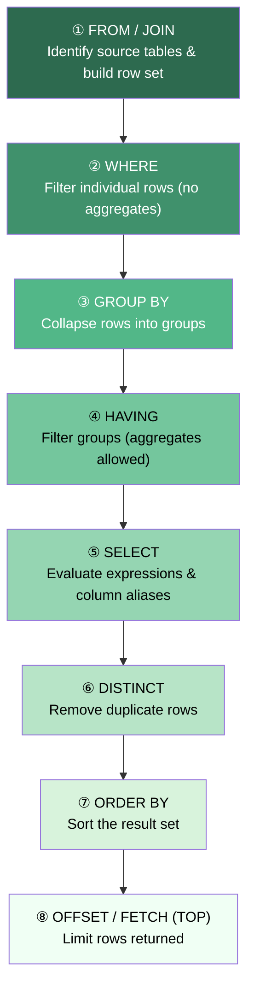

❌ **Violates:**
```sql
-- Wrong: WHERE cannot reference an aggregate function
SELECT DepartmentID, SUM(Salary) AS TotalSalary
FROM Employees
WHERE SUM(Salary) > 100000   -- ERROR: aggregate not allowed in WHERE
GROUP BY DepartmentID;
```

✅ **Satisfies:**
```sql
-- Correct: filter on raw column in WHERE, filter on aggregate in HAVING
SELECT DepartmentID, SUM(Salary) AS TotalSalary
FROM Employees
WHERE IsActive = 1                   -- eliminates inactive rows BEFORE grouping
GROUP BY DepartmentID
HAVING SUM(Salary) > 100000;        -- filters groups AFTER aggregation
```

---

### Q2. How does SQL Server handle NULL values, and what functions exist to deal with them?

**Answer:** NULL represents an unknown value and is not equal to anything — not even another NULL. Any arithmetic or string operation involving NULL returns NULL, and comparisons with NULL using = or <> always evaluate to UNKNOWN. Use IS NULL / IS NOT NULL to test for nullability. ISNULL(expr, replacement) substitutes a single replacement; COALESCE(a, b, c, ...) returns the first non-NULL argument and is ANSI-standard. NULLIF(a, b) returns NULL when a equals b, useful for avoiding divide-by-zero.

❌ **Violates:**
```sql
-- Wrong: = NULL never matches; rows with NULL ManagerID are missed
SELECT EmployeeID, Name
FROM Employees
WHERE ManagerID = NULL;   -- always returns 0 rows
```

✅ **Satisfies:**
```sql
-- Correct: use IS NULL for NULL comparison
SELECT EmployeeID, Name
FROM Employees
WHERE ManagerID IS NULL;   -- correctly finds top-level employees

-- COALESCE for display default
SELECT Name, COALESCE(Phone, Email, 'No contact') AS ContactInfo
FROM Employees;

-- NULLIF to prevent divide-by-zero
SELECT TotalRevenue / NULLIF(TotalUnits, 0) AS AvgPrice
FROM Sales;
```

---

### Q3. How does the CASE expression work, and what are the two forms?

**Answer:** CASE is an inline conditional expression that returns a single value and can appear in SELECT, ORDER BY, WHERE, or even GROUP BY clauses. The simple form compares one input expression against a list of WHEN values. The searched form evaluates independent Boolean conditions in each WHEN clause and is more flexible. CASE returns the first matching branch and short-circuits; if no WHEN matches and there is no ELSE, it returns NULL.

❌ **Violates:**
```sql
-- Wrong: tries to use IF (a statement, not an expression) inside SELECT
SELECT Name,
       IF(Salary > 80000, 'Senior', 'Junior') AS Level  -- syntax error in T-SQL
FROM Employees;
```

✅ **Satisfies:**
```sql
-- Simple CASE (equality check)
SELECT Name,
       CASE Department
           WHEN 'IT'      THEN 'Technology'
           WHEN 'Finance' THEN 'Finance'
           ELSE 'Other'
       END AS DivisionName
FROM Employees;

-- Searched CASE (range/condition check)
SELECT Name, Salary,
       CASE
           WHEN Salary >= 100000 THEN 'Band A'
           WHEN Salary >= 60000  THEN 'Band B'
           ELSE                       'Band C'
       END AS SalaryBand
FROM Employees
ORDER BY CASE WHEN Salary IS NULL THEN 1 ELSE 0 END, Salary DESC;
```

---

### Q4. What is the difference between COUNT(*), COUNT(column), and COUNT(DISTINCT column)?

**Answer:** COUNT(*) counts every row in the group including those with NULLs; it is the fastest variant. COUNT(column) counts only rows where that column is not NULL, which can give a lower number when the column contains NULLs. COUNT(DISTINCT column) counts only unique non-NULL values. SUM and AVG also silently ignore NULLs, so AVG(Salary) divides the sum by only the non-NULL rows — this can produce surprising results if you expect NULLs to count as zero.

❌ **Violates:**
```sql
-- Wrong assumption: developer thinks COUNT(ManagerID) equals total employees
SELECT COUNT(ManagerID) AS NumEmployees  -- misses rows where ManagerID IS NULL
FROM Employees;
```

✅ **Satisfies:**
```sql
-- Total rows regardless of NULLs
SELECT COUNT(*)                        AS TotalEmployees,
       COUNT(ManagerID)                AS HaveManager,      -- excludes NULLs
       COUNT(DISTINCT DepartmentID)    AS UniqueDepts,
       AVG(Salary)                     AS AvgSalary,        -- ignores NULL salaries
       AVG(COALESCE(Salary, 0))        AS AvgSalaryWithZero -- treats NULL as 0
FROM Employees;
```

---

### Q5. Explain GROUP BY ROLLUP, CUBE, and GROUPING SETS with an example.

**Answer:** ROLLUP produces subtotals along a hierarchy: it generates a row for each prefix of the column list plus a grand total, making it ideal for year/quarter/month reporting. CUBE generates subtotals for every possible combination of the listed columns — 2^n combinations. GROUPING SETS lets you specify exactly which grouping combinations you want, avoiding unnecessary computation. The GROUPING(col) function returns 1 when a column is NULL because it is a super-aggregate row, helping distinguish real NULLs from rollup placeholders.

❌ **Violates:**
```sql
-- Wrong: UNION ALL approach duplicates table scans unnecessarily
SELECT Region, Product, SUM(Sales) FROM SalesData GROUP BY Region, Product
UNION ALL
SELECT Region, NULL,    SUM(Sales) FROM SalesData GROUP BY Region
UNION ALL
SELECT NULL,   NULL,    SUM(Sales) FROM SalesData;  -- 3 separate scans
```

✅ **Satisfies:**
```sql
-- ROLLUP: hierarchy subtotals (Region > Product) + grand total
SELECT Region,
       Product,
       SUM(Sales)       AS TotalSales,
       GROUPING(Region) AS IsRegionRollup,
       GROUPING(Product) AS IsProductRollup
FROM SalesData
GROUP BY ROLLUP(Region, Product);

-- GROUPING SETS: only the combinations you need
SELECT Region, Product, SUM(Sales) AS TotalSales
FROM SalesData
GROUP BY GROUPING SETS ((Region, Product), (Region), ());
```

---

### Q6. How do TOP and OFFSET-FETCH differ for pagination?

**Answer:** TOP N returns the first N rows and is simple but not suitable for true pagination because there is no built-in "skip" mechanism — you would need a subquery workaround. OFFSET-FETCH (introduced in SQL Server 2012) provides proper page-based pagination by skipping a calculated number of rows and then fetching the next page. OFFSET-FETCH requires an ORDER BY clause; TOP does not, though using TOP without ORDER BY gives non-deterministic results. For server-side paging in applications, OFFSET-FETCH is the correct choice.

❌ **Violates:**
```sql
-- Wrong: TOP without ORDER BY gives non-deterministic rows; no page 2 possible
SELECT TOP 10 *
FROM Products;   -- which 10? undefined; page 2 is impossible without subquery hack
```

✅ **Satisfies:**
```sql
-- Page-based pagination: page 3 with 10 rows per page
DECLARE @PageNumber INT = 3;
DECLARE @PageSize   INT = 10;

SELECT ProductID, Name, Price
FROM Products
ORDER BY ProductID                          -- deterministic ordering required
OFFSET (@PageNumber - 1) * @PageSize ROWS  -- skip previous pages
FETCH NEXT @PageSize ROWS ONLY;            -- take current page
```

---

### Q7. What are the key string functions in T-SQL and when do you use them?

**Answer:** LEN returns character length excluding trailing spaces; DATALENGTH returns byte length which differs for Unicode. SUBSTRING(str, start, length) extracts a portion (1-based index). CHARINDEX(find, source) returns the position of the first occurrence, returning 0 if not found. STRING_AGG aggregates multiple rows into a delimited string (SQL Server 2017+). CONCAT handles NULLs gracefully by treating them as empty strings, unlike the + operator which propagates NULLs.

❌ **Violates:**
```sql
-- Wrong: + concatenation turns NULL into NULL for the whole expression
SELECT FirstName + ' ' + MiddleName + ' ' + LastName AS FullName
FROM Employees;   -- rows where MiddleName IS NULL return NULL for the entire name
```

✅ **Satisfies:**
```sql
-- CONCAT treats NULLs as empty string
SELECT CONCAT(FirstName, ' ', MiddleName, ' ', LastName) AS FullName,
       LEN(LastName)                                      AS LastNameLen,
       SUBSTRING(Email, 1, CHARINDEX('@', Email) - 1)    AS EmailUser
FROM Employees;

-- STRING_AGG: comma-separated list of employee names per department
SELECT DepartmentID,
       STRING_AGG(Name, ', ') WITHIN GROUP (ORDER BY Name) AS MemberList
FROM Employees
GROUP BY DepartmentID;
```

---

### Q8. What date functions does T-SQL provide, and what is the difference between GETDATE and SYSDATETIME?

**Answer:** GETDATE() returns the current date and time as datetime (3.33ms precision). SYSDATETIME() returns datetime2(7) with higher precision and is preferred for new code. DATEADD(part, n, date) adds an interval; DATEDIFF(part, start, end) returns the difference as an integer (it counts boundaries crossed, not exact elapsed time). TRY_CONVERT and TRY_CAST return NULL on conversion failure rather than throwing an error, making them safer for user-supplied data.

❌ **Violates:**
```sql
-- Wrong: CONVERT without TRY_ throws error on bad date strings
SELECT CONVERT(DATE, UserInput) AS OrderDate
FROM Orders;   -- crashes if UserInput = 'not-a-date'

-- Wrong: DATEDIFF misconception — counts month boundaries, not 30-day periods
SELECT DATEDIFF(MONTH, '2024-01-31', '2024-02-01') AS MonthDiff;
-- Returns 1, even though only 1 day apart
```

✅ **Satisfies:**
```sql
-- Safe date conversion
SELECT TRY_CONVERT(DATE, UserInput) AS OrderDate   -- NULL on bad input, no crash
FROM Orders;

-- Correct date arithmetic
SELECT OrderID,
       OrderDate,
       DATEADD(DAY, 30, OrderDate)                           AS DueDate,
       DATEDIFF(DAY, OrderDate, GETDATE())                   AS DaysOld,
       SYSDATETIME()                                         AS PreciseNow
FROM Orders
WHERE OrderDate >= DATEADD(YEAR, -1, CAST(GETDATE() AS DATE));
```

---

### Q9. What is the difference between EXISTS, IN, and correlated subqueries, and what is the NULL danger with NOT IN?

**Answer:** EXISTS returns TRUE as soon as it finds one matching row (short-circuit evaluation) and is generally the most efficient for large outer queries. IN materializes the subquery result set and checks membership; it works well when the subquery is small. NOT IN is dangerous: if the subquery returns even one NULL value, the entire NOT IN condition evaluates to UNKNOWN and zero rows are returned — a silent bug. NOT EXISTS does not have this problem and is the safe replacement.

❌ **Violates:**
```sql
-- NOT IN with NULL danger: if any customer has NULL email, returns 0 rows
SELECT Name
FROM Customers
WHERE CustomerID NOT IN (
    SELECT CustomerID FROM Orders WHERE Email IS NULL  -- if one NULL exists, all rows excluded
);
```

✅ **Satisfies:**
```sql
-- Safe: NOT EXISTS handles NULLs correctly
SELECT c.Name
FROM Customers c
WHERE NOT EXISTS (
    SELECT 1 FROM Orders o WHERE o.CustomerID = c.CustomerID
);

-- EXISTS short-circuits on first match
SELECT c.Name
FROM Customers c
WHERE EXISTS (
    SELECT 1 FROM Orders o
    WHERE o.CustomerID = c.CustomerID
      AND o.OrderDate >= '2024-01-01'
);
```

---

### Q10. What is the difference between DISTINCT and GROUP BY?

**Answer:** DISTINCT eliminates duplicate rows from a result set and operates on all selected columns together. GROUP BY collapses rows into groups and enables aggregate functions on each group; it can therefore produce richer results. When no aggregate function is used, GROUP BY and DISTINCT are semantically equivalent, but their query plans may differ. DISTINCT is clearer in intent when you simply want unique rows; GROUP BY should be used when aggregation is required.

❌ **Violates:**
```sql
-- Wrong: using GROUP BY without aggregation just to "seem professional"
-- creates confusion about intent
SELECT DepartmentID
FROM Employees
GROUP BY DepartmentID;   -- works, but intent is deduplication not aggregation
```

✅ **Satisfies:**
```sql
-- DISTINCT for simple deduplication
SELECT DISTINCT DepartmentID
FROM Employees;

-- GROUP BY for aggregation (correct use)
SELECT DepartmentID,
       COUNT(*)       AS HeadCount,
       AVG(Salary)    AS AvgSalary,
       MAX(HireDate)  AS LatestHire
FROM Employees
GROUP BY DepartmentID
HAVING COUNT(*) >= 3;
```

---
## 2. JOINs

> 📚 Reference: https://learn.microsoft.com/en-us/sql/relational-databases/performance/joins
> 📚 Medium: https://medium.com/learning-sql/sql-joins-visual-guide-inner-left-right-full-cross-self-1a2b3c4d5e6f

---

### Q11. What is the difference between INNER JOIN, LEFT JOIN, RIGHT JOIN, and FULL OUTER JOIN?

**Answer:** INNER JOIN returns only rows that have a matching row in both tables. LEFT JOIN returns all rows from the left table and matching rows from the right table; unmatched right-side columns come back as NULL. RIGHT JOIN is the mirror image. FULL OUTER JOIN returns all rows from both tables, with NULLs on whichever side has no match. In practice, RIGHT JOIN is rarely used because the same result can be achieved by swapping the table order and using LEFT JOIN.

**JOIN Types — What Rows Each Returns:**

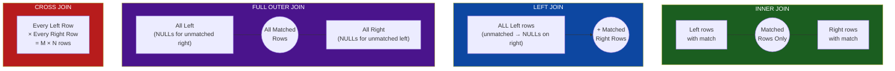

❌ **Violates:**
```sql
-- Wrong: INNER JOIN silently drops customers who have no orders
SELECT c.CustomerName, o.OrderID, o.TotalAmount
FROM Customers c
INNER JOIN Orders o ON c.CustomerID = o.CustomerID;
-- Customers with zero orders disappear from results
```

✅ **Satisfies:**
```sql
-- LEFT JOIN preserves ALL customers; OrderID is NULL for those with no orders
SELECT c.CustomerName,
       o.OrderID,
       COALESCE(o.TotalAmount, 0) AS TotalAmount
FROM Customers c
LEFT JOIN Orders o ON c.CustomerID = o.CustomerID;

-- FULL OUTER JOIN: see all customers AND all orders even with broken FK
SELECT c.CustomerName, o.OrderID
FROM Customers c
FULL OUTER JOIN Orders o ON c.CustomerID = o.CustomerID
WHERE c.CustomerID IS NULL OR o.OrderID IS NULL;  -- orphaned rows on either side
```

---

### Q12. What is a CROSS JOIN and when is it actually useful?

**Answer:** A CROSS JOIN produces the Cartesian product of two tables — every row in the left table paired with every row in the right table. With M left rows and N right rows you get M×N result rows. Although they look dangerous, CROSS JOINs are deliberately used to generate all combinations, such as pairing every product with every date for gap analysis in reporting. A WHERE clause can then filter out combinations that already have data, revealing gaps.

❌ **Violates:**
```sql
-- Wrong: accidental CROSS JOIN due to missing ON clause (old-style comma join)
SELECT c.CustomerName, p.ProductName
FROM Customers c, Products p   -- missing WHERE join condition = full Cartesian product
WHERE c.Region = 'North';      -- only filters customers, still crosses with all products
```

✅ **Satisfies:**
```sql
-- Intentional CROSS JOIN: generate all date x product combinations for gap analysis
WITH Dates AS (
    SELECT CAST('2024-01-01' AS DATE) AS SaleDate
    UNION ALL
    SELECT DATEADD(DAY, 1, SaleDate) FROM Dates WHERE SaleDate < '2024-01-31'
)
SELECT d.SaleDate, p.ProductID, COALESCE(s.Revenue, 0) AS Revenue
FROM Dates d
CROSS JOIN Products p
LEFT JOIN DailySales s ON s.SaleDate = d.SaleDate AND s.ProductID = p.ProductID
OPTION (MAXRECURSION 31);
```

---

### Q13. How do you write a SELF JOIN and what problems does it solve?

**Answer:** A SELF JOIN joins a table to itself using two different aliases, treating each alias as a logically distinct table. The most common use is an employee-manager hierarchy where both the employee and their manager live in the same Employees table. Another common use is finding pairs of rows with a related condition (e.g., products in the same category with different prices). Without aliases the query would be ambiguous.

❌ **Violates:**
```sql
-- Wrong: cannot reference same table twice without aliases
SELECT EmployeeID, Name, ManagerID, Name  -- ambiguous: which Name?
FROM Employees e
JOIN Employees ON ManagerID = EmployeeID;  -- missing alias makes ON clause ambiguous
```

✅ **Satisfies:**
```sql
-- Employee + their manager's name using SELF JOIN
SELECT e.Name        AS Employee,
       m.Name        AS Manager,
       e.Department
FROM   Employees e
LEFT JOIN Employees m ON e.ManagerID = m.EmployeeID;
-- LEFT JOIN keeps employees who have no manager (CEO / top of hierarchy)

-- Finding same-category products at different price points
SELECT a.ProductName AS CheaperProduct,
       b.ProductName AS PricierProduct,
       a.CategoryID,
       b.Price - a.Price AS PriceDiff
FROM Products a
JOIN Products b ON a.CategoryID = b.CategoryID
               AND a.Price < b.Price;
```

---

### Q14. What is an anti-join and which approach is safest — LEFT JOIN + IS NULL, NOT EXISTS, or NOT IN?

**Answer:** An anti-join finds rows in one set that have no match in another. All three approaches can produce anti-join results, but they differ in NULL safety and performance. NOT IN fails silently when the subquery returns any NULL — the entire result set becomes empty because SQL cannot confirm "this value is not in a set that contains UNKNOWN". NOT EXISTS is NULL-safe and often the most efficient because the engine can stop as soon as a match is found. LEFT JOIN + IS NULL is equivalent to NOT EXISTS and can be more readable for simple cases.

❌ **Violates:**
```sql
-- NOT IN silently returns 0 rows if ANY CustomerID in Orders is NULL
SELECT c.CustomerName
FROM Customers c
WHERE c.CustomerID NOT IN (SELECT CustomerID FROM Orders);
-- If one order has NULL CustomerID, every customer is excluded!
```

✅ **Satisfies:**
```sql
-- Option 1: NOT EXISTS (NULL-safe, usually fastest)
SELECT c.CustomerName
FROM Customers c
WHERE NOT EXISTS (
    SELECT 1 FROM Orders o WHERE o.CustomerID = c.CustomerID
);

-- Option 2: LEFT JOIN + IS NULL (NULL-safe, readable)
SELECT c.CustomerName
FROM Customers c
LEFT JOIN Orders o ON c.CustomerID = o.CustomerID
WHERE o.OrderID IS NULL;
```

---

### Q15. Why do JOINs produce duplicate rows and how do you detect and fix them?

**Answer:** Duplicate rows appear when the join key is not unique on the "many" side of a one-to-many relationship. For example, joining a customer to their orders means each customer row is repeated for every order, which is correct. The bug appears when you join a customer to a lookup table that accidentally contains duplicate keys, multiplying rows unexpectedly. Detecting duplicates before joining with a COUNT/GROUP BY check prevents data explosion. A CTE with ROW_NUMBER() can deduplicate the lookup before the JOIN.

❌ **Violates:**
```sql
-- Wrong: DimCustomer has duplicate CustomerID rows (bad ETL), causing row multiplication
SELECT o.OrderID, c.CustomerName, SUM(o.Amount) AS Total
FROM Orders o
JOIN DimCustomer c ON o.CustomerID = c.CustomerID  -- if c has 3 rows per customer, each order triples
GROUP BY o.OrderID, c.CustomerName;
-- SUM doubles/triples because of JOIN fan-out
```

✅ **Satisfies:**
```sql
-- Deduplicate the dimension table first using ROW_NUMBER()
WITH UniqueCustomers AS (
    SELECT *,
           ROW_NUMBER() OVER (PARTITION BY CustomerID ORDER BY LoadDate DESC) AS rn
    FROM DimCustomer
)
SELECT o.OrderID, c.CustomerName, o.Amount
FROM Orders o
JOIN UniqueCustomers c ON o.CustomerID = c.CustomerID AND c.rn = 1;
```

---

### Q16. How do non-equi joins work, and when do you use BETWEEN in a JOIN?

**Answer:** A non-equi join uses inequality operators (>, <, BETWEEN, !=) in the ON clause instead of equality. They are less common but invaluable for range-based lookups such as mapping a salary to a pay band, applying a tax rate based on income, or detecting overlapping date ranges. Non-equi joins can produce large result sets if not constrained and typically cannot leverage hash or merge join strategies — nested loops are common, so indexing the range boundaries matters.

❌ **Violates:**
```sql
-- Wrong: scalar subquery per row for salary band lookup — O(n) subquery per row
SELECT e.Name, e.Salary,
       (SELECT BandName FROM SalaryBands WHERE e.Salary BETWEEN MinSalary AND MaxSalary) AS Band
FROM Employees e;  -- correlated subquery; slow for large tables
```

✅ **Satisfies:**
```sql
-- Non-equi join for salary band: single pass
SELECT e.Name, e.Salary, sb.BandName
FROM Employees e
JOIN SalaryBands sb ON e.Salary BETWEEN sb.MinSalary AND sb.MaxSalary;

-- Detect overlapping vacation date ranges (non-equi self-join)
SELECT a.EmployeeID AS Emp1, b.EmployeeID AS Emp2,
       a.StartDate, a.EndDate
FROM Vacations a
JOIN Vacations b ON a.EmployeeID <> b.EmployeeID
               AND a.StartDate <= b.EndDate
               AND a.EndDate   >= b.StartDate;
```

---

### Q17. What is CROSS APPLY vs OUTER APPLY, and how do you get the top 3 orders per customer?

**Answer:** APPLY is a SQL Server-specific operator that invokes a table-valued function (or an inline subquery) once per row of the left table, passing the current row's values as parameters. CROSS APPLY is like an INNER JOIN to the result — it omits left-side rows that produce no rows from the right side. OUTER APPLY is like a LEFT JOIN — it keeps left-side rows even when the applied expression returns nothing, filling right-side columns with NULL. This is the cleanest way to solve "top N per group" problems without complex window-function workarounds.

❌ **Violates:**
```sql
-- Wrong: ROW_NUMBER in a subquery works but APPLY reads more naturally; 
-- however the common mistake is no ORDER BY inside the subquery
SELECT CustomerID, OrderID, Amount
FROM (SELECT *, ROW_NUMBER() OVER (PARTITION BY CustomerID) AS rn FROM Orders) x
WHERE rn <= 3;  -- missing ORDER BY in OVER() — ties broken arbitrarily
```

✅ **Satisfies:**
```sql
-- CROSS APPLY: top 3 orders per customer, deterministic ordering
SELECT c.CustomerName, o.OrderID, o.Amount, o.OrderDate
FROM Customers c
CROSS APPLY (
    SELECT TOP 3 OrderID, Amount, OrderDate
    FROM Orders
    WHERE CustomerID = c.CustomerID
    ORDER BY Amount DESC               -- deterministic: highest value orders
) o;

-- OUTER APPLY: keeps customers with zero orders (NULLs for order columns)
SELECT c.CustomerName, o.OrderID, o.Amount
FROM Customers c
OUTER APPLY (
    SELECT TOP 1 OrderID, Amount
    FROM Orders WHERE CustomerID = c.CustomerID
    ORDER BY OrderDate DESC
) o;
```

---

### Q18. How do you join three or more tables correctly?

**Answer:** Multi-table JOINs are processed left-to-right (with the optimizer free to reorder for performance). Each JOIN adds another result set to the running output. The key discipline is to declare the correct join type for each pair: INNER to require matching rows, LEFT to preserve the driving table's rows. A common error is mixing LEFT and INNER JOINs where the INNER JOIN later in the chain nullifies the LEFT JOIN effect on earlier tables.

❌ **Violates:**
```sql
-- Wrong: LEFT JOIN on Orders is negated by the subsequent INNER JOIN on OrderDetails
-- customers with no orders are dropped by the INNER JOIN
SELECT c.CustomerName, o.OrderID, od.ProductID
FROM Customers c
LEFT JOIN Orders o       ON c.CustomerID = o.CustomerID
INNER JOIN OrderDetails od ON o.OrderID   = od.OrderID;  -- eliminates NULL orders from LEFT JOIN
```

✅ **Satisfies:**
```sql
-- All JOINs must be LEFT if you want to preserve customers with no orders
SELECT c.CustomerName,
       o.OrderID,
       od.ProductID,
       p.ProductName
FROM Customers c
LEFT JOIN Orders o          ON c.CustomerID  = o.CustomerID
LEFT JOIN OrderDetails od   ON o.OrderID     = od.OrderID
LEFT JOIN Products p        ON od.ProductID  = p.ProductID
ORDER BY c.CustomerName, o.OrderDate;
```

---

### Q19. When would you use a JOIN instead of a correlated subquery, and vice versa?

**Answer:** A JOIN works set-based — all matching rows are combined in one pass, making it ideal when you need columns from both tables. A correlated subquery executes once per outer row, which is O(n) and can be significantly slower on large tables; however it can express "for each row, compute something" logic more intuitively. EXISTS-style correlated subqueries are acceptable when you only need a Boolean test (and the optimizer often rewrites them as semi-joins anyway). When you need aggregated values per outer row (e.g., total orders per customer in a SELECT list), a correlated subquery works but a derived table or window function is usually more efficient.

❌ **Violates:**
```sql
-- Correlated subquery for every row is O(n) — slow on millions of rows
SELECT c.CustomerName,
       (SELECT COUNT(*) FROM Orders o WHERE o.CustomerID = c.CustomerID) AS OrderCount
FROM Customers c;   -- subquery re-executes for each customer row
```

✅ **Satisfies:**
```sql
-- Single-pass JOIN with GROUP BY: one scan of Orders, then join
SELECT c.CustomerName, COALESCE(o.OrderCount, 0) AS OrderCount
FROM Customers c
LEFT JOIN (
    SELECT CustomerID, COUNT(*) AS OrderCount
    FROM Orders
    GROUP BY CustomerID
) o ON c.CustomerID = o.CustomerID;
```

---

### Q20. Write classic interview JOIN queries: customers with no orders, employees with their manager, and unsold products.

**Answer:** These three patterns are among the most commonly asked JOIN interview queries. Customers with no orders uses an anti-join (LEFT JOIN + IS NULL or NOT EXISTS). Employees with their manager uses a SELF JOIN with LEFT JOIN to preserve top-level employees. Unsold products uses a LEFT JOIN between Products and a sales table, filtering for NULL matches. Mastering these three covers the majority of real-world JOIN interview questions.

❌ **Violates:**
```sql
-- Wrong approach for all three: using NOT IN (NULL danger) or INNER JOIN (loses non-matching rows)
SELECT ProductName FROM Products
WHERE ProductID NOT IN (SELECT ProductID FROM Sales);  -- breaks if Sales.ProductID has NULLs
```

✅ **Satisfies:**
```sql
-- 1. Customers with no orders
SELECT c.CustomerName
FROM Customers c
LEFT JOIN Orders o ON c.CustomerID = o.CustomerID
WHERE o.OrderID IS NULL;

-- 2. Employee + their manager (SELF JOIN)
SELECT e.Name AS Employee, COALESCE(m.Name, 'No Manager') AS Manager
FROM Employees e
LEFT JOIN Employees m ON e.ManagerID = m.EmployeeID;

-- 3. Products never sold
SELECT p.ProductName
FROM Products p
LEFT JOIN OrderDetails od ON p.ProductID = od.ProductID
WHERE od.ProductID IS NULL;
```

---
## 3. Indexes & Query Performance

> 📚 Reference: https://learn.microsoft.com/en-us/sql/relational-databases/indexes/indexes
> 📚 Medium: https://medium.com/learning-sql/sql-server-indexes-clustered-nonclustered-covering-explained-9f1a2b3c4d5e

---

### Q21. What is the difference between a clustered and a non-clustered index?

**Answer:** A clustered index determines the physical storage order of the table's rows — the leaf level of the index IS the data pages. Because of this, a table can have only one clustered index. The primary key is clustered by default. A non-clustered index is a separate structure that stores the indexed key columns plus a row locator (the clustered key or RID for heaps). A heap is a table with no clustered index; non-clustered indexes on a heap use a physical Row ID (RID) which becomes invalid after row movement.

**Clustered vs Non-Clustered Index B-Tree Structure:**

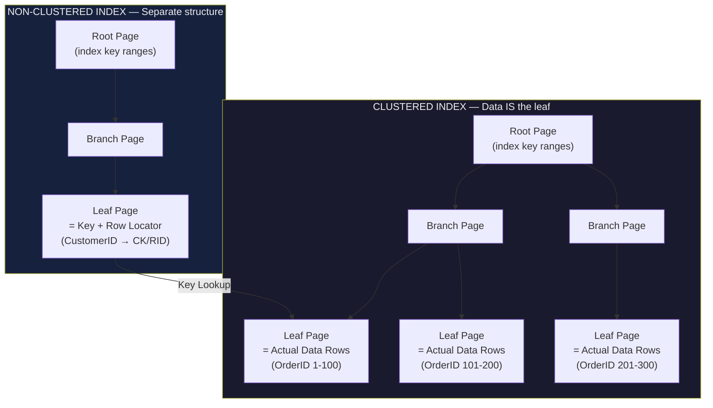

❌ **Violates:**
```sql
-- Wrong: creating a second clustered index on the same table
CREATE CLUSTERED INDEX IX_Orders_OrderDate ON Orders(OrderDate);
-- If a clustered index already exists (e.g., on OrderID), this fails with an error
```

✅ **Satisfies:**
```sql
-- Correct: one clustered on the primary key, non-clustered on the search column
CREATE TABLE Orders (
    OrderID    INT          NOT NULL PRIMARY KEY CLUSTERED,  -- clustered index
    CustomerID INT          NOT NULL,
    OrderDate  DATE         NOT NULL,
    Amount     DECIMAL(10,2) NOT NULL
);

-- Non-clustered index for CustomerID lookups
CREATE NONCLUSTERED INDEX IX_Orders_CustomerID ON Orders(CustomerID);

-- Non-clustered index for date-range queries
CREATE NONCLUSTERED INDEX IX_Orders_OrderDate  ON Orders(OrderDate);
```

---

### Q22. What is the leftmost prefix rule for composite indexes?

**Answer:** A composite (multi-column) index is useful only when queries filter or sort on a leading prefix of the indexed columns. An index on (LastName, FirstName, BirthDate) supports queries that filter on LastName alone, or on LastName + FirstName, or on all three. It cannot support a seek on FirstName alone or BirthDate alone because the B-tree is sorted by LastName first. Covering indexes add INCLUDE columns to store non-key data in the index leaf, avoiding a key lookup while not widening the sort key.

❌ **Violates:**
```sql
-- Index on (LastName, FirstName) but query only filters on FirstName
CREATE INDEX IX_Name ON Employees(LastName, FirstName);

-- This query CANNOT use the index for a seek:
SELECT * FROM Employees WHERE FirstName = 'Alice';  -- skips the leading column; causes a scan
```

✅ **Satisfies:**
```sql
-- Query uses leading column: index seek possible
SELECT * FROM Employees WHERE LastName = 'Smith';               -- seek on first col
SELECT * FROM Employees WHERE LastName = 'Smith' AND FirstName = 'Alice';  -- seek on both

-- Covering index: includes Amount to avoid key lookup
CREATE NONCLUSTERED INDEX IX_Orders_CustDate
    ON Orders(CustomerID, OrderDate)
    INCLUDE (Amount, Status);   -- extra columns in leaf, not in sort key
-- Query below is fully covered (no key lookup)
SELECT OrderDate, Amount, Status
FROM Orders
WHERE CustomerID = 42
  AND OrderDate >= '2024-01-01';
```

---

### Q23. What is an INCLUDE clause and how does it eliminate a key lookup?

**Answer:** When a non-clustered index seek finds the matching key, SQL Server then needs to retrieve additional columns not in the index — this is a key lookup (or RID lookup for heaps), which adds a random I/O per row. The INCLUDE clause stores extra columns in the leaf pages of the index without making them part of the sort key, making the index "covering" for a particular query. Key lookups become expensive when the query returns many rows, so covering indexes targeted at specific high-frequency queries can give dramatic performance gains.

❌ **Violates:**
```sql
-- Index only on CustomerID; query needs OrderDate and Amount too
CREATE INDEX IX_Orders_CustomerID ON Orders(CustomerID);

-- Execution plan shows KEY LOOKUP per row for OrderDate and Amount
SELECT CustomerID, OrderDate, Amount
FROM Orders
WHERE CustomerID = 100;
```

✅ **Satisfies:**
```sql
-- Covering index: all columns needed by the query are in the index
CREATE NONCLUSTERED INDEX IX_Orders_CustomerID_Covering
    ON Orders(CustomerID)
    INCLUDE (OrderDate, Amount);   -- stored in leaf only; no key lookup needed

-- The query is now fully satisfied from the index alone
SELECT CustomerID, OrderDate, Amount
FROM Orders
WHERE CustomerID = 100;
```

---

### Q24. When does the query optimizer choose an index scan instead of an index seek?

**Answer:** An index seek navigates the B-tree to a specific range of rows; it is efficient for selective predicates. An index scan reads every page of the index; it is appropriate when a large percentage of rows must be read. The optimizer chooses a scan when: (1) no usable index exists for the predicate, (2) the predicate is non-sargable (e.g., wrapping a column in a function), (3) the estimated selectivity is low (most rows returned anyway), (4) table statistics are stale, or (5) an implicit data type conversion prevents index use.

❌ **Violates:**
```sql
-- Non-sargable: YEAR() function on indexed column prevents seek
SELECT OrderID FROM Orders
WHERE YEAR(OrderDate) = 2024;   -- wraps column in function; optimizer must scan all rows
```

✅ **Satisfies:**
```sql
-- Sargable rewrite: range condition lets the optimizer perform an index seek
SELECT OrderID FROM Orders
WHERE OrderDate >= '2024-01-01'
  AND OrderDate <  '2025-01-01';   -- range seek on OrderDate index

-- Update statistics to help optimizer choose seek
UPDATE STATISTICS Orders IX_Orders_OrderDate WITH FULLSCAN;
```

---

### Q25. What are the 6 most common non-sargable patterns and how do you rewrite them?

**Answer:** A predicate is sargable (Search ARGument ABLE) if SQL Server can use an index seek to evaluate it. Non-sargable patterns force full scans: (1) applying a function to the indexed column, (2) leading wildcard LIKE '%text', (3) implicit or explicit type conversion on the column, (4) negation with <>, (5) OR between unindexed columns, (6) arithmetic on the column side. The fix is always to move transformations to the constant/parameter side so the column appears bare on one side of the operator.

❌ **Violates:**
```sql
-- 6 non-sargable anti-patterns:
WHERE UPPER(LastName) = 'SMITH'          -- 1: function on column
WHERE LastName LIKE '%son'               -- 2: leading wildcard
WHERE CAST(OrderDate AS VARCHAR) = '2024-01-15'  -- 3: type conversion on column
WHERE Salary <> 50000                    -- 4: negation (may scan depending on stats)
WHERE City = 'NY' OR PostalCode = '10001'-- 5: OR on different unindexed columns
WHERE Salary * 1.1 > 55000              -- 6: arithmetic on column side
```

✅ **Satisfies:**
```sql
-- Sargable rewrites:
WHERE LastName = 'SMITH'                    -- 1: use CI_AS collation or fix data
WHERE LastName LIKE 'Smi%'                  -- 2: trailing wildcard is sargable
WHERE OrderDate = '2024-01-15'              -- 3: compare directly (ensure type match)
WHERE Salary > 50000 OR Salary < 50000      -- 4: explicit range if needed
WHERE City = 'NY'
UNION ALL
SELECT * ... WHERE PostalCode = '10001'     -- 5: UNION ALL for OR on different cols
WHERE Salary > 55000 / 1.1                  -- 6: move math to the constant side
```

---

### Q26. How do you read an execution plan and what do the key warning signs mean?

**Answer:** Execution plans show the estimated and actual cost of each operator as a percentage. Thick arrows indicate large row estimates flowing between operators — unexpectedly thick arrows point to missing indexes or bad cardinality estimates. A Key Lookup means a non-clustered index seek was followed by a clustered index lookup to fetch missing columns — fix it with INCLUDE. An implicit conversion warning (yellow exclamation mark) means column and parameter data types do not match, causing every row to be cast before comparison and blocking index seeks. A Sort operator with a spill warning means the sort ran out of memory grant.

❌ **Violates:**
```sql
-- Implicit conversion: parameter is VARCHAR but column is INT — causes scan
DECLARE @ID VARCHAR(10) = '42';
SELECT * FROM Orders WHERE CustomerID = @ID;
-- Execution plan shows IMPLICIT CONVERSION warning; index on CustomerID unused
```

✅ **Satisfies:**
```sql
-- Match data types: parameter matches column type exactly
DECLARE @ID INT = 42;
SELECT * FROM Orders WHERE CustomerID = @ID;  -- index seek; no conversion warning

-- Check execution plan XML for warnings programmatically
SELECT TOP 10 qs.total_elapsed_time / qs.execution_count AS avg_ms,
              qp.query_plan
FROM sys.dm_exec_query_stats qs
CROSS APPLY sys.dm_exec_query_plan(qs.plan_handle) qp
ORDER BY avg_ms DESC;
```

---

### Q27. What is parameter sniffing, and what are four ways to fix it?

**Answer:** Parameter sniffing occurs when SQL Server compiles a stored procedure's execution plan using the parameter values supplied on the first execution, then reuses that plan for all subsequent calls even when very different parameter values would benefit from a different plan. A plan optimal for "return 5 rows" may be catastrophic for "return 500,000 rows" because it chose nested loops instead of a hash join. Fix options: (1) OPTION(RECOMPILE) — recompile each execution, (2) OPTION(OPTIMIZE FOR UNKNOWN) — use average statistics, (3) local variable technique — copy parameters to local variables before use, (4) Query Store forced plan — pin the good plan.

❌ **Violates:**
```sql
-- Stored procedure with parameter sniffing problem
CREATE PROCEDURE GetOrders @CustomerID INT AS
    SELECT * FROM Orders WHERE CustomerID = @CustomerID;
-- First call with CustomerID=1 (1 order) creates a nested-loops plan;
-- subsequent call with CustomerID=999 (50,000 orders) reuses the same bad plan
```

✅ **Satisfies:**
```sql
-- Fix 1: RECOMPILE hint (best for highly variable data)
CREATE PROCEDURE GetOrders @CustomerID INT AS
    SELECT * FROM Orders WHERE CustomerID = @CustomerID
    OPTION (RECOMPILE);   -- fresh plan every time; adds ~1ms compile overhead

-- Fix 2: OPTIMIZE FOR UNKNOWN (use average stats, not sniffed value)
CREATE PROCEDURE GetOrdersUnknown @CustomerID INT AS
    SELECT * FROM Orders WHERE CustomerID = @CustomerID
    OPTION (OPTIMIZE FOR (@CustomerID UNKNOWN));

-- Fix 3: Local variable trick (breaks sniffing; uses average statistics)
CREATE PROCEDURE GetOrdersLocal @CustomerID INT AS
    DECLARE @LocalID INT = @CustomerID;
    SELECT * FROM Orders WHERE CustomerID = @LocalID;
```

---

### Q28. What is a filtered index and when should you use one?

**Answer:** A filtered index is a non-clustered index with a WHERE clause that indexes only a subset of rows. This is ideal for columns with highly skewed data distributions — for example, an IsDeleted flag where 99% of rows are 0 and only 1% are 1. Indexing only the IsDeleted = 0 rows (active records) creates a small, efficient index. Filtered indexes can also allow unique constraints on nullable columns (e.g., unique email among non-NULL values).

❌ **Violates:**
```sql
-- Full index on Status column: 98% of rows have Status='Completed'
-- Every query for Status='Pending' still scans the huge index
CREATE INDEX IX_Orders_Status ON Orders(Status);
```

✅ **Satisfies:**
```sql
-- Filtered index: only index the minority 'Pending' rows
CREATE NONCLUSTERED INDEX IX_Orders_PendingStatus
    ON Orders(OrderDate, CustomerID)
    WHERE Status = 'Pending';    -- tiny index; very fast for pending-order queries

-- Filtered unique index: allow multiple NULLs but enforce unique non-NULL emails
CREATE UNIQUE NONCLUSTERED INDEX UX_Employees_Email
    ON Employees(Email)
    WHERE Email IS NOT NULL;    -- multiple NULLs allowed; duplicates among real values blocked
```

---

### Q29. What is the difference between REORGANIZE and REBUILD for index fragmentation?

**Answer:** Index fragmentation increases over time as INSERT/UPDATE/DELETE operations leave pages partially full or out of logical order. REORGANIZE defragments online (table remains accessible), works page-by-page, and is gentle — suitable for 5-30% fragmentation. REBUILD recreates the index from scratch, produces a perfectly compact structure, and updates statistics — but it requires a lock (or uses online rebuild in Enterprise edition). The threshold guidance from Microsoft: reorganize at 5-30% fragmentation, rebuild above 30%.

❌ **Violates:**
```sql
-- Wrong: rebuilding every index nightly regardless of fragmentation wastes resources
-- and causes unnecessary blocking during business hours
EXEC sp_MSforeachtable 'ALTER INDEX ALL ON ? REBUILD';  -- brutal, locks tables
```

✅ **Satisfies:**
```sql
-- Check fragmentation first
SELECT OBJECT_NAME(i.object_id)    AS TableName,
       i.name                      AS IndexName,
       s.avg_fragmentation_in_percent
FROM sys.dm_db_index_physical_stats(DB_ID(), NULL, NULL, NULL, 'LIMITED') s
JOIN sys.indexes i ON i.object_id = s.object_id AND i.index_id = s.index_id
WHERE s.avg_fragmentation_in_percent > 5
ORDER BY s.avg_fragmentation_in_percent DESC;

-- REORGANIZE for 5-30%
ALTER INDEX IX_Orders_CustomerID ON Orders REORGANIZE;

-- REBUILD for > 30% (ONLINE = ON requires Enterprise edition)
ALTER INDEX IX_Orders_CustomerID ON Orders REBUILD WITH (ONLINE = ON);
```

---

### Q30. How do you find unused indexes using sys.dm_db_index_usage_stats?

**Answer:** Unused indexes waste write overhead — every INSERT, UPDATE, and DELETE must maintain every index on the table. sys.dm_db_index_usage_stats accumulates seek/scan/lookup/update counts since the last SQL Server restart. An index with zero seeks/scans but many user_updates is a pure write tax that should be evaluated for removal. Always check the last restart time before acting, and verify the index is not used at a time of year outside your observation window (e.g., year-end reporting).

❌ **Violates:**
```sql
-- Wrong: dropping indexes without checking usage stats — could remove a critical index
DROP INDEX IX_Orders_CustomerID ON Orders;   -- did you verify it's truly unused?
```

✅ **Satisfies:**
```sql
-- Find indexes with zero reads (potential candidates for removal)
SELECT OBJECT_NAME(i.object_id)            AS TableName,
       i.name                              AS IndexName,
       i.type_desc,
       COALESCE(u.user_seeks, 0)           AS Seeks,
       COALESCE(u.user_scans, 0)           AS Scans,
       COALESCE(u.user_lookups, 0)         AS Lookups,
       COALESCE(u.user_updates, 0)         AS Writes,
       (SELECT sqlserver_start_time FROM sys.dm_os_sys_info) AS StatsSince
FROM sys.indexes i
LEFT JOIN sys.dm_db_index_usage_stats u
       ON u.object_id = i.object_id
      AND u.index_id  = i.index_id
      AND u.database_id = DB_ID()
WHERE OBJECTPROPERTY(i.object_id, 'IsUserTable') = 1
  AND i.index_id > 0                              -- exclude heaps
  AND COALESCE(u.user_seeks + u.user_scans + u.user_lookups, 0) = 0
ORDER BY COALESCE(u.user_updates, 0) DESC;        -- highest write cost first
```

---
## 4. Stored Procedures, Functions & Dynamic SQL

> 📚 Reference: https://learn.microsoft.com/en-us/sql/relational-databases/stored-procedures/stored-procedures-database-engine
> 📚 Medium: https://medium.com/learning-sql/stored-procedures-vs-functions-dynamic-sql-t-sql-guide-4a5b6c7d8e9f

---

### Q31. How do you create a stored procedure with input parameters, output parameters, and a RETURN value?

**Answer:** Input parameters pass values into the procedure. Output parameters (marked with OUTPUT) pass values back to the caller; the caller must also declare the variable as OUTPUT in the EXEC call. RETURN sends an integer status code (0 = success by convention); it is not for returning result sets or multiple values. For complex return data use OUTPUT parameters, a result set, or a temp table. Always provide default values for optional parameters so callers do not need to pass every argument.

**Stored Procedure vs Inline Query — Execution Flow:**

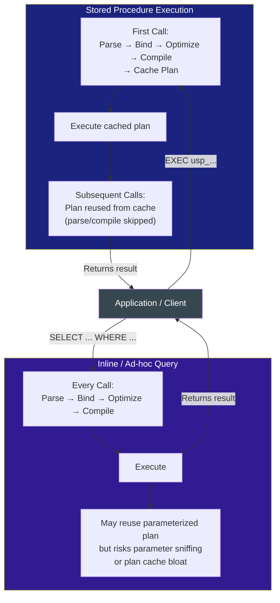

❌ **Violates:**
```sql
-- Wrong: using RETURN to pass a non-integer "result" — RETURN only takes integers
CREATE PROCEDURE GetCustomerName @ID INT AS
    RETURN (SELECT Name FROM Customers WHERE CustomerID = @ID);  -- syntax error
```

✅ **Satisfies:**
```sql
CREATE PROCEDURE usp_GetCustomerOrder
    @CustomerID  INT,
    @MinAmount   DECIMAL(10,2) = 0,        -- optional input with default
    @OrderCount  INT OUTPUT                -- output parameter
AS
BEGIN
    SET NOCOUNT ON;

    SELECT OrderID, Amount, OrderDate
    FROM   Orders
    WHERE  CustomerID = @CustomerID
      AND  Amount >= @MinAmount;

    SELECT @OrderCount = @@ROWCOUNT;       -- populate output param

    RETURN 0;                              -- 0 = success
END;
GO

-- Calling the procedure
DECLARE @Count INT;
EXEC usp_GetCustomerOrder
    @CustomerID = 42,
    @MinAmount  = 100.00,
    @OrderCount = @Count OUTPUT;
SELECT @Count AS RowsReturned;
```

---

### Q32. What is the difference between scalar UDFs, inline TVFs, and multi-statement TVFs?

**Answer:** A scalar UDF returns a single value, but in SQL Server versions before 2019, scalar UDFs prevent parallel query plans and are evaluated row-by-row, making them devastating for performance in WHERE clauses or large SELECT lists. An inline table-valued function (ITVF) returns a table and is essentially a parameterized view — the optimizer expands it inline and can produce parallel plans. A multi-statement TVF (MSTVF) builds a table variable step-by-step; it blocks parallelism and the optimizer has no statistics for the output, often causing bad plans. Prefer ITVFs over MSTVFs whenever possible.

❌ **Violates:**
```sql
-- Scalar UDF in WHERE: executes once per row, forces serial plan, catastrophic performance
CREATE FUNCTION dbo.fn_GetRegion(@CustomerID INT)
RETURNS VARCHAR(50) AS
BEGIN
    RETURN (SELECT Region FROM Customers WHERE CustomerID = @CustomerID);
END;

SELECT * FROM Orders WHERE dbo.fn_GetRegion(CustomerID) = 'North';  -- row-by-row execution
```

✅ **Satisfies:**
```sql
-- Inline TVF: treated like a view, fully optimizable, supports parallelism
CREATE OR ALTER FUNCTION dbo.fn_CustomerOrders(@CustomerID INT)
RETURNS TABLE AS
RETURN (
    SELECT o.OrderID, o.Amount, c.Region
    FROM   Orders o
    JOIN   Customers c ON o.CustomerID = c.CustomerID
    WHERE  o.CustomerID = @CustomerID
);
GO

-- Usage: optimizer sees through the TVF
SELECT * FROM dbo.fn_CustomerOrders(42) WHERE Amount > 100;
```

---

### Q33. How does TRY/CATCH work in T-SQL, and what is the difference between RAISERROR and THROW?

**Answer:** TRY/CATCH wraps code in a TRY block; if any error of severity 11 or above occurs, control jumps to the CATCH block. Inside CATCH, ERROR_MESSAGE(), ERROR_NUMBER(), ERROR_SEVERITY(), and ERROR_STATE() retrieve details. RAISERROR formats a message and can specify severity/state, but it does not re-throw the original error's metadata cleanly. THROW (SQL Server 2012+) re-throws the current error with its original number, severity, and state — it is the preferred choice. THROW with no arguments must be inside a CATCH block; with arguments it acts like a custom error.

❌ **Violates:**
```sql
-- Wrong: swallowing the error silently — no logging, no re-throw
BEGIN TRY
    INSERT INTO Orders(CustomerID, Amount) VALUES(NULL, 100);
END TRY
BEGIN CATCH
    -- do nothing: error is swallowed, caller thinks INSERT succeeded
END CATCH;
```

✅ **Satisfies:**
```sql
BEGIN TRY
    BEGIN TRANSACTION;
        UPDATE Inventory SET Quantity -= 1 WHERE ProductID = 5;
        INSERT INTO Orders(CustomerID, Amount) VALUES(42, 99.99);
    COMMIT TRANSACTION;
END TRY
BEGIN CATCH
    IF @@TRANCOUNT > 0 ROLLBACK TRANSACTION;

    -- Log the error
    INSERT INTO ErrorLog(ErrorMessage, ErrorNumber, OccurredAt)
    VALUES(ERROR_MESSAGE(), ERROR_NUMBER(), GETUTCDATE());

    -- Re-throw with original error info (SQL Server 2012+)
    THROW;
END CATCH;
```

---

### Q34. What is the difference between sp_executesql and EXEC() for dynamic SQL, and how does sp_executesql prevent SQL injection?

**Answer:** EXEC(string) concatenates the SQL string and executes it — any user-supplied value embedded in the string can contain malicious SQL, enabling injection. sp_executesql accepts a parameterized query string plus a parameter definition list and values, just like a prepared statement; user values are bound as parameters and never interpreted as SQL syntax. sp_executesql also enables plan caching because the query text is constant — only the parameter values change, so repeated calls can reuse a cached plan.

❌ **Violates:**
```sql
-- SQL injection via EXEC string concatenation
DECLARE @Name NVARCHAR(100) = N"'; DROP TABLE Orders; --";
DECLARE @SQL  NVARCHAR(500) = N'SELECT * FROM Customers WHERE Name = ''' + @Name + '''';
EXEC(@SQL);   -- Executes: SELECT * FROM Customers WHERE Name = ''; DROP TABLE Orders; --'
```

✅ **Satisfies:**
```sql
-- sp_executesql with parameterized query: injection impossible
DECLARE @Name NVARCHAR(100) = N"'; DROP TABLE Orders; --";
DECLARE @SQL  NVARCHAR(500) = N'SELECT * FROM Customers WHERE Name = @p_Name';

EXEC sp_executesql
    @SQL,
    N'@p_Name NVARCHAR(100)',   -- parameter type declaration
    @p_Name = @Name;             -- value bound as parameter, never interpreted as SQL
```

---

### Q35. How do you build a dynamic WHERE clause and dynamic ORDER BY safely?

**Answer:** Dynamic WHERE clauses must never concatenate user-supplied column names or values directly. Column names and ORDER BY directions cannot be parameterized (they are structural SQL, not data values), so they must be validated against a whitelist using IF/CASE logic before inclusion in the dynamic string. Values in WHERE conditions should always go through sp_executesql parameters. QUOTENAME() wraps identifiers in square brackets and escapes embedded brackets, making it safe for dynamic column or table names from trusted internal sources.

❌ **Violates:**
```sql
-- Dynamic ORDER BY via direct concatenation: vulnerable to injection
DECLARE @SortCol NVARCHAR(100) = N'1; DROP TABLE Orders; --';
DECLARE @SQL NVARCHAR(500) = N'SELECT * FROM Orders ORDER BY ' + @SortCol;
EXEC(@SQL);   -- injects arbitrary SQL into ORDER BY
```

✅ **Satisfies:**
```sql
-- Whitelist-validated dynamic ORDER BY
DECLARE @SortCol  NVARCHAR(50) = N'Amount';
DECLARE @SortDir  NVARCHAR(4)  = N'DESC';

-- Validate against known-safe columns
IF @SortCol NOT IN (N'OrderID', N'Amount', N'OrderDate')
    SET @SortCol = N'OrderID';
IF @SortDir NOT IN (N'ASC', N'DESC')
    SET @SortDir = N'ASC';

DECLARE @SQL NVARCHAR(1000) =
    N'SELECT OrderID, Amount, OrderDate FROM Orders ORDER BY '
    + QUOTENAME(@SortCol) + N' ' + @SortDir;   -- QUOTENAME for col; validated direction

EXEC sp_executesql @SQL;
```

---

### Q36. When and why would you use WITH RECOMPILE on a stored procedure?

**Answer:** WITH RECOMPILE on a CREATE PROCEDURE definition causes the procedure to recompile on every execution — useful when the procedure runs with wildly different parameters each time and parameter sniffing produces consistently bad plans. Alternatively, OPTION(RECOMPILE) on a specific statement recompiles only that statement, which is more granular and less wasteful. Avoid WITH RECOMPILE on procedures called thousands of times per second because compilation overhead adds up. Use it when the occasional compile cost is smaller than the cost of executing a bad plan.

❌ **Violates:**
```sql
-- Wrong: WITH RECOMPILE on a high-frequency simple lookup procedure wastes CPU
CREATE PROCEDURE usp_GetProductPrice @ProductID INT
WITH RECOMPILE AS          -- recompiles on every call; unnecessary for simple lookup
    SELECT Price FROM Products WHERE ProductID = @ProductID;
```

✅ **Satisfies:**
```sql
-- WITH RECOMPILE justified: parameter values vary enormously (date ranges from 1 day to 5 years)
CREATE PROCEDURE usp_SalesReport
    @StartDate DATE,
    @EndDate   DATE
WITH RECOMPILE AS           -- plan optimal for each date range; avoids sniffing issue
BEGIN
    SELECT Region, SUM(Amount) AS Revenue
    FROM   Sales
    WHERE  SaleDate BETWEEN @StartDate AND @EndDate
    GROUP BY Region;
END;

-- Granular: only recompile the slow query, not the whole procedure
CREATE PROCEDURE usp_ComplexReport @Region NVARCHAR(50) AS
BEGIN
    SELECT * FROM SummaryTable WHERE Region = @Region;   -- cached plan OK

    SELECT * FROM DetailTable WHERE Region = @Region     -- varies widely
    OPTION (RECOMPILE);                                  -- only this statement recompiles
END;
```

---

### Q37. What is EXECUTE AS and why would you use it for security context switching?

**Answer:** EXECUTE AS changes the security context under which a module executes. EXECUTE AS OWNER makes the procedure run as the schema owner, allowing the procedure to access objects the caller cannot directly reach — implementing the principle of least privilege. EXECUTE AS USER = 'name' impersonates a specific user. EXECUTE AS CALLER (the default) runs as the calling user. This pattern grants users access to a specific procedure (and only that procedure) without granting them direct SELECT/INSERT permissions on the underlying tables.

❌ **Violates:**
```sql
-- Wrong: granting direct table access to all application users
GRANT SELECT, INSERT, UPDATE, DELETE ON SalaryData TO AppUser;
-- Users can now run any ad-hoc query against sensitive salary data
```

✅ **Satisfies:**
```sql
-- Procedure with EXECUTE AS OWNER: caller only needs EXECUTE permission
CREATE PROCEDURE usp_GetOwnSalary @EmployeeID INT
WITH EXECUTE AS OWNER      -- runs as schema owner who has SELECT on SalaryData
AS
BEGIN
    -- Additional check: employee can only see their own salary
    IF @EmployeeID <> (SELECT EmployeeID FROM Employees WHERE LoginName = SUSER_NAME())
    BEGIN
        RAISERROR('Access denied.', 16, 1);
        RETURN;
    END;
    SELECT Salary FROM SalaryData WHERE EmployeeID = @EmployeeID;
END;
GO

-- Grant EXECUTE only; no direct table access needed
GRANT EXECUTE ON usp_GetOwnSalary TO AppUser;
```

---

### Q38. How do you implement an upsert pattern in T-SQL, and what is the race condition risk?

**Answer:** The classic upsert attempts an UPDATE first; if @@ROWCOUNT is 0 (no existing row), it performs an INSERT. This is susceptible to a race condition under concurrent load: two sessions can both see no existing row, both attempt the INSERT, and one fails with a duplicate key violation. The fix is to wrap the upsert in a transaction and use appropriate locking hints, or use the MERGE statement with HOLDLOCK. Always handle the duplicate key exception in the CATCH block for robustness.

❌ **Violates:**
```sql
-- Race condition: two concurrent calls can both pass the IF NOT EXISTS check
IF NOT EXISTS (SELECT 1 FROM Customers WHERE Email = @Email)
    INSERT INTO Customers(Email, Name) VALUES(@Email, @Name);
ELSE
    UPDATE Customers SET Name = @Name WHERE Email = @Email;
-- Window between check and insert allows duplicate inserts
```

✅ **Satisfies:**
```sql
-- Safe upsert: UPDATE first, INSERT only if no rows updated, with error handling
BEGIN TRY
    UPDATE Customers SET Name = @Name, UpdatedAt = GETUTCDATE()
    WHERE Email = @Email;

    IF @@ROWCOUNT = 0
    BEGIN
        INSERT INTO Customers(Email, Name, CreatedAt)
        VALUES(@Email, @Name, GETUTCDATE());
    END;
END TRY
BEGIN CATCH
    -- Handle duplicate key race condition gracefully
    IF ERROR_NUMBER() = 2627  -- unique constraint violation
    BEGIN
        UPDATE Customers SET Name = @Name, UpdatedAt = GETUTCDATE()
        WHERE Email = @Email;
    END
    ELSE THROW;
END CATCH;
```

---

### Q39. When should you replace a cursor with set-based logic?

**Answer:** Cursors process rows one at a time (RBAR — Row By Agonizing Row), which is orders of magnitude slower than set-based operations because each row fetch incurs overhead and prevents batch optimizations. Most cursor operations — running totals, conditional updates, string aggregation — can be rewritten with window functions, UPDATE with JOIN, or STRING_AGG. Cursors are genuinely needed for: executing a stored procedure for each row, DDL changes per table, or operations that inherently cannot be expressed as a set (e.g., sequential number generation with complex dependencies).

❌ **Violates:**
```sql
-- Cursor to update each employee's running headcount: extremely slow
DECLARE @EmpID INT, @Dept INT;
DECLARE cur CURSOR FOR SELECT EmployeeID, DepartmentID FROM Employees;
OPEN cur; FETCH NEXT FROM cur INTO @EmpID, @Dept;
WHILE @@FETCH_STATUS = 0
BEGIN
    UPDATE Employees SET HeadcountRank = (SELECT COUNT(*) FROM Employees e2
        WHERE e2.DepartmentID = @Dept AND e2.EmployeeID <= @EmpID)
    WHERE EmployeeID = @EmpID;
    FETCH NEXT FROM cur INTO @EmpID, @Dept;
END;
CLOSE cur; DEALLOCATE cur;
```

✅ **Satisfies:**
```sql
-- Set-based with window function: single pass, parallel-friendly
UPDATE e
SET HeadcountRank = rn
FROM (
    SELECT EmployeeID,
           ROW_NUMBER() OVER (PARTITION BY DepartmentID ORDER BY EmployeeID) AS rn
    FROM Employees
) ranked
JOIN Employees e ON e.EmployeeID = ranked.EmployeeID;
```

---

### Q40. What are common stored procedure patterns for pagination, soft delete, and output parameters?

**Answer:** Pagination uses OFFSET-FETCH with a deterministic ORDER BY and should return a total count in an OUTPUT parameter or second result set to avoid a second trip. Soft delete uses an IsDeleted flag; the procedure sets it to 1 rather than issuing DELETE, and a filtered index on IsDeleted = 0 keeps active-record queries fast. Output parameters are the cleanest way to return a single scalar (like a new ID after INSERT) without a full result set — always SET NOCOUNT ON to suppress the "(1 row affected)" message noise.

❌ **Violates:**
```sql
-- Hard delete with no soft-delete option; data is unrecoverable
CREATE PROCEDURE usp_DeleteCustomer @CustomerID INT AS
    DELETE FROM Customers WHERE CustomerID = @CustomerID;
-- No audit trail; dependent reports break; can't undo
```

✅ **Satisfies:**
```sql
-- Pagination SP with total count output
CREATE PROCEDURE usp_GetProducts
    @Page       INT = 1,
    @PageSize   INT = 20,
    @TotalRows  INT OUTPUT
AS
BEGIN
    SET NOCOUNT ON;
    SELECT @TotalRows = COUNT(*) FROM Products WHERE IsDeleted = 0;

    SELECT ProductID, Name, Price
    FROM   Products
    WHERE  IsDeleted = 0
    ORDER  BY ProductID
    OFFSET (@Page - 1) * @PageSize ROWS
    FETCH  NEXT @PageSize ROWS ONLY;
END;
GO

-- Soft delete SP
CREATE PROCEDURE usp_DeleteProduct @ProductID INT AS
BEGIN
    SET NOCOUNT ON;
    UPDATE Products
    SET IsDeleted = 1, DeletedAt = GETUTCDATE()
    WHERE ProductID = @ProductID;
END;
```

---
## 5. Triggers

> 📚 Reference: https://learn.microsoft.com/en-us/sql/relational-databases/triggers/dml-triggers
> 📚 Medium: https://medium.com/learning-sql/sql-server-triggers-complete-guide-after-instead-of-ddl-5a6b7c8d9e0f

---

### Q41. What are the different types of triggers in SQL Server?

**Answer:** DML triggers fire on INSERT, UPDATE, or DELETE against a table or view: AFTER triggers fire after the statement completes (most common), INSTEAD OF triggers replace the triggering statement (useful for views). DDL triggers fire on CREATE, ALTER, or DROP statements at the database or server level — useful for auditing schema changes. LOGON triggers fire when a user session is established and can block or log connections. All trigger types run in the same transaction as the triggering statement unless explicitly managed.

❌ **Violates:**
```sql
-- Wrong: creating a trigger without specifying AFTER or INSTEAD OF
CREATE TRIGGER trg_Orders ON Orders    -- missing trigger type
FOR INSERT AS                          -- FOR is old syntax; prefer AFTER
    PRINT 'Row inserted';
```

✅ **Satisfies:**
```sql
-- AFTER DML trigger (preferred modern syntax)
CREATE OR ALTER TRIGGER trg_Orders_AfterInsert
ON Orders AFTER INSERT AS
BEGIN
    SET NOCOUNT ON;
    INSERT INTO AuditLog(TableName, Action, OccurredAt)
    VALUES('Orders', 'INSERT', GETUTCDATE());
END;

-- DDL trigger: prevent table drops in production
CREATE OR ALTER TRIGGER trg_PreventTableDrop
ON DATABASE FOR DROP_TABLE AS
BEGIN
    ROLLBACK;
    RAISERROR('Table drops are not allowed in this database.', 16, 1);
END;
```

---

### Q42. What are the inserted and deleted magic tables inside a trigger?

**Answer:** Inside a DML trigger, SQL Server provides two virtual tables: inserted contains the new row values (available in INSERT and UPDATE triggers), and deleted contains the old row values (available in DELETE and UPDATE triggers). For an UPDATE, both tables are available — deleted holds the before-image and inserted holds the after-image. These tables have the same schema as the triggering table and can be joined to the base table or to each other. They exist only for the duration of the trigger execution.

❌ **Violates:**
```sql
-- Wrong: accessing the base table to get "new values" — reads committed data, not trigger values
CREATE TRIGGER trg_AfterUpdate ON Employees AFTER UPDATE AS
BEGIN
    -- This reads the current row from the table, not the trigger's inserted virtual table
    SELECT * FROM Employees WHERE EmployeeID = (SELECT EmployeeID FROM Employees);  -- wrong
END;
```

✅ **Satisfies:**
```sql
-- Correct: use inserted and deleted virtual tables
CREATE OR ALTER TRIGGER trg_Employees_AfterUpdate
ON Employees AFTER UPDATE AS
BEGIN
    SET NOCOUNT ON;
    INSERT INTO EmployeeAudit(EmployeeID, OldSalary, NewSalary, ChangedAt)
    SELECT
        d.EmployeeID,
        d.Salary AS OldSalary,
        i.Salary AS NewSalary,
        GETUTCDATE()
    FROM deleted d
    JOIN inserted i ON d.EmployeeID = i.EmployeeID
    WHERE d.Salary <> i.Salary;   -- only log actual salary changes
END;
```

---

### Q43. How do you write an AFTER INSERT audit trigger?

**Answer:** An AFTER INSERT trigger fires once per INSERT statement (not once per row) after the rows have been committed to the table within the transaction. The inserted virtual table may contain multiple rows if the INSERT was a bulk or set-based operation. Always write triggers to handle multi-row operations using INSERT...SELECT from inserted rather than scalar variable assignment. The trigger runs in the same transaction — if it fails or rolls back, the original INSERT rolls back too.

❌ **Violates:**
```sql
-- Wrong: assumes only one row is inserted; breaks on bulk INSERT
CREATE TRIGGER trg_Orders_Audit ON Orders AFTER INSERT AS
BEGIN
    DECLARE @ID INT = (SELECT OrderID FROM inserted);  -- fails if multiple rows inserted
    INSERT INTO AuditLog(EntityID, Action) VALUES(@ID, 'INSERT');
END;
```

✅ **Satisfies:**
```sql
-- Set-based: handles single and bulk inserts correctly
CREATE OR ALTER TRIGGER trg_Orders_AfterInsert_Audit
ON Orders AFTER INSERT AS
BEGIN
    SET NOCOUNT ON;
    INSERT INTO AuditLog(EntityID, TableName, Action, OccurredAt, InsertedBy)
    SELECT
        i.OrderID,
        'Orders',
        'INSERT',
        GETUTCDATE(),
        SUSER_NAME()
    FROM inserted i;   -- handles any number of inserted rows
END;
```

---

### Q44. How do you detect whether a specific column was changed inside an UPDATE trigger?

**Answer:** The UPDATE(column_name) function inside a trigger returns TRUE if the column was included in the UPDATE statement's SET clause — even if the value did not actually change. COLUMNS_UPDATED() returns a bitmask of all updated columns. For detecting actual value changes, compare deleted (old value) to inserted (new value) directly. Combining UPDATE() as a fast early exit with a value comparison avoids unnecessary audit writes when a column is SET to the same value it already had.

❌ **Violates:**
```sql
-- Wrong: logs audit row even when Salary was not part of the UPDATE
CREATE TRIGGER trg_SalaryChange ON Employees AFTER UPDATE AS
BEGIN
    INSERT INTO SalaryAudit(EmployeeID, OldSalary, NewSalary, ChangedAt)
    SELECT d.EmployeeID, d.Salary, i.Salary, GETUTCDATE()
    FROM deleted d JOIN inserted i ON d.EmployeeID = i.EmployeeID;
    -- Fires for any UPDATE on Employees, even if Salary unchanged
END;
```

✅ **Satisfies:**
```sql
CREATE OR ALTER TRIGGER trg_SalaryChange
ON Employees AFTER UPDATE AS
BEGIN
    SET NOCOUNT ON;
    IF UPDATE(Salary)   -- fast check: was Salary column in the SET clause?
    BEGIN
        INSERT INTO SalaryAudit(EmployeeID, OldSalary, NewSalary, ChangedAt)
        SELECT d.EmployeeID, d.Salary, i.Salary, GETUTCDATE()
        FROM deleted d
        JOIN inserted i ON d.EmployeeID = i.EmployeeID
        WHERE d.Salary <> i.Salary;   -- confirm the value actually changed
    END;
END;
```

---

### Q45. How do you use an AFTER DELETE trigger to archive rows to a history table?

**Answer:** An AFTER DELETE trigger fires after rows are removed from the base table but within the same transaction. The deleted virtual table holds all removed rows. This is the pattern for automatic archival: every deleted row is copied to a history table along with the deletion timestamp and the user who performed the deletion. The history table typically has additional metadata columns (DeletedAt, DeletedBy) not present in the source table.

❌ **Violates:**
```sql
-- Wrong: tries to SELECT from the base table after DELETE — rows are already gone
CREATE TRIGGER trg_Orders_Archive ON Orders AFTER DELETE AS
BEGIN
    INSERT INTO OrdersArchive
    SELECT * FROM Orders WHERE OrderID IN (SELECT OrderID FROM deleted);
    -- Orders no longer exist; this inserts 0 rows
END;
```

✅ **Satisfies:**
```sql
CREATE OR ALTER TRIGGER trg_Orders_AfterDelete_Archive
ON Orders AFTER DELETE AS
BEGIN
    SET NOCOUNT ON;
    -- deleted table has the removed rows; base table no longer has them
    INSERT INTO OrdersArchive(OrderID, CustomerID, Amount, OrderDate, DeletedAt, DeletedBy)
    SELECT
        d.OrderID,
        d.CustomerID,
        d.Amount,
        d.OrderDate,
        GETUTCDATE(),
        SUSER_NAME()
    FROM deleted d;
END;
```

---

### Q46. What is an INSTEAD OF trigger and how does it make a non-updatable view updatable?

**Answer:** An INSTEAD OF trigger intercepts the DML statement and replaces it entirely — the original INSERT/UPDATE/DELETE is cancelled and the trigger body runs instead. This is the only way to make certain views updatable: views with JOINs, aggregates, or UNION cannot be directly updated, but an INSTEAD OF trigger can decompose the incoming row and route inserts/updates to the correct underlying tables. The trigger must handle the full logic the view would otherwise prevent.

❌ **Violates:**
```sql
-- View with JOIN cannot be directly inserted into without INSTEAD OF trigger
CREATE VIEW vw_CustomerOrders AS
    SELECT c.CustomerName, o.OrderID, o.Amount
    FROM Customers c JOIN Orders o ON c.CustomerID = o.CustomerID;

INSERT INTO vw_CustomerOrders(CustomerName, OrderID, Amount)  -- error: multi-table view
VALUES('Alice', 1001, 250.00);
```

✅ **Satisfies:**
```sql
CREATE OR ALTER TRIGGER trg_vwCustomerOrders_InsteadOfInsert
ON vw_CustomerOrders INSTEAD OF INSERT AS
BEGIN
    SET NOCOUNT ON;
    -- Route CustomerName to Customers table
    INSERT INTO Customers(CustomerName)
    SELECT DISTINCT CustomerName FROM inserted
    WHERE CustomerName NOT IN (SELECT CustomerName FROM Customers);

    -- Route order data to Orders table
    INSERT INTO Orders(CustomerID, Amount)
    SELECT c.CustomerID, i.Amount
    FROM inserted i
    JOIN Customers c ON i.CustomerName = c.CustomerName;
END;
```

---

### Q47. What is the multi-row trigger bug and how do you fix it?

**Answer:** The most common trigger bug is assigning a scalar variable from inserted using SELECT @var = col FROM inserted. When multiple rows are inserted in a single statement, this assignment picks an arbitrary single row — the trigger silently ignores the rest. This is especially dangerous in audit triggers or triggers that send notifications. The fix is always to write trigger logic as set-based INSERT...SELECT or UPDATE...JOIN against the inserted and deleted virtual tables, which naturally handles any number of rows.

❌ **Violates:**
```sql
-- Bug: only processes one row even when 1000 rows are inserted
CREATE TRIGGER trg_Orders_Insert ON Orders AFTER INSERT AS
BEGIN
    DECLARE @OrderID INT;
    SELECT @OrderID = OrderID FROM inserted;   -- silently takes 1 of N rows
    EXEC usp_SendOrderNotification @OrderID;   -- other N-1 orders never notified
END;
```

✅ **Satisfies:**
```sql
-- Set-based fix: iterate all inserted rows using a cursor (if SP call needed per row)
-- or batch-process them in a queue table
CREATE OR ALTER TRIGGER trg_Orders_Insert
ON Orders AFTER INSERT AS
BEGIN
    SET NOCOUNT ON;
    -- Queue all inserted order IDs for async notification processing
    INSERT INTO NotificationQueue(OrderID, QueuedAt)
    SELECT OrderID, GETUTCDATE()
    FROM inserted;   -- handles ALL inserted rows, not just one
END;
```

---

### Q48. What are the performance implications of triggers and how do you mitigate them?

**Answer:** Triggers execute synchronously within the original transaction, which means they extend the transaction's lock duration and increase blocking risk. A slow trigger on a high-volume table will become a bottleneck for every INSERT/UPDATE/DELETE. Avoid calling external systems, sending emails, or running complex queries inside triggers. The recommended pattern is to write minimal work inside the trigger (e.g., insert a row into a queue table) and let a separate background process (Service Broker, SQL Agent job, or application worker) handle the heavy work asynchronously.

❌ **Violates:**
```sql
-- Wrong: sending email inside a trigger extends the write transaction
CREATE TRIGGER trg_Orders_Insert ON Orders AFTER INSERT AS
BEGIN
    EXEC msdb.dbo.sp_send_dbmail
        @profile_name = 'DefaultProfile',
        @recipients   = 'manager@company.com',
        @subject      = 'New Order',
        @body         = 'A new order was placed.';
    -- Holds transaction open while email is sent; blocks concurrent writers
END;
```

✅ **Satisfies:**
```sql
-- Lightweight trigger: insert to queue table only (fast); worker processes async
CREATE OR ALTER TRIGGER trg_Orders_Insert ON Orders AFTER INSERT AS
BEGIN
    SET NOCOUNT ON;
    INSERT INTO EmailQueue(OrderID, QueuedAt, Processed)
    SELECT OrderID, GETUTCDATE(), 0
    FROM inserted;
    -- Transaction completes immediately; email sent by background job
END;
```

---

### Q49. How do nested and recursive triggers work, and what is @@NESTLEVEL?

**Answer:** Nested triggers occur when a trigger fires a DML statement that fires another trigger. SQL Server allows up to 32 levels of nesting; @@NESTLEVEL returns the current nesting depth (1 for the directly fired trigger). Recursive triggers occur when a trigger's DML fires the same trigger again (direct recursion) or causes a chain that eventually re-fires it (indirect recursion). Recursive triggers are disabled by default and require the database setting RECURSIVE_TRIGGERS ON. Both can be hard to debug and should be avoided when possible.

❌ **Violates:**
```sql
-- Recursive trigger loop: UPDATE inside the trigger triggers itself forever
CREATE TRIGGER trg_Update ON Employees AFTER UPDATE AS
BEGIN
    UPDATE Employees SET LastModified = GETUTCDATE()  -- fires the same trigger again!
    WHERE EmployeeID IN (SELECT EmployeeID FROM inserted);
END;
```

✅ **Satisfies:**
```sql
-- Guard with @@NESTLEVEL to prevent recursion
CREATE OR ALTER TRIGGER trg_Employees_Update
ON Employees AFTER UPDATE AS
BEGIN
    SET NOCOUNT ON;
    IF @@NESTLEVEL > 1 RETURN;   -- prevent recursive execution

    -- Safe: NESTLEVEL check stops re-entry if this UPDATE fires the trigger again
    UPDATE Employees
    SET LastModified = GETUTCDATE()
    WHERE EmployeeID IN (SELECT EmployeeID FROM inserted);
END;
```

---

### Q50. When should you use triggers vs constraints vs application code?

**Answer:** Constraints (PRIMARY KEY, FOREIGN KEY, CHECK, UNIQUE) are the first choice for data integrity — they are enforced at the engine level, work for all data paths (direct SQL, imports, ORMs), and have no overhead. Triggers are appropriate for cross-table cascades the foreign key cannot handle, audit trails, and enforcing rules too complex for CHECK constraints. Application code should not be the primary integrity layer because it can be bypassed (direct database access, batch imports). The decision matrix: use constraints for structural integrity, triggers for cross-cutting concerns, application code for UX-level validation.

❌ **Violates:**
```sql
-- Wrong: enforcing email uniqueness in application code only
-- Direct INSERT to DB bypasses the check
-- App code: if (IsEmailUnique(email)) { InsertCustomer(email); }
-- Nothing prevents: INSERT INTO Customers(Email) VALUES('dup@test.com') run directly
```

✅ **Satisfies:**
```sql
-- Constraint for structural uniqueness (engine-level, cannot be bypassed)
ALTER TABLE Customers
    ADD CONSTRAINT UQ_Customers_Email UNIQUE (Email);

-- CHECK constraint for business rule
ALTER TABLE Orders
    ADD CONSTRAINT CK_Orders_Amount CHECK (Amount > 0);

-- Trigger only for cross-table audit (not replaceable by a constraint)
CREATE OR ALTER TRIGGER trg_Customers_Audit ON Customers AFTER INSERT, UPDATE, DELETE AS
BEGIN
    SET NOCOUNT ON;
    INSERT INTO CustomerAudit(Action, CustomerID, OccurredAt)
    SELECT 'CHANGE', COALESCE(i.CustomerID, d.CustomerID), GETUTCDATE()
    FROM inserted i FULL OUTER JOIN deleted d ON i.CustomerID = d.CustomerID;
END;
```

---
## 6. Transactions & Concurrency

> 📚 Reference: https://learn.microsoft.com/en-us/sql/relational-databases/sql-server-transaction-locking-and-row-versioning-guide
> 📚 Medium: https://medium.com/learning-sql/sql-server-transactions-isolation-levels-deadlocks-explained-6a7b8c9d0e1f

---

### Q51. What are the ACID properties and how does T-SQL enforce each one?

**Answer:** Atomicity ensures all statements in a transaction succeed or all are rolled back — enforced by BEGIN/COMMIT/ROLLBACK. Consistency means the database moves from one valid state to another — enforced by constraints, triggers, and rules. Isolation controls how concurrent transactions see each other's changes — managed by the isolation level setting. Durability guarantees committed data survives crashes — ensured by the transaction log and checkpoint mechanism writing to durable storage before COMMIT returns.

**Transaction Lifecycle & ACID Flow:**

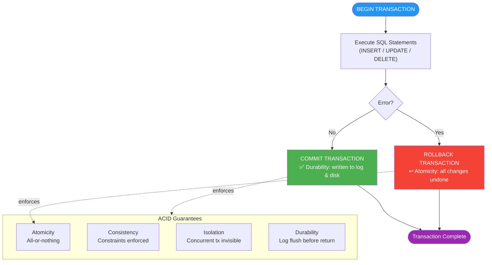

❌ **Violates:**
```sql
-- Missing transaction: if the second UPDATE fails, account balances are inconsistent (money lost)
UPDATE Accounts SET Balance -= 500 WHERE AccountID = 1;   -- debit
UPDATE Accounts SET Balance += 500 WHERE AccountID = 2;   -- credit (might fail)
-- If credit fails, $500 has vanished from account 1 with no corresponding credit
```

✅ **Satisfies:**
```sql
-- Atomic bank transfer: either both updates commit, or neither does
BEGIN TRANSACTION;
BEGIN TRY
    UPDATE Accounts SET Balance -= 500 WHERE AccountID = 1;
    UPDATE Accounts SET Balance += 500 WHERE AccountID = 2;
    COMMIT TRANSACTION;
END TRY
BEGIN CATCH
    ROLLBACK TRANSACTION;
    THROW;
END CATCH;
```

---

### Q52. How does @@TRANCOUNT work, and what is SAVE TRANSACTION used for?

**Answer:** @@TRANCOUNT tracks the nesting depth of transactions: BEGIN TRANSACTION increments it, COMMIT TRANSACTION decrements it, ROLLBACK always resets it to 0 (rolling back all nested levels). This means nested BEGIN/COMMIT pairs do not create true nested transactions — only the outermost COMMIT finalises the work. SAVE TRANSACTION creates a named savepoint allowing a partial rollback to that point without rolling back the entire transaction, useful for undo logic within a complex procedure while preserving outer work.

❌ **Violates:**
```sql
-- Wrong: assumes inner COMMIT finalises the nested transaction
BEGIN TRANSACTION;                   -- @@TRANCOUNT = 1
    BEGIN TRANSACTION inner;         -- @@TRANCOUNT = 2
        UPDATE Orders SET Status='Shipped' WHERE OrderID=1;
    COMMIT TRANSACTION inner;        -- @@TRANCOUNT decrements to 1; NOT yet committed to disk
-- If outer ROLLBACK happens here, the inner "commit" is undone!
ROLLBACK;  -- rolls back everything including the "committed" inner work
```

✅ **Satisfies:**
```sql
-- SAVE TRANSACTION for partial rollback
BEGIN TRANSACTION;
    UPDATE Orders SET Status='Processing' WHERE OrderID=1;

    SAVE TRANSACTION AfterFirstUpdate;   -- savepoint

    UPDATE Orders SET Status='Shipped' WHERE OrderID=1;  -- tentative second update

    IF (SELECT COUNT(*) FROM Inventory WHERE ProductID=5) = 0
    BEGIN
        ROLLBACK TRANSACTION AfterFirstUpdate;   -- undo only second update; keep first
    END;

COMMIT TRANSACTION;   -- commits the first update (second was rolled back to savepoint)
```

---

### Q53. What are the five isolation levels in SQL Server and which concurrency problem does each prevent?

**Answer:** READ UNCOMMITTED allows dirty reads — no shared locks are taken. READ COMMITTED (the default) prevents dirty reads but allows non-repeatable reads and phantom reads. REPEATABLE READ prevents dirty and non-repeatable reads but allows phantom rows. SERIALIZABLE prevents all three — dirty reads, non-repeatable reads, and phantoms — by holding range locks. SNAPSHOT (requires enabling) provides optimistic isolation using row versioning, preventing dirty/non-repeatable/phantom reads without blocking readers, at the cost of tempdb versioning overhead.

**Isolation Levels — Trade-offs at a Glance:**

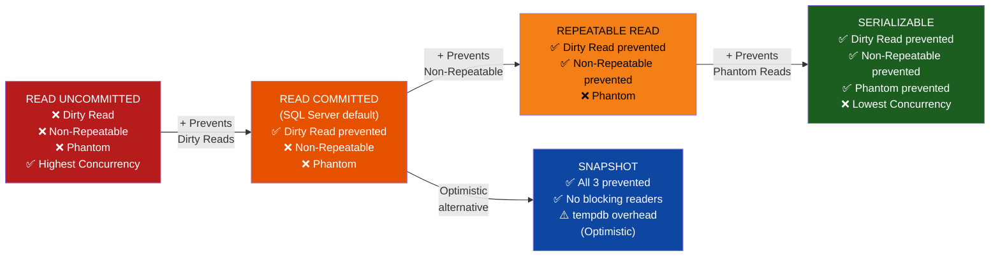

❌ **Violates:**
```sql
-- READ UNCOMMITTED in financial reporting: reads uncommitted data (dirty reads)
SET TRANSACTION ISOLATION LEVEL READ UNCOMMITTED;
SELECT SUM(Balance) FROM Accounts;   -- may sum in-progress, uncommitted transfers
-- Result is meaningless if a concurrent transfer rolled back after this read
```

✅ **Satisfies:**
```sql
-- For reporting that needs consistent reads without blocking writers, use SNAPSHOT
ALTER DATABASE MyDB SET ALLOW_SNAPSHOT_ISOLATION ON;
GO

SET TRANSACTION ISOLATION LEVEL SNAPSHOT;
BEGIN TRANSACTION;
    -- Reads the committed version of data at the start of the transaction
    SELECT SUM(Balance) AS TotalBalance FROM Accounts;  -- consistent snapshot; no dirty reads
COMMIT;
```

---

### Q54. What types of locks does SQL Server use and what is lock escalation?

**Answer:** Shared (S) locks are taken for reads; multiple transactions can hold S locks on the same resource simultaneously. Exclusive (X) locks are taken for writes; they block all other S and X locks. Update (U) locks are an intermediate state — a transaction that intends to update first takes a U lock (compatible with S, not with another U), then promotes to X. Lock escalation occurs when SQL Server holds too many fine-grained (row or page) locks and promotes them to a single table-level lock, reducing memory overhead but increasing blocking. Escalation threshold is approximately 5,000 locks.

❌ **Violates:**
```sql
-- Holding an exclusive lock for a long time by mixing slow logic with writes
BEGIN TRANSACTION;
    UPDATE Orders SET Status='Processing' WHERE OrderID=1;   -- X lock held
    EXEC usp_SendExternalAPINotification;                    -- slow external call
    COMMIT;   -- X lock held for entire API call duration; blocks all readers and writers
```

✅ **Satisfies:**
```sql
-- Do the write, capture the ID, commit immediately, then do slow work outside transaction
DECLARE @OrderID INT;

BEGIN TRANSACTION;
    UPDATE Orders SET Status='Processing' WHERE OrderID=1;
    SET @OrderID = 1;
COMMIT;   -- X lock released immediately

-- Slow work done after transaction closes; no blocking
EXEC usp_SendExternalAPINotification @OrderID;
```

---

### Q55. Describe a classic deadlock scenario and four strategies to prevent deadlocks.

**Answer:** A classic deadlock: Session A holds a lock on Table1 and waits for Table2; Session B holds a lock on Table2 and waits for Table1 — a circular wait. SQL Server's lock monitor detects this, chooses the session with the lower "deadlock priority" (or least expensive rollback) as the victim, and kills it with error 1205. Prevention strategies: (1) access objects in the same order across all sessions, (2) keep transactions short, (3) use SNAPSHOT isolation to eliminate reader-writer conflicts, (4) add appropriate indexes to reduce lock scope and duration.

**Deadlock Cycle — Two Transactions Waiting on Each Other:**

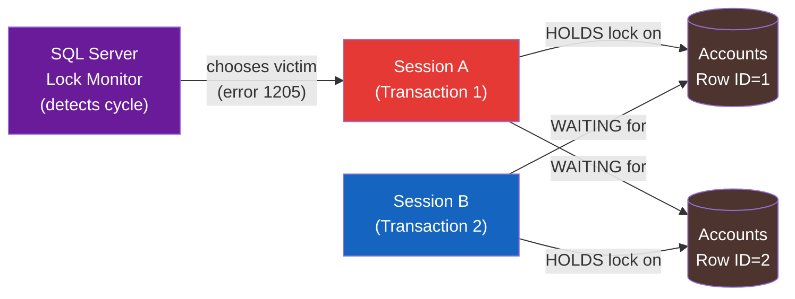

❌ **Violates:**
```sql
-- Session A                              -- Session B
BEGIN TRAN;                              BEGIN TRAN;
UPDATE Accounts SET Bal=100 WHERE ID=1;  UPDATE Accounts SET Bal=200 WHERE ID=2;
-- ... pause ...                         -- ... pause ...
UPDATE Accounts SET Bal=150 WHERE ID=2;  UPDATE Accounts SET Bal=250 WHERE ID=1;
-- Session A waits for ID=2              -- Session B waits for ID=1 → DEADLOCK
```

✅ **Satisfies:**
```sql
-- Fix 1: consistent lock ordering — always update ID=1 before ID=2
BEGIN TRANSACTION;
    UPDATE Accounts SET Balance=100 WHERE AccountID=1;  -- always smaller ID first
    UPDATE Accounts SET Balance=150 WHERE AccountID=2;
COMMIT;

-- Fix 2: short transactions — release locks as fast as possible
-- Fix 3: SNAPSHOT isolation — readers don't block writers
SET TRANSACTION ISOLATION LEVEL SNAPSHOT;

-- Fix 4: deadlock retry pattern in application
-- ON ERROR 1205: wait 50ms and retry up to 3 times
```

---

### Q56. What exact risks does the NOLOCK hint introduce, and when do teams use it?

**Answer:** NOLOCK (equivalent to READ UNCOMMITTED) causes SQL Server to read pages without acquiring shared locks. The risks are: (1) dirty reads — reading uncommitted data that may roll back, (2) non-repeatable reads — the same row can return different values within a statement, (3) phantom reads — rows can appear or disappear mid-scan, and critically (4) reading a page twice or skipping it entirely due to page splits during the scan. Teams use it on reporting queries against high-write OLTP tables to avoid blocking, accepting the risk of slightly stale or inconsistent data. SNAPSHOT isolation is a safer alternative.

❌ **Violates:**
```sql
-- NOLOCK on a financial balance query: can return double-counted or phantom transfers
SELECT SUM(Amount) AS TotalPending
FROM PendingTransfers WITH (NOLOCK);   -- may include uncommitted rows that roll back
-- Result may not match any consistent state of the database
```

✅ **Satisfies:**
```sql
-- Option 1: SNAPSHOT isolation — consistent reads without dirty data or blocking
SET TRANSACTION ISOLATION LEVEL SNAPSHOT;
SELECT SUM(Amount) AS TotalPending FROM PendingTransfers;

-- Option 2: If NOLOCK is accepted policy for non-critical reporting, document it explicitly
SELECT COUNT(*) AS ApproxOrderCount
FROM Orders WITH (NOLOCK)   -- acknowledged: approximate count; stale data acceptable
WHERE OrderDate >= '2024-01-01';
-- Comment must explain WHY NOLOCK is acceptable here
```

---

### Q57. What is SNAPSHOT isolation and how does row versioning work?

**Answer:** SNAPSHOT isolation uses a version store in tempdb to provide each transaction with a consistent view of the database as it existed at the start of the transaction. When a row is modified, the old version is written to tempdb. Readers retrieve the appropriate version without taking shared locks, so readers never block writers and writers never block readers. This is optimistic concurrency: conflicts are detected at commit time (RCSI — Read Committed Snapshot Isolation uses statement-level snapshots). The trade-off is increased tempdb usage and version cleanup overhead.

❌ **Violates:**
```sql
-- Using NOLOCK as poor substitute for SNAPSHOT; accepting data corruption risk
SELECT * FROM SalesReport WITH (NOLOCK);   -- may skip or double-count pages
```

✅ **Satisfies:**
```sql
-- Enable SNAPSHOT isolation at the database level
ALTER DATABASE SalesDB SET READ_COMMITTED_SNAPSHOT ON;    -- RCSI: statement-level snapshots
ALTER DATABASE SalesDB SET ALLOW_SNAPSHOT_ISOLATION ON;   -- transaction-level snapshots

-- Use in a transaction (no blocking of writers)
SET TRANSACTION ISOLATION LEVEL SNAPSHOT;
BEGIN TRANSACTION;
    -- Sees data as of transaction start; writers are not blocked
    SELECT CustomerID, SUM(Amount) AS Revenue
    FROM Orders
    WHERE OrderDate >= '2024-01-01'
    GROUP BY CustomerID;
COMMIT;
```

---

### Q58. How do you delete millions of rows without causing excessive blocking?

**Answer:** A single DELETE of millions of rows creates a massive transaction that holds locks on all affected rows/pages for the entire duration, blocking concurrent reads and writes, and potentially triggering lock escalation to a table lock. The pattern is to delete in small batches inside a loop, committing after each batch to release locks and allow other transactions to proceed. Adding a WAITFOR DELAY between batches reduces I/O pressure. Always include a WHERE filter to target only the rows you want and stop when done.

❌ **Violates:**
```sql
-- Wrong: single DELETE of 10 million rows holds locks for minutes
DELETE FROM AuditLog WHERE CreatedAt < '2022-01-01';
-- Escalates to table lock; blocks all access to AuditLog for the entire delete duration
```

✅ **Satisfies:**
```sql
-- Batch delete: small transactions, locks released between batches
DECLARE @BatchSize INT = 5000;
DECLARE @Deleted   INT = 1;

WHILE @Deleted > 0
BEGIN
    DELETE TOP (@BatchSize)
    FROM AuditLog
    WHERE CreatedAt < '2022-01-01';

    SET @Deleted = @@ROWCOUNT;

    IF @Deleted > 0
        WAITFOR DELAY '00:00:00.100';   -- 100ms pause; reduces I/O pressure
END;
```

---

### Q59. Why should every stored procedure with a transaction use SET XACT_ABORT ON?

**Answer:** By default, a T-SQL error inside a transaction does not automatically roll back the transaction — execution continues to the next statement, potentially leaving the transaction in a partially committed but inconsistent state. SET XACT_ABORT ON changes this: any runtime error (severity 11+) automatically rolls back the current transaction and aborts the batch. This is especially important when the error occurs in a code path that does not have a TRY/CATCH — for example, a CHECK constraint violation buried in a loop. Best practice is to put SET XACT_ABORT ON at the top of every stored procedure that manages transactions.

❌ **Violates:**
```sql
-- Without XACT_ABORT, constraint violation mid-transaction leaves it open
SET XACT_ABORT OFF;   -- default
BEGIN TRANSACTION;
    INSERT INTO Orders(CustomerID, Amount) VALUES(1, 100);    -- OK
    INSERT INTO Orders(CustomerID, Amount) VALUES(NULL, 200); -- FK violation; error raised
    -- Execution continues; transaction is still open (@@TRANCOUNT = 1)
    COMMIT;   -- commits the first insert AND leaves DB in unknown state
```

✅ **Satisfies:**
```sql
SET XACT_ABORT ON;   -- any error auto-rolls back transaction
BEGIN TRANSACTION;
    INSERT INTO Orders(CustomerID, Amount) VALUES(1, 100);
    INSERT INTO Orders(CustomerID, Amount) VALUES(NULL, 200);  -- error: auto-rollback
    COMMIT;   -- never reached; transaction already rolled back
-- @@TRANCOUNT = 0; DB is consistent
```

---

### Q60. How do you capture a deadlock graph using Extended Events?

**Answer:** The system health Extended Events session captures deadlock graphs automatically in XML format and is enabled by default in SQL Server 2012+. The xml_deadlock_report event contains the full deadlock graph including the queries involved, the resources locked, and the victim. You can also create a custom session targeting the deadlock_graph event to persist deadlock data to a file for offline analysis. The deadlock graph XML can be visualized in SSMS by saving the .xdl file and opening it.

❌ **Violates:**
```sql
-- Wrong: using SQL Profiler (deprecated) to capture deadlocks — high overhead, deprecated
-- EXEC sp_trace_create ...  -- Profiler-based tracing is deprecated; use XEvents instead
```

✅ **Satisfies:**
```sql
-- Read deadlock graphs from the default system_health session
SELECT
    xdr.value('@timestamp', 'datetime2')  AS DeadlockTime,
    xdr.query('.')                         AS DeadlockGraph
FROM (
    SELECT CAST(target_data AS XML) AS target_data
    FROM sys.dm_xe_session_targets t
    JOIN sys.dm_xe_sessions s ON s.address = t.event_session_address
    WHERE s.name = 'system_health'
      AND t.target_name = 'ring_buffer'
) AS data
CROSS APPLY target_data.nodes('//RingBufferTarget/event[@name="xml_deadlock_report"]') AS xd(xdr)
ORDER BY DeadlockTime DESC;
```

---
## 7. Window Functions

> 📚 Reference: https://learn.microsoft.com/en-us/sql/t-sql/queries/select-over-clause-transact-sql
> 📚 Medium: https://medium.com/learning-sql/sql-server-window-functions-complete-guide-row-number-rank-lag-lead-7a8b9c0d1e2f

---

### Q61. What is the OVER() clause and how do window functions differ from GROUP BY?

**Answer:** The OVER() clause defines a "window" of rows over which a function is computed relative to the current row. Unlike GROUP BY, window functions do not collapse rows — every input row remains in the output with its own computed window value. The OVER() clause can specify PARTITION BY (logical groups), ORDER BY (sort order within partitions), and a frame clause (ROWS/RANGE). Window functions belong to three categories: ranking (ROW_NUMBER, RANK, DENSE_RANK, NTILE), offset (LAG, LEAD, FIRST_VALUE, LAST_VALUE), and aggregate (SUM, AVG, COUNT, MIN, MAX used with OVER).

❌ **Violates:**
```sql
-- GROUP BY collapses to one row per department; individual employee names are lost
SELECT DepartmentID, AVG(Salary) AS AvgSalary
FROM Employees
GROUP BY DepartmentID;
-- Cannot also show individual employee Name and Salary in the same query
```

✅ **Satisfies:**
```sql
-- Window function: each employee row preserved + department average in same result
SELECT Name,
       DepartmentID,
       Salary,
       AVG(Salary) OVER (PARTITION BY DepartmentID) AS DeptAvgSalary,
       Salary - AVG(Salary) OVER (PARTITION BY DepartmentID) AS DiffFromAvg
FROM Employees;
```

---

### Q62. How do you use ROW_NUMBER() for pagination and deduplication?

**Answer:** ROW_NUMBER() assigns a sequential integer to each row within a partition, starting at 1. For pagination it generates a row number ordered by a sort key; a wrapping query then filters WHERE rn BETWEEN start AND end. For deduplication it partitions by the logical key columns; selecting WHERE rn = 1 keeps only the first occurrence per group. The ORDER BY inside OVER() is mandatory for ROW_NUMBER() and determines which row gets rn=1.

❌ **Violates:**
```sql
-- Deduplication using GROUP BY: cannot choose which duplicate to keep based on a column
SELECT CustomerID, Email
FROM Customers
GROUP BY CustomerID, Email;
-- If there are 3 rows for CustomerID=1 with different LoadDates, cannot pick the latest
```

✅ **Satisfies:**
```sql
-- Deduplication: keep the most recently loaded row per CustomerID
WITH Deduped AS (
    SELECT *,
           ROW_NUMBER() OVER (PARTITION BY CustomerID ORDER BY LoadDate DESC) AS rn
    FROM Customers
)
SELECT CustomerID, Email, Name FROM Deduped WHERE rn = 1;

-- Pagination: page 3, 10 rows per page
WITH Paged AS (
    SELECT *, ROW_NUMBER() OVER (ORDER BY OrderDate DESC) AS rn
    FROM Orders
)
SELECT * FROM Paged WHERE rn BETWEEN 21 AND 30;
```

---

### Q63. What is the difference between RANK, DENSE_RANK, ROW_NUMBER, and NTILE when ties exist?

**Answer:** When rows have equal ORDER BY values: ROW_NUMBER() assigns unique sequential numbers (ties broken arbitrarily). RANK() gives tied rows the same rank and skips the next numbers (1, 1, 3 — gap). DENSE_RANK() gives tied rows the same rank but does not skip (1, 1, 2 — no gap). NTILE(n) divides rows into n roughly equal buckets; ties within a bucket are not distinguished. Choose based on business requirement: DENSE_RANK for "top 3 distinct salaries", ROW_NUMBER for strict unique ordering.

❌ **Violates:**
```sql
-- Using RANK() when business wants "top 3 salary levels" but query returns > 3 rows
SELECT Name, Salary, RANK() OVER (ORDER BY Salary DESC) AS rnk
FROM Employees
WHERE RANK() OVER (ORDER BY Salary DESC) <= 3;  -- ERROR: window functions can't be in WHERE
```

✅ **Satisfies:**
```sql
-- All four functions compared for the same data
SELECT Name, Salary,
       ROW_NUMBER()  OVER (ORDER BY Salary DESC) AS RowNum,   -- unique: 1,2,3,4,5
       RANK()        OVER (ORDER BY Salary DESC) AS Rnk,      -- gaps:   1,1,3,4,4
       DENSE_RANK()  OVER (ORDER BY Salary DESC) AS DenseRnk, -- no gap: 1,1,2,3,3
       NTILE(3)      OVER (ORDER BY Salary DESC) AS Bucket     -- buckets: 1,1,2,2,3
FROM Employees;

-- Top 3 distinct salary levels (use DENSE_RANK)
SELECT Name, Salary
FROM (SELECT *, DENSE_RANK() OVER (ORDER BY Salary DESC) AS dr FROM Employees) x
WHERE dr <= 3;
```

---

### Q64. How do LAG() and LEAD() work for month-over-month change calculation?

**Answer:** LAG(col, offset, default) returns the value from a row that is offset rows before the current row within the partition. LEAD(col, offset, default) returns the value from offset rows after. The default value (third argument) is returned when the offset falls outside the partition boundary (e.g., LAG on the first row). These functions are ideal for sequential comparisons like month-over-month revenue change, without requiring a self-join to the same table.

❌ **Violates:**
```sql
-- Self-join for month-over-month: complex, slow, and fragile (requires consecutive months)
SELECT a.Month, a.Revenue, a.Revenue - b.Revenue AS MoMChange
FROM MonthlySales a
JOIN MonthlySales b ON a.Month = DATEADD(MONTH, 1, b.Month);
-- Breaks if any month is missing from the data
```

✅ **Satisfies:**
```sql
-- LAG for month-over-month change: clean and handles missing months gracefully
SELECT
    SaleMonth,
    Revenue,
    LAG(Revenue, 1, 0) OVER (ORDER BY SaleMonth)                         AS PrevMonthRevenue,
    Revenue - LAG(Revenue, 1, 0) OVER (ORDER BY SaleMonth)               AS MoMChange,
    ROUND(
        100.0 * (Revenue - LAG(Revenue, 1) OVER (ORDER BY SaleMonth))
              / NULLIF(LAG(Revenue, 1) OVER (ORDER BY SaleMonth), 0),
        2
    )                                                                      AS MoMPct
FROM MonthlySales
ORDER BY SaleMonth;
```

---

### Q65. What is the LAST_VALUE frame bug and how do you fix it?

**Answer:** LAST_VALUE() by default uses the frame RANGE BETWEEN UNBOUNDED PRECEDING AND CURRENT ROW, meaning it only looks back to the current row — so it always returns the current row's value, not the partition's last value. To get the true last value in the partition you must explicitly specify ROWS BETWEEN UNBOUNDED PRECEDING AND UNBOUNDED FOLLOWING. FIRST_VALUE() does not have this issue because its default frame already starts from the beginning. This is a silent bug — no error is raised; the result is just wrong.

❌ **Violates:**
```sql
-- LAST_VALUE returns current row value due to default frame, not the partition's last
SELECT Name, Salary,
       LAST_VALUE(Salary) OVER (
           PARTITION BY DepartmentID ORDER BY Salary
       ) AS MaxSalary   -- WRONG: returns current row's Salary, not the last/highest
FROM Employees;
```

✅ **Satisfies:**
```sql
-- Fix: explicitly extend the frame to UNBOUNDED FOLLOWING
SELECT Name, Salary,
       FIRST_VALUE(Salary) OVER (
           PARTITION BY DepartmentID ORDER BY Salary ASC
       )                                                      AS MinSalary,
       LAST_VALUE(Salary) OVER (
           PARTITION BY DepartmentID ORDER BY Salary ASC
           ROWS BETWEEN UNBOUNDED PRECEDING AND UNBOUNDED FOLLOWING  -- explicit full frame
       )                                                      AS MaxSalary
FROM Employees;
```

---

### Q66. How do you compute a running total and a 7-day moving average with window functions?

**Answer:** A running total uses SUM() with OVER(ORDER BY date ROWS BETWEEN UNBOUNDED PRECEDING AND CURRENT ROW). The explicit ROWS frame ensures physical row counting; RANGE (the default when only ORDER BY is specified) uses logical value ranges, which can produce unexpected results when there are duplicate dates. A 7-day moving average uses ROWS BETWEEN 6 PRECEDING AND CURRENT ROW, averaging the current row and the 6 rows before it within the ordered partition.

❌ **Violates:**
```sql
-- RANGE default: all rows with the same date get the same running total (sum of the entire day)
SELECT SaleDate, Amount,
       SUM(Amount) OVER (ORDER BY SaleDate) AS RunningTotal
-- RANGE BETWEEN UNBOUNDED PRECEDING AND CURRENT ROW is the implicit default
-- On days with multiple rows, all rows get the full-day cumulative sum, not a per-row running total
FROM DailySales;
```

✅ **Satisfies:**
```sql
-- Explicit ROWS frame: true running total row by row
SELECT SaleDate, Amount,
       SUM(Amount)  OVER (ORDER BY SaleDate ROWS BETWEEN UNBOUNDED PRECEDING AND CURRENT ROW)
                                                                   AS RunningTotal,
       AVG(Amount)  OVER (ORDER BY SaleDate ROWS BETWEEN 6 PRECEDING AND CURRENT ROW)
                                                                   AS Avg7Day,
       COUNT(*)     OVER (ORDER BY SaleDate ROWS BETWEEN 6 PRECEDING AND CURRENT ROW)
                                                                   AS DaysInWindow
FROM DailySales
ORDER BY SaleDate;
```

---

### Q67. How does a partitioned running total reset per customer?

**Answer:** Adding PARTITION BY to the window function resets the calculation for each partition boundary. A running total PARTITION BY CustomerID resets the cumulative sum when the CustomerID changes, giving each customer their own independent running total. Without PARTITION BY the running total spans all rows globally. This is the fundamental difference between a global aggregate window and a per-group aggregate window.

❌ **Violates:**
```sql
-- Global running total: accumulates across all customers instead of resetting per customer
SELECT CustomerID, OrderDate, Amount,
       SUM(Amount) OVER (ORDER BY CustomerID, OrderDate
                         ROWS BETWEEN UNBOUNDED PRECEDING AND CURRENT ROW) AS RunningTotal
FROM Orders;
-- CustomerID=2's running total starts where CustomerID=1 left off
```

✅ **Satisfies:**
```sql
-- PARTITION BY resets running total per customer
SELECT CustomerID, OrderDate, Amount,
       SUM(Amount) OVER (
           PARTITION BY CustomerID                            -- reset per customer
           ORDER BY OrderDate
           ROWS BETWEEN UNBOUNDED PRECEDING AND CURRENT ROW  -- row-by-row accumulation
       ) AS CustomerRunningTotal
FROM Orders
ORDER BY CustomerID, OrderDate;
```

---

### Q68. What is the difference between ROWS and RANGE frame specifications?

**Answer:** ROWS counts physical rows relative to the current row — it is precise and predictable. RANGE defines a logical frame based on value proximity to the current row's ORDER BY value — when two rows have equal values, both fall in the same logical range. RANGE BETWEEN UNBOUNDED PRECEDING AND CURRENT ROW (the implicit default when ORDER BY is specified) includes all rows tied with the current row up to the current row's value. This can make running totals "jump" on tied values. ROWS is almost always what you intend for running aggregates.

❌ **Violates:**
```sql
-- RANGE: two rows with same SaleDate both get the same "running total" = sum of both
SELECT SaleDate, Amount,
       SUM(Amount) OVER (ORDER BY SaleDate)  -- implicit RANGE; tied dates get same sum
       AS RunningTotal
FROM Sales;
-- Date 2024-01-15 appears twice: both rows get 300 instead of 100 then 300
```

✅ **Satisfies:**
```sql
-- ROWS: each physical row gets its own incrementally accumulated total
SELECT SaleDate, Amount,
       SUM(Amount) OVER (
           ORDER BY SaleDate
           ROWS BETWEEN UNBOUNDED PRECEDING AND CURRENT ROW   -- physical row frame
       ) AS RunningTotal,
       SUM(Amount) OVER (
           ORDER BY SaleDate
           RANGE BETWEEN UNBOUNDED PRECEDING AND CURRENT ROW  -- logical value frame
       ) AS RunningTotalRange   -- shown for comparison; different on tied dates
FROM Sales
ORDER BY SaleDate;
```

---

### Q69. How do you calculate each row as a percentage of the partition total?

**Answer:** Percentage of total is calculated by dividing the row's value by the partition SUM() using a window function with no ORDER BY clause (which gives the full partition total, not a running total). This avoids a self-join or a correlated subquery. Omitting ORDER BY from the OVER() clause means the aggregate is computed over the entire partition, which is what you want for a "what fraction of the whole" calculation.

❌ **Violates:**
```sql
-- Self-join approach: verbose, two table scans, harder to maintain
SELECT s.Region, s.Revenue,
       100.0 * s.Revenue / t.TotalRevenue AS PctOfTotal
FROM Sales s
JOIN (SELECT Region, SUM(Revenue) AS TotalRevenue FROM Sales GROUP BY Region) t
     ON s.Region = t.Region;
```

✅ **Satisfies:**
```sql
-- Window function: single scan, no self-join
SELECT Region, SaleMonth, Revenue,
       SUM(Revenue) OVER (PARTITION BY Region) AS RegionTotal,
       ROUND(
           100.0 * Revenue / SUM(Revenue) OVER (PARTITION BY Region),
           2
       ) AS PctOfRegionTotal,
       ROUND(
           100.0 * Revenue / SUM(Revenue) OVER (),   -- OVER() with no partition = grand total
           2
       ) AS PctOfGrandTotal
FROM MonthlySales;
```

---

### Q70. Write classic window function queries: top-2 per department, gaps-and-islands, and YoY change.

**Answer:** These three patterns are the most frequently tested window function interview questions. Top-2 per group uses DENSE_RANK() PARTITION BY group ORDER BY value, filtering WHERE dr <= 2. Gaps-and-islands groups consecutive rows using the difference between ROW_NUMBER() and the value (or date) — rows in the same island have the same difference. Year-over-year change uses LAG() with a partition by category and order by year. All three require wrapping the window function in a CTE or subquery because window functions cannot appear in WHERE.

❌ **Violates:**
```sql
-- Cannot filter on window function directly in WHERE
SELECT Name, Salary, DENSE_RANK() OVER (PARTITION BY Dept ORDER BY Salary DESC) AS dr
FROM Employees WHERE dr <= 2;   -- ERROR: dr not available in WHERE clause
```

✅ **Satisfies:**
```sql
-- 1. Top 2 earners per department
SELECT Name, DepartmentID, Salary
FROM (
    SELECT *, DENSE_RANK() OVER (PARTITION BY DepartmentID ORDER BY Salary DESC) AS dr
    FROM Employees
) x WHERE dr <= 2;

-- 2. Gaps and islands: group consecutive dates
SELECT MIN(SaleDate) AS IslandStart, MAX(SaleDate) AS IslandEnd, COUNT(*) AS Days
FROM (
    SELECT SaleDate,
           DATEADD(DAY, -ROW_NUMBER() OVER (ORDER BY SaleDate), SaleDate) AS Grp
    FROM DailySales
) x GROUP BY Grp ORDER BY IslandStart;

-- 3. Year-over-year revenue change
SELECT Year, Revenue,
       LAG(Revenue) OVER (ORDER BY Year)                              AS PrevYear,
       Revenue - LAG(Revenue) OVER (ORDER BY Year)                    AS YoYChange,
       ROUND(100.0 * (Revenue - LAG(Revenue) OVER (ORDER BY Year))
             / NULLIF(LAG(Revenue) OVER (ORDER BY Year), 0), 2)       AS YoYPct
FROM AnnualRevenue;
```

---
## 8. CTEs & Subqueries

> 📚 Reference: https://learn.microsoft.com/en-us/sql/t-sql/queries/with-common-table-expression-transact-sql
> 📚 Medium: https://medium.com/learning-sql/cte-vs-subquery-vs-temp-table-sql-server-complete-guide-8b9c0d1e2f3a

---

### Q71. What is a CTE, how do you define multiple CTEs, and what is the re-evaluation caveat?

**Answer:** A Common Table Expression (CTE) is a named temporary result set defined with the WITH keyword, scoped to the immediately following SELECT, INSERT, UPDATE, or DELETE statement. Multiple CTEs are chained with commas after the first WITH. A CTE is not materialized by default — it is re-evaluated every time it is referenced, unlike a temp table. If a CTE is referenced twice in the same query, it may execute twice; for expensive CTEs referenced multiple times, a temp table is more efficient.

❌ **Violates:**
```sql
-- CTE referenced twice: may be evaluated twice (expensive if complex)
WITH ExpensiveCTE AS (
    SELECT CustomerID, SUM(Amount) AS Total
    FROM Orders GROUP BY CustomerID
)
SELECT a.CustomerID FROM ExpensiveCTE a
JOIN ExpensiveCTE b ON a.CustomerID = b.CustomerID AND a.Total > b.Total * 0.9;
-- ExpensiveCTE may scan Orders twice
```

✅ **Satisfies:**
```sql
-- Multiple chained CTEs: each references the previous
WITH
ActiveCustomers AS (
    SELECT CustomerID, Name FROM Customers WHERE IsActive = 1
),
CustomerRevenue AS (
    SELECT c.CustomerID, c.Name, SUM(o.Amount) AS TotalRevenue
    FROM ActiveCustomers c
    JOIN Orders o ON c.CustomerID = o.CustomerID
    GROUP BY c.CustomerID, c.Name
),
RankedCustomers AS (
    SELECT *, DENSE_RANK() OVER (ORDER BY TotalRevenue DESC) AS RevenueRank
    FROM CustomerRevenue
)
SELECT * FROM RankedCustomers WHERE RevenueRank <= 10;
```

---

### Q72. How do recursive CTEs work, and how do you generate an org hierarchy or date sequence?

**Answer:** A recursive CTE has two parts separated by UNION ALL: an anchor member (the base case, executed once) and a recursive member (references the CTE itself, executed repeatedly until no more rows are produced). SQL Server prevents infinite loops with MAXRECURSION (default 100; set to 0 for unlimited). The recursion depth is tracked with a counter column. For hierarchy traversal, the anchor is the root rows; the recursive member joins to find children. For date sequences, the anchor is the start date and the recursive member adds one interval per iteration.

❌ **Violates:**
```sql
-- Wrong: tries to use a regular CTE for hierarchy (non-recursive; only gets one level)
WITH DirectReports AS (
    SELECT EmployeeID, Name, ManagerID FROM Employees WHERE ManagerID IS NULL
)
SELECT * FROM DirectReports;   -- only root employees; no recursion to find their reports
```

✅ **Satisfies:**
```sql
-- Recursive CTE: full org hierarchy with level and path
WITH OrgHierarchy AS (
    -- Anchor: top-level employees (no manager)
    SELECT EmployeeID, Name, ManagerID,
           0                            AS Level,
           CAST(Name AS NVARCHAR(4000)) AS Path
    FROM Employees WHERE ManagerID IS NULL

    UNION ALL

    -- Recursive: find each employee's direct reports
    SELECT e.EmployeeID, e.Name, e.ManagerID,
           h.Level + 1,
           CAST(h.Path + ' > ' + e.Name AS NVARCHAR(4000))
    FROM Employees e
    JOIN OrgHierarchy h ON e.ManagerID = h.EmployeeID
)
SELECT Level, Path, Name FROM OrgHierarchy ORDER BY Path
OPTION (MAXRECURSION 50);

-- Date sequence from 2024-01-01 to 2024-01-31
WITH Dates AS (
    SELECT CAST('2024-01-01' AS DATE) AS d
    UNION ALL
    SELECT DATEADD(DAY, 1, d) FROM Dates WHERE d < '2024-01-31'
)
SELECT d FROM Dates OPTION (MAXRECURSION 31);
```

---

### Q73. When should you use a CTE vs a temp table vs a table variable?

**Answer:** CTEs are syntax sugar — readable and scoped to one statement, but not persisted and may re-evaluate. Temp tables (#temp) are physical objects in tempdb with statistics, indexes, and visibility to nested stored procedures; they are best for large intermediate result sets or when the data is reused multiple times. Table variables (@table) are memory-hinted but can spill to disk; they have no statistics (the optimizer assumes 1 row), no parallelism support, and cannot be indexed in older SQL versions — avoid for large datasets. Rule of thumb: CTE for readability on small data, temp table for large intermediate results, table variable only for small lookup sets.

❌ **Violates:**
```sql
-- Table variable with 500,000 rows: optimizer estimates 1 row; catastrophically bad plan
DECLARE @BigResult TABLE (CustomerID INT, Revenue DECIMAL(18,2));
INSERT INTO @BigResult SELECT CustomerID, SUM(Amount) FROM Orders GROUP BY CustomerID;
-- Optimizer assumes @BigResult has 1 row; nested loop chosen over hash join; very slow
```

✅ **Satisfies:**
```sql
-- Temp table: has statistics, can be indexed, supports parallel plans
CREATE TABLE #CustomerRevenue (
    CustomerID INT PRIMARY KEY,
    Revenue    DECIMAL(18,2)
);
INSERT INTO #CustomerRevenue SELECT CustomerID, SUM(Amount) FROM Orders GROUP BY CustomerID;

-- Now the optimizer has accurate statistics for the join
SELECT c.Name, r.Revenue
FROM Customers c
JOIN #CustomerRevenue r ON c.CustomerID = r.CustomerID
ORDER BY r.Revenue DESC;

DROP TABLE #CustomerRevenue;
```

---

### Q74. What is the N+1 risk of scalar subqueries in SELECT?

**Answer:** A correlated scalar subquery in the SELECT list executes once per row of the outer query. If the outer query returns 10,000 rows, the subquery runs 10,000 times — this is the N+1 problem familiar from ORM frameworks. It is especially dangerous when the subquery hits a large table. The fix is to rewrite the scalar subquery as a JOIN to a pre-aggregated derived table or use a window function, reducing the table scans to one.

❌ **Violates:**
```sql
-- Correlated scalar subquery: executes once per Customer row (N+1)
SELECT c.CustomerID, c.Name,
       (SELECT SUM(Amount) FROM Orders o WHERE o.CustomerID = c.CustomerID) AS TotalSpent,
       (SELECT COUNT(*)    FROM Orders o WHERE o.CustomerID = c.CustomerID) AS OrderCount
FROM Customers c;
-- Two separate correlated subqueries; each scans Orders once per customer row
```

✅ **Satisfies:**
```sql
-- Single aggregation JOIN: Orders scanned once; O(1) not O(n)
SELECT c.CustomerID, c.Name,
       COALESCE(o.TotalSpent, 0)  AS TotalSpent,
       COALESCE(o.OrderCount, 0)  AS OrderCount
FROM Customers c
LEFT JOIN (
    SELECT CustomerID,
           SUM(Amount) AS TotalSpent,
           COUNT(*)    AS OrderCount
    FROM Orders
    GROUP BY CustomerID
) o ON c.CustomerID = o.CustomerID;
```

---

### Q75. What is the difference between a derived table and a CTE in terms of readability and reuse?

**Answer:** A derived table is an inline subquery in the FROM clause, aliased and referenced immediately. It cannot be referenced more than once in the same query. A CTE is defined once at the top with a name and can be referenced multiple times in the subsequent query, improving readability for multi-step logic. Deeply nested derived tables become unreadable; a chain of CTEs is far clearer. Neither is persisted — both disappear after the statement. For true reuse across statements, a view or temp table is needed.

❌ **Violates:**
```sql
-- Deeply nested derived tables: nearly unreadable
SELECT * FROM
  (SELECT CustomerID, SUM(Amt) AS Total FROM
    (SELECT CustomerID, Amount AS Amt FROM Orders WHERE Amount > 0) AS cleaned
   GROUP BY CustomerID) AS summed
WHERE Total > 1000;
```

✅ **Satisfies:**
```sql
-- Same logic as chained CTEs: clear and readable
WITH CleanedOrders AS (
    SELECT CustomerID, Amount AS Amt
    FROM Orders WHERE Amount > 0
),
CustomerTotals AS (
    SELECT CustomerID, SUM(Amt) AS Total
    FROM CleanedOrders
    GROUP BY CustomerID
)
SELECT CustomerID, Total
FROM CustomerTotals
WHERE Total > 1000;
```

---

### Q76. How do you rewrite a correlated subquery as a JOIN to improve performance?

**Answer:** A correlated subquery in a WHERE clause (e.g., WHERE col = (SELECT MAX(col) FROM t2 WHERE t2.id = t1.id)) is re-executed for every row of the outer table. Converting it to a JOIN with a derived table or CTE that pre-computes the aggregate is typically a single-pass operation and orders of magnitude faster on large tables. The optimizer sometimes transforms them automatically, but explicit rewrites are safer and always readable.

❌ **Violates:**
```sql
-- Correlated subquery: runs MAX() subquery once per Orders row
SELECT OrderID, Amount
FROM Orders o
WHERE Amount = (
    SELECT MAX(Amount)
    FROM Orders
    WHERE CustomerID = o.CustomerID   -- correlated: references outer row
);
-- If Orders has 1M rows, subquery runs 1M times
```

✅ **Satisfies:**
```sql
-- Rewrite as JOIN to pre-aggregated result: two passes instead of N+1
WITH MaxPerCustomer AS (
    SELECT CustomerID, MAX(Amount) AS MaxAmount
    FROM Orders GROUP BY CustomerID
)
SELECT o.OrderID, o.Amount
FROM Orders o
JOIN MaxPerCustomer m ON o.CustomerID = m.CustomerID
                     AND o.Amount = m.MaxAmount;

-- Alternative: window function (single pass)
SELECT OrderID, Amount
FROM (
    SELECT OrderID, Amount,
           MAX(Amount) OVER (PARTITION BY CustomerID) AS MaxAmt
    FROM Orders
) x WHERE Amount = MaxAmt;
```

---

### Q77. When do you use EXISTS vs IN vs JOIN, and what makes EXISTS NULL-safe?

**Answer:** EXISTS evaluates a Boolean and short-circuits on the first match — it never needs to materialize the inner result set. IN materializes the subquery results, then checks membership; it is efficient for small, fixed lists. JOIN returns all matching rows (can produce duplicates in one-to-many). NOT IN is NULL-unsafe; NOT EXISTS handles NULLs correctly because it does not perform equality comparisons. For semi-join tests (does a matching row exist?), EXISTS is the canonical choice; for data retrieval from both tables, JOIN is correct.

❌ **Violates:**
```sql
-- IN with large subquery: materializes entire subquery result, then checks each outer row
SELECT Name FROM Customers
WHERE CustomerID IN (
    SELECT CustomerID FROM Orders WHERE Amount > 1000
);   -- can be slow if subquery returns millions of IDs
```

✅ **Satisfies:**
```sql
-- EXISTS: short-circuits; does not materialize inner result set
SELECT Name FROM Customers c
WHERE EXISTS (
    SELECT 1 FROM Orders o
    WHERE o.CustomerID = c.CustomerID AND o.Amount > 1000
);

-- JOIN when you need columns from both tables
SELECT c.Name, o.OrderID, o.Amount
FROM Customers c
JOIN Orders o ON c.CustomerID = o.CustomerID
WHERE o.Amount > 1000;
-- Note: JOIN can duplicate customers if they have multiple qualifying orders
```

---

### Q78. How does CROSS APPLY work with a TVF, and how do you get top N per group?

**Answer:** CROSS APPLY passes each row from the left table as a parameter to a table-valued function (or inline subquery) on the right side and returns rows for matches only (like INNER JOIN). This is the ideal pattern for parameterized "top N per group" without a window function workaround. The TVF or inline subquery can reference columns from the outer table, which a standard JOIN cannot do with TOP. OUTER APPLY returns all left rows even when the applied expression returns nothing.

❌ **Violates:**
```sql
-- Incorrect TOP N per group: TOP inside a JOIN subquery does not see outer columns
SELECT c.CustomerID, o.OrderID, o.Amount
FROM Customers c
JOIN (SELECT TOP 3 OrderID, Amount, CustomerID FROM Orders ORDER BY Amount DESC) o
     ON c.CustomerID = o.CustomerID;
-- The inner TOP 3 is global, not per customer!
```

✅ **Satisfies:**
```sql
-- CROSS APPLY: TOP 3 orders per customer (correctly scoped per outer row)
SELECT c.CustomerName, top3.OrderID, top3.Amount
FROM Customers c
CROSS APPLY (
    SELECT TOP 3 OrderID, Amount
    FROM Orders
    WHERE CustomerID = c.CustomerID   -- references outer table column
    ORDER BY Amount DESC
) top3;

-- Inline TVF version (reusable)
CREATE OR ALTER FUNCTION dbo.fn_TopOrders(@CustomerID INT, @N INT)
RETURNS TABLE AS RETURN (
    SELECT TOP (@N) OrderID, Amount FROM Orders
    WHERE CustomerID = @CustomerID ORDER BY Amount DESC
);
SELECT c.CustomerName, o.OrderID, o.Amount
FROM Customers c
CROSS APPLY dbo.fn_TopOrders(c.CustomerID, 3) o;
```

---

### Q79. Write a recursive CTE that returns a full path string and a level counter.

**Answer:** A recursive CTE for hierarchy traversal should include a Level column (incremented by 1 per recursion) and a Path column (concatenated from ancestors). The Level helps filter to a specific depth. The Path enables breadcrumb-style display and ORDER BY for hierarchical output. CAST the Path column to a wide NVARCHAR in the anchor to prevent truncation errors as the path grows.

❌ **Violates:**
```sql
-- Missing level counter and path; cannot determine depth or display hierarchy
WITH Hierarchy AS (
    SELECT EmployeeID, ManagerID FROM Employees WHERE ManagerID IS NULL
    UNION ALL
    SELECT e.EmployeeID, e.ManagerID FROM Employees e
    JOIN Hierarchy h ON e.ManagerID = h.EmployeeID
)
SELECT * FROM Hierarchy;   -- no Level; no Path; hard to use
```

✅ **Satisfies:**
```sql
WITH EmployeeHierarchy AS (
    -- Anchor: root nodes (no manager)
    SELECT EmployeeID,
           Name,
           ManagerID,
           0                             AS Level,
           CAST(Name AS NVARCHAR(4000))  AS FullPath
    FROM Employees
    WHERE ManagerID IS NULL

    UNION ALL

    -- Recursive: children of already-found nodes
    SELECT e.EmployeeID,
           e.Name,
           e.ManagerID,
           h.Level + 1,
           CAST(h.FullPath + N' > ' + e.Name AS NVARCHAR(4000))
    FROM Employees e
    JOIN EmployeeHierarchy h ON e.ManagerID = h.EmployeeID
)
SELECT REPLICATE('  ', Level) + Name AS IndentedName,  -- visual indent
       Level,
       FullPath
FROM EmployeeHierarchy
ORDER BY FullPath
OPTION (MAXRECURSION 100);
```

---

### Q80. How do you build a chained CTE pipeline for Raw -> Cleaned -> Aggregated -> Ranked data?

**Answer:** Chained CTEs create a readable pipeline where each step transforms the data from the previous step, like stages in an ETL process. Each CTE name can be referenced by subsequent CTEs and by the final query. This pattern replaces deeply nested subqueries with named, self-documenting stages. The entire pipeline is compiled as a single query, allowing the optimizer to choose the most efficient overall plan.

❌ **Violates:**
```sql
-- Five levels of nested subqueries: unreadable, hard to debug
SELECT Region, Revenue, Rank FROM
  (SELECT *, RANK() OVER (ORDER BY Revenue DESC) AS Rank FROM
    (SELECT Region, SUM(CleanAmt) AS Revenue FROM
      (SELECT Region, CASE WHEN Amount < 0 THEN 0 ELSE Amount END AS CleanAmt FROM
        (SELECT Region, Amount FROM Sales WHERE Amount IS NOT NULL) r) c
      GROUP BY Region) a) ranked;
```

✅ **Satisfies:**
```sql
WITH
-- Stage 1: Raw — filter nulls
RawData AS (
    SELECT Region, Amount, SaleDate
    FROM Sales
    WHERE Amount IS NOT NULL
),
-- Stage 2: Clean — fix negative amounts
CleanedData AS (
    SELECT Region, SaleDate,
           CASE WHEN Amount < 0 THEN 0 ELSE Amount END AS CleanAmount
    FROM RawData
),
-- Stage 3: Aggregate — sum by region
AggregatedData AS (
    SELECT Region,
           SUM(CleanAmount)  AS TotalRevenue,
           COUNT(*)          AS TransactionCount
    FROM CleanedData
    GROUP BY Region
),
-- Stage 4: Rank — rank regions by revenue
RankedData AS (
    SELECT *,
           RANK() OVER (ORDER BY TotalRevenue DESC) AS RevenueRank
    FROM AggregatedData
)
SELECT Region, TotalRevenue, TransactionCount, RevenueRank
FROM RankedData
WHERE RevenueRank <= 5
ORDER BY RevenueRank;
```

---
## 9. Database Design & Normalization

> 📚 Reference: https://learn.microsoft.com/en-us/sql/relational-databases/tables/table-design-guidelines
> 📚 Medium: https://medium.com/learning-sql/database-normalization-1nf-2nf-3nf-with-sql-examples-9c0d1e2f3a4b

---

### Q81. What are 1NF, 2NF, and 3NF, and can you show violation examples and fixes?

**Answer:** First Normal Form (1NF) requires atomic values — no repeating groups or multi-valued columns. Second Normal Form (2NF) requires 1NF plus every non-key column must depend on the entire composite primary key, not just part of it. Third Normal Form (3NF) requires 2NF plus no transitive dependencies — non-key columns must not depend on other non-key columns. Violations introduce update anomalies: changing data in one place does not update all copies.

❌ **Violates:**
```sql
-- 1NF violation: multiple phone numbers in one column
CREATE TABLE Contacts (ContactID INT, Name VARCHAR(100), Phones VARCHAR(200));
-- Phones = '555-1234, 555-5678' -- not atomic; cannot query individual phones

-- 2NF violation: OrderDate depends only on OrderID, not on (OrderID, ProductID)
CREATE TABLE OrderItems (OrderID INT, ProductID INT, OrderDate DATE, Quantity INT,
    PRIMARY KEY (OrderID, ProductID));
-- OrderDate is a partial dependency on OrderID alone
```

✅ **Satisfies:**
```sql
-- 1NF fix: separate table for phone numbers
CREATE TABLE ContactPhones (ContactID INT, PhoneType VARCHAR(20), Phone VARCHAR(20),
    PRIMARY KEY (ContactID, PhoneType));

-- 2NF fix: move OrderDate to Orders table where it belongs
CREATE TABLE Orders     (OrderID INT PRIMARY KEY, OrderDate DATE, CustomerID INT);
CREATE TABLE OrderItems (OrderID INT, ProductID INT, Quantity INT,
    PRIMARY KEY (OrderID, ProductID));

-- 3NF fix: remove transitive dependency (ZipCode -> City, State)
-- Before (violation): CREATE TABLE Employees(EmpID INT, ZipCode CHAR(5), City VARCHAR(50), State CHAR(2))
CREATE TABLE ZipCodes  (ZipCode CHAR(5) PRIMARY KEY, City VARCHAR(50), State CHAR(2));
CREATE TABLE Employees (EmpID INT PRIMARY KEY, ZipCode CHAR(5) REFERENCES ZipCodes(ZipCode));
```

---

### How do you identify and eliminate data redundancy through normalization?

**Answer:**
Data redundancy — storing the same fact in multiple rows or columns — causes three types of anomalies:
- **Update anomaly**: change data in one row but forget others → inconsistency
- **Insert anomaly**: can't add a fact without unrelated required data
- **Delete anomaly**: deleting a row accidentally loses an unrelated fact

The fix is normalization: decompose the table until each fact is stored exactly once. Follow these steps:

```sql
-- ❌ BEFORE — unnormalized Orders table (all facts crammed together)
-- OrderID | CustomerName | CustomerEmail    | ProductName | Category    | Qty | Price
-- 1       | Alice        | alice@email.com  | Laptop      | Electronics | 1   | 1200
-- 1       | Alice        | alice@email.com  | Mouse       | Electronics | 2   | 25
-- 2       | Bob          | bob@email.com    | Desk        | Furniture   | 1   | 350

-- Problems:
--   Update anomaly: Alice changes email → must update EVERY row for Alice
--   Insert anomaly: can't add a Product without an Order
--   Delete anomaly: delete order 2 → lose Bob's contact info entirely
```

**Step 1 — 1NF: Atomic values, no repeating groups**
```sql
-- Each cell holds a single value; each row is uniquely identifiable (PK exists)
-- The table above already satisfies 1NF (no multi-valued cells)
```

**Step 2 — 2NF: Remove partial dependencies (non-key col depends on PART of composite PK)**
```sql
-- PK is (OrderID, ProductName) — a composite key
-- CustomerName depends ONLY on OrderID (not on ProductName) → partial dependency

-- ✅ Split: extract customer info to its own table
CREATE TABLE Customers (
    CustomerID   INT          PRIMARY KEY IDENTITY,
    Name         VARCHAR(100) NOT NULL,
    Email        VARCHAR(200) NOT NULL UNIQUE
);

CREATE TABLE Orders (
    OrderID    INT PRIMARY KEY IDENTITY,
    CustomerID INT NOT NULL REFERENCES Customers(CustomerID)
);

CREATE TABLE OrderItems (
    OrderID   INT NOT NULL REFERENCES Orders(OrderID),
    ProductID INT NOT NULL REFERENCES Products(ProductID),
    Qty       INT NOT NULL,
    PRIMARY KEY (OrderID, ProductID)
);
```

**Step 3 — 3NF: Remove transitive dependencies (non-key → non-key)**
```sql
-- Category depends on ProductName, not on OrderID — transitive dependency
-- ProductName → Category (non-key → non-key)

-- ✅ Split: extract product and category into own tables
CREATE TABLE Categories (
    CategoryID   INT          PRIMARY KEY IDENTITY,
    CategoryName VARCHAR(100) NOT NULL UNIQUE
);

CREATE TABLE Products (
    ProductID  INT            PRIMARY KEY IDENTITY,
    Name       VARCHAR(200)   NOT NULL,
    Price      DECIMAL(10,2)  NOT NULL,
    CategoryID INT            NOT NULL REFERENCES Categories(CategoryID)
);
-- Now each fact lives exactly once — no redundancy
```

**Result:** Normalized schema eliminates all three anomalies:
- Change Alice's email → update one row in `Customers`
- Insert a Product independently of Orders
- Delete an Order without losing Customer or Product data

**When to denormalize:** OLAP/reporting workloads prefer wider denormalized tables to avoid expensive joins. Use indexed views or separate reporting tables rather than denormalizing your OLTP schema.

---

### Q82. What is the difference between surrogate keys and natural keys, and when do you use IDENTITY, SEQUENCE, or NEWSEQUENTIALID()?

**Answer:** A natural key is a real-world attribute (e.g., Email, SSN) used as the primary key; it has business meaning but can change, be duplicated across systems, or be too wide for foreign key joins. A surrogate key is a system-generated meaningless integer (INT IDENTITY or BIGINT) that never changes and is compact for joins. SEQUENCE is a database object that generates values independently of a table — useful for cross-table sequences or when you need the next value before inserting. NEWSEQUENTIALID() generates GUIDs in sequential order, reducing index fragmentation compared to NEWID() (which is random).

❌ **Violates:**
```sql
-- Natural key with email as PK: email can change; VARCHAR(255) PK is wide for FK joins
CREATE TABLE Users (
    Email   VARCHAR(255) PRIMARY KEY,  -- changes if user changes email; expensive FK
    Name    VARCHAR(100)
);
```

✅ **Satisfies:**
```sql
-- Surrogate INT IDENTITY primary key; Email as unique constraint
CREATE TABLE Users (
    UserID   INT           NOT NULL IDENTITY(1,1) PRIMARY KEY,  -- surrogate
    Email    VARCHAR(255)  NOT NULL UNIQUE,                      -- natural key as unique constraint
    Name     VARCHAR(100)  NOT NULL
);

-- SEQUENCE: cross-table order number
CREATE SEQUENCE dbo.OrderNumberSeq START WITH 1000 INCREMENT BY 1;
INSERT INTO Orders(OrderNumber) VALUES(NEXT VALUE FOR dbo.OrderNumberSeq);

-- NEWSEQUENTIALID for GUID PK (sequential, reduces fragmentation)
CREATE TABLE Documents (
    DocID    UNIQUEIDENTIFIER NOT NULL DEFAULT NEWSEQUENTIALID() PRIMARY KEY,
    Title    NVARCHAR(200)    NOT NULL
);
```

---

### Q83. How should foreign keys be defined, what are CASCADE options, and why index the FK column on the child table?

**Answer:** A foreign key (FK) constraint enforces referential integrity — child rows cannot reference non-existent parent rows. CASCADE DELETE/UPDATE propagates changes automatically; RESTRICT/NO ACTION (the default) prevents the parent change if children exist; SET NULL sets the FK column to NULL when the parent is deleted. SQL Server does not automatically create an index on FK columns in child tables, but without that index, every DELETE or UPDATE on the parent row must scan the entire child table to check for dependent rows, causing massive blocking.

❌ **Violates:**
```sql
-- FK defined but no index on child table column
CREATE TABLE Orders (
    OrderID    INT PRIMARY KEY,
    CustomerID INT REFERENCES Customers(CustomerID)   -- FK exists
    -- No index on CustomerID: DELETE FROM Customers causes full scan of Orders
);
```

✅ **Satisfies:**
```sql
CREATE TABLE Orders (
    OrderID    INT NOT NULL PRIMARY KEY IDENTITY,
    CustomerID INT NOT NULL,
    OrderDate  DATE NOT NULL,
    Amount     DECIMAL(10,2) NOT NULL,

    CONSTRAINT FK_Orders_Customers
        FOREIGN KEY (CustomerID) REFERENCES Customers(CustomerID)
        ON DELETE NO ACTION    -- prevent orphan cascade; handle in application
        ON UPDATE CASCADE      -- if CustomerID changes, propagate to Orders
);

-- Critical: index on FK column to avoid full scan on parent DELETE/UPDATE
CREATE NONCLUSTERED INDEX IX_Orders_CustomerID ON Orders(CustomerID);
```

---

### Q84. When do you normalize vs denormalize, and how does it differ for OLTP vs OLAP?

**Answer:** Normalization (3NF+) minimizes data redundancy and update anomalies — ideal for OLTP systems with many small reads and writes. Denormalization deliberately introduces redundancy (pre-joined columns, pre-aggregated values) to reduce JOIN complexity and improve read performance — ideal for OLAP/reporting systems that perform large analytical scans. A star schema is a common denormalized OLAP structure with a central fact table surrounded by dimension tables. In modern systems, a normalized OLTP database feeds data into a denormalized data warehouse or columnstore via ETL.

**Database Normalization Steps (1NF → BCNF):**

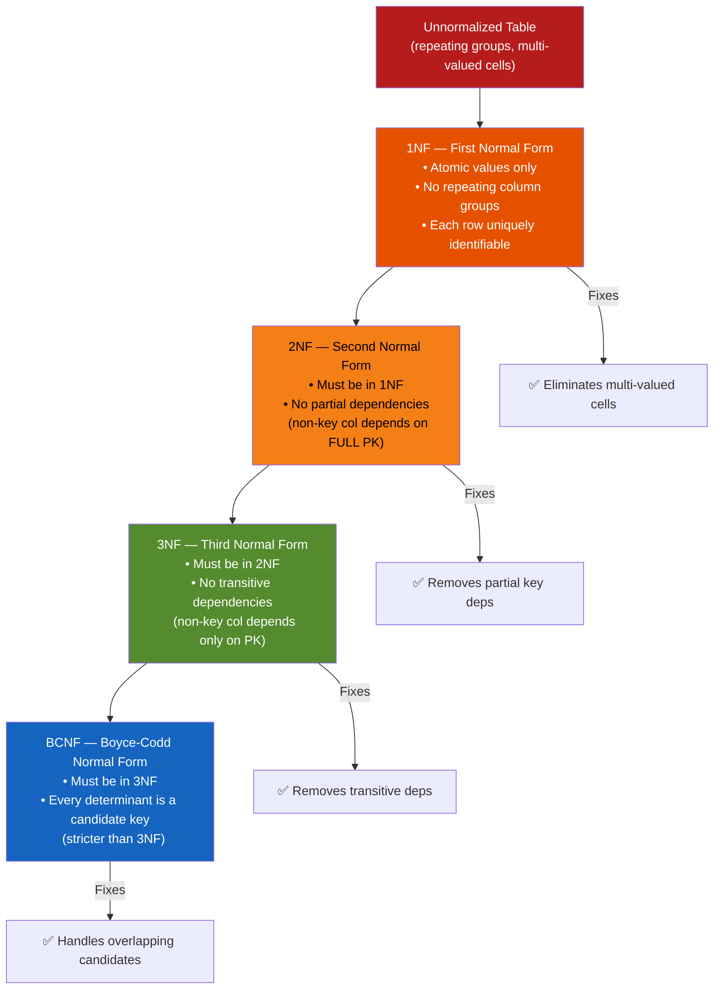

❌ **Violates:**
```sql
-- Denormalized OLTP table: CustomerName stored in every order row
CREATE TABLE Orders (
    OrderID      INT PRIMARY KEY,
    CustomerID   INT,
    CustomerName VARCHAR(100),  -- duplicated; if customer renames, all orders are stale
    Amount       DECIMAL(10,2)
);
```

✅ **Satisfies:**
```sql
-- OLTP: normalized (name stored once in Customers, FK from Orders)
CREATE TABLE Customers (CustomerID INT PRIMARY KEY, Name VARCHAR(100));
CREATE TABLE Orders (OrderID INT PRIMARY KEY, CustomerID INT REFERENCES Customers, Amount DECIMAL(10,2));

-- OLAP/Reporting: denormalized star schema fact table (snapshot of name at order time)
CREATE TABLE FactOrders (
    OrderKey      INT PRIMARY KEY,
    CustomerKey   INT,
    CustomerName  VARCHAR(100),  -- snapshot at time of order; intentional denormalization
    OrderDate     DATE,
    Amount        DECIMAL(10,2)
);
```

---

### Q85. How do you model a many-to-many relationship and add attributes to the junction table?

**Answer:** A many-to-many relationship (e.g., Students and Courses) is resolved with a junction table that holds foreign keys to both parent tables. The junction table's primary key can be the composite of both FK columns, or a surrogate key with unique constraint on the composite. When the relationship itself has attributes (e.g., EnrollmentDate, Grade), those extra columns live on the junction table. The junction table becomes an entity in its own right when it has such attributes.

❌ **Violates:**
```sql
-- Anti-pattern: storing related IDs as comma-separated values in one column
CREATE TABLE Students (StudentID INT PRIMARY KEY, CourseIDs VARCHAR(500));
-- CourseIDs = '1,3,7' -- violates 1NF; cannot JOIN or enforce FK
```

✅ **Satisfies:**
```sql
-- Correct many-to-many with junction table that has its own attributes
CREATE TABLE Students (
    StudentID INT NOT NULL PRIMARY KEY IDENTITY,
    Name      NVARCHAR(100) NOT NULL
);

CREATE TABLE Courses (
    CourseID  INT NOT NULL PRIMARY KEY IDENTITY,
    Title     NVARCHAR(200) NOT NULL
);

-- Junction table: relationship + attributes
CREATE TABLE Enrollments (
    StudentID      INT  NOT NULL REFERENCES Students(StudentID),
    CourseID       INT  NOT NULL REFERENCES Courses(CourseID),
    EnrolledDate   DATE NOT NULL DEFAULT GETUTCDATE(),
    Grade          CHAR(2) NULL,
    CONSTRAINT PK_Enrollments PRIMARY KEY (StudentID, CourseID)
);
CREATE INDEX IX_Enrollments_CourseID ON Enrollments(CourseID);
```

---

### Q86. How do you implement soft delete with a filtered index and a view?

**Answer:** Soft delete marks records as logically deleted (IsDeleted = 1) rather than physically removing them, preserving audit history. A filtered index on IsDeleted = 0 makes queries against active records fast without indexing the "deleted" rows. A view that filters WHERE IsDeleted = 0 provides a clean interface for application queries, hiding deleted rows automatically. The combination of filtered index + view means active-record queries are efficient and developers do not need to add WHERE IsDeleted = 0 to every query.

❌ **Violates:**
```sql
-- Hard delete: unrecoverable; breaks FK references; no audit trail
DELETE FROM Customers WHERE CustomerID = 42;
-- Referencing tables may have orphaned rows; history is lost
```

✅ **Satisfies:**
```sql
-- Soft delete: flag the row
ALTER TABLE Customers ADD IsDeleted BIT NOT NULL DEFAULT 0,
                          DeletedAt DATETIME2 NULL,
                          DeletedBy NVARCHAR(100) NULL;

-- Filtered index: only indexes active records (small, fast)
CREATE NONCLUSTERED INDEX IX_Customers_Active
    ON Customers(CustomerID)
    INCLUDE (Name, Email)
    WHERE IsDeleted = 0;

-- View: hides deleted rows for all normal queries
CREATE OR ALTER VIEW vw_ActiveCustomers AS
    SELECT CustomerID, Name, Email, CreatedAt
    FROM Customers
    WHERE IsDeleted = 0;
GO

-- Soft delete procedure
CREATE PROCEDURE usp_DeleteCustomer @CustomerID INT AS
BEGIN
    UPDATE Customers
    SET IsDeleted = 1, DeletedAt = GETUTCDATE(), DeletedBy = SUSER_NAME()
    WHERE CustomerID = @CustomerID;
END;
```

---

### Q87. How do you add audit columns and ensure they are always populated correctly?

**Answer:** Audit columns (CreatedAt, CreatedBy, UpdatedAt, UpdatedBy) track when and by whom rows were created and modified. Always use GETUTCDATE() rather than GETDATE() for timestamps — UTC avoids daylight saving time ambiguity. Set DEFAULT constraints on CreatedAt and CreatedBy so they are populated automatically on INSERT without requiring application code. UpdatedAt should be maintained by an AFTER UPDATE trigger or application logic. CreatedAt should be non-updatable (enforced by trigger or convention).

❌ **Violates:**
```sql
-- Wrong: relying on application code to set audit columns; easily missed
INSERT INTO Products(Name, Price) VALUES('Widget', 9.99);
-- Application may forget to set CreatedAt; column is NULL; audit trail broken
```

✅ **Satisfies:**
```sql
-- Audit columns with defaults
CREATE TABLE Products (
    ProductID  INT           NOT NULL PRIMARY KEY IDENTITY,
    Name       NVARCHAR(200) NOT NULL,
    Price      DECIMAL(10,2) NOT NULL,
    CreatedAt  DATETIME2     NOT NULL DEFAULT GETUTCDATE(),
    CreatedBy  NVARCHAR(100) NOT NULL DEFAULT SUSER_NAME(),
    UpdatedAt  DATETIME2     NOT NULL DEFAULT GETUTCDATE(),
    UpdatedBy  NVARCHAR(100) NOT NULL DEFAULT SUSER_NAME()
);

-- Trigger to auto-update UpdatedAt on every UPDATE
CREATE OR ALTER TRIGGER trg_Products_UpdateAudit ON Products AFTER UPDATE AS
BEGIN
    SET NOCOUNT ON;
    UPDATE p SET UpdatedAt = GETUTCDATE(), UpdatedBy = SUSER_NAME()
    FROM Products p JOIN inserted i ON p.ProductID = i.ProductID;
END;
```

---

### Q88. What happens when you delete a parent row without an index on the FK column in the child table?

**Answer:** When you DELETE a parent row, SQL Server must verify no child rows reference it (if ON DELETE NO ACTION). Without an index on the FK column in the child table, this verification requires a full table scan of the child table, holding a shared lock on the entire table for the duration. On large child tables this can take seconds and block all concurrent reads and writes. In systems with CASCADE DELETE, the lack of index means the engine cannot efficiently find the child rows to delete them either — a full scan is performed for each parent deletion.

❌ **Violates:**
```sql
-- Missing index on FK column in child table
CREATE TABLE OrderItems (
    ItemID     INT PRIMARY KEY,
    OrderID    INT REFERENCES Orders(OrderID),  -- FK but no index on OrderID
    ProductID  INT,
    Quantity   INT
);
-- DELETE FROM Orders WHERE OrderID=1 causes full scan of OrderItems to check/cascade
```

✅ **Satisfies:**
```sql
CREATE TABLE OrderItems (
    ItemID     INT NOT NULL PRIMARY KEY IDENTITY,
    OrderID    INT NOT NULL REFERENCES Orders(OrderID) ON DELETE CASCADE,
    ProductID  INT NOT NULL REFERENCES Products(ProductID),
    Quantity   INT NOT NULL CHECK(Quantity > 0)
);

-- Index on FK column: CASCADE DELETE now uses index seek, not full scan
CREATE NONCLUSTERED INDEX IX_OrderItems_OrderID   ON OrderItems(OrderID);
CREATE NONCLUSTERED INDEX IX_OrderItems_ProductID ON OrderItems(ProductID);
```

---

### Q89. What is table partitioning and how do partition switching work for bulk loads?

**Answer:** Table partitioning horizontally divides a large table across multiple filegroups based on a partition function and scheme. A partition function defines the range boundaries; a partition scheme maps ranges to filegroups. Partition switching instantaneously moves an entire partition by updating metadata only — no data is copied. This enables fast bulk loading: load new data into a staging table on the same filegroup, build all indexes, then switch it into the target partition in milliseconds. Partition elimination allows queries with partition key predicates to scan only relevant partitions.

❌ **Violates:**
```sql
-- Without partitioning: loading a year of data requires a long INSERT that locks the table
INSERT INTO SalesHistory SELECT * FROM SalesStaging;   -- blocks all queries for minutes
```

✅ **Satisfies:**
```sql
-- Create partition function (monthly boundaries for 2024)
CREATE PARTITION FUNCTION pf_Monthly(DATE)
AS RANGE RIGHT FOR VALUES ('2024-02-01','2024-03-01','2024-04-01','2024-05-01');

-- Create partition scheme
CREATE PARTITION SCHEME ps_Monthly
AS PARTITION pf_Monthly ALL TO ([PRIMARY]);

-- Partitioned table
CREATE TABLE SalesHistory (
    SaleID   INT  NOT NULL,
    SaleDate DATE NOT NULL,
    Amount   DECIMAL(10,2),
    CONSTRAINT PK_SalesHistory PRIMARY KEY (SaleID, SaleDate)
) ON ps_Monthly(SaleDate);

-- Instant partition switch (metadata-only operation)
-- Prerequisite: SalesStaging has same structure and indexes, on same filegroup
ALTER TABLE SalesStaging SWITCH TO SalesHistory PARTITION 3;
```

---

### Q90. What is a columnstore index and when should you use it?

**Answer:** A columnstore index stores data column-by-column rather than row-by-row, enabling dramatic compression (5-10x) and batch-mode processing for analytical queries that scan many rows but touch few columns. SQL Server 2019+ supports updatable clustered columnstore indexes and batch mode on rowstore tables. Non-clustered columnstore indexes can be added to OLTP tables to accelerate analytical queries without replacing the clustered rowstore index. They are best for: large aggregation queries, star schema joins, time-series analytics, and data warehousing workloads.

❌ **Violates:**
```sql
-- Using a columnstore index for OLTP single-row lookups (wrong workload)
CREATE CLUSTERED COLUMNSTORE INDEX CCI_Orders ON Orders;
-- Point lookups (WHERE OrderID = 42) are slower on columnstore; OLTP needs rowstore
```

✅ **Satisfies:**
```sql
-- Non-clustered columnstore on OLTP table for mixed workload (SQL Server 2014+)
-- Keeps rowstore clustered index for OLTP; adds columnstore for analytical queries
CREATE NONCLUSTERED COLUMNSTORE INDEX NCCI_Orders_Analytics
    ON Orders (CustomerID, OrderDate, Amount, Region);
-- OLTP queries still use clustered rowstore; analytical scans use columnstore

-- Pure OLAP / data warehouse: clustered columnstore is best
CREATE TABLE FactSales (
    SaleID     INT,
    ProductKey INT,
    DateKey    INT,
    Quantity   INT,
    Revenue    DECIMAL(18,2)
);
CREATE CLUSTERED COLUMNSTORE INDEX CCI_FactSales ON FactSales;
-- Enables batch mode; compression; fast aggregation over billions of rows
```

---
## 10. Advanced T-SQL Patterns

> 📚 Reference: https://learn.microsoft.com/en-us/sql/t-sql/statements/merge-transact-sql
> 📚 Medium: https://medium.com/learning-sql/advanced-tsql-merge-output-json-temporal-tables-pivot-patterns-0a1b2c3d4e5f

---

### Q91. How does the MERGE statement work, and what is the HOLDLOCK race condition fix?

**Answer:** MERGE performs INSERT, UPDATE, and DELETE in a single statement based on whether source rows match target rows. The WHEN MATCHED clause handles updates; WHEN NOT MATCHED BY TARGET handles inserts; WHEN NOT MATCHED BY SOURCE handles deletes. Without HOLDLOCK, MERGE is susceptible to race conditions: between the match evaluation and the DML execution, another session can insert a row, causing a unique constraint violation. Adding WITH (HOLDLOCK) to the target table reference serializes concurrent MERGE calls and prevents the race.

❌ **Violates:**
```sql
-- MERGE without HOLDLOCK: race condition under concurrent load
MERGE Customers AS target
USING (SELECT @ID, @Name) AS src(CustomerID, Name)
ON target.CustomerID = src.CustomerID
WHEN MATCHED     THEN UPDATE SET target.Name = src.Name
WHEN NOT MATCHED THEN INSERT(CustomerID, Name) VALUES(src.CustomerID, src.Name);
-- Two concurrent sessions can both evaluate NOT MATCHED = TRUE and both try to INSERT
```

✅ **Satisfies:**
```sql
-- HOLDLOCK serializes concurrent MERGE on the same key
MERGE Customers WITH (HOLDLOCK) AS target
USING (VALUES (@ID, @Name)) AS src(CustomerID, Name)
ON target.CustomerID = src.CustomerID
WHEN MATCHED THEN
    UPDATE SET target.Name = src.Name, target.UpdatedAt = GETUTCDATE()
WHEN NOT MATCHED BY TARGET THEN
    INSERT(CustomerID, Name, CreatedAt)
    VALUES(src.CustomerID, src.Name, GETUTCDATE())
WHEN NOT MATCHED BY SOURCE THEN
    DELETE;
-- HOLDLOCK holds a range lock; second concurrent call waits rather than racing
```

---

### Q92. What is the OUTPUT clause and how do you use it to capture inserted IDs and audit updates?

**Answer:** The OUTPUT clause returns data from affected rows as part of the DML statement, using the inserted and deleted virtual tables (same as triggers). For INSERT, OUTPUT inserted.* returns the new rows including IDENTITY-generated values. For UPDATE, OUTPUT deleted.col AS OldValue, inserted.col AS NewValue captures the before and after. For DELETE, OUTPUT deleted.* captures removed rows. The INTO clause can redirect OUTPUT rows to a table or table variable instead of the result set.

❌ **Violates:**
```sql
-- Wrong: running a separate SELECT after INSERT to get new IDs -- race condition risk
INSERT INTO Orders(CustomerID, Amount) VALUES(1, 100);
SELECT @@IDENTITY AS NewID;   -- @@IDENTITY can be affected by triggers; unreliable
```

✅ **Satisfies:**
```sql
-- OUTPUT captures all inserted IDs atomically (no second round-trip)
DECLARE @NewIDs TABLE (OrderID INT, CustomerID INT, Amount DECIMAL(10,2));

INSERT INTO Orders(CustomerID, Amount)
OUTPUT inserted.OrderID, inserted.CustomerID, inserted.Amount INTO @NewIDs
VALUES(1, 100.00), (2, 200.00), (3, 300.00);

SELECT * FROM @NewIDs;   -- returns all three new OrderIDs

-- Audit log from UPDATE using OUTPUT
UPDATE Products
SET Price = Price * 1.10
OUTPUT deleted.ProductID,
       deleted.Price     AS OldPrice,
       inserted.Price    AS NewPrice,
       GETUTCDATE()      AS ChangedAt
INTO PriceAudit(ProductID, OldPrice, NewPrice, ChangedAt)
WHERE CategoryID = 5;
```

---

### Q93. How do you work with JSON in T-SQL using FOR JSON, OPENJSON, JSON_VALUE, and JSON_QUERY?

**Answer:** FOR JSON PATH serializes query results to JSON; FOR JSON AUTO infers the structure from the query shape. JSON_VALUE(json, path) extracts a scalar value from a JSON string (returns NVARCHAR). JSON_QUERY(json, path) extracts a JSON object or array (returns the raw JSON fragment). OPENJSON() parses a JSON array or object into rows and columns — it is the JSON equivalent of a table-valued function for shredding JSON. SQL Server requires a JSON column to be stored as NVARCHAR; there is no native JSON data type.

❌ **Violates:**
```sql
-- Wrong: using string manipulation to parse JSON
DECLARE @json NVARCHAR(500) = N'{"Name":"Alice","Age":30}';
-- Trying to extract value with SUBSTRING/CHARINDEX is fragile and breaks on formatting changes
SELECT SUBSTRING(@json, CHARINDEX('"Name":"', @json) + 8, 5) AS Name;
```

✅ **Satisfies:**
```sql
-- JSON_VALUE: extract scalar
DECLARE @json NVARCHAR(500) = N'{"Name":"Alice","Age":30,"Address":{"City":"NY"}}';
SELECT JSON_VALUE(@json, '$.Name')          AS Name,        -- 'Alice'
       JSON_VALUE(@json, '$.Address.City')  AS City,        -- 'NY'
       JSON_QUERY(@json, '$.Address')       AS AddressObj;  -- {"City":"NY"} (raw JSON)

-- OPENJSON: shred JSON array into rows
DECLARE @orders NVARCHAR(MAX) = N'[{"ID":1,"Amt":100},{"ID":2,"Amt":200}]';
SELECT ID, Amt
FROM OPENJSON(@orders)
WITH (ID INT '$.ID', Amt DECIMAL(10,2) '$.Amt');

-- FOR JSON PATH: serialize rows to JSON
SELECT TOP 3 CustomerID, Name
FROM Customers
FOR JSON PATH, ROOT('Customers');
```

---

### Q94. What is STRING_AGG vs FOR XML PATH for string aggregation, and how does STRING_SPLIT work?

**Answer:** FOR XML PATH('') is the pre-SQL Server 2017 hack for string aggregation: wrapping a subquery in XML and stripping the tags. It is verbose and error-prone with special XML characters. STRING_AGG(col, delimiter) WITHIN GROUP (ORDER BY ...) is the modern, clean replacement available in SQL Server 2017+. STRING_SPLIT(string, delimiter) is the inverse — it splits a delimited string into rows. STRING_SPLIT does not guarantee order in versions before SQL Server 2022 (which adds the ordinal column).

❌ **Violates:**
```sql
-- FOR XML PATH hack: complex, XML-encodes special characters, hard to read
SELECT STUFF((
    SELECT ',' + Name FROM Employees
    WHERE DeptID = 1
    FOR XML PATH('')
), 1, 1, '') AS Names;   -- STUFF removes leading comma; XML PATH generates string
```

✅ **Satisfies:**
```sql
-- STRING_AGG: clean, modern, handles NULL gracefully, supports ORDER BY
SELECT DepartmentID,
       STRING_AGG(Name, ', ') WITHIN GROUP (ORDER BY Name) AS MemberList
FROM Employees
GROUP BY DepartmentID;

-- STRING_SPLIT: split comma-delimited parameter into rows
DECLARE @IDs NVARCHAR(500) = N'1,5,9,14,22';
SELECT value AS ID
FROM STRING_SPLIT(@IDs, ',')
WHERE TRY_CAST(value AS INT) IS NOT NULL;   -- filter non-numeric values defensively

-- Using STRING_SPLIT for IN-list from parameter
SELECT * FROM Products
WHERE ProductID IN (SELECT CAST(value AS INT) FROM STRING_SPLIT(@IDs, ','));
```

---

### Q95. How do you write a PIVOT and a dynamic PIVOT query?

**Answer:** PIVOT rotates distinct values from a column into separate result columns. The static PIVOT requires you to hardcode the column values; a dynamic PIVOT builds the column list at runtime using sp_executesql. The key components are: an aggregate function (SUM, MAX) applied to the value column, FOR the column to pivot, IN the list of values to become column names. QUOTENAME() wraps column names safely in brackets for the dynamic version.

❌ **Violates:**
```sql
-- CASE-based manual pivot: verbose and does not scale when new products are added
SELECT Month,
       SUM(CASE WHEN Product='A' THEN Revenue ELSE 0 END) AS A,
       SUM(CASE WHEN Product='B' THEN Revenue ELSE 0 END) AS B
FROM Sales GROUP BY Month;
-- Must manually add a CASE for every new product
```

✅ **Satisfies:**
```sql
-- Static PIVOT
SELECT *
FROM (SELECT SaleMonth, Product, Revenue FROM MonthlySales) src
PIVOT (SUM(Revenue) FOR Product IN ([A],[B],[C])) pvt;

-- Dynamic PIVOT: column list built at runtime
DECLARE @Cols    NVARCHAR(MAX);
DECLARE @SQL     NVARCHAR(MAX);

SELECT @Cols = STRING_AGG(QUOTENAME(Product), ',')
               WITHIN GROUP (ORDER BY Product)
FROM (SELECT DISTINCT Product FROM MonthlySales) p;

SET @SQL = N'
SELECT *
FROM (SELECT SaleMonth, Product, Revenue FROM MonthlySales) src
PIVOT (SUM(Revenue) FOR Product IN (' + @Cols + N')) pvt
ORDER BY SaleMonth;';

EXEC sp_executesql @SQL;   -- parameterized execution; QUOTENAME prevents injection
```

---

### Q96. What are temporal tables, how do you enable SYSTEM_VERSIONING, and how do you query history?

**Answer:** Temporal tables (SQL Server 2016+) automatically maintain a full history of all row changes. When you add SYSTEM_VERSIONING = ON, SQL Server links the main table to a history table and automatically records the start and end validity period for each row version using system-maintained datetime2 columns. The FOR SYSTEM_TIME AS OF clause lets you query the state of the table at any point in the past. This eliminates the need for manual audit triggers for point-in-time data recovery.

❌ **Violates:**
```sql
-- Manual history tracking: complex trigger, easy to miss columns, hard to query historically
CREATE TRIGGER trg_Audit ON Employees AFTER UPDATE AS
    INSERT INTO EmployeesHistory SELECT *, GETUTCDATE() FROM deleted;
-- Requires maintenance when table schema changes; no standard query syntax
```

✅ **Satisfies:**
```sql
-- Enable temporal table (add period columns + system versioning)
ALTER TABLE Employees
    ADD ValidFrom DATETIME2 GENERATED ALWAYS AS ROW START NOT NULL DEFAULT '2000-01-01',
        ValidTo   DATETIME2 GENERATED ALWAYS AS ROW END   NOT NULL DEFAULT '9999-12-31',
        PERIOD FOR SYSTEM_TIME (ValidFrom, ValidTo);

ALTER TABLE Employees SET (SYSTEM_VERSIONING = ON (HISTORY_TABLE = dbo.EmployeesHistory));

-- Query current state (normal query)
SELECT * FROM Employees WHERE EmployeeID = 42;

-- Query state at a specific point in the past
SELECT * FROM Employees FOR SYSTEM_TIME AS OF '2024-01-01T00:00:00'
WHERE EmployeeID = 42;

-- Query all versions of a row
SELECT * FROM Employees FOR SYSTEM_TIME ALL WHERE EmployeeID = 42 ORDER BY ValidFrom;
```

---

### Q97. How do you solve gaps-and-islands problems using the ROW_NUMBER minus value technique?

**Answer:** The gaps-and-islands problem involves grouping consecutive sequences (dates, integers) into "islands" separated by "gaps". The elegant solution exploits the fact that for consecutive integers or dates, the difference between the value and ROW_NUMBER() is constant within each island. Rows in the same island have the same (value - ROW_NUMBER()) which becomes the group key. A GROUP BY on this key yields island boundaries with MIN() and MAX().

❌ **Violates:**
```sql
-- Self-join approach: complex, requires two scans, hard to follow
SELECT a.LoginDate, MIN(b.LoginDate) AS IslandEnd
FROM UserLogins a
LEFT JOIN UserLogins b ON DATEDIFF(DAY, a.LoginDate, b.LoginDate) = 1
WHERE NOT EXISTS (SELECT 1 FROM UserLogins c
    WHERE DATEDIFF(DAY, c.LoginDate, a.LoginDate) = 1)
GROUP BY a.LoginDate;   -- verbose; two correlated subqueries
```

✅ **Satisfies:**
```sql
-- Gaps and islands for consecutive dates (login streaks)
WITH Numbered AS (
    SELECT LoginDate,
           ROW_NUMBER() OVER (ORDER BY LoginDate) AS rn,
           DATEADD(DAY, -ROW_NUMBER() OVER (ORDER BY LoginDate), LoginDate) AS Grp
    FROM UserLogins
),
Islands AS (
    SELECT MIN(LoginDate) AS StreakStart,
           MAX(LoginDate) AS StreakEnd,
           COUNT(*)       AS StreakLength
    FROM Numbered
    GROUP BY Grp
)
SELECT StreakStart, StreakEnd, StreakLength
FROM Islands
ORDER BY StreakStart;

-- Gaps and islands for consecutive integers
WITH Numbered AS (
    SELECT ProductID, ProductID - ROW_NUMBER() OVER (ORDER BY ProductID) AS Grp
    FROM Products
)
SELECT MIN(ProductID) AS RangeStart, MAX(ProductID) AS RangeEnd
FROM Numbered GROUP BY Grp ORDER BY RangeStart;
```

---

### Q98. Write classic interview queries: Nth highest salary, delete duplicates, employees earning more than their manager, and running total.

**Answer:** These four queries are among the most frequently asked in SQL interviews. Nth highest salary uses DENSE_RANK or a subquery with N-1 DISTINCT salaries. Delete duplicates keeps one row per logical key using ROW_NUMBER(). Employees earning more than their manager uses a self-join comparing the employee's salary to their manager's. Running total uses SUM() with an ordered window frame — all covered earlier in this guide but consolidated here for reference.

❌ **Violates:**
```sql
-- Wrong Nth highest: SELECT MAX(Salary) ... MAX does not account for N > 1
SELECT MAX(Salary) FROM Employees;   -- only first highest; not parameterized for N
```

✅ **Satisfies:**
```sql
-- 1. Nth highest salary (N=3)
SELECT DISTINCT Salary
FROM (SELECT Salary, DENSE_RANK() OVER (ORDER BY Salary DESC) AS dr FROM Employees) x
WHERE dr = 3;

-- 2. Delete duplicate employees (keep lowest EmployeeID per Name+DeptID)
WITH Dups AS (
    SELECT EmployeeID,
           ROW_NUMBER() OVER (PARTITION BY Name, DepartmentID ORDER BY EmployeeID) AS rn
    FROM Employees
)
DELETE FROM Dups WHERE rn > 1;

-- 3. Employees earning more than their manager
SELECT e.Name AS Employee, e.Salary, m.Name AS Manager, m.Salary AS ManagerSalary
FROM Employees e
JOIN Employees m ON e.ManagerID = m.EmployeeID
WHERE e.Salary > m.Salary;

-- 4. Running total per customer
SELECT CustomerID, OrderDate, Amount,
       SUM(Amount) OVER (PARTITION BY CustomerID ORDER BY OrderDate
                         ROWS UNBOUNDED PRECEDING) AS RunningTotal
FROM Orders ORDER BY CustomerID, OrderDate;
```

---

### Q99. What are EXCEPT and INTERSECT and when are they more appropriate than a JOIN?

**Answer:** EXCEPT returns rows from the first query that do not appear in the second query — equivalent to a set difference. INTERSECT returns rows that appear in both queries — equivalent to a set intersection. Both operators automatically deduplicate results (like DISTINCT) and require matching column counts and compatible types. They compare entire rows, making them more concise than anti-joins or semi-joins when you want to compare entire row sets (e.g., finding schema differences, detecting missing rows between tables).

❌ **Violates:**
```sql
-- LEFT JOIN anti-join for row comparison is verbose when comparing full rows
SELECT a.* FROM TableA a
LEFT JOIN TableB b ON a.Col1=b.Col1 AND a.Col2=b.Col2 AND a.Col3=b.Col3
WHERE b.Col1 IS NULL;   -- must enumerate all columns in ON; error-prone
```

✅ **Satisfies:**
```sql
-- EXCEPT: rows in Production not in Staging (compares all columns automatically)
SELECT ProductID, Name, Price FROM ProductionCatalog
EXCEPT
SELECT ProductID, Name, Price FROM StagingCatalog;  -- missing in staging

-- INTERSECT: rows that exist in both tables (common records)
SELECT CustomerID, Email FROM OldSystem
INTERSECT
SELECT CustomerID, Email FROM NewSystem;

-- Practical: find permissions that exist in RoleA but not RoleB
SELECT Permission FROM RolePermissions WHERE RoleID = 1
EXCEPT
SELECT Permission FROM RolePermissions WHERE RoleID = 2;
```

---

### Q100. How do you write safe dynamic SQL using QUOTENAME(), and how do you build a dynamic WHERE/ORDER BY safely?

**Answer:** QUOTENAME(name, '[') wraps an identifier in square brackets and escapes any embedded brackets, preventing SQL injection through identifier injection. For dynamic ORDER BY, validate the column name against a whitelist of allowed columns and validate the direction against ASC/DESC only. For dynamic WHERE values, always pass them as sp_executesql parameters — never concatenate. Combining these three techniques (QUOTENAME for identifiers, whitelist for structure, parameters for values) covers all dynamic SQL attack surfaces.

❌ **Violates:**
```sql
-- Dynamic SQL with all three injection vectors open
DECLARE @Table  NVARCHAR(100) = N'Users; DROP TABLE Users; --';
DECLARE @Filter NVARCHAR(100) = N"' OR '1'='1";
DECLARE @Sort   NVARCHAR(100) = N'1; DROP TABLE Users; --';
DECLARE @SQL NVARCHAR(MAX) = N'SELECT * FROM ' + @Table
    + N' WHERE Name=''' + @Filter + ''' ORDER BY ' + @Sort;
EXEC(@SQL);   -- all three attacks succeed
```

✅ **Satisfies:**
```sql
-- Fully hardened dynamic SQL
DECLARE @TableName  SYSNAME       = N'Orders';
DECLARE @FilterName NVARCHAR(200) = N'Alice';
DECLARE @SortCol    NVARCHAR(100) = N'Amount';
DECLARE @SortDir    NVARCHAR(4)   = N'DESC';

-- 1. Validate table name against whitelist (or use QUOTENAME for trusted internal sources)
IF @TableName NOT IN (N'Orders', N'Customers', N'Products')
    THROW 50001, 'Invalid table name.', 1;

-- 2. Validate sort column against whitelist
IF @SortCol NOT IN (N'OrderID', N'Amount', N'OrderDate')
    SET @SortCol = N'OrderID';

-- 3. Validate sort direction
IF @SortDir NOT IN (N'ASC', N'DESC')
    SET @SortDir = N'ASC';

-- Build query: QUOTENAME for identifiers, @p_Name as parameter for value
DECLARE @SQL NVARCHAR(MAX) =
    N'SELECT OrderID, CustomerID, Amount FROM ' + QUOTENAME(@TableName)
    + N' WHERE CustomerName = @p_Name'
    + N' ORDER BY ' + QUOTENAME(@SortCol) + N' ' + @SortDir + N';';

EXEC sp_executesql
    @SQL,
    N'@p_Name NVARCHAR(200)',
    @p_Name = @FilterName;   -- value bound as parameter; never interpreted as SQL
```

---

## Summary

This guide covered 100 T-SQL interview questions across 10 key areas:

| Section | Topics |
|---------|--------|
| 1. SELECT, Filtering & Aggregates | WHERE vs HAVING, NULL handling, CASE, GROUP BY extensions, pagination, string/date functions |
| 2. JOINs | All JOIN types, CROSS/SELF/anti-joins, APPLY, multi-table, classic patterns |
| 3. Indexes & Query Performance | Clustered vs non-clustered, covering, sargability, execution plans, parameter sniffing |
| 4. Stored Procedures & Functions | Parameters, UDFs vs TVFs, TRY/CATCH, dynamic SQL, sp_executesql, upsert |
| 5. Triggers | AFTER/INSTEAD OF/DDL, inserted/deleted tables, multi-row safety, performance |
| 6. Transactions & Concurrency | ACID, isolation levels, locks, deadlocks, NOLOCK, SNAPSHOT, batch deletes |
| 7. Window Functions | OVER(), ranking, LAG/LEAD, FIRST/LAST_VALUE, running totals, ROWS vs RANGE |
| 8. CTEs & Subqueries | CTE syntax, recursive CTEs, CTE vs temp table, EXISTS vs IN, APPLY |
| 9. Database Design | Normalization, keys, foreign keys, soft delete, audit columns, partitioning |
| 10. Advanced T-SQL | MERGE, OUTPUT, JSON, STRING_AGG, PIVOT, temporal tables, gaps-and-islands |

---

*Generated for SQL Server 2019+ / Azure SQL Database. Most examples are compatible with SQL Server 2016+.*

---

# ⚖️ SQL Server Comparisons — Side-by-Side Differences

---

## SQL-C1 — INNER JOIN vs LEFT JOIN vs RIGHT JOIN vs FULL OUTER JOIN

| | INNER JOIN | LEFT JOIN | RIGHT JOIN | FULL OUTER JOIN |
|-|-----------|-----------|------------|-----------------|
| Returns | Only matching rows | All left + matched right | All right + matched left | All rows from both |
| Unmatched rows | Excluded | Right side = NULL | Left side = NULL | Both sides = NULL |
| Most common | ✅ Yes | ✅ Yes | Rarely (rewrite as LEFT) | Rarely |

```sql
-- INNER: only orders WITH a customer
SELECT o.Id, c.Name FROM Orders o
INNER JOIN Customers c ON o.CustomerId = c.Id;

-- LEFT: all orders, even those without a customer (orphaned)
SELECT o.Id, c.Name FROM Orders o
LEFT JOIN Customers c ON o.CustomerId = c.Id;
-- c.Name = NULL where no match

-- FULL OUTER: all orders + all customers, NULLs where no match
SELECT o.Id, c.Name FROM Orders o
FULL OUTER JOIN Customers c ON o.CustomerId = c.Id;
```

---

## SQL-C2 — Clustered vs Non-Clustered Index

| | Clustered Index | Non-Clustered Index |
|-|----------------|---------------------|
| Physical sort | ✅ Data rows physically sorted | ❌ Separate structure, pointers to rows |
| Per table | Only ONE (data IS the index) | Many allowed (up to 999) |
| Leaf node holds | Actual data row | Row pointer (or included columns) |
| Best for | Primary key, range scans | Lookup by non-PK column |
| Row lookup after index hit | Instant (data is there) | Extra lookup (key lookup) |

```sql
-- Clustered index (automatically created on PRIMARY KEY)
CREATE CLUSTERED INDEX IX_Orders_Id ON Orders(Id);
-- Rows are physically stored sorted by Id

-- Non-clustered: separate B-tree, leaf = pointer to heap/clustered row
CREATE NONCLUSTERED INDEX IX_Orders_CustomerId ON Orders(CustomerId)
INCLUDE (Status, Total); -- covering index: no key lookup needed
```

---

## SQL-C3 — WHERE vs HAVING vs QUALIFY

| | WHERE | HAVING | QUALIFY (non-standard) |
|-|-------|--------|----------------------|
| Filters | Individual rows | Grouped results | Window function results |
| Used with | Any query | GROUP BY | Window functions (Snowflake/BigQuery) |
| Runs | Before grouping | After grouping | After window function |
| Aggregates allowed | ❌ | ✅ | ✅ |

```sql
-- WHERE — row-level filter (before grouping)
SELECT CustomerId, SUM(Total) FROM Orders
WHERE Status = 'Paid'         -- filter rows first
GROUP BY CustomerId;

-- HAVING — group-level filter (after grouping)
SELECT CustomerId, SUM(Total) AS TotalSpent FROM Orders
GROUP BY CustomerId
HAVING SUM(Total) > 1000;     -- filter groups after aggregation

-- Both together
SELECT CustomerId, SUM(Total) FROM Orders
WHERE Status = 'Paid'         -- filter rows
GROUP BY CustomerId
HAVING SUM(Total) > 500;      -- then filter groups
```

---

## SQL-C4 — CTE vs Temp Table vs Table Variable vs Subquery

| | CTE | Temp Table | Table Variable | Subquery |
|-|-----|-----------|---------------|---------|
| Scope | Single statement | Session | Batch / procedure | Inline |
| Indexes | ❌ (no stats) | ✅ Yes | Limited | ❌ |
| Re-usable in query | ✅ Multiple refs | ✅ | ✅ | ❌ (per reference) |
| Recursive | ✅ Yes | ❌ | ❌ | ❌ |
| Spills to disk | ❌ (in-memory plan) | ✅ tempdb | ✅ tempdb (usually in-memory) | ❌ |
| Use for | Readable complex queries, recursion | Large intermediate results | Small intermediate results | Simple inline filtering |

```sql
-- CTE — readable, single-use
WITH TopCustomers AS (
    SELECT CustomerId, SUM(Total) AS Spent
    FROM Orders GROUP BY CustomerId
    HAVING SUM(Total) > 5000
)
SELECT c.Name, t.Spent FROM Customers c
JOIN TopCustomers t ON c.Id = t.CustomerId;

-- Temp Table — persists for session, can index
CREATE TABLE #TopCustomers (CustomerId INT, Spent DECIMAL);
INSERT INTO #TopCustomers SELECT CustomerId, SUM(Total) FROM Orders GROUP BY CustomerId;
CREATE INDEX IX ON #TopCustomers(CustomerId); -- can add indexes!
SELECT c.Name FROM Customers c JOIN #TopCustomers t ON c.Id = t.CustomerId;
DROP TABLE #TopCustomers;
```

---

## SQL-C5 — Stored Procedure vs Function vs View

| | Stored Procedure | Function (Scalar/TVF) | View |
|-|-----------------|----------------------|------|
| Returns | Result sets, OUT params | Scalar value or table | Virtual table |
| DML inside | ✅ INSERT/UPDATE/DELETE | ❌ (scalar) / ❌ (inline TVF) | ❌ |
| Use in SELECT | ❌ Cannot | ✅ | ✅ |
| Transaction control | ✅ BEGIN/COMMIT | ❌ | ❌ |
| Caching | Execution plan cached | Inline TVF = optimised; scalar = slow | Indexed view possible |
| Use for | Business logic, batch ops | Reusable calculations | Simplified query abstraction |

```sql
-- Scalar Function (avoid in WHERE on large tables — row-by-row)
CREATE FUNCTION dbo.GetFullName(@First NVARCHAR(50), @Last NVARCHAR(50))
RETURNS NVARCHAR(101) AS BEGIN RETURN @First + ' ' + @Last END

-- Inline TVF (preferred — optimizer can inline it)
CREATE FUNCTION dbo.GetOrdersByCustomer(@CustomerId INT)
RETURNS TABLE AS RETURN
    SELECT Id, Total, Status FROM Orders WHERE CustomerId = @CustomerId;

-- View
CREATE VIEW vw_PaidOrders AS
    SELECT o.Id, c.Name, o.Total FROM Orders o
    JOIN Customers c ON o.CustomerId = c.Id WHERE o.Status = 'Paid';
```

---

## SQL-C6 — DELETE vs TRUNCATE vs DROP

| | DELETE | TRUNCATE | DROP |
|-|--------|---------|------|
| WHERE clause | ✅ Yes | ❌ No | ❌ No |
| Logged | Row-by-row (slow) | Minimal (fast) | Minimal |
| Rollback | ✅ Yes (within transaction) | ✅ Yes (within transaction) | ✅ Yes |
| Resets identity | ❌ | ✅ | Table gone |
| Triggers fire | ✅ | ❌ | ❌ |
| Removes structure | ❌ | ❌ | ✅ Table deleted |

```sql
DELETE FROM Orders WHERE Status = 'Cancelled'; -- selective, logged, triggers fire
TRUNCATE TABLE TempLog;                         -- wipe all rows fast, reset identity
DROP TABLE TempLog;                             -- delete table entirely
```

---

## SQL-C7 — ROW_NUMBER vs RANK vs DENSE_RANK vs NTILE

| | ROW_NUMBER | RANK | DENSE_RANK | NTILE(n) |
|-|-----------|------|------------|---------|
| Ties | Unique (arbitrary) | Skip numbers | No skip | Bucket assignment |
| On tie (100, 100, 90) | 1, 2, 3 | 1, 1, 3 | 1, 1, 2 | Bucket 1, 1, 2 |
| Use for | Pagination, dedup | Leaderboards | Leaderboards (no gaps) | Quartiles, buckets |

```sql
SELECT Name, Score,
    ROW_NUMBER()  OVER (ORDER BY Score DESC) AS RowNum,   -- 1,2,3,4
    RANK()        OVER (ORDER BY Score DESC) AS Rank,     -- 1,1,3,4 (skips 2)
    DENSE_RANK()  OVER (ORDER BY Score DESC) AS DenseRank,-- 1,1,2,3 (no skip)
    NTILE(4)      OVER (ORDER BY Score DESC) AS Quartile  -- 1,1,2,3
FROM Players;
```

---

## SQL-C8 — UNION vs UNION ALL vs INTERSECT vs EXCEPT

| | UNION | UNION ALL | INTERSECT | EXCEPT |
|-|-------|-----------|-----------|--------|
| Duplicates | Removed (DISTINCT) | Kept | Only common rows | Rows in A not in B |
| Performance | Slower (dedup sort) | ✅ Faster | Medium | Medium |
| Use for | Merge, deduplicate | Merge without dedup | Common rows only | Set difference |

```sql
-- UNION: all paid + all shipped orders, no duplicates
SELECT Id FROM PaidOrders UNION SELECT Id FROM ShippedOrders;

-- UNION ALL: preserve duplicates (faster)
SELECT Id FROM PaidOrders UNION ALL SELECT Id FROM ShippedOrders;

-- INTERSECT: customers who both ordered AND reviewed
SELECT CustomerId FROM Orders INTERSECT SELECT CustomerId FROM Reviews;

-- EXCEPT: customers who ordered but never reviewed
SELECT CustomerId FROM Orders EXCEPT SELECT CustomerId FROM Reviews;
```

---

## SQL-C9 — OLTP vs OLAP

| | OLTP (Online Transaction Processing) | OLAP (Online Analytical Processing) |
|-|--------------------------------------|--------------------------------------|
| Workload | Many small reads/writes | Few large read aggregations |
| Data | Current, normalised | Historical, denormalised (star schema) |
| Query type | Row-level INSERT/UPDATE | Aggregations, GROUP BY across millions |
| Indexes | B-tree (row store) | Columnstore indexes |
| Examples | Order system, banking, ERP | Data warehouse, BI dashboards, reporting |
| SQL Server feature | Standard tables | Columnstore indexes, Azure Synapse |

```sql
-- OLAP: columnstore index for analytical queries (10-100x faster on aggregations)
CREATE NONCLUSTERED COLUMNSTORE INDEX IX_CS_Orders
ON Orders (CustomerId, Total, Status, CreatedAt);

-- Query benefits from columnar compression and batch mode execution
SELECT YEAR(CreatedAt), SUM(Total) FROM Orders GROUP BY YEAR(CreatedAt);
```


---

## 11. Transaction Management: Commit, Rollback & Savepoints

> 📚 Reference: https://learn.microsoft.com/en-us/sql/t-sql/language-elements/transactions-transact-sql
> 📚 WAL internals: https://learn.microsoft.com/en-us/sql/relational-databases/sql-server-transaction-log-architecture-and-management-guide

---

### Q101. Explain the full transaction lifecycle — BEGIN, COMMIT, ROLLBACK, SAVEPOINT

**Answer:** A transaction is a unit of work that is either fully committed or fully rolled back — the ACID "Atomicity" guarantee. SQL Server supports both explicit transactions (you write BEGIN TRANSACTION / COMMIT / ROLLBACK) and implicit transactions (SET IMPLICIT_TRANSACTIONS ON, where DML statements auto-open a transaction). Leaving a transaction open without committing or rolling back holds locks and blocks other sessions — one of the most common causes of production blocking.

**What happens physically at each step:**

| Step | What SQL Server Does |
|------|---------------------|
| `BEGIN TRANSACTION` | Marks a log sequence number (LSN) as the transaction start in the Write-Ahead Log (WAL); `@@TRANCOUNT` increments to 1 |
| DML (`INSERT`/`UPDATE`/`DELETE`) | Changes written to WAL **before** modifying data pages in the buffer pool (write-ahead); row locked |
| `COMMIT` | WAL records are hardened to disk (flushed); data pages may still be in buffer pool (lazy write); locks released; `@@TRANCOUNT` decrements |
| `ROLLBACK` | WAL UNDO records are applied in reverse order; data pages restored to pre-transaction state; locks released; `@@TRANCOUNT` set to 0 |

**Explicit vs Implicit transactions:**
- **Explicit:** You control the boundary with `BEGIN TRANSACTION` / `COMMIT` / `ROLLBACK`.
- **Implicit:** `SET IMPLICIT_TRANSACTIONS ON` — every DML auto-starts a transaction; you must still manually `COMMIT` or `ROLLBACK`. Dangerous in application code — easy to forget.

❌ **Wrong — no error handling, transaction left open on failure:**
```sql
-- No TRY/CATCH, no ROLLBACK on error
BEGIN TRANSACTION

    INSERT INTO Orders (CustomerId, Total) VALUES (1, 500.00);
    -- If this next statement errors (e.g., constraint violation),
    -- the transaction is left open, holding locks on Orders!
    INSERT INTO OrderItems (OrderId, ProductId, Qty) VALUES (@@IDENTITY, 999, 1);

COMMIT TRANSACTION
-- If error occurs between BEGIN and COMMIT: transaction stays open,
-- locks are held, blocking other sessions until connection drops
```

```csharp
// C# — no rollback on exception
using var conn = new SqlConnection(connectionString);
conn.Open();
var cmd = conn.CreateCommand();
cmd.CommandText = "BEGIN TRANSACTION; INSERT INTO Orders...; INSERT INTO OrderItems...;";
cmd.ExecuteNonQuery(); // if second INSERT throws, transaction is open
// connection.Close() eventually rolls back but only when connection is recycled — too late
```

✅ **Correct — TRY/CATCH with ROLLBACK in T-SQL and C#:**
```sql
-- T-SQL: always use SET XACT_ABORT ON + TRY/CATCH
SET XACT_ABORT ON;   -- auto-rollback on any runtime error

BEGIN TRY
    BEGIN TRANSACTION;

        INSERT INTO Orders (CustomerId, Total) VALUES (1, 500.00);
        DECLARE @OrderId INT = SCOPE_IDENTITY();
        INSERT INTO OrderItems (OrderId, ProductId, Qty) VALUES (@OrderId, 42, 1);

    COMMIT TRANSACTION;
END TRY
BEGIN CATCH
    IF @@TRANCOUNT > 0
        ROLLBACK TRANSACTION;  -- undo all changes atomically

    THROW;  -- re-raise original error to caller
END CATCH;
```

```csharp
// C# — use SqlTransaction with try/catch/finally
using var conn = new SqlConnection(connectionString);
await conn.OpenAsync();
using var tx = conn.BeginTransaction();
try
{
    var cmd1 = new SqlCommand("INSERT INTO Orders (CustomerId,Total) VALUES (@cid,@total)", conn, tx);
    cmd1.Parameters.AddWithValue("@cid", 1);
    cmd1.Parameters.AddWithValue("@total", 500.00m);
    await cmd1.ExecuteNonQueryAsync();

    var orderId = (int)(await new SqlCommand("SELECT SCOPE_IDENTITY()", conn, tx).ExecuteScalarAsync()!);

    var cmd2 = new SqlCommand("INSERT INTO OrderItems (OrderId,ProductId,Qty) VALUES (@oid,@pid,@qty)", conn, tx);
    cmd2.Parameters.AddWithValue("@oid", orderId);
    cmd2.Parameters.AddWithValue("@pid", 42);
    cmd2.Parameters.AddWithValue("@qty", 1);
    await cmd2.ExecuteNonQueryAsync();

    await tx.CommitAsync();   // all-or-nothing
}
catch
{
    await tx.RollbackAsync(); // undo everything on any error
    throw;
}
```

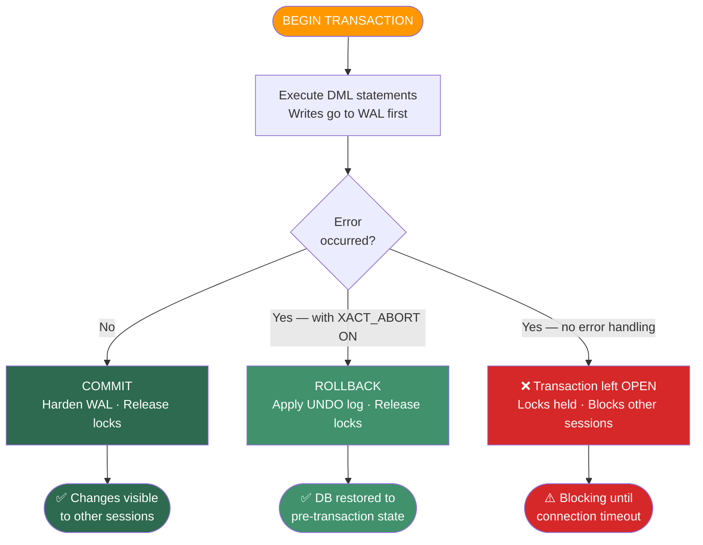

---

### Q102. What is a savepoint and when should you use it?

**Answer:** A savepoint marks an intermediate point within a transaction that you can roll back to without abandoning the entire transaction. In SQL Server the syntax is `SAVE TRANSACTION <name>` and `ROLLBACK TRANSACTION <name>`. This is useful when a transaction has multiple independent logical steps and a failure in a later step should not discard the successful earlier steps.

**Important SQL Server behaviour — nested transactions:**
SQL Server does not truly support nested transactions. `BEGIN TRANSACTION` inside an existing transaction increments `@@TRANCOUNT` but does NOT create an independent inner transaction. Only the outermost `COMMIT` (when `@@TRANCOUNT` reaches 0) actually commits. An inner `ROLLBACK` without a savepoint name rolls back the **entire** transaction to the outermost `BEGIN`, regardless of `@@TRANCOUNT`.

```sql
-- @@TRANCOUNT behaviour:
BEGIN TRANSACTION      -- @@TRANCOUNT = 1
  BEGIN TRANSACTION    -- @@TRANCOUNT = 2 (NOT a real nested transaction)
  COMMIT               -- @@TRANCOUNT = 1 (NOT committed yet!)
COMMIT                 -- @@TRANCOUNT = 0 → actually commits

-- Inner ROLLBACK without savepoint name:
BEGIN TRANSACTION      -- @@TRANCOUNT = 1
  BEGIN TRANSACTION    -- @@TRANCOUNT = 2
  ROLLBACK             -- @@TRANCOUNT = 0 → rolls back EVERYTHING (outer too!)
```

❌ **Wrong — rolling back entire transaction when only a sub-step failed:**
```sql
BEGIN TRANSACTION;

    -- Step 1: record audit log entry
    INSERT INTO AuditLog (Action, UserId) VALUES ('ORDER_CREATED', 1);

    -- Step 2: try to apply a promotional discount (optional, non-critical)
    BEGIN TRY
        INSERT INTO DiscountApplications (OrderId, Code) VALUES (101, 'INVALID_CODE');
    END TRY
    BEGIN CATCH
        -- No savepoint used — forced to roll back everything
        ROLLBACK TRANSACTION;  -- ❌ also loses the AuditLog insert!
        THROW;
    END CATCH;

COMMIT TRANSACTION;
```

✅ **Correct — savepoint allows partial rollback, preserving earlier work:**
```sql
BEGIN TRANSACTION;

    -- Step 1: record audit log entry (must be preserved regardless)
    INSERT INTO AuditLog (Action, UserId) VALUES ('ORDER_CREATED', 1);

    -- Mark savepoint AFTER step 1 is done
    SAVE TRANSACTION AfterAuditLog;

    -- Step 2: try optional promotional discount
    BEGIN TRY
        INSERT INTO DiscountApplications (OrderId, Code) VALUES (101, 'PROMO10');
    END TRY
    BEGIN CATCH
        -- Roll back only to savepoint — AuditLog insert is preserved
        ROLLBACK TRANSACTION AfterAuditLog;  -- ✅ partial rollback
        -- Log the discount failure, continue
    END CATCH;

    -- Step 3: update order status (continues even if discount failed)
    UPDATE Orders SET Status = 'CONFIRMED' WHERE OrderId = 101;

COMMIT TRANSACTION;  -- commits AuditLog + Order update; discount attempt was rolled back
```

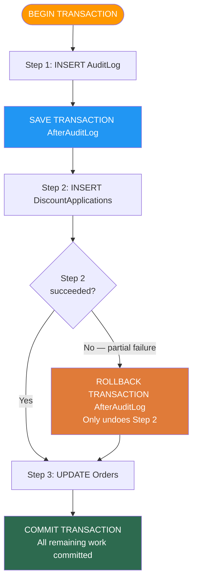

---

### Q103. What is the Write-Ahead Log (WAL) and how does it ensure durability?

**Answer:** The Write-Ahead Log (WAL) is the fundamental durability mechanism in SQL Server (and most RDBMS). The rule is: **log records must be written to disk before the corresponding data page is modified** (hence "write-ahead"). This ensures that even if the server crashes mid-transaction, the log contains enough information to either REDO committed changes or UNDO uncommitted changes during crash recovery.

**WAL components:**

| Component | Description |
|-----------|-------------|
| **Log record** | Each change (INSERT/UPDATE/DELETE) generates a log record with old value (for UNDO) and new value (for REDO) |
| **LSN (Log Sequence Number)** | Monotonically increasing identifier for each log record |
| **Log buffer** | In-memory buffer for log records; flushed to disk on COMMIT, checkpoint, or when full |
| **Checkpoint** | SQL Server periodically writes all dirty pages from buffer pool to data files and records the checkpoint LSN; limits how far back crash recovery must replay |
| **Buffer pool** | In-memory cache of data pages; pages can be "dirty" (modified but not yet written to disk) |

**REDO and UNDO logs:**
- **REDO (roll-forward):** After a crash, apply all log records for committed transactions that weren't yet written to data files — ensures committed work is not lost.
- **UNDO (roll-back):** After a crash, reverse all log records for transactions that were active at crash time and never committed — ensures partial work is removed.

**Checkpoint mechanism:**
```
Without checkpoint: crash recovery must replay ALL log records since DB creation
With checkpoint:    crash recovery only replays records after last checkpoint LSN
→ Checkpoints bound recovery time (SQL Server auto-checkpoints every ~1 min by default)
```

❌ **Wrong — assuming in-memory write = durable:**
```csharp
// Developer assumes writing to buffer pool = committed
// In reality, data page may stay in memory for minutes before checkpoint writes it to disk
// If server crashes in this window → data page change is LOST
// (WAL saves it — but if WAL buffer not flushed either → both lost)

// This is why COMMIT flushes the LOG buffer (not the data buffer):
// - Log flush on COMMIT = durability guaranteed
// - Data page write = eventually lazy-written by checkpoint
```

✅ **Correct — understanding what COMMIT actually guarantees:**
```sql
-- On COMMIT, SQL Server guarantees:
-- 1. All log records for this transaction are flushed to disk (log file)
-- 2. @@TRANCOUNT returns to 0
-- 3. Locks released

-- Data pages may still be in buffer pool (NOT yet on disk) — that is fine:
-- If crash occurs, REDO log replay will re-apply the changes to data pages on recovery.

-- To verify log usage and VLFs:
DBCC LOGINFO;                          -- view Virtual Log Files
SELECT * FROM sys.dm_db_log_info(DB_ID());  -- SQL 2016+: detailed log info

-- Monitor log space:
DBCC SQLPERF(LOGSPACE);
```

```mermaid
sequenceDiagram
    participant App as Application
    participant LB as Log Buffer (Memory)
    participant LF as Log File (Disk)
    participant BP as Buffer Pool (Memory)
    participant DF as Data File (Disk)

    App->>LB: BEGIN TRANSACTION
    App->>LB: Write log record (UNDO+REDO) for INSERT
    App->>BP: Modify data page in buffer pool (dirty page)
    App->>LB: COMMIT → flush log buffer to disk

    LB->>LF: ✅ Log flushed — durability guaranteed

    Note over BP,DF: Data page still in memory (dirty)
    Note over LF: Crash occurs here ↓

    rect rgb(80,30,30)
        Note over LF,DF: CRASH RECOVERY
        LF->>DF: REDO: re-apply committed log records to data files
        LF->>BP: UNDO: reverse uncommitted transactions
    end

    Note over DF: ✅ Data consistent — WAL saved it
```

> 📚 Reference: https://learn.microsoft.com/en-us/sql/relational-databases/sql-server-transaction-log-architecture-and-management-guide

---

### Q104. What are distributed transactions and the two-phase commit (2PC) protocol?

**Answer:** A distributed transaction spans multiple independent resource managers (separate databases, message queues, etc.) and must ensure atomicity across all of them — either all commit or all roll back. The **Two-Phase Commit (2PC)** protocol coordinates this.

**Phase 1 — Prepare (voting):**
The coordinator sends a `PREPARE` message to all participants. Each participant writes its changes to its local WAL and votes `YES` (can commit) or `NO` (cannot — constraint violation, timeout, etc.). A `YES` vote is a promise to commit when told to.

**Phase 2 — Commit or Abort:**
If all votes are `YES`, coordinator sends `COMMIT` to all participants. If any vote is `NO`, coordinator sends `ABORT` to all. Each participant then commits or rolls back locally and releases locks.

**Problems with 2PC:**
- **Blocking:** If the coordinator crashes after Phase 1 but before Phase 2, participants are stuck holding locks — they voted YES but haven't heard the final decision. They cannot unilaterally commit or abort.
- **SPOF on coordinator:** Coordinator failure halts all participants.
- **Latency:** Two network round trips minimum; in geo-distributed systems this adds significant latency.

**Alternatives:**
- **Saga pattern:** Break the distributed transaction into a sequence of local transactions, each with a compensating transaction. No locking across services. Eventual consistency — not ACID. Better for microservices.
- **Outbox pattern:** Write event to local DB outbox table in same local transaction; separate relay publishes to message bus.

❌ **Wrong — distributed transaction without coordination (inconsistency risk):**
```csharp
// Service A writes to its DB
await _orderDb.ExecuteAsync("INSERT INTO Orders...");

// Service B writes to its DB — no coordination with Service A
await _inventoryDb.ExecuteAsync("UPDATE Inventory SET Stock = Stock - 1...");

// If Service B call fails → Order exists but inventory not decremented → INCONSISTENCY
// No way to automatically roll back Service A from Service B's failure
```

✅ **Correct — using Saga pattern for distributed consistency:**
```csharp
// Saga orchestrator (or choreography via events)
// Step 1: Create Order (local transaction)
var orderId = await _orderService.CreateOrderAsync(orderRequest);
// Publishes OrderCreated event to message bus

// Step 2: Reserve Inventory (local transaction in inventory service)
// Inventory service handles OrderCreated → reserves stock
// Publishes InventoryReserved event

// Step 3: Charge Payment
// Payment service handles InventoryReserved → charges card
// If payment FAILS → publish PaymentFailed event

// Compensating transactions on failure:
// - InventoryService handles PaymentFailed → releases reserved stock
// - OrderService handles PaymentFailed → marks order as Cancelled
// Each service handles its own local rollback → eventual consistency
```

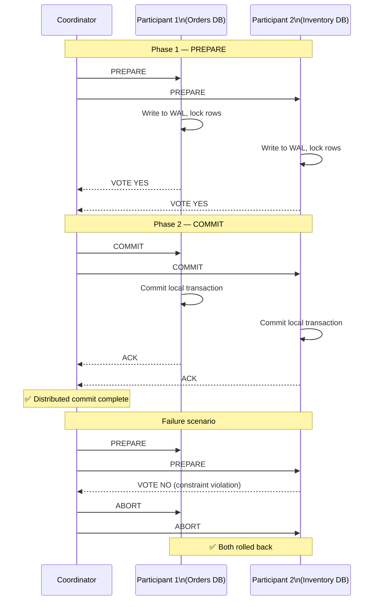

> 📚 Reference: https://learn.microsoft.com/en-us/dotnet/standard/data/transactions/implementing-an-implicit-transaction-using-transaction-scope

---

### Q105. How do you handle long-running transactions and lock contention?

**Answer:** Long-running transactions hold locks for their entire duration, blocking other sessions from reading or writing the same rows. They are one of the top causes of production incidents. The strategies below reduce lock duration, reduce the scope of locks, or eliminate read locks entirely.

**Lock escalation:** SQL Server automatically escalates many row locks to a table lock when the number of locks on a table exceeds a threshold (~5,000 locks per table). Table locks block all other access. To prevent unwanted escalation: `ALTER TABLE Orders SET (LOCK_ESCALATION = DISABLE)` — but use carefully, as it increases per-row lock memory.

**Pessimistic concurrency (default):** Read acquires a shared lock; write acquires an exclusive lock. Readers block writers and vice versa at the locked row level. Deadlocks can occur when two sessions hold locks the other needs.

**Optimistic concurrency (MVCC / row versioning):** Readers never block writers. SQL Server implements this via `READ_COMMITTED_SNAPSHOT ISOLATION (RCSI)` — instead of shared locks on reads, SQL Server serves a row's last committed version from `tempdb`. Writers still take exclusive locks.

```sql
-- Enable RCSI for a database (online operation, no downtime required)
ALTER DATABASE MyDB SET READ_COMMITTED_SNAPSHOT ON;
-- After this: SELECT statements under READ COMMITTED isolation no longer take shared locks
-- → readers never block writers, writers never block readers
-- → dramatic reduction in blocking for typical OLTP workloads
```

**Tips for short transactions:**
1. Do all data preparation (lookups, calculations) OUTSIDE the transaction; only open transaction for the actual write.
2. Never include user interaction, HTTP calls, or file I/O inside a transaction — the user might walk away.
3. Keep batch deletes/updates chunked (e.g., delete 1,000 rows per transaction) rather than one giant transaction.
4. Use `SET LOCK_TIMEOUT` to prevent indefinite waiting: `SET LOCK_TIMEOUT 5000` (ms).

❌ **Wrong — user interaction inside transaction, long-running lock:**
```csharp
// Transaction opened BEFORE showing confirmation dialog to user
using var tx = conn.BeginTransaction();
var cmd = new SqlCommand("SELECT * FROM Orders WHERE Id = @id FOR UPDATE", conn, tx);
// ... show data to user, wait for them to click "Confirm"
// User goes to lunch → transaction holds lock for 30 minutes → entire table blocked
await tx.CommitAsync(); // only called after user clicks button
```

✅ **Correct — optimistic concurrency: read → check version → update or retry:**
```sql
-- Read phase (OUTSIDE transaction — no lock held)
SELECT OrderId, Status, RowVersion FROM Orders WHERE OrderId = 101;
-- User reviews data... takes 10 seconds... no locks held

-- Write phase (short transaction — lock held for milliseconds)
BEGIN TRANSACTION;
    UPDATE Orders
    SET    Status = 'SHIPPED'
    WHERE  OrderId = 101
    AND    RowVersion = @capturedRowVersion;  -- optimistic check: has it changed?

    IF @@ROWCOUNT = 0
    BEGIN
        ROLLBACK;
        -- Return "conflict" to caller → retry with fresh read
        THROW 50409, 'Conflict: order was modified by another session. Please retry.', 1;
    END
COMMIT;
```

```mermaid
flowchart TD
    A([Start]) --> B[READ row + capture RowVersion\nNo transaction open — no locks held]
    B --> C[User reviews data\nPrepare changes in application]
    C --> D[BEGIN TRANSACTION\nShort window — lock held]
    D --> E["UPDATE ... WHERE RowVersion = @captured"]
    E --> F{@@ROWCOUNT = 1?}
    F -->|Yes — row unchanged| G[COMMIT\nSuccess]
    F -->|No — row changed by another session| H[ROLLBACK]
    H --> I{Retry\nlimit reached?}
    I -->|No| B
    I -->|Yes| J([❌ Return conflict error\nto caller])

    style A fill:#FF9800,color:#fff
    style G fill:#2d6a4f,color:#fff
    style H fill:#e07b39,color:#fff
    style J fill:#d62828,color:#fff
    style D fill:#2196F3,color:#fff
```

> 📚 Reference: https://learn.microsoft.com/en-us/sql/relational-databases/sql-server-transaction-locking-and-row-versioning-guide
> 📚 RCSI: https://learn.microsoft.com/en-us/sql/relational-databases/databases/database-properties-options-page

---

---

### Q104. What are distributed transactions and the two-phase commit (2PC) protocol?

**Answer:** A distributed transaction spans multiple independent resource managers (separate databases, message queues, etc.) and must ensure atomicity across all of them — either all commit or all roll back. The **Two-Phase Commit (2PC)** protocol coordinates this.

**Phase 1 — Prepare (voting):**
The coordinator sends a `PREPARE` message to all participants. Each participant writes its changes to its local WAL and votes `YES` (can commit) or `NO` (cannot commit). A `YES` vote is a binding promise to commit when told to.

**Phase 2 — Commit or Abort:**
If all votes are `YES`, coordinator sends `COMMIT` to all. If any vote is `NO`, coordinator sends `ABORT` to all. Each participant then commits or rolls back locally and releases locks.

**Problems with 2PC:**

| Problem | Description |
|---------|-------------|
| **Blocking** | If coordinator crashes after Phase 1, participants are stuck holding locks — they voted YES but never received the commit/abort decision |
| **SPOF on coordinator** | Coordinator failure halts all participants |
| **Latency** | Two network round trips minimum; expensive in geo-distributed systems |

**Alternatives to 2PC:**

- **Saga pattern:** Break the distributed transaction into a sequence of local transactions, each with a compensating transaction. No cross-service locking. Eventual consistency (not ACID). Preferred in microservices.
- **Outbox pattern:** Write event to a local DB outbox table in the same local transaction; a separate relay publishes to the message bus — guarantees at-least-once delivery without distributed locking.

❌ **Wrong — distributed writes without coordination (inconsistency risk):**
```csharp
// Service A writes to its DB
await _orderDb.ExecuteAsync("INSERT INTO Orders (CustomerId, Total) VALUES (@cid, @total)", ...);

// Service B writes to its DB — no coordination with Service A
await _inventoryDb.ExecuteAsync("UPDATE Inventory SET Stock = Stock - 1 WHERE ProductId = @pid", ...);

// If Service B call fails: Order exists but stock not decremented -> INCONSISTENCY
// No mechanism to automatically roll back Service A's committed insert
```

✅ **Correct — Saga pattern with compensating transactions:**
```csharp
// Saga orchestrator coordinates steps via events

// Step 1: OrderService creates order (local transaction)
//   -> publishes OrderCreated event

// Step 2: InventoryService handles OrderCreated
//   -> reserves stock (local transaction)
//   -> publishes InventoryReserved event

// Step 3: PaymentService handles InventoryReserved
//   -> charges card (local transaction)
//   -> if FAILS: publishes PaymentFailed event

// Compensating transactions on PaymentFailed:
//   InventoryService: releases reserved stock (local transaction)
//   OrderService: marks order Cancelled (local transaction)

// Each service owns its own data and its own rollback logic
// Result: eventual consistency without distributed locks
```

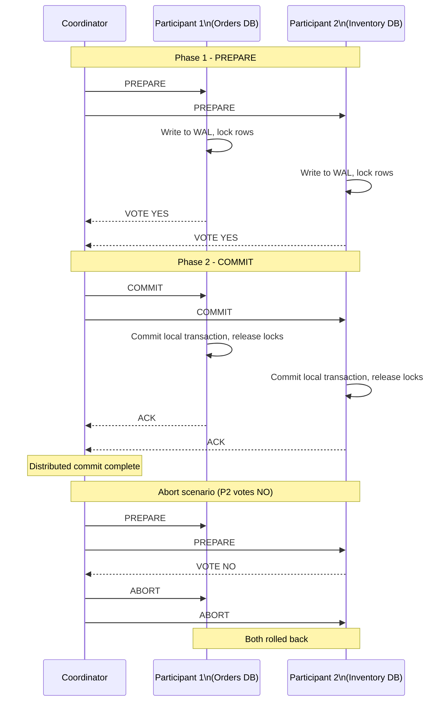

> 📚 Reference: https://learn.microsoft.com/en-us/dotnet/standard/data/transactions/implementing-an-implicit-transaction-using-transaction-scope

---

### Q105. How do you handle long-running transactions and lock contention?

**Answer:** Long-running transactions hold locks for their entire duration, blocking other sessions from reading or writing the same rows. They are one of the top causes of production incidents in SQL Server. The core strategies are: reduce lock duration, reduce lock scope, or eliminate read locks entirely using row versioning.

**Lock escalation:** SQL Server automatically escalates many row-level locks to a table lock when the count on a single table exceeds ~5,000. Table locks block all other access. To prevent unwanted escalation on a specific table: `ALTER TABLE Orders SET (LOCK_ESCALATION = DISABLE)` — use carefully as it increases per-row lock memory.

**Pessimistic concurrency (SQL Server default):**
Reads acquire shared locks; writes acquire exclusive locks. Readers can block writers and vice versa at the locked row. Deadlocks can occur when two sessions each hold a lock the other needs.

**Optimistic concurrency (MVCC via RCSI):**
`READ_COMMITTED_SNAPSHOT ISOLATION (RCSI)` — reads are served from the last committed row version stored in `tempdb`. Readers never take shared locks, so readers never block writers and writers never block readers. A dramatic improvement for typical OLTP workloads.

```sql
-- Enable RCSI for a database (online, no downtime)
ALTER DATABASE MyDB SET READ_COMMITTED_SNAPSHOT ON;
-- All READ COMMITTED queries now use row versioning instead of shared locks
```

**Best practices to keep transactions short:**

1. Do all lookups and calculations **outside** the transaction; open `BEGIN TRANSACTION` only for the actual write operations.
2. Never include user-facing waits, HTTP calls, or file I/O inside a transaction.
3. Batch large deletes/updates into chunks (e.g., 1,000 rows per transaction) to avoid holding locks on millions of rows.
4. Use `SET LOCK_TIMEOUT 5000` (ms) to fail fast rather than waiting indefinitely.
5. Monitor long-running transactions: `SELECT * FROM sys.dm_exec_sessions WHERE open_transaction_count > 0`.

❌ **Wrong — user interaction inside an open transaction:**
```csharp
// Transaction opened BEFORE user confirms
using var tx = conn.BeginTransaction();
var cmd = new SqlCommand("SELECT * FROM Orders WHERE Id = @id", conn, tx);
var order = await cmd.ExecuteReaderAsync(); // shared lock held on row

// Show order to user and wait for them to click "Approve"...
// User goes to lunch -> transaction holds lock for 30+ minutes
// -> entire row (or table after escalation) blocked for all other sessions

await tx.CommitAsync(); // only reached after user responds
```

✅ **Correct — optimistic concurrency: read outside transaction, check version on write:**
```sql
-- Phase 1: READ (no transaction open, no locks held)
SELECT OrderId, Status, RowVersion
FROM   Orders
WHERE  OrderId = 101;
-- User reviews the data... 10 seconds pass... no locks held on the row

-- Phase 2: WRITE (short transaction, lock held for milliseconds)
BEGIN TRANSACTION;

    UPDATE Orders
    SET    Status = 'APPROVED'
    WHERE  OrderId = 101
    AND    RowVersion = @capturedRowVersion; -- optimistic check

    IF @@ROWCOUNT = 0
    BEGIN
        ROLLBACK;
        -- Row was modified by another session between read and write
        THROW 50409, 'Conflict: order was modified. Please refresh and retry.', 1;
    END

COMMIT;
-- Lock held only for the duration of the UPDATE + COMMIT: milliseconds
```

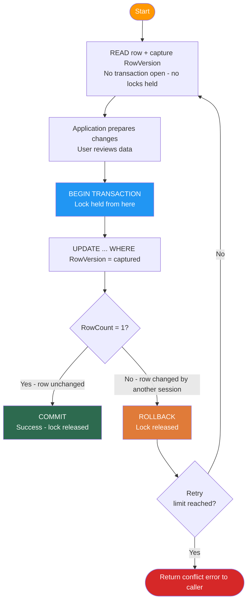

> 📚 Reference: https://learn.microsoft.com/en-us/sql/relational-databases/sql-server-transaction-locking-and-row-versioning-guide
> 📚 RCSI: https://learn.microsoft.com/en-us/sql/relational-databases/databases/database-properties-options-page

---

### Q: How do you handle database migrations in a production environment?

**Answer:**

Migrations in production require discipline: they must be versioned, reviewed like code, tested against realistic data volumes, and executed through a controlled deployment pipeline — not by running `dotnet ef database update` directly against production.

**Key principles:**

| Principle | Practice |
|-----------|---------|
| Versioned | Each migration is a numbered, immutable file in source control |
| Reviewed | Migration SQL reviewed in PR alongside code changes |
| Tested | Applied to a staging database with production-scale data before prod |
| Pipeline-executed | CI/CD applies migrations, not manual developer commands |
| Reversible | Always have a tested rollback (down migration or backfill plan) |

**Zero-downtime migrations — expand-and-contract pattern:**

For large tables under live traffic, never add a non-nullable column in one step. Use three phases:

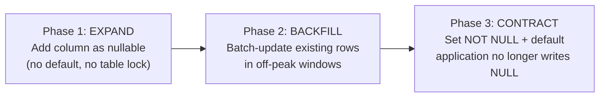

❌ **Bad — single-step non-nullable column on large table:**
```sql
-- Acquires a schema modification lock on a 50-million-row table
-- Online traffic blocked for the duration of the ALTER
ALTER TABLE Orders ADD ProcessedAt DATETIME2 NOT NULL DEFAULT GETUTCDATE();
-- Can lock the table for minutes on large tables
```

✅ **Good — expand-and-contract, zero downtime:**
```sql
-- Phase 1: Add nullable (instant schema change, no row updates)
ALTER TABLE Orders ADD ProcessedAt DATETIME2 NULL;

-- Phase 2: Backfill in batches during off-peak (no lock escalation)
DECLARE @BatchSize INT = 10000;
WHILE 1 = 1
BEGIN
    UPDATE TOP (@BatchSize) Orders
    SET ProcessedAt = CreatedAt
    WHERE ProcessedAt IS NULL;

    IF @@ROWCOUNT < @BatchSize BREAK;
    WAITFOR DELAY '00:00:01'; -- small pause to reduce I/O pressure
END;

-- Phase 3: Apply constraint after backfill completes
ALTER TABLE Orders ALTER COLUMN ProcessedAt DATETIME2 NOT NULL;
ALTER TABLE Orders ADD DEFAULT GETUTCDATE() FOR ProcessedAt;
```

> **Why this matters:** Migration mistakes under live traffic can lock tables, cause outages, or leave data inconsistent. Every production incident involving a migration usually traces back to skipping the expand-and-contract pattern.

**💡 Production Example:**
Adding a non-nullable column to a table with 50 million rows used expand-and-contract: first added as nullable, backfilled in batches of 10,000 rows during off-peak hours, then set the default and made it non-nullable only after all rows were populated. Zero downtime, no lock escalation, and the entire operation ran over two deployment cycles rather than one.

---

### Q: How do you decide when to denormalize data for read performance, and how do you keep it correct?

**Answer:**

Denormalization is a deliberate trade-off: you accept write complexity and consistency risk in exchange for read performance. The decision should always follow measurement, not instinct.

**Decision framework:**

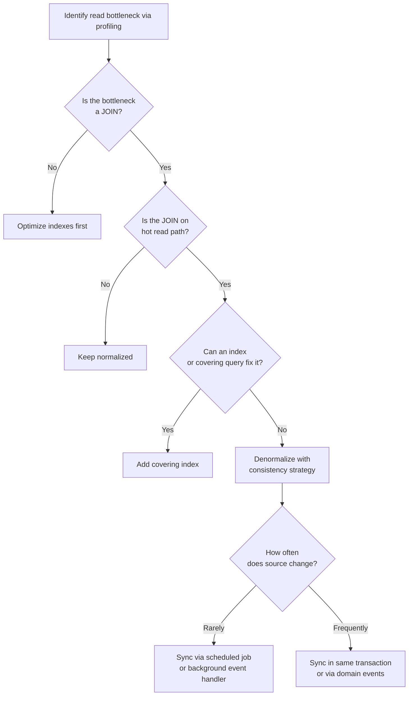

❌ **Bad — denormalize without consistency strategy:**
```sql
-- CategoryName copied onto Products, but never updated when Category changes
CREATE TABLE Products (
    Id           INT PRIMARY KEY,
    Name         NVARCHAR(200),
    CategoryId   INT REFERENCES Categories(Id),
    CategoryName NVARCHAR(100)  -- stale after category rename
);
-- After UPDATE Categories SET Name = 'Electronics' WHERE Id = 5:
-- Products.CategoryName still shows the old name → silent data inconsistency
```

✅ **Good — denormalize with explicit sync strategy:**
```sql
CREATE TABLE Products (
    Id           INT PRIMARY KEY,
    Name         NVARCHAR(200),
    CategoryId   INT REFERENCES Categories(Id),
    CategoryName NVARCHAR(100)  -- denormalized for read performance
);

-- Keep in sync via an AFTER UPDATE trigger on Categories:
CREATE TRIGGER trg_Categories_SyncProducts
ON Categories
AFTER UPDATE
AS
BEGIN
    IF UPDATE(Name)
    BEGIN
        UPDATE p
        SET    p.CategoryName = i.Name
        FROM   Products p
        JOIN   inserted i ON i.Id = p.CategoryId;
    END
END;
```

> **Why this matters:** Premature denormalization creates hidden consistency bugs that are only discovered in production. Avoiding it entirely limits read performance for high-throughput read paths.

**💡 Production Example:**
A product listing API fetching category names required a JOIN across three tables for every request, and at peak load this added 40ms per request. `CategoryName` was denormalized onto the product read model and updated via a background event handler that fired whenever a category was renamed. The event handler updated all affected products asynchronously within seconds. Read latency dropped 60% and category renames — rare events — were handled transparently.

---

### Q: Walk me through a safe rollback plan when a migration causes unexpected load.

**Answer:**

Having a rollback plan before applying a migration is non-negotiable. The plan must be tested before the deployment window — not improvised during an incident.

**Rollback decision tree:**

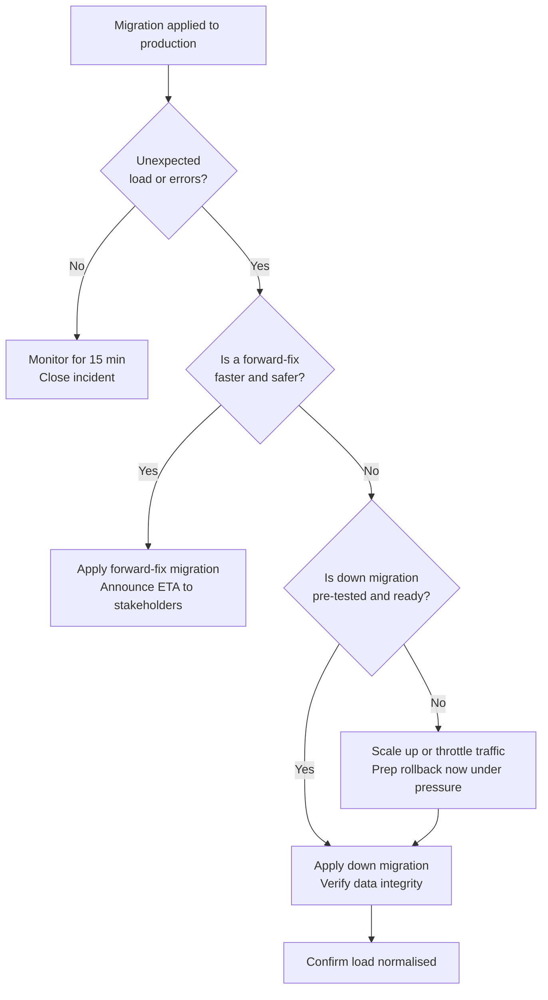

**Preparation checklist before any production migration:**

| Step | Action |
|------|--------|
| Pre-test down script | Apply down migration on staging copy of prod data |
| Backup | Take a verified backup or snapshot before applying |
| Traffic control | Identify how to reduce traffic (feature flags, rate limits) |
| Monitoring alerts | Set query duration and error rate alerts for the migration window |
| Time limit | Define a rollback trigger: "if error rate > X% after Y minutes, rollback" |

❌ **Bad — no rollback plan, improvised under pressure:**
```sql
-- Migration applied to prod causes lock contention
-- No down migration was written or tested
-- Team improvises a manual rollback under incident pressure
-- High risk of data loss or leaving DB in inconsistent state
```

✅ **Good — pre-tested down migration and controlled rollback:**
```sql
-- Up migration: add index to large table
CREATE INDEX IX_Orders_CustomerId_Status
ON Orders (CustomerId, Status)
INCLUDE (TotalAmount, CreatedAt);

-- Down migration: pre-written and tested on staging BEFORE prod deployment
DROP INDEX IF EXISTS IX_Orders_CustomerId_Status ON Orders;
```

> **Why this matters:** A failed migration rollback during an incident can escalate a bad situation into a full outage. Teams that skip pre-testing the down migration often discover it fails on production data for reasons not present in staging.

**💡 Production Example:**
A migration adding an index to a 100-million-row Orders table caused lock contention that spiked response times 10x during the deployment window. The on-call engineer ran the pre-tested down migration (`DROP INDEX`), which completed in milliseconds and immediately restored normal latency. The migration was re-applied the following week using `CREATE INDEX ... WITH (ONLINE = ON)` during a maintenance window, which allowed reads and writes to continue while the index was built.

---

### Q: How do you decide transaction boundaries in a service that touches multiple aggregates?

**Answer:**

The core rule: **one transaction per aggregate**. Transactions should protect the invariants of a single aggregate — not span multiple aggregates or multiple services.

**Why cross-aggregate transactions cause problems:**
- Locks are held across aggregate boundaries, blocking unrelated operations
- Shared transactions across services creates tight coupling
- Deadlocks increase when transaction scope grows

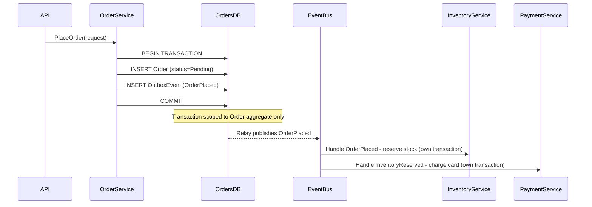

❌ **Bad — spanning transaction across aggregates:**
```csharp
using var tx = await _db.Database.BeginTransactionAsync();

var order = new Order(request.CustomerId, request.Items);
_db.Orders.Add(order);
await _db.SaveChangesAsync();

await _inventoryService.ReserveAsync(request.Items, tx); // shares tx!
await _paymentService.ChargeAsync(request.PaymentDetails, tx); // shares tx!

await tx.CommitAsync();
// Under load: locks held across all three tables → deadlocks at high concurrency
```

✅ **Good — local transaction + outbox pattern:**
```csharp
using var tx = await _db.Database.BeginTransactionAsync();

var order = new Order(request.CustomerId, request.Items);
_db.Orders.Add(order);

_db.OutboxEvents.Add(new OutboxEvent
{
    EventType = "OrderPlaced",
    Payload   = JsonSerializer.Serialize(new OrderPlacedEvent(order.Id, request.Items)),
    CreatedAt = DateTime.UtcNow
});

await _db.SaveChangesAsync();
await tx.CommitAsync();
// Transaction covers only the Order aggregate

// Outbox relay publishes event; downstream services handle in their own transactions
```

> **Why this matters:** Spanning transactions across aggregates creates deadlocks and reduces throughput. Interviewers probe this to check whether you understand DDD boundaries and can distinguish strong consistency needs from eventual consistency use cases.

**💡 Production Example:**
An order service initially wrapped order creation, inventory reservation, and payment capture in one transaction spanning two databases. Under sustained load, deadlocks appeared at ~5/minute because the lock ordering varied between concurrent requests. Scoping the transaction to order creation only, and using domain events with the outbox pattern for inventory and payment, eliminated all deadlocks and improved throughput by 40%.

---

### Q: How do you choose between optimistic and pessimistic concurrency control?

**Answer:**

The choice depends on conflict frequency and the cost of a retry.

| | Optimistic | Pessimistic |
|-|-----------|------------|
| Mechanism | Row version / timestamp check on write | Row-level lock held from read to write |
| Conflict handling | Retry on conflict (no lock held during read) | Wait for lock; no conflict possible |
| Scalability | ✅ High — no blocking reads | ❌ Lower — readers and writers queue |
| Best for | Low-contention data (profiles, settings, orders) | High-contention critical resources (seats, inventory) |
| Risk | Retry storms under high contention | Lock waits / timeouts under high load |

❌ **Bad — optimistic concurrency on high-contention resource:**
```csharp
// 500 users simultaneously try to reserve seat 23A → 499 get conflict → retry storm
public async Task<bool> ReserveSeatAsync(int flightId, string seatId, int userId)
{
    var seat = await _db.Seats.FindAsync(flightId, seatId);
    if (seat!.IsReserved) return false;

    seat.IsReserved = true;
    seat.UserId = userId;

    try
    {
        await _db.SaveChangesAsync();
        return true;
    }
    catch (DbUpdateConcurrencyException)
    {
        return false; // 499 concurrent retries exhaust connection pool
    }
}
```

✅ **Good — pessimistic lock for high-contention seat reservation:**
```sql
-- UPDLOCK acquires exclusive lock at read time → only one session at a time
BEGIN TRANSACTION;

    SELECT SeatId, IsReserved
    FROM   Seats WITH (UPDLOCK, ROWLOCK)
    WHERE  FlightId = @FlightId AND SeatId = @SeatId;

    IF (SELECT IsReserved FROM Seats
        WHERE FlightId = @FlightId AND SeatId = @SeatId) = 0
    BEGIN
        UPDATE Seats SET IsReserved = 1, UserId = @UserId
        WHERE  FlightId = @FlightId AND SeatId = @SeatId;
        COMMIT;
        SELECT 'Reserved' AS Result;
    END
    ELSE
    BEGIN
        ROLLBACK;
        SELECT 'Already taken' AS Result;
    END
```

✅ **Good — optimistic concurrency for low-contention profile updates:**
```csharp
public async Task UpdateProfileAsync(UserProfileDto dto)
{
    var profile = await _db.UserProfiles
        .Where(p => p.Id == dto.Id && p.RowVersion == dto.RowVersion)
        .FirstOrDefaultAsync()
        ?? throw new ConcurrencyException("Profile was updated by another session. Please refresh.");

    profile.DisplayName = dto.DisplayName;
    profile.Bio = dto.Bio;
    await _db.SaveChangesAsync();
}
```

> **Why this matters:** Choosing the wrong concurrency strategy causes either excessive retry storms (optimistic on high-contention) or unnecessary locking overhead (pessimistic on low-contention). Interviewers use this question to test whether you understand the trade-off rather than memorizing a rule.

**💡 Production Example:**
A seat reservation system for popular events used optimistic concurrency throughout. When tickets for a high-demand concert went on sale, 200 concurrent users hit the same 20 remaining seats. The retry storms consumed 80% of available database connections and caused 15-second response times. Switching to pessimistic row-level locks (`UPDLOCK`) for `ReserveSeat` specifically — while keeping optimistic concurrency for low-contention profile updates — resolved the issue entirely.

---

### Q: Walk me through index strategy for a rapidly growing table.

**Answer:**

Index strategy for a growing table must balance read performance against write overhead. Every index speeds up reads but slows inserts and updates on that table.

**Process:**

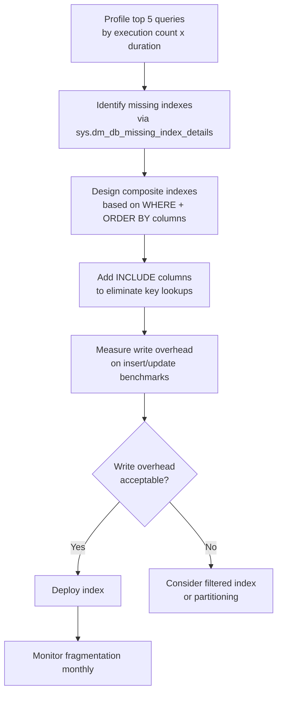

**Composite index column order rule:**
`(Equality columns first) + (Range/ORDER BY columns last) + INCLUDE (non-key columns)`

❌ **Bad — no indexes beyond primary key on growing table:**
```sql
CREATE TABLE AuditLog (
    Id        BIGINT IDENTITY PRIMARY KEY,
    UserId    INT NOT NULL,
    Action    NVARCHAR(100),
    CreatedAt DATETIME2 NOT NULL
);

-- Support query: find all actions for a user in the last 30 days
SELECT Action, CreatedAt FROM AuditLog
WHERE UserId = @UserId AND CreatedAt >= DATEADD(DAY, -30, GETDATE())
ORDER BY CreatedAt DESC;
-- TABLE SCAN → 30+ seconds at 150 million rows
```

✅ **Good — composite covering index for the top query pattern:**
```sql
-- Equality on UserId, range on CreatedAt, INCLUDE avoids key lookup
CREATE INDEX IX_AuditLog_UserId_CreatedAt
ON AuditLog (UserId, CreatedAt DESC)
INCLUDE (Action)
WITH (ONLINE = ON);  -- non-blocking on SQL Server Enterprise
-- Index seek → under 100ms at 150 million rows

-- Monthly partitioning for archival without locking live data
CREATE PARTITION FUNCTION pf_AuditLogMonth (DATETIME2)
AS RANGE RIGHT FOR VALUES ('2025-01-01', '2025-02-01', '2025-03-01');
```

**Monitor index health:**
```sql
-- Missing indexes suggested by the optimizer
SELECT TOP 10
    mid.statement AS TableName,
    migs.avg_user_impact AS EstimatedImpact,
    mid.equality_columns,
    mid.inequality_columns,
    mid.included_columns
FROM sys.dm_db_missing_index_details mid
JOIN sys.dm_db_missing_index_groups mig ON mig.index_handle = mid.index_handle
JOIN sys.dm_db_missing_index_group_stats migs ON migs.group_handle = mig.index_group_handle
ORDER BY migs.avg_user_impact DESC;
```

> **Why this matters:** Under-indexed tables are one of the most common causes of production database slowdowns, and over-indexed tables slow down writes and increase storage. Interviewers want to see a deliberate, measurement-driven approach rather than "add an index on every column."

**💡 Production Example:**
An audit log table growing by 5 million rows per day had no indexes beyond the primary key. Support queries filtering by `UserId + Timestamp` took 30+ seconds. A composite index on `(UserId, CreatedAt DESC)` with `INCLUDE (Action, Details)` brought those queries under 100ms. Adding monthly range partitioning allowed old partitions to be archived without locking the live table.

---

### Q: A query is fast in staging but slow in production. How do you investigate?

**Answer:**

Staging and production differ in ways that directly affect query plan choices: data volume, data distribution (skew), index fragmentation, statistics freshness, and server configuration. A plan optimal for staging may be catastrophic for production.

**Investigation checklist:**

| Dimension | What to check |
|-----------|--------------|
| Data volume | Row counts in all involved tables |
| Data skew | Distribution of the parameter values in production |
| Execution plan | Actual plan in production — look for scans vs seeks |
| Parameter sniffing | Is a bad plan cached from an atypical first execution? |
| Statistics | When were statistics last updated? Accurate for production distribution? |
| Index fragmentation | High fragmentation causes optimizer to choose scans over seeks |
| Server config | MAXDOP, memory, cost threshold — may differ between envs |

```mermaid
flowchart TD
    A[Query slow in prod only] --> B[Get ACTUAL execution plan\nfrom production session]
    B --> C{Table scan\nor bad nested loop?}
    C -->|Scan| D[Check index fragmentation\nand statistics age]
    C -->|Bad nested loop| E[Check parameter sniffing\nClear plan cache for SP]
    D --> F{Statistics stale?}
    F -->|Yes| G[UPDATE STATISTICS TableName WITH FULLSCAN]
    F -->|No| H[Check data skew\nIs the parameter value an outlier?]
    E --> I{Plan cached with\nbad parameter values?}
    I -->|Yes| J[Add OPTION RECOMPILE\nor OPTIMIZE FOR UNKNOWN]
    I -->|No| K[Review join order\nand cardinality estimates]
```

❌ **Bad — ignoring parameter sniffing and data distribution differences:**
```sql
-- Procedure compiled with CustomerId=1 (10 orders) on first call
-- Cached plan: index seek
-- Called with CustomerId=9999 (500,000 orders)
-- Same cached seek plan → 12 seconds in production
CREATE PROCEDURE GetCustomerOrders @CustomerId INT AS
    SELECT * FROM Orders WHERE CustomerId = @CustomerId;
```

✅ **Good — addressing parameter sniffing:**
```sql
-- OPTIMIZE FOR UNKNOWN: uses average statistics, not the sniffed value
CREATE PROCEDURE GetCustomerOrders @CustomerId INT AS
    SELECT * FROM Orders WHERE CustomerId = @CustomerId
    OPTION (OPTIMIZE FOR (@CustomerId UNKNOWN));

-- Update statistics after significant data growth
UPDATE STATISTICS Orders WITH FULLSCAN;
```

**Retrieve the cached plan from production:**
```sql
SELECT TOP 1
    qs.execution_count,
    qs.total_elapsed_time / qs.execution_count AS avg_elapsed_ms,
    qp.query_plan
FROM sys.dm_exec_query_stats qs
CROSS APPLY sys.dm_exec_query_plan(qs.plan_handle) qp
CROSS APPLY sys.dm_exec_sql_text(qs.sql_handle) st
WHERE st.text LIKE '%GetCustomerOrders%'
ORDER BY qs.total_elapsed_time DESC;
```

> **Why this matters:** Staging environments rarely reproduce production data distributions or query plan choices. A developer who only tests on staging will be blind to parameter sniffing, cardinality estimation errors, and fragmentation — the three most common causes of production query regressions.

**💡 Production Example:**
A search query ran in 50ms on staging (10,000 rows, uniform distribution) but took 12 seconds in production (50 million rows, 80% of rows sharing the same `Status` value). The execution plan showed a table scan caused by parameter sniffing — the optimizer had cached a plan based on an atypical parameter value. Adding `OPTION (OPTIMIZE FOR UNKNOWN)` and running `UPDATE STATISTICS` with a full scan fixed it. Response time dropped to 80ms in production.


---

## 🏢 FAANG Database & Data Engineering Questions

---

### Q: How does Amazon Aurora differ from standard RDS and when would you choose it? (Amazon)

**Key differences:**
- **Log-structured storage:** The redo log IS the database — no double-write buffer, no shared storage bottleneck
- **6-way replication across 3 AZs:** quorum write = 4 of 6 nodes; quorum read = 3 of 6 nodes
- **Storage auto-scaling:** grows in 10 GB increments automatically, up to 128 TB
- **Global Database:** single primary region + up to 5 read-only secondary regions with < 1 second replication lag
- **Aurora Serverless v2:** fractional ACU scaling (0.5 ACU increments) — cost-efficient for variable workloads
- **Choose Aurora when:** you need MySQL/PostgreSQL compatibility, high availability, and are willing to trade portability for performance and managed operations

```mermaid
sequenceDiagram
    participant App
    participant AuroraWriter
    participant Q1 as AZ1-Node1
    participant Q2 as AZ1-Node2
    participant Q3 as AZ2-Node3
    participant Q4 as AZ2-Node4
    participant Q5 as AZ3-Node5
    participant Q6 as AZ3-Node6

    App->>AuroraWriter: Write (INSERT/UPDATE)
    AuroraWriter->>Q1: Redo log segment
    AuroraWriter->>Q2: Redo log segment
    AuroraWriter->>Q3: Redo log segment
    AuroraWriter->>Q4: Redo log segment
    AuroraWriter->>Q5: Redo log segment
    AuroraWriter->>Q6: Redo log segment
    Q1-->>AuroraWriter: ACK
    Q2-->>AuroraWriter: ACK
    Q3-->>AuroraWriter: ACK
    Q4-->>AuroraWriter: ACK
    Note over AuroraWriter: 4 of 6 ACKs received → Quorum met → Commit
    AuroraWriter-->>App: Write committed
```

> **Why this matters:** Traditional RDS replicates full data pages — Aurora only replicates redo log records, reducing I/O by up to 7.5× and enabling significantly higher write throughput with lower latency.

**💡 Production Example:**
A team migrated from RDS MySQL Multi-AZ to Aurora MySQL. Write latency dropped from ~8ms to ~2ms and failover time from ~60s to ~15s. Aurora's quorum-based writes meant they no longer needed a synchronous standby replica — the 6-node log replication handled durability automatically.

---

### Q: How would you shard a database at Amazon/Meta scale?

**Sharding strategies:**

| Strategy | How | Pros | Cons |
|---|---|---|---|
| **Range** | Shard by value range (e.g., user_id 1–1M on shard 1) | Simple range scans | Hot spots on sequential inserts |
| **Hash** | `shard = hash(key) % N` | Even distribution | No range queries; resharding is hard |
| **Directory** | Lookup table maps key → shard | Flexible | Lookup table is a bottleneck/SPOF |

**Shard key selection criteria:**
- High cardinality (not a boolean or enum)
- Matches primary query patterns (avoid cross-shard queries)
- Even write distribution (avoid hot shards)

**Cross-shard queries and transactions:**
- Scatter-gather: fan out to all shards, aggregate results (expensive)
- Two-phase commit (2PC) for distributed transactions (avoid at scale — blocking)
- Prefer eventual consistency via saga pattern or event sourcing

**Resharding without downtime (consistent hashing + virtual nodes):**
- Assign each physical shard N virtual nodes on the hash ring
- Adding a shard: transfer only the virtual nodes it takes over
- Vitess (YouTube's MySQL sharding solution): transparent sharding middleware, online schema changes, query routing, connection pooling

```mermaid
flowchart LR
    subgraph Ring["Consistent Hash Ring (360°)"]
        direction TB
        VN1["VNode 0°\n→ Shard A"]
        VN2["VNode 60°\n→ Shard B"]
        VN3["VNode 120°\n→ Shard C"]
        VN4["VNode 180°\n→ Shard A"]
        VN5["VNode 240°\n→ Shard B"]
        VN6["VNode 300°\n→ Shard C"]
    end

    K1["Key: user_42\nhash → 45°"] -->|routes to| VN1
    K2["Key: user_99\nhash → 90°"] -->|routes to| VN2
    K3["Key: order_7\nhash → 200°"] -->|routes to| VN4

    VN1 --> SA[(Shard A\nPrimary + Replica)]
    VN2 --> SB[(Shard B\nPrimary + Replica)]
    VN3 --> SC[(Shard C\nPrimary + Replica)]
    VN4 --> SA
    VN5 --> SB
    VN6 --> SC

    style SA fill:#2196F3,color:#fff
    style SB fill:#4CAF50,color:#fff
    style SC fill:#FF9800,color:#fff
```

> **Why this matters:** Poor shard key selection causes hot shards — one shard receives 90% of traffic while others sit idle. Consistent hashing with virtual nodes solves the resharding problem: adding a new shard moves only `1/N` of the data rather than rehashing everything.

**💡 Production Example:**
An e-commerce platform sharded by `order_id % 8`. Black Friday caused a hot shard problem — sequential order IDs meant all new writes went to the same shard. Migrating to hash-based sharding on `customer_id` distributed load evenly across all 8 shards, and adding 4 virtual nodes per shard via Vitess allowed a future shard split with zero downtime.

---

### Q: How does Google Bigtable / DynamoDB store data? (NoSQL at scale)

**DynamoDB internal storage — LSM tree + SSTable:**

**Write path:**
1. Write goes to **WAL (Write-Ahead Log)** for durability
2. Written to **MemTable** (in-memory sorted structure)
3. When MemTable is full → flushed to **SSTable** (immutable sorted file on disk)
4. Background **compaction** merges and garbage-collects SSTables

**Read path:**
1. Check **MemTable** first (most recent writes)
2. Check **SSTables** in reverse chronological order (newest first)
3. **Bloom filter** on each SSTable to skip files that definitely don't contain the key
4. Merge results (latest version wins)

**Partition key → partition → tablet server:**
- DynamoDB hashes the partition key to determine which partition (storage node) owns the data
- Each partition is a Paxos group with a leader for writes
- Range scans only possible within a single partition key (sort key range queries)

```mermaid
flowchart TD
    W[Write Request] --> WAL[WAL\nWrite-Ahead Log]
    WAL --> MEM[MemTable\nin-memory sorted]
    MEM -->|flush when full| SS1[SSTable 1\nimmutable]
    MEM -->|flush when full| SS2[SSTable 2\nimmutable]
    SS1 & SS2 -->|compaction| SS3[SSTable 3\nmerged + GC'd]

    R[Read Request] --> BF{Bloom Filter\ncheck each SSTable}
    BF -->|maybe| MEM2[Check MemTable]
    MEM2 --> SS_READ[Scan SSTables\nnewest first]
    SS_READ --> MERGE[Merge results\nlatest version wins]
    MERGE --> RESP[Return value]

    style W fill:#2196F3,color:#fff
    style R fill:#4CAF50,color:#fff
    style WAL fill:#FF9800,color:#fff
```

> **Why this matters:** LSM trees optimize writes at the cost of read amplification (multiple SSTables to check). Bloom filters and compaction tune this trade-off. Understanding this explains why DynamoDB has predictable write latency but read latency can vary based on compaction state.

**💡 Production Example:**
A team saw DynamoDB read latency spike every few hours. The pattern matched SSTable compaction cycles. Adding a **DAX (DynamoDB Accelerator)** cache layer absorbed the read spikes during compaction, keeping p99 latency stable.

---

### Q: How would you design a time-series database for metrics? (Netflix/Amazon)

**Write-heavy workload characteristics:**
- Append-only (no updates, only inserts)
- High cardinality tags (host, region, service, endpoint)
- Queries are mostly recent data with time-range aggregations

**Core design decisions:**

| Concern | Solution |
|---|---|
| Partition by time | Each partition covers a fixed time window (e.g., 1 hour); old partitions become immutable |
| Compression | Delta encoding for timestamps; XOR compression (Gorilla, Facebook 2015) for float values — achieves ~1.37 bytes/sample |
| Downsampling | Rollup older data: raw → 1min → 5min → 1hr aggregates |
| Retention | TTL-based deletion; drop entire time partitions (fast) |

**Compression — Gorilla (Facebook):**
- Store first value as-is; subsequent values store only the XOR difference with the previous value
- Most metrics change by small amounts → XOR produces mostly zeros → compresses extremely well

**Approaches:**
- **OpenTSDB:** HBase-backed, good for high cardinality, complex to operate
- **InfluxDB:** purpose-built, IOx engine (Apache Arrow + Parquet), great query language (Flux/InfluxQL)
- **TimescaleDB:** PostgreSQL extension, familiar SQL, hypertable partitioning by time

```mermaid
flowchart LR
    subgraph Ingest
        AG[Agent/Scraper] --> BROKER[Kafka / Kinesis\nbuffering]
    end

    subgraph Write Path
        BROKER --> WR[Writer Service\nbatch + compress]
        WR --> RAW[(Raw Storage\ntime-partitioned\nGorilla-compressed)]
    end

    subgraph Rollup Pipeline
        RAW -->|every 5 min| R1[(1-min rollup\nagg: min/max/avg/p99)]
        R1 -->|every hour| R2[(5-min rollup)]
        R2 -->|every day| R3[(1-hr rollup)]
    end

    subgraph Query Path
        Q[Query API] -->|recent| RAW
        Q -->|older| R1
        Q -->|historical| R3
    end

    style RAW fill:#2196F3,color:#fff
    style R1 fill:#4CAF50,color:#fff
    style R3 fill:#9E9E9E,color:#fff
```

> **Why this matters:** A naive relational design (one row per metric sample) collapses at scale — 10,000 hosts × 200 metrics × 60 samples/min = 120M rows/min. Time-partitioned append-only storage with compression is the only viable approach.

**💡 Production Example:**
Netflix's Atlas handles ~2 million metrics/second. The system uses time-partitioned memory-mapped files with Gorilla compression, achieving ~1.37 bytes per data point vs ~16 bytes for a naive float64 + int64 timestamp pair — a 10× reduction in storage and I/O.

---

### Q: How does Facebook's TAO use MySQL under the hood?

**TAO (The Associations and Objects) — Facebook's graph data store:**

**Data model:**
- **Objects:** typed nodes (User, Photo, Page) — stored as `(id, type, data)` in MySQL
- **Associations:** typed edges (friend, liked, commented) — stored as `(id1, type, id2, time, data)`
- Denormalized for read performance: association data duplicated on both ends of the edge

**Storage layer:**
- Objects and associations stored in MySQL sharded by ID
- Each MySQL shard holds both objects and associations for that ID range
- Schema is intentionally simple — `data` column is a serialized thrift blob

**TAO cache layer:**
- In-process and regional caches sit above MySQL
- Cache hit rate ~99% — MySQL rarely hit in steady state
- Write path: **TAO → MySQL leader → async replication → read replicas**
- Read path: **TAO cache → (miss) → MySQL read replica → populate cache**

**Consistency model:**
- Eventual consistency between TAO and MySQL
- After a write: MySQL leader is authoritative; cache may serve stale data briefly
- "Look-aside" cache: TAO never writes back asynchronously — cache is invalidated on write, not updated

> **Why this matters:** TAO demonstrates that a purpose-built caching + routing layer can make a simple relational backend (MySQL) perform at social-network scale. The key insight is separating the data model (graph) from the storage model (relational) via a dedicated service layer.

**💡 Production Example:**
When Facebook displayed a user's News Feed, TAO assembled thousands of objects and associations in milliseconds — not by issuing thousands of MySQL queries, but by serving from cache with occasional MySQL fallback. The system served billions of queries per second globally on top of MySQL as the source of truth.

---

### Q: Database connection pool management at scale (Amazon/Google)

**Why connection pools matter:**
- Each database connection is expensive: ~1–5 MB RAM on Postgres, ~10 MB on SQL Server
- Without pooling: a spike of 1,000 concurrent requests → 1,000 new connections → database OOM
- With pooling: connections are reused; queue waits if pool is exhausted

**Pool sizing formula (from "HikariCP Sizing" and PgBouncer docs):**
```
pool_size = (core_count × 2) + effective_spindle_count
```
- For an 8-core server with SSDs (spindle count ≈ 1): `pool_size = 17`
- Counterintuitive: more connections ≠ more throughput beyond this formula — context switching overhead dominates

**Tools:**
- **PgBouncer** (PostgreSQL): session pooling, transaction pooling, statement pooling
- **HikariCP** (Java/JVM): fastest JVM connection pool; uses `ConcurrentBag` for lock-free borrowing
- **Microsoft.Data.SqlClient** (.NET): built-in connection pooling per connection string

**Key observability metrics:**
- `pool_wait_time_ms`: time waiting for a free connection — p99 > 50ms = pool too small
- `active_connections` vs `idle_connections`: too many idle = pool too large (wasting DB resources)
- `connection_timeouts`: requests failing because pool exhausted

```mermaid
sequenceDiagram
    participant App as App Thread
    participant Pool as Connection Pool
    participant DB as Database

    App->>Pool: borrow()
    alt Connection available
        Pool-->>App: existing connection
    else Pool exhausted
        Pool->>Pool: wait (queue)
        alt Timeout exceeded
            Pool-->>App: ConnectionTimeoutException
        else Connection returned
            Pool-->>App: returned connection
        end
    end

    App->>DB: Execute query
    DB-->>App: Result
    App->>Pool: return()
    Pool->>Pool: mark connection idle\nreturn to pool

    style Pool fill:#2196F3,color:#fff
    style DB fill:#4CAF50,color:#fff
```

> **Why this matters:** Under Black Friday traffic, connection pool exhaustion is one of the most common causes of cascading failure. A service with 50 pods × 20 connections each = 1,000 simultaneous database connections. Postgres starts degrading at ~300 connections per CPU core. Understanding pool sizing prevents database saturation during load spikes.

**💡 Production Example:**
A .NET API deployed to 40 pods, each with default HikariCP pool size of 10, hit a production Postgres database with 400 concurrent connections under load — exceeding Postgres's `max_connections = 200`. Adding PgBouncer in transaction-pooling mode reduced actual Postgres connections to 40 (one per pod), multiplexing all application threads through those 40, eliminating the connection saturation entirely.

