# 🏗️ System Design Extended — Elite Interview Guide

> Full system designs + production engineering patterns.
> Every design includes: Requirements → Capacity → API → Data Model → Architecture → Tradeoffs.

---

## 📋 Table of Contents

### Essential System Designs
1. [URL Shortener](#1-url-shortener)
2. [Notification System](#2-notification-system)
3. [Rate Limiter](#3-rate-limiter)
4. [File Upload Service](#4-file-upload-service)
5. [Payment System](#5-payment-system)
6. [Chat System](#6-chat-system)

### Production Engineering Patterns
7. [Retry Architecture](#7-retry-architecture)
8. [Idempotency Keys](#8-idempotency-keys)
9. [Event-Driven Architecture](#9-event-driven-architecture)
10. [Kafka Basics](#10-kafka-basics)
11. [Exactly-Once vs At-Least-Once](#11-exactly-once-vs-at-least-once)
12. [Dead Letter Queue (DLQ)](#12-dead-letter-queue-dlq)
13. [Saga Pattern](#13-saga-pattern)
14. [Distributed Tracing](#14-distributed-tracing)

---

# Essential System Designs

---

## 1. URL Shortener

### Requirements
**Functional:** Shorten long URL → short code (e.g. short.ly/aB3xZ9). Redirect short → original. Custom aliases. Expiry.  
**Non-functional:** 100M URLs created/day. Read:Write = 100:1. P99 redirect < 10ms. 99.99% availability.

### Capacity Estimation
```
Writes: 100M / 86400s ≈ 1200 writes/sec
Reads:  1200 × 100   = 120,000 reads/sec
Storage: 100M × 500 bytes = 50 GB/day → 18 TB/year
```

### API Design
```
POST /shorten
Body: { "longUrl": "https://...", "alias": "mylink", "expiresAt": "2027-01-01" }
Response: { "shortUrl": "https://short.ly/aB3xZ9" }

GET /{code}
Response: 301 Redirect → longUrl   (or 302 for analytics tracking)
```

**301 vs 302 tradeoff:**
| | 301 Permanent | 302 Temporary |
|-|---------------|---------------|
| Browser caches | ✅ Yes — faster repeat visits | ❌ No — always hits server |
| Analytics counted | ❌ No — cached redirect skips server | ✅ Yes — every click tracked |
| Use when | Speed matters most | Click tracking matters |

### Data Model
```sql
CREATE TABLE urls (
    id         BIGINT PRIMARY KEY,          -- internal auto-increment
    code       VARCHAR(8) UNIQUE NOT NULL,  -- short code "aB3xZ9"
    long_url   TEXT NOT NULL,
    user_id    BIGINT,
    created_at TIMESTAMP DEFAULT NOW(),
    expires_at TIMESTAMP,
    click_count BIGINT DEFAULT 0
);
CREATE INDEX idx_code ON urls(code);        -- lookup by short code
```

### Architecture
```
Client
  │
  ▼
[ CDN / Edge Cache ]           ← cache popular redirects at edge
  │ miss
  ▼
[ Load Balancer ]
  │
  ├── Write Path ──────────────────────────────────────────────────
  │   [ URL Service ]
  │        │ generate unique code
  │        ▼
  │   [ ID Generator ]         ← Snowflake ID or Base62(auto-increment)
  │        │
  │        ▼
  │   [ PostgreSQL (primary) ] ← write code + long_url
  │        │ async replicate
  │        ▼
  │   [ Redis Cache ]          ← warm cache after write
  │
  └── Read Path ───────────────────────────────────────────────────
      [ URL Service ]
           │ GET /aB3xZ9
           ▼
      [ Redis Cache ]          ← hit → return longUrl instantly
           │ miss
           ▼
      [ PostgreSQL (replica) ] ← read long_url, warm cache
           │
           ▼
      301/302 Redirect
```

### Code Generation: Base62
```csharp
public class UrlCodeGenerator
{
    private const string Chars = "abcdefghijklmnopqrstuvwxyzABCDEFGHIJKLMNOPQRSTUVWXYZ0123456789";

    // Convert auto-increment ID to Base62 string — guaranteed unique
    public string Encode(long id)
    {
        var sb = new StringBuilder();
        while (id > 0)
        {
            sb.Insert(0, Chars[(int)(id % 62)]);
            id /= 62;
        }
        return sb.ToString().PadLeft(6, 'a'); // at least 6 chars
    }
}

// 62^6 = 56 billion possible codes — enough for decades
```

### Key Tradeoffs
| Decision | Option A | Option B | Winner |
|----------|----------|----------|--------|
| Code generation | Random hash (MD5 first 6 chars) | Base62(auto-increment ID) | **Base62** — no collision check needed |
| Redirect type | 301 | 302 | **302** if analytics needed, **301** if speed |
| Storage | SQL | NoSQL (Cassandra) | **SQL** for this scale; NoSQL if > 1TB/day |
| Cache TTL | Short (1 min) | Long (1 day) | **Long** — URLs rarely change |

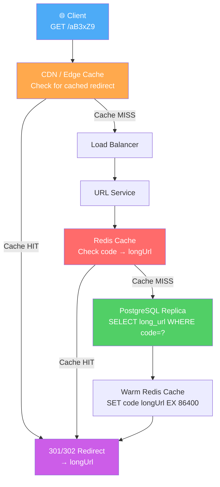

---

## 2. Notification System

### Requirements
**Functional:** Send push, email, SMS, in-app notifications. Support templates. Schedule notifications. User preference management (opt-out per channel).  
**Non-functional:** 10M notifications/day. Delivery < 30s for real-time. At-least-once delivery. No duplicates to end users.

### Architecture
```
API / Trigger Services  (Order Service, Auth Service, etc.)
        │
        ▼
[ Notification Service ]
        │
        ├─ validate preferences (user opted out? → drop)
        ├─ render template
        │
        ▼
[ Message Queue ]  ←── per-channel queues for fan-out
   │        │        │
   ▼        ▼        ▼
[Email Q] [SMS Q] [Push Q]
   │        │        │
   ▼        ▼        ▼
[Email    [SMS     [FCM/APNs
 Worker]   Worker]  Worker]
   │        │        │
   ▼        ▼        ▼
[SendGrid][Twilio] [Firebase]

Failures → DLQ → Alert → Retry or Manual Review
```

```mermaid
flowchart TD
    TRIGGER["📡 Trigger Service\n(Order/Auth/etc.)"] --> NS["Notification Service\n• Validate preferences\n• Render template\n• Deduplicate"]
    NS -->|Fan-out| EQ["📧 Email Queue"]
    NS -->|Fan-out| SQ["📱 SMS Queue"]
    NS -->|Fan-out| PQ["🔔 Push Queue"]
    EQ --> EW["Email Worker"] --> SG["SendGrid"]
    SQ --> SW["SMS Worker"] --> TW["Twilio"]
    PQ --> PW["Push Worker"] --> FCM["FCM / APNs"]
    EW -->|Failure| DLQ["💀 Dead Letter Queue\n→ Alert + Retry"]
    SW -->|Failure| DLQ
    PW -->|Failure| DLQ

    style TRIGGER fill:#4dabf7,color:#fff
    style NS fill:#ffa94d,color:#fff
    style DLQ fill:#ff6b6b,color:#fff
    style SG fill:#51cf66,color:#fff
    style TW fill:#51cf66,color:#fff
    style FCM fill:#51cf66,color:#fff
```

### Data Model
```sql
CREATE TABLE notification_templates (
    id       UUID PRIMARY KEY,
    name     VARCHAR(100),       -- "order_shipped"
    channel  VARCHAR(20),        -- "email" | "sms" | "push"
    subject  TEXT,
    body     TEXT                -- "Your order {{orderId}} has shipped!"
);

CREATE TABLE notifications (
    id           UUID PRIMARY KEY,
    user_id      BIGINT,
    template_id  UUID,
    channel      VARCHAR(20),
    status       VARCHAR(20),    -- queued|sent|failed|delivered
    payload      JSONB,          -- { "orderId": "..." }
    scheduled_at TIMESTAMP,
    sent_at      TIMESTAMP,
    created_at   TIMESTAMP DEFAULT NOW()
);

CREATE TABLE user_preferences (
    user_id   BIGINT,
    channel   VARCHAR(20),
    enabled   BOOLEAN DEFAULT TRUE,
    PRIMARY KEY (user_id, channel)
);
```

### Idempotent Delivery
```csharp
// Each notification has a unique idempotency key
// Third-party providers (SendGrid, Twilio) deduplicate on this key
public async Task SendEmailAsync(Notification n)
{
    var idempotencyKey = $"notif:{n.Id}"; // stable per notification

    await _sendGridClient.SendEmailAsync(new EmailMessage
    {
        To      = n.UserEmail,
        Subject = n.Subject,
        Body    = n.Body,
        Headers = new() { ["X-Idempotency-Key"] = idempotencyKey }
    });

    await _db.Notifications
        .Where(x => x.Id == n.Id)
        .ExecuteUpdateAsync(s => s.SetProperty(x => x.Status, "sent")
                                  .SetProperty(x => x.SentAt, DateTime.UtcNow));
}
```

### Key Tradeoffs
| Decision | Option A | Option B | Choice |
|----------|----------|----------|--------|
| Queue per channel | Single queue | Separate queue per channel | **Separate** — SMS outage doesn't block email |
| Delivery guarantee | Exactly-once | At-least-once + dedup | **At-least-once + dedup** — simpler, provider handles dedup |
| Template storage | Code | DB-driven | **DB-driven** — non-dev can edit templates |

---

## 3. Rate Limiter

### Requirements
**Functional:** Limit requests per user/IP per time window. Return 429 when exceeded. Support per-endpoint limits.  
**Non-functional:** < 5ms overhead. Distributed (multiple app servers share state).

### Algorithms Compared

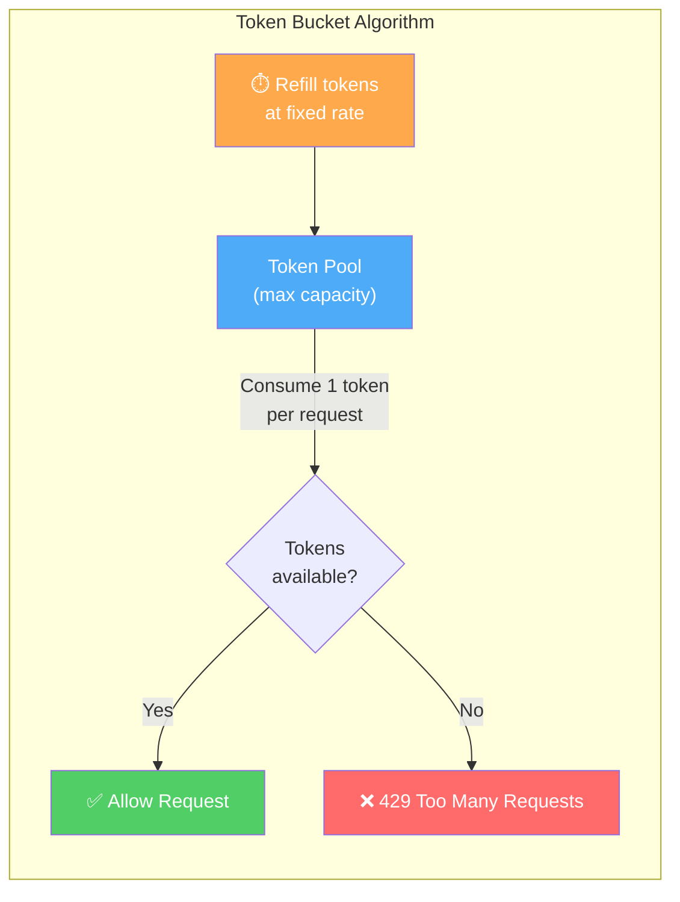

| Algorithm | Memory | Burst Allowed | Smoothness | Best For |
|-----------|--------|---------------|------------|---------|
| Fixed Window | Low | ✅ Yes (edge burst) | ❌ Bursty | Simple APIs |
| Sliding Window Log | High | ❌ No | ✅ Smooth | Precision required |
| Sliding Window Counter | Medium | ⚠️ Partial | ✅ Good | General purpose |
| Token Bucket | Low | ✅ Yes (controlled) | ✅ Good | **Most APIs** |
| Leaky Bucket | Low | ❌ No | ✅ Smooth | Stable output rate |

### Token Bucket Implementation (Redis)
```csharp
public class RedisRateLimiter
{
    private readonly IDatabase _redis;

    // Lua script — atomic check-and-decrement (no race condition)
    private const string LuaScript = @"
        local key      = KEYS[1]
        local capacity = tonumber(ARGV[1])
        local refill   = tonumber(ARGV[2])   -- tokens added per second
        local now      = tonumber(ARGV[3])   -- current timestamp (ms)
        local cost     = tonumber(ARGV[4])   -- tokens this request costs

        local data     = redis.call('HMGET', key, 'tokens', 'last_refill')
        local tokens   = tonumber(data[1]) or capacity
        local last     = tonumber(data[2]) or now

        -- Refill tokens based on elapsed time
        local elapsed  = math.max(0, now - last)
        tokens = math.min(capacity, tokens + elapsed * refill / 1000)

        if tokens >= cost then
            tokens = tokens - cost
            redis.call('HMSET', key, 'tokens', tokens, 'last_refill', now)
            redis.call('EXPIRE', key, 3600)
            return 1        -- allowed
        else
            redis.call('HMSET', key, 'tokens', tokens, 'last_refill', now)
            return 0        -- denied
        end
    ";

    public async Task<bool> IsAllowedAsync(string userId, int capacity = 100, double refillPerSec = 10)
    {
        var key    = $"ratelimit:{userId}";
        var now    = DateTimeOffset.UtcNow.ToUnixTimeMilliseconds();
        var result = await _redis.ScriptEvaluateAsync(LuaScript,
            keys:   new RedisKey[]  { key },
            values: new RedisValue[] { capacity, refillPerSec, now, 1 });

        return (int)result == 1;
    }
}

// Middleware
public class RateLimitMiddleware
{
    public async Task InvokeAsync(HttpContext ctx)
    {
        var userId  = ctx.User.FindFirst("sub")?.Value ?? ctx.Connection.RemoteIpAddress?.ToString();
        var allowed = await _limiter.IsAllowedAsync(userId!);

        if (!allowed)
        {
            ctx.Response.StatusCode = 429;
            ctx.Response.Headers["Retry-After"] = "1";
            await ctx.Response.WriteAsJsonAsync(new { error = "Rate limit exceeded" });
            return;
        }
        await _next(ctx);
    }
}
```

### Key Tradeoffs
| Decision | Option A | Option B | Choice |
|----------|----------|----------|--------|
| Storage | In-process memory | Redis | **Redis** — shared across all app servers |
| Algorithm | Fixed window | Token bucket | **Token bucket** — handles burst naturally |
| Atomicity | Check then update (2 calls) | Lua script (atomic) | **Lua** — no race conditions |
| Limit scope | Per user | Per user + per endpoint | **Both** — coarse + fine-grained |

---

## 4. File Upload Service

### Requirements
**Functional:** Upload files up to 5GB. Resume interrupted uploads. Generate download URLs. Virus scanning. Thumbnail generation for images.  
**Non-functional:** 1M uploads/day. Uploads parallelizable. Files stored durably (11 nines).

### Architecture: Chunked Upload Flow
```
Client
  │
  ├─ 1. POST /uploads/initiate
  │         → { uploadId, presignedUrls[]: [part1URL, part2URL, ...] }
  │
  ├─ 2. PUT presignedUrls[0]  ← chunk 1 directly to Azure Blob / S3
  ├─ 3. PUT presignedUrls[1]  ← chunk 2 directly to Azure Blob / S3
  │    (parallel, retry-able per chunk)
  │
  ├─ 4. POST /uploads/{uploadId}/complete
  │         → { fileId, downloadUrl }
  │
  └─ 5. Background workers:
           ├─ Virus scanner (ClamAV / Defender)
           ├─ Thumbnail generator
           └─ CDN invalidation
```

### Implementation
```csharp
// Step 1: Initiate — generate presigned URLs for each chunk
public async Task<InitiateUploadResponse> InitiateUploadAsync(InitiateUploadRequest req)
{
    var uploadId  = Guid.NewGuid().ToString();
    var chunkSize = 5 * 1024 * 1024; // 5 MB per chunk
    var numChunks = (int)Math.Ceiling((double)req.FileSizeBytes / chunkSize);

    // Store metadata
    await _db.Uploads.AddAsync(new Upload
    {
        Id         = uploadId,
        FileName   = req.FileName,
        TotalChunks= numChunks,
        Status     = "initiated"
    });

    // Generate presigned URLs for direct browser → Blob upload
    var urls = Enumerable.Range(1, numChunks)
        .Select(i => _blobService.GeneratePresignedUploadUrl(
            container:  "uploads",
            blobName:   $"{uploadId}/part{i}",
            expiresIn:  TimeSpan.FromHours(2)))
        .ToList();

    return new(uploadId, urls);
}

// Step 4: Complete — assemble chunks
public async Task<CompleteUploadResponse> CompleteUploadAsync(string uploadId)
{
    var upload   = await _db.Uploads.FindAsync(uploadId)
        ?? throw new NotFoundException($"Upload {uploadId} not found");

    // Compose chunks into final blob (Azure Block Blob CommitBlockList)
    var blockIds = Enumerable.Range(1, upload.TotalChunks)
        .Select(i => Convert.ToBase64String(Encoding.UTF8.GetBytes($"part{i:D6}")))
        .ToList();

    var blobClient = _containerClient.GetBlockBlobClient(uploadId);
    await blobClient.CommitBlockListAsync(blockIds);

    // Publish event for async processing
    await _bus.PublishAsync(new FileUploadedEvent(uploadId, upload.FileName));

    upload.Status = "completed";
    await _db.SaveChangesAsync();

    return new(uploadId, blobClient.Uri.ToString());
}
```

### Key Tradeoffs
| Decision | Option A | Option B | Choice |
|----------|----------|----------|--------|
| Upload target | Via API server | Direct to Blob (presigned URL) | **Direct** — API server not a bottleneck |
| Virus scan | Synchronous (block upload) | Async (post-upload event) | **Async** — don't delay user; quarantine before serving |
| Chunk size | 1 MB | 5–10 MB | **5 MB** — balance retry cost vs request count |
| Storage | On-premise | Azure Blob / S3 | **Blob/S3** — 11 nines durability, geo-redundancy |

---

## 5. Payment System

### Requirements
**Functional:** Charge card, issue refund, subscription billing, payment history.  
**Non-functional:** Exactly-once payment processing (no double charges). PCI-DSS compliance. < 3s p99 for charge. 99.99% availability.

### Architecture
```
Client
  │
  ├─ 1. POST /payments/initiate
  │         → { paymentIntentId, clientSecret }
  │               (idempotency key sent by client)
  │
  ├─ 2. Client-side SDK (Stripe.js) collects card → tokenises
  │         (card numbers NEVER touch your servers — PCI compliance)
  │
  ├─ 3. POST /payments/confirm { paymentIntentId, paymentMethodId }
  │
  ▼
[ Payment Service ]
  │  ─── idempotency check ────────────────────────────
  │  If paymentIntentId already processed → return cached result
  │  ─────────────────────────────────────────────────
  │
  ├─ call Stripe/Braintree API
  │
  ├─ on SUCCESS:
  │     ├─ record in payments table (status=succeeded)
  │     └─ publish PaymentSucceeded event → Order Service, Email Service
  │
  └─ on FAILURE:
        ├─ record failure + error code
        └─ return structured error to client
```

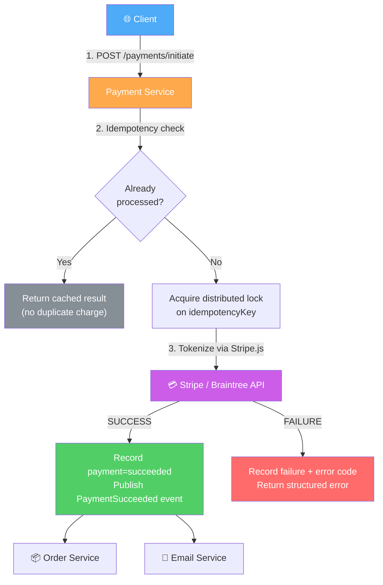

### Idempotency — Critical for Payments
```csharp
public class PaymentService
{
    public async Task<PaymentResult> ChargeAsync(ChargeRequest req)
    {
        // STEP 1: Check idempotency store first
        var existing = await _db.Payments
            .FirstOrDefaultAsync(p => p.IdempotencyKey == req.IdempotencyKey);

        if (existing is not null)
            return MapToResult(existing); // return SAME result as first attempt

        // STEP 2: Acquire distributed lock on idempotency key
        await using var @lock = await _lockService.AcquireAsync(
            $"payment:{req.IdempotencyKey}", TimeSpan.FromSeconds(30));

        // STEP 3: Double-check after lock (another instance may have raced)
        existing = await _db.Payments
            .FirstOrDefaultAsync(p => p.IdempotencyKey == req.IdempotencyKey);
        if (existing is not null) return MapToResult(existing);

        // STEP 4: Record intent BEFORE calling provider
        var payment = new Payment
        {
            Id             = Guid.NewGuid(),
            IdempotencyKey = req.IdempotencyKey,
            Amount         = req.Amount,
            Currency       = req.Currency,
            Status         = "processing"
        };
        _db.Payments.Add(payment);
        await _db.SaveChangesAsync(); // persist intent first

        // STEP 5: Call payment provider
        try
        {
            var result = await _stripeClient.ChargeAsync(req.Token, req.Amount);
            payment.Status      = "succeeded";
            payment.ProviderRef = result.ChargeId;
        }
        catch (PaymentDeclinedException ex)
        {
            payment.Status      = "failed";
            payment.FailureCode = ex.Code;
        }

        await _db.SaveChangesAsync();
        return MapToResult(payment);
    }
}
```

### Key Tradeoffs
| Decision | Option A | Option B | Choice |
|----------|----------|----------|--------|
| PCI compliance | Self-hosted card storage | Stripe/Braintree tokenisation | **Tokenisation** — never store raw card numbers |
| Retry on network error | Retry blindly | Retry with idempotency key | **Idempotency key** — safe retries, no double charge |
| Sync vs async | Wait for provider response | Queue + webhook callback | **Sync for UX**; webhooks for reconciliation |
| Refund | Immediate DB reversal | Provider refund API | **Provider API** — provider is source of truth |

---

## 6. Chat System

### Requirements
**Functional:** 1:1 and group messaging. Online presence. Message history. Media sharing. Read receipts.  
**Non-functional:** 50M DAU. Message delivery < 100ms. Messages durable (7 years). Groups up to 500 members.

### Architecture
```
Client A                              Server                           Client B
   │                                    │                                │
   │── WebSocket connect ──────────────►│                                │
   │                                    │◄── WebSocket connect ──────────│
   │                                    │                                │
   │── send { to: B, msg: "Hi" } ──────►│                                │
   │                                    ├─ 1. Save to DB (Cassandra)     │
   │                                    ├─ 2. Is B online?               │
   │                                    │     YES: push via WebSocket ──►│
   │                                    │     NO:  push via FCM/APNs ───►│
   │◄── ack { msgId, ts } ─────────────│                                │
   │                                    │                                │
```

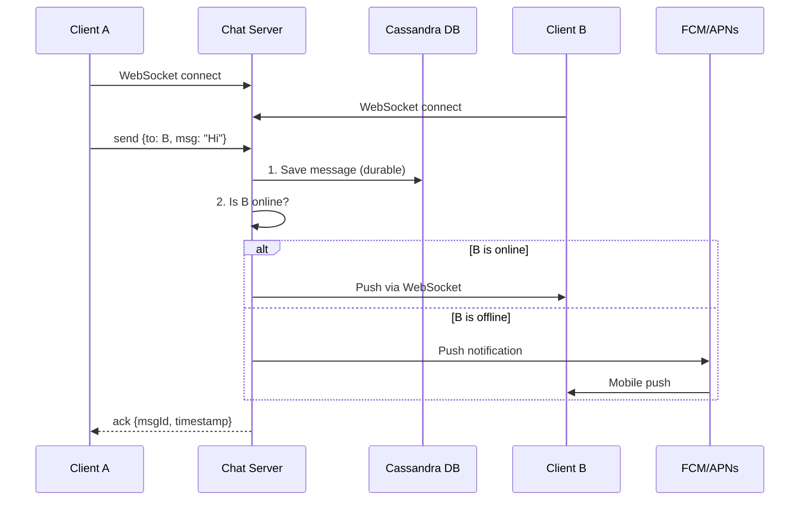

### Why WebSockets over HTTP polling?
```
HTTP Long Polling:
  Client ──► GET /messages (holds connection)
  Server waits 30s for new messages, responds
  Client immediately makes another request
  → Wasteful, high latency, many connections

WebSocket:
  Client ──► Upgrade to WebSocket (persistent)
  Server pushes instantly when message arrives
  → Low latency, single connection, efficient
```

### Data Model (Cassandra — optimised for time-series reads)
```sql
-- Messages table: partition by conversation_id, cluster by time (newest first)
CREATE TABLE messages (
    conversation_id UUID,
    message_id      TIMEUUID,     -- time-sortable UUID
    sender_id       BIGINT,
    content         TEXT,
    media_url       TEXT,
    status          TEXT,         -- sent|delivered|read
    PRIMARY KEY (conversation_id, message_id)
) WITH CLUSTERING ORDER BY (message_id DESC);

-- Load last 50 messages efficiently:
-- SELECT * FROM messages WHERE conversation_id = ? LIMIT 50;

-- User inbox: which conversations exist and last message
CREATE TABLE user_conversations (
    user_id         BIGINT,
    conversation_id UUID,
    last_message    TEXT,
    last_ts         TIMESTAMP,
    unread_count    INT,
    PRIMARY KEY (user_id, last_ts)
) WITH CLUSTERING ORDER BY (last_ts DESC);
```

### Presence Service
```csharp
// WebSocket connection manager using Redis pub/sub
public class PresenceService
{
    private readonly IDatabase _redis;

    public async Task SetOnlineAsync(Guid userId, string connectionId)
    {
        await _redis.StringSetAsync($"presence:{userId}", connectionId,
            expiry: TimeSpan.FromMinutes(5)); // heartbeat must refresh
    }

    public async Task<string?> GetConnectionIdAsync(Guid userId)
        => await _redis.StringGetAsync($"presence:{userId}");

    // Heartbeat — client pings every 30s
    public async Task HeartbeatAsync(Guid userId, string connectionId)
        => await _redis.KeyExpireAsync($"presence:{userId}", TimeSpan.FromMinutes(5));
}
```

### Key Tradeoffs
| Decision | Option A | Option B | Choice |
|----------|----------|----------|--------|
| Transport | HTTP polling | WebSocket | **WebSocket** — real-time, low latency |
| Message store | SQL (Postgres) | Cassandra | **Cassandra** — write-heavy time-series, horizontal scale |
| Fan-out for groups | Enumerate members at send time | Pre-computed fan-out | **Enumerate at send** for small groups; fan-out service for > 500 members |
| Offline delivery | Store-and-forward in DB | Push notifications | **Both** — push for immediate; DB for history on reconnect |

---

# Production Engineering Patterns

---

## 7. Retry Architecture

### The Problem
Transient failures (network blip, momentary DB overload) should be retried automatically. Permanent failures (invalid input, 404) should NOT be retried. Retrying too aggressively causes **retry storms** that worsen an already-struggling downstream.

### Exponential Backoff with Jitter
```csharp
// Polly — the standard .NET resilience library
var retryPipeline = new ResiliencePipelineBuilder()
    .AddRetry(new RetryStrategyOptions
    {
        MaxRetryAttempts  = 5,
        Delay             = TimeSpan.FromMilliseconds(200),
        BackoffType       = DelayBackoffType.Exponential, // 200ms, 400ms, 800ms, 1600ms, 3200ms
        UseJitter         = true,    // ← CRITICAL: randomises delay to prevent thundering herd
        ShouldHandle      = new PredicateBuilder()
            .Handle<HttpRequestException>()
            .Handle<TimeoutException>()
            .HandleResult<HttpResponseMessage>(r =>
                r.StatusCode == HttpStatusCode.ServiceUnavailable ||
                r.StatusCode == HttpStatusCode.TooManyRequests),
        OnRetry           = static args =>
        {
            Console.WriteLine($"Retry {args.AttemptNumber} after {args.RetryDelay}");
            return ValueTask.CompletedTask;
        }
    })
    .AddCircuitBreaker(new CircuitBreakerStrategyOptions
    {
        FailureRatio      = 0.5,                          // open if 50% fail
        SamplingDuration  = TimeSpan.FromSeconds(10),
        MinimumThroughput = 10,
        BreakDuration     = TimeSpan.FromSeconds(30)      // try again after 30s
    })
    .Build();

var result = await retryPipeline.ExecuteAsync(
    async ct => await _httpClient.GetAsync("/api/data", ct), ct);
```

### What NOT to Retry
```csharp
// ❌ Never retry on 4xx client errors — retrying won't fix them
var shouldRetry = statusCode switch
{
    HttpStatusCode.BadRequest           => false, // 400 — fix your request
    HttpStatusCode.Unauthorized         => false, // 401 — get a new token first
    HttpStatusCode.Forbidden            => false, // 403 — no point retrying
    HttpStatusCode.NotFound             => false, // 404 — it's not there
    HttpStatusCode.UnprocessableEntity  => false, // 422 — validation failure
    HttpStatusCode.TooManyRequests      => true,  // 429 — retry with backoff
    HttpStatusCode.InternalServerError  => true,  // 500 — maybe transient
    HttpStatusCode.ServiceUnavailable   => true,  // 503 — definitely retry
    HttpStatusCode.GatewayTimeout       => true,  // 504 — retry
    _ => false
};
```

### Key Tradeoff: Retry vs Circuit Breaker
```
Without circuit breaker:
  Service B is DOWN
  Service A retries → 100 RPS × 5 retries = 500 RPS → makes things worse

With circuit breaker:
  Service B fails 50% for 10s → circuit OPENS
  Service A sees OPEN circuit → fails fast (no retry)
  After 30s → circuit HALF-OPEN → test one request
  If succeeds → circuit CLOSES → normal operation
```

---

## 8. Idempotency Keys

### The Problem
Network failures after the server processes a request but before the client receives the response cause the client to retry — potentially triggering the operation twice (duplicate payment, duplicate order).

### Implementation Pattern
```csharp
// Client sends unique key per logical operation
// POST /api/payments
// Idempotency-Key: 550e8400-e29b-41d4-a716-446655440000

public class IdempotencyMiddleware
{
    public async Task InvokeAsync(HttpContext ctx)
    {
        var key = ctx.Request.Headers["Idempotency-Key"].FirstOrDefault();

        if (key is null) { await _next(ctx); return; } // non-idempotent endpoints skip

        // Check if we've already processed this key
        var cached = await _cache.GetStringAsync($"idem:{key}");
        if (cached is not null)
        {
            // Replay the exact same response
            var stored = JsonSerializer.Deserialize<StoredResponse>(cached)!;
            ctx.Response.StatusCode = stored.StatusCode;
            foreach (var h in stored.Headers) ctx.Response.Headers[h.Key] = h.Value;
            await ctx.Response.WriteAsync(stored.Body);
            return; // ← return same result, no re-processing
        }

        // First time — capture response
        var buffer   = new ResponseCapture(ctx.Response);
        await _next(ctx);

        // Store response for future duplicate requests (TTL = 24h)
        await _cache.SetStringAsync($"idem:{key}",
            JsonSerializer.Serialize(new StoredResponse(
                ctx.Response.StatusCode,
                buffer.CapturedHeaders,
                buffer.CapturedBody)),
            new DistributedCacheEntryOptions
            {
                AbsoluteExpirationRelativeToNow = TimeSpan.FromHours(24)
            });
    }
}
```

### Rules
```
✅ Client generates the idempotency key (UUID v4)
✅ Same key + same request body → same response, operation executed once
✅ Same key + different body → 422 Unprocessable (conflict)
✅ Key expires after 24h — client must use new key for new attempt next day
✅ Store key BEFORE processing — if crash during processing, retry is safe
```

---

## 9. Event-Driven Architecture

### Push vs Pull vs Event-Driven
```
Synchronous (REST):
  Order Service ──► Payment Service ──► Inventory Service
  │ Tight coupling: if Payment is down, Order fails
  │ Hard to add new consumers without changing Order Service

Event-Driven:
  Order Service ──► [OrderPlaced event] ──► Message Broker
                                                ├──► Payment Service   (subscriber)
                                                ├──► Inventory Service (subscriber)
                                                ├──► Email Service     (subscriber)
                                                └──► Analytics Service (subscriber)
  │ Loose coupling: Order Service doesn't know about subscribers
  │ Add new consumer without touching Order Service
```

### Event Envelope Pattern
```csharp
// All events share a standard envelope — routing, tracing, replay-ability
public record EventEnvelope<T>
{
    public Guid   EventId      { get; init; } = Guid.NewGuid();
    public string EventType    { get; init; } = typeof(T).Name;
    public int    Version      { get; init; } = 1;             // schema version
    public string Source       { get; init; } = "";            // which service produced it
    public DateTimeOffset OccurredAt { get; init; } = DateTimeOffset.UtcNow;
    public string CorrelationId { get; init; } = "";           // trace across services
    public T      Payload      { get; init; } = default!;
}

// Publishing
await _bus.PublishAsync(new EventEnvelope<OrderPlacedEvent>
{
    Source        = "order-service",
    CorrelationId = Activity.Current?.Id ?? Guid.NewGuid().ToString(),
    Payload       = new OrderPlacedEvent(order.Id, order.CustomerId, order.Total)
});
```

### Key Tradeoffs
| | Synchronous REST | Event-Driven |
|-|-----------------|--------------|
| Coupling | Tight | Loose |
| Consistency | Strong | Eventually consistent |
| Debugging | Easy (call chain visible) | Hard (events scattered) |
| New consumers | Requires code change | Zero change to producer |
| Failure isolation | ❌ Cascade | ✅ Independent |
| Use when | Simple flows, query responses | Complex workflows, fan-out, audit trail |

---

## 10. Kafka Basics

### Core Concepts
```
Producer → [ Topic: orders ] → Consumer Group

Topic: ordered, immutable log of messages
  ┌──────────────────────────────────────────────────────┐
  │ Partition 0: [msg0][msg1][msg3][msg5]...              │
  │ Partition 1: [msg2][msg4][msg6]...                    │
  │ Partition 2: [msg7][msg8]...                          │
  └──────────────────────────────────────────────────────┘

Consumer Group:
  Consumer A reads Partition 0
  Consumer B reads Partition 1   ← parallel processing!
  Consumer C reads Partition 2
  (one partition per consumer max; idle consumer if partitions < consumers)
```

### Producer and Consumer in .NET
```csharp
// Producer
var config   = new ProducerConfig { BootstrapServers = "kafka:9092" };
using var producer = new ProducerBuilder<string, string>(config).Build();

await producer.ProduceAsync("orders", new Message<string, string>
{
    Key   = order.CustomerId.ToString(), // same customer → same partition (ordering)
    Value = JsonSerializer.Serialize(order)
});

// Consumer
var consumerConfig = new ConsumerConfig
{
    BootstrapServers = "kafka:9092",
    GroupId          = "payment-service",          // consumer group
    AutoOffsetReset  = AutoOffsetReset.Earliest,
    EnableAutoCommit = false                        // manual commit — control exactly when offset advances
};

using var consumer = new ConsumerBuilder<string, string>(consumerConfig).Build();
consumer.Subscribe("orders");

while (true)
{
    var msg = consumer.Consume(TimeSpan.FromSeconds(1));
    if (msg is null) continue;

    var order = JsonSerializer.Deserialize<Order>(msg.Message.Value)!;

    try
    {
        await _paymentService.ProcessAsync(order);
        consumer.Commit(msg); // ← only commit offset AFTER successful processing
    }
    catch (Exception ex)
    {
        _log.LogError(ex, "Failed to process order {Id}", order.Id);
        // Don't commit — message will be re-delivered (at-least-once)
    }
}
```

### Partition Key Strategy
```
✅ Use business key (customerId, orderId) as partition key
   → All events for same entity go to same partition → ordered processing
   → "Customer 123's events always processed by same consumer instance"

❌ Random key / null key
   → Events for same entity may be on different partitions
   → Consumer A and B process events for same customer concurrently → race condition
```

---

## 11. Exactly-Once vs At-Least-Once

### Delivery Semantics Compared

| Semantic | Guarantee | Duplicates | Data Loss | Complexity |
|----------|-----------|------------|-----------|------------|
| At-most-once | Fire and forget | None | Possible | Low |
| At-least-once | Retry until ACK | Possible | None | Medium |
| Exactly-once | Delivered once | None | None | High |

### At-Least-Once (Most Common)
```csharp
// Produce: retry until broker ACKs
var producerConfig = new ProducerConfig
{
    Acks              = Acks.All,    // wait for all replicas to confirm
    MessageSendMaxRetries = 5,
    RetryBackoffMs    = 100
};

// Consume: process then commit offset
// If crash after process but before commit → re-delivered → process again
// Solution: make consumer idempotent

public async Task ProcessOrderAsync(Order order)
{
    // Idempotency check — safe to call multiple times
    if (await _db.ProcessedEvents.AnyAsync(e => e.EventId == order.EventId))
    {
        _log.LogInformation("Duplicate event {Id} — skipping", order.EventId);
        return;
    }

    await using var tx = await _db.Database.BeginTransactionAsync();
    await _db.Orders.AddAsync(order);
    await _db.ProcessedEvents.AddAsync(new ProcessedEvent { EventId = order.EventId });
    await _db.SaveChangesAsync();
    await tx.CommitAsync();
}
```

### Exactly-Once (Kafka Transactions)
```csharp
// Producer: enable idempotence + transactions
var config = new ProducerConfig
{
    EnableIdempotence  = true,
    TransactionalId    = "payment-producer-1", // unique per producer instance
    Acks               = Acks.All
};

using var producer = new ProducerBuilder<string, string>(config).Build();
producer.InitTransactions(TimeSpan.FromSeconds(30));

producer.BeginTransaction();
try
{
    await producer.ProduceAsync("payments", new Message<string, string> { Value = payload });
    producer.CommitTransaction();
}
catch
{
    producer.AbortTransaction();
    throw;
}
```

### Recommendation
> Use **at-least-once + idempotent consumers** — it's simpler, more portable, and works with any broker. Reserve Kafka exactly-once transactions only for financial flows where at-least-once with dedup is insufficient.

---

## 12. Dead Letter Queue (DLQ)

### What Is It?
A DLQ is a separate queue where messages are moved after **exhausting all retry attempts**. It prevents one bad message from blocking the entire queue while preserving the message for investigation and replay.

```
Normal Queue: [msg1][msg2][BAD_MSG][msg4]
                              │
                    Retries 1,2,3 all fail
                              │
                              ▼
DLQ:          [BAD_MSG]   ← alert fires, team investigates
                              │
                    Fix consumer bug or fix data
                              │
                              ▼
Replay DLQ → Normal Queue → processed successfully
```

### Implementation with Azure Service Bus
```csharp
// Consumer — process with retry; let ASB move to DLQ after max retries
var processor = _serviceBusClient.CreateProcessor("orders",
    new ServiceBusProcessorOptions { MaxConcurrentCalls = 5 });

processor.ProcessMessageAsync += async args =>
{
    try
    {
        var order = args.Message.Body.ToObjectFromJson<Order>();
        await _orderService.ProcessAsync(order);
        await args.CompleteMessageAsync(args.Message);          // success
    }
    catch (TransientException)
    {
        await args.AbandonMessageAsync(args.Message);           // retry (increments DeliveryCount)
        // ASB auto-moves to DLQ when DeliveryCount > MaxDeliveryCount (default 10)
    }
    catch (PermanentException ex)
    {
        // Don't retry — dead-letter immediately with reason
        await args.DeadLetterMessageAsync(args.Message,
            deadLetterReason: "PermanentFailure",
            deadLetterErrorDescription: ex.Message);
    }
};

// DLQ monitor — alert + replay
public async Task ReplayDlqAsync()
{
    var dlqReceiver = _serviceBusClient.CreateReceiver(
        "orders", new ServiceBusReceiverOptions
        {
            SubQueue = SubQueue.DeadLetter
        });

    await foreach (var msg in dlqReceiver.ReceiveMessagesAsync())
    {
        _log.LogWarning("DLQ message: {Reason} — {Body}",
            msg.DeadLetterReason, msg.Body);

        // After fixing the bug, re-enqueue for processing
        await _sender.SendMessageAsync(new ServiceBusMessage(msg.Body));
        await dlqReceiver.CompleteMessageAsync(msg);
    }
}
```

---

## 13. Saga Pattern

### The Problem
Distributed transactions spanning multiple microservices cannot use a single DB transaction. If step 3 of 5 fails, how do you undo steps 1 and 2?

### Two Saga Approaches

**Choreography** — each service publishes events; others react. No central coordinator.
```
Order Service  → publishes OrderPlaced
                      │
              Payment Service listens → charges card → publishes PaymentProcessed
                                                              │
                                          Inventory Service listens → reserves stock → publishes StockReserved
                                                                                              │
                                                                        Shipping Service listens → schedules delivery

ON FAILURE:
Payment fails → publishes PaymentFailed
Order Service listens → cancels order → publishes OrderCancelled
```

**Orchestration** — central Saga orchestrator tells each service what to do.
```csharp
public class PlaceOrderSaga : MassTransitStateMachine<PlaceOrderSagaState>
{
    public PlaceOrderSaga()
    {
        InstanceState(x => x.CurrentState);

        // Step 1: Start saga when order is placed
        Initially(
            When(OrderPlaced)
                .Then(ctx => ctx.Saga.OrderId = ctx.Message.OrderId)
                .TransitionTo(PaymentPending)
                .Publish(ctx => new ProcessPaymentCommand(ctx.Saga.OrderId)));

        // Step 2: Payment succeeded → reserve inventory
        During(PaymentPending,
            When(PaymentProcessed)
                .TransitionTo(InventoryPending)
                .Publish(ctx => new ReserveInventoryCommand(ctx.Saga.OrderId)),
            When(PaymentFailed)
                .TransitionTo(Failed)
                .Publish(ctx => new CancelOrderCommand(ctx.Saga.OrderId)));  // compensating tx

        // Step 3: All done
        During(InventoryPending,
            When(InventoryReserved)
                .TransitionTo(Completed)
                .Publish(ctx => new OrderConfirmedEvent(ctx.Saga.OrderId)),
            When(InventoryUnavailable)
                .TransitionTo(Failed)
                .Publish(ctx => new RefundPaymentCommand(ctx.Saga.OrderId))   // compensate
                .Publish(ctx => new CancelOrderCommand(ctx.Saga.OrderId)));
    }
}
```

### Choreography vs Orchestration Tradeoffs
| | Choreography | Orchestration |
|-|-------------|---------------|
| Coupling | Loose | Tighter (services know orchestrator) |
| Visibility | Low — hard to see overall flow | High — saga state is visible |
| Debugging | Hard — events scattered | Easy — single state machine |
| Cyclic dependencies | Risk | Not applicable |
| Use when | Simple, few steps | Complex, many steps, need visibility |

---

## 14. Distributed Tracing

### The Problem
In a microservices system, one user request spans 10 services. When it's slow or fails, which service is the culprit?

### How It Works
```
Request arrives at API Gateway → assigns TraceId = "abc123"
  │
  ├─ calls Order Service (SpanId = "span1", ParentSpanId = null)
  │     │
  │     ├─ calls Payment Service (SpanId = "span2", ParentSpanId = "span1")
  │     │     └─ calls Fraud Service (SpanId = "span3", ParentSpanId = "span2")
  │     │
  │     └─ calls Inventory Service (SpanId = "span4", ParentSpanId = "span1")
  │
  └─ Trace "abc123" shows full tree of spans with durations → find bottleneck
```

### OpenTelemetry in .NET
```csharp
// Program.cs — wire up OpenTelemetry
builder.Services.AddOpenTelemetry()
    .WithTracing(tracing => tracing
        .SetResourceBuilder(ResourceBuilder.CreateDefault().AddService("order-service"))
        .AddAspNetCoreInstrumentation()       // auto-trace HTTP requests
        .AddHttpClientInstrumentation()       // auto-trace outgoing HTTP calls
        .AddEntityFrameworkCoreInstrumentation() // auto-trace SQL queries
        .AddSource("OrderService")            // custom activity source
        .AddOtlpExporter(o =>                 // export to Jaeger / Zipkin / Azure Monitor
            o.Endpoint = new Uri("http://otel-collector:4317")));

// Custom span in business logic
private static readonly ActivitySource _activitySource = new("OrderService");

public async Task<Order> CreateOrderAsync(CreateOrderCommand cmd)
{
    using var activity = _activitySource.StartActivity("CreateOrder");
    activity?.SetTag("order.customerId", cmd.CustomerId.ToString());
    activity?.SetTag("order.itemCount",  cmd.Items.Count);

    try
    {
        var order = await _repo.CreateAsync(cmd);
        activity?.SetTag("order.id", order.Id.ToString());
        activity?.SetStatus(ActivityStatusCode.Ok);
        return order;
    }
    catch (Exception ex)
    {
        activity?.SetStatus(ActivityStatusCode.Error, ex.Message);
        activity?.RecordException(ex);
        throw;
    }
}

// Propagate context in outgoing HTTP calls (automatic with HttpClient instrumentation)
// TraceId + SpanId sent in "traceparent" header: "00-abc123-span1-01"
```

### Tracing vs Logging vs Metrics
| | Logs | Metrics | Traces |
|-|------|---------|--------|
| What | Discrete events | Numeric measurements | Request journey |
| Question answers | "What happened?" | "How much / how fast?" | "Where is it slow?" |
| Tool | Seq, Splunk, ELK | Prometheus, Grafana | Jaeger, Zipkin, Azure Monitor |
| Storage cost | High | Low | Medium |

---

> ✅ **6 system designs + 8 production patterns** — all with tradeoff analysis.
>
> 💡 **Tradeoff cheat sheet:**
> - Kafka over RabbitMQ: **when you need message replay, event sourcing, or > 1M msg/sec**
> - At-least-once over exactly-once: **simpler, idempotent consumers solve the duplication problem**
> - Choreography over orchestration: **for simple, few-step flows without complex rollback**
> - Idempotency keys: **always for money movement, always for external API calls**

---

*Last updated: 2026 | .NET 8 / Kafka 3.x / Polly 8.x*

---

# ⚖️ System Design Comparisons — Side-by-Side Differences

---

## SD-C1 — Saga Choreography vs Orchestration

| | Choreography | Orchestration |
|-|-------------|---------------|
| Central coordinator | ❌ None | ✅ Saga orchestrator |
| Services know about | Events (react to them) | Only the orchestrator |
| Coupling | Loose (event-based) | Tighter (orchestrator knows steps) |
| Visibility | ❌ Hard to trace full flow | ✅ Saga state machine visible |
| Cyclic dependency risk | ✅ Yes (services listen to each other) | ❌ One-directional |
| Debugging | ❌ Events scattered across services | ✅ Single state machine |
| Use for | Simple, few steps, low coordination | Complex, many steps, rollback needed |

```
Choreography:
  OrderService → OrderPlaced event
                     ↓
              PaymentService listens → PaymentProcessed event
                                           ↓
                               InventoryService listens → StockReserved
  Each service is autonomous — no one knows the full picture

Orchestration:
  SagaOrchestrator → tells PaymentService "charge card"
                   → waits → tells InventoryService "reserve stock"
                   → waits → tells ShippingService "schedule delivery"
  Full flow visible in one place — easy to track, audit, retry
```

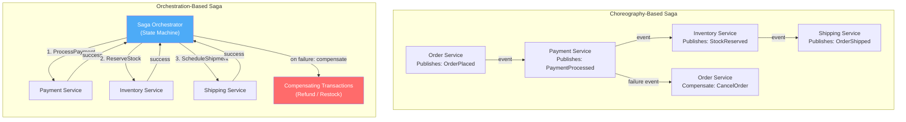

---

## SD-C2 — At-Least-Once vs Exactly-Once vs At-Most-Once Delivery

| | At-Most-Once | At-Least-Once | Exactly-Once |
|-|-------------|--------------|-------------|
| Guarantee | May be lost | Will be delivered (may duplicate) | Delivered once |
| Data loss | ✅ Possible | ❌ | ❌ |
| Duplicates | ❌ | ✅ Possible | ❌ |
| Complexity | Low | Medium (idempotent consumer) | High (transactions) |
| Use for | Metrics, logs (loss OK) | Most business events | Payments, financial |

```csharp
// At-least-once + idempotent consumer — the practical sweet spot
public async Task Consume(ConsumeContext<OrderCreatedEvent> ctx)
{
    // Idempotency check prevents duplicate processing
    if (await _db.ProcessedEvents.AnyAsync(e => e.EventId == ctx.Message.EventId))
        return; // duplicate — skip safely

    await ProcessAsync(ctx.Message);
    await _db.ProcessedEvents.AddAsync(new ProcessedEvent { EventId = ctx.Message.EventId });
    await _db.SaveChangesAsync();
}
// Result: event delivered at-least-once, but processed exactly-once
```

---

## SD-C3 — Push vs Pull Architecture

| | Push | Pull |
|-|------|------|
| Who initiates | Server pushes to consumer | Consumer polls for data |
| Latency | ✅ Low (immediate) | ❌ Up to poll interval |
| Consumer control | ❌ Server controls rate | ✅ Consumer controls pace |
| Backpressure | ❌ Hard (server may overwhelm consumer) | ✅ Natural (consumer fetches when ready) |
| Examples | WebSocket, webhooks, Server-Sent Events | Kafka consumer, REST polling, SQS |
| Use for | Real-time notifications, live data | Batch processing, when consumer is slower |

---

## SD-C4 — DLQ vs Retry Queue vs Parking Lot Pattern

| | Retry Queue | Dead Letter Queue (DLQ) | Parking Lot |
|-|------------|------------------------|-------------|
| When used | Transient failures (retry after delay) | Permanent failures (max retries exhausted) | Any failure — pause and resume later |
| Auto-retry | ✅ Yes (with backoff) | ❌ Manual replay | ❌ Manual intervention |
| Message preserved | ✅ | ✅ | ✅ |
| Alert fires | ❌ | ✅ (DLQ messages = alert) | Optional |

```
Normal Queue → Process fails (transient)
                     ↓
              Retry Queue (wait 30s, retry)
                     ↓ (if fails again × 3)
              DLQ ← alert team
                     ↓ (team fixes bug)
              Replay from DLQ → Normal Queue → Success
```

---

## SD-C5 — Synchronous vs Asynchronous vs Event-Driven Architecture

| | Synchronous (REST) | Asynchronous (Queue) | Event-Driven |
|-|------------------|---------------------|-------------|
| Caller waits | ✅ Yes | ❌ No (fire and forget) | ❌ No |
| Coupling | Tight (knows endpoint) | Loose (knows queue) | Loosest (knows event type) |
| Failure isolation | ❌ Cascade | ✅ Queue buffers | ✅ Independent |
| Data consistency | Strong | Eventual | Eventual |
| Discoverability | Easy (REST docs) | Medium | ❌ Hard (events scattered) |
| Debugging | ✅ Easy (call chain) | Medium | ❌ Hard |
| Use for | Simple CRUD, queries | Long-running tasks, decoupling | Domain events, fan-out, audit |

---

## SD-C6 — Horizontal Sharding vs Vertical Partitioning vs Read Replicas

| | Read Replicas | Vertical Partitioning | Horizontal Sharding |
|-|--------------|----------------------|---------------------|
| What splits | Read vs write traffic | Columns into separate tables | Rows across multiple DBs |
| Helps with | Read scalability | Large wide tables, I/O | Write scalability, data volume |
| Consistency | Replication lag | Fully consistent | Eventual (cross-shard) |
| Complexity | Low | Low | ❌ High (routing, cross-shard queries) |
| Use for | Read-heavy apps | Large BLOB columns, rarely-used fields | Massive scale (> 1TB, > 100k writes/sec) |

```
Read Replica:    [Primary (write)] → replicate → [Replica1 (read)] [Replica2 (read)]
Vertical:        [Users table: id, name, email] + [UserProfile: id, bio, avatar_url]
Sharding:        hash(userId) % 4 →
                   Shard 0: users 0–24M
                   Shard 1: users 25M–49M
                   Shard 2: users 50M–74M
                   Shard 3: users 75M–100M
```

---

## SD-C7 — Idempotency Key vs Deduplication ID vs Correlation ID vs Trace ID

| | Idempotency Key | Deduplication ID | Correlation ID | Trace ID |
|-|----------------|-----------------|----------------|---------|
| Set by | Client | Producer | First service in chain | First service / gateway |
| Purpose | Safe retry (same result) | Prevent duplicate messages | Link related logs across services | Link all spans in a distributed trace |
| Scope | Single operation | Single message | Business transaction | Request journey |
| Example | `POST /payments` header | Kafka message key | `X-Correlation-Id` header | OpenTelemetry `traceparent` |

```csharp
// All four in a payment request:
POST /payments
Idempotency-Key: 550e8400-e29b-41d4-a716-446655440000  // retry safely
X-Correlation-Id: order-flow-abc123                     // link order→payment→notification logs
traceparent: 00-abc123def456-span001-01                 // distributed trace span
// Message to queue includes deduplication key = Idempotency-Key value
```

---

## SD-C8 — Rate Limiting Algorithms Compared

| Algorithm | Memory | Burst handling | Smoothness | Best for |
|-----------|--------|---------------|------------|---------|
| Fixed Window | Low | ❌ Edge burst (double rate at boundary) | ❌ Bursty | Simple, approximate |
| Sliding Window Log | High (log all requests) | ❌ No burst | ✅ Smooth | Strict limits, low volume |
| Sliding Window Counter | Medium | ⚠️ Partial | ✅ Good | General purpose |
| Token Bucket | Low | ✅ Controlled burst (up to capacity) | ✅ Good | **Most APIs** |
| Leaky Bucket | Low | ❌ Excess dropped | ✅ Very smooth | Constant output rate |

```
Token Bucket — visualise a bucket:
  - Bucket holds max 100 tokens
  - Refills at 10 tokens/second
  - Each request costs 1 token
  - Burst: can use all 100 tokens at once (burst capacity)
  - Sustained: max 10 req/sec

Fixed Window problem:
  Window: 12:00:00 - 12:00:59 → 100 req limit
  100 requests at 12:00:58
  100 requests at 12:01:00 → both windows, 200 req in 2 seconds!
  Token bucket doesn't have this — bucket must refill between bursts
```


---

# 📊 System Design Flow Diagrams — Visual Reference

---

## SD-D1 — URL Shortener Architecture

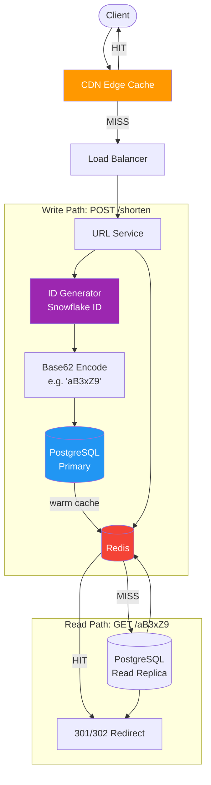

---

## SD-D2 — Notification System Fan-Out

```mermaid
flowchart TD
    TRIGGER([Order Service\nor any trigger]) --> NS[Notification Service]
    NS --> PREF{Check User\nPreferences}
    PREF -->|opted out| DROP[🗑️ Drop notification]
    PREF -->|opted in| TMPL[Render Template\n{{ orderId }} shipped!]
    TMPL --> MQ[Message Broker]

    MQ --> EQ[[Email Queue]]
    MQ --> SQ[[SMS Queue]]
    MQ --> PQ[[Push Queue]]

    EQ --> EW[Email Worker] --> SG[SendGrid]
    SQ --> SW[SMS Worker] --> TW[Twilio]
    PQ --> PW[Push Worker] --> FCM[FCM / APNs]

    SG -->|failed| DLQ1[[Email DLQ]]
    TW -->|failed| DLQ2[[SMS DLQ]]

    style TRIGGER fill:#4CAF50,color:#fff
    style DROP fill:#9e9e9e,color:#fff
    style MQ fill:#9C27B0,color:#fff
    style DLQ1 fill:#f44336,color:#fff
    style DLQ2 fill:#f44336,color:#fff
```

---

## SD-D3 — Rate Limiter (Token Bucket)

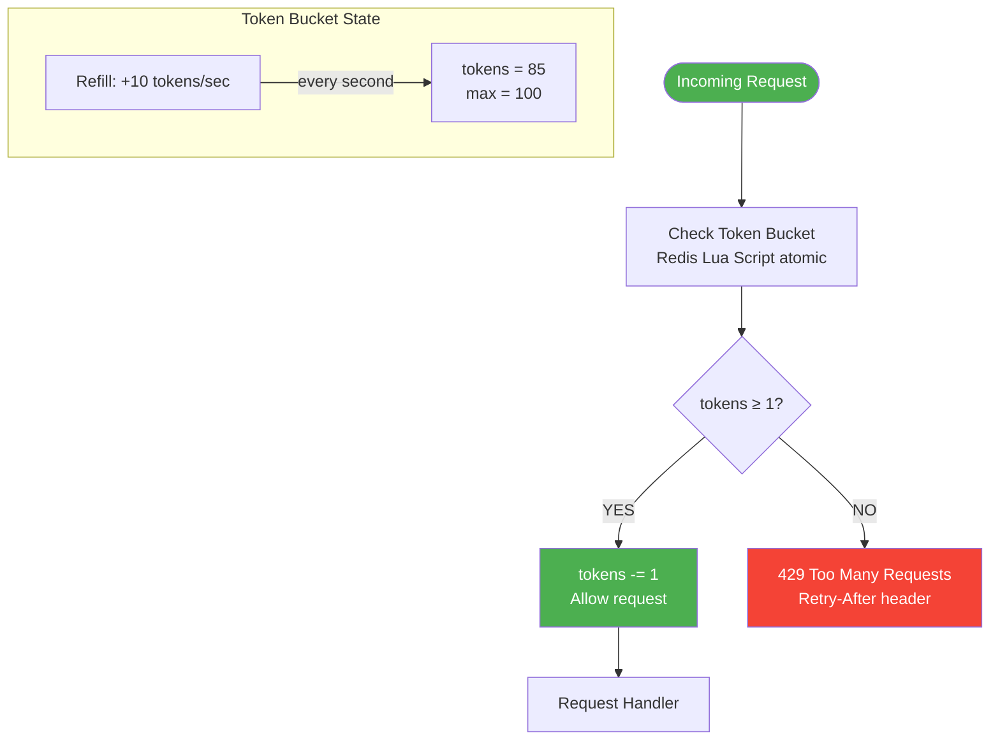

---

## SD-D4 — Chunked File Upload Flow

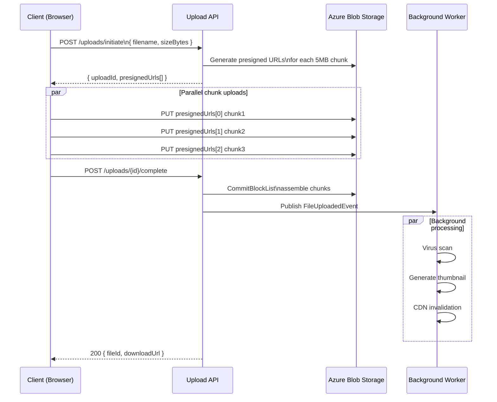

---

## SD-D5 — Payment System (Idempotency)

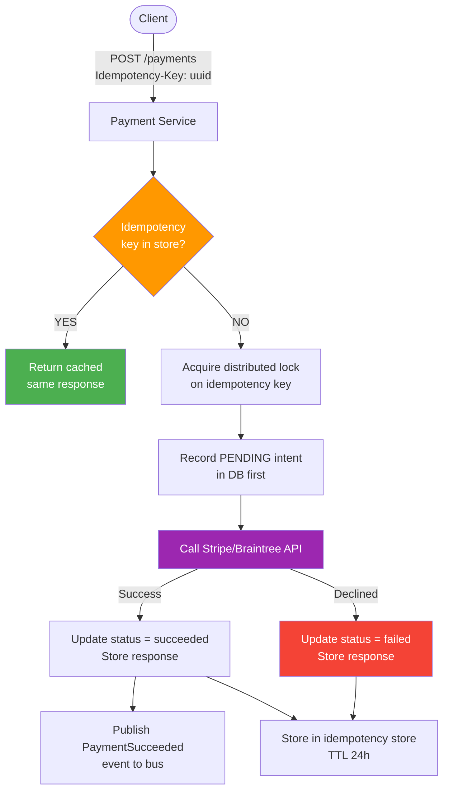

---

## SD-D6 — Retry + Circuit Breaker State Machine

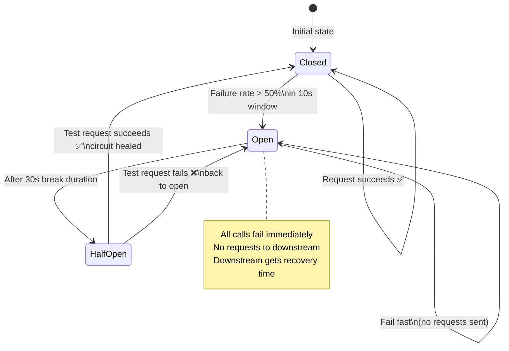

---

## SD-D7 — Kafka Producer → Consumer Flow

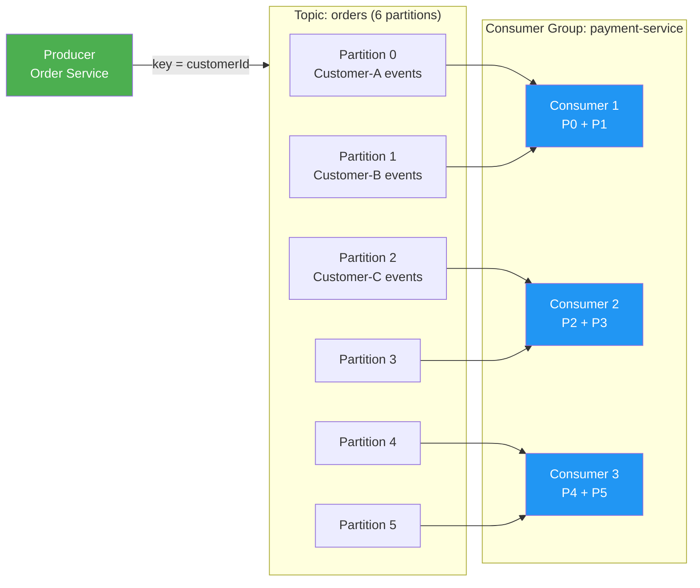

---

## SD-D8 — Dead Letter Queue Pattern

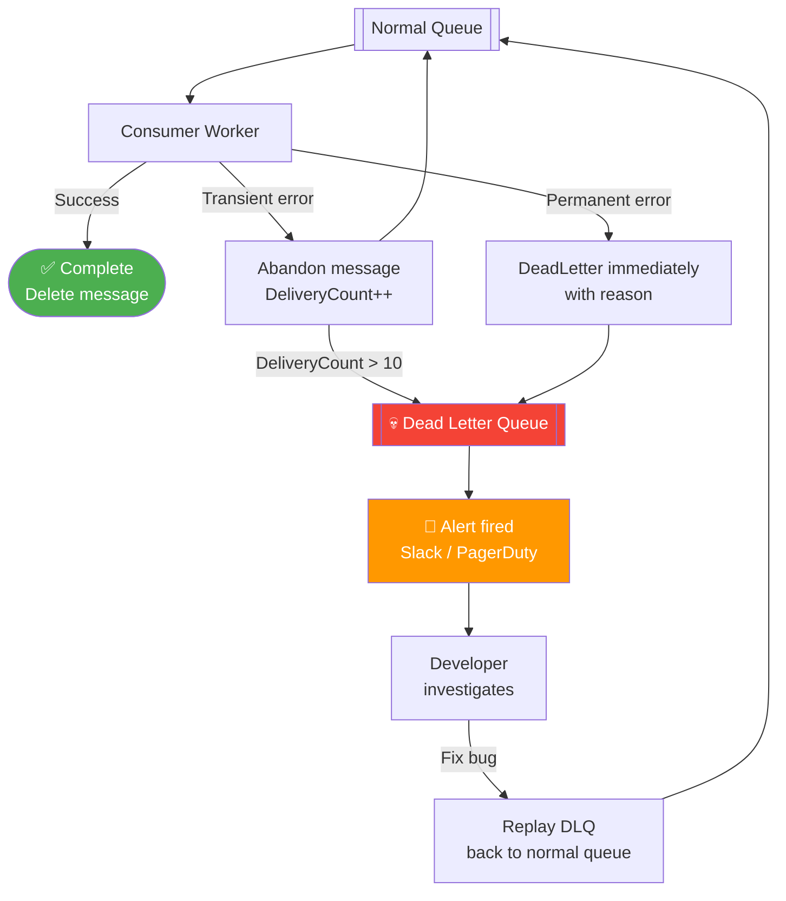


---

## 🏢 FAANG / Big Tech — Extended System Design

> These questions are asked at Google, Amazon, Meta, Apple, Netflix, and Microsoft for Senior/Staff Engineer roles. Each requires a Requirements → Capacity → API → Data Model → Architecture → Trade-offs walkthrough.

---

### 🟢 Google: Design YouTube / Video Upload & Serving

**Asked at:** Google/YouTube, Netflix, TikTok, Twitch, Vimeo
**Difficulty:** Senior / Staff

#### Requirements
**Functional:** Upload videos up to 256GB. Auto-transcode to multiple resolutions. Stream video on-demand. Like/dislike, comments, subscriptions. Search by title/tag. Recommendation feed.
**Non-functional:** 500 hours of video uploaded per minute. 1B daily active viewers. Video available for playback within 5 minutes of upload. Stream start < 2s. CDN cache hit ratio > 90%.

#### Capacity Estimation
```
Uploads:
  500 hours/min = 8.3 hours/sec of raw video
  Average 1-hour video raw size ≈ 10 GB
  Ingestion rate: 8.3 × 10 GB = 83 GB/sec raw data
  After transcoding (10 quality variants): ~330 GB/sec written to storage
  Storage growth: 330 GB/sec × 86400s = 28.5 PB/day

Views:
  1B DAU × 30 min/day average = 500M hours/day streamed
  Average bitrate 3 Mbps → 500M × 3600s × 3 Mbps / 8 = ~675 PB/day egress
  CDN absorbs 90% → origin serves ~67 PB/day

View counts:
  1B DAU × 10 video views/day = 10B view events/day → 116,000 writes/sec
  Cannot write to video row directly — hot row problem
```

#### API Design
```
-- Upload
POST /v1/videos/initiate
     Body: { title, description, tags[], fileSizeBytes, mimeType }
     → { videoId, uploadUrl, uploadToken }   (uploadUrl = pre-signed S3 URL)

POST /v1/videos/{videoId}/complete
     Body: { uploadToken }
     → { videoId, status: "processing" }

GET  /v1/videos/{videoId}
     → { videoId, title, description, channelId, viewCount,
         likeCount, duration, manifestUrl, thumbnailUrl }

-- Streaming
GET  /v1/videos/{videoId}/manifest.m3u8
     → HLS manifest with quality variant URLs

-- Interaction
POST /v1/videos/{videoId}/view          (fire-and-forget analytics event)
POST /v1/videos/{videoId}/like
POST /v1/videos/{videoId}/comments
     Body: { text }
```

#### Data Model
```sql
-- Video metadata (sharded by video_id)
CREATE TABLE videos (
    video_id     BIGINT PRIMARY KEY,     -- Snowflake ID
    channel_id   BIGINT NOT NULL,
    title        VARCHAR(1000),
    description  TEXT,
    tags         TEXT[],
    duration_sec INT,
    status       VARCHAR(20),            -- processing|ready|rejected|deleted
    thumbnail_url TEXT,
    manifest_url  TEXT,                  -- HLS/DASH master playlist URL
    created_at   TIMESTAMP,
    published_at TIMESTAMP
);

-- Video asset encodings
CREATE TABLE video_assets (
    asset_id     UUID PRIMARY KEY,
    video_id     BIGINT REFERENCES videos(video_id),
    resolution   VARCHAR(10),            -- "2160p","1080p","720p","480p","360p"
    codec        VARCHAR(20),            -- "H.264","H.265","VP9","AV1"
    bitrate_kbps INT,
    storage_path TEXT,                   -- s3://yt-videos/video_id/1080p/...
    segment_count INT
);

-- View count — sharded counters to handle 116K writes/sec
CREATE TABLE view_count_shards (
    video_id     BIGINT,
    shard_id     SMALLINT,               -- 0..255
    count        BIGINT DEFAULT 0,
    PRIMARY KEY (video_id, shard_id)
);
-- Write: UPDATE ... WHERE video_id=X AND shard_id = hash(userId) % 256
-- Read:  SELECT SUM(count) FROM view_count_shards WHERE video_id=X

-- For hot videos: batch writes in Redis, flush to DB every 30s
-- Redis: INCR view:{videoId}  → flush to shards every 30s
```

#### Architecture & Key Design Decisions

**Upload → Transcode → Serve Pipeline:**
```
1. CLIENT: POST /videos/initiate → VideoMetadata Service
   → Stores video record (status=uploading)
   → Returns pre-signed S3 URL

2. CLIENT: Direct upload to S3 (multi-part for large files, retry per part)
   → S3 triggers SNS → SQS → Transcoding Orchestrator

3. TRANSCODING (most compute-intensive step):
   Transcoding Orchestrator dequeues job
   Spawns workers for each output format/resolution (parallel):
     Worker 1: 2160p H.265
     Worker 2: 1080p H.264
     Worker 3: 720p H.264  ← first to finish → early playback
     Worker 4: 480p VP9
     Worker 5: 360p H.264
   Each worker:
     a. Download chunk from S3
     b. FFmpeg transcode → output segments (4s each)
     c. Upload segments to S3 CDN origin
     d. Update asset table

4. MANIFEST GENERATION:
   When all qualities done: generate HLS master playlist
   Update video.status = "ready", video.manifest_url

5. CDN DISTRIBUTION:
   Popular videos: pre-warm CDN on publish
   Long-tail: CDN pulls from origin on first request, caches

6. THUMBNAIL PIPELINE (parallel to transcoding):
   Extract frames at 10% / 50% / 90%
   ML model picks best frame as thumbnail
   Resize to multiple dimensions, push to CDN
```

**View Count at Scale (Eventual Consistency):**
```
Naive:  UPDATE videos SET view_count = view_count + 1 WHERE video_id = X
Problem: Viral video → 1M concurrent viewers → DB deadlock / hot row

Solution — Layered counting:
  Layer 1: Redis INCR view:{videoId}           ← in-memory, fast
  Layer 2: Flink job consumes view events from Kafka
           → aggregate per videoId per 30 seconds
           → batch UPDATE to sharded view_count_shards table
  Layer 3: Periodic reconciliation job
           → SUM shards → write to videos.view_count cache column
  Read:    Return cached count (30–60s stale) — YouTube's real behavior
```

#### Trade-offs & Follow-up Questions

| Decision | Trade-off |
|----------|-----------|
| Per-chunk S3 pre-signed upload | Pros: app server not in data path; Cons: client must handle multi-part assembly, retry logic |
| Parallel transcoding workers | Pros: 1080p ready in minutes; Cons: high cost — spot instances recommended, cost scales with uploads |
| AV1 vs H.264 | AV1: 40% smaller files (lower CDN cost); Cons: 10× slower to encode, fewer old device decoders |
| View count eventual consistency | Pros: survives 116K/sec without DB bottleneck; Cons: count may be ±minutes stale |
| Segment size (4s vs 10s) | 4s: faster quality adaptation; 10s: fewer HTTP requests, better compression ratio |

**Follow-up questions interviewers ask:**
- "Upload is 256GB — what if connection drops halfway?" → Multi-part upload with part ETags; resume from last completed part; client stores progress in local DB
- "How do you detect copyright violations?" → Audio/video fingerprinting (Content ID); hash-based matching against reference DB during transcoding pipeline
- "One CDN region goes down — what happens?" → GeoDNS reroutes to next nearest CDN PoP; slight latency increase; origin can serve as fallback

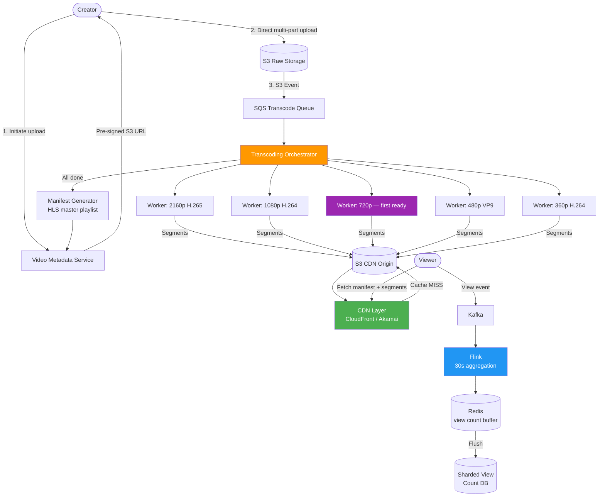

---

### 🔵 Meta: Design WhatsApp / Chat at Scale

**Asked at:** Meta/WhatsApp, Telegram, Signal, Slack, Discord
**Difficulty:** Senior / Staff

#### Requirements
**Functional:** 1-to-1 messaging. Group chats (up to 1000 members). Message delivery receipts (sent/delivered/read). Online presence and typing indicators. End-to-end encryption. Push notifications when offline. Media sharing (photos, videos, documents). Message history.
**Non-functional:** 2B users. 100B messages/day. Message delivery latency < 500ms for online users. Availability 99.99%. Store messages encrypted (server cannot read). Last seen accurate within 60 seconds.

#### Capacity Estimation
```
Messages:
  100B messages/day ÷ 86400s = 1.16M messages/sec
  Average message size: 200 bytes (text) → 1.16M × 200B = 232 MB/sec
  Peak 5×: ~1.2 GB/sec write throughput → need sharded message store

Media:
  10% of messages include media = 10B media/day
  Average media: 500KB → 5 PB/day (mostly cached, not all stored permanently)

Presence:
  2B users × heartbeat every 30s = ~67M presence updates/sec
  Cannot store in DB; must use in-memory store (Redis)

Groups:
  1000-member group: 1 message write → fan-out to 1000 members
  If 1M active group chats send 100 msgs/day:
    100M group messages × avg 500 members = 50B fan-out writes/day
```

#### API Design
```
-- Connection
WebSocket: wss://chat.whatsapp.com/v1/connect
  → persistent connection per client
  → multiplexes all real-time events (messages, presence, receipts)

-- Messaging (over WebSocket or REST fallback)
SEND message event:
  { type: "message", msgId: "uuid", toId: "userId|groupId",
    content: { type: "text|media", ciphertext: "...", mediaId: "..." },
    clientTimestamp: 1234567890 }

ACK event (server → client):
  { type: "ack", msgId: "uuid", status: "delivered|read" }

-- Presence (REST)
GET /v1/users/{userId}/presence
    → { userId, status: "online|offline", lastSeenAt: "2026-06-06T10:00:00Z" }

-- Media (REST)
POST /v1/media/upload
     → { mediaId, uploadUrl }    (pre-signed URL)
GET  /v1/media/{mediaId}
     → { downloadUrl }           (pre-signed download URL, short TTL)
```

#### Data Model
```
-- Message store (Cassandra — optimized for time-range reads by conversation)
-- Partition key: conversation_id (ensures all msgs of a chat on same partition)
-- Clustering key: msg_id DESC (time-sorted, newest first)

CREATE TABLE messages (
    conversation_id  TEXT,          -- "user:A:B" sorted, or "group:{groupId}"
    msg_id           TIMEUUID,      -- time-based UUID (ordering + uniqueness)
    sender_id        BIGINT,
    msg_type         TEXT,          -- "text" | "media" | "deleted"
    ciphertext       BLOB,          -- E2E encrypted; server cannot read
    media_id         UUID,          -- nullable; reference to media store
    client_ts        TIMESTAMP,     -- client-side timestamp
    server_ts        TIMESTAMP,     -- server receipt time
    PRIMARY KEY ((conversation_id), msg_id)
) WITH CLUSTERING ORDER BY (msg_id DESC)
  AND default_time_to_live = 0;     -- keep forever; archival handled separately

-- User inbox / delivery tracking (Redis for hot path)
-- Key: user:{userId}:inbox
-- Value: list of (msgId, conversationId, senderInfo) for undelivered messages
-- TTL: 30 days (push to cold store after)

-- Presence (Redis only — not DB)
-- Key: presence:{userId}
-- Value: HASH { status, last_heartbeat_ts }
-- TTL: 60 seconds (if no heartbeat, considered offline)
```

#### Architecture & Key Design Decisions

**Message Delivery Guarantees (At-Least-Once + Dedup):**
```
Delivery states:
  SENT      → server received message (ACK 1 tick on sender)
  DELIVERED → recipient device received (ACK 2 ticks)
  READ      → recipient opened conversation (ACK 2 blue ticks)

At-least-once delivery:
  1. Sender sends message over WebSocket
  2. Server persists to Cassandra (durable)
  3. Server sends ACK(sent) back to sender
  4. Server tries to deliver to recipient:
     a. Online: push over recipient's WebSocket
     b. Offline: store in inbox; send push notification
  5. Recipient client sends ACK(delivered) to server on receipt
  6. Server updates delivery status; notifies sender

Deduplication:
  Each message has client-generated msgId (UUID)
  Server checks: if msgId already in Cassandra → skip, return existing ACK
  Handles network retries transparently
```

**E2E Encryption (Signal Protocol):**
```
Key exchange (one-time pre-keys):
  1. Alice registers: uploads public key bundle (identity key + signed pre-key + one-time pre-keys)
  2. Bob wants to message Alice: fetches Alice's key bundle from Key Service
  3. Bob performs X3DH key exchange → derives shared session key
  4. Bob encrypts message with shared key → sends ciphertext
  5. Server stores and forwards ciphertext (cannot decrypt)

Group E2E:
  Sender Key protocol (efficient for groups):
  Group member uploads a sender key (one key per group member)
  Others in group download sender keys
  Sender encrypts once with their sender key → all recipients can decrypt
  (vs: encrypt N copies, one per member — inefficient for 1000-member groups)
```

**Online Presence System:**
```
Client sends heartbeat every 30s while app is open
Server updates Redis: SET presence:{userId} {status:online, ts:now} EX 60

Querying presence:
  GET presence:{userId} → if key exists → online; if missing → offline
  "last seen": on Redis TTL expiry, write last_heartbeat_ts to DB (async)

Typing indicators:
  Client sends "typing" event
  Server forwards to conversation participants (no persistence)
  Auto-cancel after 5s without new typing event
  Not stored in DB — ephemeral real-time signal only
```

**Group Message Fan-out:**
```
1000-member group message:
  Option A — Fan-out at server:
    Chat Server receives message → looks up 1000 member IDs
    → Routes to each member's Connection Server (WebSocket)
    → For offline members: write to inbox queue
    Problem: 1 message = 1000 routing operations = latency spike

  Option B (WhatsApp's approach) — Client-side fan-out:
    Server stores message once (conversation_id partition)
    Each recipient client polls or receives push
    For online users: server pushes to their WebSocket connection
    Connection routing: use consistent hashing of userId → connection server
```

#### Trade-offs & Follow-up Questions

| Decision | Trade-off |
|----------|-----------|
| Cassandra for messages | Pros: write-optimized, natural time-ordering; Cons: no cross-partition queries, eventual consistency |
| WebSocket vs long polling | WebSocket: real-time bidirectional, efficient; Cons: sticky sessions, harder to load-balance |
| E2E encryption | Pros: privacy, server breach-safe; Cons: no server-side spam filtering, lost keys = lost messages |
| Store encrypted media | Pros: privacy; Cons: cannot scan for CSAM — WhatsApp uses hash-matching on client side |
| Presence TTL (60s) | Tradeoff between accuracy (shorter TTL) and server load (more frequent heartbeats) |

**Follow-up questions interviewers ask:**
- "User sends message — recipient is offline for 7 days. What happens?" → Message persisted in Cassandra; inbox entry in Redis (30-day TTL); push notification delivered; user sees on next login
- "Group has 1000 members — how do you fan-out efficiently?" → Sender Key protocol for E2E; server-side routing via userId → connection server mapping
- "How do you handle message ordering in a group?" → TIMEUUID as clustering key gives server-side ordering; client uses vector clocks for conflict resolution when offline

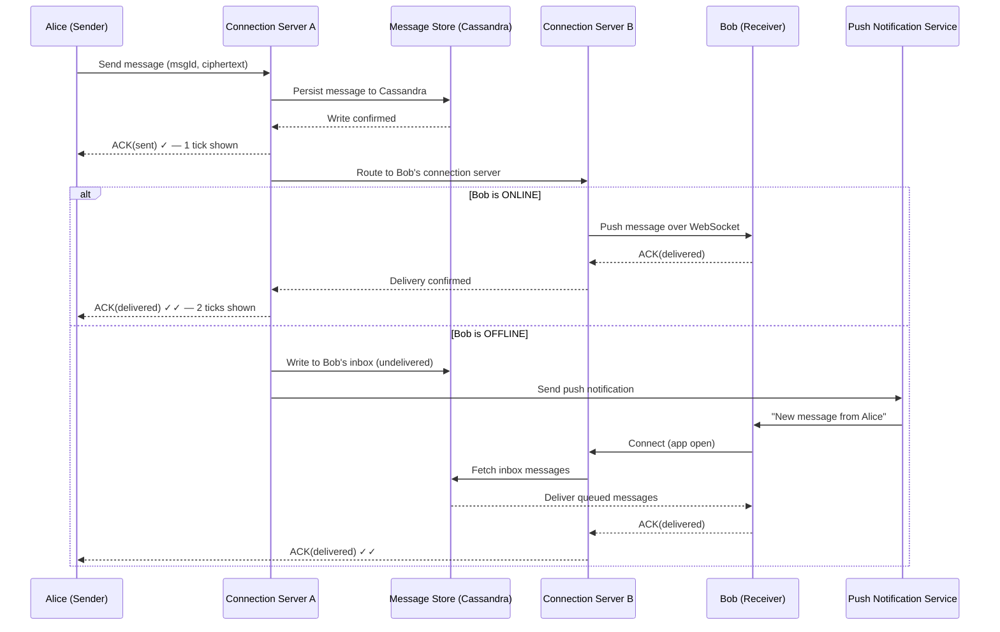

---

### 🟠 Amazon: Design a Distributed Cache (like ElastiCache/Redis Cluster)

**Asked at:** Amazon, Google, Microsoft, Meta, Stripe
**Difficulty:** Senior / Staff

#### Requirements
**Functional:** GET/SET/DELETE key-value pairs. TTL (expiry) on keys. Support multiple data structures: strings, hashes, sorted sets, lists. Cluster mode: automatically partition data across nodes. Replication for fault tolerance.
**Non-functional:** 1M operations/sec per cluster. p99 latency < 1ms for GET. Data capacity: 1TB per cluster. 99.99% availability. Survive single-node failure with < 1s disruption.

#### Capacity Estimation
```
Cluster sizing:
  1M ops/sec across 10 shard nodes = 100K ops/sec per node (achievable with single-threaded Redis)
  1 TB total data → 10 nodes × 100 GB each (keeping ~70% fill for headroom)
  Replication factor 2: 10 primary + 10 replica = 20 total nodes

Memory per node:
  100 GB data / 0.7 fill factor = 143 GB instance (use r6g.4xlarge = 128 GB → need r6g.8xlarge)

Network:
  Average value size 1KB, 1M ops/sec → 1 GB/sec network egress per cluster
  10GbE NICs sufficient; 25GbE for headroom
```

#### API Design
```
-- Client library commands (Redis compatible)
GET    key                  → value | nil
SET    key value [EX seconds] [NX]   → OK | nil
DEL    key [key ...]        → count deleted
EXPIRE key seconds          → 1 | 0

HSET   key field value      → 1
HGET   key field            → value
HMGET  key field [field ...]→ [values]

ZADD   key score member     → 1
ZRANGE key start stop [WITHSCORES] → [members]

INCR   key                  → new integer value (atomic)
SETNX  key value            → 1 (set if not exists — used for distributed locks)

-- Cluster management (internal)
CLUSTER INFO
CLUSTER NODES
CLUSTER KEYSLOT key         → hash slot number (0–16383)
```

#### Data Model
```
Key space partitioning (consistent hashing with hash slots):
  Redis Cluster uses 16384 fixed hash slots
  hash_slot = CRC16(key) % 16384
  Slots distributed evenly across shard nodes:
    Node 0: slots 0–5460
    Node 1: slots 5461–10922
    Node 2: slots 10923–16383

  Advantages over naive consistent hashing:
    Adding/removing nodes = reassign some slots (not rehash everything)
    Hash tags {userId}.profile → same slot, enables multi-key operations

Replication:
  Each primary node has 1–2 replica nodes
  Replication is async (primary → replica stream of commands)
  Client reads: can be directed to replicas (READONLY mode) for read scaling
  Writes: always go to primary for the key's slot

Data structures stored in memory:
  String: raw bytes, max 512 MB
  Hash:   ziplist (compact) for < 128 fields; hashtable for larger
  Sorted Set: ziplist for < 128 members; skiplist + hashtable for larger
  List:   quicklist (double-linked list of ziplists)
```

#### Architecture & Key Design Decisions

**Consistent Hashing with Virtual Nodes:**
```
Problem with naive modulo hashing (key % N):
  Adding a node → almost all keys must move
  N=10 → N=11: (10/11 = 91% of keys need remapping)

Consistent hashing:
  Map nodes and keys onto a hash ring (0 to 2^32)
  Key maps to next clockwise node on ring
  Adding node: only keys between new node and its predecessor move
  With virtual nodes (each physical node = 150 virtual nodes):
    Even distribution even with small cluster sizes
    When node removed: its keys spread evenly to remaining nodes

Redis's slot-based approach (simpler than full consistent hashing):
  16384 slots are stable; only slot→node mapping changes on resize
  Client caches slot→node mapping (CLUSTER SLOTS command)
  On MOVED error: client redirects + updates its cache
```

**Cache Eviction Policies:**
```
LRU (Least Recently Used):
  Evict key that hasn't been accessed longest
  Redis: approximated LRU (samples 5–10 keys, evicts oldest in sample)
  Use: general-purpose cache

LFU (Least Frequently Used):
  Evict key accessed least often
  Redis: approximated LFU with time-decay counter
  Use: when some keys are temporally hot but old; avoids evicting rarely-used but recent keys

allkeys-lru:     evict any key (LRU) — use when all data is cache data
volatile-lru:    evict only keys with TTL set (LRU)
allkeys-lfu:     evict any key (LFU)
noeviction:      return error when memory full — use as primary DB (not cache)
```

**Hot Key Problem and Solutions:**
```
Symptom: one key receives 100K req/sec while others get 100 req/sec
  e.g.: product page for iPhone 15 on launch day

Problem:
  All traffic routes to one Redis node (based on hash slot)
  Single-threaded Redis gets overwhelmed
  Other keys on same node suffer latency

Solutions:
  1. Local L1 Cache (most effective):
       Each app server caches hot key in local dictionary (TTL: 1–5 seconds)
       Reduces Redis load by 100x for hot keys
       Acceptable staleness: 1–5s

  2. Key Replication with Random Suffix:
       Instead of SET product:iphone15 value
       Replicate: SET product:iphone15:shard:0  value
                  SET product:iphone15:shard:1  value
                  ...
                  SET product:iphone15:shard:N  value
       Read: GET product:iphone15:shard:{random(0,N)}
       Spreads load across N nodes; writeback must update all shards

  3. Redis Read Replicas:
       Route reads to replicas of the hot node (READONLY mode)
       Write still goes to primary

  4. Jitter on TTL:
       Instead of TTL = 3600 for all keys
       TTL = 3600 + random(0, 300)
       Prevents thundering herd when many keys expire simultaneously
```

#### Trade-offs & Follow-up Questions

| Decision | Trade-off |
|----------|-----------|
| Async replication | Pros: fast writes; Cons: replica may lag → data loss on primary failure (RPO > 0) |
| Redis single-threaded | Pros: no lock contention, predictable latency; Cons: single core bottleneck for CPU-heavy ops |
| LRU vs LFU | LRU better for recency patterns; LFU better for frequency patterns (avoids one-hit wonders in cache) |
| Hash slot assignment | Fixed 16384 slots: simple resharding; downside vs consistent hashing: cannot do multi-key ops across slots |

**Follow-up questions interviewers ask:**
- "Primary node goes down — what happens?" → Replica detects failure via heartbeat timeout (default 15s); cluster promotes replica via leader election; during 15s window: writes to affected slots fail with CLUSTERDOWN error. Solution: reduce timeout, accept brief write failures
- "How do you handle cache invalidation for a user's profile that changed?" → Event-driven: on profile update, publish event → cache invalidation service deletes the key; or TTL-based (simpler, small staleness window)
- "What's the difference between Redis Cluster and Sentinel?" → Sentinel: HA for single-node Redis (automatic failover, no sharding); Cluster: sharding + HA combined

```mermaid
flowchart TD
    CLIENT([Application Client]) --> ROUTING[Client-side Routing\nslot = CRC16(key) % 16384]

    subgraph CLUSTER["Redis Cluster (10 shards)"]
        subgraph SHARD0["Shard 0 — Slots 0-5460"]
            P0[(Primary 0)] -->|Async replication| R0[(Replica 0)]
        end
        subgraph SHARD1["Shard 1 — Slots 5461-10922"]
            P1[(Primary 1)] -->|Async replication| R1[(Replica 1)]
        end
        subgraph SHARD2["Shard 2 — Slots 10923-16383"]
            P2[(Primary 2)] -->|Async replication| R2[(Replica 2)]
        end
    end

    ROUTING -->|Write to correct primary| P0
    ROUTING --> P1
    ROUTING --> P2

    HOT[Hot Key Handler] --> L1[L1 Local Cache\nper app server\nTTL 1-5s]
    L1 -->|Miss| ROUTING

    P0 & P1 & P2 -->|MOVED redirect on wrong node| ROUTING

    EVICT[Eviction Policy\nLRU/LFU] --> P0

    style P0 fill:#4CAF50,color:#fff
    style P1 fill:#4CAF50,color:#fff
    style P2 fill:#4CAF50,color:#fff
    style L1 fill:#FF9800,color:#fff
    style HOT fill:#f44336,color:#fff
```

---

### 🔴 Netflix: Design a Distributed Rate Limiter

**Asked at:** Netflix, Stripe, Cloudflare, Twilio, API Gateway providers
**Difficulty:** Senior / Staff

#### Requirements
**Functional:** Enforce rate limits per user/IP/API key/endpoint. Return HTTP 429 when limit exceeded. Support multiple limit policies: 100 req/min per user, 10 req/sec per IP, 1000 req/day per API key. Soft limits (warning) and hard limits (block). Configurable without redeployment.
**Non-functional:** 100K requests/sec throughput. Enforcement decision < 5ms overhead. Limits enforced consistently across 100+ app servers. Survive Redis failure gracefully. Limit configuration changes take effect within 30 seconds.

#### Capacity Estimation
```
Decision throughput:
  100K req/sec × 1 Redis call/request = 100K Redis ops/sec
  Single Redis node: ~100K ops/sec (single-threaded, pipelined)
  Need Redis cluster or pipelining to handle 100K/sec

Storage:
  Each rate limit key: "rl:user:{id}:endpoint:{ep}:window:{ts}"
  Active users: 1M concurrent → 1M keys
  Each key: ~100 bytes → 100 MB per window
  Redis memory: negligible

Policy storage:
  ~1000 unique limit policies
  Stored in Redis or DB; cached in app memory
```

#### API Design
```
-- Internal (library / sidecar, not HTTP)
bool IsAllowed(key: string, policy: RateLimitPolicy) → { allowed, remaining, resetAt }

-- External: failed requests return:
HTTP 429 Too Many Requests
Headers:
  X-RateLimit-Limit:     100        (max requests per window)
  X-RateLimit-Remaining: 0          (remaining in current window)
  X-RateLimit-Reset:     1733827200 (Unix timestamp when window resets)
  Retry-After:           47         (seconds until limit resets)

-- Admin API (for policy management)
PUT /v1/ratelimit/policies/{policyId}
    Body: { key_pattern: "user:*", limit: 200, window_seconds: 60 }
    → 200 OK (takes effect within 30s via cache TTL)
```

#### Data Model
```
-- Token bucket state in Redis (HASH per key)
Key:   rl:token:{userId}:{endpoint}
Field: tokens        (current token count, float)
Field: last_refill   (unix timestamp ms of last refill)
TTL:   window_seconds × 2

-- Sliding window log in Redis (SORTED SET per key)
Key:   rl:log:{userId}:{endpoint}
Member: requestId (UUID)
Score:  unix timestamp ms
TTL:    window_seconds + 60s buffer
Operation: ZADD + ZREMRANGEBYSCORE (remove old) + ZCARD (count)

-- Fixed window counter in Redis (STRING per key)
Key:   rl:fw:{userId}:{endpoint}:{window_bucket}
Value: integer count
TTL:   window_seconds
Operation: INCR (atomic counter)

-- Policy store (Redis Hash — config, not per-request data)
Key:   rl:policy:{policyId}
Field: limit, window_seconds, algorithm, scope
```

#### Architecture & Key Design Decisions

**Algorithm Comparison:**
```
Fixed Window:
  Key = "rl:{user}:{endpoint}:{minute_bucket}"
  INCR key; EXPIRE key 60
  Problem: burst at window boundary
    User sends 100 req at 00:59, 100 req at 01:00 → 200 req in 2 seconds
    Both windows allow it (200 total in ~2 sec despite 100/min limit)

Sliding Window Log:
  Store timestamp of every request in sorted set
  ZADD key timestamp uuid
  ZREMRANGEBYSCORE key 0 (now-window)   ← remove old
  count = ZCARD key                     ← how many in window
  if count < limit: allow; INCR implicit
  Accurate but memory: O(requests per window) per user

Sliding Window Counter (best tradeoff):
  Use two adjacent fixed windows + interpolation
  current_window_count + prev_window_count × (1 - elapsed_fraction)
  ~10% memory of sliding window log; accurate to within 0.1%

Token Bucket (Netflix's choice for API gateway):
  Allows controlled bursting (token reserve)
  Atomic Lua script for check-and-decrement (race-free)
  Most flexible for bursty-but-bounded traffic patterns
```

**Distributed Enforcement with Redis (Atomic Lua Scripts):**
```lua
-- Token Bucket atomic Lua script (runs on Redis — single-threaded, atomic)
local key      = KEYS[1]
local capacity = tonumber(ARGV[1])    -- max tokens (e.g., 100)
local refill   = tonumber(ARGV[2])    -- tokens/sec (e.g., 10)
local now      = tonumber(ARGV[3])    -- current time in ms
local cost     = tonumber(ARGV[4])    -- tokens this request needs (usually 1)

local data     = redis.call('HMGET', key, 'tokens', 'last_refill')
local tokens   = tonumber(data[1]) or capacity
local last     = tonumber(data[2]) or now

-- Refill: add tokens proportional to elapsed time
local elapsed  = math.max(0, now - last)
tokens = math.min(capacity, tokens + elapsed * refill / 1000.0)

if tokens >= cost then
    tokens = tokens - cost
    redis.call('HMSET', key, 'tokens', tokens, 'last_refill', now)
    redis.call('EXPIRE', key, 3600)
    return {1, math.floor(tokens)}   -- {allowed=true, remaining}
else
    redis.call('HMSET', key, 'tokens', tokens, 'last_refill', now)
    return {0, 0}                    -- {allowed=false, remaining=0}
end
```

**Handling Redis Failures:**
```
Strategy 1 — Fail Open (Netflix's default for most endpoints):
  If Redis unavailable: allow all requests through
  Rationale: brief Redis outage better than full service outage
  Risk: brief period of no rate limiting → monitor + alert
  Implementation: try { check Redis } catch { return ALLOW }

Strategy 2 — Fail Closed (financial/security-critical endpoints):
  If Redis unavailable: deny all requests → HTTP 503
  Rationale: better to be down than allow uncontrolled traffic
  Risk: all users impacted by Redis failure

Strategy 3 — Local Fallback (best of both):
  If Redis unavailable: fall back to in-process rate limiter
  Each app server enforces limit / num_servers × safety_factor
  e.g.: 100 req/min global limit, 10 servers → each enforces 15 req/min locally
  Redis failure: distributed enforcement degrades to per-server enforcement
  No full outage; approximate enforcement maintained
```

#### Trade-offs & Follow-up Questions

| Decision | Trade-off |
|----------|-----------|
| Token bucket vs sliding window | Token bucket: natural burst handling, good for APIs; Sliding window: precise, higher memory |
| Lua script atomicity | Ensures no race conditions between check and decrement; penalty: Lua runs on Redis main thread |
| Fail open vs fail closed | Fail open: better availability, brief enforcement gap; Fail closed: strict but causes outage on Redis failure |
| Per-endpoint vs global | Per-endpoint: fine-grained; Global: simpler; Most systems use both (defense in depth) |

**Follow-up questions interviewers ask:**
- "What if a user hits your rate limiter from 1000 different IPs?" → IP-based limiting alone insufficient; also limit by authenticated user ID, API key, and account-level aggregate
- "How do you handle distributed rate limiting across 3 data centers?" → Use global Redis cluster with cross-DC replication (accept ~10ms extra latency) OR use independent limiters per DC with limit/3 per DC (partition tolerance)
- "Stripe processes $1B/day — how do they set rate limits for payment APIs?" → Conservative default limits + per-customer overrides; payment APIs fail closed (strict); webhook delivery APIs fail open

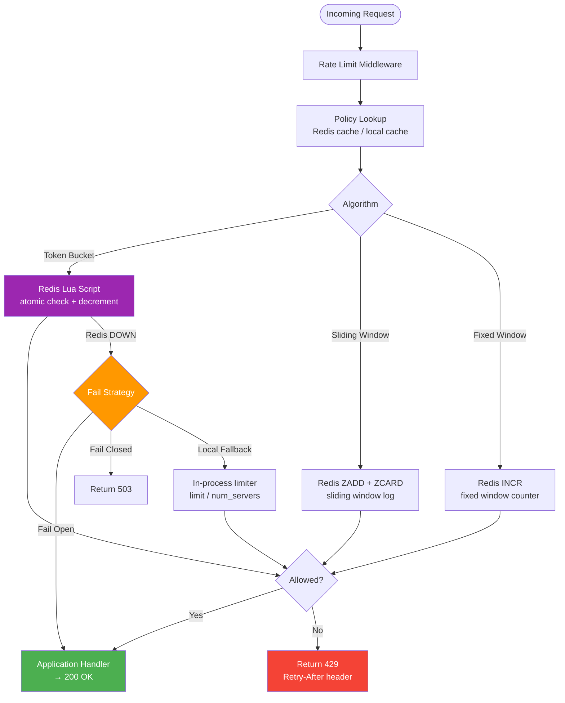

---

### 🟢 Google: Design Google Maps Navigation

**Asked at:** Google Maps, Apple Maps, Uber, Lyft, TomTom, HERE
**Difficulty:** Senior / Staff

#### Requirements
**Functional:** Display map tiles at all zoom levels. Search for places (address, POI). Route calculation: fastest/shortest route from A to B. Turn-by-turn navigation with real-time re-routing. Show real-time traffic. Display nearby places (restaurants, gas stations). Offline maps download.
**Non-functional:** 1B MAU. 20M concurrent navigating sessions. Map tile serve p99 < 50ms. Route calculation p99 < 300ms (for city-level routes). Traffic updates within 2 minutes of road condition change. 99.99% availability.

#### Capacity Estimation
```
Map tiles:
  Earth surface: 510M km²
  At zoom level 15 (street level): ~4 trillion tiles
  Average tile (256×256 PNG, compressed): ~30KB
  Total storage: 4T × 30KB = 120 PB — but 70% is ocean → ~36 PB land tiles
  Popular areas cached in CDN; unpopular areas served from origin

Navigation sessions:
  20M concurrent sessions × 1 location update/sec = 20M writes/sec (to traffic system)
  Route calculations: 20M sessions × 1 recalc / 5 min = ~67K route calcs/sec

Traffic data:
  Anonymous location traces from 20M navigating users → ~20M events/sec
  Aggregated by road segment → ~10M road segments updated/min
```

#### API Design
```
-- Map tiles
GET /tiles/{zoom}/{x}/{y}.png
    → PNG tile image (CDN cached, Cache-Control: max-age=86400)
    zoom: 1–20 (1=world, 20=building level)
    x, y: tile coordinates (Mercator projection grid)

-- Search
GET /v1/places/search?q=pizza&lat=37.7&lng=-122.4&radius=1000
    → { places: [{ placeId, name, address, lat, lng, rating, distance }] }

-- Routing
POST /v1/directions
     Body: { origin: {lat,lng}, destination: {lat,lng},
             mode: "driving|walking|transit", avoidTolls: false }
     → { routes: [{ distance_m, duration_s, steps: [...], polyline, trafficCondition }] }

-- Navigation (real-time)
POST /v1/navigation/start
     Body: { routeId, deviceId }
     → { sessionId, nextManeuver, etaSeconds }

WebSocket: wss://nav.maps.google.com/v1/session/{sessionId}
     Client → { type: "location", lat, lng, speed, heading }
     Server → { type: "instruction" | "reroute" | "traffic_alert", ... }

-- Traffic (internal, from location data)
POST /v1/traffic/probe
     Body: { segmentId, speed_kmh, confidence }
```

#### Data Model
```
-- Road network graph (Apache Spark / PostGIS + custom graph DB)
-- Nodes: road intersections
-- Edges: road segments between intersections

node (intersection):
  node_id:   BIGINT (OpenStreetMap node ID)
  lat, lng:  DECIMAL(9,6)
  geom:      POINT geometry (PostGIS index for spatial queries)

edge (road segment):
  edge_id:        BIGINT
  from_node_id:   BIGINT → node.node_id
  to_node_id:     BIGINT → node.node_id
  distance_m:     INT
  speed_limit_kmh: SMALLINT
  road_type:      VARCHAR(20)   -- "motorway|trunk|primary|secondary|residential"
  is_oneway:      BOOLEAN
  geometry:       LINESTRING    -- for polyline rendering

-- Traffic data (time-series, recent only)
traffic_segment:
  segment_id:     BIGINT
  observed_speed: FLOAT         -- km/h, crowd-sourced average
  congestion_level: SMALLINT    -- 0=free 1=light 2=moderate 3=heavy 4=standstill
  updated_at:     TIMESTAMP
  -- Stored in Redis for fast routing access; TTL 10 minutes

-- Map tiles (object storage, not DB)
-- s3://google-maps-tiles/{zoom}/{x}/{y}.png
-- Versioned: tiles regenerated on map data change
-- CDN in front with 24h TTL (tiles don't change often)
```

#### Architecture & Key Design Decisions

**Routing Algorithm Selection:**
```
Dijkstra:
  Exact shortest path; O((V + E) log V)
  US road network: ~50M nodes, ~120M edges
  Naive Dijkstra: too slow (minutes for cross-country route)

A* (heuristic-guided Dijkstra):
  Uses geographic distance as heuristic to guide search toward destination
  ~10× faster than Dijkstra for long routes
  Still too slow for real-time at scale without preprocessing

Contraction Hierarchies (CH) — what Google/Apple Maps actually use:
  Offline preprocessing (hours): contract graph by removing less important nodes,
    adding shortcut edges (represents skipping through minor roads)
  Creates hierarchy: motorways > primary roads > secondary > residential
  Query time: bidirectional search from both origin and destination
    Expands upward in hierarchy (motorways) until they meet
  Result: < 1ms for cross-country routes after preprocessing
  Trade-off: must recompute shortcuts when road network changes (nightly rebuild)

Live traffic integration with CH:
  Base graph: preprocessed with speed limits
  Traffic layer: modify edge weights with real-time observed speeds
  Periodic CH rebuild (every 5 min) with updated edge weights for affected regions
```

**Real-Time Traffic Data Pipeline:**
```
Source: 20M anonymous GPS traces/sec from navigating users
  Kafka: raw location events

Processing (Flink, 30-second windows):
  1. Match GPS point to road segment (map matching algorithm — HMM)
  2. Calculate observed speed on segment from sequential GPS points
  3. Aggregate: average speed per segment per 30s window
  4. Kalman filter: smooth noisy measurements
  5. Publish: segment_id → new speed estimate

Storage:
  Hot (last 10 min): Redis (< 1ms access for routing engine)
  Warm (last 24h): InfluxDB / TimescaleDB (for historical patterns)
  Cold (historical): BigQuery (for ML model training)

ETA Calculation:
  Route = ordered list of road segments
  ETA = Σ (segment_length / observed_speed) for each segment
  + turn penalties (left turns across traffic cost ~30s in US)
  + ML adjustment: historical accuracy correction per time-of-day + day-of-week
```

#### Trade-offs & Follow-up Questions

| Decision | Trade-off |
|----------|-----------|
| Contraction Hierarchies vs A* | CH: 10,000× faster queries, requires offline preprocessing; A*: simpler, slower, no preprocessing needed |
| Crowd-sourced traffic vs sensor data | Crowd-sourced: free, real-time, global coverage; Sensors: accurate, limited coverage, expensive |
| Vector tiles vs raster PNG tiles | Vector: smaller, infinitely scalable, style changes client-side; Raster: universal support, larger files |
| Offline maps | Store pre-computed tiles + routing graph for region; tradeoff: disk space (city ~500MB) vs network-independent navigation |

**Follow-up questions interviewers ask:**
- "How do you reroute in real-time when traffic changes?" → Navigation service detects route ETA increase > 20%; triggers new Contraction Hierarchies query with current traffic; sends new route to client via WebSocket
- "How do you avoid all drivers being routed onto the same road?" → Probabilistic routing: stagger rerouting times; route a fraction on alternative paths (exploration); Nash equilibrium modeling to balance load across routes
- "How do you serve maps in regions with poor internet?" → Offline map download (vector tiles + routing graph for region); delta updates for changed roads

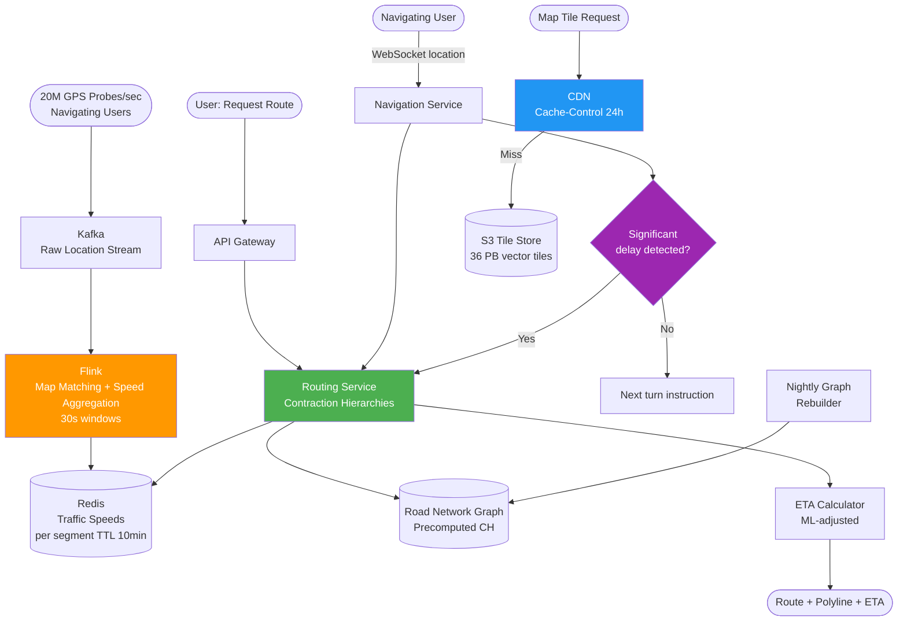

---

### 🔵 Meta: Design a Distributed Message Queue (like Kafka)

**Asked at:** Meta, LinkedIn (Kafka's origin), Uber, Netflix, Airbnb
**Difficulty:** Senior / Staff

#### Requirements
**Functional:** Producers publish messages to named topics. Consumers subscribe to topics via consumer groups. Messages retained for configurable period (e.g., 7 days). Consumers can replay from any offset. Message ordering guaranteed within a partition. Support millions of messages/sec.
**Non-functional:** 50M messages/sec throughput. Write latency < 10ms (p99). 99.999% durability (no message loss after acknowledgement). Support 10K topics. Horizontal scalability. Consumers can scale independently.

#### Capacity Estimation
```
Throughput:
  50M messages/sec × avg 1KB = 50 GB/sec write throughput
  Typical Kafka broker: 1 Gbps NIC = 125 MB/sec
  Need: 50 GB/sec ÷ 125 MB/sec = 400 broker machines

  With replication factor 3: 50 GB/sec × 3 = 150 GB/sec total network
  Compression (LZ4, ~4:1): 150 ÷ 4 = ~37 GB/sec actual network

Storage (7-day retention):
  50 GB/sec × 86400s/day × 7 days = 30 PB
  With compression ÷ 4: ~7.5 PB
  With replication × 3: ~22.5 PB total cluster storage

Topic partitions:
  10K topics × avg 100 partitions = 1M partitions
  Per broker: 1M ÷ 400 = 2500 partitions/broker (manageable)
```

#### API Design
```
-- Producer API
producer = KafkaProducer({
    bootstrap_servers: ["broker1:9092", "broker2:9092"],
    acks: "all",                    -- wait for all replicas (durability)
    compression_type: "lz4",
    batch_size_bytes: 65536,        -- batch messages for throughput
    linger_ms: 5                    -- wait up to 5ms to fill batch
})
producer.send(topic="orders", key=customerId, value=orderJson)
-- key determines partition assignment: hash(key) % num_partitions

-- Consumer API
consumer = KafkaConsumer(
    topics=["orders"],
    group_id="payment-service",     -- consumer group for load balancing
    auto_offset_reset="earliest",   -- start from beginning if no committed offset
    enable_auto_commit=False        -- manual commit for exactly-once semantics
)
for message in consumer:
    process(message)
    consumer.commit()               -- commit after successful processing

-- Admin API
admin.create_topic(name="orders", num_partitions=100, replication_factor=3)
admin.list_topics()
admin.describe_consumer_groups(["payment-service"])
```

#### Data Model
```
Topic structure:
  topic_name:   "orders"
  num_partitions: 100
  replication_factor: 3

Partition:
  topic + partition_id uniquely identify a partition
  Each partition is a totally ordered, immutable log
  Stored as segment files on disk:
    00000000000000000000.log    ← messages (binary, sequential)
    00000000000000000000.index  ← sparse offset → file byte position index
    00000000000000000000.timeindex ← timestamp → offset index

Message format (on disk, binary):
  offset:          8 bytes (int64, monotonically increasing per partition)
  timestamp:       8 bytes
  key_length:      4 bytes
  key:             variable
  value_length:    4 bytes
  value:           variable
  headers:         key-value pairs (added in Kafka 0.11)
  crc:             4 bytes (CRC32 checksum)

Consumer offset tracking:
  Committed offsets stored in internal topic: __consumer_offsets
  Key:   (groupId, topic, partitionId)
  Value: committed_offset, metadata
  Allows consumers to restart from last committed position
```

#### Architecture & Key Design Decisions

**Log-Structured Append-Only Storage:**
```
Why append-only log?
  Sequential disk writes: 100–300 MB/sec (HDD) vs 100 MB/sec random
  OS page cache: Linux caches hot log data in RAM automatically
  No B-tree overhead: no index maintenance on write path
  Immutability: simplifies replication (just transfer byte ranges)

Segment rolling:
  Active segment: written to continuously
  Rolled when: size > 1GB OR age > 7 days (configurable)
  Old segments: read-only; candidates for deletion/compaction

Zero-copy transfer to consumers:
  Normal: Disk → Kernel buffer → User space → Socket buffer → Network
  Zero-copy (sendfile syscall): Disk → Kernel buffer → Network (skips user space)
  Result: up to 60% less CPU for consumer fetch operations
```

**Partitioning and Consumer Groups:**
```
Partitioning logic:
  If key specified: partition = hash(key) % num_partitions
    → Guarantees ordering for same key (e.g., all events for customerId=123)
  If no key: round-robin across partitions
    → Maximum parallelism, no ordering guarantee

Consumer Groups:
  Each partition assigned to exactly one consumer in a group
  If consumers < partitions: one consumer handles multiple partitions
  If consumers > partitions: some consumers idle (wasted resources)
  Optimal: consumers = partitions

Partition rebalancing (triggered by consumer join/leave):
  ZooKeeper / KRaft (newer) detects change
  Group coordinator assigns partitions using range or round-robin assignment
  Brief pause in consumption during rebalance (targeted by cooperative rebalancing)

Partition count decision:
  Too few: limits consumer parallelism
  Too many: more metadata, slower leader election, more file handles
  Rule of thumb: max_throughput / throughput_per_consumer
  e.g.: 10 GB/sec topic, consumer handles 100 MB/sec → 100 partitions
```

**Leader Election Per Partition:**
```
Every partition has 1 leader + N-1 follower replicas
Leader handles all reads and writes for the partition
Followers replicate from leader (fetch requests)

In-Sync Replicas (ISR):
  ISR = set of replicas fully caught up with leader
  Leader tracks ISR; removes slow replicas from ISR after lag threshold
  For acks=all: producer waits until all ISR replicas have written message

Leader failure:
  ZooKeeper / KRaft detects leader gone (session timeout ~6s)
  Controller selects new leader from ISR (avoids data loss)
  Non-ISR replicas NOT eligible → trades availability for durability
  If ISR has only 1 replica and it goes down: partition unavailable until leader restored
```

**Exactly-Once Semantics:**
```
Producer side (idempotent producer):
  Each producer assigned producer_id + epoch
  Each message has sequence_number per partition
  Broker deduplicates: if sequence already seen → discard, return existing ack
  Handles producer retry without duplicate messages

Consumer side (transactional):
  Producer writes output + commits consumer offset in one atomic transaction
  Transaction coordinator: special Kafka broker that manages transactions
  Consumer reads: by default sees all messages (read_committed=false)
  For exactly-once: consumer.isolation_level=read_committed
    → Only sees messages from committed transactions

Combined: exactly-once end-to-end (Kafka Streams achieves this)
```

**Retention and Compaction:**
```
Time-based retention (default):
  Delete segments older than 7 days
  Simple, predictable storage usage
  Use for event streaming where history beyond 7 days unneeded

Log compaction:
  Keep only the latest message per key
  Useful for: changelog topics, database CDC, configuration topics
  Compaction runs in background: merge old segments, keep last value per key
  Tombstone: message with null value = delete key from compacted log
  Use for: event sourcing, materializing state (Kafka as database changelog)
```

#### Trade-offs & Follow-up Questions

| Decision | Trade-off |
|----------|-----------|
| Append-only log vs random-access DB | Log: sequential writes = 10–100× faster; Cons: cannot update/delete specific messages |
| acks=all vs acks=1 | acks=all: durable (no loss), +5–10ms latency; acks=1: lower latency, risk data loss on leader crash |
| Many small partitions vs few large | Small: more parallelism; Large: less metadata, simpler rebalancing |
| ZooKeeper vs KRaft (KIP-500) | ZooKeeper: mature, external dependency; KRaft: built-in, faster metadata ops, simpler ops — default in Kafka 3.7+ |
| Time-based vs compacted retention | Time: simple, predictable size; Compacted: unbounded for active keys, complex to reason about size |

**Follow-up questions interviewers ask:**
- "How do you handle a hot partition (one partition gets 10× the traffic)?" → Repartition with more partitions; use random suffix on key to spread load (loses ordering guarantee); tiered storage for hot partitions
- "Consumer is slow and falls behind by millions of messages — what happens?" → Consumer lag alert; scale out consumer group; if lag exceeds retention period, messages are deleted before consumer reads them (data loss)
- "How does Kafka guarantee ordering within a partition?" → Single leader per partition; leader processes writes sequentially; replicas apply in same order; consumer reads in offset order — ordering is only within partition, not across partitions

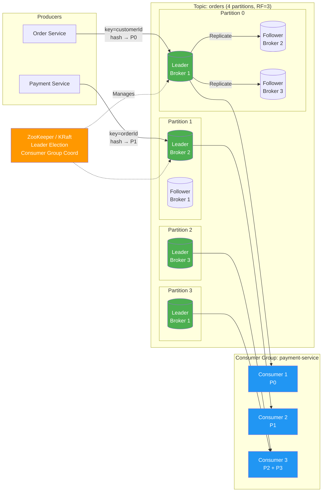

