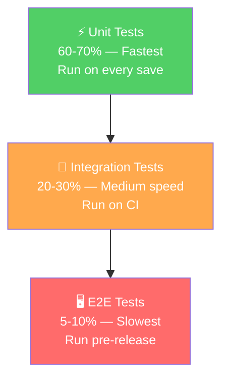
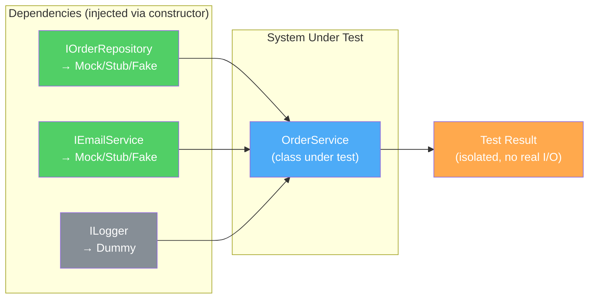
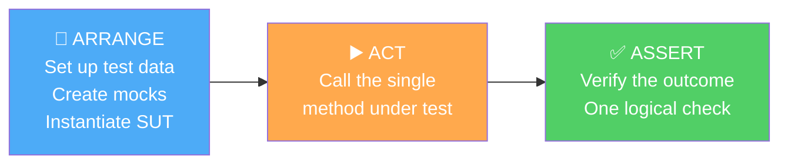
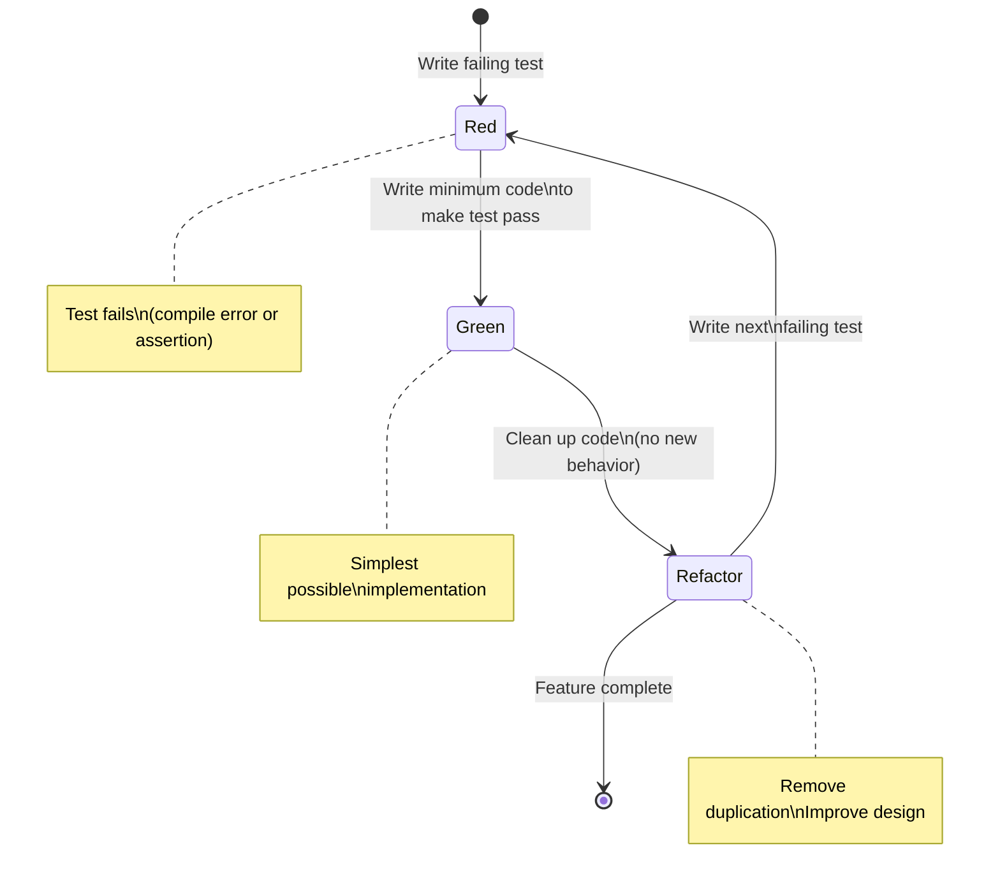
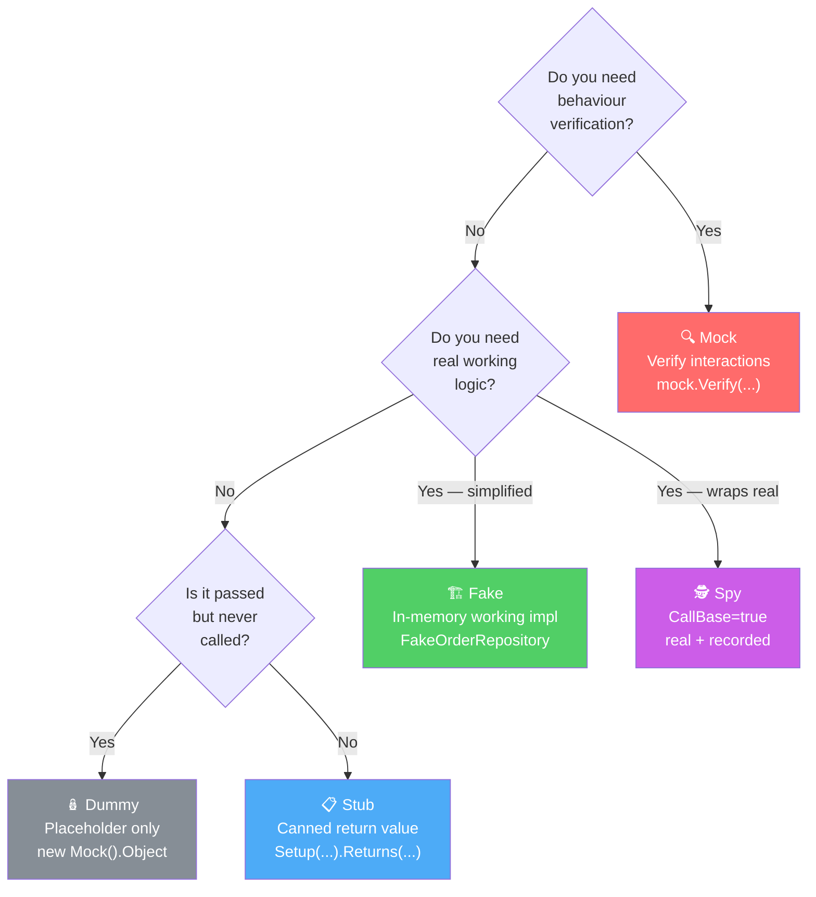
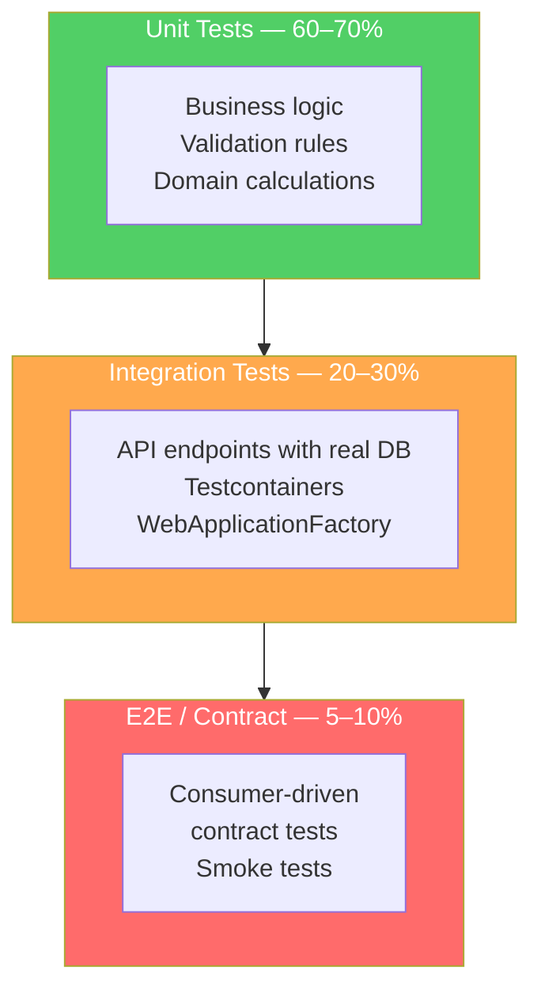
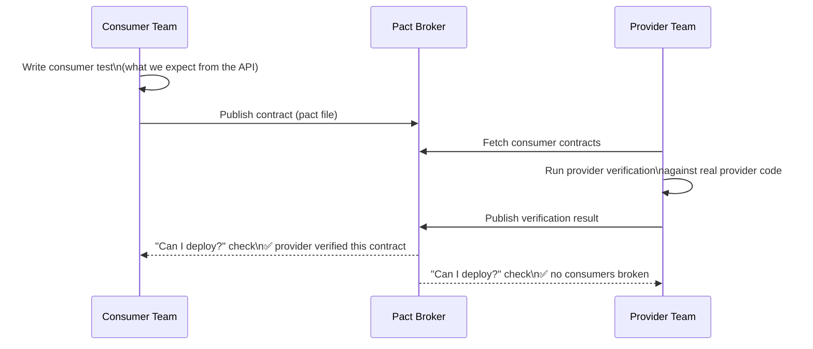
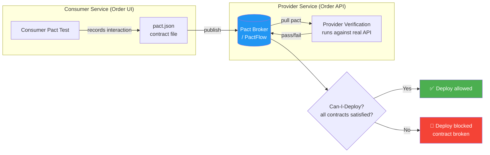

# 🧪 Unit Testing Interview Questions — Complete Guide

> **200+ questions** · xUnit · Moq · FluentAssertions · Integration Tests · TDD · AAA Pattern
> Every question has ❌ bad example and ✅ good example with full C# code.

---

## 📋 Table of Contents

1. [Testing Fundamentals](#1-testing-fundamentals)
2. [xUnit Basics](#2-xunit-basics)
3. [Arrange-Act-Assert (AAA) Pattern](#3-arrange-act-assert-aaa-pattern)
4. [Mocking with Moq](#4-mocking-with-moq)
5. [FluentAssertions](#5-fluentassertions)
6. [Testing Async Code](#6-testing-async-code)
7. [Testing Controllers (ASP.NET Core)](#7-testing-controllers-aspnet-core)
8. [Integration Testing with WebApplicationFactory](#8-integration-testing-with-webapplicationfactory)
9. [Testing Entity Framework / Repositories](#9-testing-entity-framework--repositories)
10. [Testing Design Patterns](#10-testing-design-patterns)
11. [Test-Driven Development (TDD)](#11-test-driven-development-tdd)
12. [Test Coverage & Best Practices](#12-test-coverage--best-practices)
13. [Testing CQRS / MediatR](#13-testing-cqrs--mediatr)
14. [Snapshot & Parameterised Tests](#14-snapshot--parameterised-tests)
15. [Performance & Load Testing Basics](#15-performance--load-testing-basics)

---

# 1. Testing Fundamentals

> 📚 Reference: https://learn.microsoft.com/en-us/dotnet/core/testing/

### Q1 — What are the three types of tests and when do you use each?

**Unit tests** — test a single class/method in isolation, all dependencies mocked. Fast (milliseconds), run on every commit.  
**Integration tests** — test multiple layers together (controller + service + DB). Slower, run on CI.  
**End-to-end (E2E) tests** — test from browser/client through to database. Slowest, run pre-release.

❌ **Wrong** — calling every test a "unit test" regardless of what it actually tests:
```csharp
// This hits a REAL database — it is NOT a unit test
[Fact]
public void TestGetOrder_UnitTest() // ← misnamed
{
    var db  = new AppDbContext(realConnectionString); // real DB!
    var svc = new OrderService(db);
    var result = svc.GetOrder(Guid.NewGuid());
    Assert.NotNull(result);
}
```

✅ **Correct** — true unit test: all dependencies mocked, no I/O:
```csharp
[Fact]
public async Task GetOrder_WhenExists_ReturnsOrder()
{
    // Arrange: mock the repo, no DB
    var mockRepo = new Mock<IOrderRepository>();
    var orderId  = Guid.NewGuid();
    mockRepo.Setup(r => r.GetByIdAsync(orderId))
            .ReturnsAsync(new Order { Id = orderId, Status = "Pending" });

    var svc = new OrderService(mockRepo.Object);

    // Act
    var result = await svc.GetOrderAsync(orderId);

    // Assert
    Assert.NotNull(result);
    Assert.Equal(orderId, result.Id);
}
```

---

### Q2 — What is the testing pyramid?

The testing pyramid defines the **ratio and speed** of test types: many unit tests at the base, fewer integration tests in the middle, fewest E2E tests at the top.



❌ **Wrong** — inverted pyramid (too many slow E2E tests):
```
        /──────────────\
       /   Unit (few)   \       ← almost no unit tests
      /─────────────────\
     /  Integration (some) \
    /──────────────────────\
   /    E2E (most) !!!      \   ← mostly slow Selenium tests
  /──────────────────────────\
```

✅ **Correct** — pyramid shape: fast at base, slow at top:
```
       /──────\
      /  E2E   \              5–10%   run pre-release
     /──────────\
    / Integration \           20–30%  run on CI
   /──────────────\
  /   Unit Tests   \          60–70%  run on every save
 /──────────────────\
```

---

### Q3 — What is test isolation and why does it matter?

Each test must **not share state** with other tests. Shared static state, leftover DB rows, or file-system changes cause flaky tests that pass individually but fail in suites.



❌ **Wrong** — static state shared between tests:
```csharp
public class OrderServiceTests
{
    private static readonly List<Order> _orders = new(); // ❌ shared across ALL test instances!

    [Fact]
    public void Test1()
    {
        _orders.Add(new Order());
        Assert.Single(_orders);
    }

    [Fact]
    public void Test2()
    {
        // _orders already has items from Test1 if run in same process
        Assert.Empty(_orders); // FLAKY: may fail depending on test order
    }
}
```

✅ **Correct** — fresh state per test via constructor:
```csharp
public class OrderServiceTests
{
    private readonly List<Order> _orders;
    private readonly OrderService _svc;

    public OrderServiceTests() // ← xUnit creates a NEW instance per test
    {
        _orders = new List<Order>(); // fresh every time
        var mockRepo = new Mock<IOrderRepository>();
        _svc = new OrderService(mockRepo.Object);
    }

    [Fact]
    public void Test1() { /* _orders is empty, guaranteed */ }

    [Fact]
    public void Test2() { /* _orders is empty, guaranteed */ }
}
```

---

# 2. xUnit Basics

> 📚 Reference: https://xunit.net/docs/getting-started/netcore/cmdline

### Q1 — What is the difference between `[Fact]` and `[Theory]`?

`[Fact]` marks a test with no parameters. `[Theory]` marks a parameterised test — it runs once for each `[InlineData]`, `[MemberData]`, or `[ClassData]` set.

❌ **Wrong** — duplicating test code instead of using `[Theory]`:
```csharp
[Fact]
public void Add_1_And_2_Returns_3()    => Assert.Equal(3, Calculator.Add(1, 2));

[Fact]
public void Add_Neg1_And_1_Returns_0() => Assert.Equal(0, Calculator.Add(-1, 1));

[Fact]
public void Add_0_And_0_Returns_0()    => Assert.Equal(0, Calculator.Add(0, 0));
```

✅ **Correct** — single `[Theory]` covers all cases:
```csharp
[Theory]
[InlineData(1,  2,  3)]
[InlineData(-1, 1,  0)]
[InlineData(0,  0,  0)]
[InlineData(int.MaxValue, 1, int.MinValue)] // overflow edge case
public void Add_ReturnsExpectedSum(int a, int b, int expected)
{
    var result = Calculator.Add(a, b);
    Assert.Equal(expected, result);
}
```

---

### Q2 — How do you share expensive setup across tests using `IClassFixture`?

`IClassFixture<T>` creates a single instance of `T` shared across all tests in the class — useful for expensive resources like database connections or HTTP servers.

❌ **Wrong** — recreating a heavy resource for every test:
```csharp
public class DatabaseTests
{
    [Fact]
    public async Task Test1()
    {
        var factory = new WebApplicationFactory<Program>(); // ❌ new server per test — very slow
        var client  = factory.CreateClient();
        // ...
    }
}
```

✅ **Correct** — share factory across all tests via `IClassFixture`:
```csharp
public class OrderApiTests : IClassFixture<WebApplicationFactory<Program>>
{
    private readonly HttpClient _client;

    public OrderApiTests(WebApplicationFactory<Program> factory)
    {
        _client = factory.CreateClient(); // factory created ONCE, shared
    }

    [Fact]
    public async Task GetOrders_Returns200()
    {
        var response = await _client.GetAsync("/api/orders");
        response.EnsureSuccessStatusCode();
    }

    [Fact]
    public async Task GetOrder_NotFound_Returns404()
    {
        var response = await _client.GetAsync($"/api/orders/{Guid.NewGuid()}");
        Assert.Equal(HttpStatusCode.NotFound, response.StatusCode);
    }
}
```

---

### Q3 — How do you skip a test or mark it as expected to fail?

❌ **Wrong** — commenting out tests (invisible, forgotten):
```csharp
// [Fact]
// public void BrokenTest() { ... }
```

✅ **Correct** — `[Fact(Skip = "reason")]` skips visibly; trait for categorisation:
```csharp
[Fact(Skip = "Known bug #1234 — payment gateway down in CI")]
public async Task ProcessPayment_ChargesCard()
{
    // will be skipped but VISIBLE in test results
}

// Categorise tests with [Trait]
[Fact]
[Trait("Category", "Slow")]
public async Task LargeDataset_ProcessesInUnder5Seconds() { /* ... */ }

// Run only fast tests in CI: dotnet test --filter "Category!=Slow"
```

---

### Q4 — How do you test that an exception is thrown?

❌ **Wrong** — catching exception manually, missing edge cases:
```csharp
[Fact]
public void GetOrder_NullId_Throws()
{
    try
    {
        _svc.GetOrder(Guid.Empty);
        Assert.True(false, "Should have thrown"); // easy to forget this line
    }
    catch (ArgumentException) { } // passes — but doesn't verify message
}
```

✅ **Correct** — `Assert.ThrowsAsync` captures exception for further inspection:
```csharp
[Fact]
public async Task GetOrder_EmptyId_ThrowsArgumentException()
{
    var ex = await Assert.ThrowsAsync<ArgumentException>(
        () => _svc.GetOrderAsync(Guid.Empty));

    Assert.Equal("orderId", ex.ParamName);
    Assert.Contains("must not be empty", ex.Message);
}
```

---

# 3. Arrange-Act-Assert (AAA) Pattern

> 📚 Reference: https://docs.microsoft.com/en-us/visualstudio/test/unit-test-basics

### Q1 — What is the AAA pattern and why is it the standard?

**Arrange** — set up data, mocks, system under test.  
**Act** — call the one method being tested.  
**Assert** — verify one logical outcome.

One test should test **one behaviour**. If you need two `Act` + `Assert` blocks, write two tests.



❌ **Wrong** — no clear separation, tests multiple things:
```csharp
[Fact]
public async Task OrderTests()
{
    var svc = new OrderService(new Mock<IOrderRepository>().Object);
    var order = await svc.CreateAsync("Alice");
    Assert.NotNull(order);
    order.Status = "Shipped";
    await svc.UpdateAsync(order);
    var updated = await svc.GetAsync(order.Id);
    Assert.Equal("Shipped", updated.Status); // multiple acts — test too big
    await svc.DeleteAsync(order.Id);
    Assert.Null(await svc.GetAsync(order.Id));
}
```

✅ **Correct** — one test, one behaviour, clear AAA sections:
```csharp
[Fact]
public async Task CreateOrder_ReturnsOrderWithPendingStatus()
{
    // Arrange
    var mockRepo = new Mock<IOrderRepository>();
    mockRepo.Setup(r => r.AddAsync(It.IsAny<Order>())).Returns(Task.CompletedTask);
    var svc = new OrderService(mockRepo.Object);

    // Act
    var order = await svc.CreateAsync("Alice");

    // Assert
    Assert.NotNull(order);
    Assert.Equal("Pending", order.Status);
    Assert.Equal("Alice", order.CustomerName);
}
```

---

### Q2 — What makes a good test name?

A good name reads like a sentence: **MethodName_Scenario_ExpectedBehaviour**.

❌ **Wrong** — vague, meaningless names:
```csharp
[Fact] public void Test1() { }
[Fact] public void OrderTest() { }
[Fact] public void GetOrderWorks() { }
```

✅ **Correct** — descriptive names that explain the scenario:
```csharp
[Fact] public async Task GetOrder_WhenOrderExists_ReturnsCorrectOrder()       { }
[Fact] public async Task GetOrder_WhenOrderNotFound_ReturnsNull()              { }
[Fact] public async Task CreateOrder_WhenCustomerBlacklisted_ThrowsException() { }
[Fact] public async Task UpdateOrder_WhenAlreadyShipped_ThrowsInvalidOperation(){ }
```

---

# 4. Mocking with Moq

> 📚 Reference: https://github.com/devlooped/moq/wiki/Quickstart

### Q1 — What is a mock vs a stub vs a fake?

**Stub** — returns canned data, no behaviour verification.  
**Mock** — verifies interactions (was a method called? How many times? With what args?).  
**Fake** — a working but simplified implementation (e.g., in-memory repository).

❌ **Wrong** — using a real implementation in unit tests (not isolated):
```csharp
var realRepo = new SqlOrderRepository(connectionString); // real SQL — slow, brittle
var svc = new OrderService(realRepo);
```

✅ **Correct** — mock for interaction verification, stub for data:
```csharp
var mockRepo = new Mock<IOrderRepository>();

// Stub — return canned data
mockRepo.Setup(r => r.GetByIdAsync(orderId))
        .ReturnsAsync(new Order { Id = orderId });

// Mock — verify interaction
mockRepo.Verify(r => r.GetByIdAsync(orderId), Times.Once);
```

---

### Q2 — How do you set up a mock to return different values on sequential calls?

❌ **Wrong** — using multiple `Setup` calls with same signature (last one wins, previous are ignored):
```csharp
mockRepo.Setup(r => r.GetNextAsync()).ReturnsAsync(order1);
mockRepo.Setup(r => r.GetNextAsync()).ReturnsAsync(order2); // ← overwrites first!
```

✅ **Correct** — use `SetupSequence` for sequential returns:
```csharp
mockRepo.SetupSequence(r => r.GetNextAsync())
        .ReturnsAsync(new Order { Id = Guid.NewGuid(), Status = "Pending" })  // 1st call
        .ReturnsAsync(new Order { Id = Guid.NewGuid(), Status = "Shipped" })  // 2nd call
        .ReturnsAsync(null);                                                   // 3rd call
```

---

### Q3 — How do you mock a method that throws an exception?

❌ **Wrong** — not testing the error path at all:
```csharp
// Only tests happy path — leaves exception path uncovered
mockRepo.Setup(r => r.GetByIdAsync(orderId)).ReturnsAsync(new Order());
```

✅ **Correct** — setup mock to throw, then verify the service handles it:
```csharp
var mockRepo = new Mock<IOrderRepository>();
mockRepo.Setup(r => r.GetByIdAsync(It.IsAny<Guid>()))
        .ThrowsAsync(new TimeoutException("DB timeout"));

var svc = new OrderService(mockRepo.Object, logger);

// Service should wrap the exception — verify it doesn't crash the caller
await Assert.ThrowsAsync<ServiceUnavailableException>(
    () => svc.GetOrderAsync(Guid.NewGuid()));
```

---

### Q4 — How do you verify a mock was called with specific arguments?

❌ **Wrong** — verifying with `It.IsAny<T>()` — too loose, misses wrong argument bugs:
```csharp
mockRepo.Verify(r => r.SaveAsync(It.IsAny<Order>()), Times.Once);
// passes even if the wrong order was saved!
```

✅ **Correct** — verify with specific argument matching:
```csharp
// Verify exact object
mockRepo.Verify(r => r.SaveAsync(It.Is<Order>(o =>
    o.CustomerId == expectedCustomerId &&
    o.Status     == "Pending"
)), Times.Once);

// Capture argument for deeper assertions
Order? capturedOrder = null;
mockRepo.Setup(r => r.SaveAsync(It.IsAny<Order>()))
        .Callback<Order>(o => capturedOrder = o)
        .Returns(Task.CompletedTask);

await svc.CreateOrderAsync(customerId);

Assert.NotNull(capturedOrder);
Assert.Equal(customerId, capturedOrder!.CustomerId);
Assert.True(capturedOrder.CreatedAt > DateTime.UtcNow.AddSeconds(-5));
```

---

### Q5 — How do you mock a property on an interface?

❌ **Wrong** — forgetting to set up property, getting default value:
```csharp
var mockUser = new Mock<ICurrentUser>();
// mockUser.Object.Id returns Guid.Empty (default) — test may silently pass wrong
var svc = new OrderService(mockUser.Object);
```

✅ **Correct** — explicitly set up property:
```csharp
var userId   = Guid.NewGuid();
var mockUser = new Mock<ICurrentUser>();
mockUser.Setup(u => u.Id).Returns(userId);
mockUser.Setup(u => u.Role).Returns("Admin");
mockUser.Setup(u => u.IsAuthenticated).Returns(true);

var svc = new OrderService(mockUser.Object);
// Now svc sees a consistent user
```

---

# 5. FluentAssertions

> 📚 Reference: https://fluentassertions.com/introduction

### Q1 — Why use FluentAssertions over built-in Assert?

FluentAssertions produces **human-readable failure messages** and allows chaining multiple assertions on the same object. Built-in `Assert.Equal` messages are often cryptic.

❌ **Wrong** — built-in asserts produce poor failure messages:
```csharp
Assert.Equal("Shipped", order.Status);
// On failure: "Expected: Shipped. Actual: Pending." — no context

Assert.True(order.Total > 0);
// On failure: "Expected: True. Actual: False." — useless
```

✅ **Correct** — FluentAssertions with descriptive failures:
```csharp
using FluentAssertions;

order.Status.Should().Be("Shipped",
    because: "order was marked as dispatched");
// On failure: "Expected order.Status to be 'Shipped' because order was marked as dispatched,
//             but found 'Pending'."

order.Total.Should().BeGreaterThan(0)
           .And.BeLessThan(100_000);

order.Items.Should().HaveCount(3)
           .And.AllSatisfy(i => i.Quantity.Should().BePositive());
```

---

### Q2 — How do you assert on collections with FluentAssertions?

❌ **Wrong** — manual LINQ checks with Assert:
```csharp
Assert.True(orders.All(o => o.Status == "Paid"));
Assert.True(orders.Any(o => o.Total > 1000));
Assert.Equal(3, orders.Count());
```

✅ **Correct** — FluentAssertions collection assertions:
```csharp
orders.Should().NotBeEmpty()
      .And.HaveCount(3)
      .And.AllSatisfy(o => o.Status.Should().Be("Paid"))
      .And.Contain(o => o.Total > 1000);

// Object equivalence (deep comparison ignoring nulls)
actual.Should().BeEquivalentTo(expected, opts =>
    opts.Excluding(o => o.CreatedAt) // ignore timestamp
        .Excluding(o => o.Id));       // ignore generated ID
```

---

### Q3 — How do you assert on exceptions with FluentAssertions?

❌ **Wrong** — using xUnit `Assert.Throws` and losing fluent style:
```csharp
var ex = Assert.ThrowsAsync<ArgumentException>(() => svc.CreateAsync(null!));
Assert.Equal("name", ex.Result.ParamName);
```

✅ **Correct** — FluentAssertions exception assertions:
```csharp
Func<Task> act = () => svc.CreateAsync(null!);

await act.Should().ThrowAsync<ArgumentException>()
         .WithMessage("*must not be null*")
         .WithParameterName("name");

// For synchronous:
Action syncAct = () => parser.Parse("bad-input");
syncAct.Should().Throw<FormatException>()
       .WithMessage("*invalid format*");
```

---

# 6. Testing Async Code

> 📚 Reference: https://learn.microsoft.com/en-us/dotnet/csharp/asynchronous-programming/

### Q1 — How do you correctly test async methods?

❌ **Wrong** — `.Result` blocks the thread and can deadlock; `async void` test hides exceptions:
```csharp
[Fact]
public void GetOrder_ReturnsOrder() // ❌ not async
{
    var result = _svc.GetOrderAsync(id).Result; // ❌ .Result — potential deadlock
    Assert.NotNull(result);
}

[Fact]
public async void GetOrder_Test() // ❌ async void — exceptions are swallowed!
{
    var result = await _svc.GetOrderAsync(id);
}
```

✅ **Correct** — always `async Task` for async tests:
```csharp
[Fact]
public async Task GetOrder_WhenExists_ReturnsOrder() // ✅ async Task
{
    // Arrange
    var mockRepo = new Mock<IOrderRepository>();
    mockRepo.Setup(r => r.GetByIdAsync(_orderId)).ReturnsAsync(_order);

    // Act
    var result = await _svc.GetOrderAsync(_orderId); // ✅ await properly

    // Assert
    result.Should().NotBeNull();
    result!.Id.Should().Be(_orderId);
}
```

---

### Q2 — How do you test cancellation token handling?

❌ **Wrong** — never tests cancellation, so a hung operation goes unnoticed:
```csharp
[Fact]
public async Task Export_Completes()
{
    await _svc.ExportAsync(CancellationToken.None); // never tests cancellation
}
```

✅ **Correct** — test that cancellation causes `OperationCanceledException`:
```csharp
[Fact]
public async Task Export_WhenCancelled_ThrowsOperationCancelled()
{
    using var cts = new CancellationTokenSource();
    cts.Cancel(); // cancel immediately

    Func<Task> act = () => _svc.ExportAsync(cts.Token);

    await act.Should().ThrowAsync<OperationCanceledException>();
}

[Fact]
public async Task Export_WhenCancelledMidway_StopsProcessing()
{
    using var cts = new CancellationTokenSource(TimeSpan.FromMilliseconds(50));

    // service should respect token and stop processing
    Func<Task> act = () => _svc.ExportLargeDatasetAsync(cts.Token);

    await act.Should().ThrowAsync<OperationCanceledException>();
}
```

---

### Q3 — How do you test time-dependent code?

❌ **Wrong** — `DateTime.Now` hardcoded in production code, impossible to control in tests:
```csharp
public class OrderService
{
    public Order Create(string customer)
        => new() { CreatedAt = DateTime.UtcNow }; // ❌ untestable
}
```

✅ **Correct** — inject `TimeProvider` (NET 8) or `IDateTimeProvider` to control time:
```csharp
// Production code uses injected time provider
public class OrderService
{
    private readonly TimeProvider _time;
    public OrderService(TimeProvider time) => _time = time;
    public Order Create(string customer)
        => new() { CreatedAt = _time.GetUtcNow().UtcDateTime };
}

// Test controls time
[Fact]
public void Create_SetsCreatedAtToCurrentUtcTime()
{
    var fixedTime   = new DateTimeOffset(2026, 1, 15, 10, 0, 0, TimeSpan.Zero);
    var fakeTime    = new FakeTimeProvider(fixedTime); // Microsoft.Extensions.TimeProvider.Testing
    var svc         = new OrderService(fakeTime);

    var order = svc.Create("Alice");

    order.CreatedAt.Should().Be(fixedTime.UtcDateTime);
}
```

---

# 7. Testing Controllers (ASP.NET Core)

> 📚 Reference: https://learn.microsoft.com/en-us/aspnet/core/mvc/controllers/testing

### Q1 — How do you unit-test a controller action?

❌ **Wrong** — spinning up a full ASP.NET pipeline for a controller unit test:
```csharp
// Over-engineered for a unit test — use WebApplicationFactory for integration tests
var factory = new WebApplicationFactory<Program>();
var client  = factory.CreateClient();
var response = await client.GetAsync("/api/orders");
```

✅ **Correct** — instantiate controller directly, inject mock service:
```csharp
[Fact]
public async Task Get_WhenOrderExists_ReturnsOkWithOrder()
{
    // Arrange
    var orderId  = Guid.NewGuid();
    var order    = new OrderDto(orderId, "Pending", 99.99m);
    var mockSvc  = new Mock<IOrderService>();
    mockSvc.Setup(s => s.GetByIdAsync(orderId)).ReturnsAsync(order);

    var controller = new OrdersController(mockSvc.Object);

    // Act
    var result = await controller.Get(orderId);

    // Assert
    var ok = result.Should().BeOfType<OkObjectResult>().Subject;
    ok.Value.Should().BeEquivalentTo(order);
}

[Fact]
public async Task Get_WhenNotFound_ReturnsNotFound()
{
    var mockSvc = new Mock<IOrderService>();
    mockSvc.Setup(s => s.GetByIdAsync(It.IsAny<Guid>())).ReturnsAsync((OrderDto?)null);

    var controller = new OrdersController(mockSvc.Object);
    var result     = await controller.Get(Guid.NewGuid());

    result.Should().BeOfType<NotFoundResult>();
}
```

---

### Q2 — How do you test model validation in a controller?

❌ **Wrong** — skipping `ModelState` validation entirely in unit tests:
```csharp
var controller = new OrdersController(mockSvc.Object);
// ModelState is valid by default — validation never fails in unit tests!
var result = await controller.Create(new CreateOrderDto { /* missing required fields */ });
```

✅ **Correct** — manually add `ModelState` errors to simulate validation failure:
```csharp
[Fact]
public async Task Create_WithInvalidModel_ReturnsBadRequest()
{
    var controller = new OrdersController(mockSvc.Object);
    controller.ModelState.AddModelError("CustomerName", "Required"); // simulate validation failure

    var result = await controller.Create(new CreateOrderDto());

    result.Should().BeOfType<BadRequestObjectResult>();
}
```

---

# 8. Integration Testing with WebApplicationFactory

> 📚 Reference: https://learn.microsoft.com/en-us/aspnet/core/test/integration-tests

### Q1 — How do you set up an integration test that uses a real (in-memory) database?

❌ **Wrong** — running integration tests against production or shared database:
```csharp
public class OrderTests : IClassFixture<WebApplicationFactory<Program>>
{
    // Uses whatever DB Program.cs configures — could be production!
}
```

✅ **Correct** — override DI to use in-memory EF database per test run:
```csharp
public class CustomWebApplicationFactory : WebApplicationFactory<Program>
{
    protected override void ConfigureWebHost(IWebHostBuilder builder)
    {
        builder.ConfigureServices(services =>
        {
            // Remove real DB registration
            var descriptor = services.SingleOrDefault(
                d => d.ServiceType == typeof(DbContextOptions<AppDbContext>));
            if (descriptor != null) services.Remove(descriptor);

            // Add in-memory database — fresh per test run
            services.AddDbContext<AppDbContext>(options =>
                options.UseInMemoryDatabase($"TestDb_{Guid.NewGuid()}"));

            // Seed test data
            var sp = services.BuildServiceProvider();
            using var scope = sp.CreateScope();
            var db = scope.ServiceProvider.GetRequiredService<AppDbContext>();
            db.Database.EnsureCreated();
            db.Orders.Add(new Order { Id = _knownOrderId, Status = "Pending" });
            db.SaveChanges();
        });
    }

    public static readonly Guid _knownOrderId = Guid.NewGuid();
}

public class OrderIntegrationTests : IClassFixture<CustomWebApplicationFactory>
{
    private readonly HttpClient _client;

    public OrderIntegrationTests(CustomWebApplicationFactory factory)
        => _client = factory.CreateClient();

    [Fact]
    public async Task GetOrder_ReturnsSeededOrder()
    {
        var response = await _client.GetAsync($"/api/orders/{CustomWebApplicationFactory._knownOrderId}");
        response.StatusCode.Should().Be(HttpStatusCode.OK);

        var order = await response.Content.ReadFromJsonAsync<OrderDto>();
        order!.Status.Should().Be("Pending");
    }
}
```

---

### Q2 — How do you test authenticated endpoints in integration tests?

❌ **Wrong** — skipping auth entirely:
```csharp
// Endpoint requires [Authorize] but test never sets a JWT
var response = await _client.GetAsync("/api/admin/reports");
// Returns 401 — test is useless
```

✅ **Correct** — add a fake auth handler for tests:
```csharp
// Test auth handler — bypasses real JWT validation
public class TestAuthHandler : AuthenticationHandler<AuthenticationSchemeOptions>
{
    public TestAuthHandler(IOptionsMonitor<AuthenticationSchemeOptions> options,
        ILoggerFactory logger, UrlEncoder encoder) : base(options, logger, encoder) { }

    protected override Task<AuthenticateResult> HandleAuthenticateAsync()
    {
        var claims    = new[] { new Claim(ClaimTypes.Name, "TestUser"), new Claim(ClaimTypes.Role, "Admin") };
        var identity  = new ClaimsIdentity(claims, "Test");
        var principal = new ClaimsPrincipal(identity);
        var ticket    = new AuthenticationTicket(principal, "Test");
        return Task.FromResult(AuthenticateResult.Success(ticket));
    }
}

// Register in factory
services.AddAuthentication("Test")
        .AddScheme<AuthenticationSchemeOptions, TestAuthHandler>("Test", _ => { });

// Client sends test auth header
_client.DefaultRequestHeaders.Authorization =
    new AuthenticationHeaderValue("Test");

var response = await _client.GetAsync("/api/admin/reports");
response.StatusCode.Should().Be(HttpStatusCode.OK);
```

---

# 9. Testing Entity Framework / Repositories

> 📚 Reference: https://learn.microsoft.com/en-us/ef/core/testing/

### Q1 — Should you use an in-memory database or SQLite for EF tests?

In-memory EF provider lacks SQL semantics (no FK constraints, no UNIQUE enforcement). **SQLite in-memory mode** is better — it runs real SQL but stays fast.

❌ **Wrong** — in-memory EF skips constraints:
```csharp
options.UseInMemoryDatabase("TestDb");
// Allows duplicate unique keys, ignores FK constraints — tests pass that would fail on SQL Server!
```

✅ **Correct** — SQLite in-memory for realistic SQL behaviour:
```csharp
public class RepositoryTests : IDisposable
{
    private readonly SqliteConnection _connection;
    private readonly AppDbContext _db;

    public RepositoryTests()
    {
        _connection = new SqliteConnection("DataSource=:memory:");
        _connection.Open(); // keep connection open — SQLite in-memory lives as long as the connection

        var options = new DbContextOptionsBuilder<AppDbContext>()
            .UseSqlite(_connection)
            .Options;

        _db = new AppDbContext(options);
        _db.Database.EnsureCreated(); // creates schema
    }

    [Fact]
    public async Task AddOrder_PersistsToDatabase()
    {
        var repo  = new OrderRepository(_db);
        var order = new Order { Id = Guid.NewGuid(), Status = "Pending" };

        await repo.AddAsync(order);
        await _db.SaveChangesAsync();

        var loaded = await repo.GetByIdAsync(order.Id);
        loaded.Should().NotBeNull();
        loaded!.Status.Should().Be("Pending");
    }

    public void Dispose() { _db.Dispose(); _connection.Dispose(); }
}
```

---

### Q2 — How do you test a repository method that uses a complex query?

❌ **Wrong** — testing with mock DbContext (extremely brittle, hard to set up):
```csharp
var mockSet  = new Mock<DbSet<Order>>();
var mockDb   = new Mock<AppDbContext>();
mockDb.Setup(d => d.Orders).Returns(mockSet.Object);
// Setting up IQueryable on mock DbSet is painful and fragile
```

✅ **Correct** — use real SQLite database, seed data, verify query results:
```csharp
[Fact]
public async Task GetPendingOrders_ReturnsonlyPendingStatus()
{
    // Seed
    _db.Orders.AddRange(
        new Order { Id = Guid.NewGuid(), Status = "Pending" },
        new Order { Id = Guid.NewGuid(), Status = "Shipped" },
        new Order { Id = Guid.NewGuid(), Status = "Pending" }
    );
    await _db.SaveChangesAsync();

    // Act
    var repo   = new OrderRepository(_db);
    var result = await repo.GetPendingAsync();

    // Assert
    result.Should().HaveCount(2).And.AllSatisfy(o => o.Status.Should().Be("Pending"));
}
```

---

# 10. Testing Design Patterns

> 📚 Reference: https://learn.microsoft.com/en-us/dotnet/architecture/patterns/

### Q1 — How do you test a class that uses the Strategy pattern?

❌ **Wrong** — testing the concrete strategy through the context:
```csharp
// Only tests one combination — doesn't verify strategy is replaceable
var calculator = new OrderPricer(new VipDiscount());
Assert.Equal(70, calculator.Calculate(100));
```

✅ **Correct** — test the context with a mock strategy to isolate context logic:
```csharp
[Fact]
public void Calculate_DelegatesToStrategy()
{
    // Arrange
    var mockStrategy = new Mock<IDiscountStrategy>();
    mockStrategy.Setup(s => s.Apply(100m)).Returns(85m);

    var pricer = new OrderPricer(mockStrategy.Object);

    // Act
    var result = pricer.Calculate(100m);

    // Assert
    result.Should().Be(85m);
    mockStrategy.Verify(s => s.Apply(100m), Times.Once); // strategy WAS called
}

// Also test each concrete strategy independently
[Theory]
[InlineData(100, 100)]  // NoDiscount
[InlineData(100, 90)]   // RegularDiscount (10% off)
[InlineData(100, 80)]   // PremiumDiscount (20% off)
[InlineData(100, 70)]   // VipDiscount (30% off)
public void ConcreteStrategies_ApplyCorrectDiscount(decimal input, decimal expected)
{
    IDiscountStrategy[] strategies = [new NoDiscount(), new RegularDiscount(), new PremiumDiscount(), new VipDiscount()];
    strategies[0].Apply(input).Should().Be(100);
    // ... or pass strategy as [MemberData]
}
```

---

### Q2 — How do you test the Observer pattern?

❌ **Wrong** — verifying side effects indirectly through shared state:
```csharp
// Hard to tell which observer caused the state change
await orderService.UpdateStatusAsync(order, "Shipped");
Assert.True(emailWasSent); // static flag — fragile
```

✅ **Correct** — inject mock observers and verify they were notified:
```csharp
[Fact]
public async Task UpdateStatus_NotifiesAllObservers()
{
    var mockEmail = new Mock<IOrderEventObserver>();
    var mockAudit = new Mock<IOrderEventObserver>();

    var svc = new OrderService(new[] { mockEmail.Object, mockAudit.Object },
                               new Mock<IOrderRepository>().Object);

    var order = new Order { Id = Guid.NewGuid(), Status = "Pending" };
    await svc.UpdateStatusAsync(order, "Shipped");

    mockEmail.Verify(o => o.OnOrderStatusChanged(
        It.Is<OrderStatusChangedEvent>(e =>
            e.NewStatus == "Shipped" && e.OldStatus == "Pending")),
        Times.Once);

    mockAudit.Verify(o => o.OnOrderStatusChanged(It.IsAny<OrderStatusChangedEvent>()),
        Times.Once);
}
```

---

### Q3 — How do you test the Decorator pattern?

❌ **Wrong** — only testing the outermost decorator, missing inner behaviour:
```csharp
// Tests logging works but not that it correctly delegates to the inner service
var loggingService = new LoggingOrderService(null!, logger);
```

✅ **Correct** — verify delegation AND added behaviour:
```csharp
[Fact]
public async Task CachingDecorator_OnCacheHit_DoesNotCallInnerService()
{
    var mockInner = new Mock<IOrderService>();
    var mockCache = new Mock<IMemoryCache>();
    var orderId   = Guid.NewGuid();
    var cached    = new Order { Id = orderId };

    // Set up cache HIT
    object? cacheEntry = cached;
    mockCache.Setup(c => c.TryGetValue(orderId, out cacheEntry)).Returns(true);

    var decorator = new CachingOrderService(mockInner.Object, mockCache.Object);
    var result    = await decorator.GetOrderAsync(orderId);

    result.Should().Be(cached);
    mockInner.Verify(s => s.GetOrderAsync(It.IsAny<Guid>()), Times.Never); // inner NOT called
}

[Fact]
public async Task CachingDecorator_OnCacheMiss_CallsInnerAndCachesResult()
{
    var mockInner = new Mock<IOrderService>();
    var mockCache = new Mock<IMemoryCache>();
    var orderId   = Guid.NewGuid();
    var order     = new Order { Id = orderId };

    object? nothing = null;
    mockCache.Setup(c => c.TryGetValue(orderId, out nothing)).Returns(false); // cache MISS
    mockInner.Setup(s => s.GetOrderAsync(orderId)).ReturnsAsync(order);

    var decorator = new CachingOrderService(mockInner.Object, mockCache.Object);
    var result    = await decorator.GetOrderAsync(orderId);

    result.Should().Be(order);
    mockInner.Verify(s => s.GetOrderAsync(orderId), Times.Once); // inner WAS called
}
```

---

# 11. Test-Driven Development (TDD)

> 📚 Reference: https://learn.microsoft.com/en-us/dotnet/core/testing/unit-testing-best-practices

### Q1 — What is the Red-Green-Refactor cycle?

**Red** — write a failing test for new behaviour (test doesn't compile or fails).  
**Green** — write the minimal code to make the test pass (no over-engineering).  
**Refactor** — clean up code while keeping tests green.



❌ **Wrong** — writing implementation first, tests as an afterthought:
```csharp
// 1. Write full implementation
public decimal CalculateTax(decimal amount, string country)
{
    return country switch { "US" => amount * 0.08m, "UK" => amount * 0.20m, _ => 0 };
}
// 2. Write tests to match whatever the code does — tests verify implementation, not spec!
```

✅ **Correct** — TDD: test first, then minimum code to pass:
```csharp
// RED — test fails (method doesn't exist yet)
[Fact]
public void CalculateTax_ForUS_Returns8Percent()
{
    var calculator = new TaxCalculator();
    var tax = calculator.Calculate(100m, "US");
    tax.Should().Be(8m); // fails — method not implemented
}

// GREEN — minimal implementation
public decimal Calculate(decimal amount, string country)
    => country == "US" ? amount * 0.08m : 0; // just enough to pass

// Add next failing test
[Fact]
public void CalculateTax_ForUK_Returns20Percent()
{
    var tax = new TaxCalculator().Calculate(100m, "UK");
    tax.Should().Be(20m); // fails — UK not handled
}

// REFACTOR — clean up after green
public decimal Calculate(decimal amount, string country) => country switch
{
    "US" => amount * 0.08m,
    "UK" => amount * 0.20m,
    _    => 0m
};
```

---

# 12. Test Coverage & Best Practices

> 📚 Reference: https://learn.microsoft.com/en-us/dotnet/core/testing/unit-testing-best-practices

### Q1 — What is code coverage and what percentage is good enough?

Code coverage measures what percentage of code lines/branches were executed during tests. **80–90% is a healthy target** for business logic. 100% is often impractical and doesn't guarantee correctness.

❌ **Wrong** — chasing 100% by testing implementation details:
```csharp
// Tests a private getter — brittle, tightly coupled to implementation
[Fact]
public void Order_InternalIdField_IsSet()
{
    var order = new Order();
    var field = typeof(Order).GetField("_id", BindingFlags.NonPublic | BindingFlags.Instance);
    Assert.NotNull(field!.GetValue(order)); // testing internals via reflection
}
```

✅ **Correct** — focus coverage on business rules and edge cases:
```csharp
// Measure coverage with: dotnet test --collect:"XPlat Code Coverage"
// Generate report: reportgenerator -reports:coverage.xml -targetdir:report

// Prioritise covering:
// 1. All public method happy paths
// 2. All validation rules (null, empty, boundary values)
// 3. All exception paths
// 4. All branching business logic

[Theory]
[InlineData(null)]
[InlineData("")]
[InlineData("   ")]
public void CreateOrder_WithInvalidName_ThrowsArgumentException(string? name)
{
    Action act = () => new OrderService(_repo).Create(name!);
    act.Should().Throw<ArgumentException>().WithParameterName("customerName");
}
```

---

### Q2 — What are test doubles and when do you use each?

| Double | Purpose | Example |
|--------|---------|---------|
| **Stub** | Returns canned data, no behaviour verification | `mockRepo.Setup(...).ReturnsAsync(order)` |
| **Mock** | Verifies method was called correctly | `mockRepo.Verify(...)` |
| **Fake** | Working simplified implementation | In-memory repository |
| **Spy** | Wraps real object, records calls | `Mock<T>(CallBase = true)` |
| **Dummy** | Placeholder, never used | `new Mock<ILogger>().Object` |

```csharp
// Dummy — passed but never used
var dummy = new Mock<ILogger<OrderService>>(); // we don't test logging here

// Stub — provides canned return value
var stub = new Mock<IOrderRepository>();
stub.Setup(r => r.GetByIdAsync(id)).ReturnsAsync(new Order { Id = id });

// Fake — real in-memory implementation
public class FakeOrderRepository : IOrderRepository
{
    private readonly Dictionary<Guid, Order> _store = new();
    public Task<Order?> GetByIdAsync(Guid id)
        => Task.FromResult(_store.TryGetValue(id, out var o) ? o : null);
    public Task AddAsync(Order o) { _store[o.Id] = o; return Task.CompletedTask; }
}

// Mock — verifies interactions
var mock = new Mock<IEmailService>();
await svc.CreateOrderAsync(dto);
mock.Verify(e => e.SendConfirmationAsync(It.IsAny<string>()), Times.Once);
```

---

# 13. Testing CQRS / MediatR

> 📚 Reference: https://github.com/jbogard/MediatR

### Q1 — How do you unit-test a MediatR command handler?

❌ **Wrong** — testing via the full MediatR pipeline in unit tests (over-complicated):
```csharp
var mediator = ServiceProvider.GetRequiredService<IMediator>();
var result   = await mediator.Send(new CreateOrderCommand(...)); // integration-level, not unit
```

✅ **Correct** — instantiate handler directly, mock dependencies:
```csharp
[Fact]
public async Task Handle_ValidCommand_CreatesOrderAndReturnsId()
{
    // Arrange
    var mockDb  = CreateInMemoryDbContext(); // or use mock repo
    var handler = new CreateOrderCommandHandler(mockDb);
    var cmd     = new CreateOrderCommand(CustomerId: Guid.NewGuid(),
                                         Items: [new OrderItem("SKU-1", 2)]);

    // Act
    var orderId = await handler.Handle(cmd, CancellationToken.None);

    // Assert
    orderId.Should().NotBe(Guid.Empty);

    var order = await mockDb.Orders.FindAsync(orderId);
    order.Should().NotBeNull();
    order!.CustomerId.Should().Be(cmd.CustomerId);
    order.Items.Should().HaveCount(1);
}
```

---

### Q2 — How do you test a MediatR pipeline behaviour?

❌ **Wrong** — not testing the behaviour at all, assuming it works:
```csharp
// LoggingBehavior is registered in DI — "it will work in prod"
// No unit test verifies the logging is correct
```

✅ **Correct** — unit test the behaviour directly:
```csharp
[Fact]
public async Task LoggingBehavior_LogsRequestAndResponse()
{
    var mockLogger  = new Mock<ILogger<LoggingBehavior<CreateOrderCommand, Guid>>>();
    var behaviour   = new LoggingBehavior<CreateOrderCommand, Guid>(mockLogger.Object);

    var cmd         = new CreateOrderCommand(Guid.NewGuid(), []);
    var expectedId  = Guid.NewGuid();
    RequestHandlerDelegate<Guid> next = () => Task.FromResult(expectedId);

    // Act
    var result = await behaviour.Handle(cmd, next, CancellationToken.None);

    // Assert
    result.Should().Be(expectedId);

    mockLogger.Verify(
        l => l.Log(LogLevel.Information,
                   It.IsAny<EventId>(),
                   It.Is<It.IsAnyType>((v, _) => v.ToString()!.Contains("CreateOrderCommand")),
                   null,
                   It.IsAny<Func<It.IsAnyType, Exception?, string>>()),
        Times.AtLeast(1));
}
```

---

# 14. Snapshot & Parameterised Tests

> 📚 Reference: https://github.com/VerifyTests/Verify

### Q1 — What is snapshot testing and when is it useful?

Snapshot testing captures the serialised output of a method and saves it as a `.verified.txt` file. Future runs compare against the saved snapshot — great for testing complex objects, JSON responses, or generated HTML.

❌ **Wrong** — manually asserting every field of a large response object:
```csharp
order.Id.Should().Be(expectedId);
order.Status.Should().Be("Pending");
order.Customer.Name.Should().Be("Alice");
order.Customer.Email.Should().Be("alice@test.com");
order.Items.Should().HaveCount(3);
order.Items[0].Name.Should().Be("Widget");
// ... 20 more assertions
```

✅ **Correct** — Verify snapshot:
```csharp
// Install: dotnet add package Verify.Xunit
[UsesVerify]
public class OrderSnapshotTests
{
    [Fact]
    public async Task GetOrder_MatchesSnapshot()
    {
        var svc    = new OrderService(new FakeOrderRepository());
        var order  = await svc.GetByIdAsync(_knownId);

        await Verify(order); // first run: saves .verified.txt; subsequent: compares
    }
}
// When output changes intentionally, run: dotnet verify accept
```

---

### Q2 — How do you use `[MemberData]` for complex theory data?

❌ **Wrong** — `[InlineData]` with complex objects (doesn't support non-primitive types):
```csharp
[Theory]
[InlineData(new Order { Status = "Pending" }, "Pending")] // ❌ compile error
```

✅ **Correct** — `[MemberData]` for complex test cases:
```csharp
public static IEnumerable<object[]> OrderStatusTestData =>
[
    [new Order { Status = "Pending" },  true,  "Should allow edit"],
    [new Order { Status = "Shipped" },  false, "Cannot edit shipped order"],
    [new Order { Status = "Cancelled"}, false, "Cannot edit cancelled order"],
];

[Theory]
[MemberData(nameof(OrderStatusTestData))]
public void CanEdit_ReturnsExpectedResult(Order order, bool expected, string reason)
{
    var result = OrderPolicy.CanEdit(order);
    result.Should().Be(expected, reason);
}
```

---

# 15. Performance & Load Testing Basics

> 📚 Reference: https://learn.microsoft.com/en-us/aspnet/core/test/load-tests

### Q1 — How do you write a basic benchmark with BenchmarkDotNet?

❌ **Wrong** — manually timing with Stopwatch in tests (noisy, affected by JIT warm-up):
```csharp
var sw = Stopwatch.StartNew();
for (int i = 0; i < 1000; i++) ProcessOrder(order);
Console.WriteLine(sw.ElapsedMilliseconds); // inaccurate
```

✅ **Correct** — BenchmarkDotNet handles warm-up, iterations, memory, and statistics:
```csharp
// Install: dotnet add package BenchmarkDotNet
[MemoryDiagnoser]
[SimpleJob(RuntimeMoniker.Net80)]
public class OrderProcessingBenchmarks
{
    private OrderService _svc = null!;
    private Order _order = null!;

    [GlobalSetup]
    public void Setup()
    {
        _svc   = new OrderService(new FakeOrderRepository());
        _order = new Order { Id = Guid.NewGuid(), Items = GenerateItems(100) };
    }

    [Benchmark]
    public decimal ProcessWithLinq() => _order.Items.Sum(i => i.Price * i.Qty);

    [Benchmark]
    public decimal ProcessWithSpan()
    {
        var items = CollectionsMarshal.AsSpan(_order.Items);
        decimal total = 0;
        foreach (ref var item in items) total += item.Price * item.Qty;
        return total;
    }
}

// Run: dotnet run -c Release
// Output shows Mean, Allocated memory, Gen0 GC count per benchmark
```

---

### Q2 — How do you assert performance in a regular test?

❌ **Wrong** — no performance assertions, slow code passes all tests:
```csharp
[Fact]
public async Task GetOrders_ReturnsResults()
{
    var results = await _svc.GetAllAsync(); // could take 10 seconds — test still passes
    results.Should().NotBeEmpty();
}
```

✅ **Correct** — use `ExecutionTime` assertion from FluentAssertions or `CancellationTokenSource` timeout:
```csharp
[Fact]
public async Task GetOrders_CompletesWithin500ms()
{
    using var cts = new CancellationTokenSource(TimeSpan.FromMilliseconds(500));

    Func<Task> act = () => _svc.GetAllAsync(cts.Token);

    // Either completes within 500ms or throws OperationCanceledException
    await act.Should().CompleteWithinAsync(500.Milliseconds());
}
```

---

> ✅ **200+ test questions across 15 sections.**
>
> 💡 **Quick reference — packages to know:**
> - `xunit` + `xunit.runner.visualstudio` — test runner
> - `Moq` — mocking
> - `FluentAssertions` — readable assertions
> - `Microsoft.AspNetCore.Mvc.Testing` — WebApplicationFactory
> - `Microsoft.EntityFrameworkCore.Sqlite` — SQLite in-memory for EF tests
> - `Microsoft.Extensions.TimeProvider.Testing` — fake time
> - `Verify.Xunit` — snapshot testing
> - `BenchmarkDotNet` — benchmarking

---

*Last updated: 2026 | .NET 8 / xUnit 2.x / Moq 4.x / FluentAssertions 7.x*

---

# ⚖️ Testing Comparisons — Side-by-Side Differences

---

## TEST-C1 — Unit vs Integration vs End-to-End Tests

| | Unit Test | Integration Test | End-to-End (E2E) Test |
|-|-----------|-----------------|----------------------|
| What it tests | Single class/method | Multiple layers together | Full user journey (UI → DB) |
| Dependencies | All mocked | Some real (DB, cache) | All real |
| Speed | Milliseconds | Seconds | Minutes |
| Flakiness | ✅ Low (no I/O) | Medium | ❌ High (network, browser timing) |
| Run frequency | Every save (watch mode) | Every commit (CI) | Nightly / pre-release |
| Finds | Logic bugs | Integration bugs | UX and workflow bugs |
| Maintenance | Low | Medium | ❌ High |
| Ratio (pyramid) | 70% | 20% | 10% |

---

## TEST-C2 — Mock vs Stub vs Fake vs Spy vs Dummy



| | Dummy | Stub | Fake | Mock | Spy |
|-|-------|------|------|------|-----|
| Purpose | Placeholder, never used | Returns canned data | Working simplified impl | Verify interactions | Record real calls |
| Behaviour verification | ❌ | ❌ | ❌ | ✅ `Verify(...)` | ✅ (wraps real) |
| Real logic | ❌ | ❌ | ✅ Simplified | ❌ | ✅ Real + recorded |
| Example | `new Mock<ILogger>().Object` | `mockRepo.Setup(...).Returns(...)` | `FakeOrderRepository` | `mock.Verify(r => r.Save(), Times.Once)` | `Mock<T>(CallBase = true)` |

```csharp
// Dummy — passed but never called
var dummyLogger = new Mock<ILogger<OrderService>>().Object;

// Stub — provides return value
var stub = new Mock<IOrderRepo>();
stub.Setup(r => r.GetAsync(id)).ReturnsAsync(new Order());

// Fake — in-memory working implementation
public class FakeOrderRepo : IOrderRepo
{
    private Dictionary<Guid, Order> _store = new();
    public Task<Order?> GetAsync(Guid id) => Task.FromResult(_store.GetValueOrDefault(id));
    public Task SaveAsync(Order o) { _store[o.Id] = o; return Task.CompletedTask; }
}

// Mock — verifies the interaction happened
var mock = new Mock<IEmailService>();
await svc.CreateOrderAsync(dto);
mock.Verify(e => e.SendConfirmationAsync(It.IsAny<string>()), Times.Once);

// Spy — wraps real object, records calls
var spy = new Mock<IOrderService>(MockBehavior.Loose) { CallBase = true };
// Uses real methods but can also verify calls
```

---

## TEST-C3 — xUnit vs NUnit vs MSTest

| | xUnit | NUnit | MSTest |
|-|-------|-------|--------|
| Test attribute | `[Fact]` / `[Theory]` | `[Test]` / `[TestCase]` | `[TestMethod]` / `[DataTestMethod]` |
| Setup | Constructor / `IAsyncLifetime` | `[SetUp]` | `[TestInitialize]` |
| Teardown | `Dispose()` | `[TearDown]` | `[TestCleanup]` |
| Shared fixture | `IClassFixture<T>` | `[OneTimeSetUp]` | `[ClassInitialize]` |
| Test isolation | ✅ New instance per test | Configurable | New instance per test |
| Parallelism | ✅ Default | Configurable | Configurable |
| Industry preference | ✅ Most popular (.NET) | Popular, feature-rich | Microsoft/enterprise |

```csharp
// xUnit
public class OrderTests
{
    [Fact]
    public void Create_SetsStatusToPending() { }

    [Theory]
    [InlineData(1, 2, 3)]
    [InlineData(-1, 1, 0)]
    public void Add_ReturnsSum(int a, int b, int expected) { }
}

// NUnit equivalent
[TestFixture]
public class OrderTests
{
    [Test]
    public void Create_SetsStatusToPending() { }

    [TestCase(1, 2, 3)]
    [TestCase(-1, 1, 0)]
    public void Add_ReturnsSum(int a, int b, int expected) { }
}
```

---

## TEST-C4 — `[Fact]` vs `[Theory]` vs `[MemberData]` vs `[ClassData]`

| | `[Fact]` | `[Theory]` + `[InlineData]` | `[Theory]` + `[MemberData]` | `[Theory]` + `[ClassData]` |
|-|---------|----------------------------|------------------------------|---------------------------|
| Parameters | None | Inline primitives | Static property/method | Separate class |
| Complex objects | ❌ | ❌ | ✅ | ✅ |
| Reusable across tests | ❌ | ❌ | ✅ | ✅ |
| Use for | Single scenario | Quick inline cases | Complex test data | Shared datasets |

```csharp
// MemberData — for complex objects
public static IEnumerable<object[]> OrderStatusData =>
[
    [new Order { Status = "Pending" }, true],
    [new Order { Status = "Shipped" }, false],
];

[Theory]
[MemberData(nameof(OrderStatusData))]
public void CanEdit_ReturnsExpected(Order order, bool expected) =>
    Assert.Equal(expected, OrderPolicy.CanEdit(order));
```

---

## TEST-C5 — `Assert.Equal` vs FluentAssertions vs `Assert.That` (NUnit)

| | `Assert.Equal(expected, actual)` | FluentAssertions | `Assert.That(actual, Is.EqualTo(expected))` |
|-|----------------------------------|-----------------|---------------------------------------------|
| Readability | Medium | ✅ Highest | High |
| Failure message | Basic | ✅ Descriptive with context | Good |
| Chaining | ❌ | ✅ `.And.BeGreaterThan(0)` | Limited |
| Collection assertions | Basic | ✅ Rich (`HaveCount`, `AllSatisfy`) | Good |
| Library | xUnit built-in | NuGet package | NUnit built-in |

```csharp
// Basic xUnit
Assert.Equal("Pending", order.Status);
// Failure: Expected: Pending. Actual: Shipped.

// FluentAssertions
order.Status.Should().Be("Pending", because: "newly created orders start pending");
// Failure: Expected order.Status to be "Pending" because newly created orders start pending,
//          but found "Shipped".

order.Items.Should().HaveCount(3)
           .And.AllSatisfy(i => i.Price.Should().BePositive());
```

---

## TEST-C6 — In-Memory EF vs SQLite In-Memory vs Real DB (for Repository Tests)

| | In-Memory EF Provider | SQLite In-Memory | Real SQL Server / TestContainers |
|-|----------------------|-----------------|----------------------------------|
| FK constraints | ❌ Not enforced | ✅ Enforced | ✅ Enforced |
| UNIQUE constraints | ❌ Not enforced | ✅ Enforced | ✅ Enforced |
| SQL dialect accuracy | ❌ No real SQL | Medium (SQLite dialect) | ✅ Exact match |
| Speed | ✅ Fastest | ✅ Fast | Slowest (startup) |
| Migrations tested | ❌ | Partial | ✅ Full |
| Use for | Simple CRUD logic only | Most repository tests | Integration tests, migration verification |

```csharp
// SQLite In-Memory — preferred for repository tests
var connection = new SqliteConnection("DataSource=:memory:");
connection.Open();
var options = new DbContextOptionsBuilder<AppDbContext>()
    .UseSqlite(connection).Options;
using var db = new AppDbContext(options);
db.Database.EnsureCreated();

// Testcontainers — real SQL Server in Docker for integration tests
await using var container = new MsSqlBuilder()
    .WithPassword("Strong_Pwd_123!").Build();
await container.StartAsync();
var connStr = container.GetConnectionString();
```

---

# 🎯 Senior Engineer Interview Questions — Testing (Q92–Q101)

---

### Q92: What's your testing strategy for a .NET API?

**Answer:**
A layered strategy aligned to the testing pyramid: unit tests for decision-heavy business logic (fast, run on every save), integration tests for boundary interactions with real infrastructure (run on every CI push), and a small set of end-to-end contract or smoke tests (run pre-release). Coverage follows risk — not line count.



> **Why this matters:** Without a deliberate strategy, teams drift toward either no tests or heavy E2E suites that take 20 minutes and break on every infrastructure change. The pyramid shape keeps feedback fast where it matters most.

**💡 Production Example:**
A team with no strategy had a 20-minute CI pipeline consisting almost entirely of Selenium E2E tests. Introducing unit tests for business logic and Testcontainers-based integration tests for the API layer brought critical feedback to under 3 minutes, while E2E tests were kept only for the two most critical user journeys.

---

### Q93: How do you write integration tests for an API that depends on a database?

**Answer:**
Run the real app pipeline with a real ephemeral database via Testcontainers. Override the connection string in `WebApplicationFactory`, run migrations against the container, seed data per test class, and use transaction rollback between tests for isolation. This catches mapping, migration, and query issues that mocks miss.

```csharp
// Install: Testcontainers.MsSql + Microsoft.AspNetCore.Mvc.Testing
public class ApiIntegrationFixture : IAsyncLifetime
{
    private MsSqlContainer _db = new MsSqlBuilder()
        .WithPassword("Strong_Pwd_123!")
        .Build();

    public string ConnectionString => _db.GetConnectionString();
    public HttpClient Client { get; private set; } = null!;
    private WebApplicationFactory<Program> _factory = null!;

    public async Task InitializeAsync()
    {
        await _db.StartAsync();

        _factory = new WebApplicationFactory<Program>()
            .WithWebHostBuilder(builder =>
                builder.ConfigureServices(services =>
                {
                    // Replace real DB with Testcontainers instance
                    var desc = services.Single(d => d.ServiceType == typeof(DbContextOptions<AppDbContext>));
                    services.Remove(desc);
                    services.AddDbContext<AppDbContext>(opts =>
                        opts.UseSqlServer(ConnectionString));
                }));

        Client = _factory.CreateClient();

        // Run migrations against the container
        using var scope = _factory.Services.CreateScope();
        var db = scope.ServiceProvider.GetRequiredService<AppDbContext>();
        await db.Database.MigrateAsync();
    }

    public async Task DisposeAsync()
    {
        await _factory.DisposeAsync();
        await _db.DisposeAsync();
    }
}

public class OrderApiTests : IClassFixture<ApiIntegrationFixture>
{
    private readonly HttpClient _client;

    public OrderApiTests(ApiIntegrationFixture fixture) => _client = fixture.Client;

    [Fact]
    public async Task CreateOrder_ReturnsCreatedWithId()
    {
        var response = await _client.PostAsJsonAsync("/api/orders",
            new { customerName = "Alice", amount = 99.99m });

        response.StatusCode.Should().Be(HttpStatusCode.Created);
        var body = await response.Content.ReadFromJsonAsync<OrderDto>();
        body!.Id.Should().NotBe(Guid.Empty);
    }
}
```

> **Why this matters:** Integration tests that mock the database miss the most common class of production failures — EF query translation bugs, schema mismatches, constraint violations, and migration regressions.

**💡 Production Example:**
An API was fully tested with unit tests using mocked repositories. During a migration from SQL Server to PostgreSQL, date handling broke silently — `DateTime` comparisons behaved differently between providers. Unit tests mocked the DB and passed. Testcontainers integration tests against real PostgreSQL caught the incompatibility before production deployment.

---

### Q94: When would you mock a dependency vs use the real thing?

**Answer:**
Mock unstable external dependencies (third-party APIs, email providers, payment gateways) and use real internal infrastructure where feasible (database, cache, message bus via containers). Over-mocking increases false confidence; under-mocking makes tests slow and fragile.

| Dependency type | Strategy | Reason |
|----------------|---------|--------|
| External third-party API | Mock (`ITaxProvider`) | Not controllable, costs money, rate-limited |
| Database | Real via Testcontainers | Catches real query bugs; SQLite misses SQL Server nuances |
| In-process logic | No mock — call directly | Mocking pure logic is testing the mock |
| Email / SMS | Mock or fake SMTP | Side effects must not reach real users |
| Message bus | Real via Testcontainers | Catches serialization and routing bugs |
| File system | Real temp dir or VFS | File I/O is fast and predictable enough |

```csharp
// Unit test — mock external, use real logic
public class PricingServiceTests
{
    [Fact]
    public async Task CalculateTotal_WithTax_CallsTaxProvider()
    {
        var mockTax = new Mock<ITaxProvider>();
        mockTax.Setup(t => t.GetRateAsync("US")).ReturnsAsync(0.08m);

        var svc = new PricingService(mockTax.Object);
        var total = await svc.CalculateTotalAsync(100m, "US");

        total.Should().Be(108m);
        mockTax.Verify(t => t.GetRateAsync("US"), Times.Once);
    }
}

// Integration test — real DB, mock only the external payment gateway
public class CheckoutTests : IClassFixture<ApiIntegrationFixture>
{
    [Fact]
    public async Task Checkout_WithValidCart_PersistsOrder()
    {
        // Payment gateway mocked — but DB is real Testcontainers instance
        var response = await _client.PostAsJsonAsync("/api/checkout", _validCart);
        response.StatusCode.Should().Be(HttpStatusCode.Created);

        // Verify it actually persisted — not just returned 201
        var getResponse = await _client.GetAsync($"/api/orders/{orderId}");
        getResponse.StatusCode.Should().Be(HttpStatusCode.OK);
    }
}
```

> **Why this matters:** Over-mocking produces tests that pass even when the code is broken because the mock defines the expected behavior. Under-mocking creates slow tests that break on infrastructure changes. The distinction keeps unit tests fast and integration tests meaningful.

**💡 Production Example:**
A pricing service called an external tax API. Unit tests mocked `ITaxProvider` for deterministic values and ran in milliseconds. Integration tests ran against a real tax sandbox. The distinction kept unit tests fast at 2ms each and caught an integration contract bug — the tax API changed its response shape from `{ "rate": 0.08 }` to `{ "taxRate": 0.08 }` — before it reached production.

---

### Q95: How do you test background services or scheduled jobs?

**Answer:**
Control time and side effects through abstractions (inject `TimeProvider`, `IClock`), run deterministic loops by triggering the job directly instead of waiting for the scheduler, and assert on durable outcomes (database state, outbox messages, emitted events) rather than internal variables.

```csharp
// Production background service — uses injected TimeProvider
public class ReportGeneratorJob : BackgroundService
{
    private readonly TimeProvider _time;
    private readonly IReportRepository _repo;

    public ReportGeneratorJob(TimeProvider time, IReportRepository repo)
    { _time = time; _repo = repo; }

    protected override async Task ExecuteAsync(CancellationToken ct)
    {
        while (!ct.IsCancellationRequested)
        {
            var now = _time.GetUtcNow();
            await GenerateReportAsync(now, ct);
            await Task.Delay(TimeSpan.FromHours(24), _time, ct); // uses TimeProvider
        }
    }
}

// Test — inject fake time, trigger execution directly
[Fact]
public async Task GenerateReport_AtMidnight_CreatesReportForPreviousDay()
{
    var fakeTime   = new FakeTimeProvider(new DateTimeOffset(2026, 3, 10, 0, 0, 0, TimeSpan.Zero));
    var mockRepo   = new Mock<IReportRepository>();

    var job = new ReportGeneratorJob(fakeTime, mockRepo.Object);
    using var cts = new CancellationTokenSource();

    // Execute one iteration directly — don't start the background loop
    await job.GenerateReportAsync(fakeTime.GetUtcNow(), cts.Token);

    mockRepo.Verify(r => r.SaveReportAsync(
        It.Is<Report>(rep => rep.Date == new DateOnly(2026, 3, 9))), // yesterday
        Times.Once);
}

// Test DST boundary bug
[Fact]
public async Task GenerateReport_AcrossDSTBoundary_RunsExactlyOnce()
{
    // March 8 2026 2:00 AM clocks spring forward — potential double-run
    var fakeTime = new FakeTimeProvider(new DateTimeOffset(2026, 3, 8, 1, 59, 0, TimeSpan.Zero));
    var mockRepo = new Mock<IReportRepository>();
    var job      = new ReportGeneratorJob(fakeTime, mockRepo.Object);

    fakeTime.Advance(TimeSpan.FromHours(2)); // advance past DST boundary
    await job.GenerateReportAsync(fakeTime.GetUtcNow(), CancellationToken.None);

    mockRepo.Verify(r => r.SaveReportAsync(It.IsAny<Report>()), Times.Once); // not twice
}
```

> **Why this matters:** Background jobs often carry critical side effects — sending emails, generating invoices, processing payments. Untested worker behavior is a common source of production data integrity issues, especially around time boundaries.

**💡 Production Example:**
A nightly report generator had no tests. A timezone bug caused reports to run twice at DST boundaries — once at the old midnight and once at the new midnight. Adding an integration test that used `FakeTimeProvider` to simulate a DST transition caught the bug. The fix was using UTC exclusively inside the job with only a timezone conversion at the display layer.

---

### Q96: What makes a test valuable vs just adding to the test count?

**Answer:**
A valuable test: protects important behavior, fails for real regressions (not false positives), is readable enough to diagnose failures quickly, and is stable (not flaky). Test count and code coverage percentage are vanity metrics — mutation score and regression detection rate are the real measures.

```csharp
// ❌ Not valuable — asserts nothing meaningful
[Fact]
public async Task CreateOrder_DoesNotThrow()
{
    var result = await _svc.CreateOrderAsync(new CreateOrderDto { CustomerName = "Alice" });
    Assert.NotNull(result);  // passes even if result is a garbage object
}

// ✅ Valuable — asserts specific behavior and edge cases
[Theory]
[InlineData("")]
[InlineData(null)]
[InlineData("   ")]
public async Task CreateOrder_WithInvalidCustomerName_ThrowsArgumentException(string? name)
{
    Func<Task> act = () => _svc.CreateOrderAsync(new CreateOrderDto { CustomerName = name! });
    await act.Should().ThrowAsync<ArgumentException>()
             .WithParameterName("customerName")
             .WithMessage("*must not be empty*");
}

[Fact]
public async Task CreateOrder_WithValidData_SetsStatusToPendingAndPersists()
{
    var result = await _svc.CreateOrderAsync(new CreateOrderDto { CustomerName = "Alice", Amount = 99m });

    result.Status.Should().Be(OrderStatus.Pending);
    result.CreatedAt.Should().BeCloseTo(DateTimeOffset.UtcNow, 5.Seconds());

    // Verify it actually persisted
    var saved = await _db.Orders.FindAsync(result.Id);
    saved.Should().NotBeNull();
    saved!.CustomerName.Should().Be("Alice");
}
```

**Using mutation testing to find meaningless tests:**
```bash
# Stryker.NET — mutates your production code and checks if tests catch the mutations
dotnet tool install -g dotnet-stryker
dotnet stryker

# Result: "40 of 100 mutants survived" → tests don't catch 40% of possible bugs
# A mutation like: return amount * 0.08m → return amount * 0.1m should fail a tax test
# If it doesn't → your test isn't actually asserting the right value
```

> **Why this matters:** Test count is a vanity metric. A team with 95% coverage but 40% mutation survival rate has tests that run but don't protect against bugs. Tests that don't catch regressions give false confidence and slow down the team without delivering safety.

**💡 Production Example:**
A team had 95% code coverage and green CI. After running Stryker.NET, 40% of mutants survived — tests ran but asserted nothing meaningful (mostly `Assert.NotNull` checks). Adding real assertions to existing tests surfaced three bugs that had been silently present for months and would have been caught by anyone reading the spec carefully.

---

### Q97: Walk me through your contract testing approach for APIs consumed by other teams.

**Answer:**
Define consumer contracts describing what the consumer expects (fields, types, status codes), validate them against the provider in CI on both sides, and version carefully. Pact is the most common .NET implementation. This prevents breaking changes from reaching integration environments where they are expensive to diagnose.



```csharp
// Consumer test — defines what the consumer expects
public class OrderApiConsumerTests : IAsyncLifetime
{
    private IPactBuilder _pact = null!;

    public async Task InitializeAsync()
    {
        _pact = Pact.V3("OrderConsumer", "OrderProvider", new PactConfig
            { PactDir = "./pacts" });
    }

    [Fact]
    public async Task GetOrder_Returns200WithId()
    {
        var orderId = Guid.NewGuid();

        await _pact
            .UponReceiving("a request for an existing order")
                .WithRequest(HttpMethod.Get, $"/api/orders/{orderId}")
            .WillRespond()
                .WithStatus(HttpStatusCode.OK)
                .WithJsonBody(new { id = orderId, status = "Pending", amount = 99.99m })
            .ExecuteAsync(async mockClient =>
            {
                var response = await mockClient.GetAsync($"/api/orders/{orderId}");
                response.StatusCode.Should().Be(HttpStatusCode.OK);
                var order = await response.Content.ReadFromJsonAsync<OrderDto>();
                order!.Id.Should().Be(orderId);
            });
    }
}
```

> **Why this matters:** Contract tests prevent broken integrations from reaching production without requiring full end-to-end environments. They catch API shape regressions the moment a provider changes a field name or response structure.

**💡 Production Example:**
Two teams integrated via HTTP API. The consumer team tested against a mock server and deployed confidently. The provider team changed a field from `orderId` to `id` without coordinating. Contract tests using Pact detected the breaking change in the provider's CI pipeline before deployment and triggered an API versioning discussion. The fix was adding an `api/v2/` prefix rather than breaking the existing contract.

---

### Q98: How do you avoid integration tests that are too slow for daily use?

**Answer:**
Scope setup tightly (shared container per test class, not per test), parallelize safely, use transaction rollback for isolation instead of full DB recreation, and separate fast integration suites (run on every push) from deep nightly suites. Target under 2 minutes for the integration suite that runs in CI.

```csharp
// ❌ Slow — new container per test class, full DB recreation
public class OrderTests : IClassFixture<WebApplicationFactory<Program>>
{
    public OrderTests(WebApplicationFactory<Program> factory)
    {
        // Container started + migrations run for EVERY test class = 12+ minutes in CI
    }
}

// ✅ Fast — shared container across test classes + transaction rollback per test
public class SharedContainerFixture : IAsyncLifetime
{
    public MsSqlContainer Container { get; } = new MsSqlBuilder()
        .WithPassword("Strong_Pwd_123!").Build();

    public async Task InitializeAsync()
    {
        await Container.StartAsync();
        // Run migrations ONCE for the entire test session
        await RunMigrationsAsync(Container.GetConnectionString());
    }

    public async Task DisposeAsync() => await Container.DisposeAsync();
}

// Each test wraps in a transaction and rolls back — no data leaks between tests
public class OrderRepositoryTests : IClassFixture<SharedContainerFixture>, IAsyncLifetime
{
    private IDbTransaction _tx = null!;

    public async Task InitializeAsync()
    {
        _tx = await _db.Database.BeginTransactionAsync();
    }

    public async Task DisposeAsync()
    {
        await _tx.RollbackAsync(); // each test reverts — shared DB stays clean
        _tx.Dispose();
    }

    [Fact]
    public async Task SaveOrder_PersistsCorrectly() { /* ... */ }
}
```

> **Why this matters:** Integration tests that take 12 minutes get skipped during development or moved to nightly runs, removing fast feedback precisely when it matters most — right after a change is made.

**💡 Production Example:**
A test suite spinning up a real SQL Server container for every test class took 12 minutes in CI. Switching to a single shared container per test session with transaction rollback between tests brought CI integration test time to 90 seconds without losing isolation. Developer adoption of integration tests went from "run on push" to "run on every save" locally.

---

### Q99: How do you test resiliency features like retries and circuit breakers?

**Answer:**
Inject controlled faults and deterministic timing using Polly's `Simmy` chaos library or manual fault injection. Assert behavior at policy boundaries — verify retry count, backoff timing, and fallback behavior. Normal integration tests cannot validate these policies.

```csharp
// ❌ Cannot test retry behavior with a real HTTP call — too unpredictable
[Fact]
public async Task CallExternalApi_RetriesOnFailure()
{
    var response = await _httpClient.GetAsync("https://real-api.com/data");
    // How do you make the real API fail exactly 2 times then succeed?
}

// ✅ Inject faults via Polly Simmy (chaos engineering in tests)
[Fact]
public async Task HttpPipeline_WhenServiceFails3Times_RetriesAndSucceeds()
{
    var callCount = 0;

    var mockHandler = new MockHttpMessageHandler();
    mockHandler.When("*").Respond(async () =>
    {
        callCount++;
        if (callCount <= 3)
            throw new HttpRequestException("Service unavailable");
        return new HttpResponseMessage(HttpStatusCode.OK)
            { Content = new StringContent("{\"result\": \"ok\"}") };
    });

    var httpClient = new HttpClient(mockHandler);
    var pipeline   = ResiliencePolicies.BuildHttpPipeline(NullLogger.Instance);

    var result = await pipeline.ExecuteAsync(
        ct => httpClient.GetAsync("https://service.internal/data", ct));

    result.StatusCode.Should().Be(HttpStatusCode.OK);
    callCount.Should().Be(4); // 3 failures + 1 success
}

// ✅ Test circuit breaker opens after threshold
[Fact]
public async Task CircuitBreaker_After5Failures_OpensAndFailsFast()
{
    var callCount = 0;
    var mockHandler = new MockHttpMessageHandler();
    mockHandler.When("*").Respond(() =>
    {
        callCount++;
        return new HttpResponseMessage(HttpStatusCode.ServiceUnavailable);
    });

    var pipeline = ResiliencePolicies.BuildHttpPipeline(NullLogger.Instance);

    // Trigger failures to open the circuit
    for (int i = 0; i < 5; i++)
    {
        try { await pipeline.ExecuteAsync(ct => httpClient.GetAsync("...", ct)); } catch { }
    }

    int callsBeforeFastFail = callCount;

    // Circuit should now be open — next call fails fast without reaching the handler
    await Assert.ThrowsAsync<BrokenCircuitException>(
        () => pipeline.ExecuteAsync(ct => httpClient.GetAsync("...", ct)));

    callCount.Should().Be(callsBeforeFastFail); // no new HTTP call made
}
```

> **Why this matters:** Resilience features are the hardest to test with normal approaches. Retry policies with misconfigured backoff can cause retry storms that amplify failures instead of absorbing them. Chaos and simulation techniques are the only way to validate policies actually work as configured.

**💡 Production Example:**
In a checkout service using Polly for retries, a configuration bug set retry count to 10 with no backoff and no jitter. Under a simulated downstream failure with Polly Simmy, the test revealed the retry storm — 10 immediate retries per request × 100 concurrent users = 1000 requests hammering the already-failing service. Fixing to exponential backoff with jitter and max 3 attempts prevented the production equivalent during a real payment provider outage.

---

### Q100: How do you decide what should be covered by unit tests vs integration tests in a new feature?

**Answer:**
Unit-test decision-heavy logic and integration-test boundary interactions and wiring. Coverage follows risk concentration — put unit tests where the most branching business logic lives, and integration tests where the most surprising bugs appear (query translation, serialization, middleware pipelines). Do not duplicate the same assertions in both layers.

```mermaid
flowchart LR
    FEATURE[New Feature\n"Discount Calculator\nwith DB persistence"] --> Q1{Complex\nbusiness logic?}
    Q1 -->|YES\n15 discount rules| UNIT[Unit test\neach rule combination\nno DB needed]
    Q1 -->|NO\nsimple CRUD| SKIP[Skip unit test\nintegration covers it]

    FEATURE --> Q2{DB / HTTP / Queue\nboundary?}
    Q2 -->|YES| INT[Integration test\nfull endpoint with\nreal Testcontainers DB]
    Q2 -->|NO| SKIP2[No integration test needed]

    style UNIT fill:#51cf66,color:#fff
    style INT fill:#ffa94d,color:#fff
```

```csharp
// Decision: Discount calculation has 15 rules → unit test all combinations
[Theory]
[InlineData("PREMIUM", 3, 1000, 150)]   // premium + bulk + large order
[InlineData("STANDARD", 1, 50, 0)]       // no discount
[InlineData("PREMIUM", 1, 200, 30)]      // premium only
// ... 12 more cases
public void CalculateDiscount_AppliesRulesCorrectly(
    string tier, int qty, decimal price, decimal expectedDiscount)
{
    var result = _calculator.Calculate(new Order { Tier = tier, Qty = qty, Price = price });
    result.Discount.Should().Be(expectedDiscount);
}

// Integration test: verify the endpoint wires correctly and persists to DB
// — does NOT duplicate the 15 rule assertions, just tests the happy path + edge case
[Fact]
public async Task PostDiscount_ValidOrder_Returns200AndPersistsToDB()
{
    var response = await _client.PostAsJsonAsync("/api/discounts",
        new { tier = "PREMIUM", qty = 3, price = 1000m });

    response.StatusCode.Should().Be(HttpStatusCode.OK);

    // Check persistence — not the discount amount (already unit tested)
    var saved = await _db.DiscountLogs.LastAsync();
    saved.Should().NotBeNull();
    saved.CustomerId.Should().NotBeEmpty();
}
```

> **Why this matters:** Coverage distribution determines both test confidence and test speed. Duplicating business logic assertions in integration tests makes the suite slower without adding safety. Missing integration tests for boundaries means real bugs in DB queries or HTTP serialization go undetected until production.

**💡 Production Example:**
For a discount calculation feature, 15 rule combinations were unit-tested in isolation — fast, exhaustive, readable. Integration tests verified the full endpoint with a real Testcontainers database to catch EF query translation issues. During the integration test phase, a subtle bug was found: the EF query for "active discounts" included expired ones due to a `>=` vs `>` comparison that behaved identically on SQLite but differently on SQL Server.

---

### Q101: How do you test eventual consistency workflows without flaky sleeps?

**Answer:**
Use polling with bounded timeouts and observable state transitions instead of `Thread.Sleep` or `Task.Delay`. Observable state means the workflow exposes a queryable status (outbox table, saga state, order status) that the test can poll until the expected state is reached or a timeout expires.

```csharp
// ❌ Flaky — fixed sleep, fails on slow CI, passes on fast dev machine
[Fact]
public async Task PlaceOrder_EventuallyUpdatesInventory()
{
    await _client.PostAsJsonAsync("/api/orders", _newOrder);
    await Task.Delay(3000); // hope inventory is updated by now...

    var inventory = await _client.GetFromJsonAsync<InventoryDto>("/api/inventory/SKU-1");
    inventory!.Reserved.Should().Be(1); // FLAKY — 3s may not be enough on slow CI
}

// ✅ Poll with bounded timeout — deterministic
[Fact]
public async Task PlaceOrder_EventuallyUpdatesInventory()
{
    var response = await _client.PostAsJsonAsync("/api/orders", _newOrder);
    var orderId  = (await response.Content.ReadFromJsonAsync<OrderDto>())!.Id;

    // Poll the order status endpoint until saga completes or timeout
    var completed = await WaitForConditionAsync(
        condition: async () =>
        {
            var order = await _client.GetFromJsonAsync<OrderDto>($"/api/orders/{orderId}");
            return order?.Status == "InventoryReserved";
        },
        timeout:    TimeSpan.FromSeconds(10),
        pollInterval: TimeSpan.FromMilliseconds(200));

    completed.Should().BeTrue("order saga should complete within 10 seconds");

    var inventory = await _client.GetFromJsonAsync<InventoryDto>("/api/inventory/SKU-1");
    inventory!.Reserved.Should().Be(1);
}

// Reusable polling helper
private static async Task<bool> WaitForConditionAsync(
    Func<Task<bool>> condition,
    TimeSpan timeout,
    TimeSpan pollInterval)
{
    var deadline = DateTimeOffset.UtcNow + timeout;
    while (DateTimeOffset.UtcNow < deadline)
    {
        if (await condition()) return true;
        await Task.Delay(pollInterval);
    }
    return false;
}
```

> **Why this matters:** Eventual consistency workflows are a common source of flaky tests. `Thread.Sleep(3000)` is an arbitrary guess that fails on slow CI runners and wastes time on fast machines. Polling with a bounded timeout is both faster (exits as soon as ready) and more reliable (waits up to a real boundary).

**💡 Production Example:**
For a saga placing orders across inventory, payment, and shipping services using Testcontainers, the initial tests used `Task.Delay(5000)` and were flaky in CI — passing locally but failing 30% of the time on the CI runner. Replacing with polled assertion against an outbox status endpoint brought flakiness to zero and reduced average test time from 5s to 800ms (the saga completed faster than the fixed sleep).

---

## TEST-C7 — `Setup` vs `SetupSequence` vs `Callback` vs `Returns` in Moq

| | `Returns` | `ReturnsAsync` | `SetupSequence` | `Callback` | `Throws` |
|-|----------|---------------|----------------|-----------|---------|
| Purpose | Return same value always | Return Task value | Different value each call | Side effect / capture arg | Throw exception |
| Successive calls | Same | Same | Changes per call | N/A | Same |

```csharp
var mock = new Mock<IOrderRepo>();

// Returns — same every call
mock.Setup(r => r.GetAsync(id)).ReturnsAsync(new Order { Status = "Pending" });

// SetupSequence — different values on successive calls
mock.SetupSequence(r => r.GetNextAsync())
    .ReturnsAsync(order1)   // 1st call
    .ReturnsAsync(order2)   // 2nd call
    .ReturnsAsync(null);    // 3rd call → null

// Callback — capture argument for inspection
Order? saved = null;
mock.Setup(r => r.SaveAsync(It.IsAny<Order>()))
    .Callback<Order>(o => saved = o)
    .Returns(Task.CompletedTask);

// Throws — simulate error
mock.Setup(r => r.GetAsync(It.IsAny<Guid>())).ThrowsAsync(new TimeoutException());
```


---

## 🏢 FAANG Testing & Quality Engineering Questions

---

### Q: How does Google test at scale? (Google Testing Blog)

**Google's test size taxonomy (not unit/integration/e2e):**

| Size | Resources allowed | Max duration | Equivalent to |
|---|---|---|---|
| **Small** | No network, no disk, no external services | 1 minute | Unit test |
| **Medium** | localhost network, localhost DB, no external services | 5 minutes | Integration test |
| **Large** | Real network, real external services | 15 minutes | End-to-end test |

**The 70/20/10 pyramid (Google's actual ratio):**
- 70% Small (fast, hermetic, run on every commit)
- 20% Medium (run on every PR merge)
- 10% Large (run pre-release, nightly)

**Hermetic tests:**
- Zero external dependencies at runtime
- Use test doubles, in-process fakes, or local docker containers
- Outcome is deterministic regardless of environment or time
- Prerequisite for reliable CI — flaky tests block everyone

**Flaky test handling:**
- Google tracks flakiness rate per test (% of runs where test outcome differs without code change)
- Tests above a flakiness threshold are automatically quarantined (removed from blocking CI)
- Teams must fix or delete quarantined tests within a fixed window
- Flakiness is treated as a P1 bug — it erodes trust in the entire test suite

**Mutation testing over coverage:**
- Coverage measures which lines are executed — not whether assertions are meaningful
- Mutation testing modifies the source code (flip `>` to `>=`, change a return value) and checks whether tests catch it
- A test suite with 80% coverage but poor assertions will have high mutation survival rate
- Tools: Stryker (C#/JS), PITest (Java), mutmut (Python)

```csharp
// Stryker mutation testing — C#
// Original code
public bool IsAdult(int age) => age >= 18;

// Mutant 1: >= changed to > (boundary mutation)
public bool IsAdult(int age) => age > 18;   // ← your test MUST catch this

// Mutant 2: return value negated
public bool IsAdult(int age) => !(age >= 18);  // ← your test MUST catch this

// Test that kills both mutants:
[Fact]
public void IsAdult_At18_ReturnsTrue()       // kills mutant 1 (boundary)
    => Assert.True(sut.IsAdult(18));

[Fact]
public void IsAdult_At17_ReturnsFalse()      // combined with above, kills mutant 2
    => Assert.False(sut.IsAdult(17));
```

> **Why this matters:** Coverage is a vanity metric if tests don't assert meaningful behavior. Google's emphasis on hermetic, small tests and mutation testing explains why they can confidently run thousands of tests per second in CI without flakiness halting their monorepo builds.

**💡 Production Example:**
A team with 85% test coverage shipped a regression where a pricing calculation silently returned 0 for edge-case inputs. Running Stryker revealed 40% mutation survival — tests were executing the code but not asserting the computed value. Adding value-based assertions and boundary tests brought mutation survival below 10% and caught the regression in subsequent PRs.

---

### Q: How does Netflix ensure confidence in deploys without QA gates? (Netflix)

**Netflix's testing philosophy: "No QA department, no manual testing"**
- Every team owns the quality of their own service
- Quality is enforced through automation, not human gatekeeping

**The "Confidence Pipeline":**

```
Unit tests → Contract tests → Integration tests → Chaos tests → Canary analysis
```

| Stage | What it checks | Gate type |
|---|---|---|
| **Unit** | Business logic in isolation | Blocking (fail = no merge) |
| **Contract** | API shape matches consumer expectations | Blocking |
| **Integration** | Service behavior with real dependencies | Blocking |
| **Chaos** | Resilience under failure conditions | Blocking for critical paths |
| **Canary** | Real production traffic behavior | Automated rollback trigger |

**Automated canary with production traffic sampling:**
- 1–5% of real traffic routed to new version
- Kayenta compares key metrics: p99 latency, error rate, business KPIs (stream starts, play failures)
- Statistical comparison: Mann-Whitney U test for latency distributions
- Score < threshold → automatic rollback, no human needed

**"Confidence" not "coverage":**
- Netflix explicitly does not enforce code coverage thresholds
- Instead, measures: canary pass rate, mean time between rollbacks, error budget consumption

> **Why this matters:** Manual QA gates become bottlenecks at Netflix's velocity (hundreds of deploys/day). The insight is that production is the most accurate test environment — canary analysis with real traffic is more reliable than any synthetic test suite.

**💡 Production Example:**
A Netflix team deploying a new video encoding pipeline skipped manual QA and went straight through the confidence pipeline. The canary stage detected a 2% increase in buffering ratio on a specific device type — not caught in integration tests because the test environment didn't have representative device distribution. The canary rolled back automatically, and the issue was fixed before any user-facing impact.

---

### Q: How does Amazon use A/B testing as a quality gate? (Amazon)

**A/B testing as a deployment quality gate:**
- New feature is deployed behind a flag, exposed to X% of users (treatment group)
- Remaining users see old behavior (control group)
- Statistical significance threshold must be met before full rollout
- This is not just a UX experiment — it's a correctness and performance verification gate

**Guardrail metrics vs primary metrics:**

| Metric type | Definition | Example | Rule |
|---|---|---|---|
| **Primary** | The metric the feature is intended to improve | Checkout conversion rate | Must improve by X% |
| **Guardrail** | Must not regress regardless of primary metric gains | Page load time, error rate, revenue per session | Hard stop if regressed |

**Statistical significance:**
- Minimum detectable effect (MDE): the smallest improvement worth detecting
- Required sample size = function of MDE, variance, α (false positive rate, typically 0.05), power (1-β, typically 0.8)
- Amazon uses sequential testing (SPRT — Sequential Probability Ratio Test) for faster results — allows peeking at results without inflating false positive rate

**Integration with deployment pipeline:**
```
Deploy to 1% → Run A/B test → 
  guardrail metrics OK? → 
    primary metric positive? → Ramp to 10% → 50% → 100%
    primary metric neutral → Hold; analyze
    primary metric negative → Rollback
  guardrail metrics regressed → Immediate rollback regardless of primary
```

> **Why this matters:** A feature can improve the primary metric while silently harming an unrelated guardrail. A/B testing with guardrail metrics is the only way to detect this. A checkout flow improvement that increased conversions 5% but doubled page load time would be caught by guardrail metrics and blocked.

**💡 Production Example:**
An Amazon team tested a new product recommendation algorithm. Primary metric (click-through rate) improved 8% — but the guardrail metric for page render time regressed 12% due to the algorithm's higher inference latency. The guardrail automatically blocked the rollout. After optimizing the inference path (model quantization + caching), both metrics were positive and the rollout proceeded.

---

### Q: Property-based testing — how does it differ from example-based? (used at Amazon/Google)

**Example-based testing:**
- You write specific inputs and expected outputs
- Limited to cases the developer thought of
- Misses boundary conditions and unexpected input combinations

**Property-based testing:**
- You define properties (invariants) that must hold for ALL inputs
- The framework generates hundreds of random inputs from a specified domain
- On failure, the framework "shrinks" the input to the minimal failing case

**Good candidates for property-based tests:**
- Parsers and serializers (roundtrip: `deserialize(serialize(x)) == x`)
- Domain invariants (`total = sum(lineItems)` always holds)
- Sorting and ordering (output is sorted, same elements as input)
- Mathematical properties (commutativity, associativity)
- Encoding/decoding (base64, JSON, protobuf)

**C# with FsCheck:**
```csharp
using FsCheck;
using FsCheck.Xunit;

public class MoneyCalculatorProperties
{
    // Property: adding two non-negative amounts never produces a negative total
    [Property]
    public Property AddingNonNegativeAmounts_NeverProducesNegativeTotal(
        decimal a, decimal b)
    {
        return (a >= 0 && b >= 0)
            .Implies(() => MoneyCalculator.Add(a, b) >= 0);
    }

    // Property: serialization roundtrip
    [Property]
    public Property OrderSerializationRoundtrip(Order order)
    {
        var json = JsonSerializer.Serialize(order);
        var deserialized = JsonSerializer.Deserialize<Order>(json);
        return (deserialized == order).ToProperty();
    }

    // Property: discount can never make total negative
    [Property]
    public Property DiscountNeverMakesTotalNegative(
        PositiveInt basePrice, PositiveInt discountPercent)
    {
        var pct = discountPercent.Get % 101; // 0–100%
        var result = PricingService.ApplyDiscount(basePrice.Get, pct);
        return (result >= 0).ToProperty();
    }
}
```

**Shrinking example:**
```
FsCheck finds failing input: a=-1.23456789, b=0.00000001
Shrinks to minimal case:    a=-1, b=0
→ Reveals the bug: negative inputs were not guarded against
```

> **Why this matters:** Property-based tests find edge cases developers didn't think to test. A serialization bug that only appears with Unicode surrogate pairs or null characters in string values will be found by a property-based test running 1,000 random strings, but never by example-based tests with `"hello"` and `"world"`.

**💡 Production Example:**
A team at Amazon used FsCheck to test an order total calculation. After running 10,000 random inputs, FsCheck found a case where applying two sequential discounts (each individually valid) produced a total of -$0.01 due to floating-point rounding. The fix was to clamp the result to zero — a boundary condition that would never have been written as a manual example test.

---

### Q: How do you test microservices in isolation at FAANG? (Consumer-Driven Contract Testing)

**The microservice testing problem:**
- Integration tests against a real upstream service are slow, brittle, and require both services to be running
- Mocking the upstream service risks mocks drifting from reality
- Consumer-driven contract testing solves this: the consumer defines what it needs; the provider verifies it can deliver

**Pact framework:**
1. **Consumer test:** consumer writes a test that records expected interactions (request shape + expected response shape) → produces a "pact" (contract) JSON file
2. **Publish:** pact file published to Pact Broker (or PactFlow)
3. **Provider verification:** provider CI pulls the pact and verifies its actual API satisfies the consumer's expectations — no consumer code needed
4. **Can-I-Deploy:** before deploying either side, query the Pact Broker: "are all contracts satisfied for this version?" → block deploy if not

**Bi-directional contract testing (PactFlow):**
- Consumer uploads OpenAPI spec + tests
- Provider uploads its OpenAPI spec
- PactFlow cross-checks compatibility — no code execution needed
- Faster but less specific than Pact's recorded interactions

```csharp
// Consumer side — C# Pact test
[Fact]
public async Task GetOrder_WhenOrderExists_ReturnsOrder()
{
    // Arrange — define the contract (what we expect from the provider)
    pact.UponReceiving("a request for order 42")
        .WithRequest(HttpMethod.Get, "/orders/42")
        .WillRespondWith(status: 200, body: new
        {
            id = 42,
            status = "Pending",
            total = 99.99m
        });

    await pact.VerifyAsync(async ctx =>
    {
        // Act — call the mock provider (Pact spins up a local server)
        var client = new OrderClient(ctx.MockServerUri);
        var order = await client.GetOrderAsync(42);

        // Assert — consumer-side behavior
        Assert.Equal("Pending", order.Status);
    });
    // Pact writes contract JSON → publish to Pact Broker
}
```



> **Why this matters:** Without contract testing, a provider team changing a field name or response shape silently breaks consumers — discovered only when both are deployed to a shared environment. Contract testing catches this before any deployment, enabling independent team deployments without coordinated testing cycles.

**💡 Production Example:**
A team at a FAANG company had 12 consumer services depending on a shared Orders API. When the Orders team renamed `order_total` to `total_amount`, contract tests in the Pact Broker immediately flagged 3 consumer services with broken contracts before any deployment. All 3 were updated in the same sprint, and the rename shipped with zero consumer breakage.

---

### Q: How does Google's monorepo affect testing strategy? (Google)

**Google's monorepo at scale:**
- 2 billion lines of code, 86 TB of source, ~40,000 commits/day
- A single `google3` repository; every Google project lives in it
- CI must determine which tests to run for any given change — running all tests is impossible

**Affected test detection:**
- Every build target declares its dependencies in `BUILD` files (Bazel)
- On a commit, Bazel computes the reverse dependency graph: "which targets depend on the changed files?"
- Only those targets (and their tests) are rebuilt and retested
- A change to a shared library triggers tests in every service that depends on it — cross-team impact is visible immediately

**Hermetic builds with Bazel:**
- Each build rule declares exact inputs and outputs — no implicit dependencies
- Same inputs always produce same outputs (deterministic)
- Cached outputs are reused if inputs haven't changed (build caching)
- Remote execution: build steps farmed out to a cluster of machines

**Test caching:**
- If a test's inputs (source files + transitive dependencies) haven't changed, the cached result is returned without re-running
- A test that passed yesterday with the same inputs will "pass" again from cache in milliseconds
- This is only safe because builds are hermetic (no hidden env vars, timestamps, or network calls)

**Comparison to repo-per-service:**

| Concern | Monorepo (Google/Meta/Twitter) | Repo-per-service |
|---|---|---|
| Dependency visibility | Full graph — see all consumers of a change | Hidden — consumers in other repos discover breakage at integration time |
| Cross-team refactoring | One PR updates all call sites atomically | Coordinated multi-repo PRs — error-prone |
| Test scope | Affected test detection = minimal but complete | Run all tests in one repo — fast; miss cross-service breakage |
| CI scale | Needs Bazel/Buck/Nix for build graph | Simpler; standard GitHub Actions sufficient |
| Onboarding | Easier (all code in one place) | Harder (need to clone N repos) |

> **Why this matters:** In a distributed repo model, a shared library change silently breaks downstream consumers until they pull the update. In a monorepo with a build graph, that breakage is surfaced immediately and atomically — the commit either fixes all consumers or is blocked.

**💡 Production Example:**
Google engineers can safely refactor a base authentication library used by 10,000 services. The BUILD graph identifies all affected test targets; Bazel runs only the necessary subset. The refactor either passes all 40,000 affected tests or is blocked — no "we'll fix the consumers later" escape hatch. This discipline is only feasible because affected test detection keeps the CI time manageable despite the enormous dependency fan-out.

